# 3. 数据收集结构

列表、字典、元组、序列、数据框和面板是 Python 的数据收集结构，可用于维护数据集合。本章将通过实际示例详细演示这些不同的结构。

## 列表

*列表*是任何数据类型的值的序列，可以向前或向后访问。每个值称为一个*元素*或*列表项*。列表是可变的，这意味着当你修改一个列表元素时，你不会创建一个新列表。元素按给定顺序存储。可以对列表执行各种操作，例如插入、排序和删除。可以通过存储由逗号分隔的不同类型值的序列来创建列表。Python 列表用方括号（`[]`）括起来，元素基于起始索引 0 存储在索引中。

### 创建列表

你可以拥有字符串值和整数的列表、空列表以及嵌套列表（即列表中的列表）。清单 3-1 展示了如何创建列表。

```
In [1]: # Create List
List1 = [1, 24, 76]
print (List1)
colors=['red', 'yellow', 'blue']
print (colors)
mix=['red', 24, 98.6]
print (mix)
nested= [ 1, [5, 6], 7]
print (nested)
print ([])
[1, 24, 76]
['red', 'yellow', 'blue']
['red', 24, 98.6]
[1, [5, 6], 7]
[]
清单 3-1
创建列表
```


### 访问列表中的值

你可以向前或向后访问列表元素。例如，在代码清单 3-2 中，`list2[3:]` 返回从索引 3 开始到列表末尾的元素，因为 `list2` 有四个元素，其中 `[4,5]` 是索引 3 的元素，它是以嵌套列表的形式存在的。因此，`print(list2[3:])` 的结果是 `[[4,5]]`。你也可以使用负索引向后访问列表元素。例如，`list3[-3]` 将返回向后序列 `n-3` 中的第三个元素，即索引 1。示例如下：

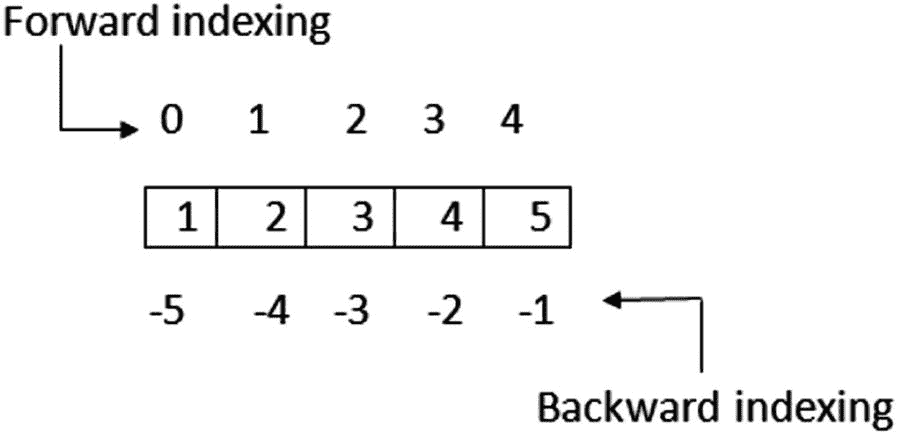

```
In [9]: list1 = ['Egypt', 'chemistry', 2017, 2018]
list2 = [1, 2, 3, [4, 5] ]
list3 = ["a", 3.7, '330', "Omar"]
print (list1[2])
print (list2 [3:])
print (list3 [-3:-1])
print (list3[-3])

[[4, 5]]
[3.7, '330']
3.7
代码清单 3-2
访问列表
```

### 添加和更新列表

你可以通过将切片放在赋值运算符的左侧来更新列表的单个或多个元素，并且可以使用 `append()` 方法向列表添加元素，如代码清单 3-3 所示。

```
In [50]: courses=["OOP","Networking","MIS","Project"] students=["Ahmed", "Ali",
"Salim", "Abdullah", "Salwa"] OOP_marks = [65, 85, 92]
OOP_marks.append(50)    # 添加新元素
OOP_marks.append(77)    # 添加新元素
print (OOP_marks[ : ])  # 更新前打印列表
OOP_marks[0]=70         # 更新新元素
OOP_marks[1]=45         # 更新新元素
list1 = [88, 93]
OOP_marks.extend(list1) # 用另一个列表扩展列表
print (OOP_marks[ : ])  # 更新后打印列表
[65, 85, 92, 50, 77]
[70, 45, 92, 50, 77, 88, 93]
代码清单 3-3
添加和更新列表元素
```

如代码清单 3-3 所示，你可以使用 `append()` 方法向列表添加新元素。你也可以通过使用列表名和元素索引来更新列表中的元素。例如，`OOP_marks[1]=45` 将索引 1 的值从 85 更改为 45。

### 删除列表元素

要移除一个列表元素，你可以使用 `del` 语句在元素索引处删除它，或者使用 `remove()` 方法通过列表中的元素值来移除该元素。如果你使用 `remove()` 方法移除一个在列表中出现多次的元素，它只会移除该元素在列表中的第一次出现。此外，你还可以使用 `pop()` 方法通过其索引值移除特定元素，如代码清单 3-4 所示。

```
In [48]: OOP_marks = [70, 45, 92, 50, 77, 45]
print (OOP_marks)
del OOP_marks[0] # 使用 del 删除一个元素
print (OOP_marks)
OOP_marks.remove (45) # 使用 remove() 方法移除一个元素
print (OOP_marks)
OOP_marks.pop (2) # 使用 pop() 方法移除一个元素
print (OOP_marks)
[70, 45, 92, 50, 77, 45]
[45, 92, 50, 77, 45]
[92, 50, 77, 45]
[92, 50, 45]
代码清单 3-4
从列表中删除元素
```

### 基本列表操作

与字符串处理类似，列表响应 `+` 和 `*` 运算符作为连接和重复，不同之处在于结果是一个新列表，如代码清单 3-5 所示。

```
In [46]:print (len([5, "Omar", 3]))      # 查找列表长度。
print ([3, 4, 1] + ["Omar", 5, 6]) # 连接列表。
print (['Eg!'] * 4)  # 在列表中重复一个元素。
print (3 in [1, 2, 3])     # 检查元素是否在列表中
for x in [1, 2, 3]:
print (x, end=' ') # 遍历列表元素

[3, 4, 1, 'Omar', 5, 6]
['Eg!', 'Eg!', 'Eg!', 'Eg!']
True
1 2 3
代码清单 3-5
列表操作
```

### 索引、切片和矩阵

列表是一系列带索引的元素，可以向前或向后访问。因此，你可以使用正索引或负（向后）索引来读取它们的元素，如代码清单 3-6 所示。

```
In [9]:list1 = ['Egypt', 'chemistry', 2017, 2018]
list2 = [1, 2, 3, [4, 5]]
list3 = ["a", 3.7, '330', "Omar"]
print (list1[2])
print (list2 [3:])
print (list3 [-3:-1])
print (list3[-3])

[[4, 5]]
[3.7, '330']
3.7
代码清单 3-6
索引和切片列表元素
```

### 内置列表函数和方法

各种函数和方法可用于列表处理，如表 3-1 所示。

表 3-1

列表函数

| **序号** | **函数** | **描述** |
| --- | --- | --- |
| 1 | `cmp(list1, list2)` | 比较两个列表的元素 |
| 2 | `len(list1)` | 给出列表的总长度 |
| 3 | `max(list1)` | 从列表中返回具有 `max` 值的项 |
| 4 | `min(list1)` | 从列表中返回具有 `min` 值的项 |
| 5 | `list(seq)` | 将元组转换为列表 |

#### 列表函数

内置函数简化了列表处理。下表显示了可用于操作列表的函数和方法。例如，你可以简单地使用 `cmp()` 来比较两个列表，如果两者相同，则返回 `TRUE`；否则，返回 `FALSE`。你可以使用 `len()` 方法查找列表大小。此外，你可以分别使用 `min()` 和 `max()` 方法查找列表中的最小值和最大值。示例请参见代码清单 3-7。

```
In [51]: #内置函数和列表
tickets = [3, 41, 12, 9, 74, 15]
print (tickets)
print (len(tickets))
print (max(tickets))
print (min(tickets))
print (sum(tickets))
print (sum(tickets)/len(tickets))
[3, 41, 12, 9, 74, 15]

25.666666666666668
代码清单 3-7
应用列表函数的 Python 脚本
```

#### 列表方法

内置方法简化了列表编辑。表 3-2 显示，你可以简单地使用 `append()`、`insert()` 和 `extend()` 向列表添加新元素。`pop()` 和 `remove()` 方法用于从列表中移除元素。表 3-2 总结了一些你可以应用于已创建列表的方法。

表 3-2

内置列表方法

| **序号** | **方法** | **描述** |
| --- | --- | --- |
| 1 | `list.append(obj)` | 将对象 `obj` 追加到列表 |
| 2 | `list.count(obj)` | 返回 `obj` 在列表中出现的次数 |
| 3 | `list.extend(seq)` | 将 `seq` 的内容追加到列表 |
| 4 | `list.index(obj)` | 返回 `obj` 在列表中出现的最低索引 |
| 5 | `list.insert(index, obj)` | 将对象 `obj` 插入到列表的偏移索引处 |
| 6 | `list.pop(obj=list[-1])` | 移除并返回列表中的最后一个对象或 `obj` |
| 7 | `list.remove(obj)` | 从列表中移除对象 `obj` |
| 8 | `list.reverse()` | 原地反转列表中的对象 |
| 9 | `list.sort([func])` | 对列表中的对象进行排序；如果给定，则使用比较函数 `func` |

### 列表排序与遍历

列表排序很重要，特别是对于列表搜索目的。你可以从序列创建列表；此外，你可以使用迭代语句对列表元素进行排序和遍历以进行处理，如代码清单 3-8 所示。

```
In [58]: #列表排序与遍历
seq=(41, 12, 9, 74, 3, 15) # 使用序列创建列表
tickets=list(seq)
print (tickets)
tickets.sort()
print (tickets)
print ("\n 排序后的列表元素 ")
for ticket in tickets:
print (ticket)
[41, 12, 9, 74, 3, 15]
[3, 9, 12, 15, 41, 74]
排序后的列表元素

代码清单 3-8
列表排序与遍历
```


### 列表与字符串

你可以将字符串拆分为字符列表。此外，还可以使用 `split()` 方法将字符串拆分为单词列表。`split()` 方法的默认分隔符是空格。不过，你可以指定哪些字符作为单词边界。例如，你可以使用连字符作为分隔符，如清单 3-9 所示。

```
In [63]: # 将字符串转换为字符列表
Word = 'Egypt'
List1 = list(Word)
print (List1)
['E', 'g', 'y', 'p', 't']
In [69]: # 使用分隔符
Greeting= 'Welcome-to-Egypt'
List2 =Greeting.split("-")
print (List2)
Greeting= 'Welcome-to-Egypt'
delimiter='-'
List2 =Greeting.split(delimiter)
print (List2)
['Welcome', 'to', 'Egypt']
['Welcome', 'to', 'Egypt']
In [70]: # 我们可以使用 split 方法将字符串拆分为单词
Greeting= 'Welcome to Egypt'
List2 =Greeting.split()
print (List2)
print (List2[2])
['Welcome', 'to', 'Egypt']
Egypt
清单 3-9
将字符串转换为字符或单词列表
```

`join()` 方法是 `split()` 方法的逆操作（参见清单 3-10）。它接收一个字符串列表并将元素连接起来。你必须指定 `join()` 方法在列表元素之间添加的分隔符，以形成一个字符串。

```
In [73]: List1 = ['Welcome', 'to', 'Egypt']
delimiter = ' '
delimiter.join(List1)
Out[73]: 'Welcome to Egypt'
In [74]: List1 = ['Welcome', 'to', 'Egypt']
delimiter = '-'
delimiter.join(List1)
Out[74]: 'Welcome-to-Egypt'
清单 3-10
使用 join() 方法
```

### 解析行

你可以从文件中读取文本数据，并将其转换为单词列表以供进一步处理。图 3-1 展示了如何读取 `myfile.txt`，逐行解析，并将数据转换为单词列表。

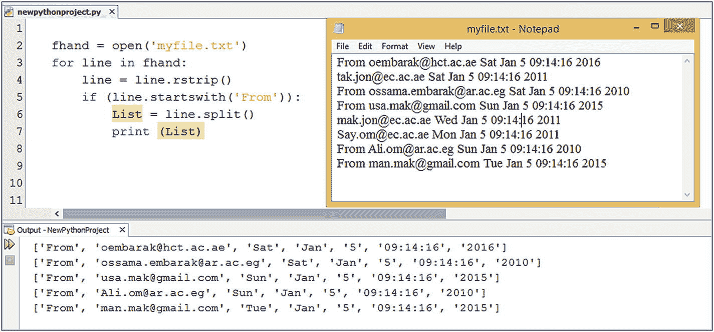

图 3-1

解析文本行

在前面的例子中，你可以只提取联系人的年份或电子邮件，如图 3-2 所示。

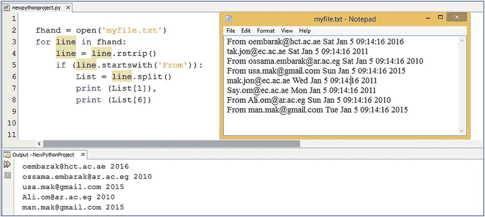

图 3-2

通过列表从文本文件中提取特定数据

### 别名

如果不小心使用，赋值运算符是危险的。变量与对象的关联称为*引用*。此外，拥有多个引用和多个名称的对象称为*别名*。清单 3-11 演示了赋值运算符的使用。假设你有一个名为 `a` 的列表。如果 `a` 引用一个对象，并且你赋值 `b = a`，那么变量 `a` 和 `b` 都引用同一个对象，对 `a` 执行的操作将自动适用于 `b`。

清单 3-11

别名对象

| **有别名** | **无别名** |
| --- | --- |
| `In [117]:a = [1, 2, 3]`         `b = a`          `print (a)`          `print (b)` | `In [120]:a = [1, 2, 3]``b = [1, 2, 3]``print (a)``print (b)` |
|          `[1, 2, 3]`         `[1, 2, 3]` | `[1, 2, 3]``[1, 2, 3]` |
| `In [118]:a.append(77)`         `print (a)`          `print (b)` | `In [121]:a.append(77)``print (a)``print (b)` |
|           `[1, 2, 3, 77]`          `[1, 2, 3, 77]` | `[1, 2, 3, 77]``[1, 2, 3]` |
| `In [119]: b is a` | `In [122]: b is a` |
| `Out[119]: True` | `Out[122]: False` |

## 字典

*字典*是一个无序的键值对集合；每个键与其值之间用冒号（`:`）分隔。项（键值对）之间用逗号分隔，整个集合用花括号（`{}`）括起来。实际上，空字典只用花括号表示。字典的键应该是唯一的，并且应该是不可变的数据类型，例如字符串、整数等。字典的值可以重复多次，并且值可以是任何数据类型。它是键和值之间的映射；你可以使用 `dict()` 方法创建字典。

### 创建字典

你可以直接创建字典并分配键值对。此外，你也可以先创建一个空字典，然后为每个生成的键赋值，如清单 3-12 所示。

```
In [36]: Prices = {"Honda":40000, "Suzuki":50000, "Mercedes":85000, "Nissan":35000, "Mitsubishi": 43000}
print (Prices)
{'Honda': 40000, 'Suzuki': 50000, 'Mercedes': 85000, 'Nissan': 35000, 'Mitsubishi': 43000}
In [37]: Staff_Salary = { 'Omar Ahmed' : 30000 , 'Ali Ziad' : 24000,
'Ossama Hashim': 25000, 'Majid Hatem':10000}
print(Staff_Salary)
STDMarks={"Salwa Ahmed":50, "Abdullah Mohamed":80, "Sultan Ghanim":90}
print(STDMarks)
{'Omar Ahmed': 30000, 'Ali Ziad': 24000, 'Ossama Hashim': 25000, 'Majid Hatem': 10000}
{'Salwa Ahmed': 50, 'Abdullah Mohamed': 80, 'Sultan Ghanim': 90}
In [38]:STDMarks = dict()
STDMarks['Salwa Ahmed']=50
STDMarks['Abdullah Mohamed']=80
STDMarks['Sultan Ghanim']=90
print (STDMarks)
{'Salwa Ahmed': 50, 'Abdullah Mohamed': 80, 'Sultan Ghanim': 90}
清单 3-12
创建字典
```

### 更新和访问字典中的值

一旦创建了字典，你就可以更新和访问其值以进行任何进一步的处理。清单 3-13 展示了你可以添加一个新项 `STDMarks['Omar Majid'] = 74`，其中 `Omar Majid` 是键，74 是映射到该键的值。此外，你还可以更新键 `Salwa Ahmed` 的现有值。

```
In [39]: STDMarks={"Salwa Ahmed":50, "Abdullah Mohamed":80, "Sultan
Ghanim":90}
STDMarks['Salwa Ahmed'] = 85 # 更新键 'Salwa Ahmed' 的当前值
STDMarks['Omar Majid'] = 74 # 向字典添加一个新项
print (STDMarks)
{'Salwa Ahmed': 85, 'Abdullah Mohamed': 80, 'Sultan Ghanim': 90, 'Omar Majid': 74}
清单 3-13
更新字典并向字典添加新项
```

你可以直接访问字典中的任何元素，或者遍历所有字典元素，如清单 3-14 所示。

```
In [2]: Staff_Salary = { 'Omar Ahmed' : 30000 , 'Ali Ziad' : 24000, 'Ossama Hashim': 25000, 'Majid Hatem':10000}
print('Salary package for Ossama Hashim is ', end=“)
#### 访问特定的字典元素
print(Staff_Salary['Ossama Hashim'])
Salary package for Ossama Hashim is 25000
In [3]: # 定义一个函数，在扣除 5% 的税后返回薪水
def Netsalary (salary):
return salary - (salary * 0.05) # 也可以写成 return salary *0.95
#### 遍历字典中的所有元素
print ("Name" , '\t', "Net Salary" )
for key, value in Staff_Salary.items():
print (key , '\t', Netsalary(value))
Name           Net Salary
Omar Ahmed    28500.0
Ali Ziad      22800.0
Ossama Hashim 23750.0
Majid Hatem   9500.0
清单 3-14
访问字典元素
```

清单 3-14 展示了你可以创建一个函数来计算扣除 5% 的工资税后的净工资，然后遍历所有字典元素。在每次迭代中，你打印键名和返回的净工资值。

### 删除字典元素

你可以使用元素键删除单个字典元素，或者清除字典的全部内容。此外，你也可以使用 `del` 关键字一次性删除整个字典，如清单 3-15 所示。需要注意的是，字典中不允许有重复的键。

```
In [40]: STDMarks={"Salwa Ahmed":50, "Abdullah Mohamed":80, "Sultan Ghanim":90}
print (STDMarks)
del STDMarks['Abdullah Mohamed'] # 删除键为 'Abdullah Mohamed' 的条目
print (STDMarks)
STDMarks.clear() # 删除 STDMarks 字典中的所有条目
print (STDMarks)
del STDMarks  # 删除整个字典
{'Salwa Ahmed': 50, 'Abdullah Mohamed': 80, 'Sultan Ghanim': 90}
{'Salwa Ahmed': 50, 'Sultan Ghanim': 90}
{}
清单 3-15
修改字典
```


### 内置字典函数

字典上可以实现多种内置函数。表 3-3 展示了其中一些函数。在旧版 Python 中，比较函数 `cmp()` 用于比较两个字典；如果两个字典相等，则返回 `0`，如果 `dic1` > `dict2`，则返回 `1`，如果 `dict1` < `dict2`，则返回 `-1`。但从 Python 3 开始，`cmp()` 函数不再可用，并且你无法定义它。另请参见代码清单 3-16。

**表 3-3** 内置字典函数

| **序号** | **函数** | **描述** |
| --- | --- | --- |
| 1 | `cmp(dict1, dict2)` | 比较两个字典的元素。 |
| 2 | `len(dict)` | 给出字典的总长度，即字典中条目的数量。 |
| 3 | `str(dict)` | 生成字典的可打印字符串表示形式。 |
| 4 | `type(variable)` | 返回传递变量的类型。如果传递的变量是字典，则返回字典类型。 |

```
In [43]:Staff_Salary = { 'Omar Ahmed' : 30000 , 'Ali Ziad' : 24000,
'Ossama Hashim': 25000, 'Majid Hatem':10000}
STDMarks={"Salwa Ahmed":50, "Abdullah Mohamed":80, "Sultan
Ghanim":90}
In [52]: def cmp(a, b):
for key, value in a.items():
for key1, value1 in b.items():
return (key >key1) - (key 
代码清单 3-16
实现字典函数
```

### 内置字典方法

Python 提供了多种用于字典处理的方法。表 3-4 总结了可用于访问字典的方法。

**表 3-4** 内置字典方法

| **序号** | **方法** | **描述** |
| --- | --- | --- |
| 1 | `dict1.clear()` | 删除字典 `dict1` 的所有元素 |
| 2 | `dict1.copy()` | 返回字典 `dict1` 的一个副本 |
| 3 | `dict1.fromkeys()` | 使用来自 `seq` 的键和值创建一个新字典 |
| 4 | `dict1.get(key, default=None)` | 对于键名 `key`，返回其值；如果键不在字典中，则返回默认值 |
| 5 | `dict1.has_key(key)` | 如果键在字典 `dict1` 中则返回 true，否则返回 false |
| 6 | `dict1.items()` | 返回 `dict1` 的（键，值）元组对列表 |
| 7 | `dict1.keys()` | 返回字典 `dict1` 的键列表 |
| 8 | `dict1.setdefault(key, default=None)` | 类似于 `get()`，但如果 `key` 尚未存在于 `dict1` 中，则会设置 `dict1 [key]=default` |
| 9 | `dict1.update(dict2)` | 将字典 `dict2` 的键值对添加到 `dict1` |
| 10 | `dict1.values()` | 返回字典 `dict1` 的值列表 |

代码清单 3-17 展示了字典方法的使用和实现。

```
In [89]: Staff_Salary = { 'Omar Ahmed' : 30000 , 'Ali Ziad' : 24000,
'Ossama Hashim': 25000, 'Majid Hatem':10000}
STDMarks={"Salwa Ahmed":50, "Abdullah Mohamed":80, "Sultan
Ghanim":90}
print (Staff_Salary.get('Ali Ziad') )
print (STDMarks.items())
print (Staff_Salary.keys())
print()
STDMarks.setdefault('Ali Ziad')
print (STDMarks)
print (STDMarks.update(dict1))
print (STDMarks)

dict_items([('Salwa Ahmed', 50), ('Abdullah Mohamed', 80), ('Sultan Ghanim', 90)])
dict_keys(['Omar Ahmed', 'Ali Ziad', 'Ossama Hashim', 'Majid Hatem'])
{'Salwa Ahmed': 50, 'Abdullah Mohamed': 80, 'Sultan Ghanim': 90, 'Ali Ziad': None}
None
{'Salwa Ahmed': 50, 'Abdullah Mohamed': 80, 'Sultan Ghanim': 90, 'Ali Ziad': None}
代码清单 3-17
实现字典方法
```

你可以按键和按值对字典进行排序，如代码清单 3-18 所示。

```
In [96]: Staff_Salary = { 'Omar Ahmed' : 30000 , 'Ali Ziad' : 24000, 'Ossama Hashim': 25000, 'Majid Hatem':10000}
print ("\nSorted by key")
for k in sorted(Staff_Salary):
print (k, Staff_Salary[k])
Sorted by key
Ali Ziad 24000
Majid Hatem 10000
Omar Ahmed 30000
Ossama Hashim 25000
In [97]: Staff_Salary = { 'Omar Ahmed' : 30000 , 'Ali Ziad' : 24000, 'Ossama Hashim': 25000, 'Majid Hatem':10000}
print ("\nSorted by value")
for w in sorted(Staff_Salary, key=Staff_Salary.get, reverse=True):
print (w, Staff_Salary[w])
Sorted by value
Omar Ahmed      30000
Ossama Hashim   25000
Ali Ziad        24000
Majid Hatem     10000
代码清单 3-18
排序字典
```

## 元组

*元组*是一个序列，就像不可变对象的列表一样。元组和列表之间的区别在于元组不能被更改；此外，元组使用圆括号，而列表使用方括号。

### 创建元组

你可以简单地通过使用不同的逗号分隔值来创建元组。你可以通过索引访问元组中的元素，如代码清单 3-19 所示。

```
In [1]:Names = ('Omar', 'Ali', 'Bahaa')
Marks = ( 75, 65, 95 )
print (Names[2])
print (Marks)
print (max(Marks))
Bahaa
(75, 65, 95)

In [2]: for name in Names:
print (name)
Omar
Ali
Bahaa
代码清单 3-19
创建和显示元组
```

让我们尝试更改元组以修改任何元素，如代码清单 3-20 所示；我们会得到一个错误，因为如前所述，元组不能被更改。

```
In [3]: Marks[1]=66

TypeError    Traceback (most recent call last)
 in ()
----> 1 Marks[1]=66
TypeError: 'tuple' object does not support item assignment
代码清单 3-20
尝试编辑元组
```

与列表类似，你可以使用元素的索引向前和向后访问元组元素。示例如下：

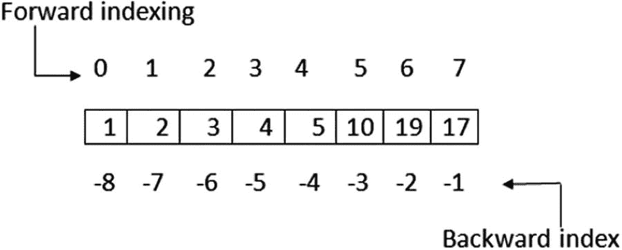

你可以对元组列表进行排序。代码清单 3-21 展示了如何对元组元素进行原地排序，以及如何创建另一个已排序的元组。

```
In [1]:import operator
MarksCIS = [(88,65),(70,90,85), (55,88,44)]
print (MarksCIS)           # original tuples
print (sorted(MarksCIS))   # direct sorting
[(88, 65), (70, 90, 85), (55, 88, 44)]
[(55, 88, 44), (70, 90, 85), (88, 65)]
In [2]: print (MarksCIS)     # original tuples
#create a new sorted tuple
MarksCIS2 = sorted(MarksCIS, key=lambda x: (x[0], x[1]))
print (MarksCIS2)
[(88, 65), (70, 90, 85), (55, 88, 44)]
[(55, 88, 44), (70, 90, 85), (88, 65)]
In [3]:print (MarksCIS) # original tuples
MarksCIS.sort(key=lambda x: (x[0], x[1])) # sort in tuple
print (MarksCIS)
[(88, 65), (70, 90, 85), (55, 88, 44)]
[(55, 88, 44), (70, 90, 85), (88, 65)]
代码清单 3-21
排序元组
```

默认情况下，内置的 `sort` 函数检测到项目是元组形式，因此排序函数会先根据第一个元素排序，然后根据第二个元素排序。

### 连接元组

如前所述，元组是不可变的，这意味着你不能更新或更改元组元素的值。你可以从现有元组中取出一部分来创建新的元组，如代码清单 3-22 所示。

```
In [5]:MarksCIS=(70,85,55)
MarksCIN=(90,75,60)
Combind=MarksCIS + MarksCIN
print (Combind)
(70, 85, 55, 90, 75, 60)
代码清单 3-22
连接元组
```


### 访问元组中的值

要访问元组中的元素，可以使用方括号和元素索引来获取元素值，如代码清单 3-23 所示。

```
In [4]:MarksCIS = (70, 85, 55)
MarksCIN = (90, 75, 60)
print ("CIS 的第三个分数是 ", MarksCIS[2])
print ("CIN 的第三个分数是 ", MarksCIN[2])
CIS 的第三个分数是 55
CIN 的第三个分数是 60
代码清单 3-23
访问元组中的值
```

你可以使用 `del` 删除元组，如代码清单 3-24 所示。

```
In [5]: MarksCIN = (90, 75, 60)
print (MarksCIN)
del MarksCIN
print (MarksCIN)
(90, 75, 60)

NameError                                 Traceback (most recent call last)
 in ()
2 print (MarksCIN) 3 del MarksCIN
----> 4 print (MarksCIN)
NameError: name 'MarksCIN' is not defined
代码清单 3-24
删除元组
```

你收到错误是因为你要求 Python 打印一个名为 `MarksCIN` 的元组，而该元组已被删除。你可以正向和反向访问元组元素；此外，你还可以使用索引从元组中切片取值。代码清单 3-25 展示了如何进行正向切片，其中 `MarksCIS[1:4]` 获取从元素 1 到元素 3 的元素，而 `MarksCIS[:]` 获取元组中的所有元素。在反向切片中，`MarksCIS[-3]` 反向获取第三个元素，`MarksCIS[-4:-2]` 反向获取从第四个元素到第三个元素（但不包括第二个反向元素）。

```
In [6]: MarksCIS = (88, 65, 70,90,85,45,78,95,55)
print ("\n 正向切片")
print (MarksCIS[1:4])
print (MarksCIS[:3])
print (MarksCIS[6:])
print (MarksCIS[4:6])
print ("\n 反向切片")
print (MarksCIS[-4:-2])
print (MarksCIS[-3])
print (MarksCIS[-3:])
print (MarksCIS[ :-3])
正向切片
(65, 70, 90)
(88, 65, 70)
(78, 95, 55)
(85, 45)
反向切片
(45, 78)

(78, 95, 55)
(88, 65, 70, 90, 85, 45)
代码清单 3-25
切片元组值
```

### 基本元组操作

与字符串类似，元组支持 `+` 和 `*` 运算符，分别用于连接和重复，以生成新的元组。参见表 3-5。

**表 3-5** 元组操作

| **表达式** | **结果** | **描述** |
| --- | --- | --- |
| `len((5, 7, 2,6))` | `4` | 长度 |
| `(1, 2, 3,10) + (4, 5, 6,7)` | `(1, 2, 3,10, 4, 5, 6,7)` | 连接 |
| `('Hi!',) * 4` | `('Hi!', 'Hi!', 'Hi!', 'Hi!')` | 重复 |
| `10 in (10, 2, 3)` | `True` | 成员关系 |
| `for x in (10, 1, 5): print x,` | `10 1 5` | 迭代 |

## 序列

序列被定义为一维带标签的数组，能够容纳任何数据类型（整数、字符串、浮点数、Python 对象等）。

```
SeriesX = pd.Series(data, index=index),
```

这里，`pd` 是 Pandas 的缩写，`data` 指的是一个 Python 字典、一个 ndarray，甚至是一个标量值。

### 创建带索引的序列

如果数据是 ndarray，则直接传递一个轴标签列表作为索引；否则，Python 会自动创建一个从 0 到 n-1 的索引。参见代码清单 3-26 和代码清单 3-27。

```
In [9]:import numpy as np
import pandas as pd
Series2 = pd.Series(np.random.randn(4))
print(Series2)
print(Series2.index)
0 1.784219
1 -0.627832
2 0.429453
3 -0.473971
dtype: float64
RangeIndex(start=0, stop=4, step=1)
代码清单 3-27
创建无标签的 Ndarray 数据序列
```

```
In [8]: import numpy as np
import pandas as pd
Series1 = pd.Series(np.random.randn(4), index=['a', 'b', 'c', 'd'])
print(Series1)
print(Series1.index)
a 0.350241
b -1.214802
c 0.704124
d 0.866934
dtype: float64
Index(['a', 'b', 'c', 'd'], dtype="object")
代码清单 3-26
创建带标签的 Ndarray 数据序列
```

从 ndarray 创建序列对大多数 Numpy 函数都有效；此外，像切片这样的操作也会对索引进行切片。参见代码清单 3-28 和代码清单 3-29。

```
In [11]:  print ("\n 序列示例操作")
print ("\n 大于均值的序列值: %.4f" % Series1.mean())
print (Series1 [Series1> Series1.mean()])
print ("\n 大于中位数的序列值:%.4f" % Series1.median())
print (Series1 [Series1> Series1.median()])
print ("\n 指数值 ")
Series1Exp = np.exp(Series1)
print (Series1Exp)
序列示例操作
大于均值的序列值: 0.1766
a    0.350241
c    0.704124
d    0.866934
dtype: float64
大于中位数的序列值: 0.5272
c    0.704124
d    0.866934
dtype: float64
指数值
a    1.419409
b    0.296769
c    2.022075
d    2.379604
dtype: float64
代码清单 3-29
序列中的示例操作
```

```
In [10]: print (" \n 序列切片 ")
print (Series1[:3])
print ("\n 索引访问")
print (Series1[[3,1,0]])
print ("\n 单个索引")
x = Series1[0]
print (x)
序列切片
a 0.350241
b -1.214802
c 0.704124
dtype: float64
索引访问
d 0.866934
b -1.214802
a 0.350241
dtype: float64
单个索引
0.35024081401881596
代码清单 3-28
从序列中切片数据
```

### 从字典创建序列

你可以直接从字典创建序列，如代码清单 3-30 所示。如果你没有显式传递索引，Python 3.6 及以上版本会按照字典插入顺序来确定序列索引。否则，序列索引将是字典键的按字典序排列的列表。

```
In [12]: dict = {'m' : 2, 'y' : 2018, 'd' : 'Sunday'}
print ("\n 未声明索引的序列")
SeriesDict1 = pd.Series(dict)
print(SeriesDict1)
print ("\n 声明了索引的序列")
SeriesDict2 = pd.Series(dict, index=['y', 'm', 'd', 's']) print(SeriesDict2)
未声明索引的序列
d    Sunday
m    2
y    2018
dtype: object
声明了索引的序列
y    2018
m    2
d    Sunday
s    NaN
dtype: object
代码清单 3-30
从字典创建序列
```

你可以使用 `get` 方法通过索引标签访问序列值，如代码清单 3-31 所示。

```
In [13]: print ("\n 使用 get 和 set 方法通过索引标签"
"访问序列值\n")
SeriesDict2 = pd.Series(dict, index=['y', 'm', 'd', 's']) print (SeriesDict2['y']) # 显示年份 SeriesDict2['y']=1999     # 更改年份值
print (SeriesDict2)           # 显示所有字典值 print (SeriesDict2.get('y')) # 通过键获取特定值
使用 get 和 set 方法通过索引标签访问序列值

y   1999
m   2
d   Sunday
s   NaN
dtype: object

代码清单 3-31
修改序列并使用 Get() 方法
```

### 从标量值创建序列

如果数据是标量值，则必须提供索引。该值将被重复以匹配 `index` 的长度。参见代码清单 3-32。

```
In [14]: print ("\n 从标量值创建序列 ")
Scl = pd.Series(8., index=['a', 'b', 'c', 'd'])
print (Scl)
从标量值创建序列
a   8.0
b   8.0
c   8.0
d   8.0
dtype: float64
代码清单 3-32
使用标量值创建序列
```


### 序列的向量化运算与标签对齐

`Series` 运算会自动根据标签对齐数据。因此，你可以在编写计算时无需考虑涉及的序列是否具有相同的标签。如果标签不匹配，则会给出缺失值 `NaN`。参见清单 3-33。

```
In [16]: SerX = pd.Series([1,2,3,4], index=['a', 'b', 'c', 'd'])
print ("加法");
print( SerX + SerX)
print ("标签不匹配的加法");
print (SerX[1:] + SerX[:-1])
print ("乘法");
print (SerX * SerX)
print ("指数运算");
print (np.exp(SerX))
加法
a 2
b 4
c 6
d 8
dtype: int64
标签不匹配的加法
a  NaN
b  4.0
c  6.0
d  NaN
dtype: float64
乘法
a  1
b  4
c  9
d  16
dtype: int64
指数运算
a  2.718282
b  7.389056
c  20.085537
d  54.598150
dtype: float64
清单 3-33
对序列进行向量化运算
```

### 名称属性

你可以为序列命名；也可以修改序列的名称，如清单 3-34 所示。

```
In [17]:std = pd.Series([77,89,65,90], name="StudentsMarks")
print (std.name)
std = std.rename("Marks")
print (std.name)
StudentsMarks
Marks
清单 3-34
使用序列名称属性
```

## 数据框

*数据框*是一种二维表格型标签化数据结构，其列可能具有不同的数据类型。数据框可以通过多种数据集合创建，例如：

*   一维 `ndarray`、列表、`dict` 或序列
*   二维 Numpy `ndarray`
*   [结构化或记录型](http://docs.scipy.org/doc/numpy/user/basics.rec.html) `ndarray`
*   一个序列
*   另一个数据框

数据框具有参数，即索引（行标签）和列（列标签）。

### 从序列字典或字典字典创建数据框

你可以简单地通过序列字典创建一个数据框；也可以为其指定索引。如果索引没有对应的值，则会给出 `NaN` 值，如清单 3-35 所示。

```
In [5]: import pandas as pd
dict1 = {'one' : pd.Series([1., 2., 3.], index=['a', 'b', 'c']),
'two' : pd.Series([1., 2., 3., 4.], index=['a', 'b', 'c', 'd'])}
df = pd.DataFrame(dict1)
df
Out[5]: one  two
a    1.0    1.0
b    2.0    2.0
c    3.0    3.0
d    NaN    4.0
In [6]: # 为 DataFrame 设置索引
pd.DataFrame(dict1, index=['d', 'b', 'a'])
Out[6]: one  two
d    NaN    4.0
b    2.0    2.0
a    1.0    1.0
In [8]: # 控制 DataFrame 的标签显示
pd.DataFrame(dict1, index=['d', 'b', 'a'], columns=['two', 'three', 'one'])
Out[8]: two  three  one
d    4.0    NaN    NaN
b    2.0    NaN    2.0
a    1.0    NaN    1.0
清单 3-35
从序列字典创建数据框
```

### 从 Ndarrays/列表字典创建数据框

当你从 `ndarray` 创建数据框时，所有 ndarray 的长度必须相同。同时，传入的索引长度应与数组长度相同。如果未传入索引，结果将是 `range(n)`，其中 `n` 是数组长度。参见清单 3-36。

```
In [11]: # 无索引
ndarrdict = {'one' : [1., 2., 3., 4.],'two' : [4., 3., 2., 1.]}
pd.DataFrame(ndarrdict)
Out[11]:           one    two
0     1.0    4.0
1     2.0    3.0
2     3.0    2.0
3     4.0    1.0
In [12]: # 指定索引
pd.DataFrame(ndarrdict, index=['a', 'b', 'c', 'd'])
Out[12]:     one    two
a      1.0      4.0
b      2.0      3.0
c      3.0      2.0
d      4.0      1.0
清单 3-36
从 Ndarray 创建数据框
```

### 从结构化或记录数组创建数据框

清单 3-37 通过先指定每列的数据类型，再指定每行的值来创建一个数据框。`('A', 'i4')` 将列标签及其数据类型确定为整数，`('B', 'f4')` 将标签确定为 B 且数据类型为浮点数，最后 `('C', 'a10')` 将标签 C 和数据类型指定为最多十个字符的字符串。

```
In [18]:import pandas as pd
import numpy as np
data = np.zeros((2,), dtype=[('A', 'i4'),('B', 'f4'),('C', 'a10')])
data[:] = [(1,2.,'Hello'), (2,3.,"World")]
pd.DataFrame(data)
Out[18]:     A      B      C
0 1      2.0    b'Hello'
1 2      3.0    b'World'
In [16]: pd.DataFrame(data, index=['First', 'Second'])
Out[16]:            A     B      C
First      1     2.0    b'Hello'
Second     2     3.0    b'World'
In [17]: pd.DataFrame(data, columns=['C', 'A', 'B'])
Out[17]:      C         A     B
0    b'Hello'  1     2.0
1    b'World'  2     3.0
清单 3-37
从记录数组创建数据框
```

### 从字典列表创建数据框

此外，你也可以从字典列表创建数据框，如清单 3-38 所示。

```
In [19]: data2 = [{'A ': 1, 'B ': 2}, {'A': 5, 'B': 10, 'C': 20}]
pd.DataFrame(data2)
Out[19]: A  B       C
0   1  2   NaN
1   5  10  20.0
In [20]: pd.DataFrame(data2, index=['First', 'Second'])
Out[20]:           A   B      C
First    1   2    NaN
Second   5   10   20.0
In [21]: pd.DataFrame(data2, columns=['A', 'B'])
Out[21]:    A   B
0  1   2
1  5  10
清单 3-38
从字典列表创建数据框
```

### 从元组字典创建数据框

另一种创建多级索引数据框的方法是传递一个元组字典，如清单 3-39 所示。

```
In [22]: pd.DataFrame({('a', 'b'): {('A', 'B'): 1, ('A', 'C'): 2},
('a', 'a'): {('A', 'C'): 3, ('A', 'B'): 4},
('a', 'c'): {('A', 'B'): 5, ('A', 'C'): 6},
('b', 'a'): {('A', 'C'): 7, ('A', 'B'): 8},
('b', 'b'): {('A', 'D'): 9, ('A', 'B'): 10}})
清单 3-39
从元组字典创建数据框
```

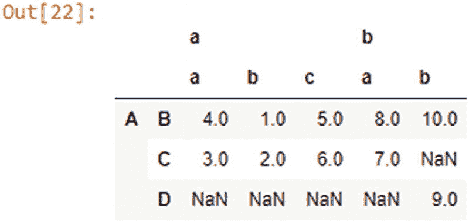

### 选择、添加和删除数据框列

一旦你有了一个数据框，就可以简单地添加列、删除列以及选择特定列。清单 3-40 演示了如何修改数据框及其相关操作。

```
In [25]: # 数据框列的选择、添加、删除
ndarrdict = {'one' : [1., 2., 3., 4.], 'two' : [4., 3., 2., 1.]}
df = pd.DataFrame(ndarrdict, index=['a', 'b', 'c', 'd'])
df
清单 3-40
在已创建的数据框上添加列并执行操作
```

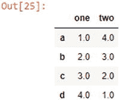

```
In [26]: df['three'] = df['one'] * df['two'] # 添加列
df['flag'] = df['one'] > 2     # 添加列
df
```

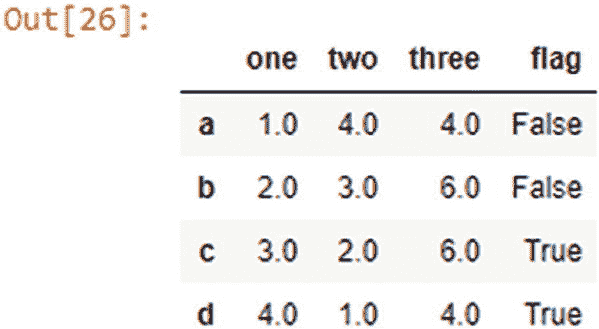

你可以向数据框插入一个标量值；该值会自动填充整个列。此外，如果你插入一个索引与数据框不匹配的序列，它将会调整为数据框的索引。要删除一列，可以使用 `del` 或 `pop` 方法，如清单 3-41 所示。

```
In [27]: df['Filler'] = 'HCT'
df['Slic'] = df['one'][:2]
df
清单 3-41
使用标量添加列并赋值给数据框
```

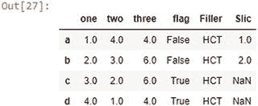

```
In [28]:# 删除列
del df['two']
Three = df.pop('three')
df
```

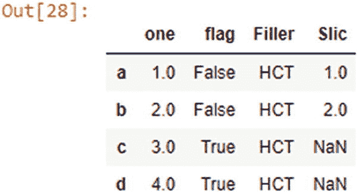

```
In [29]: df.insert(1, 'bar', df['one'])
df
```

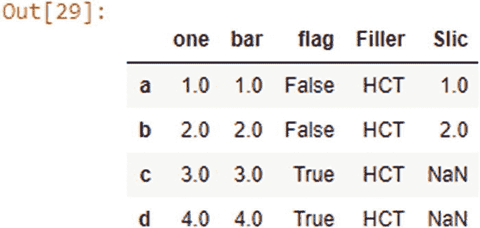

默认情况下，列会被添加到末尾。但是，你可以使用 `insert()` 函数将列插入到列中的特定位置，如上所示。


### 在方法链中分配新列

数据框有一个`assign()`方法，可以让你轻松创建可能源自现有列的新列。此外，你还可以通过修改列并执行必要操作来更改特定列的值，如清单 3-42 中的列 A 所示。

```
In [54]: import numpy as np
import pandas as pd
df = pd.DataFrame({"A": [1, 2, 3], "B": [4, 5, 6]})
df = df.assign(C=lambda x: x['A'] + x['B'])
df = df.assign( D=lambda x: x['A'] + x['C'])
df
清单 3-42
使用 assign() 方法添加派生列
```

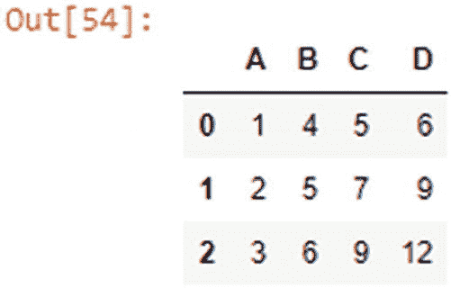

```
In [55]: df = df.assign( A=lambda x: x['A'] *2)
df
```

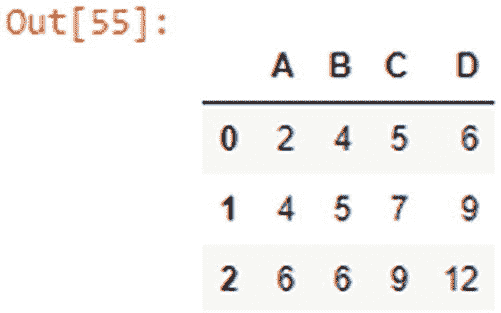

### 索引与选择数据框

表 3-6 总结了数据框的列和行索引与选择方法。

表 3-6

数据框索引与选择方法

| **操作** | **语法** | **结果** |
| --- | --- | --- |
| 选择列 | `df[col]` | Series |
| 按标签选择行 | `df.loc[label]` | Series |
| 按整数位置选择行 | `df.iloc[loc]` | Series |
| 切片行 | `df[5:10]` | Data frame |
| 按布尔向量选择行 | `df[bool_vec]` | Data frame |

清单 3-43 展示了从数据框中选择行和列的不同方法。

```
In [56]: df
清单 3-43
数据框的行与列选择
```

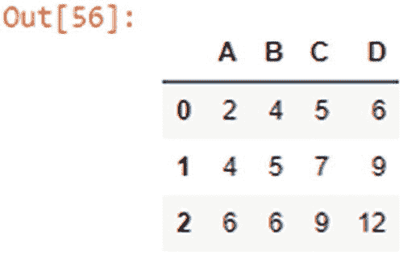

```
In [61]: df['B']
```

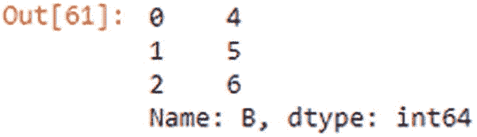

```
In [59]: df.iloc[2]
```

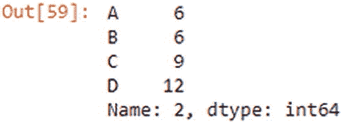

```
In [62]: df[1:]
```

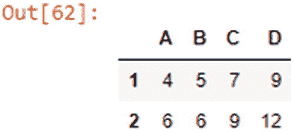

```
In [65]: df[df['C']>7]
```

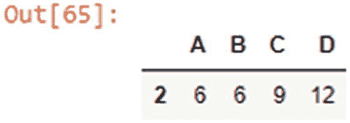

参见清单 3-44。

```
In [69]:df1 = pd.DataFrame({"A": [1, 2, 3], "B": [4, 5, 6]})
df2 = pd.DataFrame({"A": [7, 4, 6], "B": [10, 4, 15]})
print (df1)
print()
print(df2)
清单 3-44
数据框上的操作
```

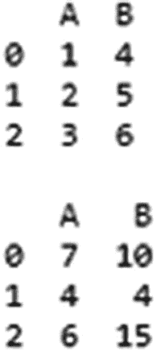

```
In [70]: df1 + df2
```

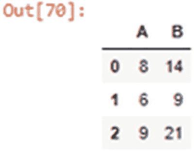

```
In [71]: df1-df2
```

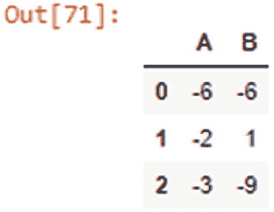

```
In [72]: df2 - df1.iloc[2]
```

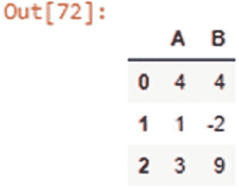

```
In [75]: df2
```

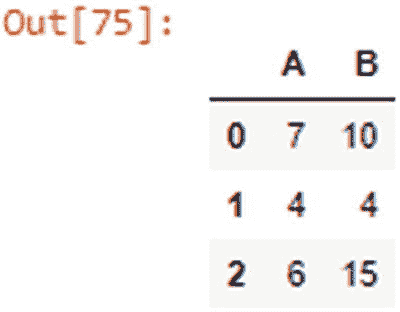

```
In [78]: df2*2+1
```

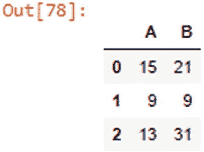

### 转置数据框

你可以使用`T`运算符转置数据框，如清单 3-45 所示。

```
In [78]: df2
清单 3-45
转置数据框
```

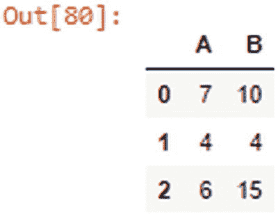

```
In [78]: df2[:].T
```

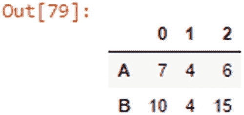

### 数据框与 Numpy 函数的互操作性

你可以使用数据框上的`dot`方法实现矩阵运算。例如，你可以像清单 3-46 那样实现矩阵乘法。

```
In [78]: df1
清单 3-46
矩阵乘法
```

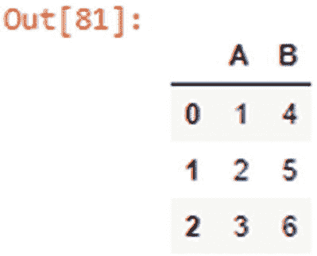

```
In [78]: df1.T.dot(df1)
```

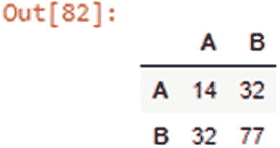

## 面板

*面板*是三维数据的容器；Python 程序员使用它的频率相对较低。

创建面板有三个主要属性。

*   `items`：轴 0；每个项目对应一个包含在内的数据框
*   `major_axis`：轴 1；它是每个数据框的索引（行）
*   `minor_axis`：轴 2；它是每个数据框的列

### 从 3D Ndarray 创建面板

你可以从带有可选轴标签的 3D ndarray 创建面板，如清单 3-47 所示。

```
In [3]:import pandas as pd
import numpy as np
P1 = pd.Panel(np.random.randn(2, 5, 4), items=['Item1',
'Item2'],major_axis=pd.date_range('10/05/2018', periods=5), minor_axis=['A', 'B', 'C', 'D'])
P1
清单 3-47
从 3D Ndarray 创建面板
```

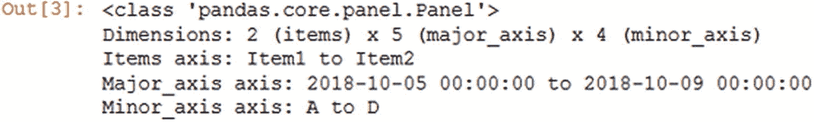

### 从数据框对象字典创建面板

你可以从数据框的字典创建面板，如清单 3-48 所示。

```
In [4]: data = {'Item1' : pd.DataFrame(np.random.randn(4, 3)),
'Item2' : pd.DataFrame(np.random.randn(4, 2))}
P2 = pd.Panel(data)
P2
清单 3-48
从数据框字典创建面板
```

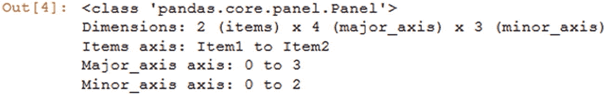

```
In [5]: p3 = pd.Panel.from_dict(data, orient="minor")
p3
```

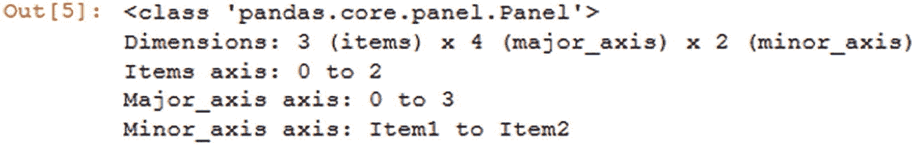

参见清单 3-49。

```
In [26]: df = pd.DataFrame({'Item': ['TV', 'Mobile', 'Laptop'],
'Price': np.random.randn(3)**2*1000})
df
清单 3-49
从数据框创建面板
```

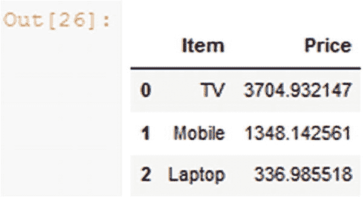

```
In [29]: data = {'stock1': df, 'stock2': df}
panel = pd.Panel.from_dict(data, orient="minor")
panel['Item']
```

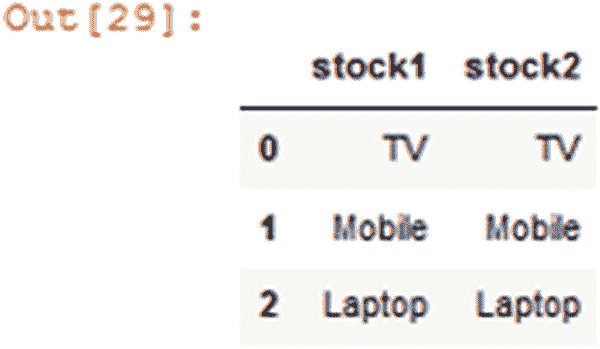

```
In [30]: panel['Price']
```

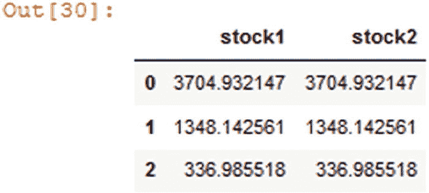


### 选择、添加和删除项目

面板（Panel）类似于数据框的字典；你可以对元素进行切片、选择项目等操作。表 3-7 给出了面板项目选择的三种操作。

**表 3-7** 面板项目选择与切片操作

| 操作 | 语法 | 结果 |
| --- | --- | --- |
| 选择项目 | `wp[item]` | 数据框 |
| 在 `major_axis` 标签处获取切片 | `wp.major_xs(val)` | 数据框 |
| 在 `minor_axis` 标签处获取切片 | `wp.minor_xs(val)` | 数据框 |

参见代码清单 3-50。

```
In [33]: import pandas as pd
import numpy as np
P1 = pd.Panel(np.random.randn(2, 5, 4), items=['Item1',
'Item2'], major_axis=pd.date_range('10/05/2018',
periods=5), minor_axis=['A', 'B', 'C', 'D'])
P1['Item1']
Listing 3-50
Slicing and Selecting Items from a Panel
```

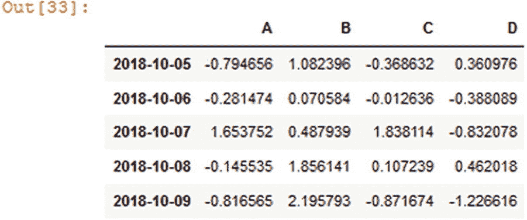

```
In [34]: P1.major_xs(P1.major_axis[2])
```

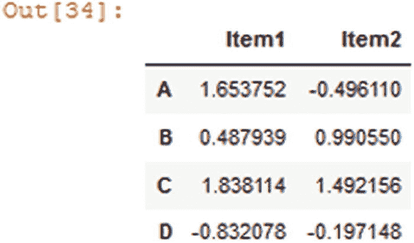

```
In [35]: P1.minor_axis
Out[35]: Index(['A', 'B', 'C', 'D'], dtype="object")
In [36]: P1.minor_xs('C')
```

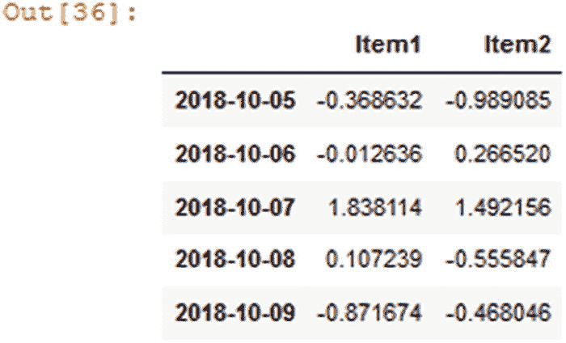

## 本章小结

本章介绍了 Python 中的数据集合结构及其实现。以下是本章内容的回顾：

-   如何以不同形式维护数据集合
-   如何创建列表以及如何操作列表内容
-   什么是字典，以及创建字典作为数据容器的目的
-   如何创建元组，元组数据结构与字典结构的区别，以及基本的元组操作
-   如何从其他数据集合形式创建序列
-   如何从不同的数据集合结构以及从另一个数据框创建数据框
-   如何从序列或数据框创建面板作为三维数据集合

下一章将介绍文件 I/O 处理，以及使用正则表达式作为数据提取工具等内容。

## 练习与答案

1.  编写一个程序，创建一个姓名列表；然后定义一个函数来显示接收到的列表中的所有元素。调用该函数执行其语句，并显示列表中的所有姓名。

***答案：***

```
In [124]: Students =["Ahmed", "Ali", "Salim", "Abdullah", "Salwa"]
def displaynames (x):
for name in x:
print (name)
displaynames(Students)   # Call the function display names
Ahmed
Ali
Salim
Abdullah
Salwa
```

2.  编写一个程序，读取文本文件数据，并创建一个包含文本文件中所有关键词的字典。该程序应统计每个单词在文本文件中重复出现的次数，然后找出重复次数最多的关键词。程序应同时显示关键词字典和出现次数最多的单词。

***答案：***

```
In [4]: # read data from file and add it to dictionary for processing
```


```
handle = open("Egypt.txt")
text = handle.read()
words = text.split()
counts = dict()
for word in words:
counts[word] = counts.get(word,0) + 1
print (counts)
bigcount = None
bigword = None
for word,count in counts.items():
if bigcount is None or count > bigcount:
bigword = word
bigcount = count
print ("\n bigword and bigcount")
print (bigword, bigcount)
```

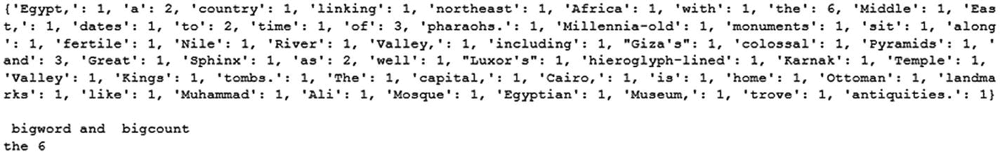

3.  编写一个程序，比较整数元组和字符串元组。

***答案：***

| **姓名** | **GPA** |
| --- | --- |
| Omar | 2.5 |
| Ali | 3.5 |
| Osama | 3 |

4.  编写一个程序，创建一个序列来维护三名学生的姓名和 GPA 值。

```
In [14]: print ((100, 1, 2) > (150, 1, 2))
print ((0, 1, 120)  ('Omar', 'Sam'))
print (( 'Khalid', 'Ahmed') < ('Ziad', 'Majid'))
False
True
False
True
```

***答案：***

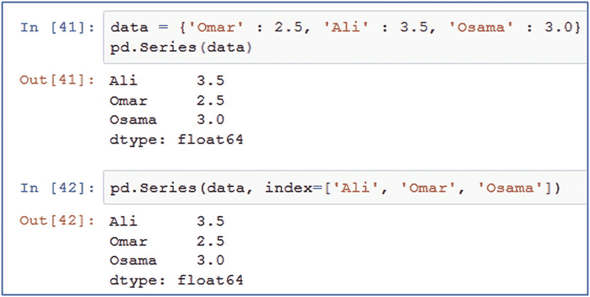

| **姓名** | **课程 1** | **课程 2** | **课程 3** |
| --- | --- | --- | --- |
| Omar | 90 | 50 | 89 |
| Ali | 78 | 75 | 73 |
| Osama | 67 | 85 | 80 |

5.  编写一个程序，创建一个数据框来维护三名学生的姓名及其在三门课程中的成绩，然后添加一个名为“平均分”的新列，用于维护每门课程计算出的平均分。显示最终的数据框。

***答案：***

```
In [31]: data = {'Omar': [90, 50, 89], 'Ali': [78, 75, 73], 'Osama': [67, 85, 80]}
df1 = pd.DataFrame (data, index= ['Course1', 'Course2', 'Course3'])
df1
```

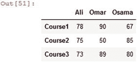

```
In [32]: df1['Omar']
Out[32]:Course1     90
Course2    50
Course3    89
Name: Omar, dtype: int64
In [33]: df1['Mean'] = (df1['Ali'] + df1['Omar'] + df1['Osama'])/3
df1
```

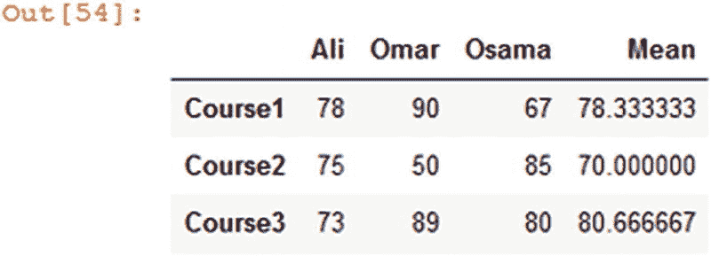

