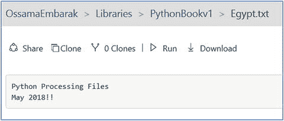
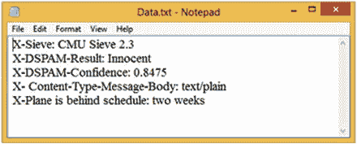

# 4. 文件 I/O 处理与正则表达式

在本章中，你将学习输入输出函数和文件处理。此外，你还将学习正则表达式以及如何提取匹配特定模式的数据。

## 文件 I/O 处理

Python 提供了多种用于输入、输出和文件处理的方法。你可以从屏幕获取输入并将数据输出到屏幕，也可以从文件读取数据并将数据存储到文件中。

### 数据输入与输出

你可以使用 `input()` 函数从用户处读取数据。默认情况下，接收到的数据是文本格式。因此，如果需要，你应该使用转换函数将数据转换为数值，如代码清单 4-1 所示。

```
In [2]: Name = input ("Enter your name: ")
Name
Enter your name: Osama Hashim
Out[2]: 'Osama Hashim'
In [3]: Mark = input("Enter your mark: ") Mark = float(Mark)
Enter your mark: 92
In [4]:print ("Welcome to Grading System \nHCT 2018")
print ("\nCampus\t Name\t\tMark\tGrade")
if (Mark>=85):
Grade="B+"
print ("FMC\t", Name,"\t",Mark,"\t", Grade)
Welcome to Grading System
HCT 2018
Campus       Name         Mark    Grade
FMC       Osama Hashim    92.0    B+
Listing 4-1
Screen Data Input/Output
```

这里你使用 `float(Mark)` 将 `Mark` 值转换为浮点数。你使用 `\t` 来添加制表符，使用 `\n` 在屏幕上换行。

### 打开和关闭文件

Python 内置的 `open()` 函数用于打开存储在计算机硬盘或云端的文件。其语法如下：

```
file object = open(file_name [, access_mode][, buffering])
```

表 4-1 描述了其模式。

**表 4-1** 文件打开模式

| 序号 | 模式 | 描述 |
| --- | --- | --- |
| 1 | `r` | 以只读方式打开文件；默认模式 |
| 2 | `rb` | 以二进制格式只读打开文件 |
| 3 | `r+` | 以读写方式打开文件 |
| 4 | `rb+` | 以二进制格式读写打开文件 |
| 5 | `w` | 以只写方式打开文件 |
| 6 | `wb` | 以二进制格式只写打开文件 |
| 7 | `w+` | 以读写方式打开文件 |
| 8 | `wb+` | 以二进制格式读写打开文件 |
| 9 | `a` | 以追加方式打开文件 |
| 10 | `ab` | 以二进制格式追加打开文件 |
| 11 | `a+` | 以追加和读取方式打开文件 |
| 12 | `ab+` | 以二进制格式追加和读取打开文件 |


### 文件对象属性

Python 提供了多种方法来检测已打开文件的信息，如表 4-2 所示。

**表 4-2** 已打开文件的属性

| 序号 | 属性 | 描述 |
| --- | --- | --- |
| 1 | `file.closed` | 如果文件已关闭则返回 true，否则返回 false |
| 2 | `file.mode` | 返回打开文件时使用的访问模式 |
| 3 | `file.name` | 返回文件的名称 |

清单 4-2 展示了一个名为 `Egypt.txt` 的已打开文件的属性。

```
In [41]: # 打开一个文件并查找其属性
Filehndl = open("Egypt.txt", "r")
print ("文件名称: ", Filehndl.name)
print ("是否已关闭: ", Filehndl.closed)
print ("打开模式: ", Filehndl.mode)
文件名称: Egypt.txt
是否已关闭: False
打开模式: r
清单 4-2
已打开文件的属性
```

你可以使用 `close()` 方法关闭已打开的文件，以从内存中清除所有相关内容，并关闭指向后端文件的任何已打开流，如清单 4-3 所示。

```
In [40]: Filehndl = open("Egypt.txt", "r")
print ("是否已关闭: ", Filehndl.closed)
Filehndl.close()
print ("是否已关闭: ", Filehndl.closed)
是否已关闭: False
是否已关闭: True
清单 4-3
关闭文件
```

### 读写文件

`file.write()` 方法用于向文件写入数据，如下图所示；`file.read()` 方法用于从已打开的文件中读取数据。文件可以以写入（`w`）、读取（`r`）或读写（`r+`）模式打开，如清单 4-4 所示。

```
In [39]:Filehndl = open("Egypt.txt", "w+")
Filehndl.write( "Python 处理文件\n2018 年 5 月!!\n")
#### 关闭已打开的文件
Filehndl.close()
清单 4-4
写入文件
```

如下图所示，数据已被写入 `Egypt.txt` 文件。



`rename()` 方法用于重命名文件；它接受两个参数：当前文件名和新文件名。此外，`remove()` 方法可用于删除文件，只需将要删除的文件名作为参数传入。

```
In [34]: import os
os.rename( "Egypt.txt", "test2.txt" )
os.remove( "test2.txt" )
```

### Python 中的目录

Python 提供了多种创建和访问目录的方法。清单 4-5 演示了如何创建、移动和删除目录。你可以使用 Python 的 `getcwd()` 方法查找当前工作目录。

```
In [35]: import os
os.mkdir("Data 1") # 创建一个目录
os.mkdir("Data_2")
os.chdir("Data_3")     # 创建一个子目录
os.getcwd()            # 获取当前工作目录
os.rmdir('Data 1') # 删除一个目录
os.rmdir('Data_3') # 删除一个目录
清单 4-5
创建和删除目录
```

## 正则表达式

*正则表达式*是一种特殊的字符序列，有助于查找匹配特定模式的其他字符串或字符串集合；它是一种用于匹配文本模式的强大语言。

### 正则表达式模式

可以使用不同的正则表达式语法从文本文件、XML、JSON、HTML 容器等中提取数据。

表 4-3 列出了一些 Python 正则表达式语法。

**表 4-3** Python 正则表达式语法

| 序号 | 模式 | 描述 |
| --- | --- | --- |
| 1 | `^` | 匹配行首。 |
| 2 | `$` | 匹配行尾。 |
| 3 | `.` | 匹配除换行符之外的任意单个字符。 |
| 4 | `[...]` | 匹配方括号内的任意单个字符。 |
| 5 | `[^...]` | 匹配不在方括号内的任意单个字符。 |
| 6 | `re*` | 匹配前一个表达式零次或多次。 |
| 7 | `re+` | 匹配前一个表达式一次或多次。 |
| 8 | `re?` | 匹配前一个表达式零次或一次。 |
| 9 | `re{ n}` | 精确匹配前一个表达式 *n* 次。 |
| 10 | `re{ n,}` | 匹配前一个表达式至少 *n* 次。 |
| 11 | `re{ n, m}` | 匹配前一个表达式至少 *n* 次，至多 *m* 次。 |
| 12 | `a&#124; b` | 匹配 *a* 或 *b*。 |
| 13 | `(re)` | 对正则表达式进行分组并记住匹配的文本。 |
| 14 | `(?imx)` | 在正则表达式内临时启用 *i*、*m* 或 *x* 选项。 |
| 15 | `(?-imx)` | 在正则表达式内临时禁用 *i*、*m* 或 *x* 选项。 |
| 16 | `(?: re)` | 对正则表达式进行分组但不记住匹配的文本。 |
| 17 | `(?imx: re)` | 在括号内临时启用 *i*、*m* 或 *x* 选项。 |
| 18 | `(?-imx: re)` | 在括号内临时禁用 *i*、*m* 或 *x* 选项。 |
| 19 | `(?#...)` | 注释。 |
| 20 | `(?= re)` | 使用模式指定位置。没有范围。 |
| 21 | `(?! re)` | 使用模式否定指定位置。没有范围。 |
| 22 | `(?> re)` | 匹配独立模式，不进行回溯。 |
| 23 | `\w` | 匹配单词字符。 |
| 24 | `\W` | 匹配非单词字符。 |
| 25 | `\s` | 匹配空白字符。等价于 `[\t\n\r\f]`。 |
| 26 | `\S` | 匹配非空白字符。 |
| 27 | `\d` | 匹配数字。等价于 `[0-9]`。 |
| 28 | `\D` | 匹配非数字字符。 |
| 29 | `\A` | 匹配字符串开头。 |
| 30 | `\Z` | 匹配字符串结尾。如果存在换行符，则匹配换行符之前的位置。 |
| 31 | `\z` | 匹配字符串结尾。 |
| 32 | `\G` | 匹配上一次匹配结束的位置。 |
| 33 | `\b` | 在括号外时匹配单词边界。 |
| 34 | `\B` | 匹配非单词边界。 |
| 35 | `\n`、`\t` 等 | 匹配换行符、回车符、制表符等。 |
| 36 | `\1...\9` | 匹配第 n 个分组子表达式。 |
| 37 | `\10` | 如果已匹配，则匹配第 n 个分组子表达式。 |

例如，如果你有一个包含电子邮件日志数据的文本文件，并且只想提取出现 `@uct.ac.za` 模式的文本行，那么你可以使用迭代来仅捕获包含该模式的行，如清单 4-6 所示。

```
In [46]: print ("\n 使用 in 选择行 // 仅打印包含特定字符串的行 ")
fhand = open('Emails.txt')
for line in fhand:
line = line.rstrip()
if not '@uct.ac.za' in line :
continue
print (line)
清单 4-6
读取和处理文本文件
```

你可以仅提取以 `From:` 开头的行。提取后，你可以将每一行拆分为一个列表，并仅切片出电子邮件元素，如清单 4-7 和清单 4-8 所示。


```python
In [47]: print("\nSearching Through a File\n")
fhand = open('Emails.txt')
for line in fhand:
    line = line.rstrip()
    if line.startswith('From:'):
        line = line.split()
        print(line[1])
```
```
Searching Through a File
stephen.marquard@uct.ac.za
louis@media.berkeley.edu
zqian@umich.edu
rjlowe@iupui.edu
zqian@umich.edu
rjlowe@iupui.edu
cwen@iupui.edu
cwen@iupui.edu
gsilver@umich.edu
gsilver@umich.edu
zqian@umich.edu
gsilver@umich.edu
wagnermr@iupui.edu
zqian@umich.edu
antranig@caret.cam.ac.uk
gopal.ramasammycook@gmail.com
david.horwitz@uct.ac.za
david.horwitz@uct.ac.za
david.horwitz@uct.ac.za
david.horwitz@uct.ac.za
stephen.marquard@uct.ac.za
louis@media.berkeley.edu
louis@media.berkeley.edu
ray@media.berkeley.edu
cwen@iupui.edu
cwen@iupui.edu
cwen@iupui.edu
```
清单 4-8：不使用正则表达式提取电子邮件

```python
In [45]: print("\nSearching Through a File\n")
fhand = open('Emails.txt')
for line in fhand:
    line = line.rstrip()
    if line.startswith('From:'):
        print(line)
```
```
Searching Through a File
From: stephen.marquard@uct.ac.za
From: louis@media.berkeley.edu
From: zqian@umich.edu
From: rjlowe@iupui.edu
From: zqian@umich.edu
From: rjlowe@iupui.edu
From: cwen@iupui.edu
From: cwen@iupui.edu
From: gsilver@umich.edu
From: gsilver@umich.edu
From: zqian@umich.edu
From: gsilver@umich.edu
From: wagnermr@iupui.edu
From: zqian@umich.edu
From: antranig@caret.cam.ac.uk
From: gopal.ramasammycook@gmail.com
From: david.horwitz@uct.ac.za
From: david.horwitz@uct.ac.za
From: david.horwitz@uct.ac.za
From: david.horwitz@uct.ac.za
From: stephen.marquard@uct.ac.za
From: louis@media.berkeley.edu
From: louis@media.berkeley.edu
From: ray@media.berkeley.edu
From: cwen@iupui.edu
From: cwen@iupui.edu
From: cwen@iupui.edu
```
清单 4-7：提取以特定模式开头的行

虽然正则表达式对于从文本中提取数据很有用，但应谨慎使用。清单 4-9 中的正则表达式查找所有以大写字母 *X* 开头、后跟零个或多个任意字符、并以冒号（`:`）结尾的文本。

```python
In [48]: import re
print("\nRegular Expressions\n'^X.*:' \n")
hand = open('Data.txt')
for line in hand:
    line = line.rstrip()
    y = re.findall('^X.*:', line)
    print(y)
```
清单 4-9：正则表达式示例

这是一个用于维护文本数据的文本文件，我们用它来应用正则表达式，如下所示。



在以下代码中，表达式 `'^X.*:'` 检索所有以大写字母 *X* 开头、后跟零个或多个任意字符（包括空格）、并以冒号分隔符（`:`）结尾的行。然而，它没有考虑空白字符。清单 4-10 仅检索匹配模式中不包含空白字符的值。

```python
In [49]: print("\nRegular Expressions\nWild-Card Characters '^X-\S+:'\n")
hand = open('Data.txt')
for line in hand:
    line = line.rstrip()
    y = re.findall('^X-\S+:', line)  # 匹配任何非空白字符
    print(y)
```
```
Regular Expressions
Wild-Card Characters 'X-\S+:'
['X-Sieve:']
['X-DSPAM-Result:']
['X-DSPAM-Confidence:']
[]
[]
```
清单 4-10：提取非空白模式

```
'X.*:'
['X-Sieve:']
['X-DSPAM-Result:']
['X-DSPAM-Confidence:']
['X- Content-Type-Message-Body:']
['X-Plane is behind schedule:']
```

正则表达式使您能够提取字符串中的数值，并在字符串中查找特定的字符模式，如清单 4-11 所示。

```python
In [50]: print("\n Matching and Extracting Data \n")
x = 'My 2 favorite numbers are 19 and 42'
y = re.findall('[0-9]+', x)
print(y)
```
```
Matching and Extracting Data
['2', '19', '42']
```
```python
In [51]: y = re.findall('[AEsOUn]+', x)  # 在字符串中查找这些字符中的任意一个
print(y)
```
```
['n', 's', 'n']
```
清单 4-11：提取数值和特定字符

虽然正则表达式对于提取数据很有用，但应谨慎实现。以下示例展示了贪婪提取和非贪婪提取。在清单 4-12 的第一个示例中，Python 查找以 *F* 开头、包含任意数量字符直到冒号的字符串，并在到达行尾时停止。这就是为什么即使找到第一个冒号，它也会继续检索字符。在第二个示例中，`re.findall('^F.+?:', x)` 要求 Python 检索以 *F* 开头、以分隔符（即冒号）第一次出现位置结尾的字符，无论是否到达行尾。

```python
In [52]: print("\nGreedy Matching \n")
x = 'From: Using the : character'
y = re.findall('^F.+:', x)
print(y)
```
```
Greedy Matching
['From: Using the :']
```
```python
In [53]: print("\nNon-Greedy Matching \n")
x = 'From: Using the : character'
y = re.findall('^F.+?:', x)
print(y)
```
```
Non-Greedy Matching
['From:']
```
清单 4-12：贪婪匹配与非贪婪匹配

表 4-4 展示了正则表达式的各种实现。

**表 4-4** 正则表达式示例

| 序号 | 示例 | 描述 |
| --- | --- | --- |
| 1 | `[Pp]ython` | 匹配 `"Python"` 或 `"python"` |
| 2 | `rub[ye]` | 匹配 `"ruby"` 或 `"rube"` |
| 3 | `[aeiou]` | 匹配任意一个小写元音字母 |
| 4 | `[0-9]` | 匹配任意一个数字；等同于 `[0123456789]` |
| 5 | `[a-z]` | 匹配任意一个小写 ASCII 字母 |
| 6 | `[A-Z]` | 匹配任意一个大写 ASCII 字母 |
| 7 | `[a-zA-Z0-9]` | 匹配上述任意字符 |
| 8 | `[^aeiou]` | 匹配除小写元音字母外的任意字符 |
| 9 | `[⁰-9]` | 匹配除数字外的任意字符 |

### 特殊字符类

正则表达式中使用一些特殊字符来提取数据。表 4-5 总结了其中一些特殊字符。

**表 4-5** 正则表达式特殊字符

| 序号 | 示例 | 描述 |
| --- | --- | --- |
| 1 | `.` | 匹配除换行符外的任意字符 |
| 2 | `\d` | 匹配一个数字：`[0-9]` |
| 3 | `\D` | 匹配一个非数字：`[⁰-9]` |
| 4 | `\s` | 匹配一个空白字符：`[ \t\r\n\f]` |
| 5 | `\S` | 匹配一个非空白字符：`[^ \t\r\n\f]` |
| 6 | `\w` | 匹配一个单词字符：`[A-Za-z0-9_]` |
| 7 | `\W` | 匹配一个非单词字符：`[^A-Za-z0-9_]` |

### 重复类

字符串可能存在不同拼写，例如“ok”和“okay”。为处理此类情况，可以使用重复表达式，如表 4-6 所示。

**表 4-6** 正则表达式重复字符

| 序号 | 示例 | 描述 |
| --- | --- | --- |
| 1 | `ruby?` | 匹配 `"rub"` 或 `"ruby"`；*y* 是可选的 |
| 2 | `ruby*` | 匹配 `"rub"` 加上零个或多个 *y* |
| 3 | `ruby+` | 匹配 `"rub"` 加上一个或多个 *y* |
| 4 | `\d{3}` | 匹配恰好三个数字 |
| 5 | `\d{3,}` | 匹配三个或更多数字 |
| 6 | `\d{3,5}` | 匹配三个、四个或五个数字 |

### 选择

选择指的是可以使用多个表达式语句来提取数据的表达式，如表 4-7 所示。

**表 4-7** 选择正则表达式字符

| 序号 | 示例 | 描述 |
| --- | --- | --- |
| 1 | `python\|RLang` | 匹配 `"python"` 或 `"RLang"` |
| 2 | `R(L\|Lang)` | 匹配 `"RL"` 或 `"RLang"` |
| 3 | `Python(!+\|\?)` | `"Python"` 后跟一个或多个 `!` 或一个 `?` |


### 锚点

锚点用于确定字符串中匹配模式的位置。表 4-8 展示了多个锚点示例。

**表 4-8** 锚点字符

| 序号 | 示例 | 描述 |
| --- | --- | --- |
| 1 | `^Python` | 匹配字符串或内部行开头的 `"Python"` |
| 2 | `Python$` | 匹配字符串或行结尾的 `"Python"` |
| 3 | `\APython` | 匹配字符串开头的 `"Python"` |
| 4 | `Python\Z` | 匹配字符串结尾的 `"Python"` |
| 5 | `\bPython\b` | 匹配单词边界处的 `"Python"` |
| 6 | `\brub\B` | `\B` 是非单词边界：匹配 *rube* 和 *ruby* 中的 `"rub"`，但不匹配独立的 `"rub"` |
| 7 | `Python(?=!)` | 匹配后跟感叹号的 `"Python"` |
| 8 | `Python(?!!)` | 匹配后不跟感叹号的 `"Python"` |

正则表达式不仅用于从字符串中提取数据，各种内置方法也可用于相同目的。清单 4-13 演示了使用方法与正则表达式提取相同字符的对比。

```
In [54]: import re
print ("\nFine-Tuning String Extraction \n")
mystr="From ossama.embarak@hct.ac.ae Sat Jun 5 08:14:16 2018" Extract = re.findall('\S+@\S+',mystr)
print (Extract)
E_xtracted = re.findall('^From.*? (\S+@\S+)',mystr) # non greedy white space
print (E_xtracted)
print (E_xtracted[0])
Fine-Tuning String Extraction
['ossama.embarak@hct.ac.ae']
['ossama.embarak@hct.ac.ae']
ossama.embarak@hct.ac.ae
In [57]: mystr="From ossama.embarak@hct.ac.ae Sat Jun 5 08:14:16 2018"
atpos = mystr.find('@')
sppos = mystr.find(' ',atpos) # find white space starting from atpos
host = mystr[atpos+1 : sppos]
print (host)
usernamepos = mystr.find(' ')
username = mystr[usernamepos+1 : atpos]
print (username)
hct.ac.ae
ossama.embarak
Listing 4-13
The Use of Methods vs. Regular Expressions
```

`re.findall('@([^ ]*)',mystr)` 从 `mystr` 字符串中检索子字符串，该子字符串从 `@` 之后开始，一直持续到找到空白字符为止。类似地，`re.findall('^From .*@([^ ]*)', mystr)` 从 `mystr` 字符串中检索子字符串，该子字符串从 `From` 之后开始，查找零个或多个字符，然后是 `@` 字符，*然后是除空白字符之外的任何字符。* 参见清单 4-14。

```
In [58]: print ("\n The Regex Version\n")
import re
mystr="From ossama.embarak@hct.ac.ae Sat Jun 5 08:14:16 2018"
Extract = re.findall('@([^ ]*)',mystr)
print (Extract)
Extract = re.findall('^From .*@([^ ]*)',mystr)
print (Extract)
The Regex Version
['hct.ac.ae']
['hct.ac.ae']
In [59]: print ("\nScape character \n")
mystr = 'We just received $10.00 for cookies and $20.23 for juice'
Extract = re.findall('\$[0-9.]+',mystr)
print (Extract)
Scape character
['$10.00', '$20.23']
Listing 4-14
Using the Regular Expression findall() Method
```

## 总结

本章涵盖了从存储文件中读取或拉取，或直接从用户读取的输入/输出数据。让我们回顾一下本章涵盖的内容。

*   本章涵盖了如何打开文件进行读取、写入或两者兼有。此外，还涵盖了如何访问打开文件的属性以及关闭所有打开的会话。
*   本章涵盖了如何通过屏幕直接从用户收集数据。
*   它涵盖了正则表达式及其模式以及特殊字符的用法。
*   本章涵盖了如何应用正则表达式提取数据，以及如何使用替代、锚点和重复表达式进行数据提取。

下一章将研究收集和清理数据以进行进一步处理的技术，以及更多内容。

## 练习与答案

1.  编写一个 Python 脚本，使用正则表达式从以下文本中提取课程编号、代码和名称：

```
CoursesData = """101 COM Computers
205 MAT Mathematics
189 ENG English"""
```

**答案：**

1.  编写一个 Python 脚本，使用正则表达式从以下文本中以元组形式提取每门课程的详细信息。此外，使用正则表达式检索 `CoursesData` 中的字符串值，然后检索 `CoursesData` 中的数值。

    **答案：**

```
In [60]: import re
CoursesData = """101 COM Computers
205 MAT  Mathematics
189 ENG  English"""
In [61]: # Extract all course numbers
Course_numbers = re.findall('[0-9]+', CoursesData)
print (Course_numbers)
### Extract all course codes
Course_codes = re.findall('[A-Z]{3}', CoursesData)
print (Course_codes)
### Extract all course names
Course_names = re.findall('[A-Za-z]{4,}', CoursesData) print (Course_names)
['101', '205', '189']
['COM', 'MAT', 'ENG']
['Computers', 'Mathematics', 'English']
```

1.  编写一个 Python 脚本，使用正则表达式提取大小为 4 的数字和大小为 2 到 4 的数字。

    **答案：**

```
In [63]: # define the course text pattern groups and extract
course_pattern = '([0-9]+)\s*([A-Z]{3})\s*([A-Za-z]{4,})'
re.findall(course_pattern, CoursesData)
Out[63]: [('101', 'COM', 'Computers'),
('205', 'MAT', 'Mathematics'),
('189', 'ENG', 'English')]
In [64]: print(re.findall('[a-zA-Z]+', CoursesData)) # [] Matches any character inside
['COM', 'Computers', 'MAT', 'Mathematics', 'ENG', 'English']
In [65]: print(re.findall('[0-9]+', CoursesData)) # [] Matches any numeric inside
['101', '205', '189']
```

```
CoursesData = """101 COM Computers
205 MAT Mathematics
189 ENG English"""
```

```
In [66]: import re
CoursesData = """10 COM Computers
205 MAT Mathematics 1899 ENG English"""
print(re.findall('\d{4}', CoursesData)) # {n} Matches repeat n times.
print(re.findall('\d{2,4}', CoursesData))
['1899']
['10', '205', '1899']
```

```
CoursesData = """101 COM Computers
205 MAT Mathematics
189 ENG English"""
```

