# 5. 数据收集与清洗

在 21 世纪，数据对于决策和制定长期战略计划至关重要。Python 提供了众多库和内置功能，使得支持数据分析和处理变得容易。制定商业决策、预测天气、研究生物学中的蛋白质结构以及设计营销活动，这些都是需要收集数据，然后进行清洗、处理和可视化的例子。

数据处理主要有五个步骤。

1.  *数据获取*：从各种来源读取数据，这些来源可能是非结构化数据、半结构化数据或完全结构化数据，可能存储在电子表格、逗号分隔文件、网页、数据库等中。
2.  *数据清洗*：移除噪声数据，并执行必要的操作以仅保留相关数据。
3.  *探索性分析*：查看清洗后的数据，并进行适合特定分析目的的统计处理。
4.  需要创建*分析模型*。此步骤可以使用诸如机器学习算法之类的先进工具。
5.  *数据可视化*：使用 Python 提供的各种系统绘制结果，以帮助决策过程。

Python 提供了几个用于数据收集、清洗、集成、处理和可视化的库。

*   `Pandas` 是一个开源的 Python 库，通过提供强大的数据结构来加载、组织、操作、建模和分析数据。
*   `Numpy` 是一个 Python 包，代表“数值 Python”。它是一个由多维数组对象和一组用于操作数组的例程组成的库。它可以用于对数组执行数学、逻辑和线性代数运算。
*   `SciPy` 是另一个用于数值积分和优化的内置 Python 库。
*   `Matplotlib` 是一个用于创建二维图形和图表的 Python 库。它支持多种图形和图表，例如直方图、条形图、功率谱、误差图等，并具有额外的格式化功能，例如控制线条样式、字体属性、格式化坐标轴等。

## 数据清洗

数据是通过各种方法手动或自动收集的，例如气象传感器、金融股票市场数据服务器、用户的在线商业偏好等。收集到的数据并非没有错误，通常存在各种缺失数据点和错误输入的数据。例如，在线用户可能因隐私问题而不愿输入其信息。因此，处理缺失和噪声数据（`NA` 或 `NaN`）对于任何数据分析处理都至关重要。

### 检查缺失值

你可以使用内置的 Python 方法来检查缺失值。让我们使用 `Numpy` 和 `Pandas` 库创建一个数据框。包含索引值 `a` 到 `h`，并为列指定标签 `stock1`、`stock2` 和 `stock3`，如清单 5-1 所示。

```
In [47]: import pandas as pd
import numpy as np
dataset = pd.DataFrame(np.random.randn(5, 3), index=['a', 'c', 'e', 'f', 'h'],columns=['stock1', 'stock2', 'stock3'])
dataset.rename(columns={"one":'stock1',"two":'stock2', "three":'stock3'}, inplace=True)
dataset = dataset.reindex(['a', 'b', 'c', 'd', 'e', 'f', 'g', 'h'])
print (dataset)
清单 5-1
创建包含 NaN 的数据框
```

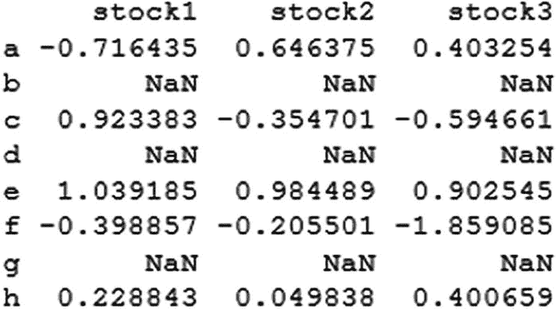

应该清楚的是，你可以使用 `Numpy` 创建一个随机值数组，如清单 5-2 所示。

```
In [46]: import numpy as np
np.random.randn(5, 3)
清单 5-2
创建随机值矩阵
```

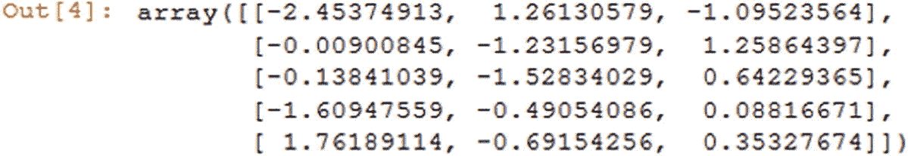

在清单 5-2 中，你忽略了行 `b`、`d` 和 `g`。这就是你得到 `NaN` 的原因，它表示非数值。`Pandas` 提供了 `isnull()` 和 `notnull()` 函数来检测数据集中的缺失值。当检测到 `NaN` 时，会返回一个布尔值；否则，返回 `False`，如清单 5-3 所示。

```
In [48]: print (dataset['stock1'].isnull())
清单 5-3
检查空值情况
```

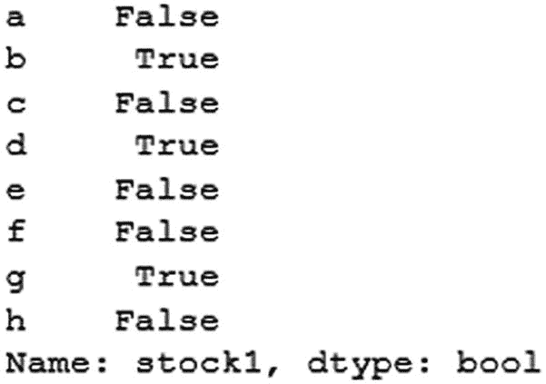

### 处理缺失值

有多种技术可用于处理缺失值。

*   你可以用标量值替换 `NaN`。清单 5-4 将所有 `NaN` 情况替换为 `0` 值。

    ```
    In [49]: print (dataset)
    dataset.fillna(0)
    清单 5-4
    用标量值替换 NaN
    ```

    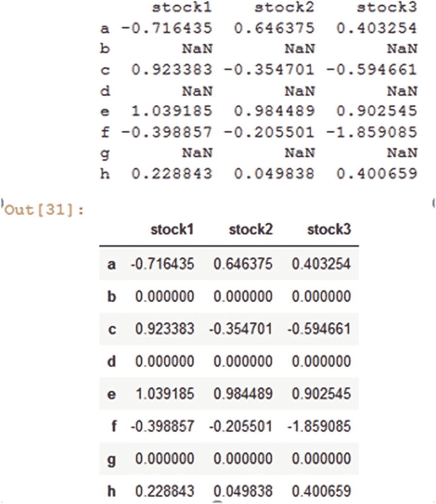

*   你可以向前和向后填充 `NaN` 情况。另一种处理缺失值的技术是使用 `pad`/`fill` 方法向前填充，或使用 `bfill`/`backfill` 方法向后填充。在清单 5-5 中，行 `a` 的值复制到了行 `b` 的缺失值中。

    ```
    In [50]: # 向前填充缺失值
    print (dataset)
    dataset.fillna(method='pad')
    清单 5-5
    向前填充缺失值
    ```

    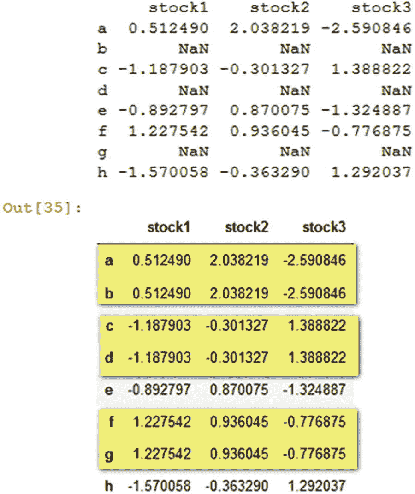

*   你可以删除缺失值。另一种技术是排除所有包含 `NaN` 值的行。`Pandas` 的 `dropna()` 函数可用于从数据集中删除整行。如清单 5-6 所示，行 `b`、`d` 和 `g` 已从数据集中完全删除。

    ```
    In [51]: print (dataset)
    dataset.dropna()
    清单 5-6
    删除所有包含 NaN 的行
    ```

    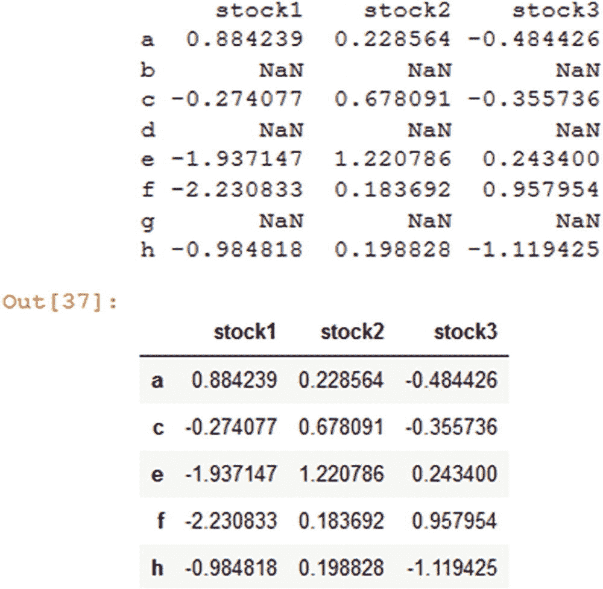

*   你可以替换缺失（或通用）值。`replace()` 方法可用于将数据集中的特定值替换为另一个给定值。此外，它还可用于替换 `NaN` 情况，如清单 5-7 所示。

    ```
    In [52]: print (dataset)
    dataset.replace(np.nan, 0 )
    清单 5-7
    使用 replace() 函数
    ```

    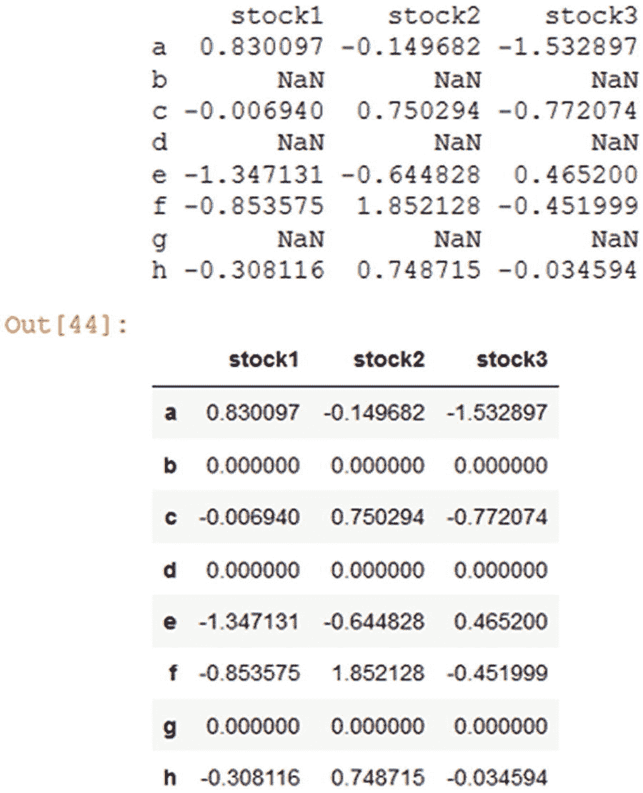

### 读取与清洗 CSV 数据

在本节中，你将从一个逗号分隔值（CSV）文件中读取数据。图 5-1 所示的 CSV 销售文件格式将用于演示数据清洗过程。

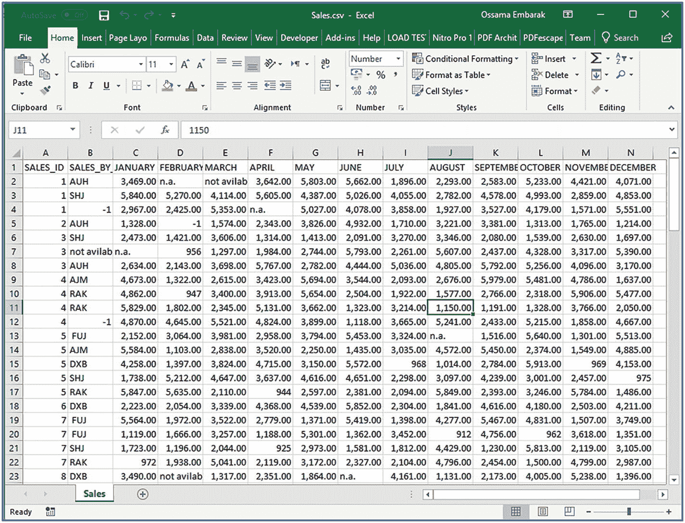

图 5-1 CSV 格式的销售数据

你可以使用 Pandas 库读取文件并显示前五条记录。Python 会生成一个从 0 开始的自动索引，如代码清单 5-8 所示。

```
In [53]: import pandas as pd
sales = pd.read_csv("Sales.csv")
print ("\n\n<<<<<<< 前 5 条记录 <<<<<<<\n\n" )
print (sales.head())
代码清单 5-8
读取 CSV 文件并显示前五条记录
```

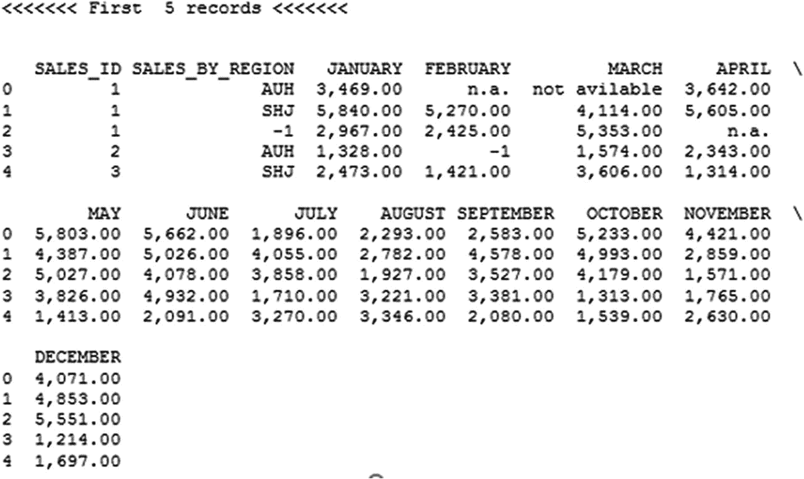

你可以使用 `tail()` 方法显示最后五条记录。

```
In [54]:  print (sales.tail())
```

`pd.read_csv()` 用于读取整个 CSV 文件；但有时你只需要读取少量记录以减少内存占用。在这种情况下，你可以使用 `nrows` 属性来控制要读取的行数。

```
In [55]:   import pandas as pd
salesNrows = pd.read_csv("Sales.csv", nrows=4)
salesNrows
```

类似地，你可以使用列索引或标签读取特定列。代码清单 5-9 使用 `usecols` 属性读取第 0、1 和 6 列，然后改用列标签代替列索引。

```
In [58]: salesNrows = pd.read_csv("Sales.csv", nrows=4, usecols=[0, 1, 6])
salesNrows
代码清单 5-9
重命名列标签
```

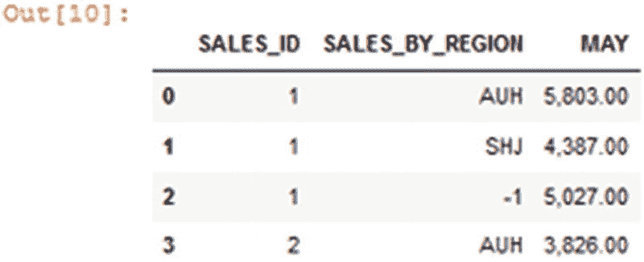

```
In [60]: salesNrows = pd.read_csv("Sales.csv", nrows=4, usecols=['SALES_ID' , 'SALES_BY_REGION', 'FEBRUARY', 'MARCH'])
salesNrows
```

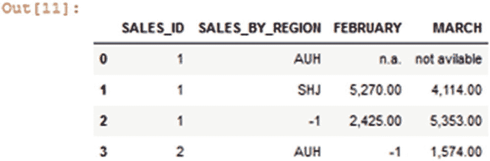

在代码清单 5-10 中，使用 `.rename()` 方法更改数据集列标签（例如，将 `SALES_ID` 改为 `ID`）。此外，你设置 `inplace=True` 以将这些更改提交到原始数据集，而不是其副本。

```
In [56]: salesNrows.rename(columns={"SALES_ID":'ID',"SALES_BY_REGION":'REGION'}, inplace=True)
salesNrows
代码清单 5-10
重命名列标签
```

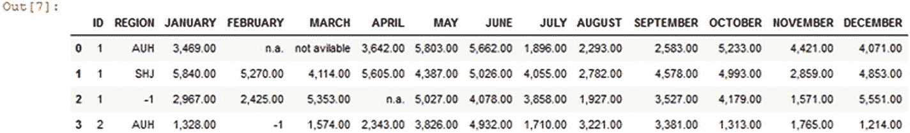

你可以查找数据集中变量的唯一值；只需将每一列视为一个可用于进一步处理的变量或模式。参见代码清单 5-11。

```
In [57]: print (len(salesNrows['JANUARY'].unique()))
print (len(salesNrows['REGION'].unique()))
print (salesNrows['JANUARY'].unique())
代码清单 5-11
查找列中的唯一值
```

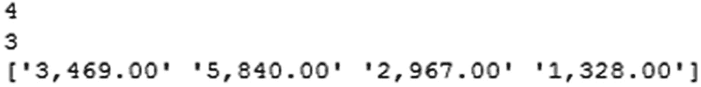

为了获得精确数据，你可以将所有异常值替换为 `NaN` 以便进一步处理。例如，如代码清单 5-12 所示，你可以在读取 CSV 文件时使用 `na_values =["n.a.", "not avilable", -1]` 生成 `NaN` 案例。

```
In [61]: import pandas as pd
sales = pd.read_csv("Sales.csv", nrows=7, na_values =["n.a.", "not avilable"])
mydata = sales.head(7)
mydata
代码清单 5-12
自动将匹配案例替换为 NaN
```

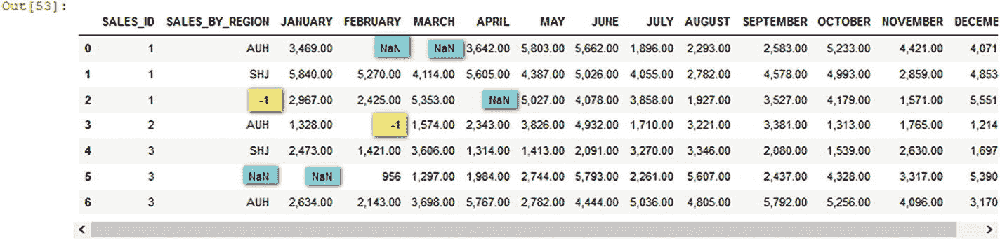

```
In [62]: import pandas as pd
sales = pd.read_csv("Sales.csv", nrows=7, na_values =["n.a.", "not avilable", -1])
mydata = sales.head(7)
mydata
```

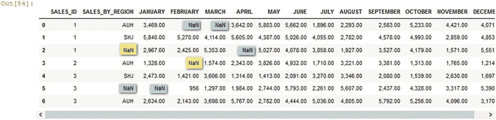

由于数据集中存在不同的模式，你应该能够使用不同的值进行数据清洗和替换。以下示例从 `sales.csv` 文件读取数据并将其存储到 `sales` 数据框中。`na_values` 属性中列出的所有值都被替换为 `NaN` 值。因此，对于 `January` 列，所有 `["n.a.", "not available", -1]` 值都被转换为 `NaN`。

```
In [25]: sales = pd.read_csv("Sales.csv", na_values = {
"SALES_BY_REGION": ["n.a.", "not avilabl”],
"JANUARY": ["n.a.", "not avilable", -1],
"FEBRUARY": ["n.a.", "not avilable", -1]})
sales.head(20)
```

另一种在加载数据时进行清洗的专业方法是定义数据清洗函数。在代码清单 5-13 中，你定义并调用了两个函数：`CleanData_Sales()` 用于清洗数值并将所有 `NaN` 值重置为 `0`，`CleanData_REGION()` 用于清洗字符串值并将所有 `NaN` 值重置为 `Abu Dhabi`。然后在 `converters` 属性中调用这些函数。

```
In [26]: def CleanData_Sales(cell):
if (cell=="n.a." or cell=="-1" or cell=="not avilable"):
return 0
return cell
def CleanData_REGION(cell):
if (cell=="n.a." or cell=="-1" or cell=="not avilable"):
return 'AbuDhabi'
return cell
In [28]: sales = pd.read_csv("Sales.csv", nrows=7, converters={
"SALES_BY_REGION": CleanData_REGION,
"JANUARY": CleanData_Sales,
"FEBRUARY": CleanData_Sales,
"APRIL": CleanData_Sales,
})
sales.head(20)
代码清单 5-13
定义并调用数据清洗函数
```

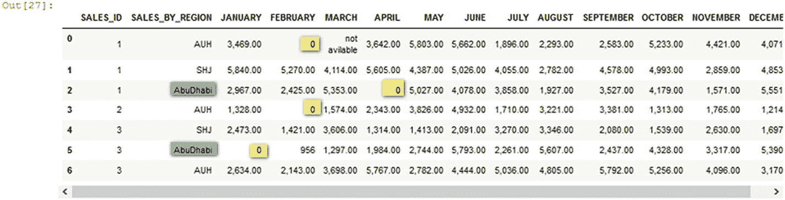

# 合并与整合数据

Python 提供了 `merge()` 方法，用于通过特定的共同模式将不同的数据集合并在一起。清单 5-14 读取了两个关于不同年份范围但针对相同国家的出口值数据集。

```
In [35]: import pandas as pd
a = pd.read_csv("1\. Export1_Columns.csv")
b = pd.read_csv("1\. Export2_Columns.csv")
清单 5-14
两个出口销售文件
```

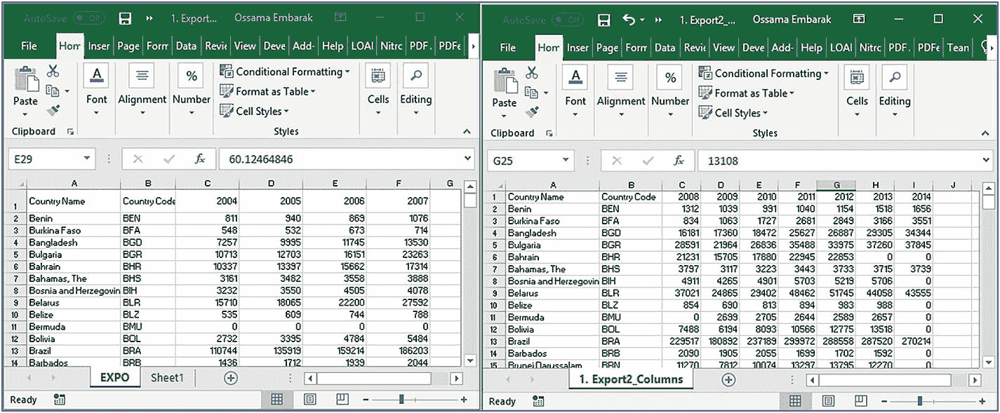

假设你想从这项研究中删除特定年份，例如 2009、2012、2013 和 2014。清单 5-15 和清单 5-16 演示了用于删除这些列的不同方法。

```
In [35]: import pandas as pd
a = pd.read_csv("1\. Export1_Columns.csv")
b = pd.read_csv("1\. Export2_Columns.csv")
In [31]: a.head()
清单 5-15
加载两个具有一个共同属性的不同数据集
```

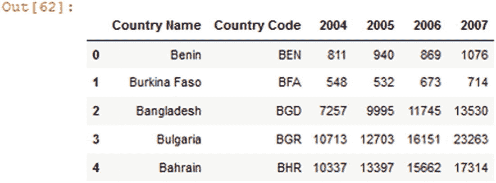

```
In [30]: b.head()
```

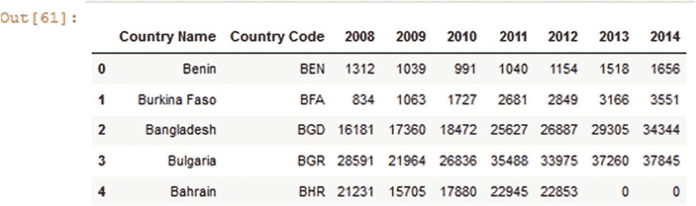

```
In [32]: b.drop('2014', axis=1, inplace=True)
columns = ['2013', '2012']
b.drop(columns, inplace=True, axis=1)
b.head()
清单 5-16
删除 2009、2012、2013 和 2014 列
```

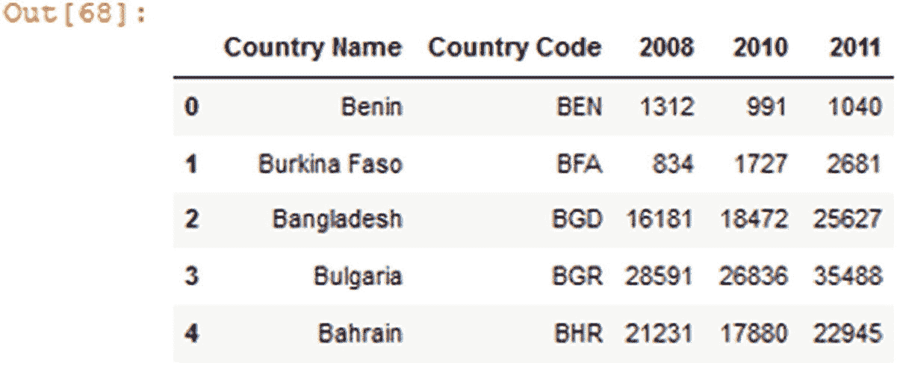

Python 的 `.merge()` 方法可用于合并数据集；你可以指定合并变量，也可以让 Python 查找匹配的变量并执行合并，如清单 5-17 所示。

```
In [102]: mergedDataSet = a.merge(b, on="Country Name")
mergedDataSet.head()
清单 5-17
合并两个数据集
```

使用名为 `County Code_x` 和 `County Code_y` 的列合并两个数据集，如下所示。

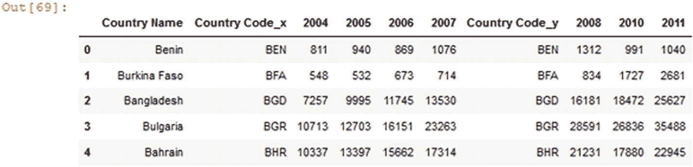

```
In [103]:  dataX = a.merge(b)
dataX.head()
```

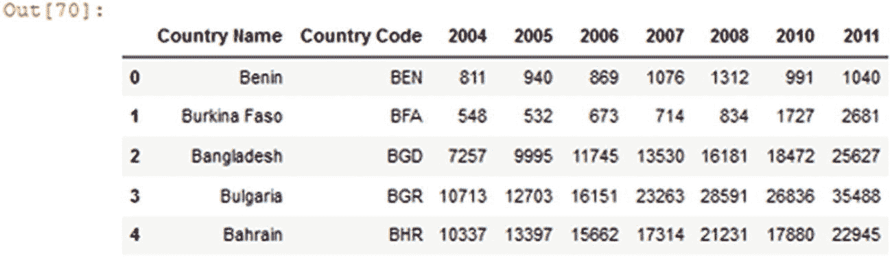

你可以通过行联合操作使用索引合并两个数据集，如清单 5-18 所示，其中使用了 `.concat()` 方法在轴 0 上合并 `Data1` 和 `Data2`。这是一个按行操作。

```
In [71]: Data1 = a.head()
Data1=Data1.reset_index()
Data1
清单 5-18
两个数据集的行联合
```

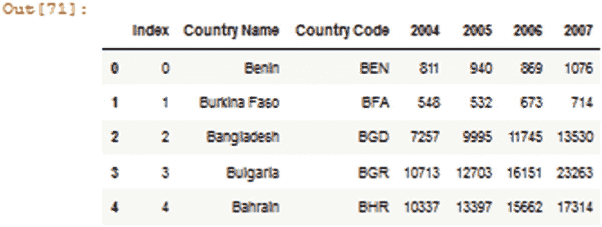

```
In [72]: Data2 = a.tail()
Data2=Data2.reset_index()
Data2
```

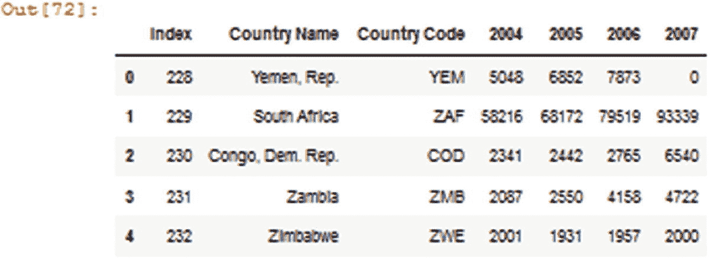

```
In [78]: # 将 DataFrame 垂直堆叠
VerticalStack = pd.concat((Data1, Data2), axis=0) VerticalStack
```

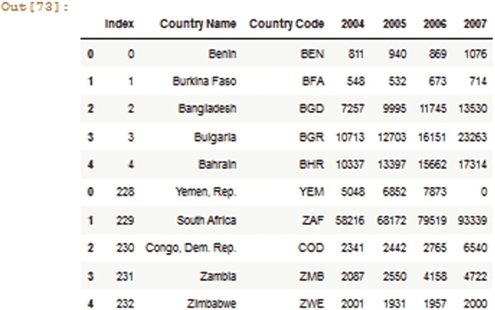

# 从 JSON 格式读取数据

Pandas 库可以使用 `read_json` 函数直接从云端或硬盘读取 JSON 文件。清单 5-19 演示了如何创建 JSON 数据并以 JSON 格式加载，然后迭代或操作数据。JSON 格式类似于字典结构，具有键值对，但在 JSON 中，你可以拥有带有内部值的子属性，类似于第一个示例中的 `email`，以及其子属性 `hide`，值为 `NO`。

```
In [73]: import json data = '''{
"name" : "Ossama",
"phone" : { "type" : "intl", "number" : "+971 50 244 5467"},
"email" : {"hide" : "No" }
}'''
info = json.loads(data)
print ('Name:',info["name"])
print ('Hide:',info["email"]["hide"])
Name: Ossama
Hide: No
In [74]: input = '''[
{ "id" : "001", "x" : "5", "name" : "Ossama"} ,
{ "id" : "009","x" : "10","name" : "Omar" }
]'''
info = json.loads(input) print ('User count:', len(info)) for item in info:
print ('\nName', item['name'])
print ('Id', item['id'])
print ('Attribute', item['x'])
User count: 2
Name Ossama
Id 001
Attribute 5
Name Omar
Id 009
Attribute 10
清单 5-19
创建和操作 JSON 数据
```

你可以直接从在线资源读取 JSON 数据，如清单 5-20 和清单 5-21 所示。

```
url=' http://python-data.dr-chuck.net/comments_244984.json'
print ('Retrieving', url)
uh = urllib.urlopen(url)
data = uh.read()
清单 5-20
JSON 示例数据
```

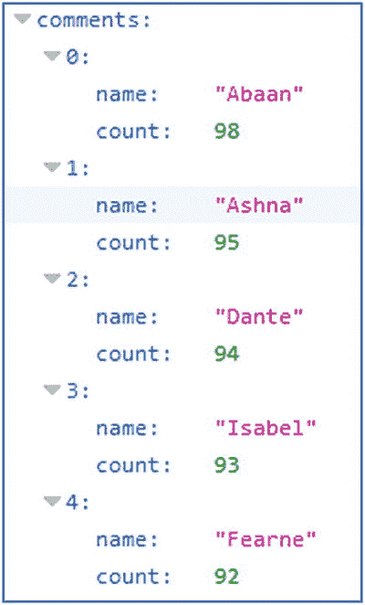

```
In [101]: import json
with open('comments.json') as json_data:
JSONdta = json.load(json_data)
print(JSONdta)
清单 5-21
加载 JSON 文件
```

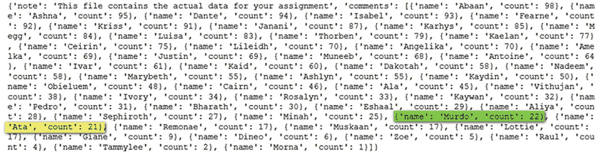

你可以访问 JSON 数据并对提取的数据进行进一步操作。例如，你可以计算所有用户的总数，查找所有计数的平均值等，如清单 5-22 所示。

```
In [102]:sumv=0
counter=0
for i in range(len(JSONdta["comments"])):
counter+=1
Name = JSONdta["comments"][i]["name"]
Count = JSONdta["comments"][i]["count"]
sumv+=int(Count)
print (Name," ", Count)
print ("\nCount: ", counter)
print ("Sum: ", sumv)
清单 5-22
访问 JSON 数据
```

以下是从 JSON 文件中提取的数据样本以及计算出的所有用户总数：

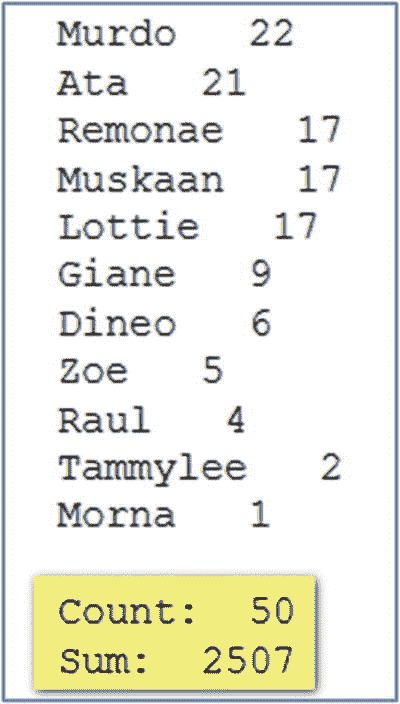

# 从 HTML 格式读取数据

你可以读取在线 HTML 文件，但需要安装并使用 `Beautiful Soup` 包来实现。清单 5-23 展示了如何向一个 URL 发起请求，将其加载到 Python 环境中。然后，你使用 `HTML` 解析器参数来读取整个 HTML 文件。你还可以提取存储在 HTML 标签中的值。

```
In [104]:import urllib from bs4
import BeautifulSoup
response = urllib.request.urlopen('http://python-data.dr-chuck.net/known_by_Rona.html'
html_doc = response.read()
soup = BeautifulSoup(html_doc, 'html.parser')
print(html_doc[:700])
print("\n")
print (soup.title)
print(soup.title.string)
print(soup.a.string)
清单 5-23
读取并解析 HTML 文件
```

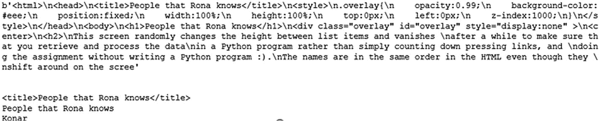

```
In [103]: import urllib.request
with urllib.request.urlopen("http://python-data.dr-chuck.net/known_by_Rona.html") as url:
strhtml = url.read()
#我猜这会输出 HTML 源代码？ print(strhtml[:700])
```

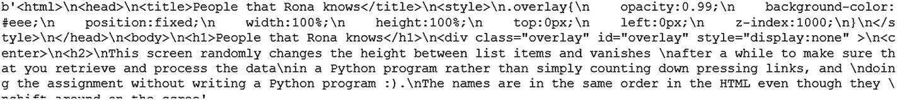

你也可以加载 HTML 并使用 `Beautiful Soup` 包来解析 HTML 标签，并显示前十个锚点标签，如清单 5-24 所示。

```
In [107]: import urllib from bs4
import BeautifulSoup
response = urllib.request.urlopen('http://python-data.dr chuck.net/known_by_Rona.html' html_doc = response.read()
print (html_doc[:300])
soup = BeautifulSoup(html_doc, 'html.parser')
print ("\n") counter=0
for link in soup.findAll("a"):
print(link.get("href"))
if counter<10: counter+=1
continue
else:
break
清单 5-24
解析 HTML 标签
```

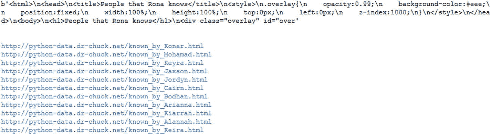

让我们创建一个 `html` 变量，它保存一些网页内容，并使用 `Beautiful Soup` 来读取它，如清单 5-25 所示。

```
In [108]: htmldata="""

The Dormouse's story

The Dormouse's story

Once upon a time there were three little sisters; and their names were
 Elsie

,
 Lacie
 and
 Tillie

; and they lived at the bottom of a well.

...

"""
from bs4 import BeautifulSoup
soup = BeautifulSoup(htmldata, 'html.parser')
print(soup.prettify())
清单 5-25
使用 Beautiful Soup 读取 HTML
```

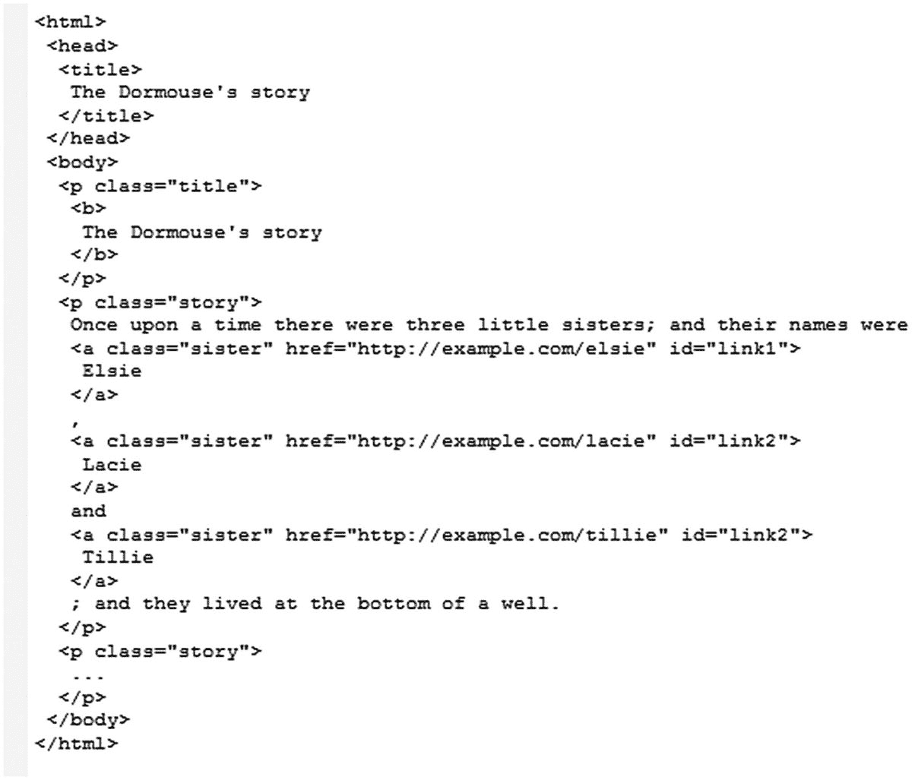

你也可以使用 `Beautiful Soup` 从 HTML 中提取数据。你可以提取数据、标签或所有相关数据，例如解析后的 HTML 内容中的所有超链接，如清单 5-26 所示。

```
In [109]: soup.title
Out[109]: 
The Dormouse's story

In [110]: soup.title.name
Out[110]: 'title'
In [111]: soup.title.string
Out[111]: "\n      The Dormouse's story\n "
In [112]: soup.title.parent.name
Out[112]: 'head'
In [113]: soup.p
Out[113]:

The Dormouse's story

In [114]: soup.p['class']
Out[114]: ['title']
In [115]: soup.a
Out[115]:  Elsie

In [116]: soup.find_all('a')
Out[116]: [ Elsie
,  Lacie
,  Tillie
]
In [117]: soup.find(id="link2")
Out[117]:  Lacie

清单 5-26
使用 Beautiful Soup 从 HTML 中提取数据
```

可以提取页面 `<a>` 标签内找到的所有 URL，如清单 5-27 所示。

```
In [118]: for link in soup.find_all('a'):
print(link.get('href'))
清单 5-27
提取网页内容中的所有 URL
```

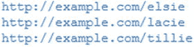

另一个常见任务是提取页面中的所有文本并忽略所有标签，如清单 5-28 所示。

```
In [119]: print(soup.get_text())
清单 5-28
仅提取内容
```

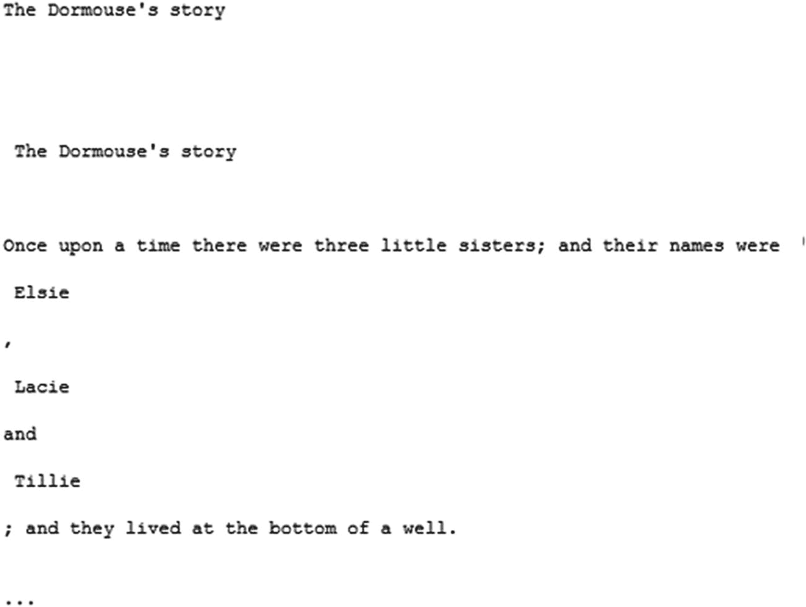

### 从 XML 格式读取数据

Python 提供了 `xml.etree.ElementTree` (`ET`) 模块来实现对 XML 数据的简单高效解析。`ET` 为此提供了两个类：`ElementTree`，它将整个 XML 文档表示为一棵树；以及 `Element`，它表示这棵树中的一个节点。与整个文档的交互（读写文件）通常在 `ElementTree` 级别进行。与单个 XML 元素及其子元素的交互则在 `Element` 级别进行。在清单 5-29 中，你创建了一个 XML 容器，并使用 `ET` 进行解析读取。然后，你使用 `find()` 和 `get()` 方法，通过解析生成的树来从容器中提取数据。

```
In [128]: xmldata = """

3.5

2.8

3.7

""".strip()
In [129]:from xml.etree import ElementTree as ET stuff = ET.fromstring(xmldata) lst = stuff.findall('student')
print ('学生数量:', len(lst))
for item in lst:
print ("\n 姓名:", item.get("name"))
print ('专业:', item.find("concentration").get("name"))
print ('排名:', item.find('rank').text)
print ('GPA:', item.find("GPA").text)
清单 5-29
读取 XML 并提取其数据
```


## 总结

本章涵盖了数据收集和清洗，以便你拥有可靠的数据进行分析。以下列表回顾了你在本章学到的内容：
*   如何应用清洗技术来处理缺失值
*   如何离线读取 CSV 格式的数据以及直接从云端读取
*   如何合并和整合来自不同来源的数据
*   如何从 JSON、HTML 和 XML 格式中读取和提取数据

下一章将学习如何探索和分析数据以及更多内容。

## 练习与答案

1.  编写一个 Python 脚本，读取名为 `movies.xlsx` 的 Excel 文件中的数据，并将这些数据保存到名为 `mov` 的数据框中。执行以下步骤：

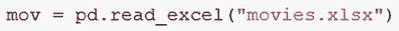

    1.  读取 Excel 文件（`movies.xlsx`）中名为 `2000s` 的第二个工作表的内容，并将此内容存储到名为 `Second_sheet` 的数据框中。

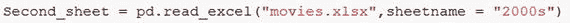

2.  编写必要的代码，使用适当的方法显示数据框 `Second_sheet` 的前七行。

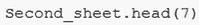

3.  编写必要的代码，使用适当的方法显示最后五行。

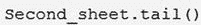

4.  使用合适的命令仅显示名为 `Budget` 的列。

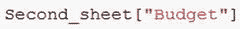

5.  使用合适的命令显示第一个名为 `2000s` 的工作表中的总行数。

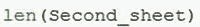

6.  使用合适的命令显示 `Budget` 列中存储的 `最大值`。

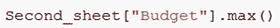

7.  使用合适的命令显示 `Budget` 列中存储的 `最小值`。

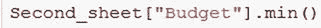

8.  编写一条命令，显示 `User Votes` 列的详细信息（计数、最小值、最大值、均值、标准差、25%、50%、75%）。

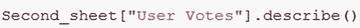

9.  使用合适的条件语句，将国家名称为 `USA` 且 `Duration` 值小于 50 的行存储到名为 `USA50` 的数据框中。显示数据框 `USA50` 中的值。

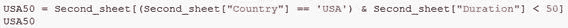

10. 使用合适的命令，在 `Second_sheet` 中通过将 `Reviews by Users` 和 `Reviews by Critics` 相加并除以 2，创建一个名为 `Avg Reviews` 的计算列。在创建上述计算列后，显示 `Second_sheet` 的前五行。

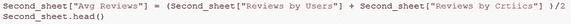

11. 使用合适的命令，按升序（从小到大）对 `Country` 值进行排序，并按降序（从大到小）对 `Avg_reviews` 进行排序。

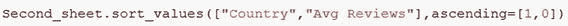

12. 编写一个 Python 脚本，读取以下 HTML 并仅提取和显示内容，忽略标签结构：

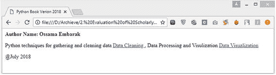

```
Python Book Version 2018

Author Name: Ossama Embarak

Python techniques for gathering and cleaning data

Data Cleaning

, Data Processing and Visualization

Data Visualization

@July 2018
```

***答案：***

```
from bs4 import BeautifulSoup
soup = BeautifulSoup(htmldata, 'html.parser')
print(soup.prettify())
print(soup.get_text())
```

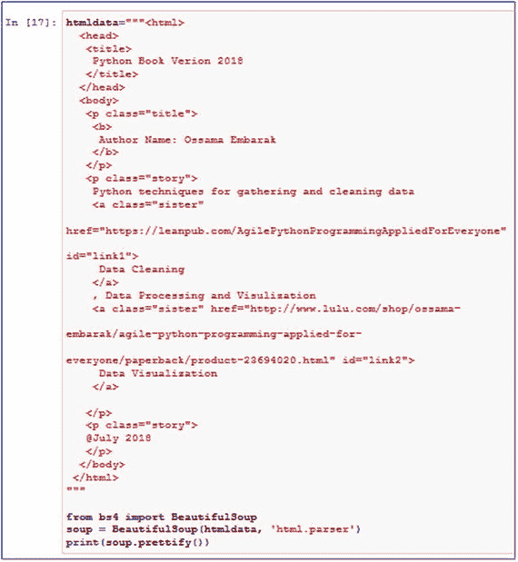
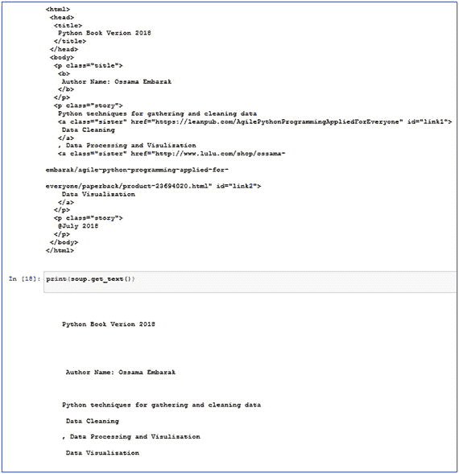