# 6. 数据探索与分析

如今，每天都会收集海量数据并分发到各种渠道。这需要高效且灵活的数据分析工具。Python 的开源 `Pandas` 库填补了这一空白，并处理三种不同的数据结构：序列、数据框和面板。`序列`是一维数据结构，例如字典、数组、列表、元组等。`数据框`是包含异构数据类型的二维数据结构，即表格数据。`面板`指的是三维数据结构，例如三维数组。需要明确的是，高维数据结构是其低维数据结构的容器。换句话说，面板是数据框的容器，而数据框是序列的容器。

## 序列数据结构

如前所述，序列是一维数据的序列，例如字典、列表、数组、元组等。

### 创建序列

Pandas 提供了一个 `Series()` 方法，用于创建序列结构。大小为 `n` 的序列结构应具有长度为 `n` 的索引。默认情况下，Pandas 创建从 0 开始到 `n`-1 结束的索引。可以使用构造函数 `pandas.Series(data, index, dtype, copy)` 创建 Pandas 序列，其中 `data` 可以是数组、常量、列表等。序列 `index` 应该是唯一的、可哈希的，并且长度为 `n`，而 `dtype` 是一种数据类型，可以显式声明或从接收到的数据中推断。清单 6-1 创建了一个具有默认索引和自定义索引的序列。

```
In [5]: import pandas as pd
import numpy as np
data = np.array(['O','S','S','A'])
S1 = pd.Series(data) # 不添加索引
S2 = pd.Series(data,index=[100,101,102,103]) # 添加索引 print (S1) print ("\n") print (S2)
0    O
1    S
2    S
3    A
dtype: object
100  O
101  S
102  S
103  A
dtype: object
In [40]:import pandas as pd
import numpy as np
my_series2 = np.random.randn(5, 10)
print ("\nmy_series2\n", my_series2)
清单 6-1
创建序列
```

这是创建包含 5 行 10 列的随机值序列的输出。

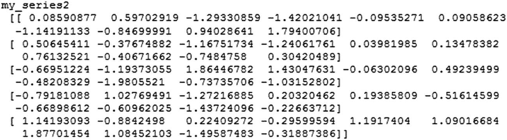

如前所述，您可以从字典创建序列；清单 6-2 演示了如何为数据序列创建索引。

```
In [6]: import pandas as pd
import numpy as np
data = {'X' : 0., 'Y' : 1., 'Z' : 2.}
SERIES1 = pd.Series(data)
print (SERIES1)
X 0.0
Y 1.0
Z 2.0
dtype: float64
In [7]: import pandas as pd
import numpy as np
data = {'X' : 0., 'Y' : 1., 'Z' : 2.}
SERIES1 = pd.Series(data,index=['Y','Z','W','X'])
print (SERIES1)
Y 1.0
Z 2.0
W NaN
X 0.0
dtype: float64
清单 6-2
创建带索引的序列
```

如果您可以从标量值创建序列数据，如清单 6-3 所示，那么索引是必需的，并且标量值将重复以匹配给定索引的长度。

```
In [9]: # 使用标量创建序列
import pandas as pd
import numpy as np
Series1 = pd.Series(7, index=[0, 1, 2, 3, 4])
print (Series1)
0    7
1    7
2    7
3    7
4    7
dtype: int64
清单 6-3
使用标量创建序列
```

### 通过位置访问序列数据

与列表类似，你可以通过索引值访问序列数据。清单 6-4 中的示例演示了访问序列数据的不同方法。第一个示例演示了检索索引为 0 的特定元素。第二个示例检索索引 0、1 和 2。第三个示例检索最后三个元素，因为起始索引是 -3，然后向后移动到 -2、-1。第四个和第五个示例使用序列索引标签检索数据。

```
In [18]: import pandas as pd
Series1 = pd.Series([1,2,3,4,5],index =
['a','b','c','d','e'])
print ("Example 1:Retrieve the first element")
print (Series1[0] )
print ("\nExample 2:Retrieve the first three element")
print (Series1[:3])
print ("\nExample 3:Retrieve the last three element")
print(Series1[-3:])
print ("\nExample 4:Retrieve a single element")
print (Series1['a'])
print ("\nExample 5:Retrieve multiple elements")
print (Series1[['a','c','d']])
Listing 6-4
Accessing a Data Series
```

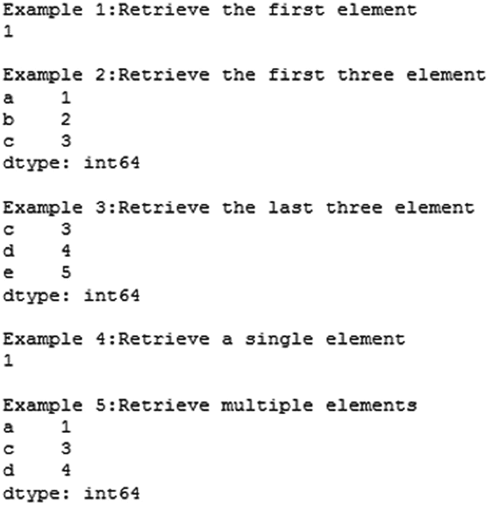

### 探索与分析序列

许多统计方法可以直接应用于数据序列。清单 6-5 演示了数据序列的均值、最大值、最小值和标准差的计算。此外，`.describe()` 方法可用于提供数据描述，包括分位数。

```
In [10]: import pandas as pd
import numpy as np
my_series1 = pd.Series([5, 6, 7, 8, 9, 10])
print ("my_series1\n", my_series1)
print ("\n Series Analysis\n ")
print ("Series mean value : ", my_series1.mean()) # find mean value in a series
print ("Series max value : ",my_series1.max()) # find max value in a series
print ("Series min value : ",my_series1.min()) # find min value in a series
print ("Series standard deviation value : ",my_series1.std()) # find standard deviation
my_series1
0    5
1    6
2    7
3    8
4    9
5    10
dtype: int64
Series Analysis
Series mean value : 7.5
Series max value : 10
Series min value : 5
Series standard deviation value : 1.8708286933869707
In [11]: my_series1.describe()
Out[11]: count     6.000000
mean      7.500000
std       1.870829
min       5.000000
25%       6.250000
50%       7.500000
75%       8.750000
max      10.000000
dtype: float64
Listing 6-5
Analyzing Series Data
```

如果你通过引用将一个序列复制到另一个序列，那么对其中一个序列的任何更改都会影响到另一个序列。将 `my_series1` 复制到 `my_series_11` 后，一旦更改 `my_series_11` 的索引，它就会反映回 `my_series1`，如清单 6-6 所示。

```
In [17]: my_series_11 = my_series1
print (my_series1)
my_series_11.index = ['A', 'B', 'C', 'D', 'E', 'F']
print (my_series_11)
print (my_series1)
0    5
1    6
2    7
3    8
4    9
5    10
dtype: int64
A    5
B    6
C    7
D    8
E    9
F    10
dtype: int64
A    5
B    6
C    7
D    8
E    9
F    10
dtype: int64
Listing 6-6
Copying a Series to Another with a Reference
```

你可以使用 `.copy()` 方法来复制数据集，而不会对原始序列产生引用。参见清单 6-7。

```
In [21]: my_series_11 = my_series1.copy()
print (my_series1)
my_series_11.index = ['A', 'B', 'C', 'D', 'E', 'F']
print (my_series_11)
print (my_series1)
0    5
1    6
2    7
3    8
4    9
5    10
dtype: int64
A    5
B    6
C    7
D    8
E    9
F    10
dtype: int64
0    5
1    6
2    7
3    8
4    9
5    10
dtype: int64
Listing 6-7
Copying Series Values to Another
```

### 序列上的操作

可以对序列数据执行许多操作。你可以检查某个索引值是否存在于序列中。此外，你还可以根据特定条件检查所有序列元素，例如序列值是否小于 8。另外，你可以直接或通过定义的函数对序列数据执行数学运算，如清单 6-8 所示。

```
In [23]: 'F' in my_series_11
Out[23]: True
In [27]: temp = my_series_11 < 8
temp
Out[27]: A    True
B    True
C    True
D    False
E    False
F    False
dtype: bool
In [35]: len(my_series_11)
Out[35]: 6
In [28]: temp = my_series_11[my_series_11 < 8 ] * 2
temp
Out[28]: A    10
B    12
C    14
dtype: int64
Listing 6-8
Operations on Series
```

定义一个函数来相加两个序列并调用该函数，如下所示：

```
In [37]: def AddSeries(x,y):
for i in range (len(x)):
print (x[i] + y[i])
In [39]: print ("Add two series\n")
AddSeries (my_series_11, my_series1)
Add two series

```

你可以使用第 7 章中介绍的不同绘图系统来可视化数据序列。然而，图 6-1 演示了如何快速了解你的序列数据，并通过可视化绘图图表以图形方式探索它。参见清单 6-9。

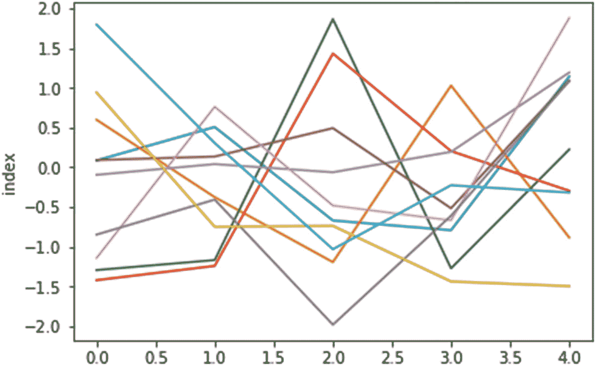

图 6-1

折线可视化

```
In [49]: import matplotlib.pyplot as plt
plt.plot(my_series2)
plt.ylabel('index')
plt.show()
Listing 6-9
Visualizing Data Series
```

```
In [54]: from numpy import *
import math
import matplotlib.pyplot as plt
t = linspace(0, 2*math.pi, 400)
a = sin(t)
b = cos(t)
c = a + b
In [50]: plt.plot(t, a, 'r') # plotting t, a separately
plt.plot(t, b, 'b') # plotting t, b separately
plt.plot(t, c, 'g') # plotting t, c separately
plt.show()
```

我们可以将多个图形添加到同一个画布上，如图 6-2 所示。

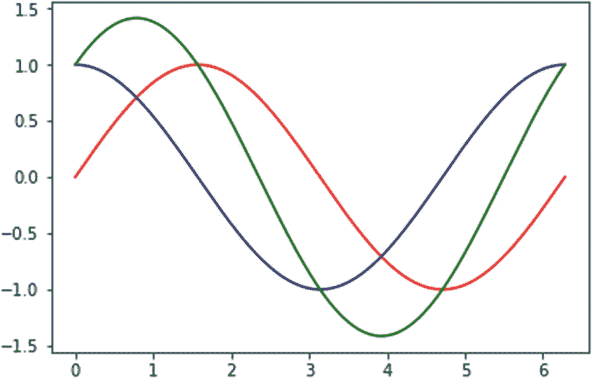

图 6-2

同一画布上的多图

## 数据框数据结构

如前所述，数据框是一种二维数据结构，包含异构数据类型，即表格数据。

### 创建数据框

Pandas 可以使用构造函数`pandas.DataFrame(data, index, columns, dtype, copy)`创建数据框。数据框可以从列表、序列、字典、Numpy 数组或其他数据框创建。Pandas 数据框不仅有助于存储表格数据，还可以对数据框的行和列执行算术运算。代码清单 6-10 从单个列表和列表的列表创建了一个数据框。

```
In [19]: import pandas as pd
data = [10,20,30,40,50]
DF1 = pd.DataFrame(data)
print (DF1)
0    10
1    20
2    30
3    40
4    50
```

```
In [22]: import pandas as pd
data = [['Ossama',25],['Ali',43],['Ziad',32]]
DF1 = pd.DataFrame(data,columns=['Name','Age'])
print (DF1)
Name       Age
0    Ossama     25
1    Ali        43
2    Ziad       32
```

```
In [21]: import pandas as pd
data = [['Ossama',25],['Ali',43],['Ziad',32]]
DF1 = pd.DataFrame(data,columns=['Name','Age'],dtype=float) print (DF1)
Name       Age
0    Ossama     25.0
1    Ali        43.0
2    Ziad       32.0
```

代码清单 6-10 从列表创建数据框。

你可以从字典或数组创建数据框，如代码清单 6-11 所示。此外，你还可以设置数据框的索引。但是，如果你不设置索引，那么数据框将从 0 开始，一直到 `n`-1，其中 `n` 是列表的长度。列名默认取自字典的键。不过，也可以为列设置标签。第一个数据框`df1`的列使用字典键名作为标签；这就是为什么除了字典 1 中项目（project）的缺失值外，你看不到 NaN 的情况。而在第二个名为`df2`的数据框中，你将列名从`Test1`更改为`Test_1`，并且所有记录都得到了 NaN。这是因为`data`的字典键中缺少`Test_1`。

```
In [13]: import pandas as pd
data = [{'Test1': 10, 'Test2': 20},{'Test1': 30, 'Test2': 20, 'Project': 20}]
#### 使用三个列索引，值与字典键相同
df1 = pd.DataFrame(data, index=['First', 'Second'], columns=['Test2', 'Project' , 'Test1'])
#### 使用两个列索引，其中一个索引使用另一个名称
df2 = pd.DataFrame(data, index=['First', 'Second'], columns=['Project', 'Test_1','Test2 '])
print (df1)
print ("\n")
print (df2)
Test2       Project        Test1
First     20          NaN            10
Second    20          20.0           30
Project     Test_1         Test2
First     NaN         NaN            20
Second    20.0        NaN            20
```

代码清单 6-11 从字典创建数据框。

Pandas 允许你从序列字典创建数据框，此时你会得到所有传入序列索引的并集。如代码清单 6-12 所示，对于学生 `Salwa`，没有给出 `Test1` 的值。这就是 NaN 被自动设置的原因。

```
In [16]: import pandas as pd
data = {'Test1' : pd.Series([70, 55, 89], index=['Ahmed', 'Omar', 'Ali']),
'Test2' : pd.Series([56, 82, 77, 65], index=['Ahmed', 'Omar', 'Ali', 'Salwa'])}
df1 = pd.DataFrame(data)
print (df1)
Test1     Test2
Ahmed      70.0      56
Ali        89.0      77
Omar       55.0      82
Salwa      NaN       65
```

代码清单 6-12 从序列创建数据框。

### 更新和访问数据框的列选择

你可以使用列标签选择特定的列。例如，`df1['Test2']`用于仅选择数据框中标签为`Test2`的列，而`df1[:]`用于显示所有列和所有行，如代码清单 6-13 所示。

```
In [51]: import pandas as pd
data = {'Test1' : pd.Series([70, 55, 89], index=['Ahmed', 'Omar', 'Ali']),
'Test2' : pd.Series([56, 82, 77, 65], index=['Ahmed', 'Omar', 'Ali', 'Salwa'])}
df1 = pd.DataFrame(data)
print (df1['Test2']) # 列选择
print("\n")
print (df1[:]) # 列选择
Ahmed     56
Ali       77
Omar      82
Salwa     65
Name: Test2, dtype: int64
Test1       Test2
Ahmed     70.0        56
Ali       89.0        77
Omar      55.0        82
Salwa     NaN         65
```

代码清单 6-13 数据框列选择。

你可以使用列标签或列索引来选择列。`df1.iloc[:, [1,0]]`用于显示列 1 和列 0 的所有行，从列 1 开始，它指的是名为`Test2`的列。此外，`df1[0:4:1]`用于显示从第 0 行到第 3 行（步长为 1）的所有行，即给出从 0 到 3 的所有行。参见代码清单 6-14。

```
In [46]: df1.iloc[:, [1,0 ]]
Out[46]:             Test2   Test1
Ahmed       56      70.0
Ali         77      89.0
Omar        82      55.0
Salwa       65      NaN
```

```
In [39]: df1[0:4:1]
Out[39]:             Test1   Test2
Ahmed       70.0    56
Ali         89.0    77
Omar        55.0    82
Salwa       NaN     65
```

代码清单 6-14 数据框列和行选择。

### 列添加

你可以简单地添加一个新列，并使用序列直接添加其值。此外，你还可以通过处理其他列来创建新列，如代码清单 6-15 所示。

```
In [66]: # 添加一个新列
import pandas as pd
data = {'Test1' : pd.Series([70, 55, 89], index=['Ahmed', 'Omar', 'Ali']),
'Test2' : pd.Series([56, 82, 77, 65], index=['Ahmed', 'Omar', 'Ali', 'Salwa'])}
df1 = pd.DataFrame(data)
print (df1)
df1['Project'] = pd.Series([90,83,67, 87], index=['Ali','Omar','Salwa', 'Ahmed'])
print ("\n")
df1['Average'] = round((df1['Test1']+df1['Test2']+df1['Project'])/3, 2)
print (df1)
Test1   Test2
Ahmed    70.0    56
Ali      89.0    77
Omar     55.0    82
Salwa    NaN     65
Test1   Test2   Project   Average
Ahmed    70.0    56      87        71.00
Ali      89.0    77      90        85.33
Omar     55.0    82      83        73.33
Salwa    NaN     65      67        NaN
```

代码清单 6-15 向数据框添加新列。

### 列删除

你可以使用`del`方法删除任意列。例如，`del df2['Test2']`会从数据集中删除`Test2`列。此外，你还可以使用`pop`方法来删除列。例如，`df2.pop('Project')`用于删除`Project`列。但是，在使用`del`或`pop`方法时需要小心，因为可能存在引用。在这种情况下，它不仅会从执行的数据框中删除，还会从被引用的数据框中删除。清单 6-16 创建了数据框`df1`，并将`df1`复制给`df2`。

```
In [70]: import pandas as pd
data = {'Test1' : pd.Series([70, 55, 89], index=['Ahmed', 'Omar', 'Ali']),
'Test2' : pd.Series([56, 82, 77, 65], index=['Ahmed', 'Omar', 'Ali', 'Salwa'])}
print (df1)
df2 = df1
print ("\n")
print (df2)
Test1    Test2   Project   Average
Ahmed    70.0     56      87        71.00
Ali      89.0     77      90        85.33
Omar     55.0     82      83        73.33
Salwa    NaN      65      67        NaN
Test1    Test2   Project   Average
Ahmed             70.0     56      87        71.00
Ali               89.0     77      90        85.33
Omar              55.0     82      83        73.33
Salwa             NaN      65      6         7  NaN
```

清单 6-16 创建和复制数据框。

在前面的 Python 脚本中，你看到了如何创建`df2`并将其赋值为`df1`。在清单 6-17 中，你依次使用`del`和`pop`方法删除了`Test2`和`Project`变量。如图所示，这两个变量都从数据框`df1`和`df2`中被删除了，这是因为使用赋值（`=`）运算符导致这两个数据框之间存在引用关系。

```
In [71]: # 使用 del 函数删除数据框中的列
print ("使用 DEL 函数删除第一列:")
del df2['Test2']
print (df2)
#### 使用 pop 函数删除数据框中的列
print ("\n 使用 POP 函数删除另一列:")
df2.pop('Project')
print (df2)
使用 DEL 函数删除第一列:
Test1   Project    Average
Ahmed       70.0    87         71.00
Ali         89.0    90         85.33
Omar        55.0    83         73.33
Salwa       NaN     67         NaN
使用 POP 函数删除另一列:
Test1    Average
Ahmed       70.0     71.00
Ali         89.0     85.33
Omar        55.0     73.33
Salwa       NaN      NaN
```

```
In [72]: print (df1)
Test1    Average
Ahmed       70.0     71.00
Ali         89.0     85.33
Omar        55.0     73.33
Salwa       NaN      NaN
```

```
In [73]: print (df2)
Test1    Average
Ahmed       70.0     71.00
Ali         89.0     85.33
Omar        55.0     73.33
Salwa       NaN      NaN
```

清单 6-17 从数据框中删除列。

为了解决这个问题，你可以使用`df.copy()`方法代替赋值运算符（`=`）。清单 6-18 展示了依次使用`del()`和`pop()`方法删除变量`Test2`和`Project`，但只有`df2`受到了影响，而`df1`保持不变。

```
In [83]: # 添加一个新列
import pandas as pd
data = {'Test1' : pd.Series([70, 55, 89], index=['Ahmed', 'Omar', 'Ali']),
'Test2' : pd.Series([56, 82, 77, 65], index=['Ahmed', 'Omar', 'Ali', 'Salwa'])}
df1 = pd.DataFrame(data)
df1['Project'] = pd.Series([90,83,67, 87],index=['Ali','Omar','Salwa', 'Ahmed'])
print ("\n")
df1['Average'] = round((df1['Test1']+df1['Test2']+df1['Project'])/3, 2)
print (df1)
print ("\n")
df2= df1.copy() # 使用 copy() 方法将 df1 复制到 df2
print (df2)
#使用 del 和 pop 方法删除列
del df2['Test2']
df2.pop('Project')
print ("\n")
print (df1)
print ("\n")
print (df2)
```

清单 6-18 使用复制方法从数据框中删除列。

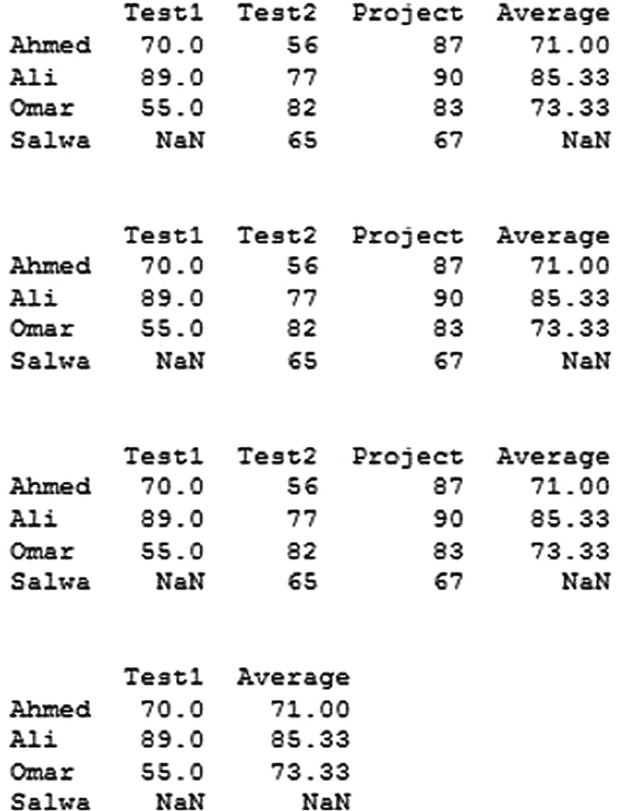

### 行选择

在清单 6-19 中，你选择了学生 `Omar` 的第二行。同时，你使用了切片方法来检索第 2 行和第 3 行。

```
In [106]: # 添加一个新列
import pandas as pd
data = {'Test1' : pd.Series([70, 55, 89], index=['Ahmed', 'Omar', 'Ali']),
'Test2' : pd.Series([56, 82, 77, 65], index=['Ahmed', 'Omar', 'Ali', 'Salwa'])}
df1 = pd.DataFrame(data)
df1['Project'] = pd.Series([90,83,67, 87],index=['Ali','Omar','Salwa', 'Ahmed'])
print ("\n")
df1['Average'] = round((df1['Test1']+df1['Test2']+df1['Project'])/3, 2)
print (df1)
print ("\n 选择 iloc 函数来检索第 2 行")
print (df1.iloc[2])
print ("\n 切片行")
print (df1[2:4] )
```

清单 6-19 检索特定行。

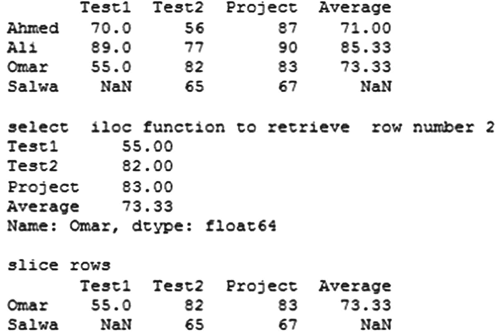

### 行添加

清单 6-20 演示了如何向现有数据框添加行。

```python
In [134 ]: import pandas as pd
data = {'Test1' : pd.Series([70, 55, 89], index=['Ahmed', 'Omar', 'Ali']),
'Test2' : pd.Series([56, 82, 77, 65], index=['Ahmed', 'Omar', 'Ali', 'Salwa']),
'Project' : pd.Series([87, 83, 90, 67], index=['Ahmed', 'Omar', 'Ali', 'Salwa']),
'Average' : pd.Series([71, 73.33, 85.33, 66], index=['Ahmed', 'Omar', 'Ali', 'Salw
data = pd.DataFrame(data)
print (data)
print("\n")
df2 = pd.DataFrame([[80, 70, 90, 80]], columns = ['Test1','Test2','Project','Average'], index=['Khalid'])
datadata.append(df2)
print (data)
清单 6-20
向数据框添加新行
```

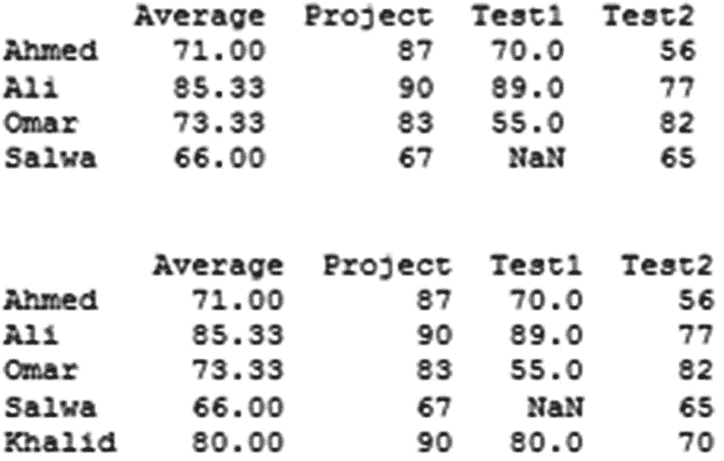

### 行删除

Pandas 提供了 `df.drop()` 方法，可以使用标签索引删除行，如清单 6-21 所示。

```python
In [138]: print (data)
print ('\n')
data = data.drop('Omar')
print (data)
清单 6-21
从数据框中删除行
```

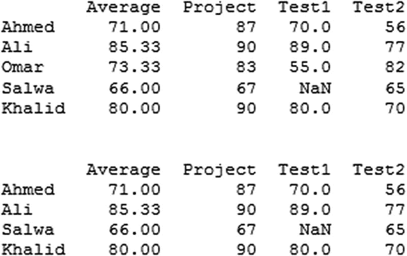

### 探索与分析数据框

Pandas 提供了多种用于分析数据框中数据的方法。`.describe()` 方法用于生成描述性统计信息，这些信息总结了数据集分布的中心趋势、离散程度和形状，并排除了 `NaN` 值。

```python
DataFrame.describe(percentiles=None,include=None, exclude=None)[source]
```

`DataFrame.describe()` 可以分析数值型和对象型序列，以及包含混合数据类型的列集。输出结果会根据提供的参数而变化。清单 6-22 分析了数据框中的 `Age`、`Salary`、`Height` 和 `Weight` 属性。它还显示了所有属性的均值、最大值、最小值、标准差和分位数。但是，Salwa 的 `Age` 缺失了；你得到的是排除了 Salwa 数据后的 `Age` 属性的完整描述。

```python
In [61]: print (df1)
data = {'Age' : pd.Series([30, 25, 44, ], index=['Ahmed', 'Omar', 'Ali']),
'Salary' : pd.Series([25000, 17000, 30000, 12000], index=['Ahmed', 'Omar', 'Ali',
'Height' : pd.Series([160, 154, 175, 165], index=['Ahmed', 'Omar', 'Ali', 'Salwa'
'Weight' : pd.Series([85, 70, 92, 65], index=['Ahmed', 'Omar', 'Ali', 'Salwa']),
'Gender' : pd.Series(['Male', 'Male', 'Male', 'Female'], index=['Ahmed', 'Omar',
data = pd.DataFrame(data)
print (data)
print("\n")
df2 = pd.DataFrame([[42, 31000, 170, 80, 'Female']], columns =['Age','Salary','Height'
, index=['Mona'])
data = data.append(df2)
print (data)
清单 6-22
创建一个包含五个属性的数据框
```

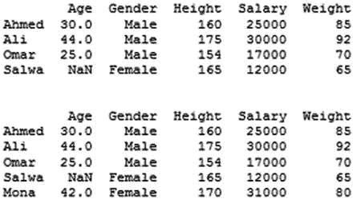

应用 `data.describe()` 方法，你会得到除 `Gender` 属性之外所有属性的完整描述，因为 `Gender` 是字符串数据类型。你可以通过使用 `include='all'` 方法属性来强制对所有属性进行分析。此外，你也可以将分析应用于特定模式，例如，仅应用于 `Salary` 模式，这将计算所有员工薪资的均值、最小值、最大值、标准差和分位数。参见清单 6-23。

```python
In [63]: data.describe()
清单 6-23
分析数据框
```

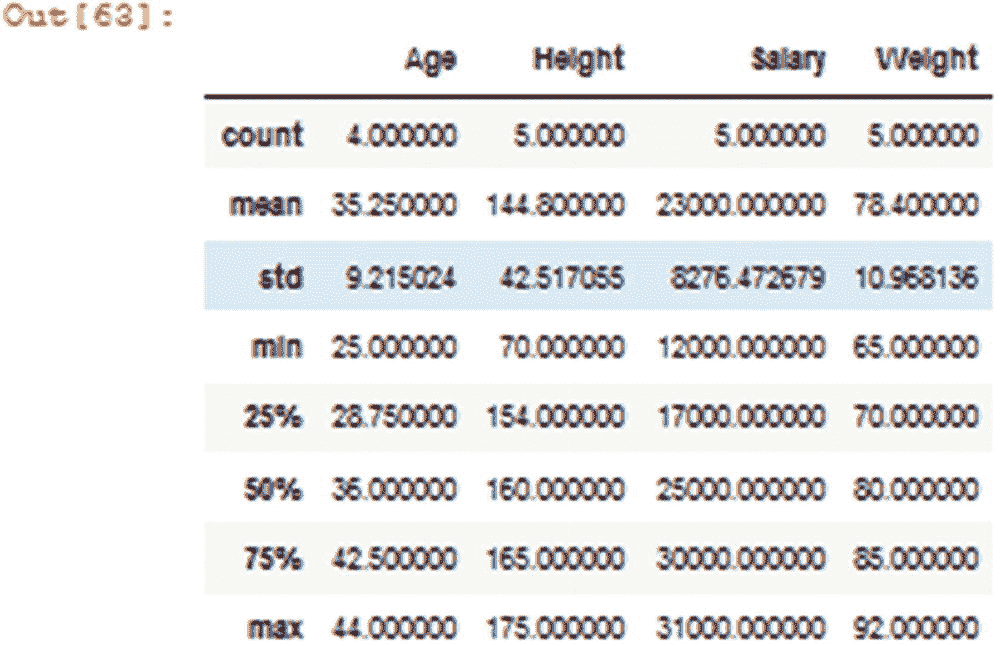

```python
In [64]: data.describe(include='all')
```

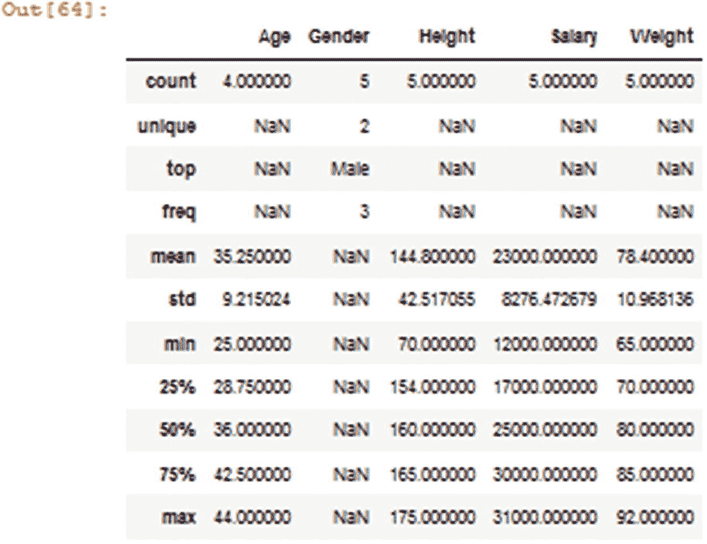

```python
In [66]: data.Salary.describe()
```

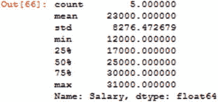

清单 6-24 仅包含数据框描述中的数值列。

```python
In [67]: data.describe(include=[np.number])
清单 6-24
仅分析数值模式
```

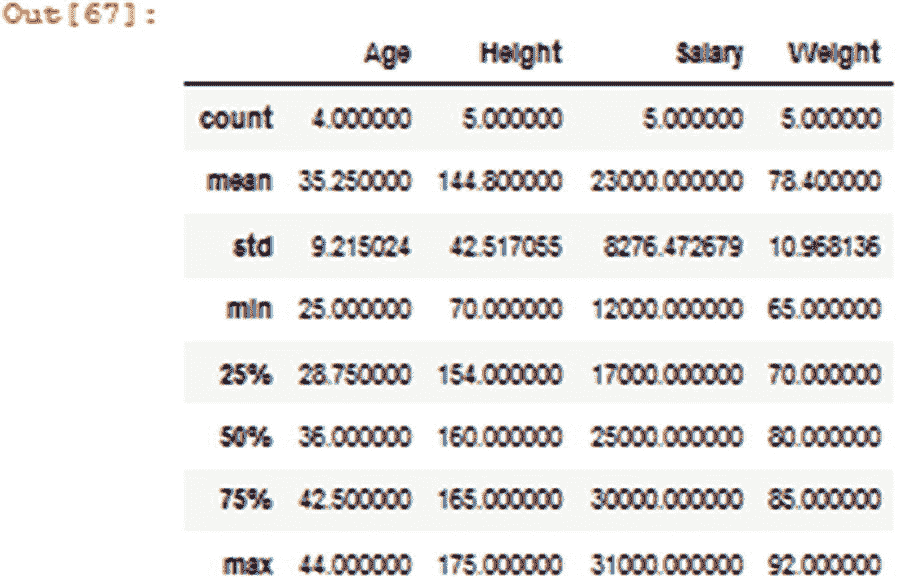

清单 6-25 仅包含数据框描述中的字符串列。

```python
In [68]: data.describe(include=[np.object])
清单 6-25
仅分析字符串模式（性别）
```

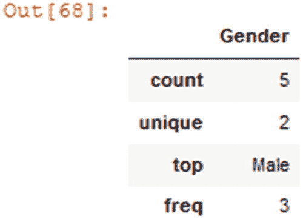

```python
In [70]: data.describe(exclude=[np.number])
```

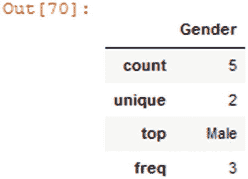

你可以通过计算理想体重并与记录体重进行比较来衡量超重员工，如清单 6-26 所示。

```python
In [71]: data
清单 6-26
检查体重是否理想
```

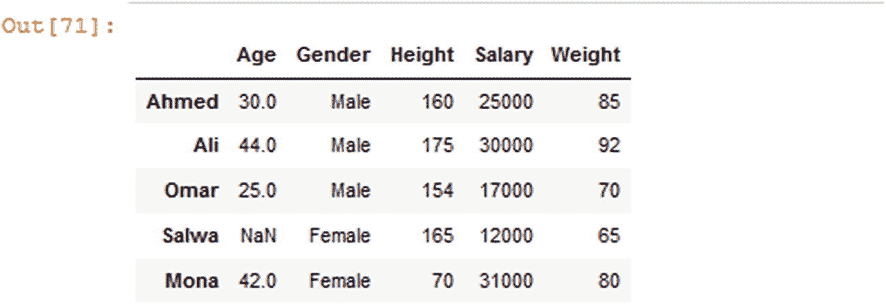

```python
In [75]: OptimalWeight = data['Height']- 100
OptimalWeight
```

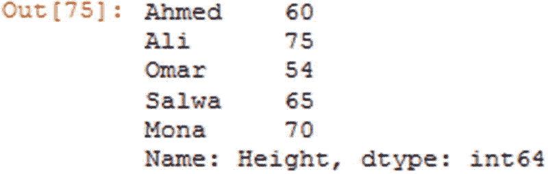

```python
In [93]:unOptimalCases = data['Weight'] <= OptimalWeight unOptimalCases
```

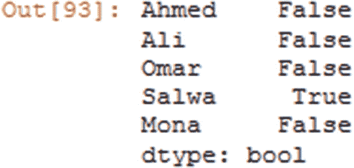

### 面板数据结构

如前所述，*面板*是一种三维数据结构，类似于三维数组。

#### 创建面板

Pandas 使用构造函数 `pandas.Panel(data, items, major_axis, minor_axis, dtype, copy)` 创建面板。面板可以从数据框和数组的字典创建。数据可以采用多种形式，例如 `ndarray`、序列、映射、列表、字典、常量，以及另一个数据框。

以下 Python 脚本创建了一个空面板：

```python
#creating an empty panel
import pandas as pd
p = pd.Panel ()
```

清单 6-27 创建了一个三维面板。

```python
In [143]: # creating an empty panel
import pandas as pd
import numpy as np
data = np.random.rand(2,4,5)
Paneldf = pd.Panel(data)
print (Paneldf)
清单 6-27
创建一个三维面板
```

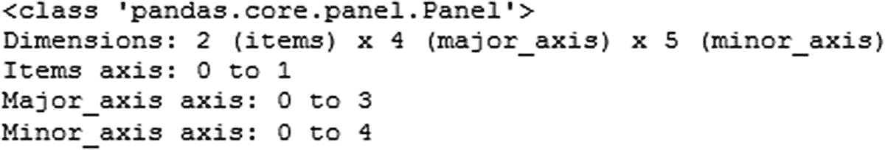

#### 通过位置从面板访问数据

清单 6-28 创建了一个面板并用随机数据填充它，其中面板中的第一个项目是一个 4x3 的数组，第二个项目是一个 4x2 的随机值数组。对于 `Item2` 列，有两个值是 `NaN`，因为它的维度是 4x2。你也可以使用项目标签从面板访问数据，如清单 6-28 所示。

```python
In [147]: # creating an empty panel
import pandas as pd
import numpy as np
data = {'Item1' : pd.DataFrame(np.random.randn(4, 3)),
'Item2' : pd.DataFrame(np.random.randn(4, 2))}
Paneldf = pd.Panel(data)
print (Paneldf['Item1'])
print ("\n")
print (Paneldf['Item2'])
清单 6-28
选择并显示面板项目
```

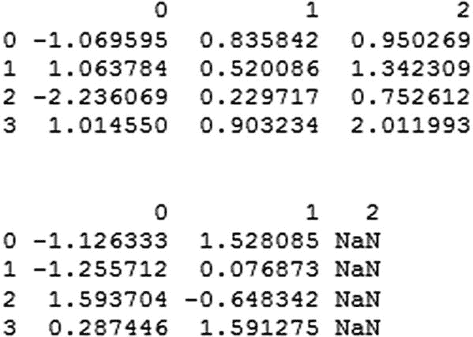

如上所示，Python 以二维数据框的形式显示面板项目。可以使用 `panel.major_axis(index)` 方法以及 `panel.minor_axis(index)` 方法来访问数据。参见清单 6-29。

```python
In [149]: print (Paneldf.major_xs(1))
清单 6-29
使用主维度和次维度选择并显示面板
```

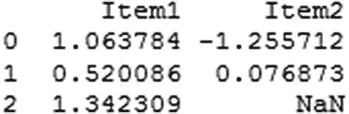

```python
In [150]: print (Paneldf.minor_xs(1))
```

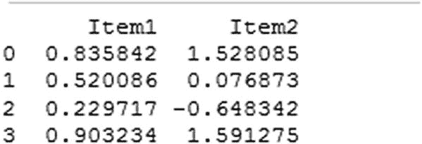

#### 探索与分析面板

获得面板后，你可以对其中维护的数据进行统计分析。在代码清单 6-30 中，你可以看到两组员工，每组员工在名为 `P` 的面板中维护了五个属性。你对 `Group1` 以及该组中的 `Salary` 属性执行了 `.describe()` 方法。

```python
In [104]: import pandas as pd
data1 = {'Age' : pd.Series([30, 25, 44, ], index=['Ahmed', 'Omar', 'Ali']),
'Salary' : pd.Series([25000, 17000, 30000, 12000], index=['Ahmed', 'Omar', 'Ali', 'Salwa']),
'Height' : pd.Series([160, 154, 175, 165], index=['Ahmed', 'Omar', 'Ali', 'Salwa']),
'Weight' : pd.Series([85, 70, 92, 65], index=['Ahmed', 'Omar', 'Ali', 'Salwa']),
'Gender' : pd.Series(['Male', 'Male', 'Male', 'Female'], index=['Ahmed', 'Omar', 'Ali', 'Salwa'])}
data2 = {'Age' : pd.Series([24, 19, 33,25  ], index=['Ziad', 'Majid', 'Ayman', 'Ahlam']),
'Salary' : pd.Series([17000, 7000, 22000, 21000], index=['Ziad', 'Majid', 'Ayman', 'Ahlam']),
'Height' : pd.Series([170, 175, 162, 177], index=['Ziad', 'Majid', 'Ayman', 'Ahlam']),
'Weight' : pd.Series([77, 84, 74, 90], index=['Ziad', 'Majid', 'Ayman', 'Ahlam']),
'Gender' : pd.Series(['Male', 'Male', 'Male', 'Female'], index=['Ziad', 'Majid', 'Ayman', 'Ahlam'])}
data = {'Group1': data1, 'Group2': data2}
p = pd.Panel(data)
In [106]: p['Group1'].describe()
代码清单 6-30
面板分析
```

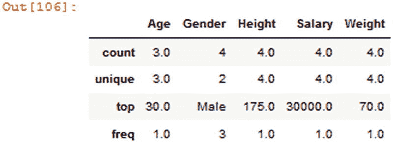

```python
In [107]: p['Group1']['Salary'].describe()
```

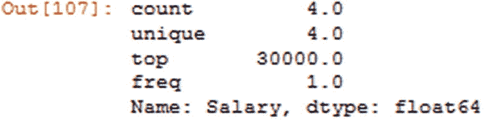

### 数据分析

如前所述，Pandas 提供了多种数据分析方法。本节的目标是熟悉数据并总结其主要特征。此外，你还可以为特定的统计分析定义自己的方法。

# 数据分析与分组操作

## 统计分析

以下大多数统计方法在前文中已通过三种主要数据集合（序列、数据框和面板）的实际示例进行了介绍。

*   `df.describe()`：数值列的汇总统计
*   `df.mean()`：返回所有列的均值
*   `df.corr()`：返回数据框中列之间的相关性
*   `df.count()`：返回每个数据框列中非空值的数量
*   `df.max()`：返回每列中的最大值
*   `df.min()`：返回每列中的最小值
*   `df.median()`：返回每列的中位数
*   `df.std()`：返回每列的标准差

代码清单 6-31 创建了一个包含六列十行的数据框。

```
In [11]: import pandas as pd
import numpy as np
Number = [1,2,3,4,5,6,7,8,9,10]
Names = ['Ali Ahmed','Mohamed Ziad','Majid Salim','Salwa Ahmed', 'Ahlam Mohamed', 'Omar Ali', 'Amna Mohammed','Khalid Yousif', 'Safa Humaid', 'Amjad Tayel']
City = ['Fujairah','Dubai','Sharjah','AbuDhabi','Fujairah','Dubai', 'Sharja ', 'AbuDhabi','Sharjah','Fujairah']
columns = ['Number', 'Name', 'City' ]
dataset= pd.DataFrame({'Number': Number , 'Name': Names, 'City': City}, columns = columns )
Gender= pd.DataFrame({'Gender':['Male','Male','Male','Female', 'Female', 'Male', 'Female', 'Male','Female', 'Male']})
Height = pd.DataFrame(np.random.randint(120,175, size=(12, 1))) Weight = pd.DataFrame(np.random.randint(50,110, size=(12, 1)))
dataset['Gender']= Gender
dataset['Height']= Height
dataset['Weight']= Weight
dataset.set_index('Number')
代码清单 6-31
创建数据框
```

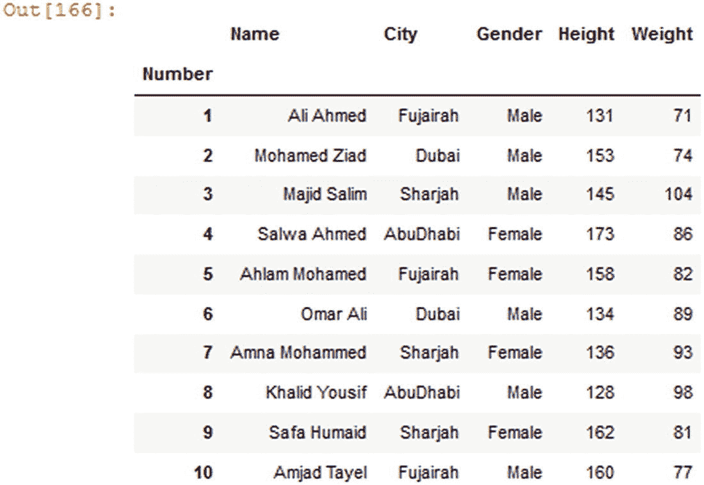

代码清单 6-32 中的 Python 脚本和示例展示了身高和体重变量的汇总、身高和体重的均值、数值变量之间的相关性以及数据集中所有记录的计数。相关系数是一种衡量两个变量变动关联程度的指标。最常用的相关系数由皮尔逊相关系数生成，可用于衡量两个变量之间的线性关系。然而，在非线性关系中，该相关系数可能并非衡量依赖关系的合适指标。相关系数的取值范围为 -1.0 到 1.0。换句话说，其值不能超过 1.0 或小于 -1.0，其中 -1.0 的相关系数表示完全负相关，1.0 的相关系数表示完全正相关。相关系数用 `r` 表示。如果其值大于零，则为正相关；如果值小于零，则为负相关。值为零表示两个变量之间没有关系。

如图所示，数据集中所有成员的身高和体重之间存在微弱的负相关（-0.301503）。此外，初始统计数据显示身高的偏差最大；另外，身高的第 75 百分位数等于 159。

```
In [186]: # Summary statistics for numerical columns
print ( dataset.describe())
代码清单 6-32
变量汇总与统计
```

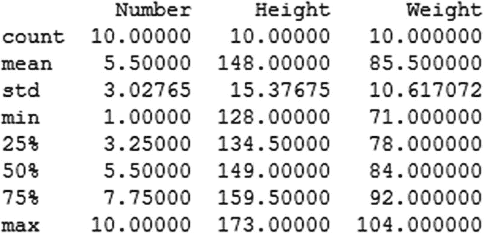

```
In [187]: print (dataset.mean()) # Returns the mean of all columns
```

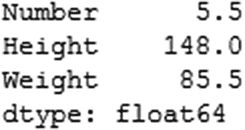

```
In [188]: # Returns the correlation between columns in a DataFrame
print (dataset.corr())
```

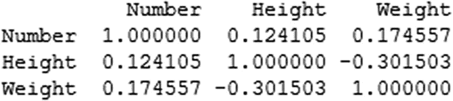

```
In [189]: # Returns the number of non-null values in each DataFrame       column
print (dataset.count())
```

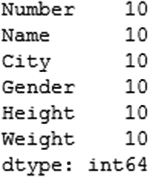

```
In [190]: # Returns the highest value in each column
print (dataset.max())
```

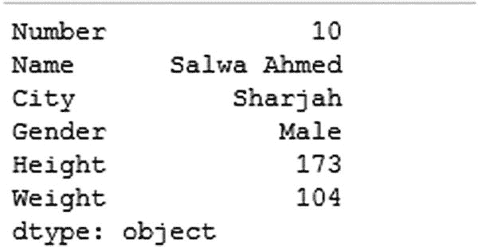

```
In [191]: # Returns the lowest value in each column
print (dataset.min())
```

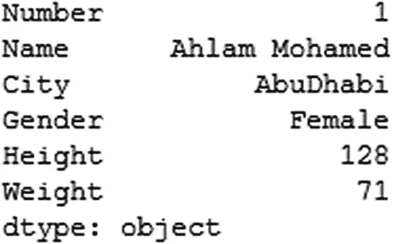

```
In [192]: # Returns the median of each column
print (dataset.median())
```

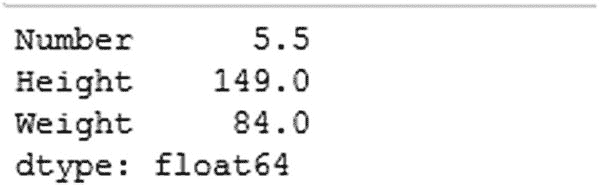

```
In [193]: # Returns the standard deviation of each column
print (dataset.std())
```

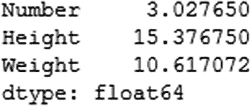

## 数据分组

你可以将数据拆分为多个组，以便对数据集进行更具体的分析。执行数据分组后，你可以计算汇总统计量（聚合）、执行特定的组操作（转换），以及根据某些条件丢弃数据（过滤）。在清单 6-33 中，你使用 `City` 对数据进行分组，并查找每个城市的性别计数。此外，你按城市对数据集进行分组并显示结果，例如，第 1 行和第 5 行是来自迪拜的人。你可以使用多个分组属性。你可以使用 `City` 和 `Gender` 对数据集进行分组。检索到的数据显示，例如，富查伊拉有女性（第 4 行）和男性（第 0 行和第 9 行）。

```
In [3]: dataset.groupby('City')['Gender'].count()
清单 6-33
数据分组
```

以下输出显示，按性别分组后，我们有 2 名学生来自阿布扎比，2 名来自迪拜，3 名来自富查伊拉，3 名来自沙迦。

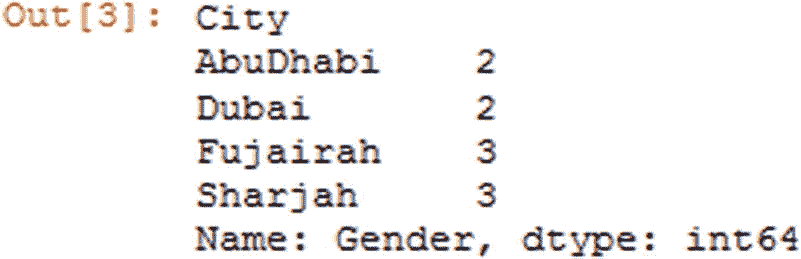

```
In [4]: print (dataset.groupby('City').groups)
```

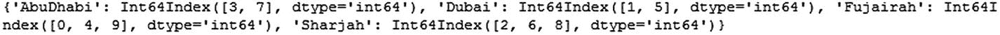

```
In [5]: print (dataset.groupby(['City','Gender']).groups)
```

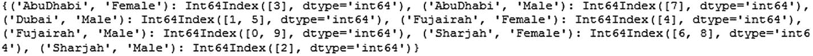

## 遍历分组

你可以遍历特定的分组，如清单 6-34 所示。当你遍历性别分组时，应该清楚的是，默认情况下 `groupby` 对象的名称与组名相同。

```
In [7]: grouped = dataset.groupby('Gender')
for name,group in grouped:
print (name)
print (group)
print ("\n")
清单 6-34
遍历分组数据
```

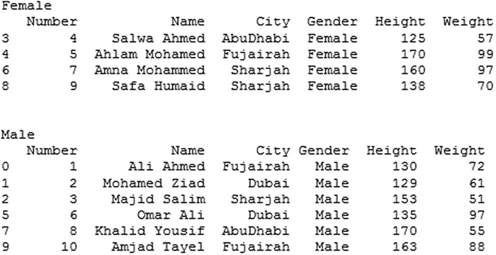

你也可以使用 `get_group()` 方法选择特定的分组，如清单 6-35 所示，其中你按性别对数据进行分组，然后仅选择女性。

```
In [9]: grouped = dataset.groupby('Gender')
print (grouped.get_group('Female'))
清单 6-35
选择单个分组
```

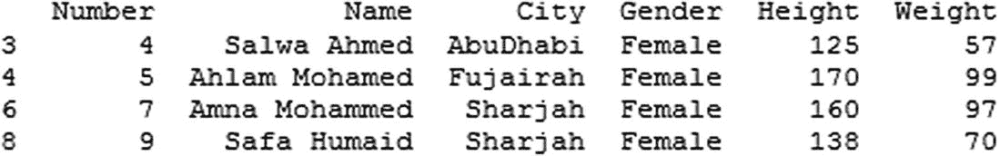

## 聚合

聚合函数为每个分组返回一个单一的聚合值。一旦创建了 `groupby` 对象，你就可以对分组后的数据实现各种函数。在清单 6-36 中，你计算了男性和女性身高和体重的平均值和大小。此外，你还计算了男性和女性两种模式的求和与标准差。

```
In [18]: # 聚合
grouped = dataset.groupby('Gender')
print (grouped['Height'].agg(np.mean))
print ("\n")
print (grouped['Weight'].agg(np.mean))
print ("\n")
print (grouped.agg(np.size))
print ("\n")
print (grouped['Height'].agg([np.sum, np.mean, np.std]))
清单 6-36
数据聚合
```

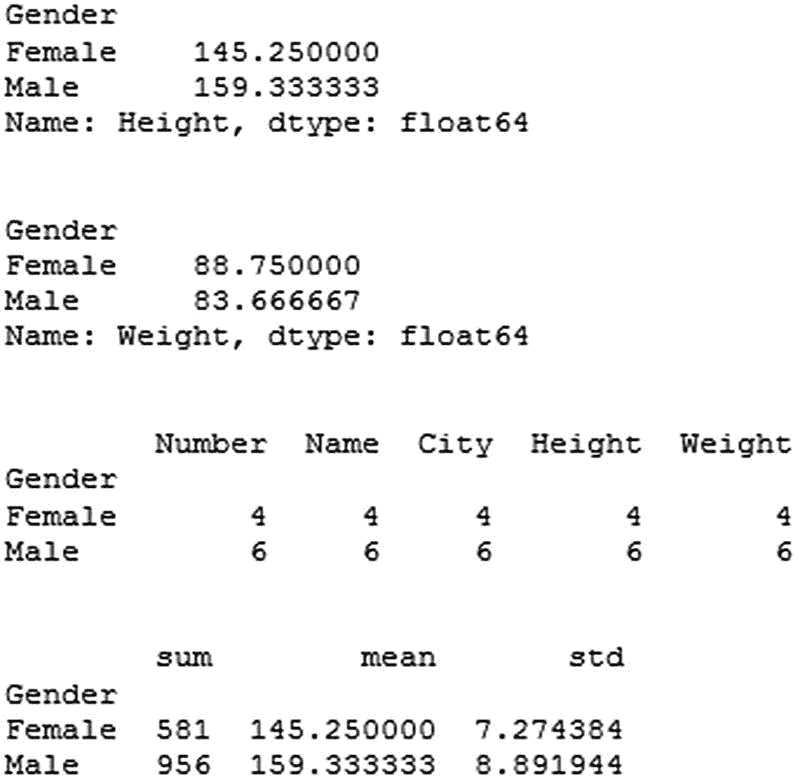

## 转换

对分组或列的转换会返回一个与被分组对象索引大小相同的对象。因此，转换应返回一个与分组块大小相同的结果。参见清单 6-37。

```
In [26]: dataset = dataset.set_index(['Number'])
print (dataset)
清单 6-37
创建索引
```

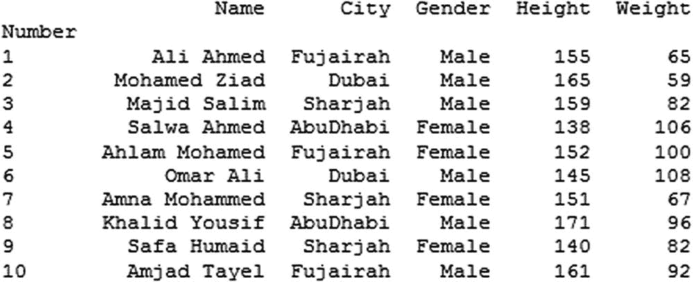

在清单 6-38 中，你按 `Gender` 对数据进行分组，然后实现函数 lambda `x: (x - x.mean()) / x.std()*10`，并显示身高和体重的结果。lambda 运算符或 lambda 函数是一种创建小型匿名函数（即没有名称的函数）的方式。此函数是一次性函数；换句话说，它仅在创建它的地方需要。

```
In [28]: grouped = dataset.groupby('Gender')
score = lambda x: (x - x.mean()) / x.std()*10
print (grouped.transform(score))
清单 6-38
转换
```

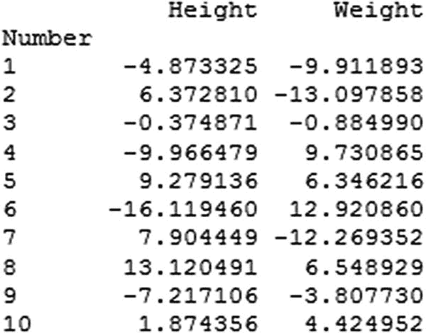

## 过滤

Python 提供了直接的数据过滤功能。在清单 6-39 中，你按城市应用了过滤，返回在数据集中出现超过三次的城市。

```
In [30]: print (dataset.groupby('City').filter(lambda x: len(x) >= 3))
清单 6-39
过滤
```

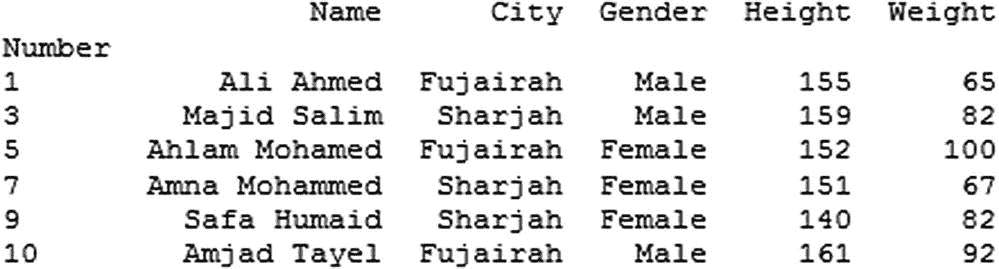

### 总结

本章涵盖了如何在不同的集合结构中探索和分析数据。以下是你在本章中学习的内容列表：

*   如何运用 Python 技术探索和分析一系列数据、创建序列、通过位置访问序列中的数据，以及将统计方法应用于序列。

*   如何在数据框中探索和分析数据、创建数据框、更新和访问数据。这包括列和行的选择、添加和删除，以及将统计方法应用于数据框。

*   如何将统计方法应用于面板以探索和分析其数据。

*   如何对通过实现 Python 数据分组、遍历分组、聚合、转换和过滤技术而得到的数据应用统计分析。

下一章将介绍如何使用众多绘图包等工具进行数据可视化。

# 练习与答案

1.  根据以下表格数据字典创建一个名为 `df` 的数据框，其索引标签为：`['a', 'b', 'c', 'd', 'e', 'f', 'g', 'h', 'i', 'j']`。

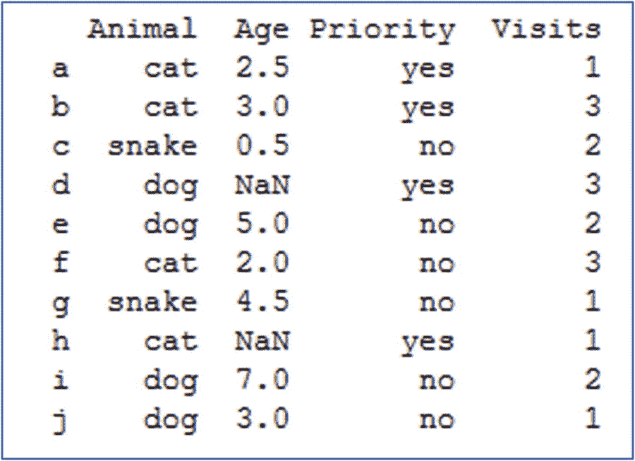

**答案：** 你需要同时导入 `Pandas` 和 `Numpy` 库。

```
import numpy as np
import pandas as pd
```

你必须创建一个字典和一个标签列表，然后调用数据框方法并将标签列表指定为索引，如代码清单 6-40 所示。

```
In [5]: import numpy as np
import pandas as pd
import matplotlib as mpl
data = { 'Animal': ['cat', 'cat', 'snake', 'dog', 'dog',
'cat', 'snake', 'cat', 'dog', 'dog'],
'Age': [2.5, 3, 0.5, np.nan, 5, 2, 4.5, np.nan, 7, 3],
'Visits': [1, 3, 2, 3, 2, 3, 1, 1, 2, 1],
'Priority': ['yes', 'yes', 'no', 'yes', 'no', 'no', 'no', 'yes', 'no', 'no']}
labels = ['a', 'b', 'c', 'd', 'e', 'f', 'g', 'h', 'i', 'j']
#Create a DataFrame df from this dictionary data which has the index labels.
df = pd.DataFrame( data, index = labels, columns=['Animal', 'Age', 'Priority', 'Visits'])
print (df)
代码清单 6-40
创建表格数据框
```

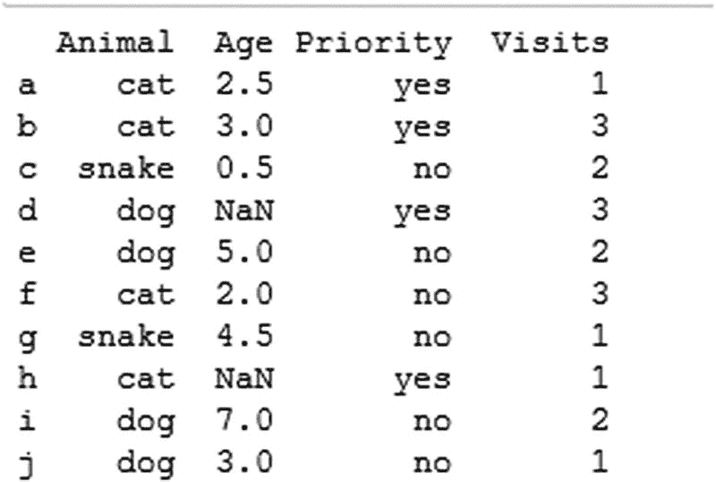

2.  显示数据框基本信息的摘要。

你可以使用 `df.info()` 和 `df.describe()` 来获取数据集的完整描述，如代码清单 6-41 所示。

```
In [6]: df.info()
代码清单 6-41
数据框摘要
```

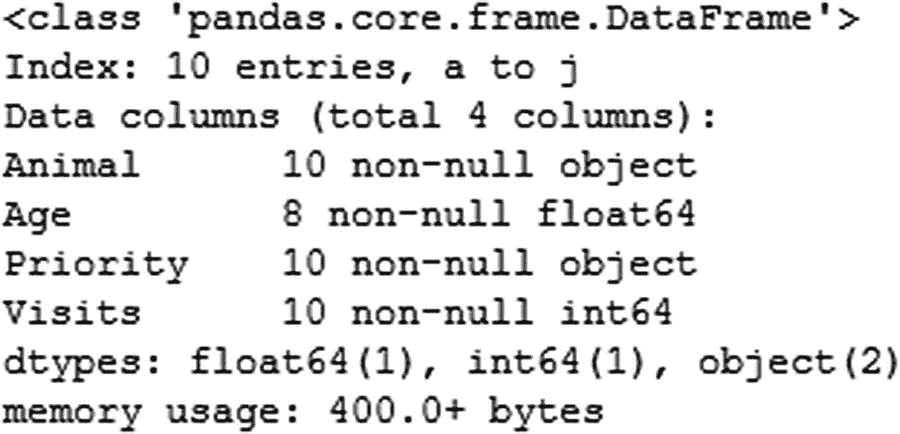

```
In [7]: df.describe()
```

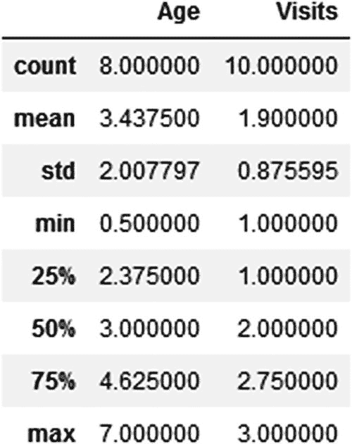

3.  返回数据框 `df` 的前三行。

代码清单 6-42 展示了如何使用 `df.iloc[:3]` 和 `df.head(3)` 来检索数据框的前 `n` 行。

```
In [12]: df.head(3)
代码清单 6-42
选择特定的 n 行
```

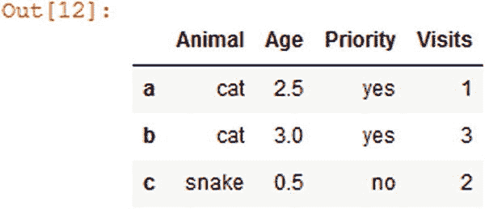

```
In [13]: df.iloc[:3]
```

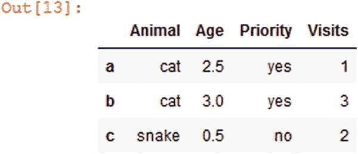

4.  仅从数据框 `df` 中选择 `animal` 和 `age` 列。

Python 数据框的 `loc()` 方法用于检索特定模式 `df.loc[ : , ['Animal', 'Age']]`。此外，也可以使用数组形式的检索 `df[['Animal', 'Age']]`。参见代码清单 6-43。

```
In [16]: df.loc[:,['Animal', 'Age']]
# or
df [['Animal', 'Age']]
代码清单 6-43
切片数据框
```

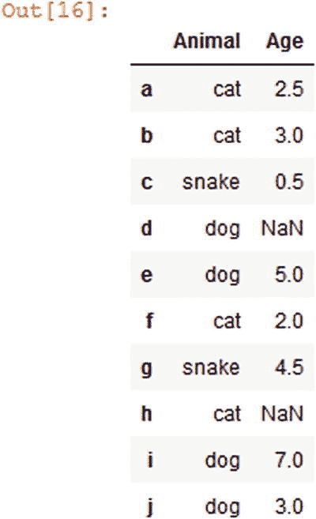

5.  统计每种动物的访问优先级。

```
In [8]: df.groupby('Priority')['Animal'].count()
```

6.  计算动物年龄的平均值。

```
In [10]: df.groupby('Animal')['Age'].mean()
```

7.  显示数据集的摘要。参见代码清单 6-44。

```
In [13]: df.groupby('Animal')['Age'].describe()
代码清单 6-44
数据集摘要
```

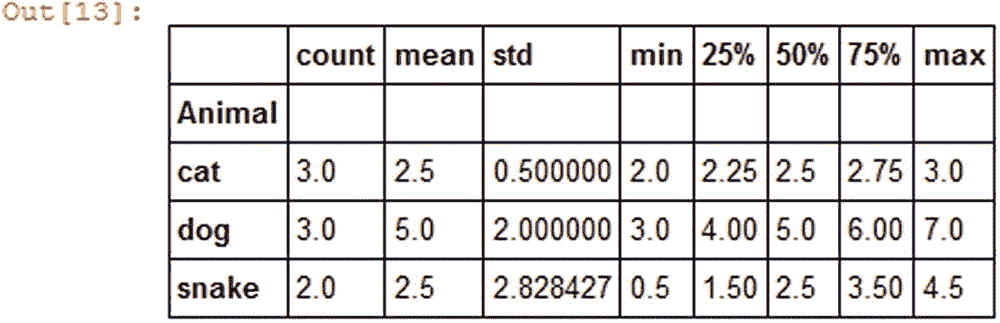