# 8. 案例研究

本章涵盖两个案例研究。我将提供每个案例的一些简要信息，然后展示如何收集分析所需的数据、如何分析数据以及如何可视化与特定模式相关的数据。

## 案例研究 1：美国死亡原因（1999–2015）

本研究分析了 1999 年至 2015 年间美利坚合众国的主要死亡原因。

### 数据收集

从可靠来源收集研究数据集非常重要；使用更新且准确的数据集以获得无偏倚的发现也同样重要。本案例研究的数据集来自美国政府的开放数据，可通过 [`https://data.gov`](https://data.gov) 访问。

你可以从此处下载：

[`https://catalog.data.gov/dataset/age-adjusted-death-rates-for-the-top-10-leading-causes-of-death-united-states-2013`](https://catalog.data.gov/dataset/age-adjusted-death-rates-for-the-top-10-leading-causes-of-death-united-states-2013)

本案例研究将尝试回答以下问题：

-   数据集中记录的总数是多少？
-   该数据集中有哪些死亡原因？
-   1999 年至 2015 年间美国的总死亡人数是多少？
-   1999 年至 2015 年每年的死亡人数是多少？
-   总体而言，哪十个州的死亡人数最多？
-   在此期间，美国的主要死亡原因是什么？

### 数据分析

让我们首先读取并清理数据集。

-   记录的死亡案例总数是多少？

参见代码清单 8-1。

```
In [2]: import pandas as pd
data = pd.read_csv("NCHS.csv")
data.head(3)
代码清单 8-1
美国死亡原因清理后的记录
```

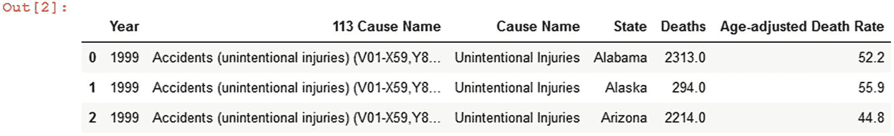

```
In [3]: data.shape # 15028 行，6 列
Out[3]: (15028, 6)
```

删除所有包含 `na` 值的行。

```
In [4]: data = data.dropna()
data.shape
Out[4]: (14917, 6)
```

在美国不同州记录了大约 14,917 例死亡案例。

现在让我们清理数据以找出数据集中的死亡原因数量。

-   该数据集中有哪些死亡原因？

参见代码清单 8-2。

```
In [7]: causes = data["原因名称"].unique()
causes
代码清单 8-2
美国独特的死亡原因
```

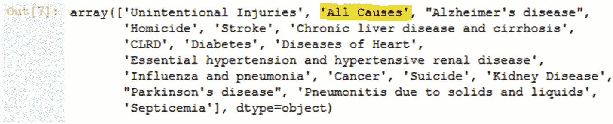

从 `原因名称` 列中移除 `所有原因`。

```
In [8]: data = data[data["原因名称"] !="所有原因"]
causes = data["原因名称"].unique()
causes
```

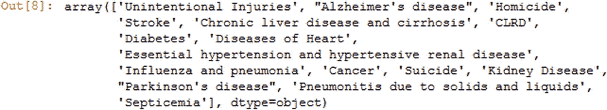

```
In [9]: len(causes)
Out[9]: 16
```

如图所示，根据加载的数据集，共有 16 种死亡原因。

清理数据以找出研究中包含的独特州。

参见代码清单 8-3。

```
In [11]: state = data["州"].unique()
state
代码清单 8-3
研究中的独特州
```

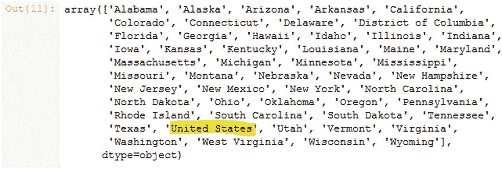

```
In [12]: data1 = data[data["州"] !="美国"]
state = data1["州"].unique()
state
```

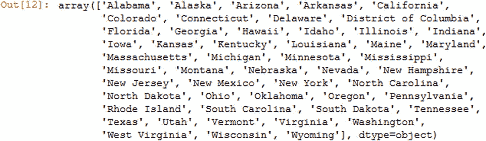

```
In [13]: len(state)
Out[13]: 51
```

研究中包含 51 个州。

-   1999 年至 2015 年间美国的总死亡人数是多少？

```
In [15]: data["死亡人数"].sum()
Out[15]: 69279057.0
```

给定期间的总死亡人数为 69,279,057。

-   1999 年至 2015 年每年的死亡人数是多少？

参见代码清单 8-4。

```
In [16]: dyear= data.groupby(["年份"]).sum()
dyear
代码清单 8-4
研究每年的死亡趋势
```

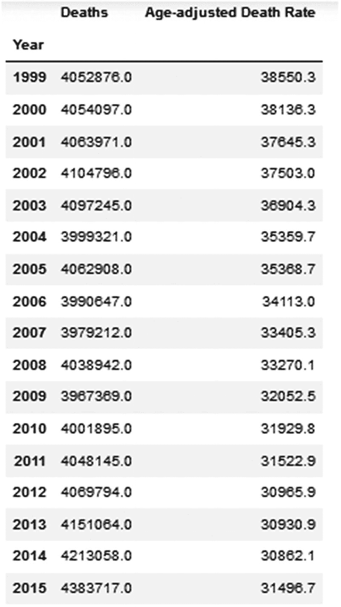

```
In [18]: dyear["死亡人数"].plot(title="每年死亡人数 \n 1999-2015")
```

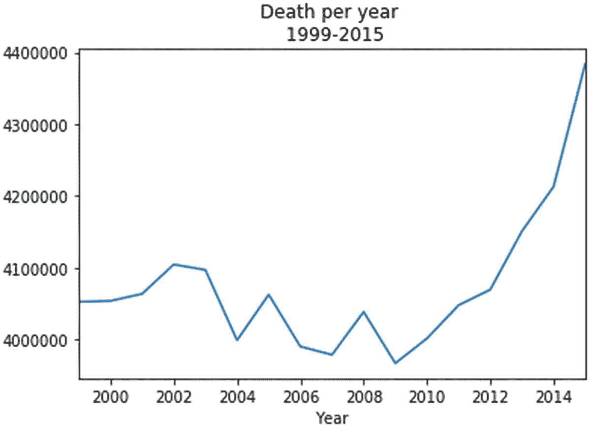

死亡人数在 2002 年至 2009 年间有所下降。随后，从 2010 年到 2013 年，死亡人数持续增长。最后，在 2013 年和 2014 年，死亡人数急剧增加。


### 数据可视化

将数据绘制成图表可以清晰地揭示数据背后的模式，并有助于在商业中做出正确决策。

- 总体而言，哪十个州的死亡人数最高？

请参见代码清单 8-5。

```
In [19]: data1 = data[data["State"] !="United States"]
dataset2 = data1.groupby("State").sum()
dataset2.sort_values("Deaths", ascending=False , inplace = True)
dataset2.head(10)
Listing 8-5
美国死亡人数最多的十个州
```

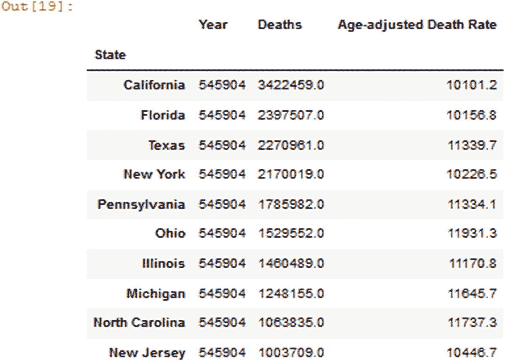

```
In [20]: dataset2["Deaths"].head(10).plot.bar(title= "1999-2015 年死亡人数最多的十个州")
```

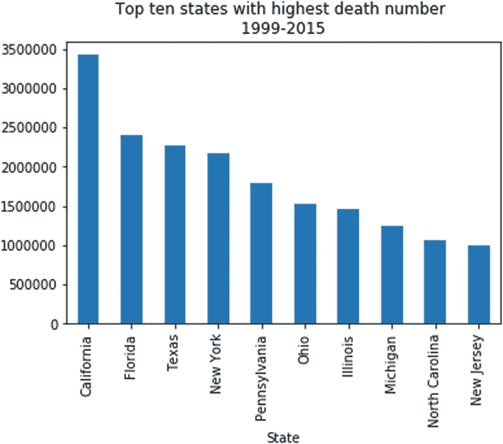

加利福尼亚州的死亡人数在美国最高，佛罗里达州位居第二。

- 在此期间，美国的主要死因是什么？

请参见代码清单 8-6。

```
In [21]: dataset1 = data[data["Cause Name"] !="All Causes"]
dataset2 = dataset1.groupby("Cause Name").sum()
dataset2.sort_values("Deaths", ascending=False , inplace = True)
dataset2.head(10)
Listing 8-6
美国十大死因
```

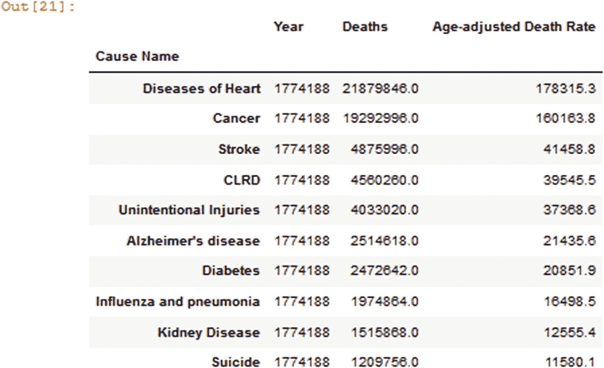

```
In [22]: dataset2["Deaths"].head(10).plot.bar(title="1999-2015 年美国十大死因")
```

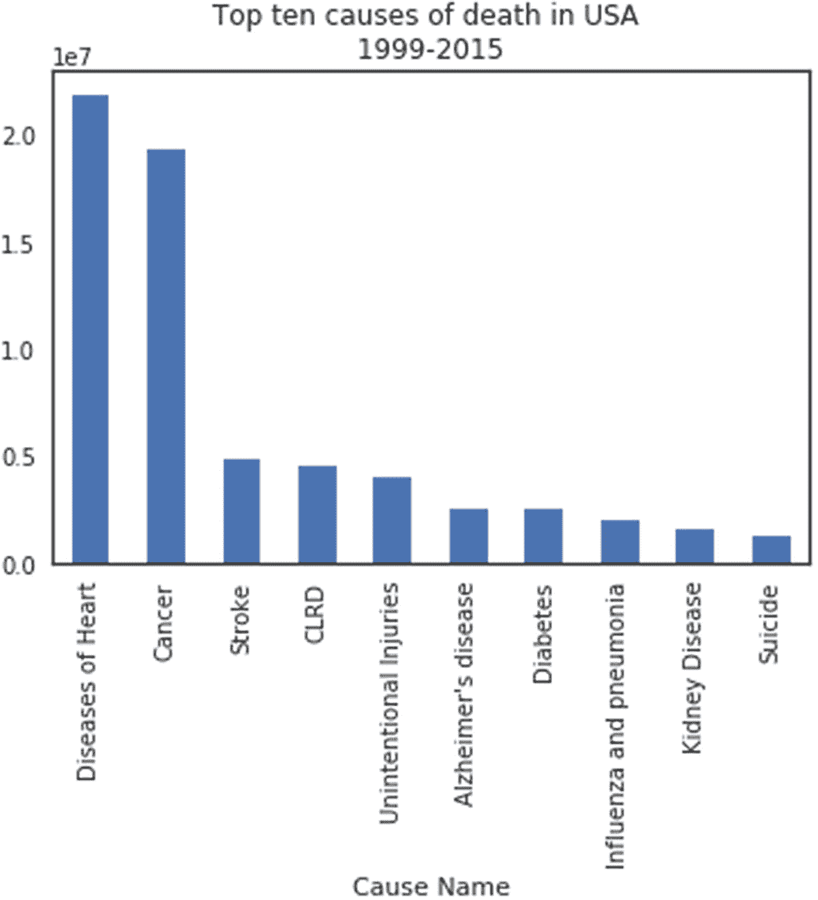

心脏病是导致死亡的最大原因，其次是癌症。

### 研究发现

表 8-1 总结了研究发现。

**表 8-1** 案例研究 1：研究发现

| 调查问题 | 研究发现 |
| --- | --- |
| 1. 数据集中记录的总数是多少？ | 美国记录的死亡人数约为 14,917 人。 |
| 2. 该数据集中有哪些死因？ | 根据研究数据集，共有 16 种死因。 |
| 3. 1999 年至 2015 年美国的总死亡人数是多少？ | 该期间的总死亡人数为 69,279,057 人。 |
| 4. 1999 年至 2015 年每年的死亡人数是多少？ | 从 2002 年到 2009 年，死亡人数有所下降，随后从 2010 年到 2013 年有所增加。2013 年和 2014 年，死亡人数急剧增加。 |
| 5. 总体而言，哪十个州的死亡人数最高？ | 加利福尼亚州的死亡人数在美国最多，佛罗里达州位居第二。 |
| 6. 在此期间，美国的主要死因是什么？ | 心脏病是导致死亡的最高原因，其次是癌症。 |

## 案例研究 2：分析美国枪击死亡事件（2012–2014 年）

本研究分析了 2012 年至 2014 年间美国的枪击死亡事件。

本案例研究将尝试回答以下问题：

- 2012 年至 2014 年，美国每年因枪击自杀的死亡人数（按性别划分）是多少？
- 2012 年至 2014 年，美国每 10 万人中按种族划分的枪击死亡人数是多少？
- 2012 年至 2014 年，美国每年平均枪击死亡人数（按原因划分）是多少？
- 2012 年至 2014 年，美国每年每 10 万人中枪击死亡人数的百分比（按原因划分）是多少？
- 2012 年至 2014 年，美国每年因枪击自杀的死亡人数百分比（按年份划分）是多少？

### 数据收集

本研究的数据集来自 GitHub，可在此处访问：

[`https://github.com/fivethirtyeight/guns-data.git`](https://github.com/fivethirtyeight/guns-data.git)

加载并清理数据集，为处理做好准备。

请参见代码清单 8-7。

```
In [25]: import pandas as pd
import numpy as np
import matplotlib.pyplot as plt
import seaborn as sns
sns.set(style='white', color_codes=True)
%matplotlib inline
In [26]: dataset = pd.read_csv('Death data.csv', index_col=0) print(dataset.shape)
dataset.index.name = 'Index'
dataset.columns = map(str.capitalize, dataset.columns)
dataset.head(5)
(100798, 10)
Listing 8-7
读取美国枪击死亡数据（2012–2014 年）
```

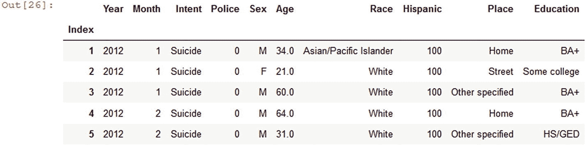

按年份和月份组织数据集。

```
In [27]: dataset_Gun = dataset
dataset_Gun.sort_values(['Year', 'Month'], inplace=True)
```

### 数据分析

现在让我们查看数据并进行一些分析。

- 这项研究包含了多少男性和女性？
- 这项研究包含了多少受过教育的女性？

```
In [28]: dataset_Gun.Sex.value_counts(normalize=False)
Out[28]: M    86349
F    14449
Name: Sex, dtype: int64
```

如图所示，这项研究涉及 14,243 名受过教育的女性。

按性别对数据集进行分组。

```
In [8]: dataset_byGender = dataset_Gun.groupby('Sex').count()
dataset_byGender
```

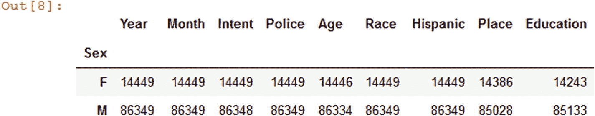


### 数据可视化

在本案例研究中，我们将尝试回答之前提出的众多问题。让我们开始吧。

- 2012 年至 2014 年间，美国按性别划分的自杀枪击死亡人数是多少？

请参见代码清单 8-8。

```
In [29]: dataset_suicide_Gender =dataset_Gun[
dataset_Gun["Intent"] =="Suicide"]
dataset_suicide_Gender.Sex.value_counts (normalize=False).plot.bar(title='Annual U.S.\\suicide gun deaths \n 2012-2014, by gender')
Listing 8-8
Gun Death by Gender
```

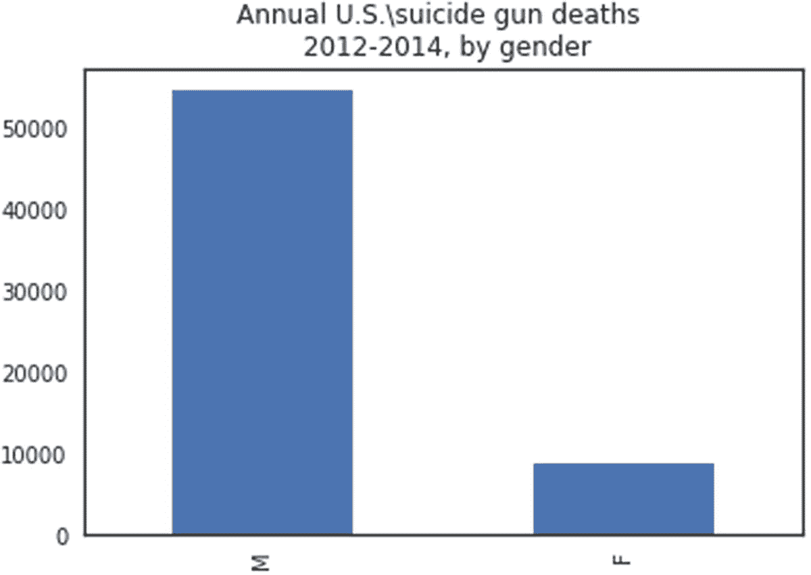

很明显，男性和女性之间存在巨大差异。男性使用枪支自杀的人数超过 50,000 人，而女性死亡人数低于 10,000 人，这表明男性更倾向于使用枪支自杀。

```
In [31]: dataset_byGender.plot.bar(title='Annual U.S. suicide gun deaths \n 2012-2014, by gender')
```

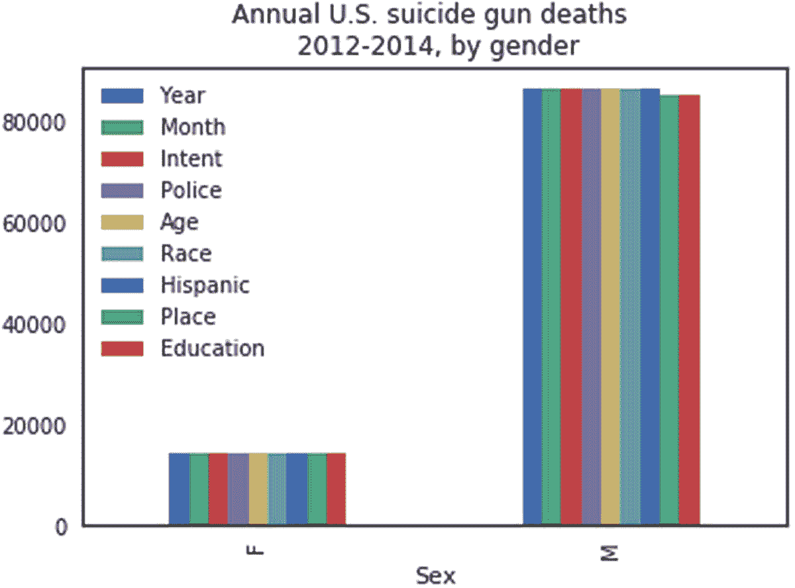

- 2012 年至 2014 年间，美国按种族划分的每 10 万人中枪击死亡人数是多少？

请参见代码清单 8-9。

```
In [32]: dataset_byRace = dataset (dataset_byRace.Race.value_counts(ascending=False)*100/100000)
Listing 8-9
Analyzing and Visualizing Gun Death Percentage by Race
```

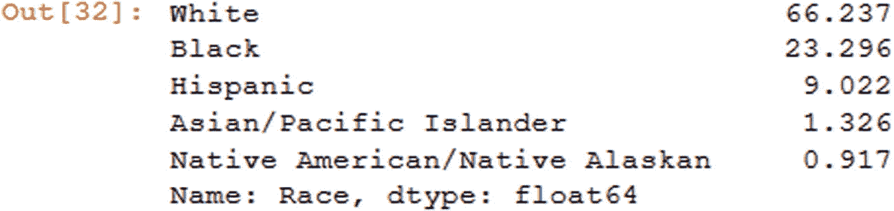

死亡率最高的是白人，其次是黑人，然后是西班牙裔。列表中还有其他一些种族，但比例相对较小。

```
In [33]:(dataset_byRace.Race.value_counts(ascending=False) *100/100000).plot.bar(title='Percent death toll from guns in the United States \nfrom 2012 to 2014, by race')
```

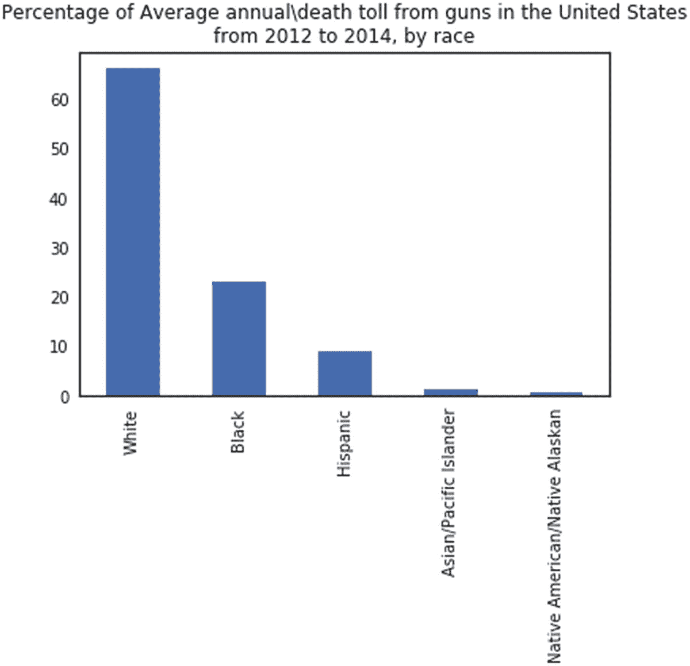

- 2012 年至 2014 年间，美国按原因划分的平均枪击死亡人数是多少？

请参见代码清单 8-10。

```
In [14]: dataset_byRace.Intent.value_counts(sort =True, ascending=False)
Listing 8-10
Visualizing Gun Death by Cause
```

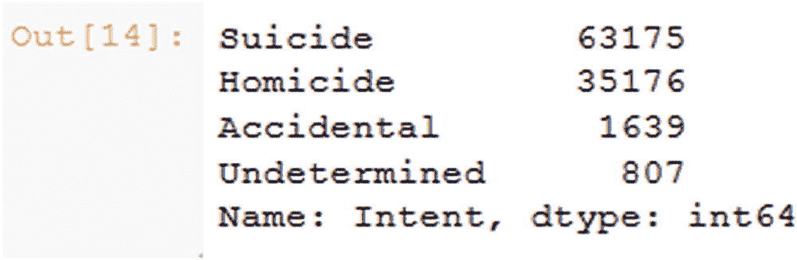

```
In [17]: dataset_byRace.Intent.value_counts(sort=True).plot.bar(title='Annual number of gun deaths in the United States on average \n from 2012 to 2014, by cause')
```

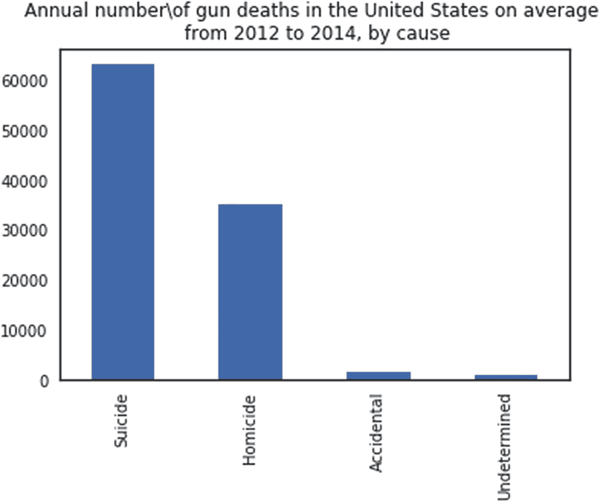

该图显示，自杀和他杀死亡人数很高，而意外死亡人数较低。

- 2012 年至 2014 年间，美国按原因划分的每年每 10 万人中枪击死亡百分比是多少？

请参见代码清单 8-11。

```
In [40]: dataset_byRace.Intent.value_counts(ascending=False) *100/100000
Out[40]: Suicide              63.175
Homicide             35.176
Accidental            1.639
Undetermined          0.807
Name: Intent, dtype: float64
In [41]: (dataset_byRace.Intent.value_counts(ascending=False) *100/100000).plot.bar(title='Rate gun deaths in the U.S. per 100,000 population \n2012-2014, by race')
Listing 8-11
Visualizing Gun Death per 100,000 by Cause
```

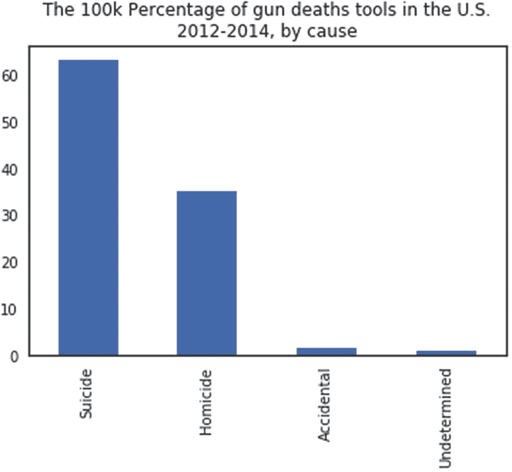

这表明每 10 万人中有 60 起自杀案例。此外，每 10 万人中有 30 起他杀案例。

- 2012 年至 2014 年间，美国按年份划分的自杀枪击死亡百分比是多少？

请参见代码清单 8-12。

```
In [42]: dataset_suicide=dataset[ dataset["Intent"] =="Suicide"]
datasetSuicide= dataset_suicide.Year.value_counts(ascending=False) *100/100000
datasetSuicide.sort_values(ascending=True)
Out[42]:
2012    20.666
2013    21.175
2014    21.334
Name: Year, dtype: float64
In [43]:datasetSuicide.sort_values(ascending=True).plot.bar(title='Percentage of annual suicide gun deaths in the United States \nfrom 2012 to 2014, by year')
Listing 8-12
Visualizing Gun Death by Year
```

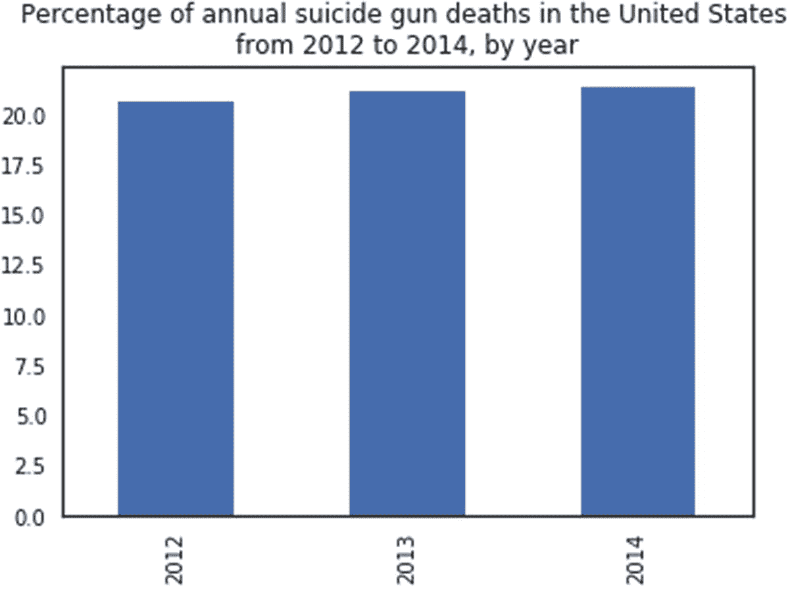

该图显示，三年中每年的自杀人数几乎相同，这意味着这是一种规律性模式。

### 发现

表 8-2 展示了研究发现。

**表 8-2** 案例研究 2：研究发现

| 调查问题 | 研究发现 |
| --- | --- |
| 1. 2012 年至 2014 年间，美国按性别划分的自杀枪击死亡人数是多少？ | 男性自杀枪击死亡人数超过 50,000 人，而女性自杀枪击死亡人数低于 10,000 人，这表明男性更倾向于使用枪支自杀。 |
| 2. 2012 年至 2014 年间，美国每 10 万人口中的枪击死亡人数是多少？ | 死亡人数最高的是白人，其次是黑人，然后是西班牙裔。 |
| 3. 2012 年至 2014 年间，美国按原因划分的年均枪击死亡人数是多少？ | 自杀和他杀死亡人数很高，而意外死亡人数较低。 |
| 4. 2012 年至 2014 年间，美国按原因划分的每年每 10 万人中枪击死亡百分比是多少？ | 每 10 万人百分比显示，每 10 万人中有 60 起自杀案例，这个比例不算高。此外，每 10 万人中有 30 起他杀案例。 |
| 5. 2012 年至 2014 年间，美国按年份划分的每年自杀枪击死亡百分比是多少？ | 分析显示，三年中每年的自杀人数几乎相同，这意味着这是社会中的一种规律性模式。 |

## 总结

本章介绍了如何将 Python 技术应用于两个不同的案例研究。以下是您学到的内容：

- 如何确定所调查的问题
- 如何确定需要回答的主要问题
- 如何寻找可靠的数据源
- 如何探索收集到的数据以移除异常值
- 如何分析和可视化清洗后的数据
- 如何讨论研究发现

