# 第三部分：在高级技能中使用 API

现在你已经学会了如何创建 Alexa 技能，我们将开始使用应用程序编程接口（API）。这是通过互联网收集数据的常见方式。我们将特别使用两个 API 来构建一个个人净资产技能，该技能可以告诉你房屋和投资的价值。当然，这样的技能会接触到你的部分个人数据，但所有数据都将安全地存储在受保护的数据库中并加密保护。在任何情况下，你都可以选择使用测试账户进行开发，因此完全不需要涉及真实数据。

**第 14 章：个人净资产技能**

想象一下 Alexa 能够告诉你净资产的情况。通过使用账户关联和 DynamoDB，我们可以安全地存储你的个人数据。在本章中，我们将完善 VUI 并构建后端 lambda 函数。但一旦对话模型设计完成，如何获取你的资产价值呢？答案就在互联网上——通过使用 API。

**第 15 章：房地产 API**

通过使用名为 Rapid API 的网站，我们找到了几个可以为房屋估价的 API。其中 Realty Mole 的销售价格估算器尤为突出。在本章中，我们将弄清楚如何利用第 14 章中提供给 Alexa 的地址来获取你的房屋价格。

**第 16 章：股票市场 API**

从数百个股票价格 API 中选择一个后，我们将其集成到 lambda 函数中。本章将扩展第 12 章中的单元测试内容，测试多种不同场景以确保你的股票投资组合得到正确估值。本章最后会提供一些改进技能的建议。

**第 17 章：下一步是什么？**

在本书中，你接触了多种数据源，包括 DynamoDb 等数据库以及 Realty Mole Property API 等 API。此外，你还创建并测试了作为云端后端应用的 lambda 函数。这些 Lambda 后端可以从任何地方拉取数据，并通过 Alexa 技能界面呈现。下一步是什么？本书只是你数据驱动 Alexa 技能之旅的起点。我迫不及待想听听你将会构建什么。

## 致谢

感谢我的家人，特别是我的妻子，在整个过程中给予我的支持。感谢阅读各章节并提供编辑建议和推荐的朋友们。特别感谢 Jos`é`和 Joan 对代码的测试。感谢 Alexa 布道师 Jeff Blankenburg 和 Justin Jeffress，他们教会了我很多。感谢 Alexa 社区的支持和鼓励，尤其是 Tradelast、Goldzulu、Oxygenbox 和 Xeladotbe（另见[`https://apl.ninja`](https://apl.ninja)）。

## 关于作者

## 关于技术审校者


### VUI 简史

两百多年来，科学家们一直追求与智能设备实现完全对话式交互的梦想。1773 年，德国科学家克里斯蒂安·克拉岑斯坦成功利用连接在音管上的共鸣管发出了元音。^(¹) 如今，聊天机器人和智能设备的普及，已使语音交互成为全球数百万用户日常生活中的常见场景。这是一段激动人心的探索之旅。

20 世纪 30 年代，贝尔实验室的研究员霍默·达德利开发了第一台计算机化语音合成器。^(²) 这台名为 `VODER`（语音操作演示器）的设备，由操作员海伦·哈珀通过十个按键、一个踏板和一个腕板组合操作来发出单词。海伦花了大约一年时间才学会如何让 `VODER` 说话。在图 1-1 中，海伦正在 1939 年世界博览会上操作 `VODER`。


图 1-1

1939 年世界博览会上的 `VODER`。公有领域

1952 年，贝尔实验室率先推出名为 `Audrey` 的语音识别系统，该系统能够识别数字 0 到 9。20 世纪 60 年代初，IBM 紧随其后，推出了 `Shoebox`，这台机器能理解 16 个口语单词，并能根据指令执行算术运算。^(³) 在图 1-2 中，科学家兼发明家威廉·C·德施正在演示 `Shoebox`。


图 1-2

IBM 工程师威廉·C·德施于 1961 年演示 `Shoebox`。（图片由国际商业机器公司提供）

在 20 世纪 60 年代和 70 年代的冷战期间，世界各地的实验室都在开发语音识别技术。例如，从 1972 年到 1976 年，DARPA（美国国防高级研究计划局）设立了语音理解研究（SUR）项目，旨在创造一台能够理解连续语音的计算机。^(⁴) SUR 项目下的几个子项目颇具前景，但均未达到项目的性能目标。20 世纪 70 年代的计算机性能不足以处理除最基本语音识别之外的机器学习与人工智能模型。

20 世纪 80 年代是一个重大变革时期。不仅个人电脑开始普及，Windows 成为事实上的标准操作系统，而且语音合成与识别技术也从基于模式识别的系统转向了基于算法和统计模型的系统。正是在这个时期，我们完善了隐马尔可夫模型（HMM）。肖恩·埃迪在其 2004 年关于 HMM 的论文中解释道：“HMM 是为线性序列‘标注’问题建立概率模型的形式化基础……HMM 是计算序列分析领域的乐高积木。”^(⁵)

1982 年，詹姆斯·贝克博士和珍妮特·贝克博士为基于 DOS 的计算机推出了 Dragon Dictate。这款软件价格昂贵，但它允许用户直接向工具口述内容（尽管速度较慢），而无需打字。20 世纪 80 年代末，随着深度神经网络的引入，我们开始拥有将语音识别提升到新水平的机制，尽管计算能力尚显不足。

大约在 1990 年，DARPA 重新加入竞争，开发了多种模拟和可识别的语音词汇库。1997 年，在 Dragon Dictate 推出 15 年后，贝克夫妇发布了更为复杂、速度更快的 Dragon Naturally Speaking 1.0。^(⁶) 除了听写功能外，Naturally Speaking 还提供了 PC 语音控制以及文本转语音功能，让电脑能够朗读你的数字文档。

2005 年，IBM 与本田合作，将 IBM 的 Embedded ViaVoice 软件集成到本田的 Acura（轿车）和 Odyssey（小型货车）产品线中。^(⁷) 汽车制造商一直在努力为驾驶员带来纯语音体验。

2008 年至 2010 年间，谷歌为其网页应用和移动设备推出了语音搜索功能，使用户能够说出搜索条件。谷歌的语音转文字技术将口语转换为文本，并提交给其顶尖的搜索引擎。当时，谷歌的语音搜索团队在一篇论文中写道：

> *谷歌的一个目标是让语音访问无处不在。我们希望让用户拥有选择权——他们应该理所当然地认为语音交互始终是一个可选项。实现无处不在需要两件事：可用性（即，内置到每一个语音输入或输出有意义的交互中）和性能（即，运行得足够好，以至于这种交互方式不会给交互增加任何摩擦）。——Schalkwyk 等人*^(⁸)

2011 年秋季，在第一代 iPhone 发布四年后，苹果公司宣布集成语音激活的个人助理 `Siri`。^(⁹) `Siri` 允许用户通过语音与 iPhone 进行交互。拨打电话、发送短信、设置约会、获取路线、开启或关闭 iPhone 功能等等，只需说一声“嘿 Siri”并命令她执行即可。`Siri` 源自 Adam Cheyer 长达二十年的研发，他与联合创始人 Dag Kittlaus 和 Tom Gruber 共同创建了一家小公司，并开发了一款通过苹果 App Store 销售的语音助手应用。在完善应用、发展公司并进行大量谈判之后，创始人以据报道 2 亿美元的价格将 Siri Inc. 卖给了苹果。^(¹⁰)

几年后的 2014 年，微软推出了其语音助手版本 `Cortana`，最初用于 Windows Phone，最终扩展到 Windows 10 Mobile、Windows 10 PC、Xbox One 以及 iOS 和 Android 平台。^(¹¹) 如今，`Cortana` 是全世界分布最广（尽管不一定使用最广）的语音用户界面之一。

同样在 2014 年，亚马逊在 Amazon Echo 智能音箱上推出了 `Alexa`，^(¹²) 将智能设备送入全球每个家庭的竞赛就此拉开帷幕！Echo 设备是首批广泛普及的智能音箱技术，它将语音激活与简单命令及吸引人的功能相结合。用户可以说：“Alexa，现在几点了？”或者“Alexa，随机播放我的播放列表。”她就会做出相应的回应。请参见图 1-3，了解你可以让 `Alexa` 执行的部分操作示例。


图 1-3

配备 `Alexa` 语音助手的 Amazon Echo 智能音箱

全球消费者正在拥抱智能技术，市场也取得了飞跃式增长，我们将在下一节中看到这一点。


### 当今的语音用户界面格局

目前，全球智能音箱市场主要有五大参与者。它们合计占据了总销量的 88%。该市场从 2018 年到 2019 年增长了 60.3%，销量从 7800 万台增加到 1.25 亿台，增加了 4700 万台。^(¹³) 智能音箱行业最突出的参与者是（见图 1-4）：


图 1-4

全球市场份额百分比（来源：Canalys）

1.  **亚马逊。** 过去两年一直是该领域的领导者，拥有 30%的市场份额。亚马逊的 Alexa 智能音箱、屏幕和设备销往世界各地。Alexa 技能商店中提供了超过 10 万种技能，使 Alexa 成为市场上功能最丰富的智能音箱。

2.  **谷歌。** 美国搜索巨头谷歌推出了 Nest 系列智能音箱和屏幕，拥有 19%的市场份额。这些设备以前称为 Google Home，使用内置谷歌搜索的 Google Assistant 语音服务。

3.  **百度。** 中国顶级搜索引擎公司百度于 2017 年收购了渡鸦。Raven H 智能音箱价格昂贵，但在 2018 年，他们高调推出了价格更低的小度智能音箱，并在 90 秒内售出了 1 万台。百度目前拥有 14%的市场份额。其智能音箱连接至开放平台个人助理服务 DuerOS。尽管运费和关税仍在上涨，但不可否认，这些智能音箱定价颇具吸引力，尤其是在其本土中国市场。

4.  **阿里巴巴。** 中国在线零售商阿里巴巴于 2017 年推出了天猫精灵。这款智能音箱连接至阿里巴巴的个人助理服务 AliGenie。阿里巴巴目前在其产品目录中提供了超过 1 万种不同的智能设备。

5.  **小米。** 中国电子产品制造商小米以其 Mi 品牌提供智能手机和智能音箱。小米 AI 音箱连接至小米的小爱虚拟助手。

尽管苹果 HomePod 智能音箱的销量不及五大巨头，但苹果的 Siri 语音用户界面也存在于全球每一部 iPhone 和 iPad 上，这使其在行业中占据了重要地位。

许多其他公司也在大力投资语音技术，例如微软（其语音助手 Cortana 存在于全球每一台 Windows 电脑上）、Sonos（使用 Google Assistant）、三星（拥有自己的 Bixby 个人助手）和 IBM（拥有其 Watson 技术）。音响和娱乐技术供应商，如 Bose（内置亚马逊 Alexa 和 Google Assistant）、贝尔金（Google Assistant）和 Facebook（Alexa），正在推出自己的语音设备或与合作伙伴共同推出。

在其他市场和行业中，语音也变得越来越普遍。例如，美国陆军正在开发联合理解与对话界面（JUDI），使士兵能够通过无线麦克风使用非正式语言与智能机器人进行交互（见图 1-5）。机器人将利用其传感器数据来帮助解释给定的命令。

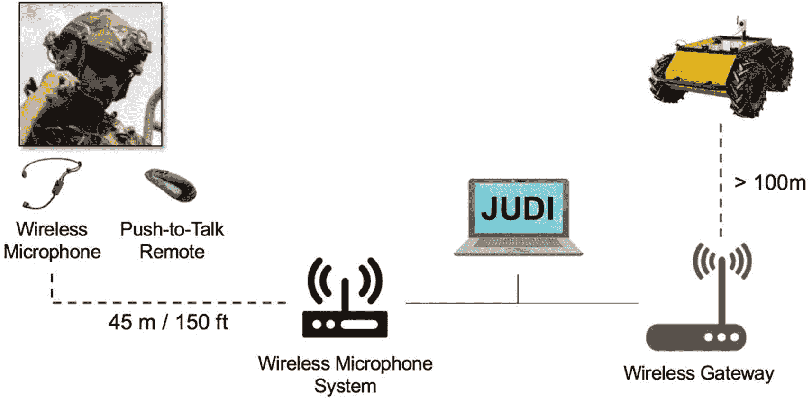

图 1-5

JUDI – 一种供士兵无线控制机器人的语音界面（美国陆军照片）

在汽车行业，语音用户界面已成为消费者期望在新车中看到的必备配置。汽车制造商提供了多种解决方案，包括在汽车中嵌入 Alexa 和 Google Assistant。与此同时，设备制造商正通过 Roav Viva、Garmin Speak 和 Amazon Echo Auto 等即插即用适配器将 Alexa 带入汽车。

不仅行业和政府正在投资语音技术，美国消费者也参与其中。大约三分之一的美国住宅现在拥有智能技术，包括智能音箱、智能电视、智能灯和智能插头。在下一节中，我们将介绍一些在家中运用智能技术的创新方法。

### 智能家居

“Alexa，打开我的家庭办公室。”

“好的，”她回应道。仿佛变魔术一般，顶灯和吊扇亮起，电脑启动，打印机开始嗡嗡作响。摇头风扇开启；蜡烛蜡加热器发出微光，将浓郁的香草味送入房间；台灯也亮了。同样，只需简单说一句“Alexa，关闭房屋准备过夜”，鱼缸的灯光就会变暗，车库门和前门锁上，恒温器将温度降低 2 度，整个房子的灯都会关闭。

欢迎来到智能家居。通过将智能音箱连接到集线器（可能是你的智能手机）以及遍布家中的无线设备，你可以控制电源状态（开/关）、调光器、音量等。任何带插头的设备都可以插入智能插座，这样只需对你的智能音箱发出简单的语音命令即可打开或关闭；见图 1-6。将灯泡和开关更换为可无线连接到集线器的智能设备，你就可以通过向智能音箱发出简单命令来轻松控制它们。


图 1-6

智能插头和智能灯泡在智能家居中与 Alexa 配合使用

智能设备也非常适合用于监控。智能烟雾和一氧化碳探测器、安防摄像头、运动探测器和可视门铃很常见。婴儿监视器、智能手表和心脏监测器也已有售。与家庭公用设施集成，智能恒温器、水系统、泄漏探测器和照明可以节省大量账单费用。在家庭娱乐类别中，有智能电视和智能遥控器，使家庭影院更易于操作。在厨房和洗衣房，有智能炉灶和冰箱、智能洗衣机和烘干机、智能微波炉和咖啡机。自亚马逊 Echo 推出以来的短短几年里，已有数千种产品被打造为“可与 Alexa 配合使用”。这些产品中有一些引人入胜的智能设备。例如，iRobot 的 Roomba 是一款声控机器人吸尘器。惠而浦的智能电灶系列具有语音控制和扫描烹饪技术。而科勒的 Numi 2.0 智能马桶支持 Alexa，可实现自动冲水和免提关闭座圈。是的，会说话的智能马桶已经问世！面对这些新奇事物，你可能会问自己：这是为什么？


### 为什么是语音？为什么是 Alexa？为什么是现在？

**为什么是语音？** 我们已经达到了语音技术既普及又实用的阶段。它的覆盖范围和能力与日俱增。我们早已过了它只是新奇玩意的阶段。我们正迈向一个语音成为商业世界标准组成部分的未来。用不了多久，高管们就会期望从他们的智能音箱那里获得快速、频繁的更新。语音是自然而然的。说一句“`Alexa`，运行一下过去一小时的数据”或者“`Alexa`，我们今天能达成销售目标吗？”是如此简单。这些正是我们将在本书中构建的技能类型。

**为什么是 Alexa？** 除了是行业领先的智能音箱之外，为`Alexa`构建自定义技能的主要原因是它相对容易实现。只要了解`Python`或`JavaScript`，你就能在一两天内让自定义技能上线运行。其他一些平台似乎刻意让创建自定义技能变得困难。当你深入研究`Alexa`的文档时，你会发现它非常详尽，与`Alexa`集成的`Amazon Web Services`的文档也是如此。凭借一个易于上手的平台、良好的文档、熟悉的编程语言以及引人入胜的市场前景，`Alexa`是数据驱动技能开发的强力选择。

**为什么是现在？** 语音技术足够新，以至于有大量的发现、发明和研究在推动平台向前发展。同时它也足够成熟，我们已经解决了大部分基础设施和硬件问题。API 定义明确。大多数工具都已进入 2.0 或更高版本。现在是学习这项新技术的好时机。消费者用例已经确立了好几年。商业用例尚待确定。现在是加入前沿领域并构建数据驱动型`Alexa`技能的最佳时机。

### 总结

在本章中，我们了解了语音用户界面，它们的过去和现在。我们发现了`Alexa`和智能家居技术。最后，我们回答了三个为什么：为什么是语音？为什么是 Alexa？为什么是现在？

有了这个基础，我们就可以开始构建`Alexa`技能了。在下一章中，我们将配置一个例程，然后使用蓝图创建一个自定义技能。

脚注 1 2 3 4 5 6 7 8 9 10 11 12 13

## 2. 例程与蓝图

既然我们已经了解了 VUI 和智能技术，那么让我们更深入地探讨一下`Alexa`到底是什么，并看看如何从蓝图创建例程和自定义技能。

### 什么是 Alexa？

`Alexa`是亚马逊为智能音箱、智能屏幕和其他智能设备提供的语音用户界面。通过对你的`Alexa`设备说出简单的命令，你可以获得智能响应。你可以让`Alexa`做以下事情：

- 告诉你时间
- 将“你好”翻译成法语
- 掷一个`d6`、`2d20`或任意数量、任意面数的骰子
- 给你讲个故事
- 随机播放你的播放列表
- 告诉你天气
- 在 40 分钟后叫醒你（我喜欢这个）
- 给你播报每日新闻摘要
- 列出你接下来的三件待办事项
- 告诉你昨天的收盘价
- 阅读你的电子邮件
- 获取你今天需要关注的热点问题摘要
- 告诉你明天的销售预测
- 以及数百种其他请求

在`Alexa 技能商店`中，有成千上万种额外的技能你可以启用，这样`Alexa`就能和你玩游戏、激励你、帮你规划旅行、教育你、控制你的智能家居等等。例如，`Alexa`的天气功能可以告诉你温度，以及是否正在下雨或将要下雨。`Big Sky`技能则增加了空气质量、湿度、紫外线指数、风速、天气常识等更多信息。对于高级用户，`Big Sky`还提供自定义天气警报、雷达图像（在智能屏幕上）以及其他地址的天气信息。

除了`Alexa 技能商店`中的免费和高级技能外，还有几种无需构建技能即可自定义`Alexa`的方法。特别是，`Amazon 例程`和`Alexa 蓝图`无需编码，任何想要创建自定义`Alexa`体验的人都可以使用。

### Alexa 例程

当你发现自己反复让`Alexa`连续做几件事时，就应该考虑创建一个`Alexa 例程`。例如，如果每天早上你都要开灯、将恒温器调高 2 度、并启动咖啡机，你就可以为此创建一个例程。

要创建例程，你将使用智能手机上的`Alexa`应用（见图 2-1）并按照以下说明操作：


图 2-1

在 iPhone 上使用`Alexa`应用创建例程

1. 选择主菜单图标。
2. 选择*例程*。
3. 点击`+`按钮添加一个例程。
4. 点击*输入例程名称*旁边的`+`按钮，输入名称，然后点击*下一步*。（注意：这不是你触发例程时说的话。那将在稍后输入。）例程名称限制为 50 个字符。
5. 点击*当此发生时*旁边的`+`按钮。
6. 点击你想要触发的动作图标，例如*语音*。然后输入或选择相应的动作。对于语音，这就是触发短语，例如“启动”、“开始煮咖啡”，甚至“粉红火烈鸟”。然后点击*下一步*。
7. 点击*添加动作*旁边的`+`按钮。
8. 选择你希望`Alexa`在例程运行时执行的动作。例如，选择智能家居，然后选择所有设备，接着选择电视，再选择开机。
9. 在例程中添加你需要的任意多个动作。
10. 使用汉堡图标（右侧的两条堆叠线）上下拖动动作，以重新排列它们在例程中发生的顺序。
11. 点击*保存*以完成例程配置并创建它。

类似地，一个例程可以在工作中为你节省时间。你可以创建一个例程，列出夜间发生的、仍需关注的任何生产故障（来自`公司心跳技能`），然后提供今天的收入预测（来自`销售预测技能`），接着列出超预算的项目（来自`项目管理技能`），最后列出你需要处理的三件最紧急的事情（来自你的`每日计划技能`）。

创建例程是一种将多个`Alexa`技能排队到一个触发器中的方法。这与创建自定义技能不同。那么，我们如何制作一个自定义技能呢？在下一节中，我们将了解如何使用`Alexa 蓝图`来实现这一点。无需编码。


### Alexa 蓝图

为你的 Alexa 创建自定义技能最简单的方法是从 Alexa 蓝图开始。虽然例程适用于现有技能，但蓝图能基于提供的众多模板之一创建个性化技能。例如，你可以根据“家务表”或“宠物保姆”蓝图创建家庭技能，也可以根据“简报”或“入职指南”蓝图创建办公技能。

要从蓝图创建技能，请在浏览器中打开 [`https://blueprints.amazon.com/home`](https://blueprints.amazon.com/home)（见图 2-2）。

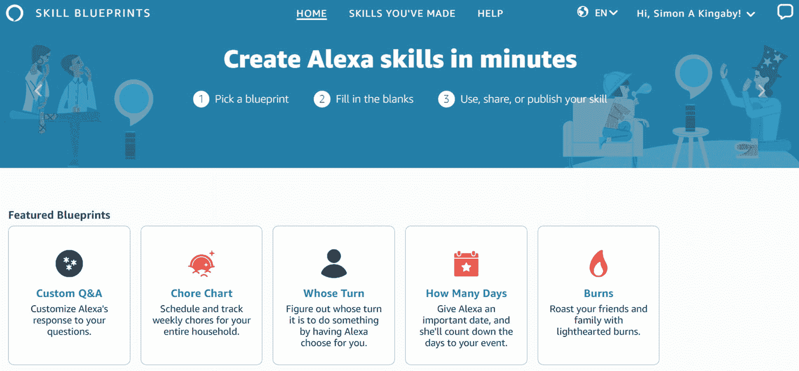

图 2-2：Alexa 技能蓝图主屏幕

例如，首先选择“家务表”蓝图，该蓝图允许你使用家庭成员（见图 2-3）和家务事项（见图 2-4）创建自定义的家务表技能。然后点击 `Make Your Own` 按钮。


图 2-4：家务表蓝图 – 自定义家务列表


图 2-3：家务表蓝图 – 自定义家庭成员列表

添加完家庭成员和想要完成的家务后，点击 `Next: Assign`。在下一页“`Step 2: Assign`”中，你可以分配并安排你在第一页列出的家务。在图 2-5 中，我选择了让 Vinny 在周二、周四和周六“`Put away the laundry`”。Vinny 将在晚上 7:00 通过 Karen（厨房的 Echo Dot）收到提醒。


图 2-5：家务表蓝图 – 分配和安排家务

接下来，在“`Step 3: Experience`”页面，你可以自定义 Alexa 在打开技能时、听完家务列表后以及完成任务时使用的评论。在“`Step 4: Name`”页面，你可以为家务表技能输入一个名称，例如 `Family Chore Chart`。最后，点击 `Create Skill`。蓝图将需要几分钟时间来创建你的新技能。起初，该技能仅对你可见。点击 `Share With Others` 链接，然后按照提示通过电子邮件将链接发送给你的其他家庭成员。

Alexa 蓝图的另一个有趣示例是“入职指南”蓝图。要创建入职指南技能，请在浏览器中打开 [`https://blueprints.amazon.com/home`](https://blueprints.amazon.com/home)，滚动到底部的“`Business`”类别，然后选择“`Onboard Guide`”，如图 2-6 所示。


图 2-6：选择入职指南蓝图

点击 `Make Your Own` 按钮；然后在“`Step 1: Content`”中，你将填写任何重要资源的位置、做事步骤以及关键联系人的姓名和电话号码，如图 2-7 所示。


图 2-7：步骤 1 – 入职指南的内容

接下来，在“`Step 2: Experience`”中，添加一些消息来为新员工个性化体验。例如，见图 2-8。

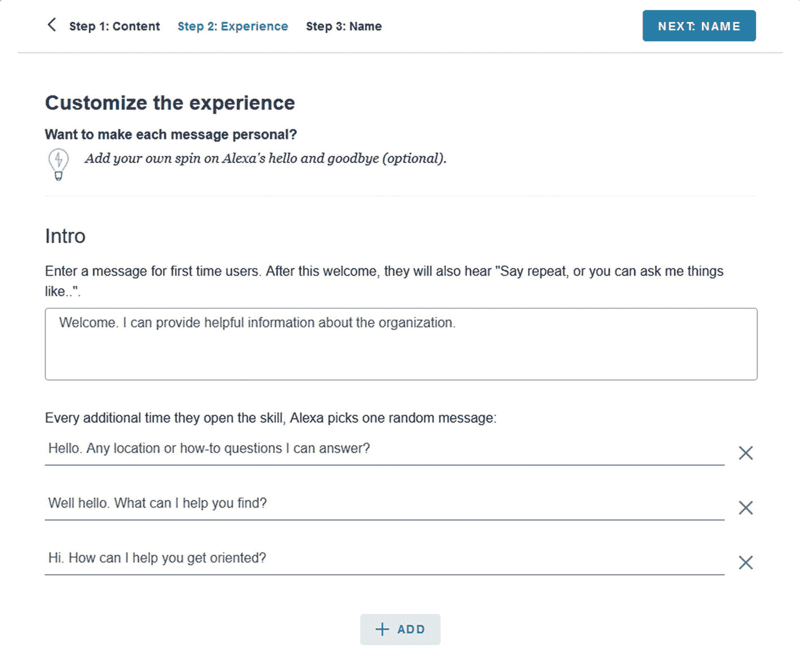

图 2-8：通过步骤 2 添加一些个性化元素 - 自定义体验

在“`Step 3: Name`”中，为你的新技能命名。这是人们启动技能的方式，因此你可能希望给它起一个容易记住且容易说出的名字。例如，如果你将其命名为 `the butler`，那么要启动该技能，人们会说 `Alexa, Open the Butler`。选择技能名称可能很困难。首先，技能名称只能包含字母字符、撇号、句点和空格。因此你必须拼写出每个单词和数字。所以 `007` 不是有效选择，但 `double oh seven` 是。其次，你希望你的技能名称独特、易说且易记。这就是问题所在。例如，如果你创建了一个让听众可以从不同故事结局中选择的技能，你不能将其命名为 `choose your own adventure`，因为那已经是一个技能名称。更糟糕的是，任何该主题的变体都可能被导向官方的 `Choose Your Own Adventure` 技能。要提出一个独特、易说且易记的名称可能会变得棘手。

最后，点击 `Next: Create Skill` 按钮，蓝图将需要几分钟时间来创建你的新技能。创建完成后，彻底测试以确保其按预期工作。起初，该技能仅对你可见。点击 `Share With Others` 链接，然后按照提示通过电子邮件将链接发送给你的部门或公司的其他人。

到目前为止，蓝图是为 Alexa 创建自定义技能最简单的方法。

### 总结

在本章中，你了解了 Alexa 例程和蓝图。例程是一种将多个 Alexa 操作组合到一个组中并使用一个启动短语的方法。蓝图通过填写现有模板（或蓝图）然后共享创建的技能来帮助你实现技能。两者都很有用，但如果你想构建自定义技能，你将需要使用 Alexa 开发者控制台和 AWS 服务。在下一章中，我们将设置你在本书中需要的账户，以便我们可以构建自定义技能。

## 3. 开发者账户

在第 2 章中，你学习了如何创建例程以及如何从蓝图配置技能。现在我们将开始设置你的开发环境，以便你可以开始构建 Alexa 技能。首先，我们将创建你在本书中需要的账户。

**注意：** 我强烈建议使用密码管理器，例如 Dashlane、1Password 或 LastPass。这些工具将允许你安全地存储访问你即将创建的各种账户所需的密码。

### 创建开发者账户

在开发数据驱动的 Alexa 技能时，你需要四个基本账户，另外还有两个我们将在本书中使用的附加账户。总共需要创建以下六个账户：

1.  一个亚马逊账户
2.  一个 Alexa 开发者账户
3.  一个 AWS 根用户账户
4.  一个非根用户的 IAM 开发者/管理员账户
5.  一个 GitHub 账户
6.  一个 Jira 账户

在以下部分中，你将创建这些账户中的每一个，并了解为什么需要它们。

### 亚马逊账户

你需要一个亚马逊账户来访问你的 Alexa 设备、手机上的 Alexa 应用以及 Alexa 技能商店。如果你没有亚马逊账户，或者希望为 Alexa 开发创建一个不同的账户，那么你需要一个可以接收电子邮件的有效电子邮件地址，以及一部用于接收短信确认的智能手机。然后，按照以下说明操作：


图 3-1：创建新的亚马逊账户

1.  前往 [`https://amazon.com`](https://amazon.com)。
2.  如果你已有亚马逊账户，请点击右上角的个人资料，然后选择 `Switch Account`。接着选择 `Create Account`。
3.  创建一个账户（图 3-1）。


### Alexa 开发者账户

要登录 Alexa 开发者控制台，您需要一个开发者账户。该账户与您刚刚创建的亚马逊账户相同，但需配置为开发者访问权限。请按照以下步骤操作：


图 3-2

完成开发者注册

1. 导航至 [`https://developer.amazon.com/alexa`](https://developer.amazon.com/alexa)。
2. 点击右上角的 *登录*，并使用您之前创建的亚马逊账户登录。
3. 或者，选择右上角的个人资料图标，然后选择“完成注册”。
4. 完成 *亚马逊开发者注册*（图 3-2）。
   1. 完善个人资料，并回答关于您感兴趣产品的调查问题。
   2. 然后点击 *开始探索控制台* 选项。

您已成功创建亚马逊开发者账户，该账户可用于多种亚马逊开发者服务和技术（见图 3-3）。

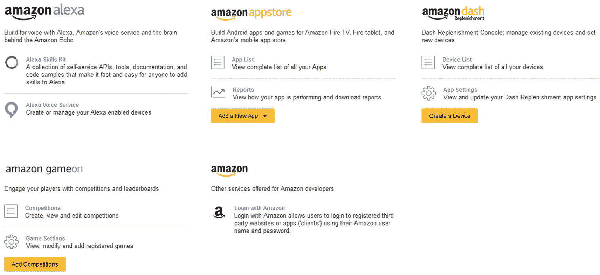

图 3-3

您的亚马逊开发者账户解锁的众多服务

### AWS 开发者账户

您接下来需要的账户是亚马逊云服务（AWS）账户。我们将使用此账户来支持数据驱动的 Alexa 技能所需的后端服务。特别是，自定义技能会使用一个名为 Lambda 的服务。请注意，创建开发者账户需要一张信用卡用于支付验证。注册时不会产生任何费用，因为您注册的是免费套餐账户。开始操作：


图 3-4

注册 AWS 免费套餐

1. 导航至 [`https://aws.amazon.com/free/`](https://aws.amazon.com/free/)（图 3-4）。


图 3-5

选择免费支持计划

2. 点击 *创建免费账户*。
3. 创建一个 *AWS 账户*。
4. 填写联系信息，然后点击 *创建账户并继续*。
5. 提供付款信息，然后点击 *验证并继续*。此时不会产生任何费用。AWS 将使用您的付款信息来验证您的身份，并且仅在您的使用量超出 AWS 免费套餐限制时才会向您收费（[`https://aws.amazon.com/free/`](https://aws.amazon.com/free/)）。
6. 确认您的身份。
7. 选择“基本支持 – 免费计划”（图 3-5）。

欢迎使用 AWS 管理控制台（图 3-6）！


图 3-6

AWS 管理控制台

您刚刚创建的 AWS 账户被称为根用户。可以将其视为拥有神级权限的账户，可以对您的 AWS 服务执行任何操作。首要任务是创建一个新的用户账户，该账户是管理员，但不是根用户。根用户将很少使用，并且应安全地置于多重身份验证和复杂密码的保护之下。下一节将创建您用于日常登录和创建 AWS 服务的账户。

### IAM 与账户安全

我们需要配置的第一个亚马逊云服务是 IAM（身份与访问管理）。IAM 是您创建用户、组、权限等的地方。以根用户身份登录后，我们将创建一个管理员账户。然后，您将退出根用户账户，并登录到管理员账户，之后您将使用该账户来创建、管理和配置您需要的任何其他 AWS 服务。要创建管理员账户，请执行以下操作：

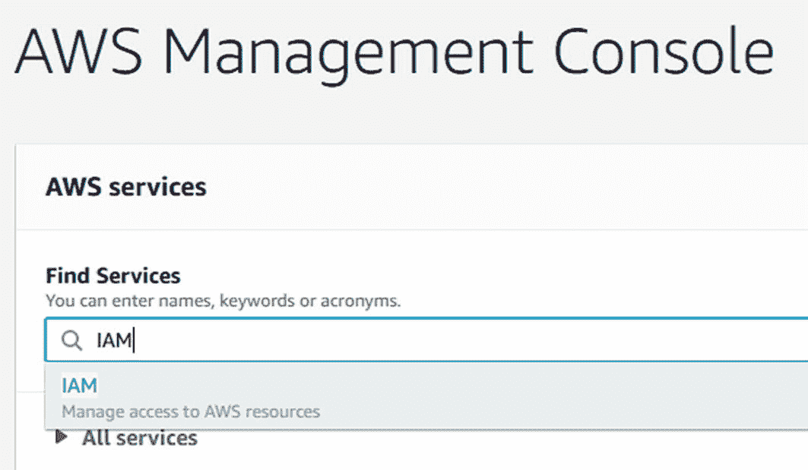

图 3-7

在 AWS 管理控制台中搜索 IAM

1. 在 AWS 管理控制台中，搜索 *IAM*，然后选择它（图 3-7）。

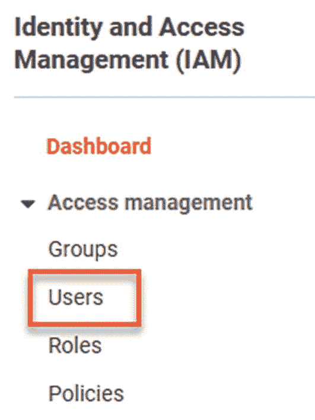

图 3-8

在左侧选择“用户”

2. 在身份与访问管理（IAM）控制台中，选择左侧菜单中的 *用户*（图 3-8）。

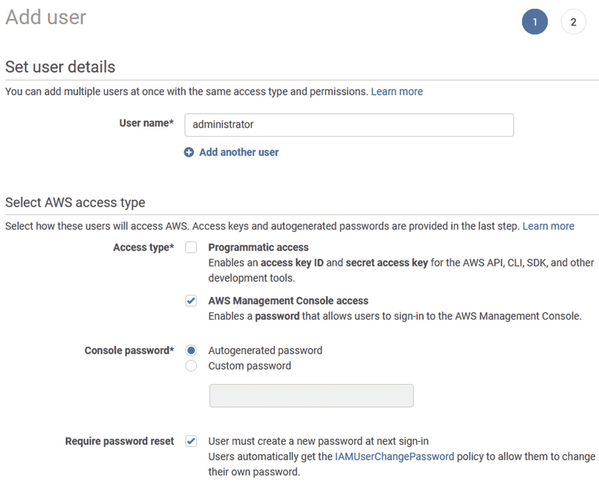

图 3-9

添加管理员用户

3. 点击顶部的 *添加用户*。
4. 输入 `administrator` 作为用户名。
5. 选中 *AWS 管理控制台访问* 复选框。其他选项保留默认设置（见图 3-9）。

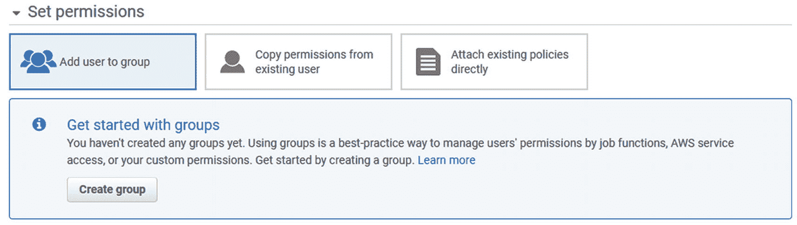

图 3-10

为新管理员创建一个组

6. 点击屏幕底部的 *下一步：权限*。
7. 选择 *将用户添加到组*，然后点击 *创建组*（图 3-10）。

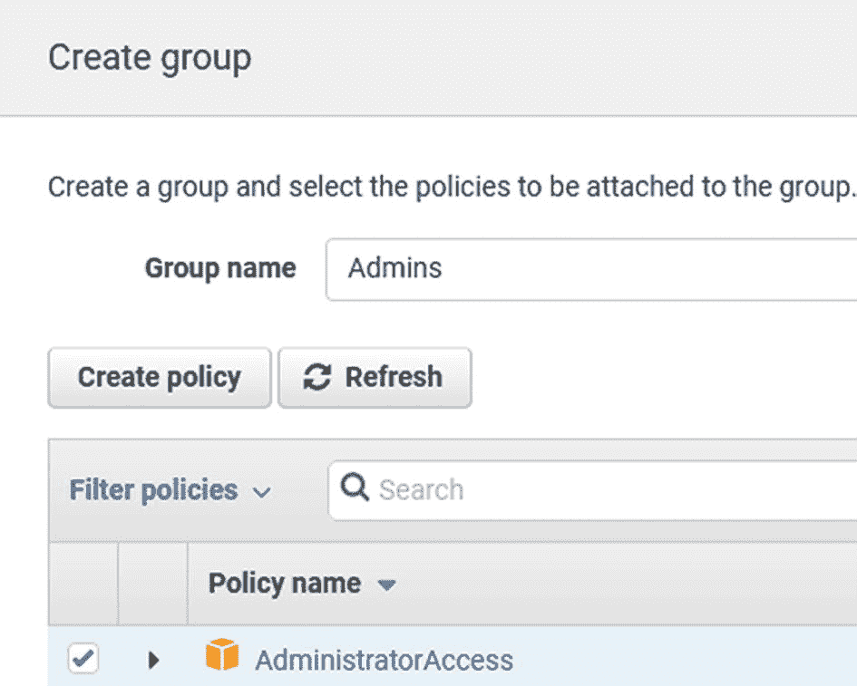

图 3-11

选择 AdministratorAccess 策略

8. 输入 `Admins` 作为组名称，并在策略列表中选中 *AdministratorAccess* 旁边的复选框（图 3-11）。

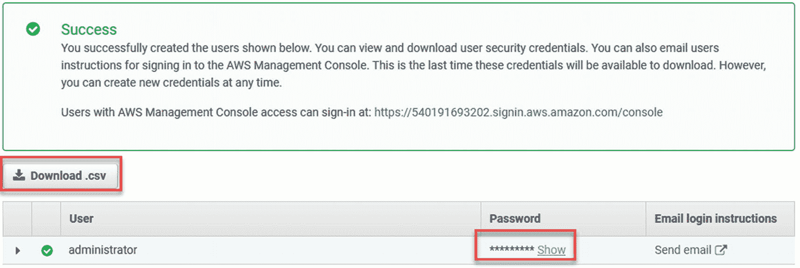

图 3-12

务必下载 .csv 文件并记下密码

9. 现在，点击屏幕底部的 *创建组*。
10. 返回“将用户添加到组”屏幕，点击底部的 *下一步：标签*。
11. 然后点击 *下一步：审核*。
12. 然后点击 *创建用户*。
13. 创建用户后，下载 `.csv` 文件。同时，显示生成的密码并记下它，用于首次登录（见图 3-12）。或者，将登录说明通过电子邮件发送给自己。


图 3-13

下载的 .csv 文件显示了 12 位账户 ID

14. 打开您之前下载的 `.csv` 文件。
15. 复制文件中 URL 里的 12 位数字（图 3-13）。


图 3-14

退出根用户账户

16. 接下来，我们将退出根用户账户，并以管理员身份登录。
17. 选择右上角的个人资料图标，然后选择 *退出*（图 3-14）。

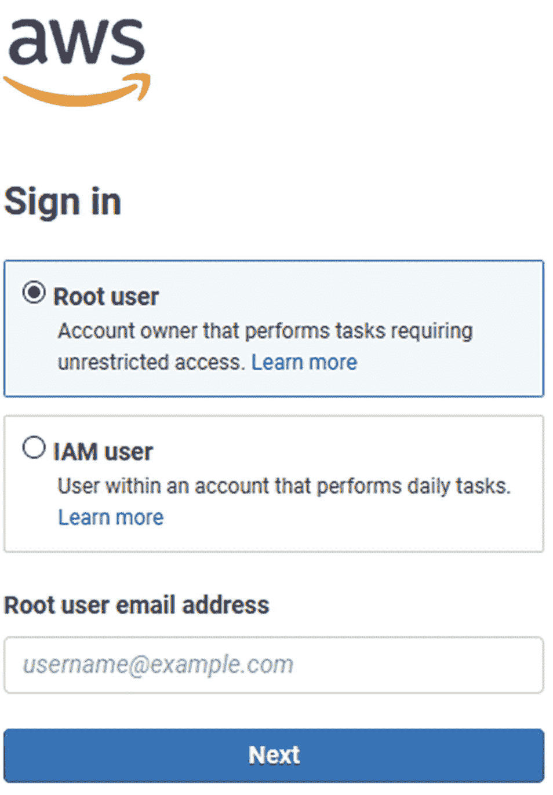

图 3-15

AWS 登录屏幕

18. 现在，选择右上角的 *登录控制台* 按钮。
19. 在登录屏幕（图 3-15）中，选择 *IAM 用户*。


图 3-16

以 IAM 用户身份登录，输入 12 位账户号码


1.  输入您之前复制的 12 位数字（图 3-16）。然后点击*下一步*。

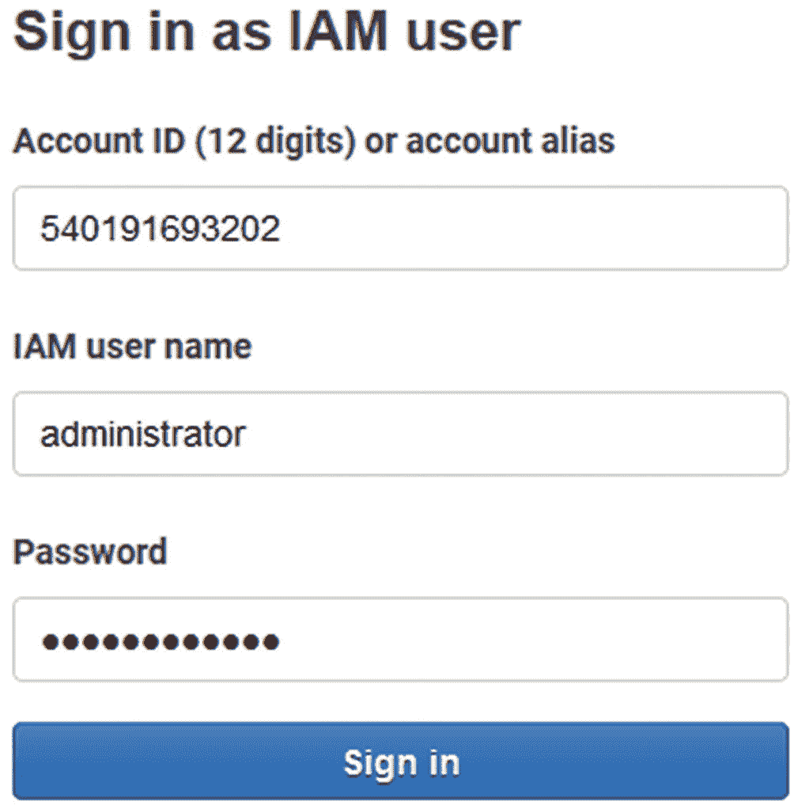

图 3-17

以管理员身份登录

1.  然后，在 IAM 用户名处输入`administrator`，并输入您之前复制的一次性密码（图 3-17）。

1.  接着，将您的密码更改为一个足够复杂的密码，用于您的 AWS 服务的管理员账户。

欢迎回到 AWS 管理控制台。每当您需要管理 AWS 服务时，请使用此管理员账户，而不是根用户账户。接下来，我们介绍 GitHub。

### GitHub 访问权限

本书将全程使用 GitHub 作为我们的源代码仓库。您创建的大多数技能至少会包含一些需要安全存储的代码。GitHub 私有仓库就是这样一个安全的地方。作为替代方案，您也可以使用微软的 Azure DevOps 仓库、亚马逊的 AWS CodeCommit、Atlassian 的 Bitbucket 或其他众多选择。我们将坚持使用 GitHub，因为它在商业领域被广泛用作标准，并且所有主流工具都与其兼容。首先，我们需要创建一个 GitHub 账户：

1.  导航至 [`https://github.com`](https://github.com)。

2.  点击*注册 GitHub*。

3.  输入一个用户名（非您的电子邮件地址）。

4.  输入您的电子邮件地址。

5.  输入密码。

6.  完成验证。

7.  点击*创建账户*。

8.  验证您的电子邮件。

9.  完成。您现在拥有了一个 GitHub 账户。

### Jira 账户

Atlassian 的 Jira 和微软的 Azure DevOps 是两个最流行的敏捷软件项目管理工具。AWS CodeStar 和 GitHub 也提供一些项目管理功能。这些工具中的任何一个都适用于我们的目的，所以如果您有偏好，请随意选择。然而，Jira 在开源社区中普遍使用，并且相比 Azure DevOps，其配置和开销更少，因此本书将使用 Jira 进行需求和任务管理。要创建 Jira 账户：

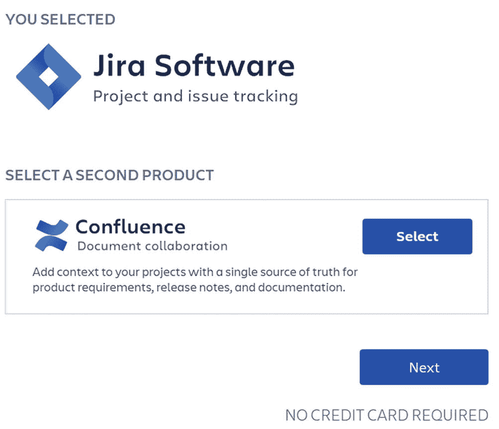

图 3-18

将 Confluence 添加到 Jira 的选择界面

1.  导航至 [`www.atlassian.com/software/jira`](http://www.atlassian.com/software/jira)。

2.  点击*免费获取*。

3.  点击选择 Confluence 作为第二个产品（图 3-18）。


图 3-19

创建 Jira 站点名称

1.  点击*下一步*。

2.  点击*使用电子邮件注册*。

3.  输入所需信息。

4.  点击*同意*。

5.  验证您的电子邮件。

6.  为您的站点命名（图 3-19）。

1.  回答调查问题（或点击*跳过*）。

2.  邀请您的团队成员（或点击*跳过*）。

3.  选择*新手*使用 Jira。选择*新手*使用敏捷方法论。这些选项将使 Jira 更易于使用。

4.  选择我们将时间花在开发*功能*上。

5.  选择我们的日程安排是*灵活的*。

6.  点击*下一步*。

7.  在下一个屏幕上，我们将选择*看板*。Scrum 也是一个不错的选择，但就我们的目的而言，我们只需要看板模板。

8.  对于您的第一个项目名称，输入*Data-Driven Skills*，密钥为*DDS*。

9.  这样就完成了。您已经设置好了一个 Jira 账户、站点和项目，可以随时开始使用。

### 总结

在本章中，我们设置并配置了本书后续章节所需的开发者账户。这些账户用于捕获需求、管理任务、存储源代码、为我们自定义的、数据驱动的 Alexa 技能配置 VUI，以及构建后端数据库、存储区域和技能逻辑的编码。在下一章中，我们将构建我们的第一个自定义技能：一个身体质量指数（BMI）计算器。

## 4. 为自定义数据驱动技能创建 VUI

现在您已经配置了一个例程并从蓝图中创建了一些技能，并且已经设置好了账户，我们准备构建我们的第一个自定义数据驱动的 Alexa 技能。在本章中，我们将构建一个身体质量指数（BMI）计算器。前提很简单：BMI 是身高和体重的函数。计算公式为：


使这个计算变得复杂的是，如果我询问您的身高，您可能会说：188 厘米、1.88 米、6 英尺 2 英寸或 74 英寸。同样，如果我询问您的体重，您可能会说 109 公斤、109 千克、240 磅，甚至 17 英石 2 磅，或者仅仅 17 英石。

那么，让我们开始吧。首先，我们将创建基础技能。然后，我们将在 Alexa 开发者控制台中为该技能配置 VUI。在下一章中，我们将编写后端代码并测试我们的技能，以确保其按预期工作。最后，我们将经历将技能发布到 Alexa 技能商店的流程。

### 步骤 1：创建基础技能

第一步是根据模型、方法和模板创建基础技能。要开始此步骤，我们需要启动 Alexa 开发者控制台。导航至 [`https://developer.amazon.com/alexa/console/ask`](https://developer.amazon.com/alexa/console/ask)。欢迎来到 Alexa 技能开发（见图 4-1）。

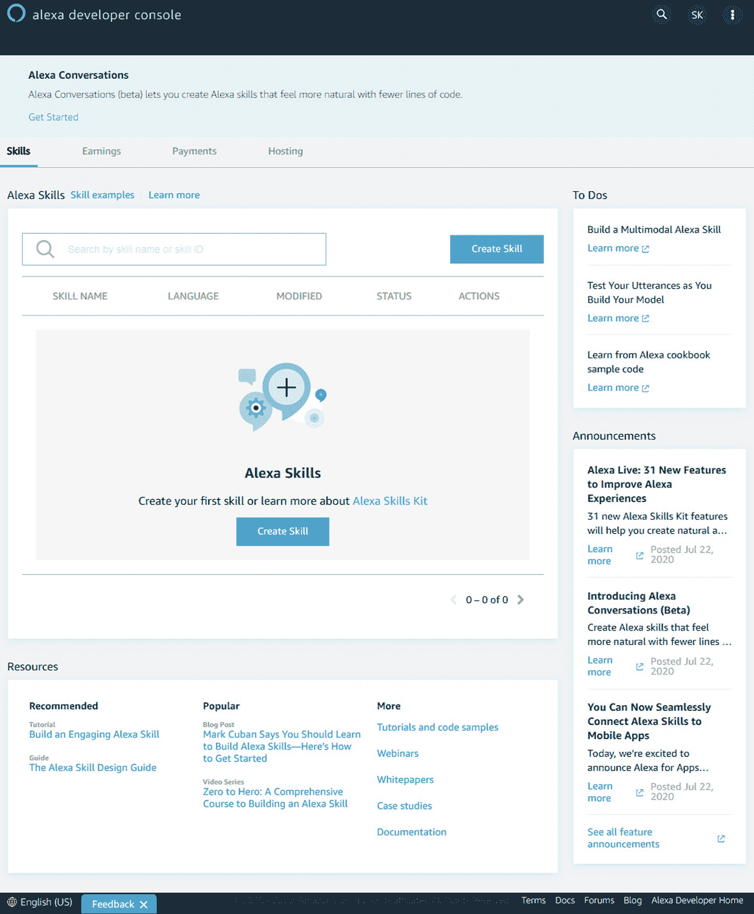

图 4-1

Alexa 技能开发控制台

现在，点击*创建技能*并为技能命名，例如 BMI 计算器。然后将第一个选项保留为*自定义*，因为我们正在构建一个自定义技能，而不是其他类型。接着，您可以选择 Alexa 托管或自行配置。Alexa 托管提供了通往 AWS lambda 函数和其他几个 AWS 服务的管道。自行配置则没有。在本书中，我们稍后需要为一些高级技能自行配置，但现在还不需要。对于第二个选项，选择*Alexa 托管（Python）*，如图 4-2 所示。


图 4-2

为新技能选择模型和方法

现在点击右上角的*创建技能*。我们将选择*Hello World 技能/从头开始*模板（我知道，我知道，但在提供的选项中，它是最基础的）并点击*继续使用模板*（图 4-3）。

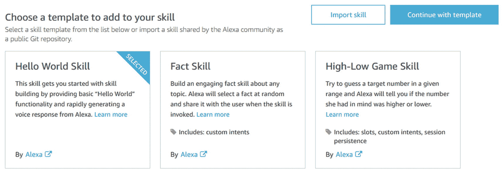

图 4-3

为新技能选择模板

呜呼！您的新技能正在创建中（图 4-4）。


图 4-4

您的技能正在创建中

一两分钟后，您的新 BMI 计算器技能就可以开始使用了（见图 4-5）。与此同时，让我们参观一下技能界面。


图 4-5

您的新 BMI 计算器技能


### 技能构建器界面

让我们来熟悉一下 Alexa 开发者控制台。从顶部开始（见图 4-6），有一组用于开发技能主要任务的选项卡。


图 4-6

开发技能的主要任务

**构建：** 使用此选项卡配置 VUI 选项并为你的技能创建交互模型。

**代码：** 在此处编写你的后端代码。对于 Alexa 托管的技能，此选项卡是你编写 lambda 函数的地方。你无需为此前往 AWS。

**测试：** 在此选项卡中测试你的交互模型。你可以打开麦克风并与你的技能进行交互，以确保其按预期工作。

**分发：** 在此处，你可以配置技能商店选项以及隐私声明等内容。

**认证：** 这是你可以提交技能进行认证的地方。当你选择此选项卡时，你的技能将自动进行验证，并且可能会建议一些修复方法。一旦通过自动验证，你就可以将技能提交到认证流程。

**分析：** 一旦你的技能在 Alexa 商店中上线，你可以查看分析选项卡，了解其运行情况并学习如何改进它。

在 Alexa 开发者控制台的左侧，是用于选择交互模型不同部分的菜单（见图 4-7）。在顶部，你可以选择技能的语言。

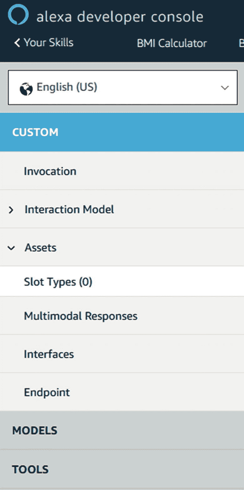

图 4-7

用于选择交互模型组件的菜单

在语言选择器下方，有三个部分：自定义、模型和工具。在自定义部分，你将开发你的交互模型。显示的选项会根据你选择的交互模型类型而有所不同，但标准选项如下：

*   **调用：** 这是你为技能分配调用名称的地方。如果你的调用名称是“西蒙的不可思议的技能”，人们需要说“Alexa，启动西蒙的不可思议的技能”才能访问你的技能。

*   **交互模型：** 使用此选项配置用户与 Alexa 之间的对话。此选项是你花费大部分时间编写技能意图和表述的地方——我们将在下一节中详细介绍这些内容。

*   **资产：** 通过选择资产菜单选项，配置槽位值和其他完成交互模型所需的资产。同样，在下一节中，我们将为身高和体重创建槽位，以便在交互模型中使用。

*   **多模态响应：** 包含在技能交互中返回的 Alexa 表示语言 (APL) 和 Alexa 音频表示语言 (APLA) 代码。我们将在后面的章节中学习 APL 和 APLA。

*   **接口：** 使用此选项打开或关闭技能可用的各种接口。我们将在本技能中使用此选项来打开 Alexa 对话，并在本书的其他项目中使用其他接口。

*   **端点：** 这是你连接前端和后端的地方。由于 BMI 计算器技能是 Alexa 托管的，这部分已经为你完成了。

当你选择模型部分时，有两个选项：自定义和智能家居。如果你正在构建智能家居技能，你需要打开该模型。我们不是，所以我们可以将这些选项保留为默认值。

在工具部分，你将找到技能内产品、账户关联、权限和语言的选项，我们将在后面的章节中介绍所有这些内容。对于 BMI 计算器，我们不需要这些。

在 Alexa 开发者控制台的中央面板中，有*如何入门*视频以及可用于入门和进一步学习的资源列表。

最后，在控制台的右侧是技能构建器清单。此部分显示了你需要完成以构建技能的各种任务的状态。使用我们用来创建基础技能的模板，其中大部分已经完成。

回顾完控制台后，我们准备开始为我们的 BMI 计算器技能配置 VUI。

### 步骤 2：配置 VUI

让我们回顾一下本章开头找到的 BMI 技能的问题陈述：根据身高和体重计算 BMI。计算公式为


我们需要一种方法来要求用户提供他们的身高和体重，以便我们能够计算他们的 BMI。在此之前，用户需要启动（或调用）我们的技能并要求我们计算他们的 BMI。我们将逐步处理这两个步骤。

#### 调用名称

用户要做的第一件事是启动你的技能。他们通过说“Alexa，开始/启动/运行 *<调用名称>*”来做到这一点。通过选择左侧的调用菜单项来创建**技能调用名称**。调用名称有一些规则：

1.  两个或更多单词。

2.  用小写字母书写，单词之间用空格分隔。

3.  所有格撇号是可以的，例如“simon's”。

4.  缩写和首字母缩略词必须用句点和字母之间的空格拼写出来，因此“b. m. i.”是正确的。

5.  数字必须拼写出来，例如“one hundred”。

6.  调用名称不能包含任何 Alexa 技能启动短语，例如“launch”、“ask”、“tell”、“open”、“load”、“begin”和“enable”。唤醒词包括“Alexa”、“Amazon”、“Echo”、“Computer”或单词“skill”或“app”也是不允许的。

7.  品牌名称必须是你可以使用的。

技能调用名称是人们启动你的技能的方式。与例程一样，技能名称应该是独一无二、易于记忆且易于说出的。如果你查看 Alexa 技能商店（[`www.amazon.com/alexa-skills`](https://www.amazon.com/alexa-skills)），你会发现大量的 BMI 计算器。为了想出一些独特的东西，我添加了我的名字，所以对于我们的 BMI 计算器，我选择了“simon's b. m. i. calculator”作为我的技能调用名称（图 4-8）。注意 BMI 缩写是如何拼写出来的。如果我仅仅使用“simon's bmi calculator”，Alexa 会监听单词 bmi，而不是首字母缩略词 B.M.I.。


图 4-8

为你的新技能输入技能调用名称

请务必在 Alexa 设备上多次测试你的启动短语。这种测试应该能暴露出任何潜在的冲突。例如，许多启动短语中包含我名字的技能与流行的游戏“西蒙说”冲突。我必须小心地提出独特的调用名称。

我们需要回答的下一个问题是我们要使用哪种交互模型。


#### 交互模型

`Interaction Model`（交互模型）有两种选择。首先，默认的交互模型使用意图（intents）来捕捉用户希望技能执行的操作。一个`intent`（意图）是一条告诉或请求 Alexa 做某事的语句。例如，“我的 BMI 是多少？”就是一个意图。它请求 Alexa 开始计算我的 BMI 的过程。这个第一个意图之后，Alexa 会询问你的身高和体重，你可以通过说出`ProvideHeightAndWeight`意图来回答，例如说“我身高六英尺二英寸，体重两百四十磅。”这个意图期望你同时提供身高和体重。如果你只说其中一项，它是无法正常工作的。这时就引入了第二种交互模型——`Alexa Conversations`。它更具对话性，允许你只回答身高或体重来回应提示。当 Alexa 注意到缺失的值时，她会仅针对那一项再次提示你。

使用意图模型时，你和 Alexa 之间的对话将如图 4-9 所示。

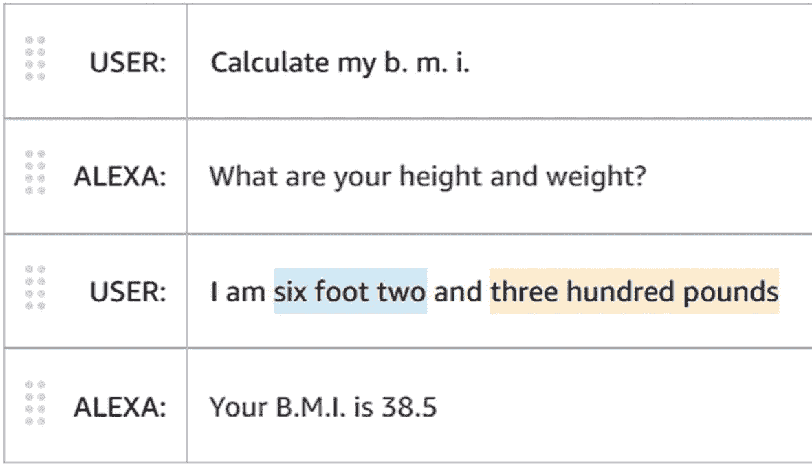

图 4-9 BMI 计算器的意图对话

而使用对话模型时，对话可能如图 4-9 所示，也可能如图 4-10 所示。

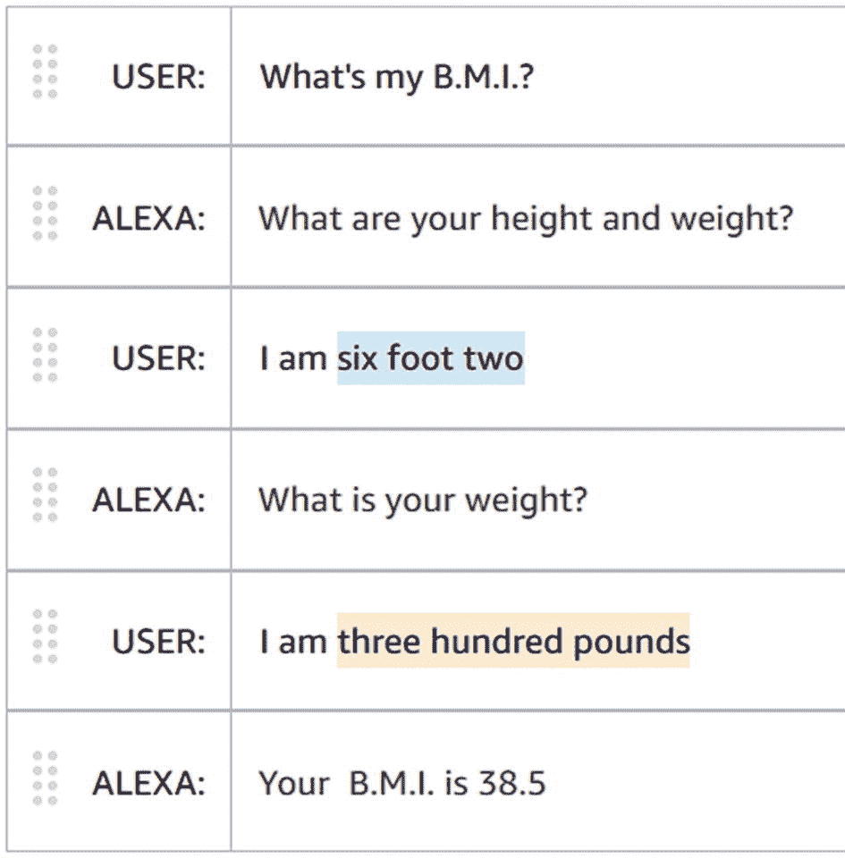

图 4-10 BMI 计算器的对话模型对话

这种差异很微妙，但意义重大。对于更复杂的技能，对话模型对用户更加友好，因为它允许用户以自己的方式回答提示，而不是遵循意图模型所要求的严格交互方式。还有一个优势：在意图模型中，作为开发者的你需要负责处理所有可能的交互排列组合。而在对话模型中，你只需向 Alexa 展示对话的基本流程，剩下的事情由她的人工智能来完成。同样重要的是，这并非一个非此即彼的选择；你可以在两种模型中都有交互，并且，正如我们将看到的，即使是一个基于对话模型构建的技能，你也至少需要一个意图。

现在你已经了解了意图和对话，接下来需要理解槽位（Slots）。

#### 槽位

`Slot`（槽位）是用户为 Alexa 填充的内容。当你定义一个槽位时，需要为其分配一个槽位类型。这些可以是内置的槽位类型，例如`AMAZON.City`和`AMAZON.Artist`，也可以是更通用的槽位类型，例如`AMAZON.NUMBER`和`AMAZON.DATE`，甚至可以是自定义槽位类型，你可以在技能配置过程中提供槽位值。内置槽位类型的酷炫之处在于，它们能处理人们可能用来表达（例如）日期的各种奇怪而奇妙的方式。我可能会说“five ten twenty-twenty”，或者“May tenth twenty-twenty”，甚至可能说“oh-five ten twenty-twenty”。`AMAZON.DATE`槽位类型旨在处理所有这些变体，并为我（开发者）捕获实际的日期值 5/10/2020。

在我们的 BMI 技能中，身高和体重将是槽位。用户需要提供这些值，就像参数或变量一样，然后 Alexa 会将槽位值传递给 API 代码进行评估和处理。不过，我们面临一个难题：如何表示身高和体重槽位的众多可能性？起初，我们可能会将身高和体重视为`AMAZON.NUMBER`类型，在这种情况下，用户可以这样说：

```
我身高 {Height} 厘米，体重 {Weight} 公斤。
```

这种方法可能有效，但仅限于公制单位。如果我们允许用户使用英制单位回答，那么我们就需要为身高使用两个槽位来分别表示英尺和英寸，即：

```
我身高 {Feet} 英尺 {Inches} 英寸，体重 {Weight} 磅。
```

或者，如果用户的身高是整数英尺：

```
我身高 {Feet} 英尺，体重 {Weight} 磅。
```

然后，如果我们允许体重使用英石（stone）单位，我们还需要两个槽位（一个必填，一个可选），这样就会产生四种话语变体：

```
我身高 {Feet} 英尺 {Inches} 英寸，体重 {Stone} 英石 {Pounds} 磅。
我身高 {Feet} 英尺，体重 {Stone} 英石 {Pounds} 磅。
我身高 {Feet} 英尺 {Inches} 英寸，体重 {Stone} 英石。
我身高 {Feet} 英尺，体重 {Stone} 英石。
```

现在我们有了七条包含完全不同槽位的话语，这意味着我们必须编写七个 API 来处理它们，这听起来工作量很大。没有人喜欢做可以避免的大量工作，而在这个例子中，恰恰是可以避免的！

与其为我们的槽位类型使用`AMAZON.NUMBER`，不如为身高和体重创建自定义槽位类型，包含我们想要处理的所有选项。例如，表 4-1 展示了一组示例单位组合。

表 4-1 示例单位组合

| 身高 | 体重 |
| --- | --- |
| 188 厘米 | 45 公斤 |
| 188 c.m. | 45 k.g. |
| 1.9 米 | 45 千克 |
| 6 英尺 | 180 磅 |
| 6 英尺 2 | 14 英石 |
| 6 英尺 2 英寸 | 14 英石 3 |
| 等等 | 等等 |

下一个问题是，Alexa 不喜欢你将数值作为数字放入自定义槽位中。相反，我们必须将数字拼写为单词。因此，表 4-1 中的示例实际上应该写成表 4-2 所示的样子。

表 4-2 数字转换为单词后的单位组合

| 身高 | 体重 |
| --- | --- |
| one hundred and eighty eight centimeters | forty five kilograms |
| one hundred eighty eight c.m. | forty five k.g. |
| one point nine meters | forty five kilos |
| six foot | one hundred eighty pounds |
| six foot two | fourteen stone |
| six foot two inches | fourteen stone three |
| 等等 | 等等 |

通过创建包含所有这些不同值的自定义槽位，我们允许用户说出他们喜欢的任何数量和单位，并且我们可以将它们全部转换为可用于 BMI 计算的值。但这需要很多槽位值，不是吗？是的，这正是为什么这个特定的技能实际上是一个数据驱动的技能！


#### 创建自定义槽位值

要创建槽位值列表，我本人可没打算手动输入所有可能性。相反，我们来看看自定义槽位的批量编辑功能。此功能允许你在 CSV（逗号分隔值）文件中定义值列表。我知道一个能很好创建 CSV 文件的工具：Microsoft Excel（或者任何电子表格软件，我想）。我好奇 Excel 能否将数字转换为单词。

不能。它做不到。但等等，快速上网搜索后，我找到了微软支持团队编写的一个函数^(¹⁴)，它恰好能实现这个功能，不过针对的是美元和美分。也就是说，它可以将 $1,234.56 拼写为 one thousand two hundred thirty-four dollars and fifty-six cents。这或许可行。我们可以修改 `SpellNumbers` 函数，使其不处理美元和美分，而只显示拼写出来的数字。修改完成后，我们可以将该函数作为代码模块添加到 Excel 中，并在生成槽位时使用它。就像这样：

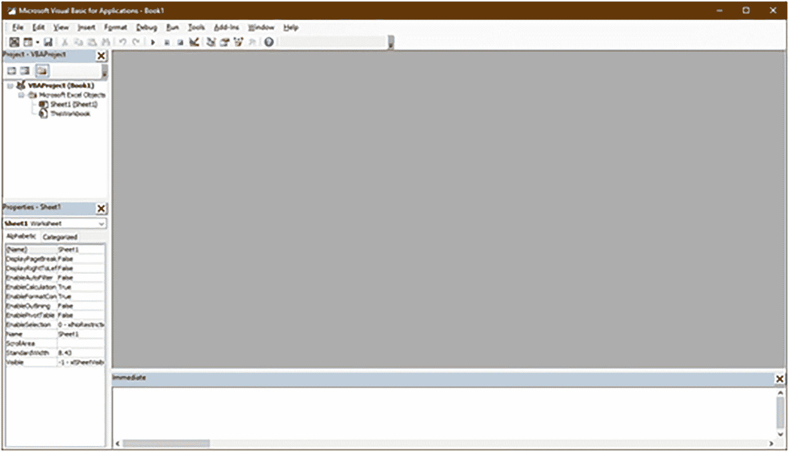

**图 4-11** Visual Basic for Applications 窗口

1.  打开 Excel。
2.  打开一个空白工作簿。
3.  按下 `Alt-F11` 打开 Visual Basic for Applications 窗口（图 4-11）。

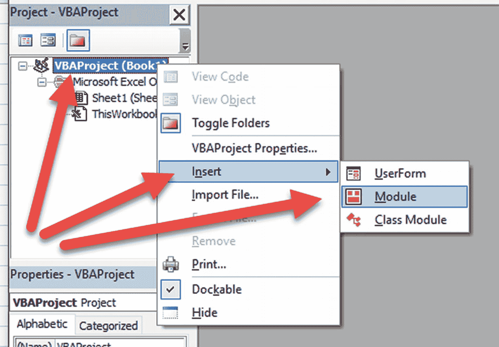

**图 4-12** 创建新的 VBA 代码模块

1.  右键点击 `VBAProject (Book1)`，然后选择 `Insert | Module`（参见图 4-12）。


**图 4-13** 编译 VBA 模块

1.  粘贴以下代码，你可以从本书的示例代码下载中获得：

```
Option Explicit
'Main Function
Public Function SpellNumber(ByVal MyNumber, Optional AddAnds = False)
Dim Dollars, Cents, Temp
Dim DecimalPlace, Count
ReDim Place(9) As String
Place(2) = " Thousand "
Place(3) = " Million "
Place(4) = " Billion "
Place(5) = " Trillion "
' String representation of amount.
MyNumber = Trim(Str(MyNumber))
' Position of decimal place 0 if none.
DecimalPlace = InStr(MyNumber, ".")
' Convert cents and set MyNumber to the dollar amount.
If DecimalPlace > 0 Then
Cents = GetTens(Left(Mid(MyNumber, DecimalPlace + 1) & "00", 2))
MyNumber = Trim(Left(MyNumber, DecimalPlace - 1))
End If
Count = 1
Do While MyNumber  ""
Temp = GetHundreds(Right(MyNumber, 3))
If Temp  "" Then
Dollars = Temp & Place(Count) & Dollars
End If
If Len(MyNumber) > 3 Then
MyNumber = Left(MyNumber, Len(MyNumber) - 3)
Else
MyNumber = ""
End If
Count = Count + 1
Loop
Select Case Dollars
Case ""
Dollars = "Zero"
Case "One"
Dollars = "One"
Case Else
Dollars = Dollars
End Select
If AddAnds Then
Debug.Print (Right(Trim(Dollars), 7) = "Hundred")
If Right(Trim(Dollars), 8)  "Trillion" Then
Dollars = Replace(Dollars, "Trillion ", "Trillion and ")
End If
If Right(Trim(Dollars), 7)  "Billion" Then
Dollars = Replace(Dollars, "Billion ", "Billion and ")
End If
If Right(Trim(Dollars), 7)  "Million" Then
Dollars = Replace(Dollars, "Million ", "Million and ")
End If
If Right(Trim(Dollars), 8)  "Thousand" Then
Dollars = Replace(Dollars, "Thousand ", "Thousand and ")
End If
If Right(Trim(Dollars), 7)  "Hundred" Then
Dollars = Replace(Dollars, "Hundred ", "Hundred and ")
End If
End If
SpellNumber = Trim(Dollars)
End Function
' Converts a number from 100-999 into text
Function GetHundreds(ByVal MyNumber)
Dim Result As String
If Val(MyNumber) = 0 Then Exit Function
MyNumber = Right("000" & MyNumber, 3)
' Convert the hundreds place.
If Mid(MyNumber, 1, 1)  "0" Then
Result = GetDigit(Mid(MyNumber, 1, 1)) & " Hundred "
End If
' Convert the tens and ones place.
If Mid(MyNumber, 2, 1)  "0" Then
Result = Result & GetTens(Mid(MyNumber, 2))
Else
Result = Result & GetDigit(Mid(MyNumber, 3))
End If
GetHundreds = Result
End Function
' Converts a number from 10 to 99 into text.
Function GetTens(TensText)
Dim Result As String
Result = "" ' Null out the temporary function value.
If Val(Left(TensText, 1)) = 1 Then ' If value between 10-19...
Select Case Val(TensText)
Case 10: Result = "Ten"
Case 11: Result = "Eleven"
Case 12: Result = "Twelve"
Case 13: Result = "Thirteen"
Case 14: Result = "Fourteen"
Case 15: Result = "Fifteen"
Case 16: Result = "Sixteen"
Case 17: Result = "Seventeen"
Case 18: Result = "Eighteen"
Case 19: Result = "Nineteen"
Case Else
End Select
Else ' If value between 20-99...
Select Case Val(Left(TensText, 1))
Case 2: Result = "Twenty "
Case 3: Result = "Thirty "
Case 4: Result = "Forty "
Case 5: Result = "Fifty "
Case 6: Result = "Sixty "
Case 7: Result = "Seventy "
Case 8: Result = "Eighty "
Case 9: Result = "Ninety "
Case Else
End Select
Result = Result & GetDigit(Right(TensText, 1)) ' Retrieve ones place.
End If
GetTens = Result
End Function
' Converts a number from 1 to 9 into text.
Function GetDigit(Digit)
Select Case Val(Digit)
Case 1: GetDigit = "One"
Case 2: GetDigit = "Two"
Case 3: GetDigit = "Three"
Case 4: GetDigit = "Four"
Case 5: GetDigit = "Five"
Case 6: GetDigit = "Six"
Case 7: GetDigit = "Seven"
Case 8: GetDigit = "Eight"
Case 9: GetDigit = "Nine"
Case Else: GetDigit = ""
End Select
End Function
```


2.  选择 `Debug | Compile VBAProject` 菜单选项（见图 4-13）。

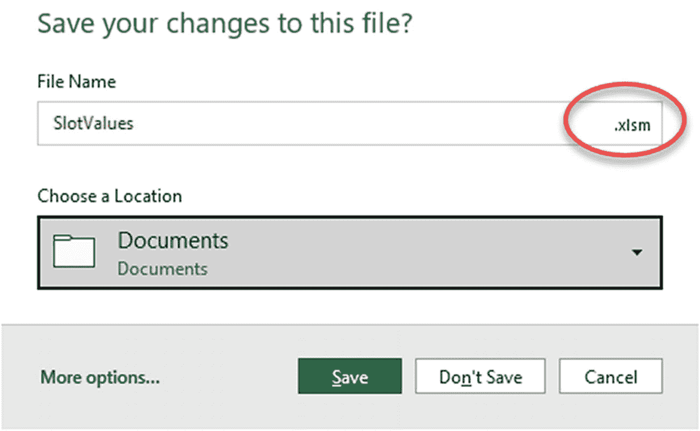

**图 4-14**

确保你保存为 `.xlsm` 文件。

1.  从菜单中选择 `File | Close and return to Microsoft Excel`。
2.  回到电子表格中，选择 `File | Save As`。
3.  输入文件名，例如 `SlotValues`。
4.  选择一个方便的文件夹。
5.  确保文件类型为 `.xlsm`（Excel 启用宏的工作簿）（见图 4-14）。如果不是，请点击对话框底部的 `More options…`，并在 `File Type` 下拉菜单中更改。
6.  点击 `Save`。

现在我们有了一个 `SpellNumber` 函数，可以用来将数值转换为文字。呼，喝口水吧，这是你应得的。

接下来，让我们为电子表格的“高度”选项卡创建选项。我们需要九个列标题，如表 4-3 所示。

**表 4-3** 高度列

| 值 | 术语 | 索引 | 同义词 1 … | 同义词 6 |
| :--- | :--- | :--- | :--- | :--- |
| 12 | 十二英寸 | 12 | 一英尺 | 不适用 |
| 30 | 三十厘米 | 30cm | 三十公分 | 不适用 |

我们将把实际数字放在 `Value` 列中。然后，我们将在 `Term` 列中用英寸或厘米拼写出该数字。我们将通过直接使用英寸数字，并在公制版本后添加 `"cm"` 后缀来索引此列表。然后，我们将输入同义词的公式，如表 4-4 所示。

**表 4-4** 高度的同义词公式

| 单位 | 列 | 转换 | 公式 |
| :--- | :--- | :--- | :--- |
| 英制 | A [值] | 无 | 数字从 12 到 132。 |
| | B [术语] | 转换为英寸 | `=Concat(SpellNumber($A2), " inches")` |
| | C[索引] | 无 | `=$A2` |
| | D [同义词 1] | 转换为英尺 | `=Concat(SpellNumber(Trunc($A2/12)), " foot ", If(Mod($A2,12)=0, "", SpellNumber(Mod($A2,12))))` |
| | E [同义词 2] | 转换为英尺（复数） | `=Concat(SpellNumber(Trunc($A2/12)), " feet ", If(Mod($A2,12)=0, "", SpellNumber(Mod($A2,12))))` |
| | F [同义词 3] | 转换为英尺/英寸 | `=If(Mod($A2,12)=0, "", Concat(SpellNumber(Trunc($A2/12)), " foot ", If(Mod($A2,12)=0, "", Concat(SpellNumber(Mod($A2,12)), If(Mod($A2,12)=1, " inch", " inches")))))` |
| | G [同义词 4] | 转换为英尺（复数）/英寸 | `=If(Mod($A2,12)=0, "", Concat(SpellNumber(Trunc($A2/12)), " feet ", If(Mod($A2,12)=0, "", Concat(SpellNumber(Mod($A2,12)), If(Mod($A2,12)=1, " inch", " inches")))))` |
| | H [同义词 5] | 转换为空 | `=If(Mod($A2,12)=0, "", Concat(SpellNumber(Trunc($A2/12)), " ", SpellNumber(Mod($A2,12))))` |
| | I [同义词 6] | 转换为带“And”的英寸（百位数） | `=If($A2<=100, "", Concat(SpellNumber($A2,True), " inches"))` |
| 公制 | A [值] | 无 | 数字从 30 到 250。 |
| | B [术语] | 转换为厘米 | `=Concat(SpellNumber($A123), " centimeters")` |
| | C[索引] | 后缀 cm | `=Concat($A123, "cm")` |
| | D [同义词 1] | 转换为公分 | `=Concat(SpellNumber($A123), " c.m.")` |
| | E [同义词 2] | 转换为带“And”的厘米 | `=If($A123<=100, "", Concat(SpellNumber($A123, True), " centimeters"))` |
| | F [同义词 3] | 转换为带“And”的公分 | `=If($A123<=100, "", Concat(SpellNumber($A123, True), " c.m."))` |
| | G [同义词 4] | 手动 | `50cm` 半米<br>`100cm` 一米<br>`150cm` 一米半<br>`200cm` 两米<br>`250cm` 两米半 |
| | H [同义词 5] | 手动 | `50cm` 零点五米<br>`150cm` 一点五米<br>`250cm` 两点五米 |
| | I [同义词 6] | 手动 | `50cm` 点五米<br>`100cm` 一米<br>`150cm` 一米半<br>`250cm` 两米半 |

然后，在相应的行中向下复制公式。完成后，工作表应如图 4-15 所示。


**图 4-15** 完成公式后的高度电子表格

对于重量，我们将做类似的事情。不过我们只需要三个同义词，如表 4-5 所示。

**表 4-5** 重量列

| 值 | 术语 | 索引 | 同义词 1 … | 同义词 3 |
| :--- | :--- | :--- | :--- | :--- |
| 17 | 十七磅 | 17lb | 一英石三磅 | 不适用 |
| 20 | 二十公斤 | 20kg | 二十千克 | 不适用 |

表 4-6 显示了同义词的公式。

**表 4-6** 重量的同义词公式

| 单位 | 列 | 转换 | 公式 |
| :--- | :--- | :--- | :--- |
| 英制 | A [值] | 无 | 数字从 1 到 600。 |
| | B [术语] | 转换为磅 | `=Concat(SpellNumber($A2), " pounds")` |
| | C[索引] | 后缀 lb | `=Concat($A2, "lb")` |
| | D [同义词 1] | 转换为英石和磅 | `=If($A2<14, "", Concat(SpellNumber(Trunc($A2/14)), " stone", If(Mod($A2,14)=0, "", Concat(" ", Spellnumber(Mod($A2, 14)), " pound", If(Mod($A2,14)=1, "", "s")))))` |
| | E [同义词 2] | 转换为英石 | `=If($A2<14, "", Concat(SpellNumber(Trunc ($A2/14)), " stone", IF(Mod($A2,14)=0, "", Concat(" ", SpellNumber(Mod($A2, 14))))))` |
| | F [同义词 3] | 转换为带“And”的磅 | `=If($A2<=100, "", Concat(SpellNumber($A2, True), " pound", If($A2=1,"","s")))` |
| 公制 | A [值] | 无 | 数字从 1 到 275。 |
| | B [术语] | 转换为公斤 | `=Concat(SpellNumber($A602), " kilo", If($A602=1, "", "s"))` |
| | C[索引] | 后缀 kg | `=Concat($A602, "kg")` |
| | D [同义词 1] | 转换为千克 | `=Concat(SpellNumber($A602), " kilogram", If($A602=1, "", "s"))` |
| | E [同义词 2] | 转换为带“And”的公斤 | `=If($A602<=100, "", Concat(SpellNumber($A602,True), " kilo", If($A602=1, "", "s")))` |
| | F [同义词 3] | 转换为带“And”的千克 | `=If($A602<=100, "", Concat(SpellNumber($A602,True), " kilogram", If($A602=1, "", "s")))` |

完成后的重量电子表格应如图 4-16 所示。


**图 4-16** 完成公式后的重量电子表格

现在我们有了高度和重量槽位的槽值。

此时，请务必保存你的工作，并保存工作簿的第二个副本！

要将槽值导出为 CSV 文件，我们需要将列表（不包括 A 列 [值]）复制到新工作表（或新工作簿），将公式粘贴为值，然后将该工作表导出为 CSV 文件。对高度执行一次，对重量再执行一次。导出过程如下：


**图 4-17** 在 Excel 中粘贴值

1.  在工作簿底部，点击 `+` 添加一个工作表。将其命名为 `HeightData`。
2.  在高度电子表格中，按 `Ctrl-Home`，然后按 `Ctrl-End`，再按 `Ctrl-Shift-Home`，最后按 `Shift-Right-Arrow`。
3.  现在，工作表被高亮显示（除 A 列外），我们可以按 `Ctrl-C` 复制所有内容。
4.  点击切换到 `HeightData` 选项卡。
5.  使用“粘贴”按钮菜单选择 `Paste Values`（见图 4-17）。
6.  从菜单中选择 `File | Export`。
7.  选择 `Change File Type`。
8.  选择 `CSV (Comma delimited) (*.csv)`。
9.  点击 `Save As`。
10. 输入文件名并点击 `Ok`。
11. 对重量文件重复这些步骤。

现在，我们准备好在 Alexa 开发者控制台中创建自定义槽位类型了。


**图 4-18** 批量编辑高度槽值


1.  使用文本编辑器（如 Notepad++）打开刚创建的 `HeightData.csv` 文件，然后将内容复制到剪贴板。
2.  在 Alexa 开发者控制台中，点击顶部的 *Build* 选项卡。
3.  点击左侧的 *Slot Types* 菜单。
4.  点击 *+ Add Slot Type*。
5.  选择 *Create a Custom slot type with values*。
6.  输入名称 `Height`，然后点击 *Next*。
7.  对于 Slot Values，点击中间的 *Bulk Edit* 链接。
8.  勾选 *The CSV below contains headers*。
9.  将数据粘贴到提供的框中（参见图 4-18）。
10. 点击 *Submit*。
11. 点击顶部的 *Save*。

现在对 `Weight` 数据重复这些步骤。

配置好这些槽位后，我们就可以继续进行对话配置了。

#### 配置对话

在使用意图模型创建 Alexa 技能时，接下来需要创建用于获取身高和体重的意图。然而，我更倾向于让 Alexa 自行判断用户已经或尚未告知我们的信息，并自行处理，这正是对话模型发挥作用的地方。在本书中，我们将使用这两种模型，但更倾向于后者。为了深入实践，我们将从将对话设置为 Alexa 对话开始。为此，我们需要：(1) 开启 Alexa 对话工具，(2) 构建一个示例对话，(3) 将示例的每一步与相关的表述和 API 调用连接起来，(4) 创建完成技能的最终意图，以及 (5) 编写 API 的代码。

**开启 Alexa 对话模型**

1.  在 Alexa 开发者控制台中打开你的技能。
2.  选择顶部的 *Build* 选项卡。
3.  选择左侧的 *Custom* 菜单选项。
4.  选择左侧 *Custom* 下的 *Interfaces* 菜单。
5.  向下滚动到 *Alexa Conversations* 并将其切换为开启状态。
6.  勾选 *Use Alexa Conversations as the default dialog manager* 复选框。
7.  点击顶部的 *Save Interfaces* 按钮。

接下来，我们将识别并定义用于实现对话的 API。换句话说，Alexa 需要在后端代码中做什么来满足用户的意图。在我们的案例中，API 将接收两个参数：`Height` 和 `Weight`，并返回一个值：`BMI`。我们通过以下步骤在对话模型中定义这一点：


图 4-19 添加 `CalculateBMI` API 定义

1.  从左侧菜单中选择 *API Definitions* 选项。
2.  点击顶部的 *Add API Definition* 按钮。
3.  在顶部输入 `CalculateBMI` 作为 *APIName*（参见图 4-19）。

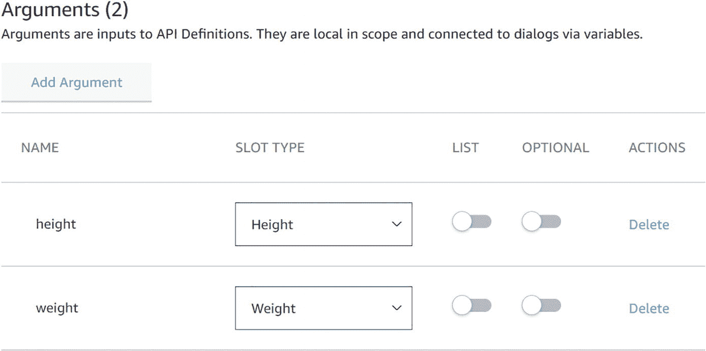

图 4-20 添加 `Height` 和 `Weight` 参数

1.  点击 *Add Argument* 按钮。
2.  输入 `Height` 作为 *Name*。
3.  选择 `Height` 作为 *Slot Type*（参见图 4-20）。
4.  点击 *Add Argument* 按钮。
5.  输入 `Weight` 作为 *Name*。
6.  选择 `Weight` 作为 *Slot Type*（参见图 4-20）。
7.  我们稍后再处理 *Responses and Return* 部分。

接下来，我们将输入一个用户与 Alexa 之间的示例对话。请按照以下步骤操作：


图 4-21 选择左侧的 *Dialogs* 选项卡

1.  在左侧菜单栏中选择 *Alexa Conversations*。
2.  选择其下的 *Dialogs*（参见图 4-21）。


图 4-22 输入 `GetHeightAndWeight` 作为对话名称

1.  点击顶部的 *Add Dialog* 按钮。
2.  在顶部输入 `GetHeightAndWeight` 作为 *DialogName*（参见图 4-22）。

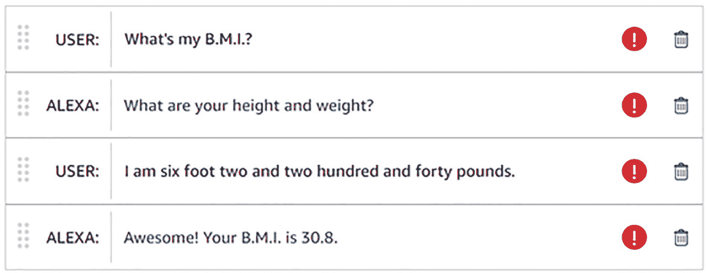

图 4-23 用户与 Alexa 之间的示例对话

1.  现在你会看到一个表格，你可以在其中输入用户与 Alexa 之间可能发生的对话，以使你的技能正常工作。在我们的案例中，这将类似于图 4-23。

下一步是将示例对话与表述集、API 定义和响应连接起来。表述集是用户可能说的话。API 定义是对话如何告诉 Alexa 找出答案。响应是 Alexa 对用户说的话。

以下是我们将如何连接 `MainDialog`：


**图 4-24** 选择对话

1. 选择对话的第一行（见图 4-24）。

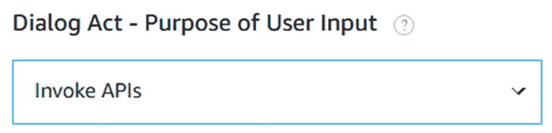

**图 4-25** 选择调用 API

1. 在右侧，点击 *Dialog Act* 下拉菜单，然后选择 *Invoke APIs*。（见图 4-25。）

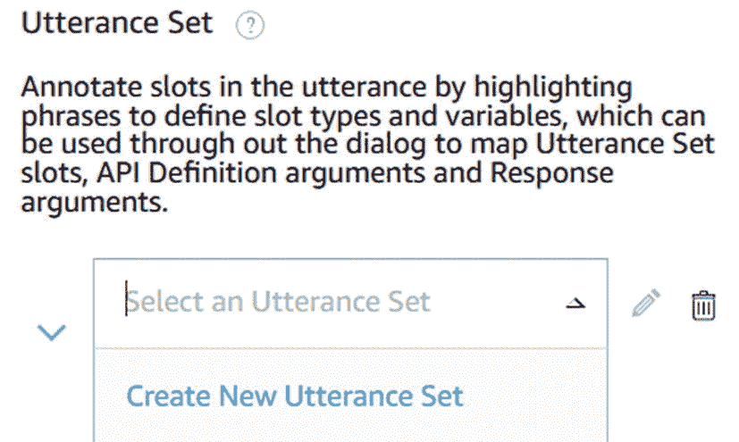

**图 4-26** 创建新的表述集

1. 点击 *Select an Utterance Set* 下拉菜单，然后选择 *Create New Utterance Set*。（见图 4-26。）

1. 此时会显示要选择的表述集。这表示用户可能会说什么来调用 API。例如，他们可能会说“我的 B.M.I. 是多少？”，就像我们在示例中输入的那样，或者他们可能会说“计算我的 B.M.I.”。这两个选项构成一个表述集，我们需要定义这个集合，以便 Alexa Conversations 在用户说出这些内容时能够理解。为此，我们需要：


**图 4-27** 命名表述集

1. 输入 *Utterance Set Name*：**InvokeCalculateBMI**。（见图 4-27。）


**图 4-28** 输入第二条表述并点击保存按钮

1. 跳过 *Dialog Act* 部分，直接进入 *Sample Utterances*。

2. 点击 *Add Utterance* 按钮。

3. 在 *What might the user say?* 框中输入 **Calculate my B.M.I.**，然后按回车键。

4. 输入另一条表述：**What’s my B.M.I.**（见图 4-28。）

5. 现在点击 *Save* 按钮。

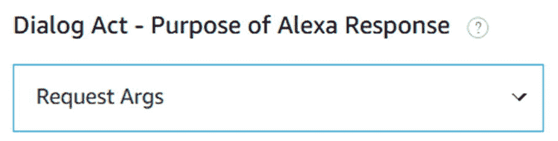

**图 4-29** 选择请求参数

1. 回到对话中，选择对话的第二行，即 Alexa 的回合。

2. 在右侧，点击 *Dialog Act* 下拉菜单，然后选择 *Request Args*。（见图 4-29。）当 Alexa 向用户请求参数（槽位值）时，会使用此 Dialog Act。


**图 4-30** 选择 CalculateBMI API

1. 首先，选择我们之前定义的 CalculateBMI API。此 API 是此对话将要调用的 API。选择 **CalculateBMI** 作为 *API to Request*。（见图 4-30。）

1. 按如下方式完成 Request Args Dialog Act 的选项：

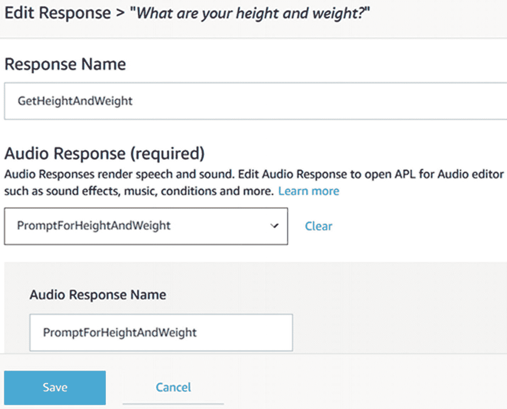

**图 4-31** 配置响应

1. 在 *API Arguments to Request* 下，保留 **Height** 和 **Weight** 不变。

2. 在 *Response* 下拉菜单中，选择 *Create New Response*。

3. 这是 Alexa 可能会对我们说的话，以让我们提供身高和体重。在 *Response Name* 下，输入 **GetHeightAndWeight**。

4. 向下滚动，输入 **PromptForHeightAndWeight** 作为 *Audio Response Name*。

5. 我们编写的示例对话已作为音频提示输入，因此我们可以点击底部的 *Save* 按钮。（见图 4-31。）

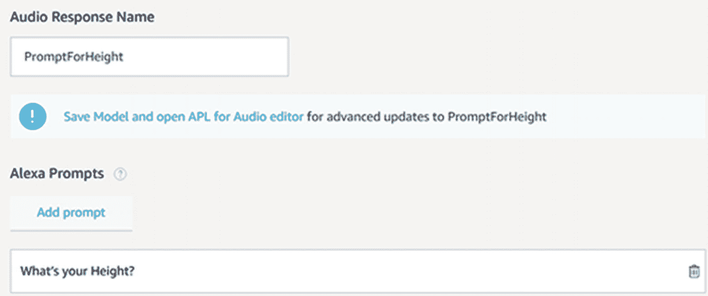

**图 4-32** 输入身高提示

1. 然后我们点击主控制台顶部的 *Save* 按钮。


2.  还需要添加两个额外的响应。这是针对用户只提供了所请求参数之一的情况。Alexa 需要提示用户提供缺失的参数。在“额外响应”下，有仅请求身高和仅请求体重的选项。我们需要对每个选项重复之前的步骤 (c) 到 (g)，具体如下：

3.  在身高参数旁边，选择`创建新响应`。

4.  在`响应名称`中输入`GetHeight`。

5.  在`音频响应名称`中输入`PromptForHeight`。

6.  在`Alexa 提示`下，点击`添加提示`。

7.  在`Alexa 提示`框中输入`你的身高是多少？`。

8.  点击`保存`。（见图 4-32。）

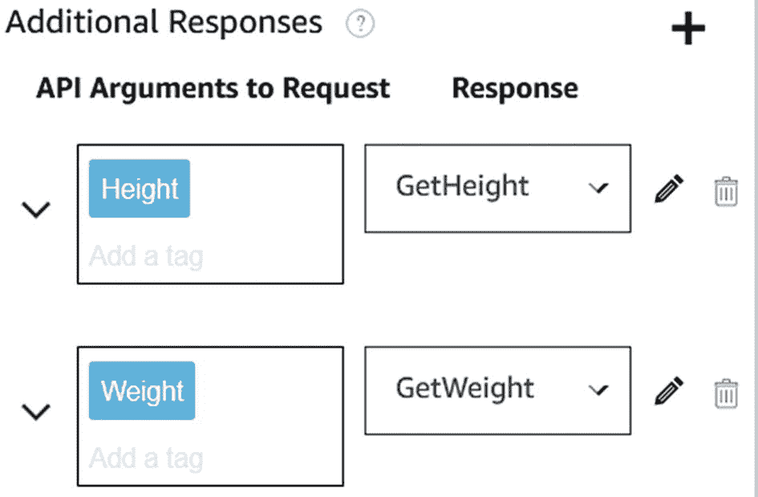

图 4-33

添加两个响应后的额外响应

1.  在体重参数旁边，选择`创建新响应`。

2.  在`响应名称`中输入`GetWeight`。

3.  在`音频响应名称`中输入`PromptForWeight`。

4.  在`Alexa 提示`框中输入`你的体重是多少？`，并点击末尾的 + 号进行添加。

5.  点击`创建提示`。

6.  点击`保存`。

7.  你的`额外响应`现在应该如图 4-33 所示。


图 4-34

点击顶部的保存

1.  点击控制台顶部的`保存`按钮以保存进度。（见图 4-34。）

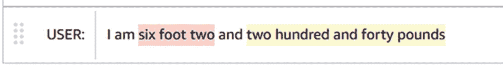

图 4-35

选择供用户填写的槽位后

1.  选中文字`six foot two`。你可能需要尝试几次，因为槽位提示非常急切。

2.  在弹出的槽位类型提示中，选择`身高`作为`槽位类型`。

3.  点击右侧的`添加`按钮。

4.  现在选中文字`two hundred and forty pounds`。

5.  在槽位类型提示中，选择`体重`作为`槽位类型`。

6.  你应该有两个高亮显示的槽位，如图 4-35 所示。

1.  接下来，选择第三行对话。这是用户告诉我们他们的身高和体重的地方。

2.  首先，我们将高亮并识别用户提供给我们的槽位值：

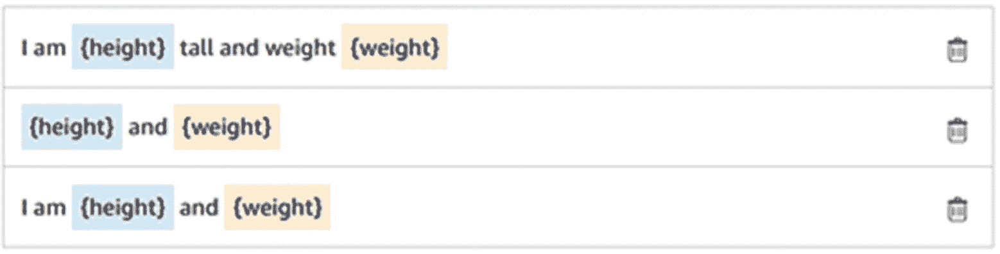

图 4-36

InformHeightAndWeight 话语集的示例话语

1.  既然我们已经识别了用户提供的槽位，我们可以选择右侧的`通知参数对话行为`。

2.  在`选择话语集`下拉菜单中，选择`创建新话语集`。

3.  在`话语集名称`中输入`InformHeightAndWeight`。

4.  在`示例话语`下，添加`我是 {height} 和 {weight}`，然后点击添加话语按钮。

5.  添加`{height} 和 {weight}`作为另一个选项，然后点击添加话语按钮。

6.  最后，输入`我身高 {height}，体重 {weight}`。

7.  你的示例话语应该如图 4-36 所示。


图 4-37

将槽位映射到变量

1.  向下滚动找到我们在话语中添加的两个槽位`height`和`weight`。现在选择适当的`槽位类型`。

2.  点击`保存`按钮。

3.  现在，通过填写槽位 ➤ 变量映射，从第二行对话中选择将由第三行对话中的用户槽位值填充的变量，如图 4-37 所示。


图 4-38

选择“再见”响应

1.  同时点击顶部的`保存`按钮。

2.  现在我们继续处理对话的最后一行；选择`确认 API`作为`对话行为`。

3.  选择`CalculateBMI`作为`要确认的 API`。

4.  保持`要确认的 API 参数`不变。它应该显示身高和体重。

5.  令人困惑的是，我们此时不会让 Alexa 通过说出 BMI 来响应；相反，我们只选择`再见`作为`响应`。当我们进入编码部分时，这会更有意义。Alexa 对话旨在成为 Alexa 和用户之间持续的对话。每次 Alexa 说话时，她都应该提示或询问用户一些事情，除非你已经到达对话的末尾并想要结束会话（我们正是如此）。在这种情况下，你必须将对话委托给你的技能中的一个常规意图，并且不让 Alexa 提示任何其他内容。常规意图处理程序将设置适当的标志来结束会话。我们将在代码中执行此操作，当 API 完成时，它将委托给一个意图，因此我们在此特定对话行中放置的任何响应都将被忽略。所以我们不妨选择`再见`作为响应。（见图 4-38。）

1.  就是这样。我们已经连接好了对话。

接下来，我们需要创建我们将要委托的意图：

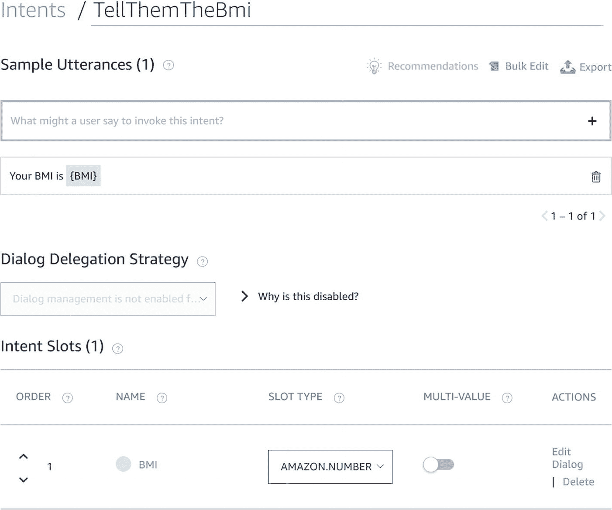

图 4-39

TellThemTheBmi 意图

1.  选择左侧的`交互模型`菜单选项。

2.  选择其下方的`意图`选项。

3.  点击`添加意图`按钮。

4.  我们只需要一个意图来告诉用户 BMI 并结束会话。所以我们称之为`TellThemTheBMI`。

5.  `示例话语`将很简单：`你的 B.M.I. 是 {BMI}`。

6.  在`意图槽位`中，为`BMI`槽位类型选择`AMAZON.NUMBER`。（见图 4-39。）

7.  然后点击顶部的`保存`按钮。

趁此机会，我们可以删除 Hello World 意图，因为我们不再需要它。

1.  选择左侧的`交互模型`菜单选项。

2.  选择其下方的`意图`选项。

3.  在`HelloWorldIntent`的右侧，选择`删除`选项。

4.  点击`删除意图`按钮。

最后，在下一章中，你将编写后端代码，让这个技能进行 BMI 计算。

### 总结

在本章中，我们为 BMI 计算器创建了基础技能，设置了槽位数据，定义了对话以及 API、话语集和响应。至此，我们已经完全构建了技能的 VUI。在下一章中，我们将编写并测试后端代码以完成技能，并为其认证做好准备。

脚注 1

