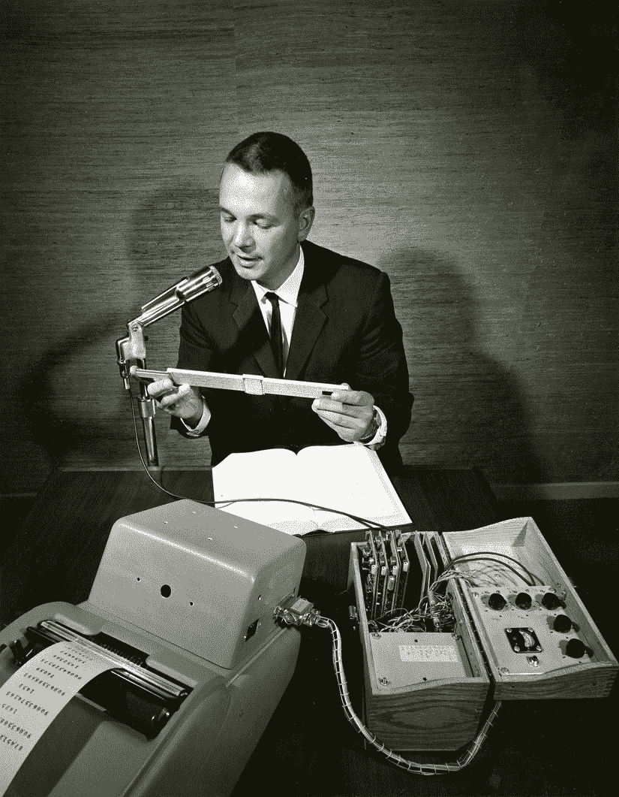
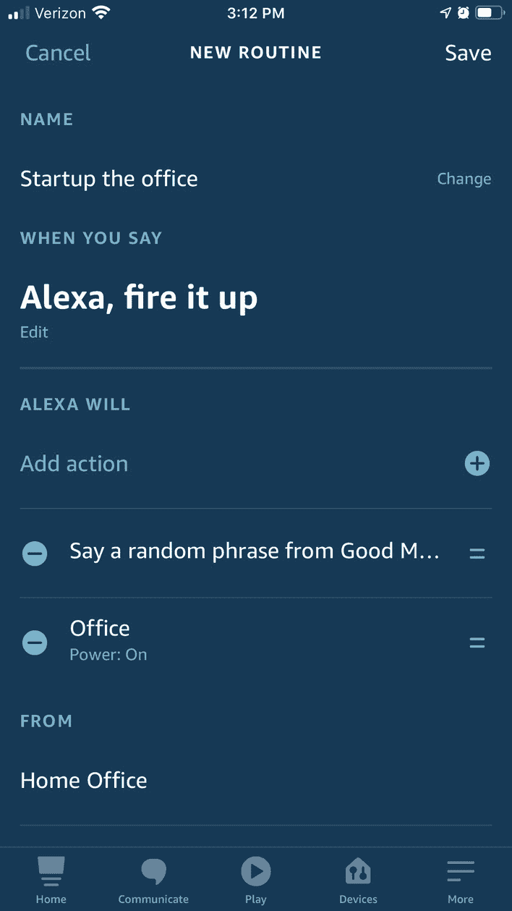
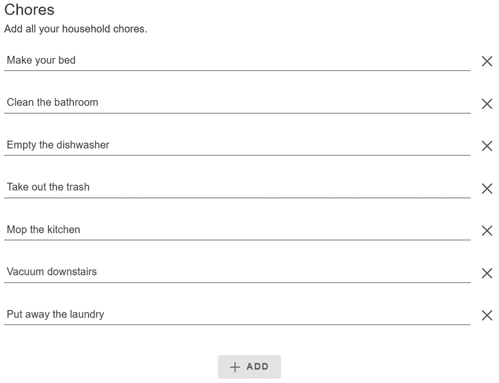
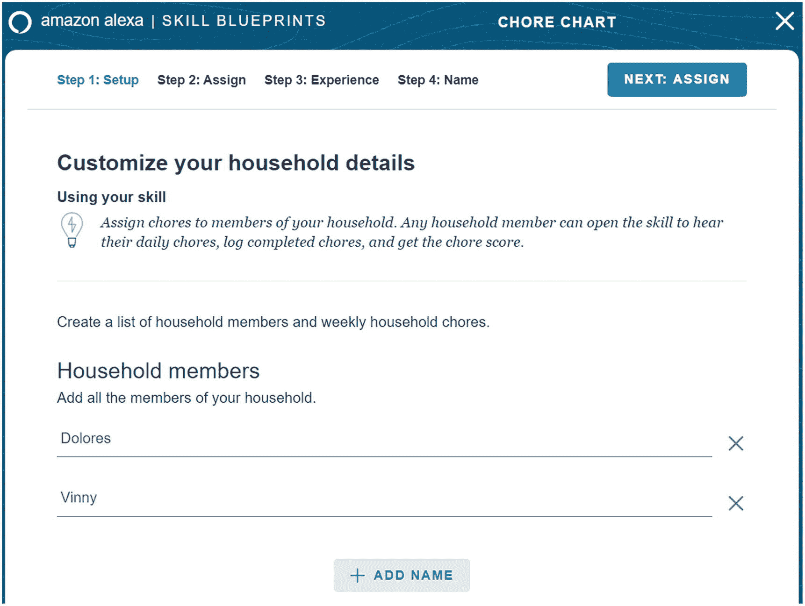
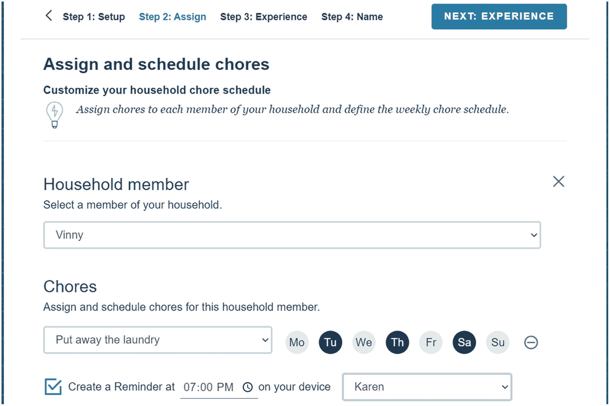
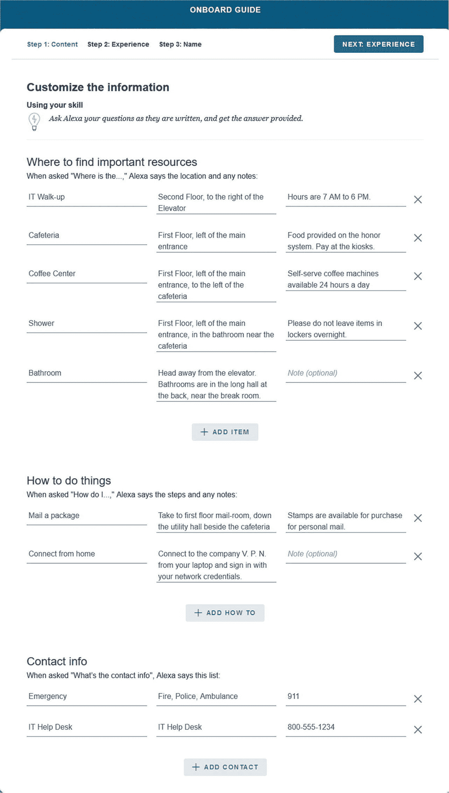
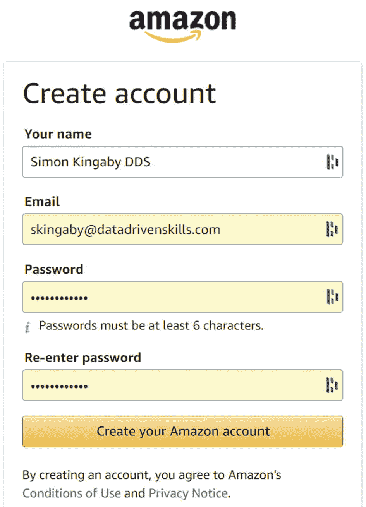
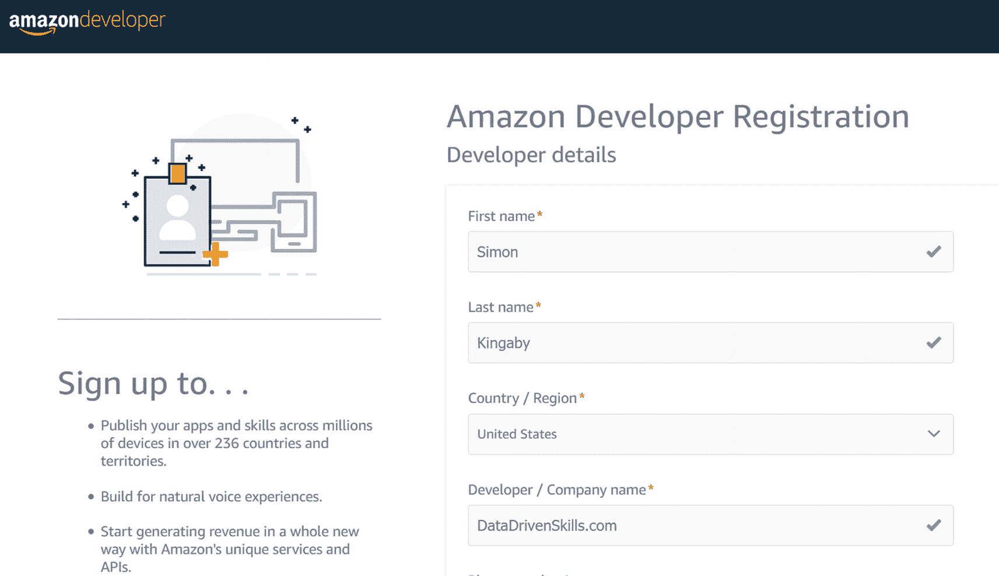
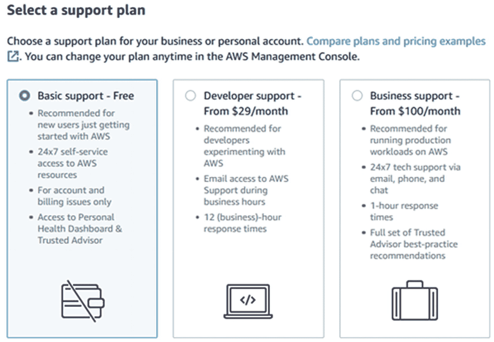
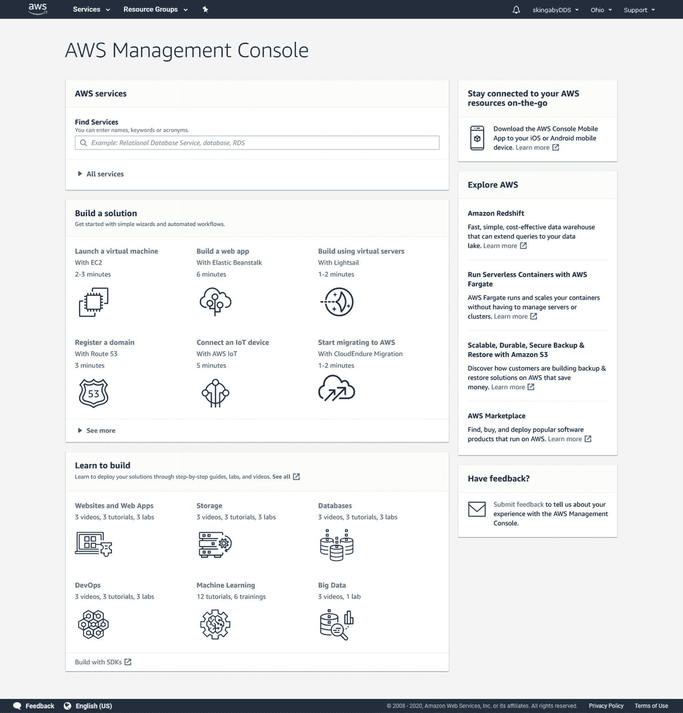

## 关于作者

## 关于技术审校者

### VUI 简史

两百多年来，科学家们一直追求与智能设备实现完全对话式交互的梦想。1773 年，德国科学家克里斯蒂安·克拉岑斯坦成功利用连接在音管上的共鸣管发出了元音。^(¹) 如今，聊天机器人和智能设备的普及，已使语音交互成为全球数百万用户日常生活中的常见场景。这是一段激动人心的探索之旅。

20 世纪 30 年代，贝尔实验室的研究员霍默·达德利开发了第一台计算机化语音合成器。^(²) 这台名为 `VODER`（语音操作演示器）的设备，由操作员海伦·哈珀通过十个按键、一个踏板和一个腕板组合操作来发出单词。海伦花了大约一年时间才学会如何让 `VODER` 说话。在图 1-1 中，海伦正在 1939 年世界博览会上操作 `VODER`。

图 1-1
1939 年世界博览会上的 `VODER`。公有领域

1952 年，贝尔实验室率先推出名为 `Audrey` 的语音识别系统，该系统能够识别数字 0 到 9。20 世纪 60 年代初，IBM 紧随其后，推出了 `Shoebox`，这台机器能理解 16 个口语单词，并能根据指令执行算术运算。^(³) 在图 1-2 中，科学家兼发明家威廉·C·德施正在演示 `Shoebox`。

图 1-2
IBM 工程师威廉·C·德施于 1961 年演示 `Shoebox`。（图片由国际商业机器公司提供）

在 20 世纪 60 年代和 70 年代的冷战期间，世界各地的实验室都在开发语音识别技术。例如，从 1972 年到 1976 年，DARPA（美国国防高级研究计划局）设立了语音理解研究（SUR）项目，旨在创造一台能够理解连续语音的计算机。^(⁴) SUR 项目下的几个子项目颇具前景，但均未达到项目的性能目标。20 世纪 70 年代的计算机性能不足以处理除最基本语音识别之外的机器学习与人工智能模型。

20 世纪 80 年代是一个重大变革时期。不仅个人电脑开始普及，Windows 成为事实上的标准操作系统，而且语音合成与识别技术也从基于模式识别的系统转向了基于算法和统计模型的系统。正是在这个时期，我们完善了隐马尔可夫模型（HMM）。肖恩·埃迪在其 2004 年关于 HMM 的论文中解释道：“HMM 是为线性序列‘标注’问题建立概率模型的形式化基础……HMM 是计算序列分析领域的乐高积木。”^(⁵)

1982 年，詹姆斯·贝克博士和珍妮特·贝克博士为基于 DOS 的计算机推出了 `Dragon Dictate`。这款软件价格昂贵，但它允许用户直接向工具口述内容（尽管速度较慢），而无需打字。20 世纪 80 年代末，随着深度神经网络的引入，我们开始拥有将语音识别提升到新水平的机制，尽管计算能力尚显不足。

大约在 1990 年，DARPA 重新加入竞争，开发了多种模拟和可识别的语音词汇库。1997 年，在 `Dragon Dictate` 推出 15 年后，贝克夫妇发布了更为复杂、速度更快的 `Dragon Naturally Speaking 1.0`。^(⁶) 除了听写功能外，`Naturally Speaking` 还提供了 PC 语音控制以及文本转语音功能，让电脑能够朗读你的数字文档。

2005 年，IBM 与本田合作，将 IBM 的 `Embedded ViaVoice` 软件集成到本田的 `Acura`（轿车）和 `Odyssey`（小型货车）产品线中。^(⁷) 汽车制造商一直在努力为驾驶员带来纯语音体验。

2008 年至 2010 年间，谷歌为其网页应用和移动设备推出了语音搜索功能，使用户能够说出搜索条件。谷歌的语音转文字技术将口语转换为文本，并提交给其顶尖的搜索引擎。当时，谷歌的语音搜索团队在一篇论文中写道：

> *谷歌的一个目标是让语音访问无处不在。我们希望让用户拥有选择权——他们应该理所当然地认为语音交互始终是一个可选项。实现无处不在需要两件事：可用性（即，内置到每一个语音输入或输出有意义的交互中）和性能（即，运行得足够好，以至于这种交互方式不会给交互增加任何摩擦）。——Schalkwyk 等人*^(⁸)

2011 年秋季，在第一代 iPhone 发布四年后，苹果公司宣布集成语音激活的个人助理 `Siri`。^(⁹) `Siri` 允许用户通过语音与 iPhone 进行交互。拨打电话、发送短信、设置约会、获取路线、开启或关闭 iPhone 功能等等，只需说一声“嘿 Siri”并命令她执行即可。`Siri` 源自 Adam Cheyer 长达二十年的研发，他与联合创始人 Dag Kittlaus 和 Tom Gruber 共同创建了一家小公司，并开发了一款通过苹果 App Store 销售的语音助手应用。在完善应用、发展公司并进行大量谈判之后，创始人以据报道 2 亿美元的价格将 Siri Inc. 卖给了苹果。^(¹⁰)

几年后的 2014 年，微软推出了其语音助手版本 `Cortana`，最初用于 Windows Phone，最终扩展到 Windows 10 Mobile、Windows 10 PC、Xbox One 以及 iOS 和 Android 平台。^(¹¹) 如今，`Cortana` 是全世界分布最广（尽管不一定使用最广）的语音用户界面之一。

同样在 2014 年，亚马逊在 Amazon Echo 智能音箱上推出了 `Alexa`，^(¹²) 将智能设备送入全球每个家庭的竞赛就此拉开帷幕！Echo 设备是首批广泛普及的智能音箱技术，它将语音激活与简单命令及吸引人的功能相结合。用户可以说：“Alexa，现在几点了？”或者“Alexa，随机播放我的播放列表。”她就会做出相应的回应。请参见图 1-3，了解你可以让 `Alexa` 执行的部分操作示例。

图 1-3
配备 `Alexa` 语音助手的 Amazon Echo 智能音箱

全球消费者正在拥抱智能技术，市场也取得了飞跃式增长，我们将在下一节中看到这一点。

### 当今的语音用户界面格局

目前，全球智能音箱市场主要有五大参与者。它们合计占据了总销量的 88%。该市场从 2018 年到 2019 年增长了 60.3%，销量从 7800 万台增加到 1.25 亿台，增加了 4700 万台。^(¹³) 智能音箱行业最突出的参与者是（见图 1-4）：

图 1-4
全球市场份额百分比（来源：Canalys）

1.  **亚马逊。** 过去两年一直是该领域的领导者，拥有 30%的市场份额。亚马逊的 `Alexa` 智能音箱、屏幕和设备销往世界各地。`Alexa` 技能商店中提供了超过 10 万种技能，使 `Alexa` 成为市场上功能最丰富的智能音箱。

2.  **谷歌。** 美国搜索巨头谷歌推出了 Nest 系列智能音箱和屏幕，拥有 19%的市场份额。这些设备以前称为 Google Home，使用内置谷歌搜索的 Google Assistant 语音服务。

3.  **百度。** 中国顶级搜索引擎公司百度于 2017 年收购了渡鸦。`Raven H` 智能音箱价格昂贵，但在 2018 年，他们高调推出了价格更低的小度智能音箱，并在 90 秒内售出了 1 万台。百度目前拥有 14%的市场份额。其智能音箱连接至开放平台个人助理服务 `DuerOS`。尽管运费和关税仍在上涨，但不可否认，这些智能音箱定价颇具吸引力，尤其是在其本土中国市场。

4.  **阿里巴巴。** 中国在线零售商阿里巴巴于 2017 年推出了天猫精灵。这款智能音箱连接至阿里巴巴的个人助理服务 `AliGenie`。阿里巴巴目前在其产品目录中提供了超过 1 万种不同的智能设备。

5.  **小米。** 中国电子产品制造商小米以其 `Mi` 品牌提供智能手机和智能音箱。小米 AI 音箱连接至小米的小爱虚拟助手。

尽管苹果 HomePod 智能音箱的销量不及五大巨头，但苹果的 `Siri` 语音用户界面也存在于全球每一部 iPhone 和 iPad 上，这使其在行业中占据了重要地位。

许多其他公司也在大力投资语音技术，例如微软（其语音助手 `Cortana` 存在于全球每一台 Windows 电脑上）、Sonos（使用 Google Assistant）、三星（拥有自己的 Bixby 个人助手）和 IBM（拥有其 Watson 技术）。音响和娱乐技术供应商，如 Bose（内置亚马逊 `Alexa` 和 Google Assistant）、贝尔金（Google Assistant）和 Facebook（`Alexa`），正在推出自己的语音设备或与合作伙伴共同推出。

在其他市场和行业中，语音也变得越来越普遍。例如，美国陆军正在开发联合理解与对话界面（JUDI），使士兵能够通过无线麦克风使用非正式语言与智能机器人进行交互（见图 1-5）。机器人将利用其传感器数据来帮助解释给定的命令。

图 1-5
JUDI – 一种供士兵无线控制机器人的语音界面（美国陆军照片）

在汽车行业，语音用户界面已成为消费者期望在新车中看到的必备配置。汽车制造商提供了多种解决方案，包括在汽车中嵌入 `Alexa` 和 Google Assistant。与此同时，设备制造商正通过 Roav Viva、Garmin Speak 和 Amazon Echo Auto 等即插即用适配器将 `Alexa` 带入汽车。

不仅行业和政府正在投资语音技术，美国消费者也参与其中。大约三分之一的美国住宅现在拥有智能技术，包括智能音箱、智能电视、智能灯和智能插头。在下一节中，我们将介绍一些在家中运用智能技术的创新方法。

### 智能家居

“`Alexa`，打开我的家庭办公室。”

“好的，”她回应道。仿佛变魔术一般，顶灯和吊扇亮起，电脑启动，打印机开始嗡嗡作响。摇头风扇开启；蜡烛蜡加热器发出微光，将浓郁的香草味送入房间；台灯也亮了。同样，只需简单说一句“`Alexa`，关闭房屋准备过夜”，鱼缸的灯光就会变暗，车库门和前门锁上，恒温器将温度降低 2 度，整个房子的灯都会关闭。

欢迎来到智能家居。通过将智能音箱连接到集线器（可能是你的智能手机）以及遍布家中的无线设备，你可以控制电源状态（开/关）、调光器、音量等。任何带插头的设备都可以插入智能插座，这样只需对你的智能音箱发出简单的语音命令即可打开或关闭；见图 1-6。将灯泡和开关更换为可无线连接到集线器的智能设备，你就可以通过向智能音箱发出简单命令来轻松控制它们。

图 1-6
智能插头和智能灯泡在智能家居中与 `Alexa` 配合使用

智能设备也非常适合用于监控。智能烟雾和一氧化碳探测器、安防摄像头、运动探测器和可视门铃很常见。婴儿监视器、智能手表和心脏监测器也已有售。与家庭公用设施集成，智能恒温器、水系统、泄漏探测器和照明可以节省大量账单费用。在家庭娱乐类别中，有智能电视和智能遥控器，使家庭影院更易于操作。在厨房和洗衣房，有智能炉灶和冰箱、智能洗衣机和烘干机、智能微波炉和咖啡机。自 Amazon Echo 推出以来的短短几年里，已有数千种产品被打造为“可与 `Alexa` 配合使用”。这些产品中有一些引人入胜的智能设备。例如，iRobot 的 Roomba 是一款声控机器人吸尘器。惠而浦的智能电灶系列具有语音控制和扫描烹饪技术。而科勒的 Numi 2.0 智能马桶支持 `Alexa`，可实现自动冲水和免提关闭座圈。是的，会说话的智能马桶已经问世！面对这些新奇事物，你可能会问自己：这是为什么？

### 为什么是语音？为什么是 Alexa？为什么是现在？

**为什么是语音？** 我们已经达到了语音技术既普及又实用的阶段。它的覆盖范围和能力与日俱增。我们早已过了它只是新奇玩意的阶段。我们正迈向一个语音成为商业世界标准组成部分的未来。用不了多久，高管们就会期望从他们的智能音箱那里获得快速、频繁的更新。语音是自然而然的。说一句“`Alexa`，运行一下过去一小时的数据”或者“`Alexa`，我们今天能达成销售目标吗？”是如此简单。这些正是我们将在本书中构建的技能类型。

**为什么是 Alexa？** 除了是行业领先的智能音箱之外，为`Alexa`构建自定义技能的主要原因是它相对容易实现。只要了解`Python`或`JavaScript`，你就能在一两天内让自定义技能上线运行。其他一些平台似乎刻意让创建自定义技能变得困难。当你深入研究`Alexa`的文档时，你会发现它非常详尽，与`Alexa`集成的`Amazon Web Services`的文档也是如此。凭借一个易于上手的平台、良好的文档、熟悉的编程语言以及引人入胜的市场前景，`Alexa`是数据驱动技能开发的强力选择。

**为什么是现在？** 语音技术足够新，以至于有大量的发现、发明和研究在推动平台向前发展。同时它也足够成熟，我们已经解决了大部分基础设施和硬件问题。API 定义明确。大多数工具都已进入 2.0 或更高版本。现在是学习这项新技术的好时机。消费者用例已经确立了好几年。商业用例尚待确定。现在是加入前沿领域并构建数据驱动型`Alexa`技能的最佳时机。

### 总结

在本章中，我们了解了语音用户界面，它们的过去和现在。我们发现了`Alexa`和智能家居技术。最后，我们回答了三个为什么：为什么是语音？为什么是 Alexa？为什么是现在？

有了这个基础，我们就可以开始构建`Alexa`技能了。在下一章中，我们将配置一个例程，然后使用蓝图创建一个自定义技能。

脚注 1 2 3 4 5 6 7 8 9 10 11 12 13

### 2. 例程与蓝图

既然我们已经了解了 VUI 和智能技术，那么让我们更深入地探讨一下`Alexa`到底是什么，并看看如何从蓝图创建例程和自定义技能。

### 什么是 Alexa？

`Alexa`是亚马逊为智能音箱、智能屏幕和其他智能设备提供的语音用户界面。通过对你的`Alexa`设备说出简单的命令，你可以获得智能响应。你可以让`Alexa`做以下事情：

- 告诉你时间
- 将“你好”翻译成法语
- 掷一个`d6`、`2d20`或任意数量、任意面数的骰子
- 给你讲个故事
- 随机播放你的播放列表
- 告诉你天气
- 在 40 分钟后叫醒你（我喜欢这个）
- 给你播报每日新闻摘要
- 列出你接下来的三件待办事项
- 告诉你昨天的收盘价
- 阅读你的电子邮件
- 获取你今天需要关注的热点问题摘要
- 告诉你明天的销售预测
- 以及数百种其他请求

在`Alexa 技能商店`中，有成千上万种额外的技能你可以启用，这样`Alexa`就能和你玩游戏、激励你、帮你规划旅行、教育你、控制你的智能家居等等。例如，`Alexa`的天气功能可以告诉你温度，以及是否正在下雨或将要下雨。`Big Sky`技能则增加了空气质量、湿度、紫外线指数、风速、天气常识等更多信息。对于高级用户，`Big Sky`还提供自定义天气警报、雷达图像（在智能屏幕上）以及其他地址的天气信息。

除了`Alexa 技能商店`中的免费和高级技能外，还有几种无需构建技能即可自定义`Alexa`的方法。特别是，`Amazon 例程`和`Alexa 蓝图`无需编码，任何想要创建自定义`Alexa`体验的人都可以使用。

### Alexa 例程

当你发现自己反复让`Alexa`连续做几件事时，就应该考虑创建一个`Alexa 例程`。例如，如果每天早上你都要开灯、将恒温器调高 2 度、并启动咖啡机，你就可以为此创建一个例程。

要创建例程，你将使用智能手机上的`Alexa`应用（见图 2-1）并按照以下说明操作：

图 2-1：在 iPhone 上使用`Alexa`应用创建例程

1. 选择主菜单图标。
2. 选择*例程*。
3. 点击`+`按钮添加一个例程。
4. 点击*输入例程名称*旁边的`+`按钮，输入名称，然后点击*下一步*。（注意：这不是你触发例程时说的话。那将在稍后输入。）例程名称限制为 50 个字符。
5. 点击*当此发生时*旁边的`+`按钮。
6. 点击你想要触发的动作图标，例如*语音*。然后输入或选择相应的动作。对于语音，这就是触发短语，例如“启动”、“开始煮咖啡”，甚至“粉红火烈鸟”。然后点击*下一步*。
7. 点击*添加动作*旁边的`+`按钮。
8. 选择你希望`Alexa`在例程运行时执行的动作。例如，选择智能家居，然后选择所有设备，接着选择电视，再选择开机。
9. 在例程中添加你需要的任意多个动作。
10. 使用汉堡图标（右侧的两条堆叠线）上下拖动动作，以重新排列它们在例程中发生的顺序。
11. 点击*保存*以完成例程配置并创建它。

类似地，一个例程可以在工作中为你节省时间。你可以创建一个例程，列出夜间发生的、仍需关注的任何生产故障（来自`公司心跳技能`），然后提供今天的收入预测（来自`销售预测技能`），接着列出超预算的项目（来自`项目管理技能`），最后列出你需要处理的三件最紧急的事情（来自你的`每日计划技能`）。

创建例程是一种将多个`Alexa`技能排队到一个触发器中的方法。这与创建自定义技能不同。那么，我们如何制作一个自定义技能呢？在下一节中，我们将了解如何使用`Alexa 蓝图`来实现这一点。无需编码。

### Alexa 蓝图

为你的 Alexa 创建自定义技能最简单的方法是从 Alexa 蓝图开始。虽然例程适用于现有技能，但蓝图能基于提供的众多模板之一创建个性化技能。例如，你可以根据“家务表”或“宠物保姆”蓝图创建家庭技能，也可以根据“简报”或“入职指南”蓝图创建办公技能。

要从蓝图创建技能，请在浏览器中打开 [`https://blueprints.amazon.com/home`](https://blueprints.amazon.com/home)（见图 2-2）。

图 2-2：Alexa 技能蓝图主屏幕

例如，首先选择“家务表”蓝图，该蓝图允许你使用家庭成员（见图 2-3）和家务事项（见图 2-4）创建自定义的家务表技能。然后点击 `Make Your Own` 按钮。

图 2-4：家务表蓝图 – 自定义家务列表

图 2-3：家务表蓝图 – 自定义家庭成员列表

添加完家庭成员和想要完成的家务后，点击 `Next: Assign`。在下一页“`Step 2: Assign`”中，你可以分配并安排你在第一页列出的家务。在图 2-5 中，我选择了让 Vinny 在周二、周四和周六“`Put away the laundry`”。Vinny 将在晚上 7:00 通过 Karen（厨房的 Echo Dot）收到提醒。

图 2-5：家务表蓝图 – 分配和安排家务

接下来，在“`Step 3: Experience`”页面，你可以自定义 Alexa 在打开技能时、听完家务列表后以及完成任务时使用的评论。在“`Step 4: Name`”页面，你可以为家务表技能输入一个名称，例如 `Family Chore Chart`。最后，点击 `Create Skill`。蓝图将需要几分钟时间来创建你的新技能。起初，该技能仅对你可见。点击 `Share With Others` 链接，然后按照提示通过电子邮件将链接发送给你的其他家庭成员。

Alexa 蓝图的另一个有趣示例是“入职指南”蓝图。要创建入职指南技能，请在浏览器中打开 [`https://blueprints.amazon.com/home`](https://blueprints.amazon.com/home)，滚动到底部的“`Business`”类别，然后选择“`Onboard Guide`”，如图 2-6 所示。

图 2-6：选择入职指南蓝图

点击 `Make Your Own` 按钮；然后在“`Step 1: Content`”中，你将填写任何重要资源的位置、做事步骤以及关键联系人的姓名和电话号码，如图 2-7 所示。

图 2-7：步骤 1 – 入职指南的内容

接下来，在“`Step 2: Experience`”中，添加一些消息来为新员工个性化体验。例如，见图 2-8。

图 2-8：通过步骤 2 添加一些个性化元素 - 自定义体验

在“`Step 3: Name`”中，为你的新技能命名。这是人们启动技能的方式，因此你可能希望给它起一个容易记住且容易说出的名字。例如，如果你将其命名为 `the butler`，那么要启动该技能，人们会说 `Alexa, Open the Butler`。选择技能名称可能很困难。首先，技能名称只能包含字母字符、撇号、句点和空格。因此你必须拼写出每个单词和数字。所以 `007` 不是有效选择，但 `double oh seven` 是。其次，你希望你的技能名称独特、易说且易记。这就是问题所在。例如，如果你创建了一个让听众可以从不同故事结局中选择的技能，你不能将其命名为 `choose your own adventure`，因为那已经是一个技能名称。更糟糕的是，任何该主题的变体都可能被导向官方的 `Choose Your Own Adventure` 技能。要提出一个独特、易说且易记的名称可能会变得棘手。

最后，点击 `Next: Create Skill` 按钮，蓝图将需要几分钟时间来创建你的新技能。创建完成后，彻底测试以确保其按预期工作。起初，该技能仅对你可见。点击 `Share With Others` 链接，然后按照提示通过电子邮件将链接发送给你的部门或公司的其他人。

到目前为止，蓝图是为 Alexa 创建自定义技能最简单的方法。

### 总结

在本章中，你了解了 Alexa 例程和蓝图。例程是一种将多个 Alexa 操作组合到一个组中并使用一个启动短语的方法。蓝图通过填写现有模板（或蓝图）然后共享创建的技能来帮助你实现技能。两者都很有用，但如果你想构建自定义技能，你将需要使用 Alexa 开发者控制台和 `AWS` 服务。在下一章中，我们将设置你在本书中需要的账户，以便我们可以构建自定义技能。

## 3. 开发者账户

在第 2 章中，你学习了如何创建例程以及如何从蓝图配置技能。现在我们将开始设置你的开发环境，以便你可以开始构建 Alexa 技能。首先，我们将创建你在本书中需要的账户。

**注意：** 我强烈建议使用密码管理器，例如 `Dashlane`、`1Password` 或 `LastPass`。这些工具将允许你安全地存储访问你即将创建的各种账户所需的密码。

### 创建开发者账户

在开发数据驱动的 Alexa 技能时，你需要四个基本账户，另外还有两个我们将在本书中使用的附加账户。总共需要创建以下六个账户：

1.  一个亚马逊账户
2.  一个 Alexa 开发者账户
3.  一个 `AWS` 根用户账户
4.  一个非根用户的 `IAM` 开发者/管理员账户
5.  一个 `GitHub` 账户
6.  一个 `Jira` 账户

在以下部分中，你将创建这些账户中的每一个，并了解为什么需要它们。

### 亚马逊账户

你需要一个亚马逊账户来访问你的 Alexa 设备、手机上的 Alexa 应用以及 Alexa 技能商店。如果你没有亚马逊账户，或者希望为 Alexa 开发创建一个不同的账户，那么你需要一个可以接收电子邮件的有效电子邮件地址，以及一部用于接收短信确认的智能手机。然后，按照以下说明操作：

图 3-1：创建新的亚马逊账户

1.  前往 [`https://amazon.com`](https://amazon.com)。
2.  如果你已有亚马逊账户，请点击右上角的个人资料，然后选择 `Switch Account`。接着选择 `Create Account`。
3.  创建一个账户（图 3-1）。

### Alexa 开发者账户

要登录 Alexa 开发者控制台，您需要一个开发者账户。该账户与您刚刚创建的亚马逊账户相同，但需配置为开发者访问权限。请按照以下步骤操作：

图 3-2：完成开发者注册

1. 导航至 [`https://developer.amazon.com/alexa`](https://developer.amazon.com/alexa)。
2. 点击右上角的 *登录*，并使用您之前创建的亚马逊账户登录。
3. 或者，选择右上角的个人资料图标，然后选择“完成注册”。
4. 完成 *亚马逊开发者注册*（图 3-2）。
    1. 完善个人资料，并回答关于您感兴趣产品的调查问题。
    2. 然后点击 *开始探索控制台* 选项。

您已成功创建亚马逊开发者账户，该账户可用于多种亚马逊开发者服务和技术（见图 3-3）。

图 3-3：您的亚马逊开发者账户解锁的众多服务

### `AWS` 开发者账户

您接下来需要的账户是亚马逊云服务（`AWS`）账户。我们将使用此账户来支持数据驱动的 Alexa 技能所需的后端服务。特别是，自定义技能会使用一个名为 `Lambda` 的服务。请注意，创建开发者账户需要一张信用卡用于支付验证。注册时不会产生任何费用，因为您注册的是免费套餐账户。开始操作：

图 3-4：注册 `AWS` 免费套餐

1. 导航至 [`https://aws.amazon.com/free/`](https://aws.amazon.com/free/)（图 3-4）。

图 3-5：选择免费支持计划

2. 点击 *创建免费账户*。
3. 创建一个 *`AWS` 账户*。
4. 填写联系信息，然后点击 *创建账户并继续*。
5. 提供付款信息，然后点击 *验证并继续*。此时不会产生任何费用。`AWS` 将使用您的付款信息来验证您的身份，并且仅在您的使用量超出 `AWS` 免费套餐限制时才会向您收费（[`https://aws.amazon.com/free/`](https://aws.amazon.com/free/)）。
6. 确认您的身份。
7. 选择“基本支持 – 免费计划”（图 3-5）。

欢迎使用 `AWS` 管理控制台（图 3-6）！

图 3-6：`AWS` 管理控制台

您刚刚创建的 `AWS` 账户被称为根用户。可以将其视为拥有神级权限的账户，可以对您的 `AWS` 服务执行任何操作。首要任务是创建一个新的用户账户，该账户是管理员，但不是根用户。根用户将很少使用，并且应安全地置于多重身份验证和复杂密码的保护之下。下一节将创建您用于日常登录和创建 `AWS` 服务的账户。
