# 4. 为自定义数据驱动技能创建 VUI

## IAM 与账户安全

我们需要配置的第一个亚马逊云服务是 IAM（身份与访问管理）。IAM 是您创建用户、组、权限等的地方。以根用户身份登录后，我们将创建一个管理员账户。然后，您将退出根用户账户，并登录到管理员账户，之后您将使用该账户来创建、管理和配置您需要的任何其他 AWS 服务。要创建管理员账户，请执行以下操作：

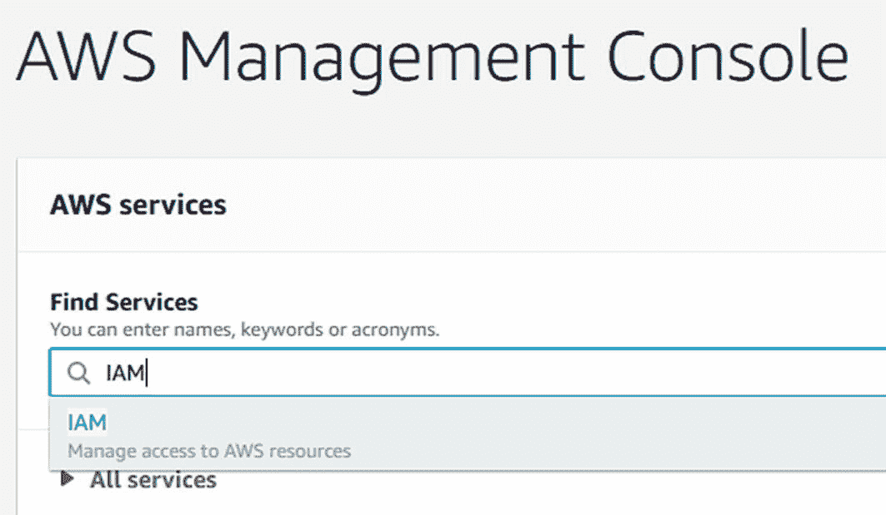

图 3-7

1. 在 AWS 管理控制台中，搜索 `IAM`，然后选择它（图 3-7）。

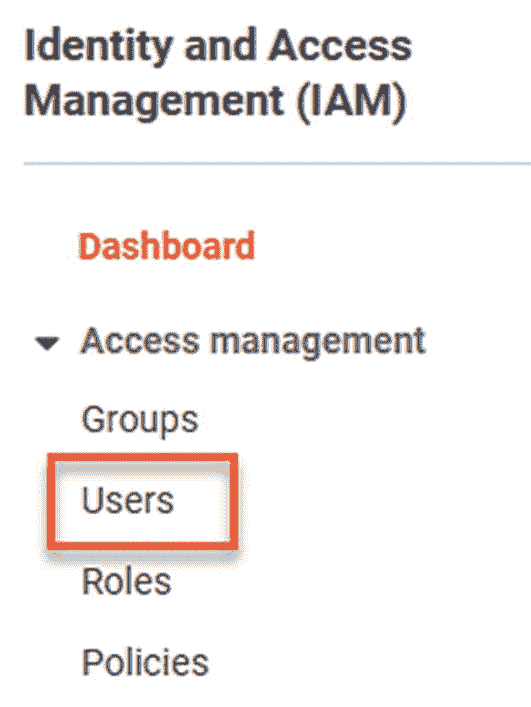

图 3-8

2. 在身份与访问管理（IAM）控制台中，选择左侧菜单中的 *用户*（图 3-8）。

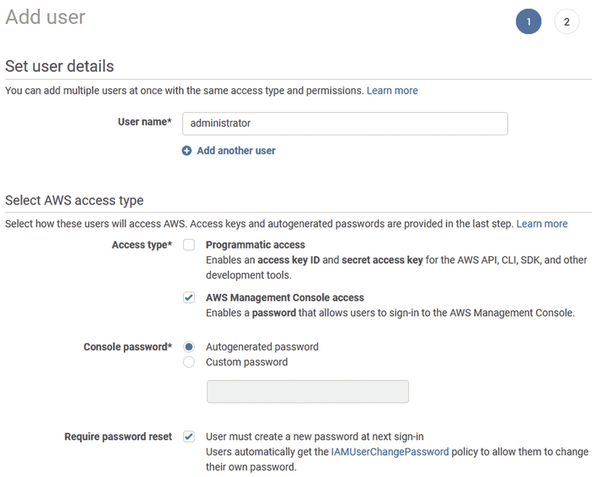

图 3-9

3. 点击顶部的 *添加用户*。
4. 输入 `administrator` 作为用户名。
5. 选中 *AWS 管理控制台访问* 复选框。其他选项保留默认设置（见图 3-9）。

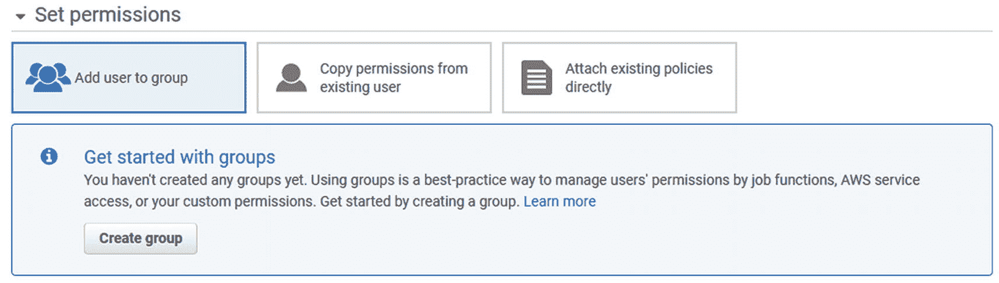

图 3-10

6. 点击屏幕底部的 *下一步：权限*。
7. 选择 *将用户添加到组*，然后点击 *创建组*（图 3-10）。

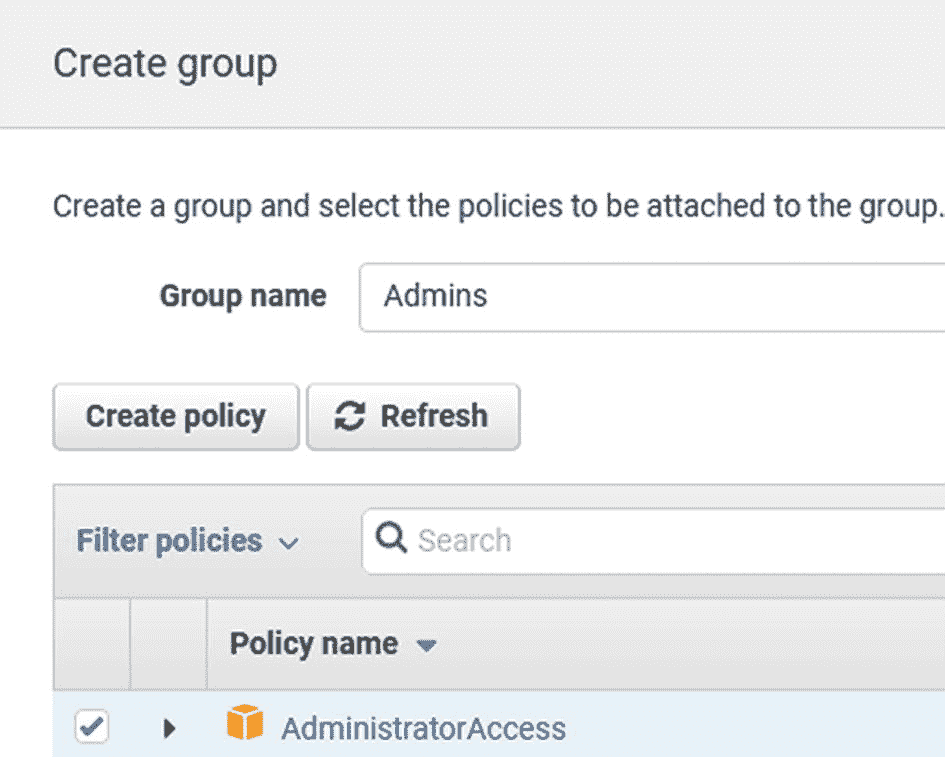

图 3-11

8. 输入 `Admins` 作为组名称，并在策略列表中选中 *AdministratorAccess* 旁边的复选框（图 3-11）。

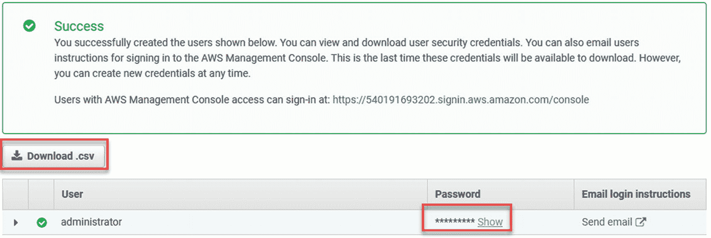

图 3-12

9. 现在，点击屏幕底部的 *创建组*。
10. 返回“将用户添加到组”屏幕，点击底部的 *下一步：标签*。
11. 然后点击 *下一步：审核*。
12. 然后点击 *创建用户*。
13. 创建用户后，下载 `.csv` 文件。同时，显示生成的密码并记下它，用于首次登录（见图 3-12）。或者，将登录说明通过电子邮件发送给自己。


图 3-13

14. 打开您之前下载的 `.csv` 文件。
15. 复制文件中 URL 里的 12 位数字（图 3-13）。

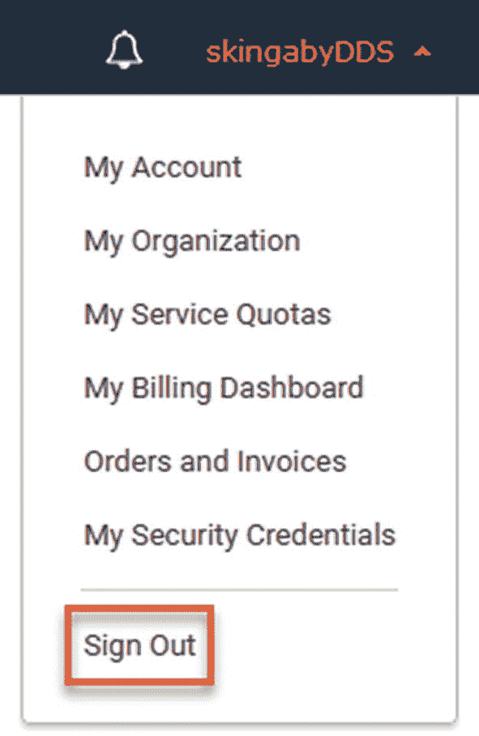

图 3-14

16. 接下来，我们将退出根用户账户，并以管理员身份登录。
17. 选择右上角的个人资料图标，然后选择 *退出*（图 3-14）。

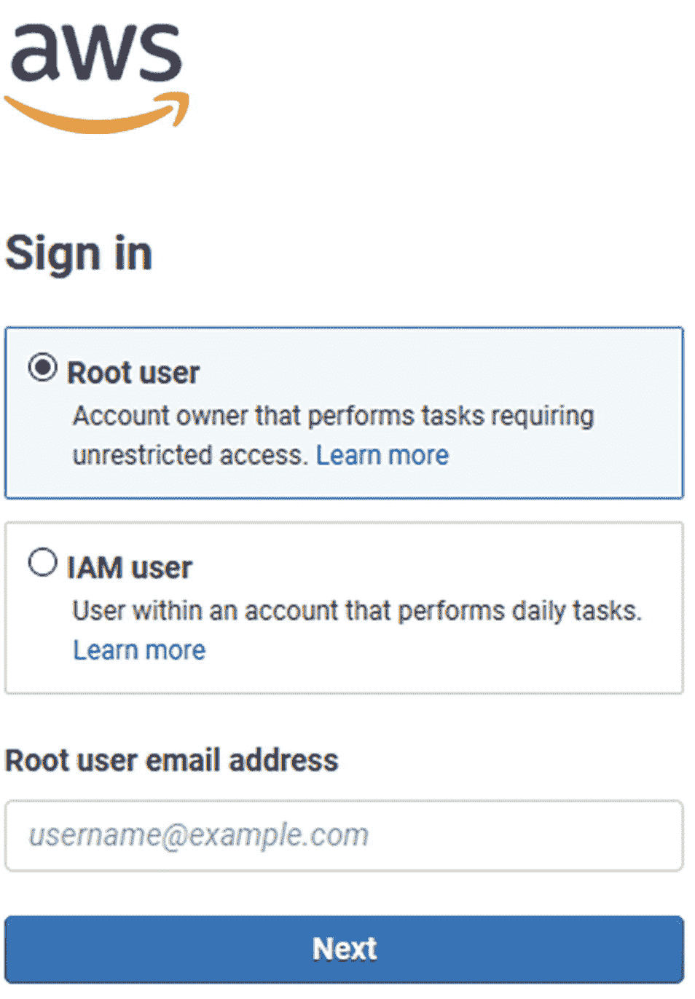

图 3-15

18. 现在，选择右上角的 *登录控制台* 按钮。
19. 在登录屏幕（图 3-15）中，选择 *IAM 用户*。

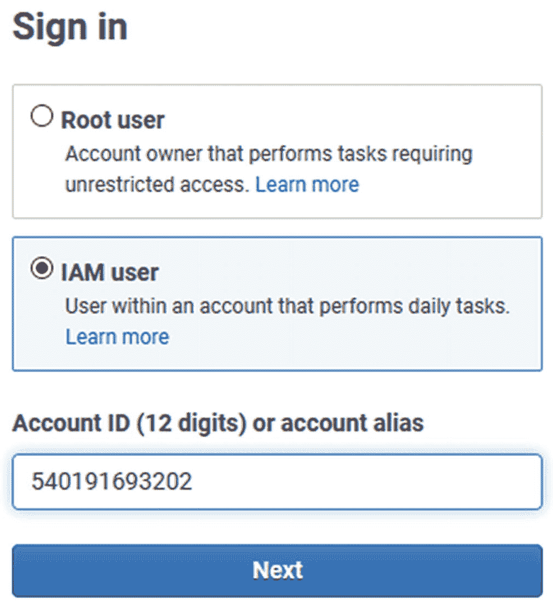

图 3-16

20. 输入您之前复制的 12 位数字（图 3-16）。然后点击*下一步*。

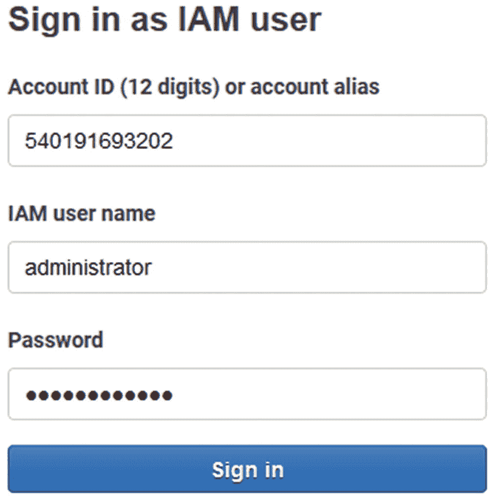

图 3-17

21. 然后，在 IAM 用户名处输入`administrator`，并输入您之前复制的一次性密码（图 3-17）。
22. 接着，将您的密码更改为一个足够复杂的密码，用于您的 AWS 服务的管理员账户。

欢迎回到 AWS 管理控制台。每当您需要管理 AWS 服务时，请使用此管理员账户，而不是根用户账户。接下来，我们介绍 GitHub。

## GitHub 访问权限

本书将全程使用 GitHub 作为我们的源代码仓库。您创建的大多数技能至少会包含一些需要安全存储的代码。GitHub 私有仓库就是这样一个安全的地方。作为替代方案，您也可以使用微软的 Azure DevOps 仓库、亚马逊的 AWS CodeCommit、Atlassian 的 Bitbucket 或其他众多选择。我们将坚持使用 GitHub，因为它在商业领域被广泛用作标准，并且所有主流工具都与其兼容。首先，我们需要创建一个 GitHub 账户：

1. 导航至 [`https://github.com`](https://github.com)。
2. 点击*注册 GitHub*。
3. 输入一个用户名（非您的电子邮件地址）。
4. 输入您的电子邮件地址。
5. 输入密码。
6. 完成验证。
7. 点击*创建账户*。
8. 验证您的电子邮件。
9. 完成。您现在拥有了一个 GitHub 账户。

## Jira 账户

Atlassian 的 Jira 和微软的 Azure DevOps 是两个最流行的敏捷软件项目管理工具。AWS CodeStar 和 GitHub 也提供一些项目管理功能。这些工具中的任何一个都适用于我们的目的，所以如果您有偏好，请随意选择。然而，Jira 在开源社区中普遍使用，并且相比 Azure DevOps，其配置和开销更少，因此本书将使用 Jira 进行需求和任务管理。要创建 Jira 账户：

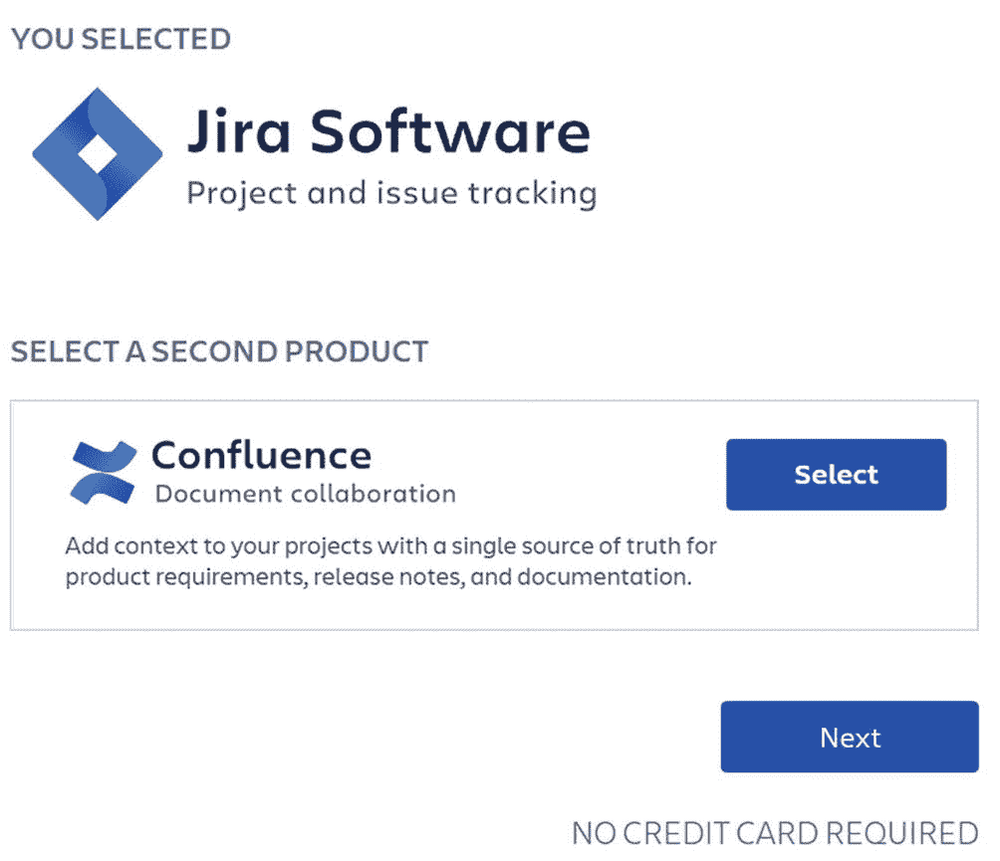

图 3-18

1. 导航至 [`www.atlassian.com/software/jira`](http://www.atlassian.com/software/jira)。
2. 点击*免费获取*。
3. 点击选择 Confluence 作为第二个产品（图 3-18）。

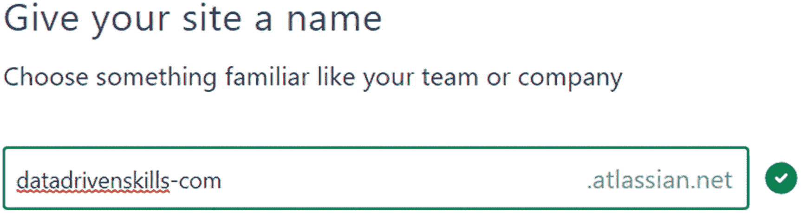

图 3-19

4. 点击*下一步*。
5. 点击*使用电子邮件注册*。
6. 输入所需信息。
7. 点击*同意*。
8. 验证您的电子邮件。
9. 为您的站点命名（图 3-19）。
10. 回答调查问题（或点击*跳过*）。
11. 邀请您的团队成员（或点击*跳过*）。
12. 选择*新手*使用 Jira。选择*新手*使用敏捷方法论。这些选项将使 Jira 更易于使用。
13. 选择我们将时间花在开发*功能*上。
14. 选择我们的日程安排是*灵活的*。
15. 点击*下一步*。
16. 在下一个屏幕上，我们将选择*看板*。Scrum 也是一个不错的选择，但就我们的目的而言，我们只需要看板模板。
17. 对于您的第一个项目名称，输入*Data-Driven Skills*，密钥为*DDS*。
18. 这样就完成了。您已经设置好了一个 Jira 账户、站点和项目，可以随时开始使用。

## 总结

在本章中，我们设置并配置了本书后续章节所需的开发者账户。这些账户用于捕获需求、管理任务、存储源代码、为我们自定义的、数据驱动的 Alexa 技能配置 VUI，以及构建后端数据库、存储区域和技能逻辑的编码。在下一章中，我们将构建我们的第一个自定义技能：一个身体质量指数（BMI）计算器。

现在您已经配置了一个例程并从蓝图中创建了一些技能，并且已经设置好了账户，我们准备构建我们的第一个自定义数据驱动的 Alexa 技能。在本章中，我们将构建一个身体质量指数（BMI）计算器。前提很简单：BMI 是身高和体重的函数。计算公式为：

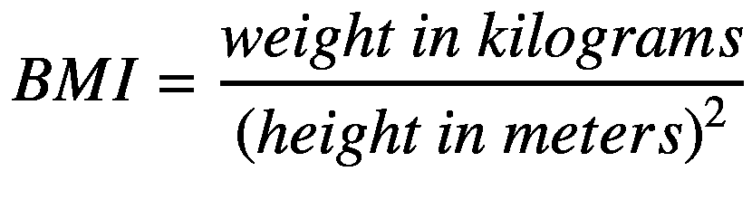

使这个计算变得复杂的是，如果我询问您的身高，您可能会说：188 厘米、1.88 米、6 英尺 2 英寸或 74 英寸。同样，如果我询问您的体重，您可能会说 109 公斤、109 千克、240 磅，甚至 17 英石 2 磅，或者仅仅 17 英石。

那么，让我们开始吧。首先，我们将创建基础技能。然后，我们将在 Alexa 开发者控制台中为该技能配置 VUI。在下一章中，我们将编写后端代码并测试我们的技能，以确保其按预期工作。最后，我们将经历将技能发布到 Alexa 技能商店的流程。

## 步骤 1：创建基础技能

第一步是根据模型、方法和模板创建基础技能。要开始此步骤，我们需要启动 Alexa 开发者控制台。导航至 [`https://developer.amazon.com/alexa/console/ask`](https://developer.amazon.com/alexa/console/ask)。欢迎来到 Alexa 技能开发（见图 4-1）。

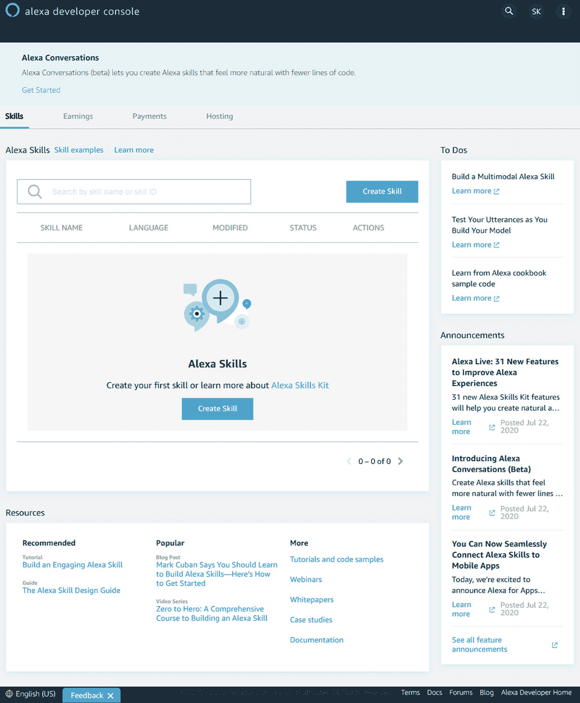

图 4-1

现在，点击*创建技能*并为技能命名，例如 BMI 计算器。然后将第一个选项保留为*自定义*，因为我们正在构建一个自定义技能，而不是其他类型。接着，您可以选择 Alexa 托管或自行配置。Alexa 托管提供了通往 AWS lambda 函数和其他几个 AWS 服务的管道。自行配置则没有。在本书中，我们稍后需要为一些高级技能自行配置，但现在还不需要。对于第二个选项，选择*Alexa 托管（Python）*，如图 4-2 所示。

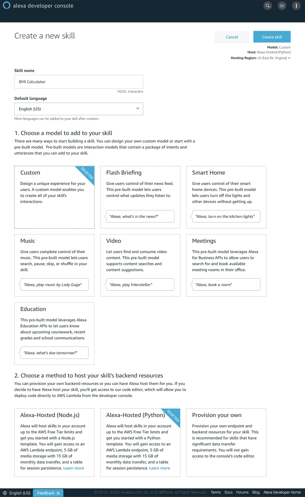

图 4-2

现在点击右上角的*创建技能*。我们将选择*Hello World 技能/从头开始*模板（我知道，我知道，但在提供的选项中，它是最基础的）并点击*继续使用模板*（图 4-3）。

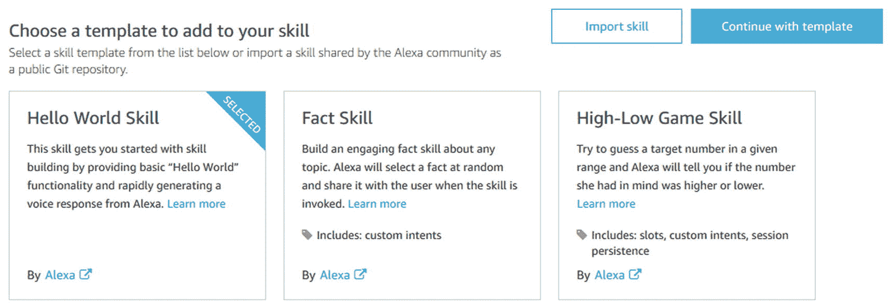

图 4-3

呜呼！您的新技能正在创建中（图 4-4）。

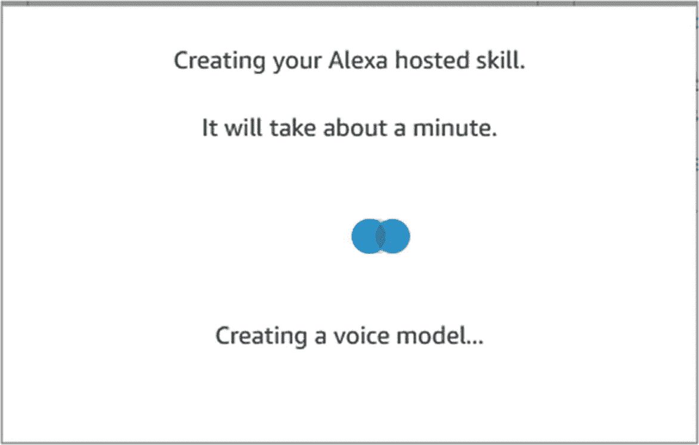

图 4-4

一两分钟后，您的新 BMI 计算器技能就可以开始使用了（见图 4-5）。与此同时，让我们参观一下技能界面。

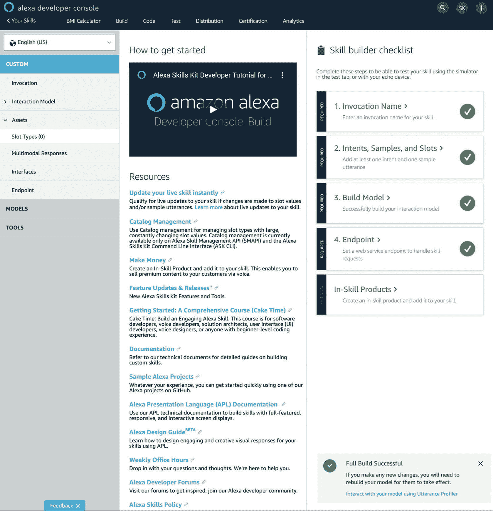

图 4-5

## 技能构建器界面

让我们来熟悉一下 Alexa 开发者控制台。从顶部开始（见图 4-6），有一组用于开发技能主要任务的选项卡。


图 4-6

- **构建：** 使用此选项卡配置 VUI 选项并为你的技能创建交互模型。
- **代码：** 在此处编写你的后端代码。对于 Alexa 托管的技能，此选项卡是你编写 lambda 函数的地方。你无需为此前往 AWS。
- **测试：** 在此选项卡中测试你的交互模型。你可以打开麦克风并与你的技能进行交互，以确保其按预期工作。
- **分发：** 在此处，你可以配置技能商店选项以及隐私声明等内容。
- **认证：** 这是你可以提交技能进行认证的地方。当你选择此选项卡时，你的技能将自动进行验证，并且可能会建议一些修复方法。一旦通过自动验证，你就可以将技能提交到认证流程。
- **分析：** 一旦你的技能在 Alexa 商店中上线，你可以查看分析选项卡，了解其运行情况并学习如何改进它。

在 Alexa 开发者控制台的左侧，是用于选择交互模型不同部分的菜单（见图 4-7）。在顶部，你可以选择技能的语言。

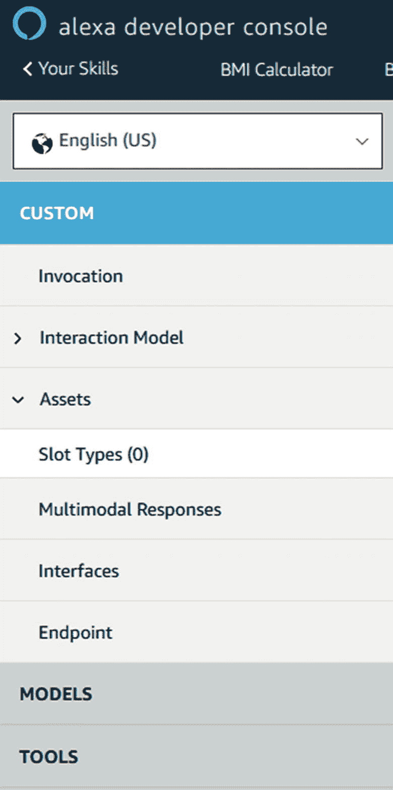

图 4-7

在语言选择器下方，有三个部分：自定义、模型和工具。在自定义部分，你将开发你的交互模型。显示的选项会根据你选择的交互模型类型而有所不同，但标准选项如下：

- **调用：** 这是你为技能分配调用名称的地方。如果你的调用名称是“西蒙的不可思议的技能”，人们需要说“Alexa，启动西蒙的不可思议的技能”才能访问你的技能。
- **交互模型：** 使用此选项配置用户与 Alexa 之间的对话。此选项是你花费大部分时间编写技能意图和表述的地方——我们将在下一节中详细介绍这些内容。
- **资产：** 通过选择资产菜单选项，配置槽位值和其他完成交互模型所需的资产。同样，在下一节中，我们将为身高和体重创建槽位，以便在交互模型中使用。
- **多模态响应：** 包含在技能交互中返回的 Alexa 表示语言 (APL) 和 Alexa 音频表示语言 (APLA) 代码。我们将在后面的章节中学习 APL 和 APLA。
- **接口：** 使用此选项打开或关闭技能可用的各种接口。我们将在本技能中使用此选项来打开 Alexa 对话，并在本书的其他项目中使用其他接口。
- **端点：** 这是你连接前端和后端的地方。由于 BMI 计算器技能是 Alexa 托管的，这部分已经为你完成了。

当你选择模型部分时，有两个选项：自定义和智能家居。如果你正在构建智能家居技能，你需要打开该模型。我们不是，所以我们可以将这些选项保留为默认值。

在工具部分，你将找到技能内产品、账户关联、权限和语言的选项，我们将在后面的章节中介绍所有这些内容。对于 BMI 计算器，我们不需要这些。

在 Alexa 开发者控制台的中央面板中，有*如何入门*视频以及可用于入门和进一步学习的资源列表。

最后，在控制台的右侧是技能构建器清单。此部分显示了你需要完成以构建技能的各种任务的状态。使用我们用来创建基础技能的模板，其中大部分已经完成。

回顾完控制台后，我们准备开始为我们的 BMI 计算器技能配置 VUI。

## 步骤 2：配置 VUI

让我们回顾一下本章开头找到的 BMI 技能的问题陈述：根据身高和体重计算 BMI。计算公式为


我们需要一种方法来要求用户提供他们的身高和体重，以便我们能够计算他们的 BMI。在此之前，用户需要启动（或调用）我们的技能并要求我们计算他们的 BMI。我们将逐步处理这两个步骤。

### 调用名称

用户要做的第一件事是启动你的技能。他们通过说“Alexa，开始/启动/运行 *<调用名称>*”来做到这一点。通过选择左侧的调用菜单项来创建`技能调用名称`。调用名称有一些规则：

1.  两个或更多单词。
2.  用小写字母书写，单词之间用空格分隔。
3.  所有格撇号是可以的，例如“simon's”。
4.  缩写和首字母缩略词必须用句点和字母之间的空格拼写出来，因此“b. m. i.”是正确的。
5.  数字必须拼写出来，例如“one hundred”。
6.  调用名称不能包含任何 Alexa 技能启动短语，例如“launch”、“ask”、“tell”、“open”、“load”、“begin”和“enable”。唤醒词包括“Alexa”、“Amazon”、“Echo”、“Computer”或单词“skill”或“app”也是不允许的。
7.  品牌名称必须是你可以使用的。

技能调用名称是人们启动你的技能的方式。与例程一样，技能名称应该是独一无二、易于记忆且易于说出的。如果你查看 Alexa 技能商店（`www.amazon.com/alexa-skills`），你会发现大量的 BMI 计算器。为了想出一些独特的东西，我添加了我的名字，所以对于我们的 BMI 计算器，我选择了“simon's b. m. i. calculator”作为我的技能调用名称（图 4-8）。注意 BMI 缩写是如何拼写出来的。如果我仅仅使用“simon's bmi calculator”，Alexa 会监听单词 bmi，而不是首字母缩略词 B.M.I.。

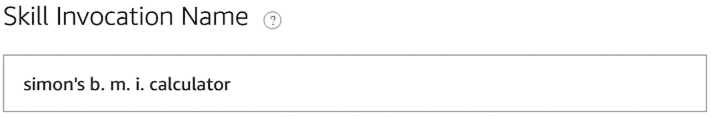
图 4-8 为你的新技能输入技能调用名称

请务必在 Alexa 设备上多次测试你的启动短语。这种测试应该能暴露出任何潜在的冲突。例如，许多启动短语中包含我名字的技能与流行的游戏“西蒙说”冲突。我必须小心地提出独特的调用名称。

我们需要回答的下一个问题是我们要使用哪种交互模型。

### 交互模型

`Interaction Model`（交互模型）有两种选择。首先，默认的交互模型使用意图（intents）来捕捉用户希望技能执行的操作。一个`intent`（意图）是一条告诉或请求 Alexa 做某事的语句。例如，“我的 BMI 是多少？”就是一个意图。它请求 Alexa 开始计算我的 BMI 的过程。这个第一个意图之后，Alexa 会询问你的身高和体重，你可以通过说出`ProvideHeightAndWeight`意图来回答，例如说“我身高六英尺二英寸，体重两百四十磅。”这个意图期望你同时提供身高和体重。如果你只说其中一项，它是无法正常工作的。这时就引入了第二种交互模型——`Alexa Conversations`。它更具对话性，允许你只回答身高或体重来回应提示。当 Alexa 注意到缺失的值时，她会仅针对那一项再次提示你。

使用意图模型时，你和 Alexa 之间的对话将如图 4-9 所示。

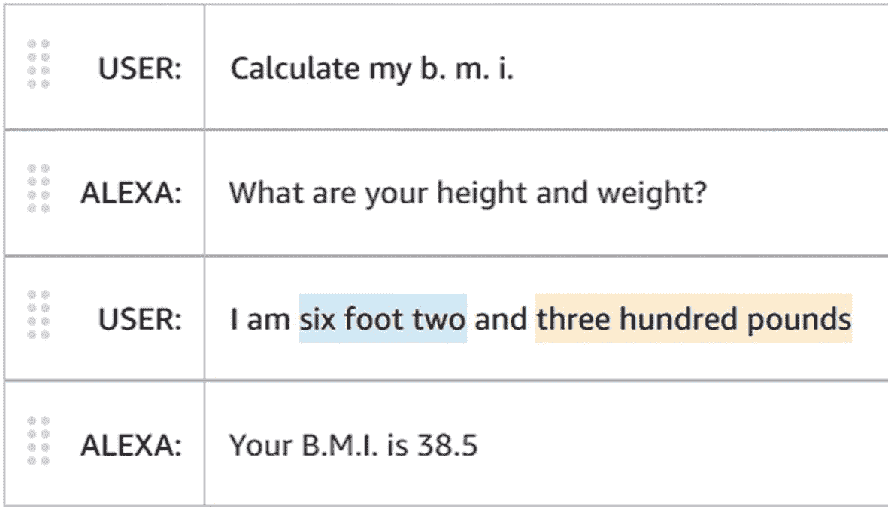
图 4-9 BMI 计算器的意图对话

而使用对话模型时，对话可能如图 4-9 所示，也可能如图 4-10 所示。

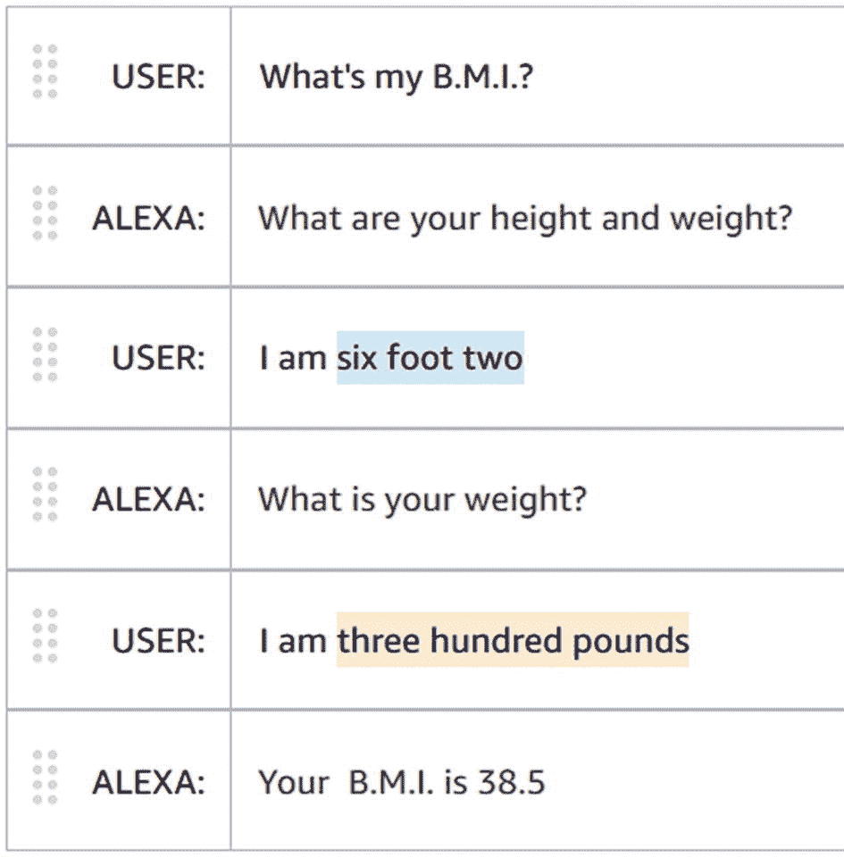
图 4-10 BMI 计算器的对话模型对话

这种差异很微妙，但意义重大。对于更复杂的技能，对话模型对用户更加友好，因为它允许用户以自己的方式回答提示，而不是遵循意图模型所要求的严格交互方式。还有一个优势：在意图模型中，作为开发者的你需要负责处理所有可能的交互排列组合。而在对话模型中，你只需向 Alexa 展示对话的基本流程，剩下的事情由她的人工智能来完成。同样重要的是，这并非一个非此即彼的选择；你可以在两种模型中都有交互，并且，正如我们将看到的，即使是一个基于对话模型构建的技能，你也至少需要一个意图。

现在你已经了解了意图和对话，接下来需要理解槽位（Slots）。

### 槽位

`Slot`（槽位）是用户为 Alexa 填充的内容。当你定义一个槽位时，需要为其分配一个槽位类型。这些可以是内置的槽位类型，例如`AMAZON.City`和`AMAZON.Artist`，也可以是更通用的槽位类型，例如`AMAZON.NUMBER`和`AMAZON.DATE`，甚至可以是自定义槽位类型，你可以在技能配置过程中提供槽位值。内置槽位类型的酷炫之处在于，它们能处理人们可能用来表达（例如）日期的各种奇怪而奇妙的方式。我可能会说“five ten twenty-twenty”，或者“May tenth twenty-twenty”，甚至可能说“oh-five ten twenty-twenty”。`AMAZON.DATE`槽位类型旨在处理所有这些变体，并为我（开发者）捕获实际的日期值 5/10/2020。

在我们的 BMI 技能中，身高和体重将是槽位。用户需要提供这些值，就像参数或变量一样，然后 Alexa 会将槽位值传递给 API 代码进行评估和处理。不过，我们面临一个难题：如何表示身高和体重槽位的众多可能性？起初，我们可能会将身高和体重视为`AMAZON.NUMBER`类型，在这种情况下，用户可以这样说：

```
我身高 {Height} 厘米，体重 {Weight} 公斤。
```

这种方法可能有效，但仅限于公制单位。如果我们允许用户使用英制单位回答，那么我们就需要为身高使用两个槽位来分别表示英尺和英寸，即：

```
我身高 {Feet} 英尺 {Inches} 英寸，体重 {Weight} 磅。
```

或者，如果用户的身高是整数英尺：

```
我身高 {Feet} 英尺，体重 {Weight} 磅。
```

然后，如果我们允许体重使用英石（stone）单位，我们还需要两个槽位（一个必填，一个可选），这样就会产生四种话语变体：

```
我身高 {Feet} 英尺 {Inches} 英寸，体重 {Stone} 英石 {Pounds} 磅。
我身高 {Feet} 英尺，体重 {Stone} 英石 {Pounds} 磅。
我身高 {Feet} 英尺 {Inches} 英寸，体重 {Stone} 英石。
我身高 {Feet} 英尺，体重 {Stone} 英石。
```

现在我们有了七条包含完全不同槽位的话语，这意味着我们必须编写七个 API 来处理它们，这听起来工作量很大。没有人喜欢做可以避免的大量工作，而在这个例子中，恰恰是可以避免的！

与其为我们的槽位类型使用`AMAZON.NUMBER`，不如为身高和体重创建自定义槽位类型，包含我们想要处理的所有选项。例如，表 4-1 展示了一组示例单位组合。

表 4-1 示例单位组合

| 身高 | 体重 |
| --- | --- |
| 188 厘米 | 45 公斤 |
| 188 c.m. | 45 k.g. |
| 1.9 米 | 45 千克 |
| 6 英尺 | 180 磅 |
| 6 英尺 2 | 14 英石 |
| 6 英尺 2 英寸 | 14 英石 3 |
| 等等 | 等等 |

下一个问题是，Alexa 不喜欢你将数值作为数字放入自定义槽位中。相反，我们必须将数字拼写为单词。因此，表 4-1 中的示例实际上应该写成表 4-2 所示的样子。

表 4-2 数字转换为单词后的单位组合

| 身高 | 体重 |
| --- | --- |
| one hundred and eighty eight centimeters | forty five kilograms |
| one hundred eighty eight c.m. | forty five k.g. |
| one point nine meters | forty five kilos |
| six foot | one hundred eighty pounds |
| six foot two | fourteen stone |
| six foot two inches | fourteen stone three |
| 等等 | 等等 |

通过创建包含所有这些不同值的自定义槽位，我们允许用户说出他们喜欢的任何数量和单位，并且我们可以将它们全部转换为可用于 BMI 计算的值。但这需要很多槽位值，不是吗？是的，这正是为什么这个特定的技能实际上是一个数据驱动的技能！

#### 创建自定义槽位值

要创建槽位值列表，我本人可没打算手动输入所有可能性。相反，我们来看看自定义槽位的批量编辑功能。此功能允许你在 CSV（逗号分隔值）文件中定义值列表。我知道一个能很好创建 CSV 文件的工具：Microsoft Excel（或者任何电子表格软件，我想）。我好奇 Excel 能否将数字转换为单词。

不能。它做不到。但等等，快速上网搜索后，我找到了微软支持团队编写的一个函数^(¹⁴)，它恰好能实现这个功能，不过针对的是美元和美分。也就是说，它可以将 `$1,234.56` 拼写为 `one thousand two hundred thirty-four dollars and fifty-six cents`。这或许可行。我们可以修改 `SpellNumbers` 函数，使其不处理美元和美分，而只显示拼写出来的数字。修改完成后，我们可以将该函数作为代码模块添加到 Excel 中，并在生成槽位时使用它。就像这样：

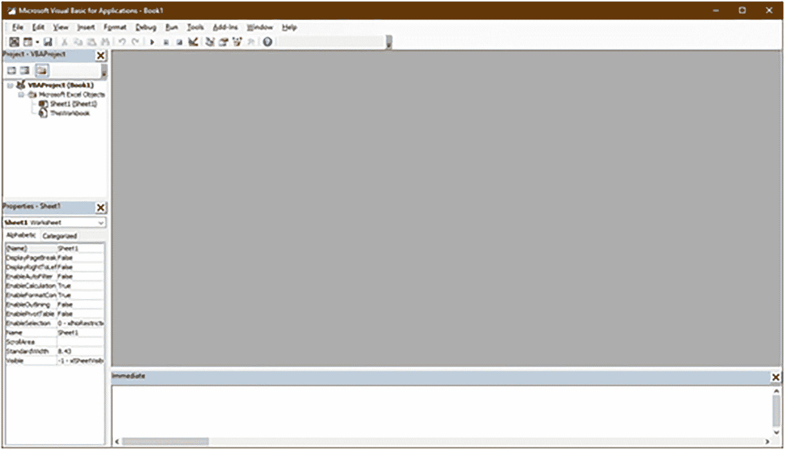
**图 4-11** Visual Basic for Applications 窗口

1.  打开 Excel。
2.  打开一个空白工作簿。
3.  按下 `Alt-F11` 打开 Visual Basic for Applications 窗口（图 4-11）。

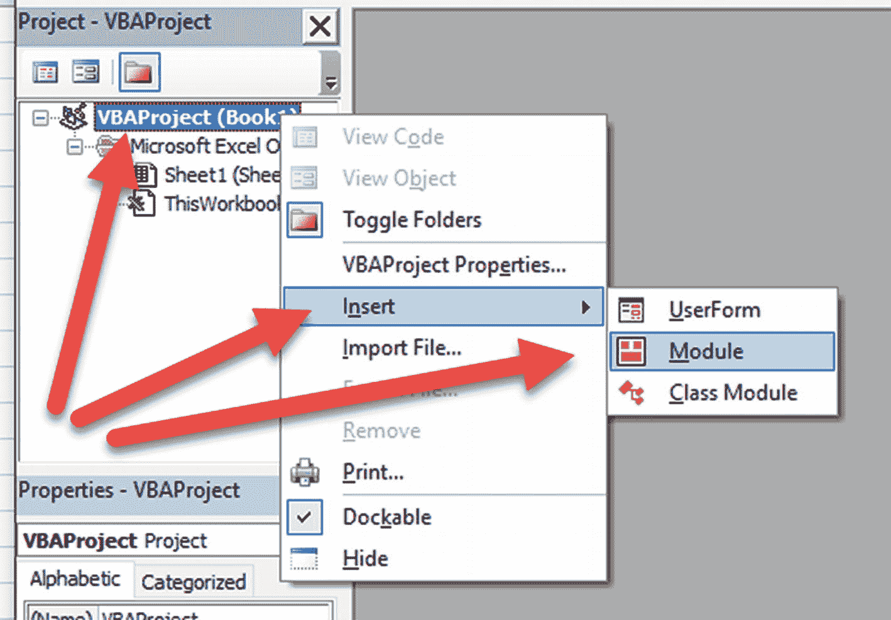
**图 4-12** 创建新的 VBA 代码模块

1.  右键点击 `VBAProject (Book1)`，然后选择 `Insert | Module`（参见图 4-12）。

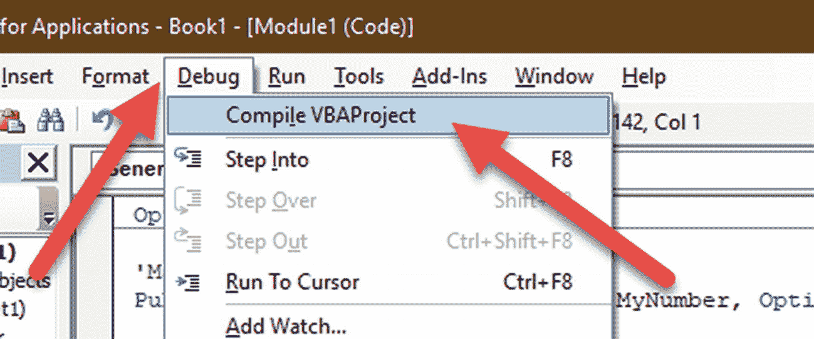
**图 4-13** 编译 VBA 模块

1.  粘贴以下代码，你可以从本书的示例代码下载中获得：

```
Option Explicit
'Main Function
Public Function SpellNumber(ByVal MyNumber, Optional AddAnds = False)
Dim Dollars, Cents, Temp
Dim DecimalPlace, Count
ReDim Place(9) As String
Place(2) = " Thousand "
Place(3) = " Million "
Place(4) = " Billion "
Place(5) = " Trillion "
' String representation of amount.
MyNumber = Trim(Str(MyNumber))
' Position of decimal place 0 if none.
DecimalPlace = InStr(MyNumber, ".")
' Convert cents and set MyNumber to the dollar amount.
If DecimalPlace > 0 Then
Cents = GetTens(Left(Mid(MyNumber, DecimalPlace + 1) & "00", 2))
MyNumber = Trim(Left(MyNumber, DecimalPlace - 1))
End If
Count = 1
Do While MyNumber  ""
Temp = GetHundreds(Right(MyNumber, 3))
If Temp  "" Then
Dollars = Temp & Place(Count) & Dollars
End If
If Len(MyNumber) > 3 Then
MyNumber = Left(MyNumber, Len(MyNumber) - 3)
Else
MyNumber = ""
End If
Count = Count + 1
Loop
Select Case Dollars
Case ""
Dollars = "Zero"
Case "One"
Dollars = "One"
Case Else
Dollars = Dollars
End Select
If AddAnds Then
Debug.Print (Right(Trim(Dollars), 7) = "Hundred")
If Right(Trim(Dollars), 8)  "Trillion" Then
Dollars = Replace(Dollars, "Trillion ", "Trillion and ")
End If
If Right(Trim(Dollars), 7)  "Billion" Then
Dollars = Replace(Dollars, "Billion ", "Billion and ")
End If
If Right(Trim(Dollars), 7)  "Million" Then
Dollars = Replace(Dollars, "Million ", "Million and ")
End If
If Right(Trim(Dollars), 8)  "Thousand" Then
Dollars = Replace(Dollars, "Thousand ", "Thousand and ")
End If
If Right(Trim(Dollars), 7)  "Hundred" Then
Dollars = Replace(Dollars, "Hundred ", "Hundred and ")
End If
End If
SpellNumber = Trim(Dollars)
End Function
' Converts a number from 100-999 into text
Function GetHundreds(ByVal MyNumber)
Dim Result As String
If Val(MyNumber) = 0 Then Exit Function
MyNumber = Right("000" & MyNumber, 3)
' Convert the hundreds place.
If Mid(MyNumber, 1, 1)  "0" Then
Result = GetDigit(Mid(MyNumber, 1, 1)) & " Hundred "
End If
' Convert the tens and ones place.
If Mid(MyNumber, 2, 1)  "0" Then
Result = Result & GetTens(Mid(MyNumber, 2))
Else
Result = Result & GetDigit(Mid(MyNumber, 3))
End If
GetHundreds = Result
End Function
' Converts a number from 10 to 99 into text.
Function GetTens(TensText)
Dim Result As String
Result = "" ' Null out the temporary function value.
If Val(Left(TensText, 1)) = 1 Then ' If value between 10-19...
Select Case Val(TensText)
Case 10: Result = "Ten"
Case 11: Result = "Eleven"
Case 12: Result = "Twelve"
Case 13: Result = "Thirteen"
Case 14: Result = "Fourteen"
Case 15: Result = "Fifteen"
Case 16: Result = "Sixteen"
Case 17: Result = "Seventeen"
Case 18: Result = "Eighteen"
Case 19: Result = "Nineteen"
Case Else
End Select
Else ' If value between 20-99...
Select Case Val(Left(TensText, 1))
Case 2: Result = "Twenty "
Case 3: Result = "Thirty "
Case 4: Result = "Forty "
Case 5: Result = "Fifty "
Case 6: Result = "Sixty "
Case 7: Result = "Seventy "
Case 8: Result = "Eighty "
Case 9: Result = "Ninety "
Case Else
End Select
Result = Result & GetDigit(Right(TensText, 1)) ' Retrieve ones place.
End If
GetTens = Result
End Function
' Converts a number from 1 to 9 into text.
Function GetDigit(Digit)
Select Case Val(Digit)
Case 1: GetDigit = "One"
Case 2: GetDigit = "Two"
Case 3: GetDigit = "Three"
Case 4: GetDigit = "Four"
Case 5: GetDigit = "Five"
Case 6: GetDigit = "Six"
Case 7: GetDigit = "Seven"
Case 8: GetDigit = "Eight"
Case 9: GetDigit = "Nine"
Case Else: GetDigit = ""
End Select
End Function
```

2.  选择 `Debug | Compile VBAProject` 菜单选项（见图 4-13）。

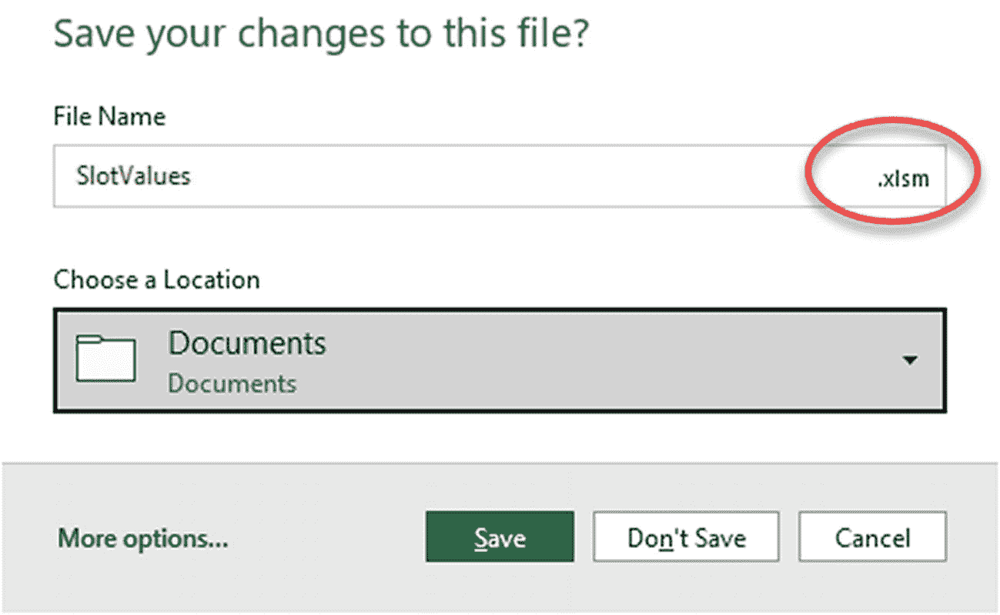
**图 4-14**

确保你保存为 `.xlsm` 文件。

1.  从菜单中选择 `File | Close and return to Microsoft Excel`。
2.  回到电子表格中，选择 `File | Save As`。
3.  输入文件名，例如 `SlotValues`。
4.  选择一个方便的文件夹。
5.  确保文件类型为 `.xlsm`（Excel 启用宏的工作簿）（见图 4-14）。如果不是，请点击对话框底部的 `More options…`，并在 `File Type` 下拉菜单中更改。
6.  点击 `Save`。

现在我们有了一个 `SpellNumber` 函数，可以用来将数值转换为文字。呼，喝口水吧，这是你应得的。

接下来，让我们为电子表格的“高度”选项卡创建选项。我们需要九个列标题，如表 4-3 所示。

**表 4-3** 高度列

| 值 | 术语 | 索引 | 同义词 1 … | 同义词 6 |
| :--- | :--- | :--- | :--- | :--- |
| 12 | 十二英寸 | 12 | 一英尺 | 不适用 |
| 30 | 三十厘米 | 30cm | 三十公分 | 不适用 |

我们将把实际数字放在 `Value` 列中。然后，我们将在 `Term` 列中用英寸或厘米拼写出该数字。我们将通过直接使用英寸数字，并在公制版本后添加 `"cm"` 后缀来索引此列表。然后，我们将输入同义词的公式，如表 4-4 所示。

**表 4-4** 高度的同义词公式

| 单位 | 列 | 转换 | 公式 |
| :--- | :--- | :--- | :--- |
| 英制 | A [值] | 无 | 数字从 12 到 132。 |
| | B [术语] | 转换为英寸 | `=Concat(SpellNumber($A2), " inches")` |
| | C[索引] | 无 | `=$A2` |
| | D [同义词 1] | 转换为英尺 | `=Concat(SpellNumber(Trunc($A2/12)), " foot ", If(Mod($A2,12)=0, "", SpellNumber(Mod($A2,12))))` |
| | E [同义词 2] | 转换为英尺（复数） | `=Concat(SpellNumber(Trunc($A2/12)), " feet ", If(Mod($A2,12)=0, "", SpellNumber(Mod($A2,12))))` |
| | F [同义词 3] | 转换为英尺/英寸 | `=If(Mod($A2,12)=0, "", Concat(SpellNumber(Trunc($A2/12)), " foot ", If(Mod($A2,12)=0, "", Concat(SpellNumber(Mod($A2,12)), If(Mod($A2,12)=1, " inch", " inches")))))` |
| | G [同义词 4] | 转换为英尺（复数）/英寸 | `=If(Mod($A2,12)=0, "", Concat(SpellNumber(Trunc($A2/12)), " feet ", If(Mod($A2,12)=0, "", Concat(SpellNumber(Mod($A2,12)), If(Mod($A2,12)=1, " inch", " inches")))))` |
| | H [同义词 5] | 转换为空 | `=If(Mod($A2,12)=0, "", Concat(SpellNumber(Trunc($A2/12)), " ", SpellNumber(Mod($A2,12))))` |
| | I [同义词 6] | 转换为带“And”的英寸（百位数） | `=If($A2<=100, "", Concat(SpellNumber($A2,True), " inches"))` |
| 公制 | A [值] | 无 | 数字从 30 到 250。 |
| | B [术语] | 转换为厘米 | `=Concat(SpellNumber($A123), " centimeters")` |
| | C[索引] | 后缀 cm | `=Concat($A123, "cm")` |
| | D [同义词 1] | 转换为公分 | `=Concat(SpellNumber($A123), " c.m.")` |
| | E [同义词 2] | 转换为带“And”的厘米 | `=If($A123<=100, "", Concat(SpellNumber($A123, True), " centimeters"))` |
| | F [同义词 3] | 转换为带“And”的公分 | `=If($A123<=100, "", Concat(SpellNumber($A123, True), " c.m."))` |
| | G [同义词 4] | 手动 | `50cm` 半米<br>`100cm` 一米<br>`150cm` 一米半<br>`200cm` 两米<br>`250cm` 两米半 |
| | H [同义词 5] | 手动 | `50cm` 零点五米<br>`150cm` 一点五米<br>`250cm` 两点五米 |
| | I [同义词 6] | 手动 | `50cm` 点五米<br>`100cm` 一米<br>`150cm` 一米半<br>`250cm` 两米半 |

然后，在相应的行中向下复制公式。完成后，工作表应如图 4-15 所示。

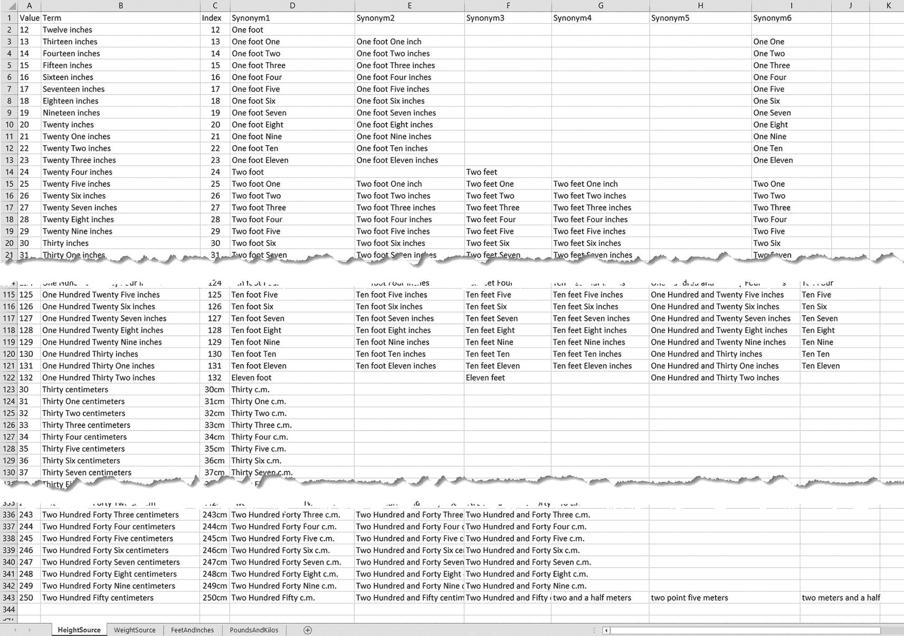
**图 4-15** 完成公式后的高度电子表格

对于重量，我们将做类似的事情。不过我们只需要三个同义词，如表 4-5 所示。

**表 4-5** 重量列

| 值 | 术语 | 索引 | 同义词 1 … | 同义词 3 |
| :--- | :--- | :--- | :--- | :--- |
| 17 | 十七磅 | 17lb | 一英石三磅 | 不适用 |
| 20 | 二十公斤 | 20kg | 二十千克 | 不适用 |

表 4-6 显示了同义词的公式。

**表 4-6** 重量的同义词公式

| 单位 | 列 | 转换 | 公式 |
| :--- | :--- | :--- | :--- |
| 英制 | A [值] | 无 | 数字从 1 到 600。 |
| | B [术语] | 转换为磅 | `=Concat(SpellNumber($A2), " pounds")` |
| | C[索引] | 后缀 lb | `=Concat($A2, "lb")` |
| | D [同义词 1] | 转换为英石和磅 | `=If($A2<14, "", Concat(SpellNumber(Trunc($A2/14)), " stone", If(Mod($A2,14)=0, "", Concat(" ", Spellnumber(Mod($A2, 14)), " pound", If(Mod($A2,14)=1, "", "s")))))` |
| | E [同义词 2] | 转换为英石 | `=If($A2<14, "", Concat(SpellNumber(Trunc ($A2/14)), " stone", IF(Mod($A2,14)=0, "", Concat(" ", SpellNumber(Mod($A2, 14))))))` |
| | F [同义词 3] | 转换为带“And”的磅 | `=If($A2<=100, "", Concat(SpellNumber($A2, True), " pound", If($A2=1,"","s")))` |
| 公制 | A [值] | 无 | 数字从 1 到 275。 |
| | B [术语] | 转换为公斤 | `=Concat(SpellNumber($A602), " kilo", If($A602=1, "", "s"))` |
| | C[索引] | 后缀 kg | `=Concat($A602, "kg")` |
| | D [同义词 1] | 转换为千克 | `=Concat(SpellNumber($A602), " kilogram", If($A602=1, "", "s"))` |
| | E [同义词 2] | 转换为带“And”的公斤 | `=If($A602<=100, "", Concat(SpellNumber($A602,True), " kilo", If($A602=1, "", "s")))` |
| | F [同义词 3] | 转换为带“And”的千克 | `=If($A602<=100, "", Concat(SpellNumber($A602,True), " kilogram", If($A602=1, "", "s")))` |

完成后的重量电子表格应如图 4-16 所示。

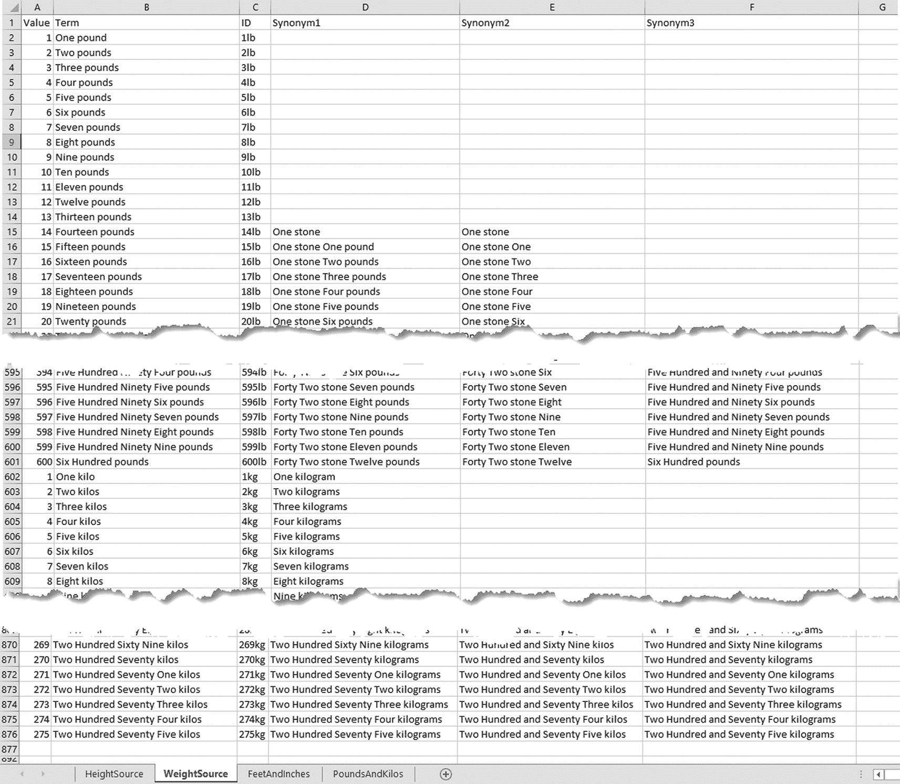
**图 4-16** 完成公式后的重量电子表格

现在我们有了高度和重量槽位的槽值。

此时，请务必保存你的工作，并保存工作簿的第二个副本！

要将槽值导出为 CSV 文件，我们需要将列表（不包括 A 列 [值]）复制到新工作表（或新工作簿），将公式粘贴为值，然后将该工作表导出为 CSV 文件。对高度执行一次，对重量再执行一次。导出过程如下：

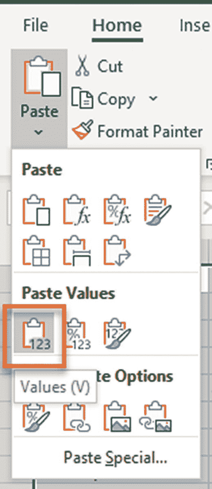
**图 4-17** 在 Excel 中粘贴值

1.  在工作簿底部，点击 `+` 添加一个工作表。将其命名为 `HeightData`。
2.  在高度电子表格中，按 `Ctrl-Home`，然后按 `Ctrl-End`，再按 `Ctrl-Shift-Home`，最后按 `Shift-Right-Arrow`。
3.  现在，工作表被高亮显示（除 A 列外），我们可以按 `Ctrl-C` 复制所有内容。
4.  点击切换到 `HeightData` 选项卡。
5.  使用“粘贴”按钮菜单选择 `Paste Values`（见图 4-17）。
6.  从菜单中选择 `File | Export`。
7.  选择 `Change File Type`。
8.  选择 `CSV (Comma delimited) (*.csv)`。
9.  点击 `Save As`。
10. 输入文件名并点击 `Ok`。
11. 对重量文件重复这些步骤。

现在，我们准备好在 Alexa 开发者控制台中创建自定义槽位类型了。

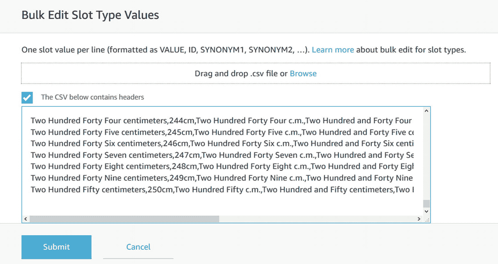
**图 4-18** 批量编辑高度槽值

1.  使用文本编辑器（如 Notepad++）打开刚创建的 `HeightData.csv` 文件，然后将内容复制到剪贴板。
2.  在 Alexa 开发者控制台中，点击顶部的 `Build` 选项卡。
3.  点击左侧的 `Slot Types` 菜单。
4.  点击 `+ Add Slot Type`。
5.  选择 `Create a Custom slot type with values`。
6.  输入名称 `Height`，然后点击 `Next`。
7.  对于 Slot Values，点击中间的 `Bulk Edit` 链接。
8.  勾选 `The CSV below contains headers`。
9.  将数据粘贴到提供的框中（参见图 4-18）。
10. 点击 `Submit`。
11. 点击顶部的 `Save`。

现在对 `Weight` 数据重复这些步骤。

配置好这些槽位后，我们就可以继续进行对话配置了。

# 配置对话

在使用意图模型创建 Alexa 技能时，接下来需要创建用于获取身高和体重的意图。然而，我更倾向于让 Alexa 自行判断用户已经或尚未告知我们的信息，并自行处理，这正是对话模型发挥作用的地方。在本书中，我们将使用这两种模型，但更倾向于后者。为了深入实践，我们将从将对话设置为 Alexa 对话开始。为此，我们需要：(1) 开启 Alexa 对话工具，(2) 构建一个示例对话，(3) 将示例的每一步与相关的表述和 API 调用连接起来，(4) 创建完成技能的最终意图，以及 (5) 编写 API 的代码。

## 开启 Alexa 对话模型

1.  在 Alexa 开发者控制台中打开你的技能。
2.  选择顶部的 *Build* 选项卡。
3.  选择左侧的 *Custom* 菜单选项。
4.  选择左侧 *Custom* 下的 *Interfaces* 菜单。
5.  向下滚动到 *Alexa Conversations* 并将其切换为开启状态。
6.  勾选 *Use Alexa Conversations as the default dialog manager* 复选框。
7.  点击顶部的 *Save Interfaces* 按钮。

接下来，我们将识别并定义用于实现对话的 API。换句话说，Alexa 需要在后端代码中做什么来满足用户的意图。在我们的案例中，API 将接收两个参数：`Height` 和 `Weight`，并返回一个值：`BMI`。我们通过以下步骤在对话模型中定义这一点：


图 4-19 添加 `CalculateBMI` API 定义

1.  从左侧菜单中选择 *API Definitions* 选项。
2.  点击顶部的 *Add API Definition* 按钮。
3.  在顶部输入 `CalculateBMI` 作为 *APIName*（参见图 4-19）。

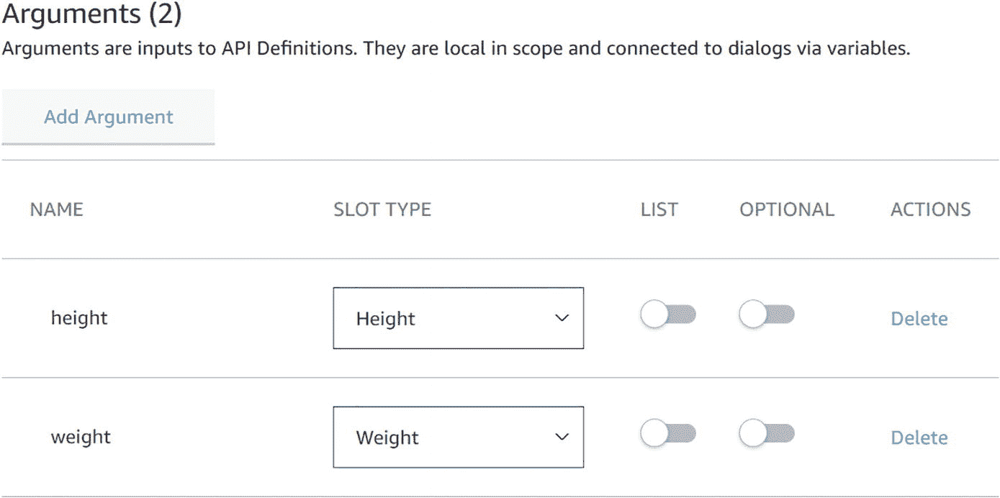

图 4-20 添加 `Height` 和 `Weight` 参数

1.  点击 *Add Argument* 按钮。
2.  输入 `Height` 作为 *Name*。
3.  选择 `Height` 作为 *Slot Type*（参见图 4-20）。
4.  点击 *Add Argument* 按钮。
5.  输入 `Weight` 作为 *Name*。
6.  选择 `Weight` 作为 *Slot Type*（参见图 4-20）。
7.  我们稍后再处理 *Responses and Return* 部分。

接下来，我们将输入一个用户与 Alexa 之间的示例对话。请按照以下步骤操作：

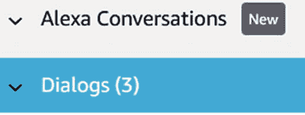

图 4-21 选择左侧的 *Dialogs* 选项卡

1.  在左侧菜单栏中选择 *Alexa Conversations*。
2.  选择其下的 *Dialogs*（参见图 4-21）。


图 4-22 输入 `GetHeightAndWeight` 作为对话名称

1.  点击顶部的 *Add Dialog* 按钮。
2.  在顶部输入 `GetHeightAndWeight` 作为 *DialogName*（参见图 4-22）。

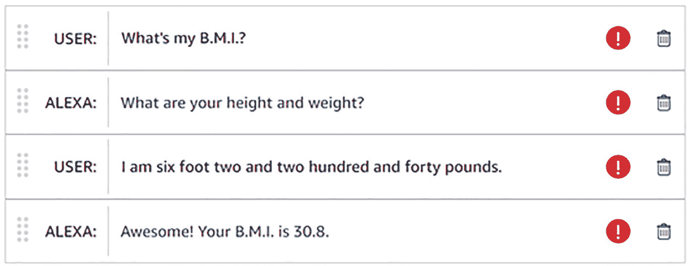

图 4-23 用户与 Alexa 之间的示例对话

1.  现在你会看到一个表格，你可以在其中输入用户与 Alexa 之间可能发生的对话，以使你的技能正常工作。在我们的案例中，这将类似于图 4-23。

下一步是将示例对话与表述集、API 定义和响应连接起来。表述集是用户可能说的话。API 定义是对话如何告诉 Alexa 找出答案。响应是 Alexa 对用户说的话。

以下是我们将如何连接 `MainDialog`：

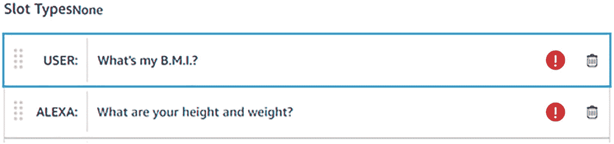

图 4-24 选择对话

1. 选择对话的第一行（见图 4-24）。

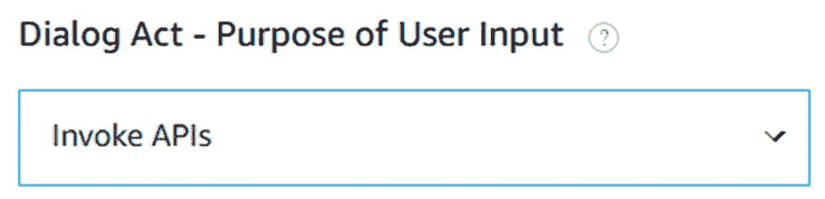

图 4-25 选择调用 API

1. 在右侧，点击 *Dialog Act* 下拉菜单，然后选择 *Invoke APIs*。（见图 4-25。）

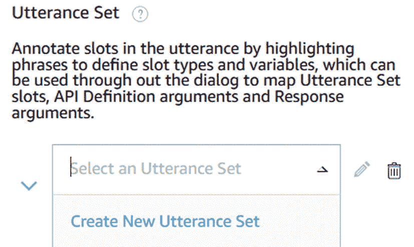

图 4-26 创建新的表述集

1. 点击 *Select an Utterance Set* 下拉菜单，然后选择 *Create New Utterance Set*。（见图 4-26。）

1. 此时会显示要选择的表述集。这表示用户可能会说什么来调用 API。例如，他们可能会说“我的 B.M.I. 是多少？”，就像我们在示例中输入的那样，或者他们可能会说“计算我的 B.M.I.”。这两个选项构成一个表述集，我们需要定义这个集合，以便 Alexa Conversations 在用户说出这些内容时能够理解。为此，我们需要：


图 4-27 命名表述集

1. 输入 *Utterance Set Name*：`InvokeCalculateBMI`。（见图 4-27。）

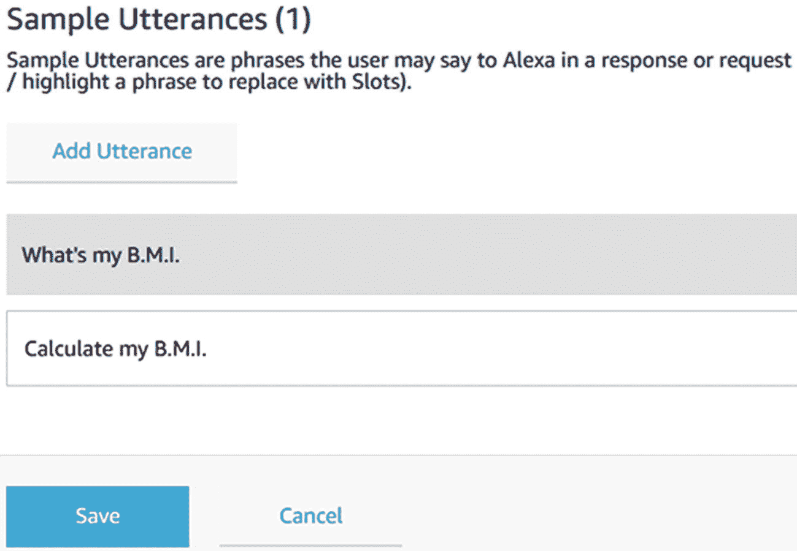

图 4-28 输入第二条表述并点击保存按钮

1. 跳过 *Dialog Act* 部分，直接进入 *Sample Utterances*。

2. 点击 *Add Utterance* 按钮。

3. 在 *What might the user say?* 框中输入 Calculate my B.M.I.，然后按回车键。

4. 输入另一条表述：What’s my B.M.I.（见图 4-28。）

5. 现在点击 *Save* 按钮。

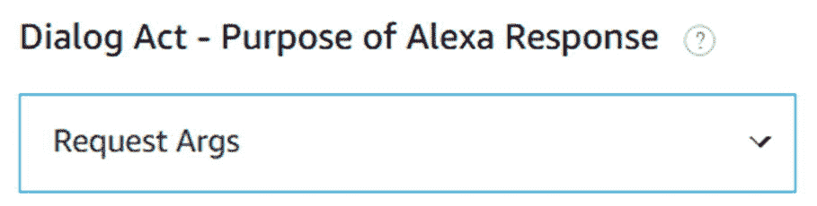

图 4-29 选择请求参数

1. 回到对话中，选择对话的第二行，即 Alexa 的回合。

2. 在右侧，点击 *Dialog Act* 下拉菜单，然后选择 *Request Args*。（见图 4-29。）当 Alexa 向用户请求参数（槽位值）时，会使用此 Dialog Act。

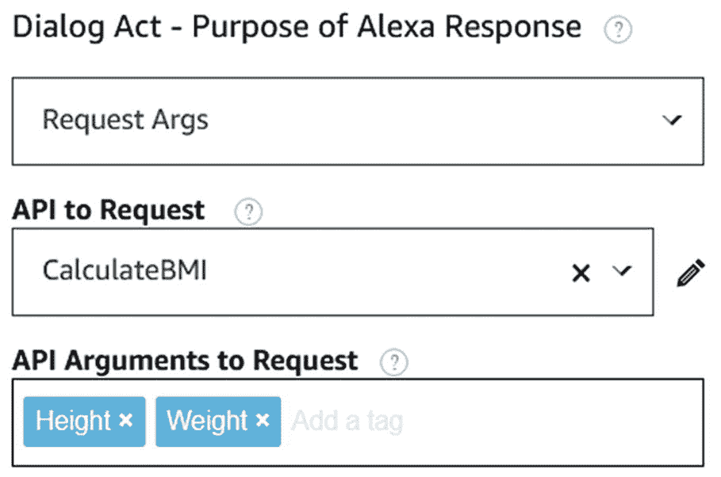

图 4-30 选择 CalculateBMI API

1. 首先，选择我们之前定义的 CalculateBMI API。此 API 是此对话将要调用的 API。选择 `CalculateBMI` 作为 *API to Request*。（见图 4-30。）

1. 按如下方式完成 Request Args Dialog Act 的选项：

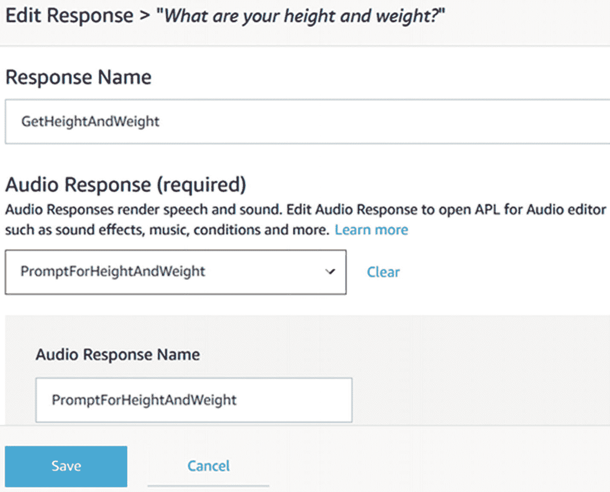

图 4-31 配置响应

1. 在 *API Arguments to Request* 下，保留 `Height` 和 `Weight` 不变。

2. 在 *Response* 下拉菜单中，选择 *Create New Response*。

3. 这是 Alexa 可能会对我们说的话，以让我们提供身高和体重。在 *Response Name* 下，输入 `GetHeightAndWeight`。

4. 向下滚动，输入 `PromptForHeightAndWeight` 作为 *Audio Response Name*。

5. 我们编写的示例对话已作为音频提示输入，因此我们可以点击底部的 *Save* 按钮。（见图 4-31。）

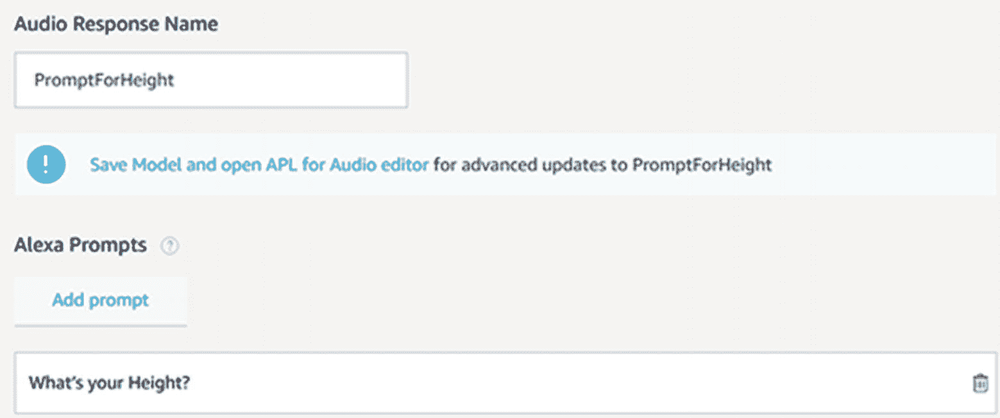

图 4-32 输入身高提示

1. 然后我们点击主控制台顶部的 *Save* 按钮。

2.  还需要添加两个额外的响应。这是针对用户只提供了所请求参数之一的情况。Alexa 需要提示用户提供缺失的参数。在“额外响应”下，有仅请求身高和仅请求体重的选项。我们需要对每个选项重复之前的步骤 (c) 到 (g)，具体如下：

3.  在身高参数旁边，选择 `创建新响应`。

4.  在 `响应名称` 中输入 `GetHeight`。

5.  在 `音频响应名称` 中输入 `PromptForHeight`。

6.  在 `Alexa 提示` 下，点击 `添加提示`。

7.  在 `Alexa 提示` 框中输入 `你的身高是多少？`。

8.  点击 `保存`。（见图 4-32。）

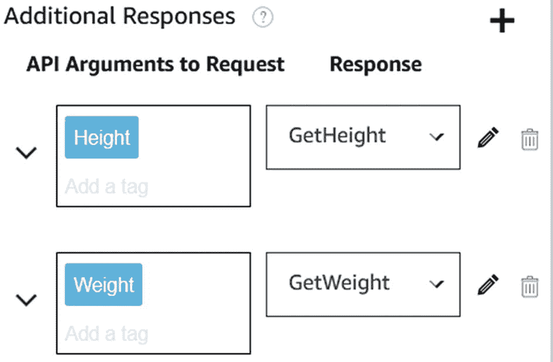

图 4-33 添加两个响应后的额外响应

1.  在体重参数旁边，选择 `创建新响应`。

2.  在 `响应名称` 中输入 `GetWeight`。

3.  在 `音频响应名称` 中输入 `PromptForWeight`。

4.  在 `Alexa 提示` 框中输入 `你的体重是多少？`，并点击末尾的 + 号进行添加。

5.  点击 `创建提示`。

6.  点击 `保存`。

7.  你的 `额外响应` 现在应该如图 4-33 所示。


图 4-34 点击顶部的保存

1.  点击控制台顶部的 `保存` 按钮以保存进度。（见图 4-34。）

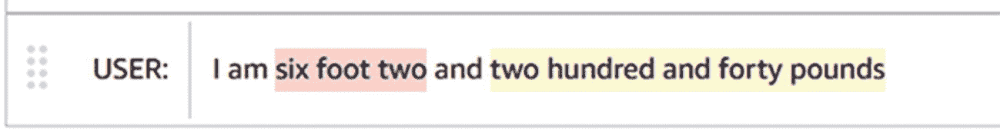

图 4-35 选择供用户填写的槽位后

1.  选中文字 `six foot two`。你可能需要尝试几次，因为槽位提示非常急切。

2.  在弹出的槽位类型提示中，选择 `身高` 作为 `槽位类型`。

3.  点击右侧的 `添加` 按钮。

4.  现在选中文字 `two hundred and forty pounds`。

5.  在槽位类型提示中，选择 `体重` 作为 `槽位类型`。

6.  你应该有两个高亮显示的槽位，如图 4-35 所示。

1.  接下来，选择第三行对话。这是用户告诉我们他们的身高和体重的地方。

2.  首先，我们将高亮并识别用户提供给我们的槽位值：

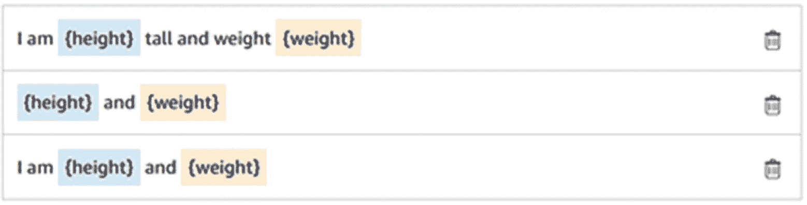

图 4-36 InformHeightAndWeight 话语集的示例话语

1.  既然我们已经识别了用户提供的槽位，我们可以选择右侧的 `通知参数对话行为`。

2.  在 `选择话语集` 下拉菜单中，选择 `创建新话语集`。

3.  在 `话语集名称` 中输入 `InformHeightAndWeight`。

4.  在 `示例话语` 下，添加 `我是 {height} 和 {weight}`，然后点击添加话语按钮。

5.  添加 `{height} 和 {weight}` 作为另一个选项，然后点击添加话语按钮。

6.  最后，输入 `我身高 {height}，体重 {weight}`。

7.  你的示例话语应该如图 4-36 所示。

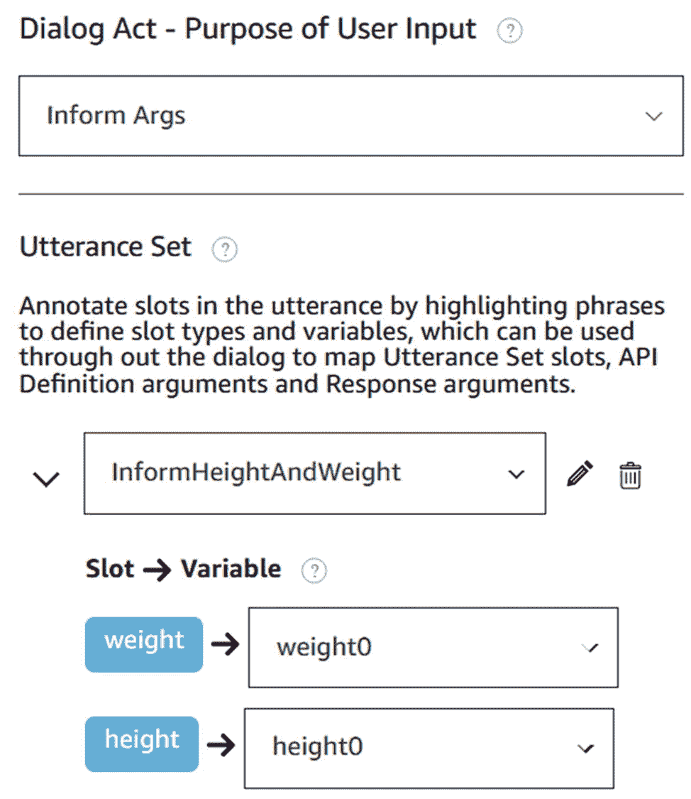

图 4-37 将槽位映射到变量

1.  向下滚动找到我们在话语中添加的两个槽位 `height` 和 `weight`。现在选择适当的 `槽位类型`。

2.  点击 `保存` 按钮。

3.  现在，通过填写槽位 ➤ 变量映射，从第二行对话中选择将由第三行对话中的用户槽位值填充的变量，如图 4-37 所示。

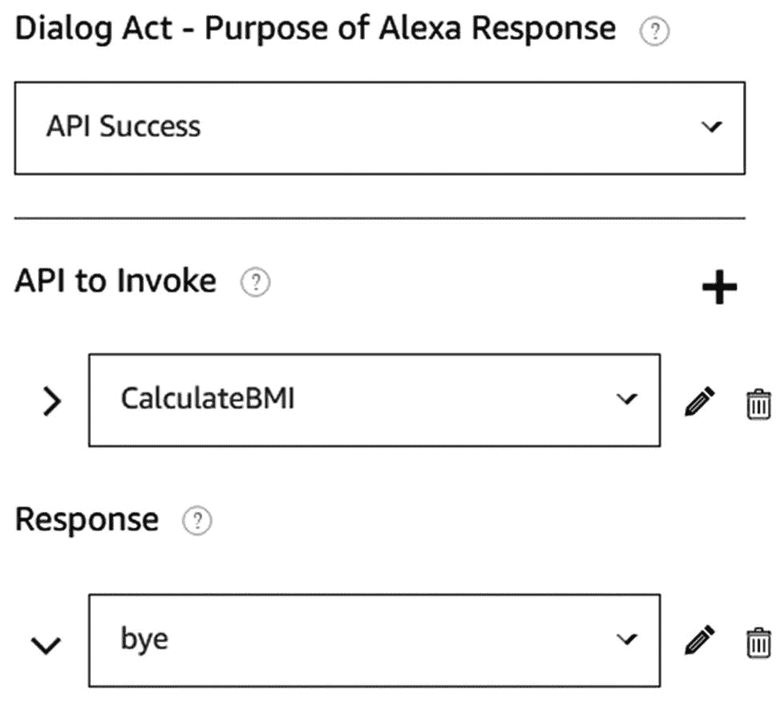

图 4-38 选择“再见”响应

1.  同时点击顶部的 `保存` 按钮。

2.  现在我们继续处理对话的最后一行；选择 `确认 API` 作为 `对话行为`。

3.  选择 `CalculateBMI` 作为 `要确认的 API`。

4.  保持 `要确认的 API 参数` 不变。它应该显示身高和体重。

5.  令人困惑的是，我们此时不会让 Alexa 通过说出 BMI 来响应；相反，我们只选择 `再见` 作为 `响应`。当我们进入编码部分时，这会更有意义。Alexa 对话旨在成为 Alexa 和用户之间持续的对话。每次 Alexa 说话时，她都应该提示或询问用户一些事情，除非你已经到达对话的末尾并想要结束会话（我们正是如此）。在这种情况下，你必须将对话委托给你的技能中的一个常规意图，并且不让 Alexa 提示任何其他内容。常规意图处理程序将设置适当的标志来结束会话。我们将在代码中执行此操作，当 API 完成时，它将委托给一个意图，因此我们在此特定对话行中放置的任何响应都将被忽略。所以我们不妨选择 `再见` 作为响应。（见图 4-38。）

1.  就是这样。我们已经连接好了对话。

接下来，我们需要创建我们将要委托的意图：

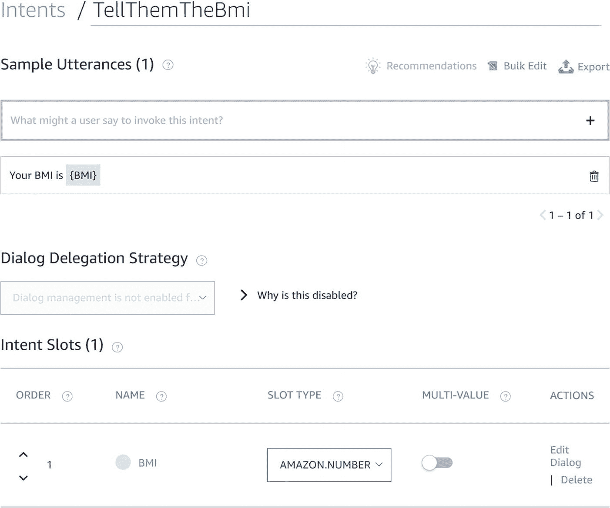

图 4-39 TellThemTheBmi 意图

1.  选择左侧的 `交互模型` 菜单选项。

2.  选择其下方的 `意图` 选项。

3.  点击 `添加意图` 按钮。

4.  我们只需要一个意图来告诉用户 BMI 并结束会话。所以我们称之为 `TellThemTheBMI`。

5.  `示例话语` 将很简单：`你的 B.M.I. 是 {BMI}`。

6.  在 `意图槽位` 中，为 `BMI` 槽位类型选择 `AMAZON.NUMBER`。（见图 4-39。）

7.  然后点击顶部的 `保存` 按钮。

趁此机会，我们可以删除 Hello World 意图，因为我们不再需要它。

1.  选择左侧的 `交互模型` 菜单选项。

2.  选择其下方的 `意图` 选项。

3.  在 `HelloWorldIntent` 的右侧，选择 `删除` 选项。

4.  点击 `删除意图` 按钮。

最后，在下一章中，你将编写后端代码，让这个技能进行 BMI 计算。

### 总结

在本章中，我们为 BMI 计算器创建了基础技能，设置了槽位数据，定义了对话以及 API、话语集和响应。至此，我们已经完全构建了技能的 VUI。在下一章中，我们将编写并测试后端代码以完成技能，并为其认证做好准备。

脚注 1
