# 5. 编写后端代码

既然我们已经为 BMI 技能创建了 VUI，我们准备在后端编写代码，让技能真正做一些有趣的事情。在我们的例子中，就是计算 BMI。在编写代码时，我们将测试我们的技能以确保其按预期工作。然后，在下一章中，我们将经历技能认证并发布到 Alexa 技能商店的过程。

不过，在编写代码之前，我们需要安装工具。

## 安装工具

我们需要下载并安装几个工具，以便高效地处理后端代码。这些工具包括：

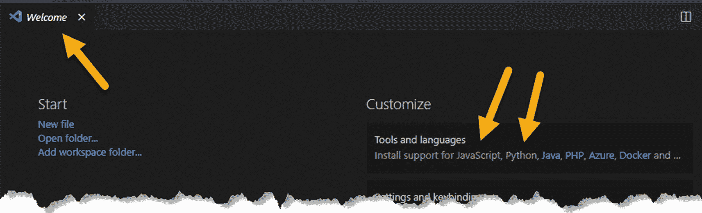

图 5-1

安装后，点击 `JavaScript` 和 `Python`

- **`Microsoft Visual Studio Code (用户安装程序)`**
  [https://code.visualstudio.com/download](https://code.visualstudio.com/download)
  安装后，在*工具和语言*下，为 `JavaScript` 和 `Python` 安装支持。见图 5-1。

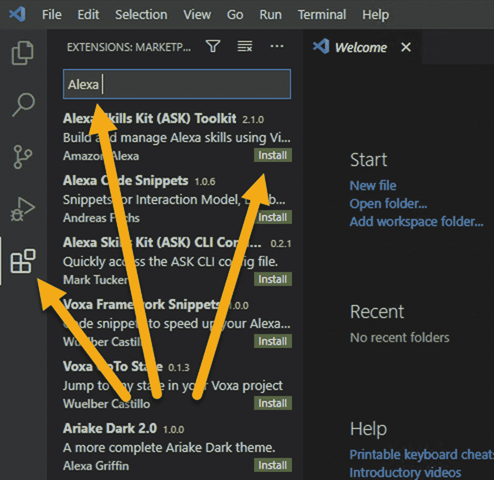

图 5-2

安装 Alexa Skills Kit 扩展

- 然后，在扩展市场中，安装来自 Amazon Alexa 的 **`Alexa Skills Kit (ASK)` 工具包**。见图 5-2。

- **`Anaconda`**
  [www.anaconda.com/products/individual#Downloads](http://www.anaconda.com/products/individual%2523Downloads)

- **`Notepad++`**
  [https://notepad-plus-plus.org/downloads/](https://notepad-plus-plus.org/downloads/)

- **`Firefox` 浏览器**
  [www.mozilla.org/en-US/firefox/download/thanks/](http://www.mozilla.org/en-US/firefox/download/thanks/)

- **`Git for Windows`**
  [https://gitforwindows.org](https://gitforwindows.org)

当 Git 安装程序询问你以下问题时，以下是建议的答案：

**选择 Git 使用的默认编辑器**：选择 `Notepad++`。

**调整你的 PATH 环境**：仅从 `Git Bash` 使用 Git。

否则，你可以保留默认选择并安装 `Git for Windows`。

安装完所有这些工具后，你还需要安装 Python 模块。

## 安装 Python 模块

在本书中，我们将不断向 `Anaconda` 环境中添加 Python 模块。现在，我们需要创建该环境并安装几个模块。为此，请按照以下步骤操作：

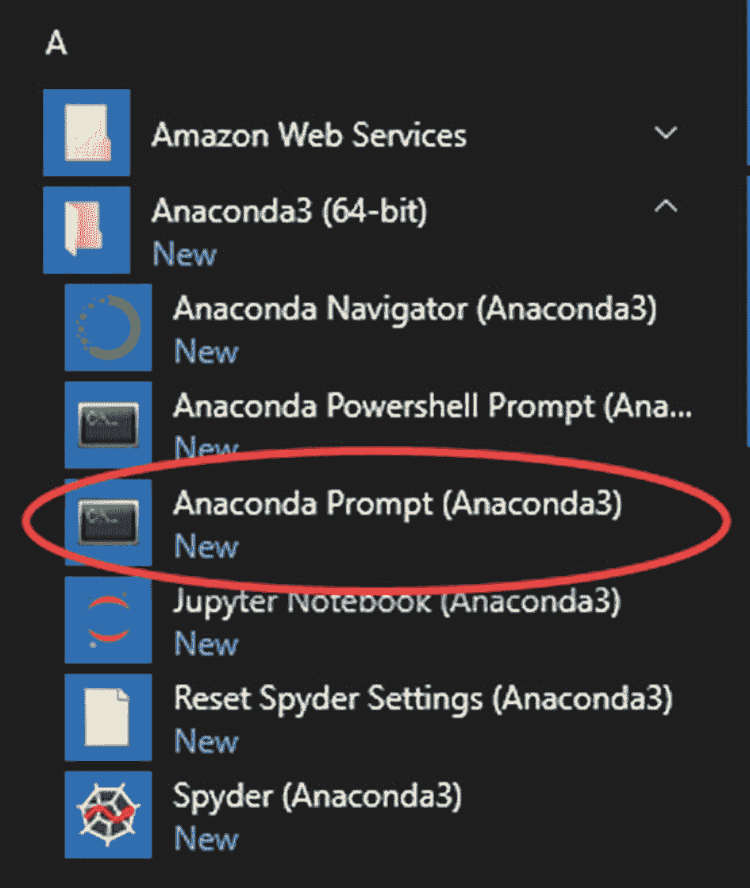

图 5-3

打开 `Anaconda Prompt`

1. 从开始菜单 | `Anaconda` | `Anaconda Prompt` 选项打开 `Anaconda Prompt`。见图 5-3。注意：不要选择 `Anaconda PowerShell 提示符`。你只需要 `Anaconda Prompt`，不要带 `PowerShell` 字样。

2. 打开后，你应该会在命令提示符前看到 `(base)` 选项，如下所示：

3. 如果你没有看到 `(base)` 选项，请尝试此命令：`conda activate base`。如果这不起作用，那么你需要调试你的 `Anaconda` 安装并使其正常工作，然后才能继续。

4. 在命令提示符下，一次一个地运行以下命令。其中一些命令会花费一些时间，请耐心等待。我将使用名称 `DDS`（代表数据驱动技能）作为 `Anaconda` 中的虚拟环境名称，但任何名称都可以。

```
(base) C:\Users\UserName>
```

5. 创建并激活环境后，提示符应如下所示：

```
conda update -n base -c defaults conda
conda create --name DDS anaconda
conda activate DDS
```

6. 接下来，我们需要安装 `Node.js` 和 `Alexa SDK`。^(¹⁵)

```
(DDS) C:\Users\UserName>
```

7. 我发现以下命令有助于注册虚拟环境以在 `Jupyter Notebooks` 中使用。

```
conda install -c conda-forge nodejs
pip install ask-sdk
pip install ask-sdk-local-debug
```

```
python -m ipykernel install --user --name DDS --display-name "Data-Driven Skills"
```

安装好这些工具后，我们就可以编写和测试一些代码了。

## 编写代码

前端 VUI 开发有两种模型，后端代码也有两种模型。当 VUI 使用意图模型时，后端需要有请求和意图处理器。当 VUI 使用对话模型时，后端将改为拥有 API 处理器。在接下来的章节中，当我们为 BMI 计算器技能编写代码时，我们将看到所有这些内容。

### 模板中的代码

值得庆幸的是，我们用来创建 BMI 计算器的 Hello World 模板附带了不少样板代码。如果我们查看 `Alexa 开发者控制台` 中的“构建”选项卡，然后选择左侧菜单中的“意图”，我们会看到一个 `HelloWorldIntent` 和四个内置意图（见图 5-4）。

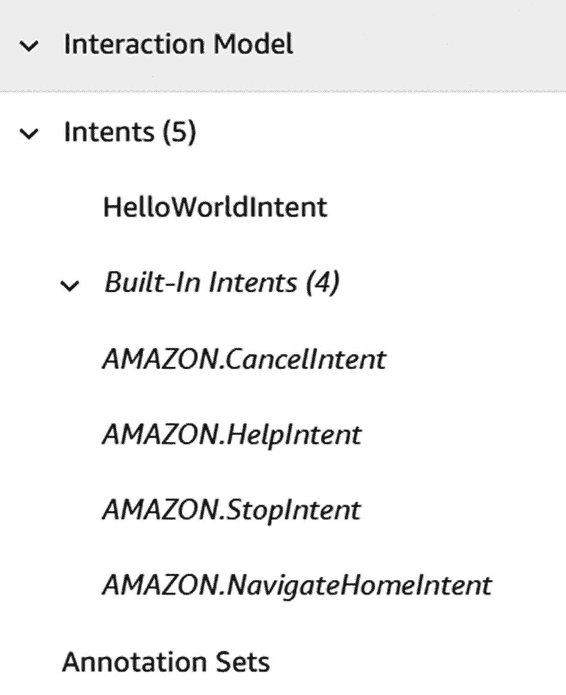

图 5-4

`Hello World` 技能模板附带的意图

这些意图中的每一个，以及启动技能的启动请求，在 `Hello World` 技能模板附带的代码中都有一个处理器。现在选择顶部的“代码”选项卡，我们可以在其中看到此技能的 `lambda` 函数。

### Lambda 函数

在“代码”选项卡的 `Skill Code/lambda` 文件夹中，有一个名为 `lambda_function.py` 的文件。（见图 5-5。）

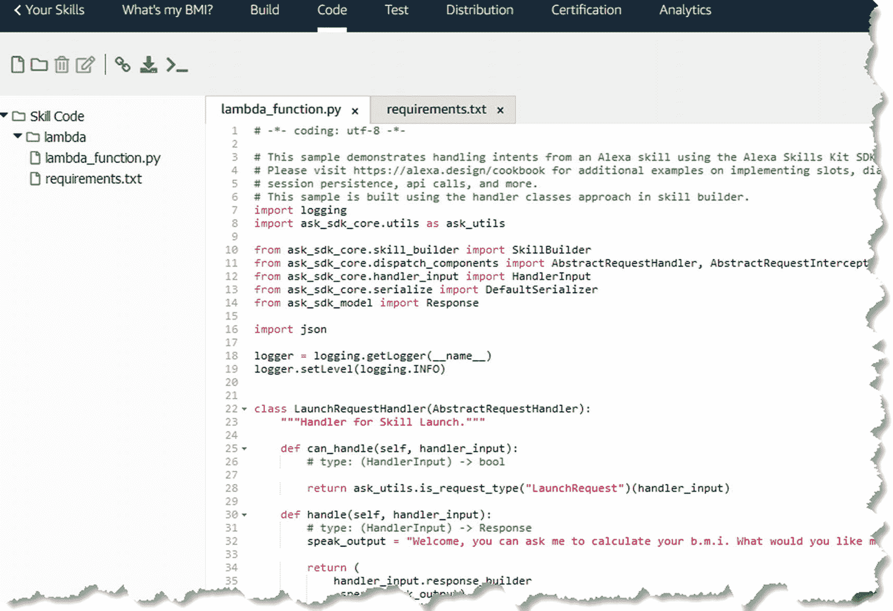

图 5-5

“代码”选项卡中的 `lambda_function.py` 文件

该文件包含了技能 VUI 的后端，我们将在该函数中找到请求、意图和 API 处理程序代码。在亚马逊云服务（AWS）中，`lambda` 函数是基于云的**无服务器函数**。它们具有可扩展性，在云端运行，独立于容器或服务器，因此非常适合构建 Alexa 技能的后端。

请求和意图处理程序是我们创建 Alexa 在用户说出触发意图的内容后，进行回复时所说的话语的方式。在 Python 中，每个请求、意图和 API 处理程序都实现为一个包含两个方法的 `class`：`can_handle` 和 `handle`。这些处理程序类由 VUI 通过 `SkillBuilder` 类调用，并处理 VUI 发出的各种请求、意图和 API 调用。例如，`HelloWorldHandler` 看起来像这样：

```
class HelloWorldIntentHandler(AbstractRequestHandler):
    """Handler for Hello World Intent."""
    def can_handle(self, handler_input):
        # type: (HandlerInput) -> bool
        return ask_utils.is_intent_name("HelloWorldIntent")(handler_input)
    def handle(self, handler_input):
        # type: (HandlerInput) -> Response
        speak_output = "Hello World!"
        return (
            handler_input.response_builder
            .speak(speak_output)
            # .ask("add a reprompt if you want to keep the session open for the user to respond")
            .response
        )
```

请注意，在 `can_handle` 函数中，我们根据该处理程序是否是 VUI 调用的意图的正确处理程序，返回 `True` 或 `False`。然后，在 `handle` 函数中，我们在 `speak_output = "Hello World!"` 这一行创建 Alexa 要说的话语，并使用 `response_builder` 将其返回给 VUI，以指示 Alexa `.speak(speak_output)`。

`lambda` 函数中另一个主要关注区域在底部，那里创建了 `SkillBuilder`，并将所有请求和意图处理程序添加到其中，如下所示：

```
sb = SkillBuilder()
sb.add_request_handler(LaunchRequestHandler())
sb.add_request_handler(HelloWorldIntentHandler())
sb.add_request_handler(HelpIntentHandler())
sb.add_request_handler(CancelOrStopIntentHandler())
sb.add_request_handler(SessionEndedRequestHandler())
sb.add_request_handler(IntentReflectorHandler()) # make sure IntentReflectorHandler is last so it doesn't override your custom intent handlers
sb.add_exception_handler(CatchAllExceptionHandler())
lambda_handler = sb.lambda_handler()
```

看到 `HelloWorldIntentHandler()` 是如何作为请求处理程序添加的吗？我们同样需要在这里添加我们的请求处理程序。

在下一节中，我们将概述需要对 `lambda` 函数进行的更改。如果此时代码看起来令人不知所措，这很正常。在本章的其余部分，我们将更深入地探讨 `lambda` 函数，你将开始了解 Alexa 应用的后端是如何形成的。

#### 我们需要进行的更改

我们需要做六件事来修改模板代码，使其成为我们自己的代码，如图 5-6 所示。

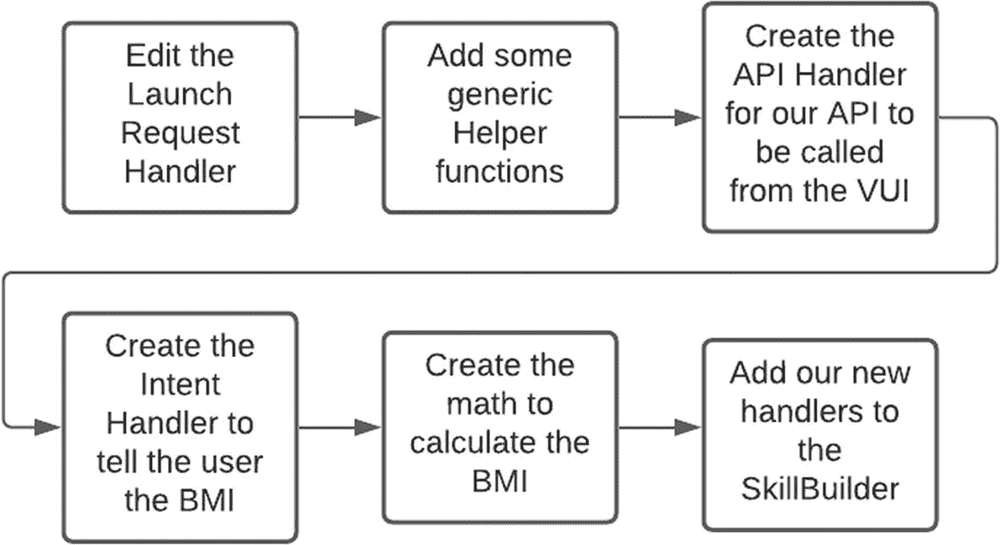

图 5-6

我们将在本章中进行的代码更改

我们需要更改的六件事如下：

1.  修改启动请求处理程序，使与 Alexa 的交互与 BMI 计算器相关。

2.  创建一些将在 API 处理程序中使用的辅助函数。

3.  为我们在 VUI 的 Alexa Conversations 部分定义的 `CalculateBMI` API 创建 API 处理程序。

4.  为我们在 VUI 的意图部分定义的 `TellThemTheBMI` 意图创建意图处理程序。

5.  创建一个函数来计算 BMI。

6.  在 `lambda` 函数底部将我们的新处理程序添加到 `SkillBuilder` 中。

下一节将讨论这些更改中的第一项。后续章节将逐一讨论其余更改。

##### 更改启动请求处理程序

我们需要对模板代码进行的第一个更改是在启动请求处理程序中（见图 5-7）。

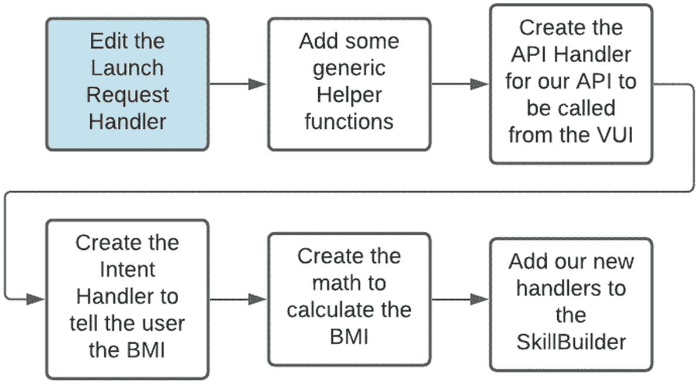

图 5-7

我们进行的第一个更改是针对启动请求处理程序

在 `class LaunchRequestHandler` 的 `handle` 函数中，当前 Alexa 要说的话语显示为

```
speak_output = "Welcome, you can say Hello or Help. Which would you like to try?"
```

我们需要将其改为

```
speak_output = "Welcome, you can ask me to calculate your b.m.i. What would you like me to do?"
```

完成后的类将如图 5-8 所示。

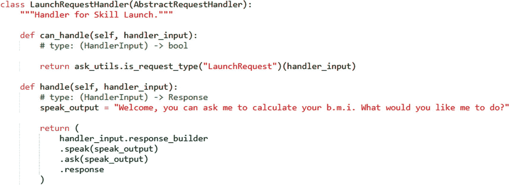

图 5-8

完成后的 `LaunchRequestHandler` 类

第二个更改稍微复杂一些，因为我们要添加一些 API 处理程序所需的辅助函数。

##### 创建辅助函数

作为 API 处理程序的一部分，我们需要添加一些辅助函数（见图 5-9）。

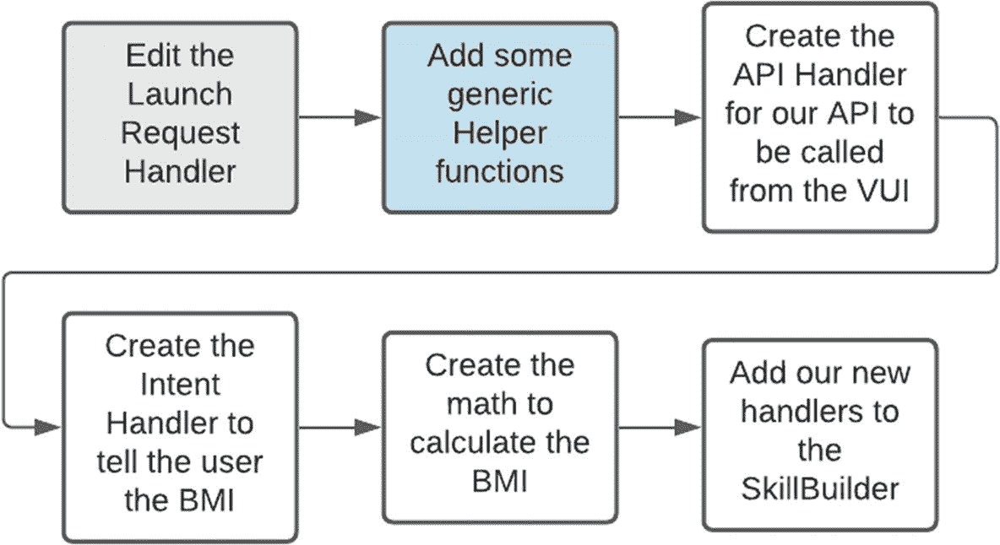

图 5-9

第二个更改是添加辅助函数

辅助函数提供了我们在 API 和意图处理程序中需要的支持功能。向下滚动到代码中的 `sb = SkillBuilder()` 这一行。

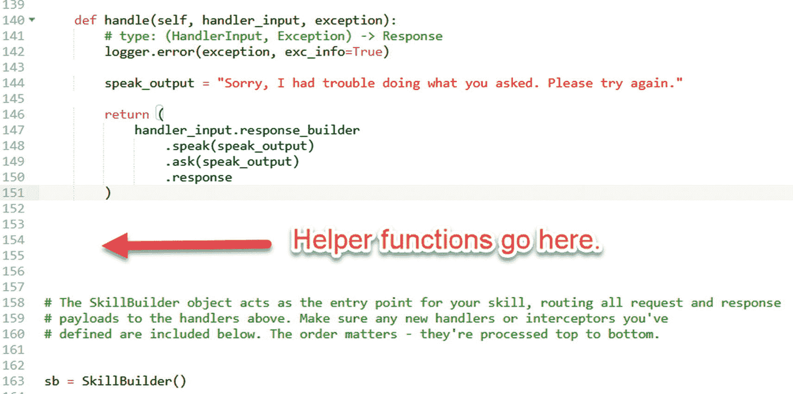

图 5-10

辅助函数的位置

在上面的注释上方（见图 5-10），插入以下代码：

```
def isApiRequest(handlerInput, apiName):
    """Helper method to find if a request is for a certain apiName.
    """
    try:
        return ask_utils.is_request_type('Dialog.API.Invoked')(handlerInput) \
               and handlerInput.request_envelope.request.api_request.name == apiName
    except Exception:
        logging.exception("Error")
        return False

def getApiArguments(handlerInput):
    """Helper method to get API request entity from the request envelope.
    """
    try:
        return handlerInput.request_envelope.request.api_request.arguments
    except Exception:
        logging.exception("Error")
        return False

def getApiSlots(handlerInput):
    """Helper method to get API resolved entity from the request envelope.
    """
    try:
        return handlerInput.request_envelope.request.api_request.slots
    except Exception:
        logging.exception("Error")
        return False
```

这三个辅助函数将 `handlerInput` 参数包装在异常处理程序中，以防请求的对象不存在或抛出错误。辅助函数就位后，向上滚动到 `HelloWorldIntent` 之后的位置，我们将在那里插入 API 处理程序。

#### 创建计算 BMI 的 API 处理器

在本节中，我们需要为 Alexa 对话 API 创建 API 处理器（见图 5-11）。

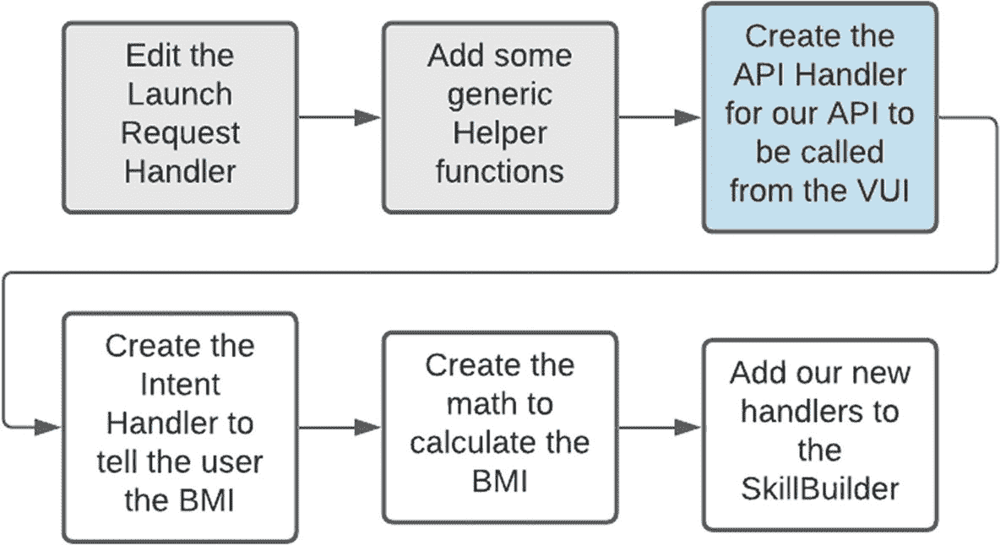

图 5-11

第三个改动是添加 API 处理器

回想一下，我们已经配置了对话来调用 `CalculateBMI` API。见图 5-12 和图 5-13。

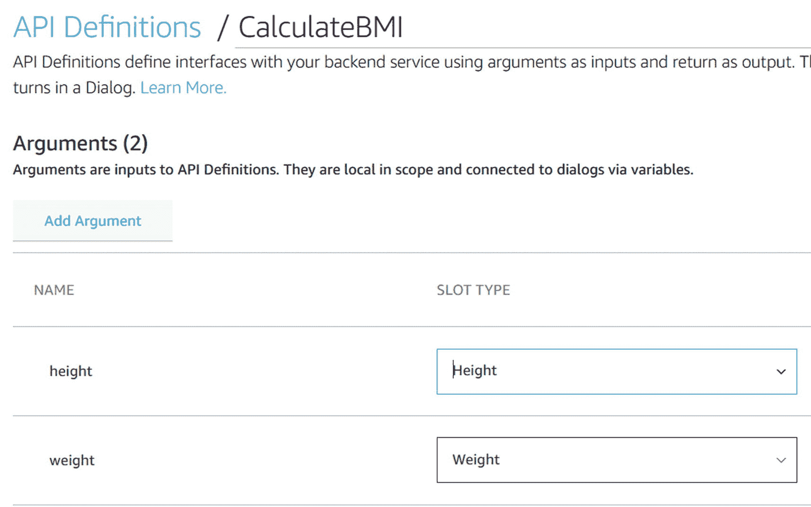

图 5-12

Alexa 对话模型中的 API 定义

在图 5-12 的 API 定义中，我们将 API 命名为 `CalculateBMI`。它有两个参数：`height` 和 `weight`。在接下来的对话配置（图 5-13）中，Alexa 从用户那里获取 `height` 和 `weight` 槽位值，并将它们传递给 `CalculateBMI` 参数。

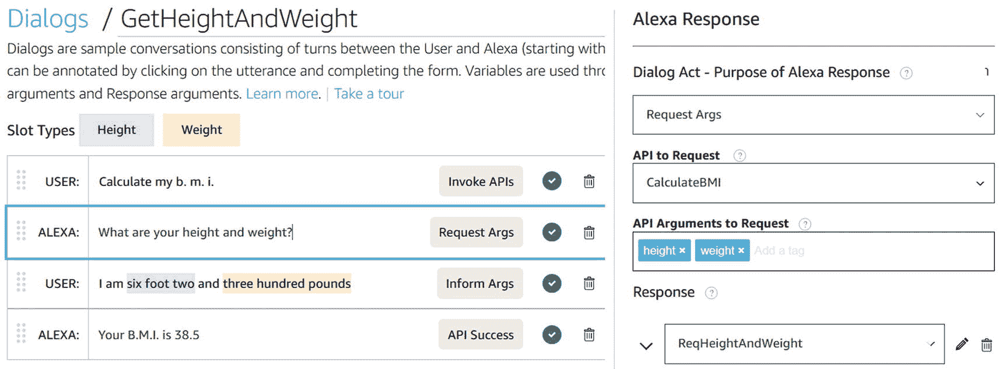

图 5-13

Alexa 对话中的 API 请求

在后端，我们需要处理这个 API 调用，并插入 `CalculateBMIApiHandler` 类的开头部分：

```python
class CalculateBMIApiHandler(AbstractRequestHandler):
    """Handler for CalculateBMI API."""
    def can_handle(self, handler_input):
        # type: (HandlerInput) -> bool
        return isApiRequest(handler_input, "CalculateBMI")
    def handle(self, handler_input):
        # type: (HandlerInput) -> Response
        # args = getApiArguments(handler_input)
        # print(args)
        response = ""
        return response
```

现在我们需要从 `handler_input` 中提取 `height` 和 `weight` 值并存入变量，以便计算 BMI。这些值存储在槽位中，具体来说是在所选身高和体重的槽位 ID 中。在上述 `class` 的 `handle` 函数中，我们需要添加以下代码，该代码调用 `getApiSlots` 辅助函数，以便获取槽位 ID：

```python
slots = getApiSlots(handler_input)
weightId = slots["weight"].resolutions.
    resolutions_per_authority[0].values[0].value.id
heightId = slots["height"].resolutions.
    resolutions_per_authority[0].values[0].value.id
```

然后，我们将这些 ID 值传递给尚未定义的 `CalculateBMI` 函数：

```python
BMI = CalculateBMI(heightId, weightId)
```

请记住，在第 4 章末尾，我们提到过，与其在 API 处理器中直接说出 BMI，不如将该任务委托给一个意图。因为我们的 API 是“一次性”的，这意味着它只运行一次然后终止，所以我们需要告诉 Alexa 我们已经完成了。在 Alexa 对话中无法做到这一点。你必须将该职责（或委托）移交给一个意图处理器。然后，意图处理器可以结束会话。

以下是将任务从 Alexa 对话委托给我们创建的 `TellThemTheBmi` 意图的代码：

```python
responseStr = """
{
    "directives":
    [
        {
            "type": "Dialog.DelegateRequest",
            "target": "skill",
            "period": {
                "until": "EXPLICIT_RETURN"
            },
            "updatedRequest": {
                "type": "IntentRequest",
                "intent": {
                    "name": "TellThemTheBmi",
                    "slots": {
                        "BMI": {
                            "name": "BMI",
                            "value": """ + str(BMI) + """
                        }
                    }
                }
            }
        }
    ]
}
"""
response = json.loads(responseStr)
```

我们没有在响应中传递语音文本，而是创建了一个 `type` 为 `Dialog.DelegateRequest` 的 `directive`。在该指令中，我们将 `TellThemTheBmi` 意图命名为目标意图请求，并将 `BMI value` 作为槽位传递给该意图。该指令本身是一个字符串；我们需要将其转换为 Json^(¹⁶)，以便作为处理函数的响应返回。至此，我们已经完成了 API 处理器的编写。

### 完整的 API 处理器

将所有部分组合在一起，`CalculateBMI` API 处理器的定义如下。此代码可从本书在 [Apress.​com](http://apress.com) 的目录页面下载。

```python
class CalculateBMIApiHandler(AbstractRequestHandler):
    """Handler for CalculateBMI API."""
    def can_handle(self, handler_input):
        # type: (HandlerInput) -> bool
        return isApiRequest(handler_input, "CalculateBMI")
    def handle(self, handler_input):
        # type: (HandlerInput) -> Response
        # args = getApiArguments(handler_input)
        # print(args)
        slots = getApiSlots(handler_input)
        weightId = slots["weight"].resolutions.resolutions_per_authority[0].values[0].value.id
        heightId = slots["height"].resolutions.resolutions_per_authority[0].values[0].value.id
        BMI = CalculateBMI(heightId, weightId)
        responseStr = """
{
    "directives":
    [
        {
            "type": "Dialog.DelegateRequest",
            "target": "skill",
            "period": {
                "until": "EXPLICIT_RETURN"
            },
            "updatedRequest": {
                "type": "IntentRequest",
                "intent": {
                    "name": "TellThemTheBmi",
                    "slots": {
                        "BMI": {
                            "name": "BMI",
                            "value": """ + str(BMI) + """
                        }
                    }
                }
            }
        }
    ]
}
"""
        response = json.loads(responseStr)
        return response
```

完成 API 处理器后，在下一节中，我们将为 `TellThemTheBMI` 意图创建处理器——即 API 处理器所委托的意图。

### 创建意图处理器

我们需要进行的下一个改动是创建意图处理器，该处理器将向用户告知 BMI（见图 5-14）。

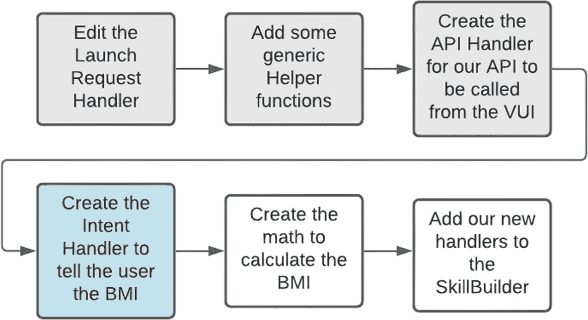

图 5-14

第四个改动是创建意图处理器

这是 API 所委托的意图，名为 `TellThemTheBMI`。回想一下，我们在 VUI 中定义它，如图 5-15 所示。

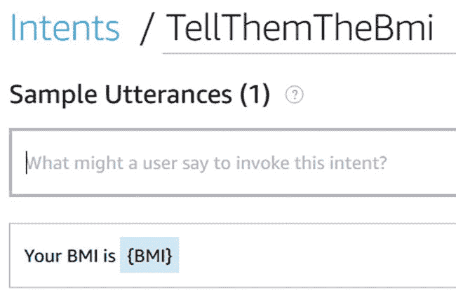

图 5-15

`TellThemTheBmi` 意图的定义

`TellThemTheBMI` 意图处理器与 `HelloWorld` 意图处理器非常相似。意图处理器的主要目的是构建 Alexa 在响应用户触发该意图时所说的语音。在这种情况下，对话 API 处理器正在委托给该意图以触发它。

在 `can_handle` 函数中，意图处理器类需要识别它处理的意图名称。在我们的例子中，名称是 `TellThemTheBMI`。代码如下所示：

```python
def can_handle(self, handler_input):
    # type: (HandlerInput) -> bool
    return ask_utils.is_intent_name("TellThemTheBmi")(handler_input)
```

在 `handle` 函数中，意图处理器类需要创建 Alexa 将说出的语音。在我们的例子中，这是告知用户他们的 BMI。首先，我们从 `Dialog.Delegate` 指令放置的槽位中提取 BMI 值。然后，我们创建语音输出。最后，我们使用 `response_builder` 将语音作为 Json 返回，并设置一个标志以结束会话，以便 Alexa 知道我们的技能已完成。该代码如下所示：

```python
def handle(self, handler_input):
    # type: (HandlerInput) -> Response
    BMI = handler_input.request_envelope.request.intent.slots["BMI"].value
    speak_output = f"Awesome! Your b.m.i. is {BMI}"
    return (
        handler_input.response_builder
        .speak(speak_output)
        .set_should_end_session(True)
        .response
    )
```

现在我们已经完成了完整的意图处理器。

# 完整的意图处理器

将所有部分整合起来，我们就得到了完整的 `TellThemTheBMI` 意图处理器：

```python
class TellThemTheBmiIntentHandler(AbstractRequestHandler):
    """处理“告诉他们 BMI”意图的处理器。"""
    def can_handle(self, handler_input):
        # type: (HandlerInput) -> bool
        return ask_utils.is_intent_name("TellThemTheBmi")(handler_input)
    def handle(self, handler_input):
        # type: (HandlerInput) -> Response
        BMI = handler_input.request_envelope.request.intent.slots["BMI"].value
        speak_output = f"太棒了！你的身体质量指数是 {BMI}"
        return (
            handler_input.response_builder
                .speak(speak_output)
                .set_should_end_session(True)
                .response
        )
```

现在我们已经编写好了意图处理器和 API 处理器，接下来可以专注于数学计算了。

## 计算 BMI 的方法

接下来，我们需要计算 BMI（见图 5-16）。

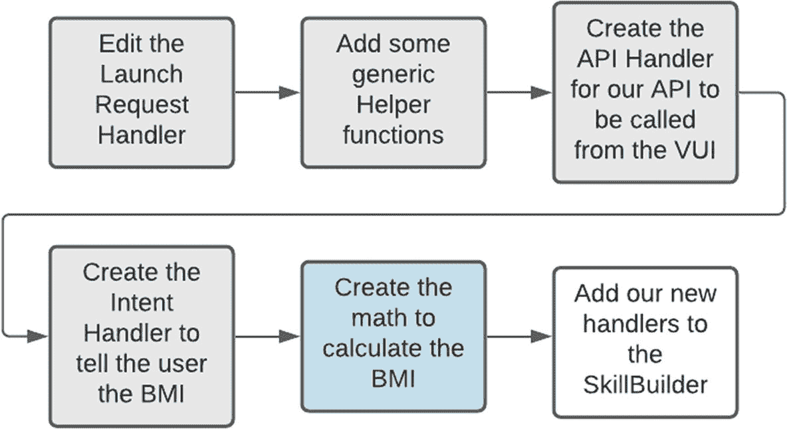
*图 5-16*
*创建计算 BMI 的方法*

我们从用户那里获得了槽位 ID。这些 ID 旨在为我们提供所需的数字。对于体重，ID 是 `nnnkg` 或 `nnnlb`。通过去掉最后两个字符，我们就能得到体重值。同样地，对于身高，ID 要么是英寸的整数，要么是 `nnncm`。处理这四种情况的函数可以放在我们之前添加的辅助方法之后，如下所示：

```python
def CalculateBMI(heightId, weightId):
    # print(heightId, weightId)
    if 'cm' in heightId:
        # 厘米
        meters = float(heightId[0:-2]) / 100.0
    else:
        # 英寸
        meters = float(heightId) * 0.0254
    if 'kg' in weightId:
        # 千克
        kilos = float(weightId[0:-2]) * 1.0
    else:
        # 磅
        kilos = float(weightId[0:-2]) / 2.20462
    bmi = round(kilos / meters ** 2, 1)
    return bmi
```

各位先生女士，到此就结束了。几乎结束了。还剩最后一步。

## 将请求处理器添加到技能构建器

在 lambda 函数的底部，我们需要将新的意图处理器和新的 API 处理器添加到 `SkillBuilder` 中（见图 5-17）。


*图 5-17*
*最后一步，将处理器添加到 `SkillBuilder`*

滚动到 `lambda_function.py` 文件的末尾，为我们的每个新处理器插入 `add_request_handler()` 行。这些行应放在列表顶部附近，但在 `LaunchRequestHandler()` 之后，如下所示：

```python
sb = SkillBuilder()
sb.add_request_handler(LaunchRequestHandler())
sb.add_request_handler(TellThemTheBmiIntentHandler())
sb.add_request_handler(CalculateBMIApiHandler())
sb.add_request_handler(HelpIntentHandler())
sb.add_request_handler(CancelOrStopIntentHandler())
sb.add_request_handler(SessionEndedRequestHandler())
```

趁现在，你需要删除添加 `HelloWorldIntentHandler()` 请求处理器的行。既然我们已经删除了 Hello World 意图，就不再需要它的处理器了。

现在，我们完成了！

在右上角，点击保存（这不是你第一次这样做，对吧？），然后点击部署。定义了 VUI 并部署了代码后，我们就可以开始测试了！

## 测试完成的技能

要测试你的技能，你需要能够调试 lambda 函数。在 Alexa 开发者控制台中无法做到这一点。相反，我们需要借助一个离线工具，例如 Visual Studio Code（VS Code）。为此，我们将把 VS Code 连接到我们的技能。

### 设置调试环境

我们需要将 Visual Studio Code（VS Code）连接到我们的技能 VUI 进行测试。为此，我们将从开发者控制台将代码模块克隆到本地机器，配置 VS Code 作为技能的调试环境，并在 VS Code 中本地运行 lambda 函数。

**注意：** 在继续之前，请确保在 VS Code 中启用了 Git 扩展。

按照以下步骤将你的技能克隆到 VS Code 中：

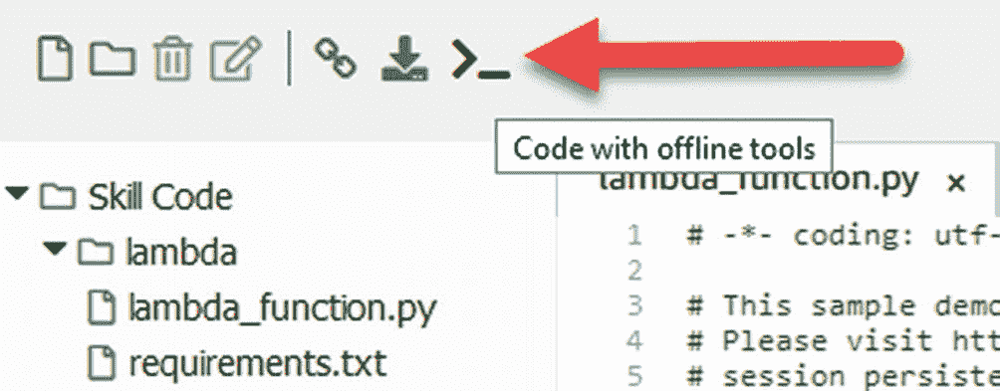
*图 5-18*
*Lambda 工具栏*

1. 导航到 Alexa 开发者控制台中的“代码”选项卡。
2. 找到技能工具栏（见图 5-18），然后点击最后一个按钮（*使用离线工具编写代码*按钮）。

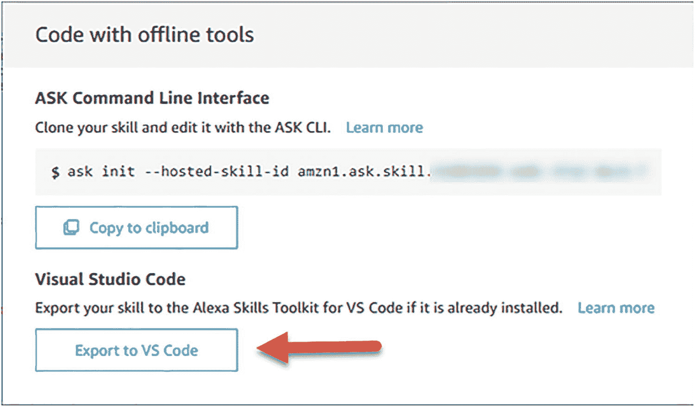
*图 5-19*
*选择“导出到 VS Code”按钮*

1. 在出现的对话框中，选择“导出到 VS Code”按钮。见图 5-19。


*图 5-20*
*加载到 VS Code 中的技能项目*

1. 现在，允许你的浏览器在 VS Code 中打开 vscode 链接。
2. 然后也允许 VS Code 打开该链接。
3. 在本地机器上创建并选择一个项目文件夹（这不应位于另一个 GitHub 文件夹内）。
4. 等待一分钟，让项目加载完成。
5. 在 VS Code 左侧的“资源管理器”选项卡中，你将看到你的技能。见图 5-20。
6. 展开 `lambda` 文件夹并选择 `lambda_function.py` 文件。这将打开我们在开发者控制台“代码”选项卡中处理的相同代码。

现在你已经将技能加载到 VS Code 中，可以开始调试和测试 lambda 代码了。向下滚动并确认你看到了 `TellThemTheBmiIntentHandler` 和 `CalculateBMIApiHandler`。

在运行代码之前，我们需要创建一个运行配置，告诉 VS Code 如何将我们的函数作为 Alexa 后端运行。操作如下：

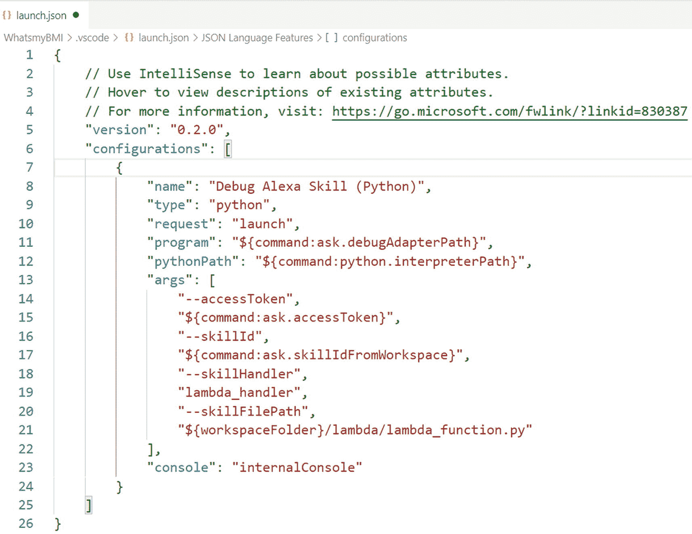
*图 5-21*
*添加了 ASK（Python）配置后的 `launch.json` 文件*

1. 打开 `lambda_function.py` 文件后，在 VS Code 中选择 *运行* 菜单。
2. 从运行菜单中选择 *添加配置…*。
3. 有两个选项显示 *ASK: Alexa Skills Debugger…*。选择第二个。它是 Python 选项。这将打开一个 `launch.json` 文件并添加一个 *调试 Alexa 技能（Python）* 配置。见图 5-21。
4. 将文件保存到其默认位置（隐藏在 `/.vscode` 文件夹中）。

此时，你可以在 VS Code 中运行 lambda 函数：

1. 从菜单中选择“运行 | 开始调试”，或按键盘上的 F5 键。

如果代码无法运行，你需要修复任何编译错误。这些错误通常是由于输入代码时的拼写错误造成的，因此请仔细仔细检查你添加的代码。当代码构建成功并在调试模式下运行时，VS Code 底部的状态栏将变为橙色，并且调试工具栏将出现，如图 5-22 所示。

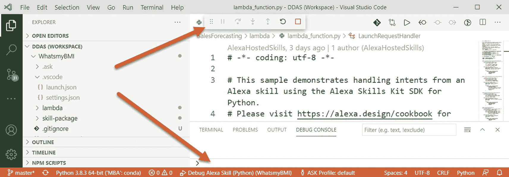
*图 5-22*
*在调试模式下运行的 lambda 函数*

现在，切换回浏览器，在开发者控制台中选择“测试”选项卡，然后通过从图 5-23 所示的下拉菜单中选择“开发”，将技能测试模式切换为“开发”。


*图 5-23*
*在开发模式下开启技能测试*

现在，你已经准备好测试你的技能了。

### 测试技能

要测试技能，你需要输入或说出你期望用户说的话，Alexa 会按照你编程设定的方式做出响应。在本例中，我们将进行一段简短的对话，让她获取你的身高和体重，并告知你的 BMI 指数。

你应该运行的第一个测试是，在左侧的“Alexa 模拟器”选项卡中键入用户的语句，具体操作如下。

在模拟器中，输入“启动 *<在此处插入你的启动短语>*”。注意：你的启动短语很可能不是技能的名称，而是你在“构建”选项卡中输入的调用名称。我的调用名称是“simon's b.m.i. calculator”，因此我会在模拟器中输入 `launch simon's b.m.i. calculator`，如图 5-24 所示。

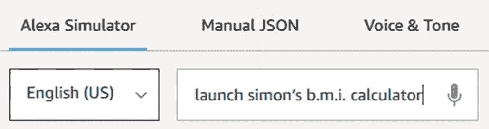
*图 5-24*
*启动你的技能*

Alexa 应回复“欢迎。你可以让我计算你的 BMI 指数”，如图 5-25 所示。


*图 5-25*
*Alexa 对你的启动短语的响应*

接下来，询问 Alexa，“我的 BMI 指数是多少？”

她应该会提示你输入身高、体重或两者都输入，如图 5-26 所示。


*图 5-26*
*Alexa 通过询问你的身高来回应你的查询*

回答她。输入你的身高。不要忘记将数字拼写为单词。例如，six foot two。

在你告诉她你的身高和体重后，她会告诉你你的 BMI 指数并结束对话，如下所示（图 5-27）。

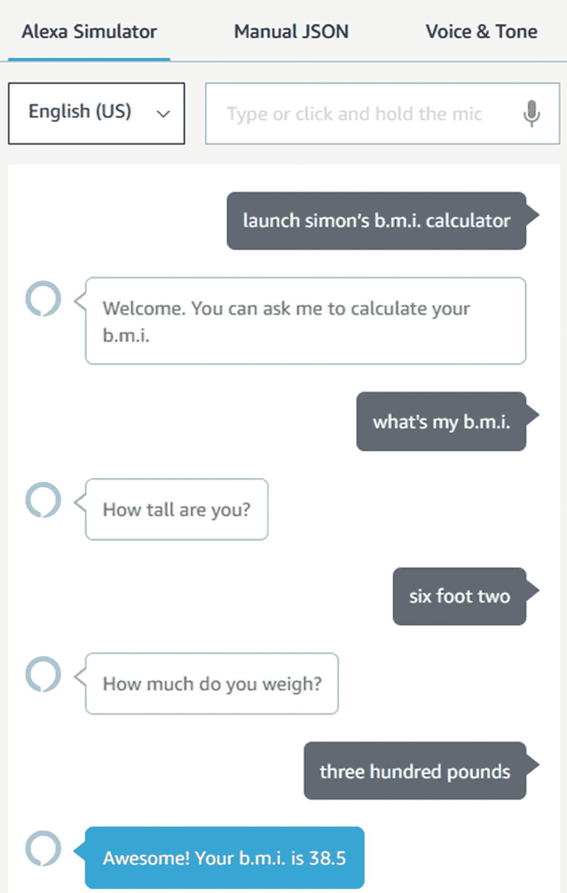
*图 5-27*
*完成的 BMI 对话*

至此，你已经完成了初步测试，技能可以正常运行。给自己一个击掌鼓励吧。

如果它不能正常工作，请返回并仔细检查我们编写的两个函数中的代码，以及 `lambda_function.py` 文件底部的 `SkillBuilder()` 代码。然后重新测试你的技能。

你可能会发现，在 VS Code 中通过点击代码窗口左侧边缘来添加断点会很有帮助，如图 5-28 所示。

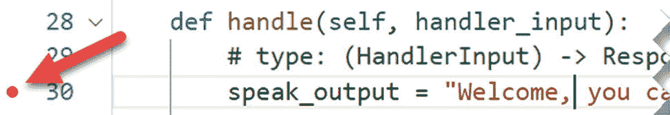
*图 5-28*
*为代码添加断点*

一旦这个初步测试通过，你应该尝试几种不同的身高和体重，使用不同的测量单位，并在过程中进行调试。

当你完成 BMI 技能的测试后，就可以将其发布到 Alexa 技能商店了。

## 总结

在本章中，我们编写并测试了 BMI 计算器技能的后端代码。我们学习了 lambda 函数以及请求、意图和 API 处理器。我们在本地机器上设置并使用了调试环境。随着我们深入更复杂的技能，所有这些概念都将在本书中反复出现。在下一章中，我们将把 BMI 计算器技能发布到 Alexa 技能商店。

脚注 1 2
