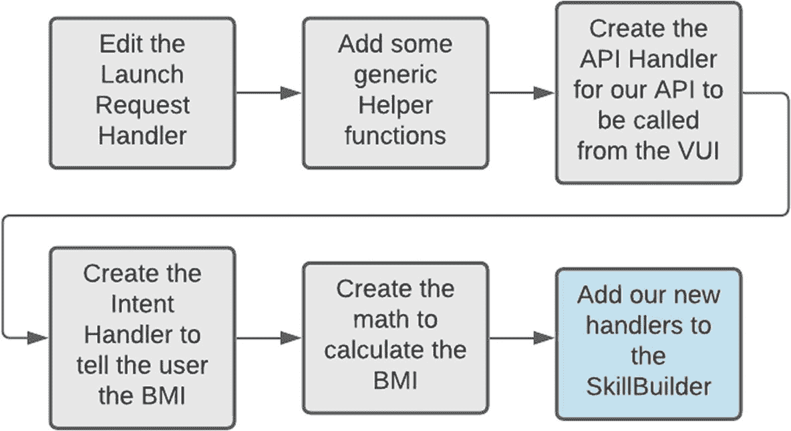
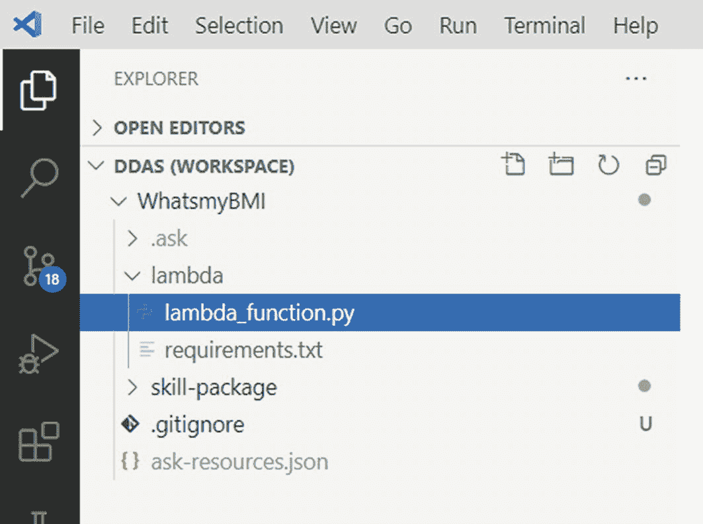
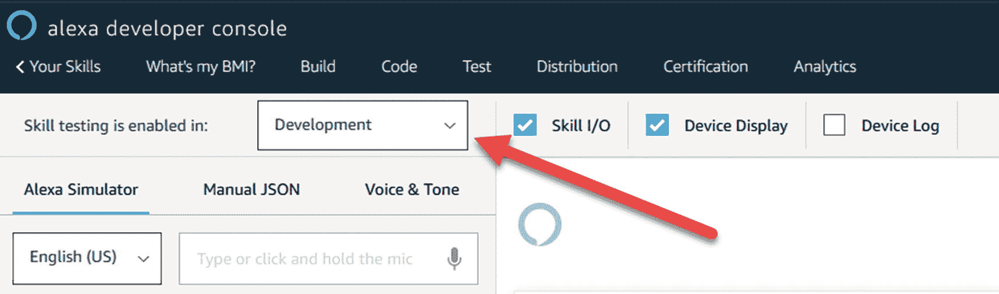
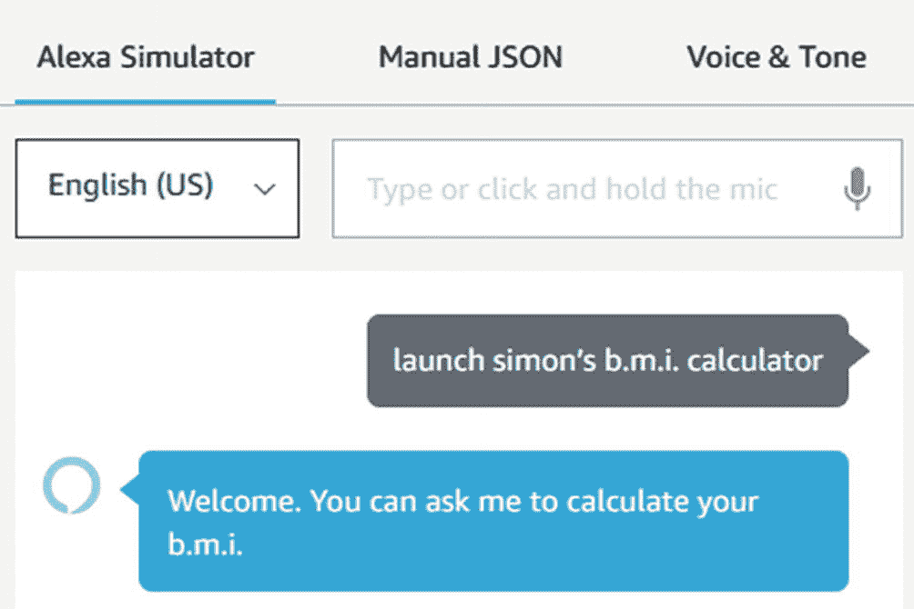
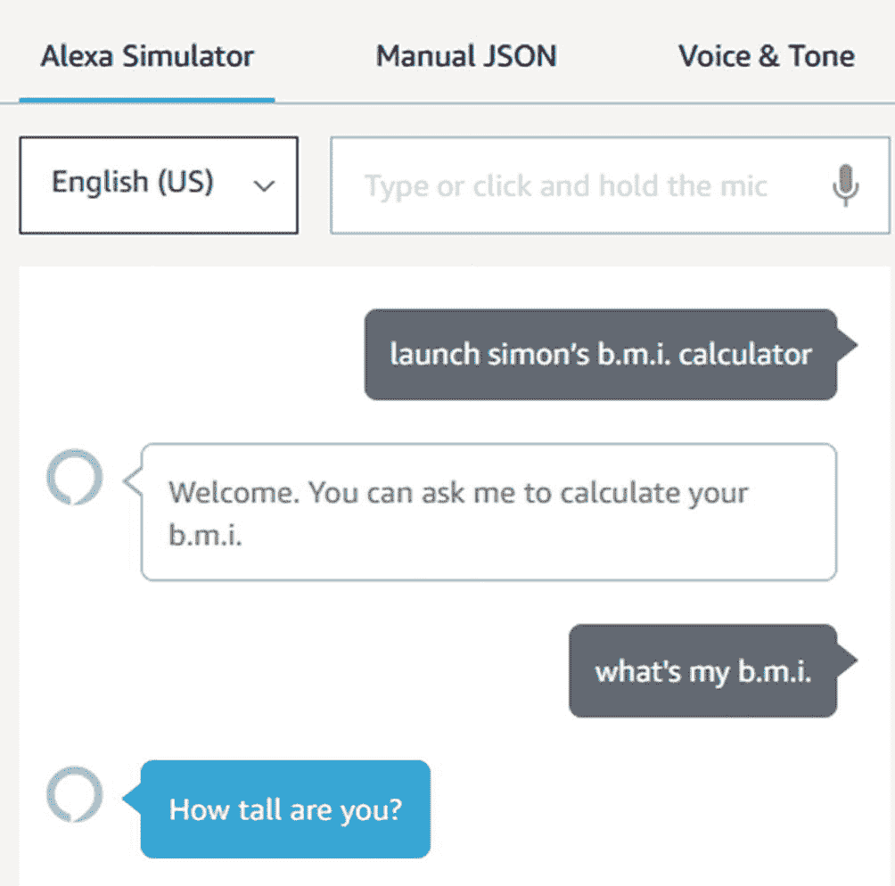
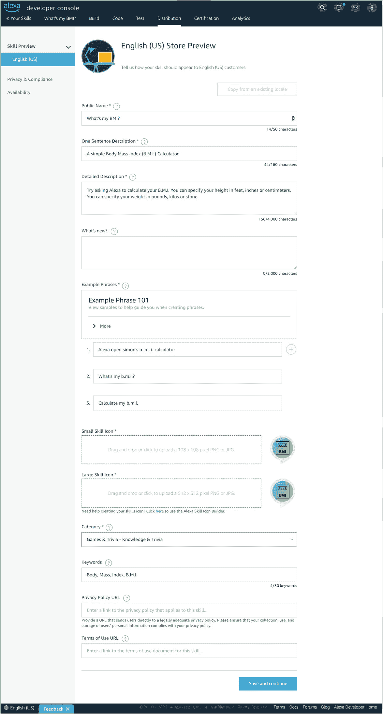
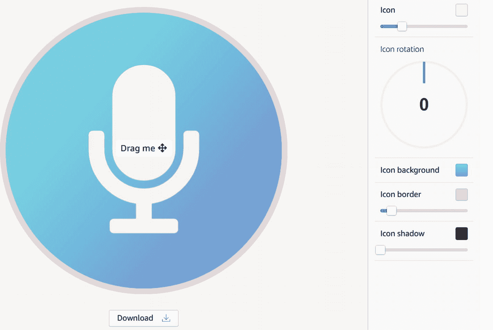

# 完整的意图处理器

将所有部分整合起来，我们就得到了完整的 `TellThemTheBMI` 意图处理器：

```
class TellThemTheBmiIntentHandler(AbstractRequestHandler):
"""处理“告诉他们 BMI”意图的处理器。"""
def can_handle(self, handler_input):
# type: (HandlerInput) -> bool
return ask_utils.is_intent_name("TellThemTheBmi")(handler_input)
def handle(self, handler_input):
# type: (HandlerInput) -> Response
BMI = handler_input.request_envelope.request.intent.slots["BMI"].value
speak_output = f"太棒了！你的身体质量指数是 {BMI}"
return (
handler_input.response_builder
.speak(speak_output)
.set_should_end_session(True)
.response
)
```

现在我们已经编写好了意图处理器和 API 处理器，接下来可以专注于数学计算了。

### 计算 BMI 的方法

接下来，我们需要计算 BMI（见图 5-16）。


图 5-16

创建计算 BMI 的方法

我们从用户那里获得了槽位 ID。这些 ID 旨在为我们提供所需的数字。对于体重，ID 是 `nnnkg` 或 `nnnlb`。通过去掉最后两个字符，我们就能得到体重值。同样地，对于身高，ID 要么是英寸的整数，要么是 `nnncm`。处理这四种情况的函数可以放在我们之前添加的辅助方法之后，如下所示：

```
def CalculateBMI(heightId, weightId):
# print(heightId, weightId)
if 'cm' in heightId:
# 厘米
meters = float(heightId[0:-2]) / 100.0
else:
# 英寸
meters = float(heightId) * 0.0254
if 'kg' in weightId:
# 千克
kilos = float(weightId[0:-2]) * 1.0
else:
# 磅
kilos = float(weightId[0:-2]) / 2.20462
bmi = round(kilos / meters ** 2, 1)
return bmi
```

各位先生女士，到此就结束了。几乎结束了。还剩最后一步。

### 将请求处理器添加到技能构建器

在 lambda 函数的底部，我们需要将新的意图处理器和新的 API 处理器添加到 `SkillBuilder` 中（见图 5-17）。



图 5-17

最后一步，将处理器添加到 `SkillBuilder`

滚动到 `lambda_function.py` 文件的末尾，为我们的每个新处理器插入 `add_request_handler()` 行。这些行应放在列表顶部附近，但在 `LaunchRequestHandler()` 之后，如下所示：

```
sb = SkillBuilder()
sb.add_request_handler(LaunchRequestHandler())
sb.add_request_handler(TellThemTheBmiIntentHandler())
sb.add_request_handler(CalculateBMIApiHandler())
sb.add_request_handler(HelpIntentHandler())
sb.add_request_handler(CancelOrStopIntentHandler())
sb.add_request_handler(SessionEndedRequestHandler())
```

趁现在，你需要删除添加 `HelloWorldIntentHandler()` 请求处理器的行。既然我们已经删除了 Hello World 意图，就不再需要它的处理器了。

现在，我们完成了！

在右上角，点击保存（这不是你第一次这样做，对吧？），然后点击部署。定义了 VUI 并部署了代码后，我们就可以开始测试了！

### 测试完成的技能

要测试你的技能，你需要能够调试 lambda 函数。在 Alexa 开发者控制台中无法做到这一点。相反，我们需要借助一个离线工具，例如 Visual Studio Code（VS Code）。为此，我们将把 VS Code 连接到我们的技能。

#### 设置调试环境

我们需要将 Visual Studio Code（VS Code）连接到我们的技能 VUI 进行测试。为此，我们将从开发者控制台将代码模块克隆到本地机器，配置 VS Code 作为技能的调试环境，并在 VS Code 中本地运行 lambda 函数。

**注意：** 在继续之前，请确保在 VS Code 中启用了 Git 扩展。

按照以下步骤将你的技能克隆到 VS Code 中：


图 5-18

Lambda 工具栏

1. 导航到 Alexa 开发者控制台中的“代码”选项卡。
2. 找到技能工具栏（见图 5-18），然后点击最后一个按钮（*使用离线工具编写代码*按钮）。


图 5-19

选择“导出到 VS Code”按钮

1. 在出现的对话框中，选择“导出到 VS Code”按钮。见图 5-19。



图 5-20

加载到 VS Code 中的技能项目

1. 现在，允许你的浏览器在 VS Code 中打开 vscode 链接。
2. 然后也允许 VS Code 打开该链接。
3. 在本地机器上创建并选择一个项目文件夹（这不应位于另一个 GitHub 文件夹内）。
4. 等待一分钟，让项目加载完成。
5. 在 VS Code 左侧的“资源管理器”选项卡中，你将看到你的技能。见图 5-20。
6. 展开 **lambda** 文件夹并选择 `lambda_function.py` 文件。这将打开我们在开发者控制台“代码”选项卡中处理的相同代码。

现在你已经将技能加载到 VS Code 中，可以开始调试和测试 lambda 代码了。向下滚动并确认你看到了 `TellThemTheBmiIntentHandler` 和 `CalculateBMIApiHandler`。

在运行代码之前，我们需要创建一个运行配置，告诉 VS Code 如何将我们的函数作为 Alexa 后端运行。操作如下：


图 5-21

添加了 ASK（Python）配置后的 `launch.json` 文件

1. 打开 `lambda_function.py` 文件后，在 VS Code 中选择 *运行* 菜单。
2. 从运行菜单中选择 *添加配置…*。
3. 有两个选项显示 *ASK: Alexa Skills Debugger…*。选择第二个。它是 Python 选项。这将打开一个 `launch.json` 文件并添加一个 *调试 Alexa 技能（Python）* 配置。见图 5-21。
4. 将文件保存到其默认位置（隐藏在 `.vscode` 文件夹中）。

此时，你可以在 VS Code 中运行 lambda 函数：

1. 从菜单中选择“运行 | 开始调试”，或按键盘上的 F5 键。

如果代码无法运行，你需要修复任何编译错误。这些错误通常是由于输入代码时的拼写错误造成的，因此请仔细仔细检查你添加的代码。当代码构建成功并在调试模式下运行时，VS Code 底部的状态栏将变为橙色，并且调试工具栏将出现，如图 5-22 所示。


图 5-22

在调试模式下运行的 lambda 函数

现在，切换回浏览器，在开发者控制台中选择“测试”选项卡，然后通过从图 5-23 所示的下拉菜单中选择“开发”，将技能测试模式切换为“开发”。



图 5-23

在开发模式下开启技能测试

现在，你已经准备好测试你的技能了。


#### 测试技能

要测试技能，你需要输入或说出你期望用户说的话，Alexa 会按照你编程设定的方式做出响应。在本例中，我们将进行一段简短的对话，让她获取你的身高和体重，并告知你的 BMI 指数。

你应该运行的第一个测试是，在左侧的“Alexa 模拟器”选项卡中键入用户的语句，具体操作如下。

在模拟器中，输入“启动 *<在此处插入你的启动短语>*”。注意：你的启动短语很可能不是技能的名称，而是你在“构建”选项卡中输入的调用名称。我的调用名称是“simon's b.m.i. calculator”，因此我会在模拟器中输入“`launch simon's b.m.i. calculator`”，如图 5-24 所示。


图 5-24

启动你的技能

Alexa 应回复“欢迎。你可以让我计算你的 BMI 指数”，如图 5-25 所示。



图 5-25

Alexa 对你的启动短语的响应

接下来，询问 Alexa，“我的 BMI 指数是多少？”

她应该会提示你输入身高、体重或两者都输入，如图 5-26 所示。



图 5-26

Alexa 通过询问你的身高来回应你的查询

回答她。输入你的身高。不要忘记将数字拼写为单词。例如，six foot two。

在你告诉她你的身高和体重后，她会告诉你你的 BMI 指数并结束对话，如下所示（图 5-27）。


图 5-27

完成的 BMI 对话

至此，你已经完成了初步测试，技能可以正常运行。给自己一个击掌鼓励吧。

如果它不能正常工作，请返回并仔细检查我们编写的两个函数中的代码，以及 `lambda_function.py` 文件底部的 `SkillBuilder()` 代码。然后重新测试你的技能。

你可能会发现，在 VS Code 中通过点击代码窗口左侧边缘来添加断点会很有帮助，如图 5-28 所示。


图 5-28

为代码添加断点

一旦这个初步测试通过，你应该尝试几种不同的身高和体重，使用不同的测量单位，并在过程中进行调试。

当你完成 BMI 技能的测试后，就可以将其发布到 Alexa 技能商店了。

### 总结

在本章中，我们编写并测试了 BMI 计算器技能的后端代码。我们学习了 lambda 函数以及请求、意图和 API 处理器。我们在本地机器上设置并使用了调试环境。随着我们深入更复杂的技能，所有这些概念都将在本书中反复出现。在下一章中，我们将把 BMI 计算器技能发布到 Alexa 技能商店。

脚注 1 2

## 6. 发布 Alexa 技能

现在我们已经有了一个可以正常运行的技能，准备提交审批并发布到 Alexa 技能商店。认证有几个步骤。本章将探讨这些步骤，并学习如何驾驭这一流程，以便尽可能快速高效地让我们的技能通过认证并发布。首先，我们将了解认证流程。然后，我们将完成分发表格和验证测试。接着，我们将讨论一些发布规则和要求。最后，我们将审视一些你可能遇到的问题以及如何解决它们。

### 流程

认证流程相对直接。你填写分发详细信息，然后将技能提交给自动化验证测试，修复出现的任何错误或警告，直到验证通过。然后，你将技能提交给认证团队。他们将审查和测试你的技能，以确保其符合认证标准，如果不符合，他们会告知你原因。在你解决了他们提出的问题后，技能将通过认证并发布到 Alexa 技能商店。在下一节中，我们将填写分发表格，让我们的技能通过验证流程。

### 分发与验证

在第 4 章和第 5 章中，我们创建了一个 BMI 计算器技能，现在我们希望将其发布。不过，首先还需要做一些收尾工作。在 Alexa 开发者控制台中选择“分发”选项卡。然后填写所需信息，如图 6-1 所示。



图 6-1

开发者控制台的“分发”选项卡


#### 技能预览

在`技能预览`部分，你需要填写在技能商店中创建条目所需的字段。例如技能的名称、描述和图标。下面我们将逐一介绍这些选项。

**公开名称** 输入你希望该技能在公众面前呈现的名称。这通常不是你的调用名称。长度必须少于 50 个字符。对于 BMI 计算器，公开名称可以是“我的 BMI 是多少？”

**一句话描述** 一句简短描述该技能的话。Alexa 在向用户介绍你的技能时可能会用到这句话。对于 BMI 计算器，一句话描述可以是“一个简单的身体质量指数（B.M.I.）计算器。”

**详细描述** 技能的完整描述，包括使用说明以及你认为用户在技能商店中查找该技能时需要了解的任何信息。任何硬件要求，例如屏幕、Echo Buttons、Echo Auto 或智能家居设备，都应在此处说明。注意：详细描述会显示在 Alexa 应用中你技能的卡片上，因此也请考虑这一点。例如，请参见图 6-2 中的产品卡片。


图 6-2

Alexa 应用中的产品卡片

对于 BMI 计算器，详细描述可以是“尝试让 Alexa 计算你的 B.M.I.。你可以用英尺、英寸或厘米指定身高。你可以用磅、公斤或英石指定体重。”

**新增功能？** 由于这是技能的第一个版本，我们可以将此字段留空。当你修订技能并添加新功能时，应在`新增功能`框中记录这些变更和修复。

**示例短语** 示例短语是认证过程中最繁琐的部分之一。你必须确保每个示例短语与意图或对话中的表述完全匹配。第一个示例必须包含唤醒词 Alexa 和调用名称。由于我们的技能是对话式的，第二和第三个示例不必包含这些内容，而应展示用户如何与 Alexa 发起对话。对于 BMI 计算器，示例短语可以是：

1.  `Alexa open simon’s b. m. i. calculator`

2.  `What’s my b.m.i.?`

3.  `Calculate my b.m.i.`

请记住，它们必须与表述匹配，因此拼写和标点应与 Alexa 开发者控制台`构建`选项卡中使用的保持一致。

**小技能图标** 这需要是一个 108 × 108 像素的 PNG 或 JPG 图片，但由于它必须适配圆形，因此需要是一个直径为 108 像素的圆形图标。这里有一个指向 Alexa 技能图标生成器的链接，你可以用它创建自己的图标（见图 6-3）。



图 6-3

Alexa 技能图标生成器

在图标编辑器下方，有数百个图形可供选择，用于放入你的徽标中（见图 6-4），或者你也可以将图标下载为模板，在你选择的图形编辑器中编辑。


图 6-4

可添加到图标中的图形

**大技能图标** 你需要为你创建的图标准备两种尺寸：108 × 108 像素和 512 × 512 像素。一个用于小技能图标，一个用于大技能图标。

**类别** 为你的技能选择最合适的类别。这将是你的技能在 Alexa 技能商店中的分类。对于 BMI 计算器，类别可以是*游戏与问答 – 知识与问答*。

**关键词** 输入一个逗号分隔的关键词列表，以帮助用户找到你的技能。对于 BMI 计算器，关键词可以是“Body, Mass, Index, B.M.I.”

**隐私政策 URL** 在美国，联邦贸易委员会建议任何共享或收集（存储）消费者数据的网站都应制定隐私政策。许多州有更严格的要求。加拿大有关于在线隐私的规定。此外还有 GDPR（欧盟通用数据保护条例），它适用于任何在欧盟处理消费者数据或向欧盟个人提供服务的人。

根据商业改进局的文章《BBB 提示：为你的企业网站撰写有效的隐私政策》（[`www.bbb.org/article/news-releases/21390-bbb-tip-writing-an-effective-privacy-policy-for-your-small-business-website`](http://www.bbb.org/article/news-releases/21390-bbb-tip-writing-an-effective-privacy-policy-for-your-small-business-website)），“无论法律是否要求你的企业这样做，制定并维护一份隐私政策都是一个好主意……请务必做到以下几点：

*   保持可见。

*   保持简洁。

*   保持真实。

*   保持更新。”

网上有多种隐私政策生成器。花费不到 100 美元，它们就能让你明确：

*   你通过技能收集哪些信息

*   你为何收集这些信息

*   你如何收集和存储这些信息

*   你如何保护这些信息

*   用户如何控制或管理他们的数据

*   当政策更新时，你将如何告知技能用户

*   或许最重要的是，谁有权访问你的信息

拥有一份可接受的隐私政策将有助于你赢得并维持技能用户的信任。当你发布技能的新版本时，请务必更新你的隐私政策。

尽管如此，由于我们不会存储任何可识别用户身份的数据，对于 BMI 计算器，我们可以将隐私政策 URL 留空。

**使用条款 URL** 技能的另一个重要组成部分是使用条款，与隐私政策一样，这有助于建立信任。使用条款是你作为技能开发者与想要使用你技能的人之间的法律协议。用户通过使用你的技能，即默示同意遵守使用条款。与隐私政策一样，网上有多种使用条款生成器。使用条款通常涵盖：

*   用户的权利和责任。

*   正确或预期的技能使用方式。用户在其在线行为中应负责什么？

*   什么是滥用或不当行为？后果是什么？

*   任何付款细节，支付内容、方式、订阅费用等。

*   用户如何选择退出并终止其账户。

*   争议解决和管辖权。

*   责任限制，说明你承担和不承担哪些责任，以及如何评估损害赔偿。

*   用户如何知晓条款变更。

请确保在使用条款中明确说明任何个人身份信息，如何处理这些信息，以及如何删除这些信息。如果你在技能中使用账户关联来访问用户的亚马逊账户，这一点尤其重要。对于 BMI 计算器，我们可以将使用条款 URL 留空。

完成`技能预览`部分后，点击`保存`并继续进入分发问卷的`隐私与合规`部分。


#### 隐私与合规

如图 6-5 所示，**隐私与合规**部分包含一组问题，旨在从隐私与合规角度大致界定您的技能功能。


图 6-5  
隐私与合规部分

前几个问题相当直接，下文将详细说明。测试说明将在下一节中解释。

**此技能是否允许用户进行购买或花费真实货币？** 这包括鼓励人们花钱，例如，鼓励用户访问网站进行捐赠或购买。对于 BMI 计算器，我们可以回答“否”。

**此 Alexa 技能是否收集用户的个人信息？** 这个问题比较棘手，因为它涵盖了通过您的技能或账户关联收集的个人信息。您还需要考虑这些个人信息是否与个人相关联。以我们的 BMI 计算器为例，我们获取的数据（身高和体重）不与个人关联，仅用于 BMI 计算。我们也不存储结果，这在考虑问题中“收集”一词时是相关的。此外，您只能收集技能运行所必需的用户数据。对于 BMI 计算器，我们可以回答“否”。

**此技能是否面向或针对 13 岁以下的儿童？** 有许多保护儿童的法律法规，因此这个问题意味着您需要了解这些规则和法规，并确保您的技能遵守它们。对于 BMI 计算器，我们可以回答“否”。

**此技能是否包含广告？** 对于 BMI 计算器，我们可以回答“否”。

**出口合规** 此复选框为必填项，因此我不确定如果您的技能未能“……完全遵守所有适用的进出口法律法规”，您会怎么做。我猜想那样的话，您的技能根本无法发布。对于 BMI 计算器，我们可以勾选此框。

下一节将介绍测试说明框，这对于您的技能通过认证流程至关重要。

#### 测试说明

正如测试说明提示中所说：“请详细说明我们的团队测试您的技能所需的任何特殊说明。包括任何账户或硬件要求。如果您的技能请求权限，请包含测试这些权限请求的方法。”

测试说明不必详尽无遗地涵盖所有可能的测试方式，但应做到全面且精确。请确保包含测试技能“快乐路径”及其任何变体的步骤。技能的“快乐路径”是指用户正确回答每个问题并做出最优选择时所遵循的路径。“非快乐路径”则以已知方式偏离快乐路径。在我们的 BMI 计算器中，我们只有一条快乐路径（Alexa 询问身高和体重，并获取身高和体重），没有非快乐路径。我们也不处理任何错误路径。例如，如果 Alexa 询问您的身高，而您回答“鱼”，该怎么办？请包含您能想到的任何用于测试技能所处理的非快乐路径场景的说明。在我们的案例中，测试说明相对简单。某些技能可能有特定的硬件要求，例如“此技能在带屏幕的设备上效果最佳”。某些技能需要账户关联和其他权限，这些都需要在此列出并进行测试。这也是您阐述需要账户关联和额外权限的理由的地方——您提供给技能认证团队的信息越多越好。

对于 BMI 计算器，测试说明可能如下所示：“这是一个非常简单的技能，仅用于计算您的 BMI。请使用英尺和英寸、仅英寸或厘米来测试身高，并使用磅、英石或千克来测试体重。”如果 BMI 计算器技能比现在更复杂，这些说明将不够充分，我们很可能无法凭借如此简短的说明通过认证。

屏幕底部有一个小提示，提醒您确保您的技能符合所有 Alexa 政策和认证要求。在整个技能开发过程中考虑这些要求至关重要。对于 BMI 计算器，它符合这些要求，但对于我们将要创建的一些技能，这些要求并非微不足道。在下一节中，我们将详细讨论认证检查清单。

### 认证检查清单

在 Alexa 开发者文档中，有一份认证提交检查清单（`https://developer.amazon.com/en-US/docs/alexa/custom-skills/certification-requirements-for-custom-skills.html`）。您应该为您编写的每个技能考虑这些要求。它们如下：

1.  确保您的技能符合 Alexa 政策指南。
2.  确保您的技能满足托管技能服务方式的安全要求。
3.  执行所有必需的功能测试。
4.  执行所有必需的语音界面和用户体验测试。
5.  如果您的技能包含基于屏幕的交互，请测试技能的基于屏幕的交互。
6.  如果您的技能包含提醒，请确保使用测试说明描述您如何在技能中实现提醒功能。
7.  如果您的技能符合“与 Alexa 配合使用”计划或“人类认证”计划的资格，请确保您的设备和技能符合“与 Alexa 配合使用”计划指南和“人类认证”计划指南。
8.  如果您的技能允许用户通过 Alexa 或您的技能引用的任何网站进行购买或花钱，请确保遵循允许购买的技能的要求。

有关完整和最新的要求，您应查阅 Amazon Alexa Skills Kit 文档。在接下来的几节中，我们将详细阐述检查清单中的每一项。


#### Alexa 政策

您的技能必须遵守亚马逊的 Alexa 政策（`https://developer.amazon.com/en-US/docs/alexa/custom-skills/policy-testing-for-an-alexa-skill.html`）。如果不遵守，您的技能将被拒绝。其中部分政策如下：

1.  **商标、知识产权和品牌。** 您必须拥有在技能中使用的任何此类内容的权利，并且必须在测试说明中提供相关证明文件。例如，如果我们将技能命名为“Nike BMI 计算器”，则必须提供我们有权使用 Nike 名称的证据。如果没有充分的证据，我们的技能将无法通过认证。

2.  **面向儿童的 Alexa 技能**（`https://developer.amazon.com/en-US/alexa/alexa-skills-kit/get-deeper/custom-skills/kid-skills`）。您必须是亚马逊批准的开发者，才能为 13 岁以下（或美国及印度以外的地区为 16 岁以下）的儿童开发技能。针对儿童技能，存在若干特定的法律和政策考量，例如《儿童在线隐私保护法》（“COPPA”）和亚马逊的家长同意要求。

3.  **健康。** 健康技能分为两类：符合 HIPAA 要求的和不符合的。要具备处理受保护健康信息（PHI）的资格，您的技能必须遵守美国 1996 年《健康保险流通与责任法案》（HIPAA）。您还必须是亚马逊批准的健康技能开发者（`https://developer.amazon.com/en-US/alexa/alexa-skills-kit/get-deeper/custom-skills/healthcare-skills`）。所有其他与健康相关的技能必须在技能描述中包含书面免责声明，说明该技能不能替代专业医疗建议。在某些情况下，Alexa 团队还会要求您的技能在技能内提供口头免责声明。

4.  **技能推荐、报酬和购买。** 如果您的技能销售任何物品（数字或实物）（`https://developer.amazon.com/en-US/docs/alexa/custom-skills/requirements-for-skills-that-allow-purchases.html`）或以任何方式（购买、捐赠等）建议用户花钱，您必须使用 Alexa 批准的渠道进行。例如，数字商品和服务必须通过 Alexa 技能内购买功能（`https://developer.amazon.com/en-US/docs/alexa/custom-skills/requirements-for-skills-that-allow-purchases.html#digital`）进行。实物产品或服务（`https://developer.amazon.com/en-US/docs/alexa/custom-skills/requirements-for-skills-that-allow-purchases.html#non-digital`）或慈善捐赠（`https://pay.amazon.com/secure-checkout/non-profits`）必须正确使用 Amazon Pay 和账户关联。

5.  **广告。** 技能回复中大多数广告和促销信息是被禁止的（`https://developer.amazon.com/en-US/docs/alexa/custom-skills/policy-testing-for-an-alexa-skill.html#5-advertising`）。例外情况包括提供音频广告的流媒体技能、技能内购买促销以及回应客户的特定请求。

6.  **色情与性。** 禁止出现露骨的性内容或图像（`https://developer.amazon.com/en-US/docs/alexa/custom-skills/policy-testing-for-an-alexa-skill.html#cert-pornography-and-sex`）。

7.  **暴力。** 禁止出现极端暴力、有组织犯罪、恐怖主义和其他非法活动（`https://developer.amazon.com/en-US/docs/alexa/custom-skills/policy-testing-for-an-alexa-skill.html#cert-violence`）。

8.  **宗教、种族和文化。** 此政策主要是关于防止仇恨犯罪（`https://developer.amazon.com/en-US/docs/alexa/custom-skills/policy-testing-for-an-alexa-skill.html#cert-religion`）。

9.  **紧急服务（电信）。** 您的技能不能拨打 911 或任何其他紧急响应电话（`https://developer.amazon.com/en-US/docs/alexa/custom-skills/policy-testing-for-an-alexa-skill.html#9-emergency-services-telecommunications`）。

10. **内容。** 此政策是禁止不良行为的兜底条款（`https://developer.amazon.com/en-US/docs/alexa/custom-skills/policy-testing-for-an-alexa-skill.html#cert-content`）。如果您的技能不宣扬不良行为，那就没问题。如果宣扬，则可能因违反内容政策而被拒绝。

11. **一般性规定。** 此政策（`https://developer.amazon.com/en-US/docs/alexa/custom-skills/policy-testing-for-an-alexa-skill.html#11-general`）要求您完成本章其余部分概述的步骤，并倡导友善、礼貌以及良好维护 Alexa 品牌形象。

12. **网络搜索技能。** 如果您的技能是搜索技能，则必须搜索特定的在线资源，注明该来源，并遵守所有其他政策（`https://developer.amazon.com/en-US/docs/alexa/custom-skills/policy-testing-for-an-alexa-skill.html#12-web-search-skills`）。

13. **金融技能。** 如果您提供股票报价，请附上关于其时效性的免责声明。如果您访问个人财务信息，则必须满足所有金融技能指南。仅允许美国金融技能。要在美国创建金融或银行技能，您必须联系亚马逊以获得其批准（`https://developer.amazon.com/en-US/docs/alexa/custom-skills/policy-testing-for-an-alexa-skill.html#13-financial-skills`）。

14. **调用名称要求。** 您的技能的调用名称有一些非常具体的要求（`https://developer.amazon.com/en-US/docs/alexa/custom-skills/choose-the-invocation-name-for-a-custom-skill.html#cert-invocation-name-req`）。注意：这不是技能的名称，而是用户用来调用您的技能时所说的内容。主要要求是您的技能调用名称清晰、准确且易于用户重复。它还应该合理、实用且与您的技能相关。它不能包含您不拥有的品牌/知识产权术语。


