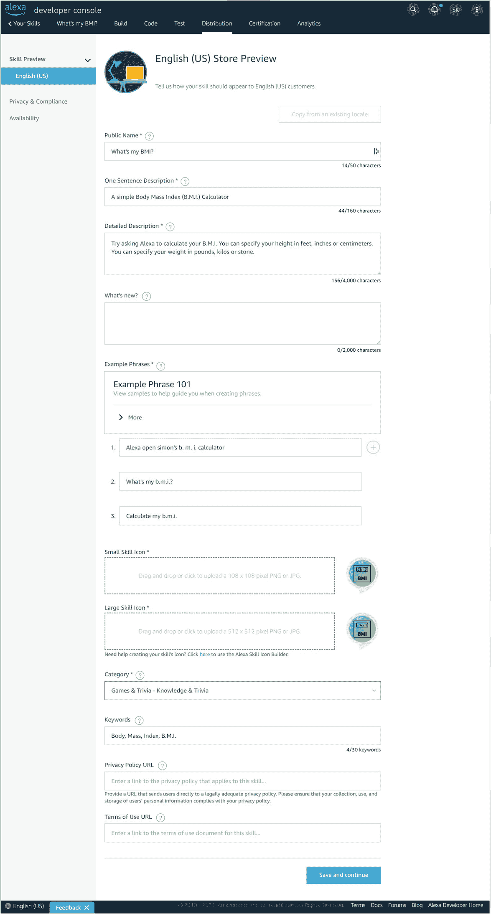
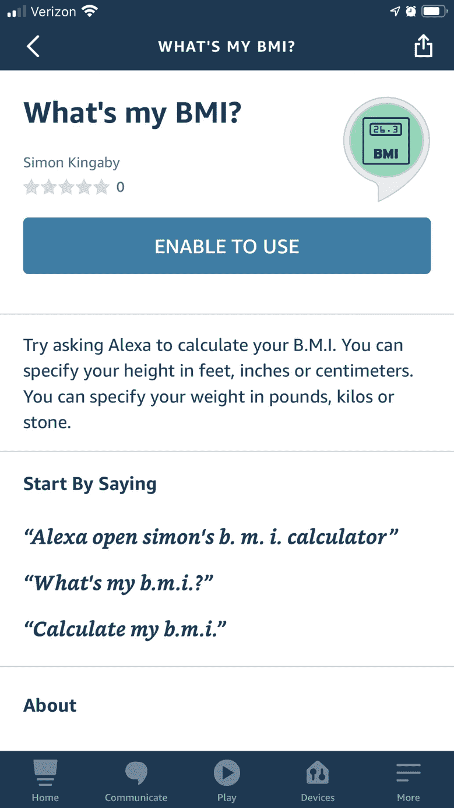
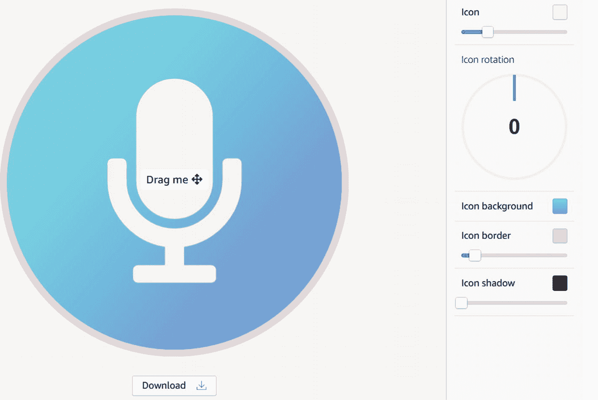
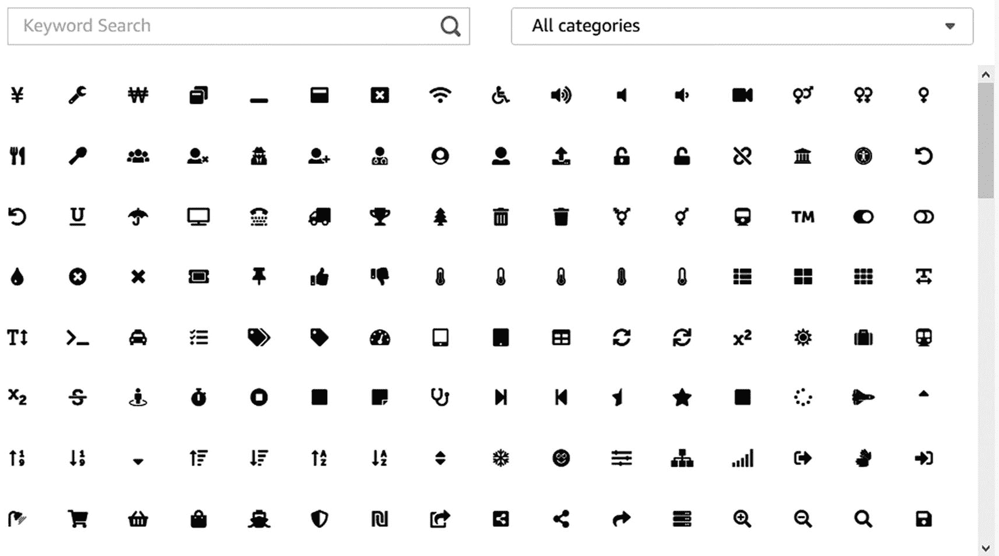
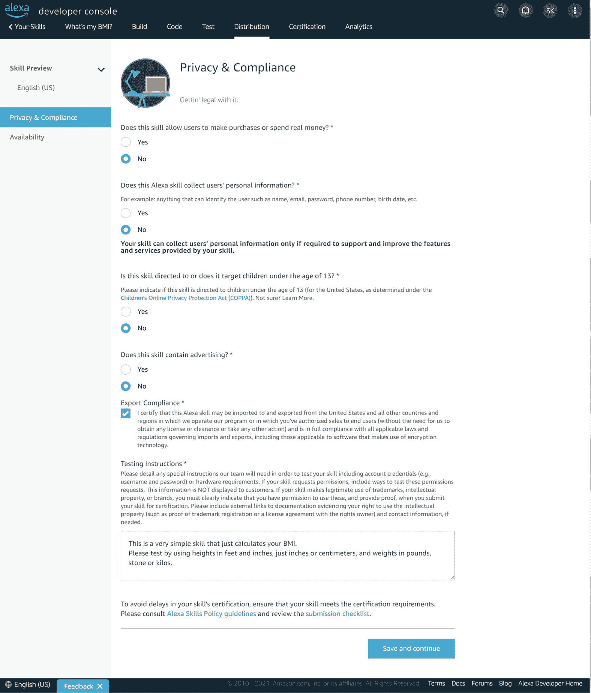
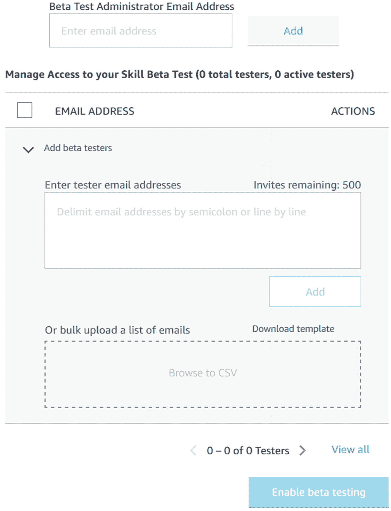
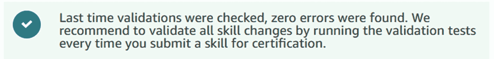

# 6. 发布 Alexa 技能

现在我们已经有了一个可以正常运行的技能，准备提交审批并发布到 Alexa 技能商店。认证有几个步骤。本章将探讨这些步骤，并学习如何驾驭这一流程，以便尽可能快速高效地让我们的技能通过认证并发布。首先，我们将了解认证流程。然后，我们将完成分发表格和验证测试。接着，我们将讨论一些发布规则和要求。最后，我们将审视一些你可能遇到的问题以及如何解决它们。

## 流程

认证流程相对直接。你填写分发详细信息，然后将技能提交给自动化验证测试，修复出现的任何错误或警告，直到验证通过。然后，你将技能提交给认证团队。他们将审查和测试你的技能，以确保其符合认证标准，如果不符合，他们会告知你原因。在你解决了他们提出的问题后，技能将通过认证并发布到 Alexa 技能商店。在下一节中，我们将填写分发表格，让我们的技能通过验证流程。

## 分发与验证

在第 4 章和第 5 章中，我们创建了一个 BMI 计算器技能，现在我们希望将其发布。不过，首先还需要做一些收尾工作。在 Alexa 开发者控制台中选择“分发”选项卡。然后填写所需信息，如图 6-1 所示。

*图 6-1*
*开发者控制台的“分发”选项卡*

## 技能预览

在`技能预览`部分，你需要填写在技能商店中创建条目所需的字段。例如技能的名称、描述和图标。下面我们将逐一介绍这些选项。

**公开名称** 输入你希望该技能在公众面前呈现的名称。这通常不是你的调用名称。长度必须少于 50 个字符。对于 BMI 计算器，公开名称可以是“我的 BMI 是多少？”

**一句话描述** 一句简短描述该技能的话。Alexa 在向用户介绍你的技能时可能会用到这句话。对于 BMI 计算器，一句话描述可以是“一个简单的身体质量指数（B.M.I.）计算器。”

**详细描述** 技能的完整描述，包括使用说明以及你认为用户在技能商店中查找该技能时需要了解的任何信息。任何硬件要求，例如屏幕、Echo Buttons、Echo Auto 或智能家居设备，都应在此处说明。注意：详细描述会显示在 Alexa 应用中你技能的卡片上，因此也请考虑这一点。例如，请参见图 6-2 中的产品卡片。

图 6-2 Alexa 应用中的产品卡片

对于 BMI 计算器，详细描述可以是“尝试让 Alexa 计算你的 B.M.I.。你可以用英尺、英寸或厘米指定身高。你可以用磅、公斤或英石指定体重。”

**新增功能？** 由于这是技能的第一个版本，我们可以将此字段留空。当你修订技能并添加新功能时，应在`新增功能`框中记录这些变更和修复。

**示例短语** 示例短语是认证过程中最繁琐的部分之一。你必须确保每个示例短语与意图或对话中的表述完全匹配。第一个示例必须包含唤醒词 Alexa 和调用名称。由于我们的技能是对话式的，第二和第三个示例不必包含这些内容，而应展示用户如何与 Alexa 发起对话。对于 BMI 计算器，示例短语可以是：

1. `Alexa open simon’s b. m. i. calculator`
2. `What’s my b.m.i.?`
3. `Calculate my b.m.i.`

请记住，它们必须与表述匹配，因此拼写和标点应与 Alexa 开发者控制台`构建`选项卡中使用的保持一致。

**小技能图标** 这需要是一个 108 × 108 像素的 PNG 或 JPG 图片，但由于它必须适配圆形，因此需要是一个直径为 108 像素的圆形图标。这里有一个指向 Alexa 技能图标生成器的链接，你可以用它创建自己的图标（见图 6-3）。

图 6-3 Alexa 技能图标生成器

在图标编辑器下方，有数百个图形可供选择，用于放入你的徽标中（见图 6-4），或者你也可以将图标下载为模板，在你选择的图形编辑器中编辑。

图 6-4 可添加到图标中的图形

**大技能图标** 你需要为你创建的图标准备两种尺寸：108 × 108 像素和 512 × 512 像素。一个用于小技能图标，一个用于大技能图标。

**类别** 为你的技能选择最合适的类别。这将是你的技能在 Alexa 技能商店中的分类。对于 BMI 计算器，类别可以是`游戏与问答 – 知识与问答`。

**关键词** 输入一个逗号分隔的关键词列表，以帮助用户找到你的技能。对于 BMI 计算器，关键词可以是“Body, Mass, Index, B.M.I.”

**隐私政策 URL** 在美国，联邦贸易委员会建议任何共享或收集（存储）消费者数据的网站都应制定隐私政策。许多州有更严格的要求。加拿大有关于在线隐私的规定。此外还有 GDPR（欧盟通用数据保护条例），它适用于任何在欧盟处理消费者数据或向欧盟个人提供服务的人。

根据商业改进局的文章《BBB 提示：为你的企业网站撰写有效的隐私政策》（[`www.bbb.org/article/news-releases/21390-bbb-tip-writing-an-effective-privacy-policy-for-your-small-business-website`](http://www.bbb.org/article/news-releases/21390-bbb-tip-writing-an-effective-privacy-policy-for-your-small-business-website)），“无论法律是否要求你的企业这样做，制定并维护一份隐私政策都是一个好主意……请务必做到以下几点：

* 保持可见。
* 保持简洁。
* 保持真实。
* 保持更新。”

网上有多种隐私政策生成器。花费不到 100 美元，它们就能让你明确：

* 你通过技能收集哪些信息
* 你为何收集这些信息
* 你如何收集和存储这些信息
* 你如何保护这些信息
* 用户如何控制或管理他们的数据
* 当政策更新时，你将如何告知技能用户
* 或许最重要的是，谁有权访问你的信息

拥有一份可接受的隐私政策将有助于你赢得并维持技能用户的信任。当你发布技能的新版本时，请务必更新你的隐私政策。

尽管如此，由于我们不会存储任何可识别用户身份的数据，对于 BMI 计算器，我们可以将隐私政策 URL 留空。

**使用条款 URL** 技能的另一个重要组成部分是使用条款，与隐私政策一样，这有助于建立信任。使用条款是你作为技能开发者与想要使用你技能的人之间的法律协议。用户通过使用你的技能，即默示同意遵守使用条款。与隐私政策一样，网上有多种使用条款生成器。使用条款通常涵盖：

* 用户的权利和责任。
* 正确或预期的技能使用方式。用户在其在线行为中应负责什么？
* 什么是滥用或不当行为？后果是什么？
* 任何付款细节，支付内容、方式、订阅费用等。
* 用户如何选择退出并终止其账户。
* 争议解决和管辖权。
* 责任限制，说明你承担和不承担哪些责任，以及如何评估损害赔偿。
* 用户如何知晓条款变更。

请确保在使用条款中明确说明任何个人身份信息，如何处理这些信息，以及如何删除这些信息。如果你在技能中使用账户关联来访问用户的亚马逊账户，这一点尤其重要。对于 BMI 计算器，我们可以将使用条款 URL 留空。

完成`技能预览`部分后，点击`保存`并继续进入分发问卷的`隐私与合规`部分。

## 隐私与合规

如图 6-5 所示，**隐私与合规**部分包含一组问题，旨在从隐私与合规角度大致界定您的技能功能。

图 6-5 隐私与合规部分

前几个问题相当直接，下文将详细说明。测试说明将在下一节中解释。

**此技能是否允许用户进行购买或花费真实货币？** 这包括鼓励人们花钱，例如，鼓励用户访问网站进行捐赠或购买。对于 BMI 计算器，我们可以回答“否”。

**此 Alexa 技能是否收集用户的个人信息？** 这个问题比较棘手，因为它涵盖了通过您的技能或账户关联收集的个人信息。您还需要考虑这些个人信息是否与个人相关联。以我们的 BMI 计算器为例，我们获取的数据（身高和体重）不与个人关联，仅用于 BMI 计算。我们也不存储结果，这在考虑问题中“收集”一词时是相关的。此外，您只能收集技能运行所必需的用户数据。对于 BMI 计算器，我们可以回答“否”。

**此技能是否面向或针对 13 岁以下的儿童？** 有许多保护儿童的法律法规，因此这个问题意味着您需要了解这些规则和法规，并确保您的技能遵守它们。对于 BMI 计算器，我们可以回答“否”。

**此技能是否包含广告？** 对于 BMI 计算器，我们可以回答“否”。

**出口合规** 此复选框为必填项，因此我不确定如果您的技能未能“……完全遵守所有适用的进出口法律法规”，您会怎么做。我猜想那样的话，您的技能根本无法发布。对于 BMI 计算器，我们可以勾选此框。

下一节将介绍测试说明框，这对于您的技能通过认证流程至关重要。

## 测试说明

正如测试说明提示中所说：“请详细说明我们的团队测试您的技能所需的任何特殊说明。包括任何账户或硬件要求。如果您的技能请求权限，请包含测试这些权限请求的方法。”

测试说明不必详尽无遗地涵盖所有可能的测试方式，但应做到全面且精确。请确保包含测试技能“快乐路径”及其任何变体的步骤。技能的“快乐路径”是指用户正确回答每个问题并做出最优选择时所遵循的路径。“非快乐路径”则以已知方式偏离快乐路径。在我们的 BMI 计算器中，我们只有一条快乐路径（Alexa 询问身高和体重，并获取身高和体重），没有非快乐路径。我们也不处理任何错误路径。例如，如果 Alexa 询问您的身高，而您回答“鱼”，该怎么办？请包含您能想到的任何用于测试技能所处理的非快乐路径场景的说明。在我们的案例中，测试说明相对简单。某些技能可能有特定的硬件要求，例如“此技能在带屏幕的设备上效果最佳”。某些技能需要账户关联和其他权限，这些都需要在此列出并进行测试。这也是您阐述需要账户关联和额外权限的理由的地方——您提供给技能认证团队的信息越多越好。

对于 BMI 计算器，测试说明可能如下所示：“这是一个非常简单的技能，仅用于计算您的 BMI。请使用英尺和英寸、仅英寸或厘米来测试身高，并使用磅、英石或千克来测试体重。”如果 BMI 计算器技能比现在更复杂，这些说明将不够充分，我们很可能无法凭借如此简短的说明通过认证。

屏幕底部有一个小提示，提醒您确保您的技能符合所有 Alexa 政策和认证要求。在整个技能开发过程中考虑这些要求至关重要。对于 BMI 计算器，它符合这些要求，但对于我们将要创建的一些技能，这些要求并非微不足道。在下一节中，我们将详细讨论认证检查清单。

### 认证检查清单

在 Alexa 开发者文档中，有一份认证提交检查清单（`https://developer.amazon.com/en-US/docs/alexa/custom-skills/certification-requirements-for-custom-skills.html`）。您应该为您编写的每个技能考虑这些要求。它们如下：
1. 确保您的技能符合 Alexa 政策指南。
2. 确保您的技能满足托管技能服务方式的安全要求。
3. 执行所有必需的功能测试。
4. 执行所有必需的语音界面和用户体验测试。
5. 如果您的技能包含基于屏幕的交互，请测试技能的基于屏幕的交互。
6. 如果您的技能包含提醒，请确保使用测试说明描述您如何在技能中实现提醒功能。
7. 如果您的技能符合“与 Alexa 配合使用”计划或“人类认证”计划的资格，请确保您的设备和技能符合“与 Alexa 配合使用”计划指南和“人类认证”计划指南。
8. 如果您的技能允许用户通过 Alexa 或您的技能引用的任何网站进行购买或花钱，请确保遵循允许购买的技能的要求。
有关完整和最新的要求，您应查阅 Amazon Alexa Skills Kit 文档。在接下来的几节中，我们将详细阐述检查清单中的每一项。

#### Alexa 政策

您的技能必须遵守亚马逊的 Alexa 政策（`https://developer.amazon.com/en-US/docs/alexa/custom-skills/policy-testing-for-an-alexa-skill.html`）。如果不遵守，您的技能将被拒绝。其中部分政策如下：
1.  **商标、知识产权和品牌。** 您必须拥有在技能中使用的任何此类内容的权利，并且必须在测试说明中提供相关证明文件。例如，如果我们将技能命名为“Nike BMI 计算器”，则必须提供我们有权使用 Nike 名称的证据。如果没有充分的证据，我们的技能将无法通过认证。
2.  **面向儿童的 Alexa 技能**（`https://developer.amazon.com/en-US/alexa/alexa-skills-kit/get-deeper/custom-skills/kid-skills`）。您必须是亚马逊批准的开发者，才能为 13 岁以下（或美国及印度以外的地区为 16 岁以下）的儿童开发技能。针对儿童技能，存在若干特定的法律和政策考量，例如《儿童在线隐私保护法》（“`COPPA`”）和亚马逊的家长同意要求。
3.  **健康。** 健康技能分为两类：符合 `HIPAA` 要求的和不符合的。要具备处理受保护健康信息（`PHI`）的资格，您的技能必须遵守美国 1996 年《健康保险流通与责任法案》（`HIPAA`）。您还必须是亚马逊批准的健康技能开发者（`https://developer.amazon.com/en-US/alexa/alexa-skills-kit/get-deeper/custom-skills/healthcare-skills`）。所有其他与健康相关的技能必须在技能描述中包含书面免责声明，说明该技能不能替代专业医疗建议。在某些情况下，Alexa 团队还会要求您的技能在技能内提供口头免责声明。
4.  **技能推荐、报酬和购买。** 如果您的技能销售任何物品（数字或实物）（`https://developer.amazon.com/en-US/docs/alexa/custom-skills/requirements-for-skills-that-allow-purchases.html`）或以任何方式（购买、捐赠等）建议用户花钱，您必须使用 Alexa 批准的渠道进行。例如，数字商品和服务必须通过 Alexa 技能内购买功能（`https://developer.amazon.com/en-US/docs/alexa/custom-skills/requirements-for-skills-that-allow-purchases.html#digital`）进行。实物产品或服务（`https://developer.amazon.com/en-US/docs/alexa/custom-skills/requirements-for-skills-that-allow-purchases.html#non-digital`）或慈善捐赠（`https://pay.amazon.com/secure-checkout/non-profits`）必须正确使用 `Amazon Pay` 和账户关联。
5.  **广告。** 技能回复中大多数广告和促销信息是被禁止的（`https://developer.amazon.com/en-US/docs/alexa/custom-skills/policy-testing-for-an-alexa-skill.html#5-advertising`）。例外情况包括提供音频广告的流媒体技能、技能内购买促销以及回应客户的特定请求。
6.  **色情与性。** 禁止出现露骨的性内容或图像（`https://developer.amazon.com/en-US/docs/alexa/custom-skills/policy-testing-for-an-alexa-skill.html#cert-pornography-and-sex`）。
7.  **暴力。** 禁止出现极端暴力、有组织犯罪、恐怖主义和其他非法活动（`https://developer.amazon.com/en-US/docs/alexa/custom-skills/policy-testing-for-an-alexa-skill.html#cert-violence`）。
8.  **宗教、种族和文化。** 此政策主要是关于防止仇恨犯罪（`https://developer.amazon.com/en-US/docs/alexa/custom-skills/policy-testing-for-an-alexa-skill.html#cert-religion`）。
9.  **紧急服务（电信）。** 您的技能不能拨打 `911` 或任何其他紧急响应电话（`https://developer.amazon.com/en-US/docs/alexa/custom-skills/policy-testing-for-an-alexa-skill.html#9-emergency-services-telecommunications`）。
10. **内容。** 此政策是禁止不良行为的兜底条款（`https://developer.amazon.com/en-US/docs/alexa/custom-skills/policy-testing-for-an-alexa-skill.html#cert-content`）。如果您的技能不宣扬不良行为，那就没问题。如果宣扬，则可能因违反内容政策而被拒绝。
11. **一般性规定。** 此政策（`https://developer.amazon.com/en-US/docs/alexa/custom-skills/policy-testing-for-an-alexa-skill.html#11-general`）要求您完成本章其余部分概述的步骤，并倡导友善、礼貌以及良好维护 `Alexa` 品牌形象。
12. **网络搜索技能。** 如果您的技能是搜索技能，则必须搜索特定的在线资源，注明该来源，并遵守所有其他政策（`https://developer.amazon.com/en-US/docs/alexa/custom-skills/policy-testing-for-an-alexa-skill.html#12-web-search-skills`）。
13. **金融技能。** 如果您提供股票报价，请附上关于其时效性的免责声明。如果您访问个人财务信息，则必须满足所有金融技能指南。仅允许美国金融技能。要在美国创建金融或银行技能，您必须联系亚马逊以获得其批准（`https://developer.amazon.com/en-US/docs/alexa/custom-skills/policy-testing-for-an-alexa-skill.html#13-financial-skills`）。
14. **调用名称要求。** 您的技能的调用名称有一些非常具体的要求（`https://developer.amazon.com/en-US/docs/alexa/custom-skills/choose-the-invocation-name-for-a-custom-skill.html#cert-invocation-name-req`）。注意：这不是技能的名称，而是用户用来调用您的技能时所说的内容。主要要求是您的技能调用名称清晰、准确且易于用户重复。它还应该合理、实用且与您的技能相关。它不能包含您不拥有的品牌/知识产权术语。

# 15. 安全策略 – Web 服务
在建立连接时，您必须使用亚马逊批准的证书颁发机构，并提供有效、可信的证书。

# 16. 安全策略 – 账户关联
有许多特定于账户关联的策略。如果您的技能需要连接到另一个系统，这就属于账户关联。关联账户必须受到保护并进行监控。您必须在“技能预览”部分提供隐私政策和服务条款的 URL。别忘了在测试说明中包含一组虚拟凭据，以便认证团队能够测试您的技能。如果您的技能是智能家居技能，则还有额外的安全要求，特别是当您的技能允许解锁或解除设备布防时。

# 17. 安全策略 – PII 处理
只有在您的技能需要时，才能收集个人身份信息 (PII)，并且在需要时，必须正确处理这些信息（`https://developer.amazon.com/en-US/docs/alexa/custom-skills/security-testing-for-an-alexa-skill.html#25-privacy-requirements`）。

# 18. 安全策略 – 语音验证码
某些类型的技能，包括金融技能和允许超过 100 美元购买的技能，必须让客户有机会设置语音验证码（`https://developer.amazon.com/en-US/docs/alexa/custom-skills/security-testing-for-an-alexa-skill.html#voice-code-requirements`）。

即使您的技能满足所有这些策略要求，认证团队仍可能拒绝它。如果发生这种情况，他们会告诉您原因。进行必要的更正并重新提交，或者对他们的决定提出申诉，请求他们重新考虑。大多数技能在成功提交之前至少会被拒绝一次，但这通常不是因为违反策略。更常见的原因是测试失败。

## 为认证测试您的自定义技能
您的技能在获得认证团队批准之前，将经历多轮测试。大多数测试将集中在您在测试说明中输入的数据上。您可以通过执行以下操作来帮助确保您的技能通过这些测试：

1. 检查并测试您的三个示例语句。在“技能预览”页面，您必须提供三个示例语句，如本章前面所述。确保这些语句有效。
2. 确保您的技能描述和详细信息页面准确无误。测试人员会将这些内容作为指导，并验证技能描述和详细信息页面中隐含的所有功能。
3. 确保所有视觉响应（卡片、流式输出或 Alexa 演示语言 (APL) 输出）按预期工作。
4. 确保您的技能中没有损坏的链接。确保所有外部链接都能正常工作。
5. 为任何使用账户关联的技能提供链接到您开发者账户的测试凭据。
6. 确保您的账户关联技能能够正常启用、关联、取消关联和禁用。
7. 确保音频响应（流式输出或用于音频的 Alexa 演示语言 (APLA) 输出）按预期工作。
8. 如果您的技能提供可视化界面，请确保它在所有相关设备上正确显示，并且屏幕导航选项按预期工作。
9. 确保您在技能中集成的任何 API 按预期工作。
10. 不要在技能描述中声明您的技能是测试版或试用版技能。这样无法通过认证。只有正式版技能才能通过认证。
11. 检查您的意图、表述和槽位，确保它们正确、完整，并遵循语音设计最佳实践。
12. 您必须通过语音交互来测试您的技能，而不仅仅是在模拟器中输入。
13. 测试您的 VUI，确保流程顺畅且会话管理良好。确保意图和槽位协同工作正确、听起来自然，并遵循 Alexa 设计指南的建议（`https://developer.amazon.com/en-US/docs/alexa/alexa-design/get-started.html`）。确保当用户未填写所有槽位时，您的技能能提供支持性提示。
14. 如果您提供一次性体验，请确保其正常工作并按预期结束会话。
15. 确保多种表述都能正确触发您的技能。
16. 确保您能优雅地处理错误。
17. 您的技能必须提供一个帮助意图。
18. 当客户要求时，您的技能必须能够停止、取消和结束。

呼。策略和测试真不少。不过别担心。如果您的技能合理、礼貌、友好且优质，它很可能会通过策略要求；如果它能正常工作，也应该能通过测试要求。在本书后面，我们将深入讨论 VUI 设计。我们还将学习几种不同的功能测试技术，以确保技能按预期工作。

现在，我们准备进入“技能预览”页面的下一页：“可用性”。

### 可用性
您的技能一旦进入技能商店，就可以向公众开放。如果您创建的是 Alexa for Business 技能，您可以选择将技能发布到特定的商业组织。

如果您想对技能进行 Beta 测试，即将其发布到技能商店，但访问权限仅限于通过电子邮件地址指定的特定用户，您可以输入他们的电子邮件地址。（见图 6-6。）Beta 测试模式的优势在于，即使技能已在技能商店中，您仍可以继续开发它。您最多可以添加 500 名 Beta 测试人员。

图 6-6：为您的技能添加 Beta 测试人员

如果您希望您的英语（美国）技能在其他英语国家可用，您可以选择自动区域分发。这也适用于其他语言。

最后，您需要选择您的技能在哪些国家可用——是所有国家，还是仅限特定国家。

至此，您已完成预提交流程。现在，您可以进入“验证与提交”环节。

### 验证
在“验证”屏幕上，单击 `运行` 按钮，运行一系列自动化测试来验证您的技能。根据技能的复杂程度，这可能需要一些时间。如果一切顺利，您将看到一个绿色的勾选标记，如图 6-7 所示。

图 6-7：您的技能已通过验证

趁一切还没变化，赶紧点击左侧的“提交”选项卡。

### 提交
提交过程的最终决定摆在您面前。您是选择认证并发布您的技能到 Alexa 技能商店，还是费了这么大劲只是为了认证技能以便日后发布？您可能需要配合营销活动来安排发布，在这种情况下，您只需认证技能即可。所以，请仔细考虑。做出选择。然后点击那个大大的蓝色 `提交审核` 按钮（图 6-8）！

图 6-8：来吧，点击它。你知道你想点 

既然您已经提交了技能进行审核，您可以放松几天，等待认证团队完成他们的工作。然后，如果您的技能通过了认证，您就需要着手撰写营销活动方案了。否则，您会收到一封电子邮件，说明您的技能未通过的原因。

### 被拒？接下来怎么办？
如果你的技能第一次未能通过认证（这很常见），首先要做的是阅读解释未通过原因的邮件。这看似显而易见，但你会惊讶地发现，有多少开发者会直接开始重写技能。大多数拒绝原因是违反政策，而非编码错误。

大多数情况下，如果你不理解违规原因，可以通过“联系我们”页面（`https://developer.amazon.com/support/contact-us`）提交工单。收到工单编号后，你可以在“分发”选项卡的“技能预览”页面的“测试说明”框中引用该工单及其中提出的问题。

Alexa 团队整理了一个网页，详细列出了认证失败的常见原因（`https://developer.amazon.com/en-US/docs/alexa/custom-skills/troubleshooting-common-certification-failures.html`）。你可以浏览此列表，获取常见失败的更多细节和示例。以下列出其中一部分。

以下是认证失败的一些常见原因。这些原因按常见问题领域分组。

#### 技能描述问题
- 技能的详细描述应包含使用该技能所需的所有信息。
- 技能描述中描述的功能应在技能中存在并按描述正常工作。
- 描述中的任何示例语句应能完全按照书面形式在技能中正常工作。

#### 示例语句问题
- 确保技能预览中的三个示例语句按预期工作。它们不应抛出错误，应提供相关且正确的响应。
- 不要在示例语句中使用特殊字符、数字或日期。请拼写出来。例如，如果示例语句使用了日期，请完整写出：January first, nineteen-eighty（一月一日，一九八零年）。
- 示例语句必须作为语句存在于技能定义中。
- 示例语句隐含的一次性语句也应能正常工作。例如，示例语句说：“Six foot two and three hundred pounds（六英尺二英寸，三百磅）。”这暗示用户可以这样说：“Alexa，启动我的 b.m.i. 计算器，告诉它我六英尺二英寸，三百磅。”Alexa 应响应此一次性语句：“您的 b.m.i. 是 38.5。”
- 如果词语稍有变化，示例语句也应能正常工作。例如，示例“Six foot two and three hundred pounds”应按所示方式工作。但“I am six foot two and weigh three hundred pounds（我六英尺二英寸，重三百磅）”也应如此。“I am six foot two inches tall, and I weigh three hundred pounds（我六英尺二英寸高，体重三百磅）”也应如此。
- 语句在您的技能中应是唯一的，以防止两个意图冲突。
- 语句应使用正确的语言。例如，如果您的技能支持美式英语和美式西班牙语，请确保英语语句在英语区域设置中，西班牙语语句在西班牙语区域设置中。

#### 技能会话状态问题
- 确保在能直观显示麦克风状态的设备上测试您的技能（例如您的智能手机、Amazon Echo 或 Echo Show）。如果蓝灯亮起，表示 Alexa 正在监听。如果 Alexa 正在监听，她应该刚刚问了一个问题或给出了一个提示，期望用户做出回应。
- 如果您的技能是一次性技能，请确保在 Alexa 响应后结束会话。例如：
  用户说：“Alexa，我的 b.m.i. 是多少？”
  Alexa 说：“您的身高和体重是多少？” – 蓝灯亮起，Alexa 正在监听。
  用户说：“六英尺二英寸，三百磅。”
  Alexa 说：“您的 b.m.i. 是 38.5。” – 蓝灯应在会话结束时熄灭。如果蓝灯保持亮起，表示 Alexa 正在等待用户响应，您的技能将无法通过认证。请确保正确结束会话。

一旦解决了导致技能认证失败的问题，请务必更新“分发”选项卡中“技能预览”的文档，尤其注意“测试技能”框。不要犹豫，向测试人员添加注释来解释您技能的行为。您也可以通过“联系我们”页面向他们发送消息，进一步解释您的技能。准备好后，重新提交技能进行认证。重复此过程，直到技能通过。有时，由于错误或拒绝原因可能显得晦涩难懂，这会令人沮丧。我曾见过一个向玩家出售宇宙飞船的游戏技能反复被拒，因为它没有实现应用内购买来支付飞船费用。有时，您需要反复解释自己，直到通过流程。很快，您就能通过流程，您的技能将在 Alexa 技能商店上线。

### 总结
在本章中，您发布了您的技能！

哇哦，太棒了！给自己来个全方位的击掌庆祝吧。

我们填写了分发表格，提供了通过认证所需的信息。我们检查了认证清单。我们甚至回顾了 Alexa 政策以及一些认证测试建议。我们介绍了提交过程中可能遇到的情况以及如何处理拒绝。

本书第一部分到此结束。我们从零开始创建了一个 Alexa 技能，并经历了从 VUI 开发到发布的整个数据驱动技能构建过程。在第二部分中，我们将更深入地逐步探讨每个步骤。

