## 7. 自定义 Alexa 技能

既然您已经发布了第一个 Alexa 技能，让我们重新审视各个步骤，并更深入地了解每一个。在第一部分中，您创建了一个 Alexa 技能，从 VUI 开发到后端代码，再到在 Alexa 技能商店发布。在第二部分中，我们将开发另一个技能，并学习如何使用 Alexa 平台的一些更高级功能。

### Alexa 托管技能与完全自定义技能

在第一部分中，BMI 计算器是一个 Alexa 托管技能。这意味着前端、后端以及两者之间的所有内容都托管在 Alexa 平台内。特别是，后端代码托管在 Alexa 中，因此我们必须进入 Alexa 界面的“代码”选项卡来输入技能的代码。（见图 7-1。）

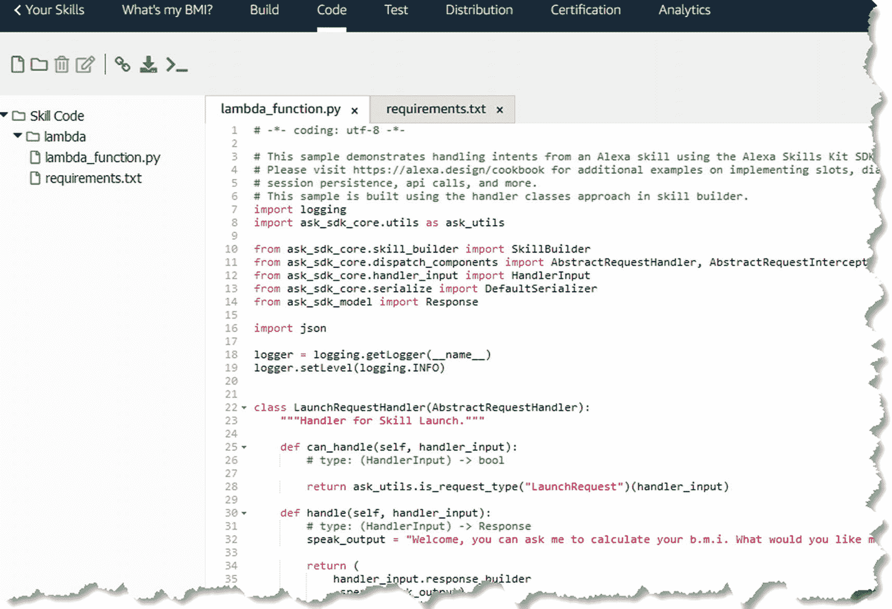
图 7-1 编辑 Alexa 托管技能的代码

在本节中，我们将创建一个完全自定义的技能，其代码和所有使用的资源都托管在亚马逊云服务（AWS）上，而不是在 Alexa 平台内。Alexa 托管技能更容易构建，但 Alexa 平台会施加一些限制。您可能需要迁移到 AWS 来实现技能所需的功能，对于媒体和数据存储尤其如此。在我们的新技能中，这两者都会用到，因此在这种情况下迁移到 AWS 是合理的。但我们的新技能是什么呢？

### 我们的新技能

几个月前，我在车里收听美国国家公共广播电台的 TED 广播时间节目。我不记得当时是谁在发言，但那是一个回顾节目，他们谈论系列节目中的亮点，包括对评论员意义重大的演讲。其中一位评论员提到，一位 TED 演讲者（我想应该称他为 TED 讲者）在演讲结尾不经意提出的一个想法让他们深受触动。经过一番搜索，我发现那位演讲者是蒂姆·厄本，演讲主题是关于拖延症的^(¹⁷)。他提出的想法是一张 90 年日历，蒂姆称之为“人生日历”，用一个小方格代表 90 年寿命中的每一周。起初，你可能会觉得有很多方格。但如果你已经 21 岁，那么你已经划掉了 1092 个小方格。原本总共只有 4680 个方格。在 21 岁时，你已经完成了 23%！

蒂姆·厄本的人生日历改变了我的生活。

### 90 年日历

我一回到家，就打开 Excel 制作了自己的 90 年日历。在划掉超过一半的方格后，我震惊于剩下的方格如此之少，并开始思考自己用那些划掉的方格换来了什么。我看到的画面是这样的（见图 7-2）。


图 7-2 一张 90 年人生日历

但这还没完。我为家里的每个人都制作了 90 年人生日历。然后，我用自己人生中的一些重要事件“增强”了我的日历。最终效果类似于图 7-3。

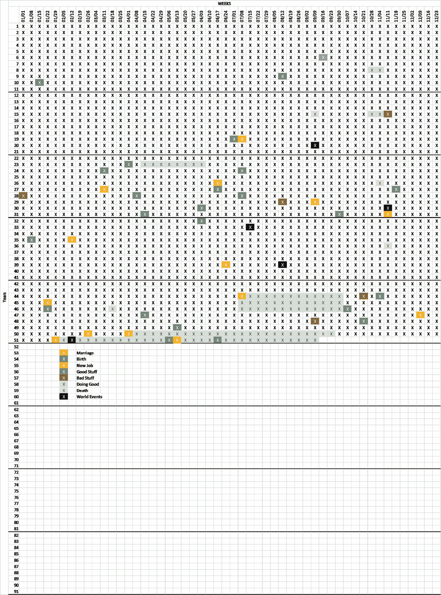
图 7-3 一张增强版 90 年人生日历

在接下来的几章中，我们将把这个增强版 90 年人生日历构建成一个 Alexa 技能。通过这个练习，我们将更深入地了解 Alexa 开发流程，并使用许多高级功能，包括：
* 语音用户界面设计
* Alexa 交互模型——意图、槽位、语句
* Alexa 对话与委派
* 使用 Alexa 演示语言在带屏幕的设备上绘制 90 年日历
* 使用 Alexa 音频演示语言通过音效增强我们的技能
* 使用 `DynamoDb` 持久化存储来安全地保存你的人生事件
* 使用 `S3` 存储来安全地链接你人生事件的图片
* 账户关联，以便安全地收集你的人生事件
* 一个 `Lambda` 函数——我们技能的大脑

在本章中，我们将创建构成一个完全自定义技能所需的账户和 AWS 服务。在接下来的章节中，我们将使用这些 AWS 服务来实现我们技能的各项功能。

### VUI 设计

我们将使用的第一个工具是 Botmock，一个 VUI 设计工具。在设计对话界面时，我们很容易想到使用 Word、Excel 和 PowerPoint，因为这些是我们最熟悉的工具。然而，这些工具都很难很好地呈现 VUI。即使是 Visio 和 Lucidchart 这样的高级工具，也不适合映射语音体验，而这正是 Botmock 和 Voiceflow 这类工具的用武之地。在本练习中，我们将使用 Botmock，因此你需要注册他们的免费账户。

1. 首先，访问[`www.botmock.com`](https://www.botmock.com)。
2. 然后点击*免费试用*。
3. 输入所需信息并点击*注册*。

登录后，你将处于免费层级，该层级允许你创建最多两个项目。在下一章中，我们将为 90 年日历创建一个项目，并学习如何使用 Botmock 设计我们的语音体验。接下来，我们将登录 Alexa 控制台并创建一个技能。

### 创建 Alexa 技能

我们需要创建一个自定义 Alexa 技能并开启若干功能。这就是我们接下来要做的事情。打开 Alexa 开发者控制台（[`https://developer.amazon.com/alexa/console/ask`](https://developer.amazon.com/alexa/console/ask)）。然后按照以下步骤操作：

1. 点击*创建技能*。
2. 输入技能名称：**90 年日历**。
3. 在选择模型时，选择自定义技能。
4. 在选择托管技能后端资源的方法时，选择自行配置。
5. 然后点击右上角的*创建技能*。
6. 在选择模板时：选择**从零开始**。
7. 然后点击右上角的*选择*。

控制台将创建一个带有 `Hello World` 意图的简单技能。接下来，我们将进行一些配置更改，然后在第 9 章中再回到交互模型。

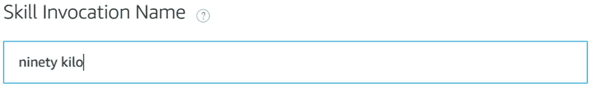
图 7-4 选择一个简单易用的调用名称

1. 点击左侧导航栏中的*调用*。
2. 将*技能调用名称*改为易于输入和发音的名称。在调试过程中，你会频繁说出和输入这个名称。在创建过程接近尾声时，你可以将其改为更合适的名称，比如“九十年日历”。现在，先使用像**ninety kilo**这样的名称——两个单词，易于输入（90 kilo 这几个键都集中在一起），易于发音，也易于记忆。（见图 7-4。）
3. 点击顶部的*保存模型*。
4. 在左侧导航栏中，选择*接口*。
5. 向下滚动到 Alexa 演示语言，并将其切换为**开启**状态。
6. 确保所有集线器和电视都被选中。
7. 向下滚动到 Alexa 对话并选择它。
8. 不要使用 Alexa 对话作为默认对话管理器。
9. 滚动回顶部并点击*保存接口*。

现在我们已经为技能创建了骨架。

我们需要导航回技能列表（[`https://developer.amazon.com/alexa/console/ask`](https://developer.amazon.com/alexa/console/ask)）。在技能列表中，选择*复制技能 ID*（见图 7-5）并将其粘贴到 Notepad++中。稍后我们会在安全配置文件中用到它。

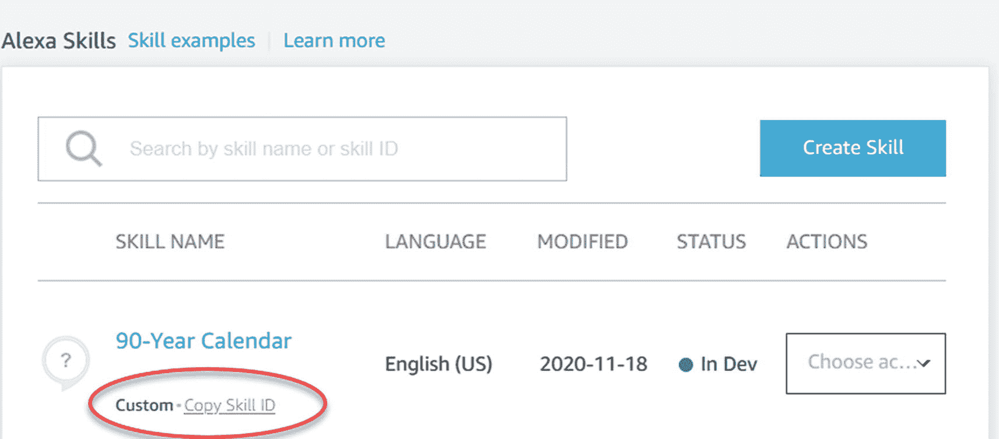
图 7-5 复制技能 ID 以备后用

接下来，我们需要一个数据库来存储 Alexa 将收集的人生事件。

### DynamoDb

当 Alexa 收集信息时，信息会以 JSON 文档的形式传输。我们需要一个地方来存储这些文档。最可能的选择是 NoSQL 数据库，在 Amazon AWS 技术栈中，它被称为 `DynamoDb`。在这种情况下，NoSQL 相比传统关系型数据库有几个优势。第一，我们将拥有一个包含许多相关详细信息的关键记录。第二，我们的数据将全部采用 JSON 格式。第三，NoSQL 数据库可以非常快速地读写这些 JSON 文档。因此，我们需要创建一个 `DynamoDb` 表。

1. 首先，以管理员用户（而非 root 用户）身份登录 AWS 开发者控制台。AWS 控制台地址为：[`https://console.aws.amazon.com`](https://console.aws.amazon.com)。
2. 登录后，在“查找服务”框中搜索 `DynamoDb`。
3. 选择 `DynamoDb` 后，您将进入 `DynamoDb` 控制台。
4. 在左侧导航栏中，选择 `Tables`。
5. 在右侧，点击 `Create Table` 按钮。

NoSQL 表与 SQL（关系型）表不同，尽管它们使用一些相同的术语。每个 NoSQL 表必须有一个分区键和一个可选的排序键。主键由这两个属性组成，并且对于每个项目必须是唯一的。`DynamoDb` 对分区键进行哈希处理，以确定将项目存储在数据库的哪个分区中。在小型数据库中可能只有一个分区，但随着数据库的增长，可以有多个分区。有关选择分区键的更多信息，请查看此文档：[`https://aws.amazon.com/blogs/database/choosing-the-right-dynamodb-partition-key/`](https://aws.amazon.com/blogs/database/choosing-the-right-dynamodb-partition-key/)。对于我们的用例——为个人创建一个 90 年的日历——使用对每个个体唯一的 `PersonId` 作为分区键似乎是合理的，并且我们不需要排序键。填写表表单时，输入以下内容（参见图 7-6）：

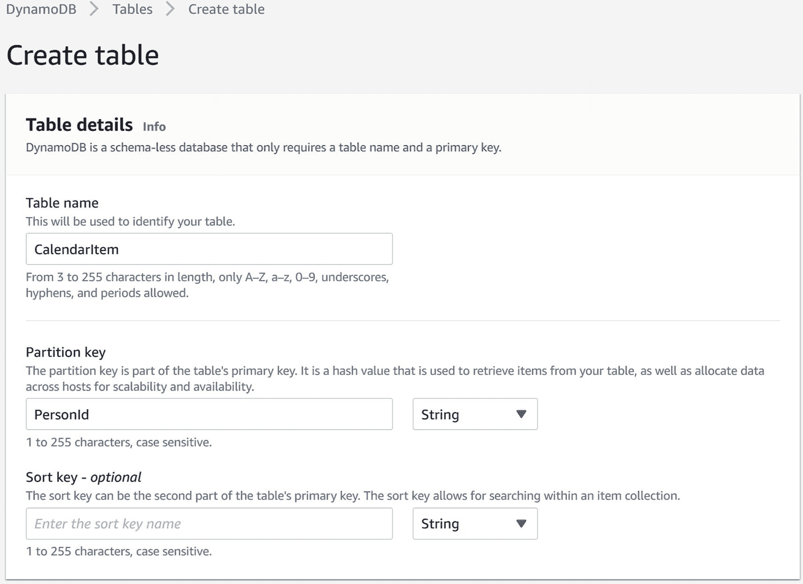
图 7-6 为日历项目创建 `DynamoDb` 表

1. 对于表名，输入 `CalendarItem`。
2. 对于分区键，输入 `PersonId`。
3. 滚动到底部，点击 `Create`。

`DynamoDb` 将需要大约一分钟来配置表。完成后，将 `DynamoDB` 表的 ARN 复制到 `Notepad++`（参见图 7-7）。在创建安全角色时，我们将需要它。

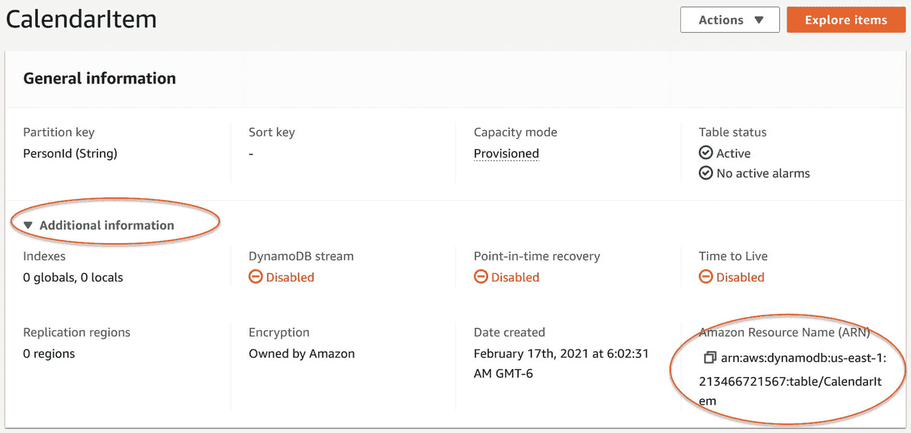
图 7-7 复制 `DynamoDB` 表的 ARN

接下来，我们将创建我们的 `S3` 存储账户。

### S3 存储

虽然 `DynamoDb` 是存储您生活事件数据的绝佳场所，但它不是存储与这些事件相关的图片的正确位置。图像是一种二进制大对象，即 Blob 数据。Blob 数据最好保存在文件系统中，这样可以轻松且廉价地存储。后者是 `S3` 存储桶的主要优势。`S3` 是 Simple Storage Service（简单存储服务）的缩写，是亚马逊用于文件存储的云解决方案。在您的本地机器上，您有磁盘驱动器；在 `S3` 中，您有存储桶。在本地，您有文件夹来存放文件；在 `S3` 中，您也有文件夹来组织您的对象。为了为我们将为技能存储的图像创建一个 `S3` 存储桶，请导航到任何 AWS 控制台左上角的“服务”菜单，并按照以下步骤操作：

1. 首先，以管理员用户（而非 root 用户）身份登录 AWS 开发者控制台。AWS 控制台地址为：[`https://console.aws.amazon.com`](https://console.aws.amazon.com)。
2. 在 `S3` 控制台中，点击右上角的橙色 `Create bucket` 按钮。
3. 对于存储桶名称：`calendar-pics-12345`。（必须全部小写。名称需要唯一，因此根据需要更改数字。）
4. 选择正确的区域。
5. 确保选中“阻止所有公共访问”复选框。
6. 我们不需要存储桶版本控制（也不需要与之相关的成本）。
7. 由于我们存储的是私人图片，我们需要服务器端加密，并且我们可以让亚马逊管理密钥——`Amazon S3 key (SSE-S3)`。
8. 现在向下滚动并点击橙色的 `Create bucket` 按钮。

创建存储桶后，我们需要编辑其中一个设置。

1. 在存储桶列表中，选择存储桶名称链接。
2. 点击 `Permissions` 选项卡。
3. 滚动到底部。
4. 在“跨源资源共享 (CORS)”旁边，点击 `Edit`。
5. 输入以下 JSON：

```json
[
{
"AllowedHeaders": [
"*"
],
"AllowedMethods": [
"PUT",
"GET",
"POST",
"DELETE",
"HEAD"
],
"AllowedOrigins": [
"https://www.example.com"
],
"ExposeHeaders": [
"ETag"
]
}
]
```

6. 点击 `Save changes`。

目前，我们对 `S3` 存储桶需要做的就这些。将 `S3` 存储桶的 ARN 复制到 `Notepad++`。（参见图 7-8。）在创建安全角色时，我们将需要它。

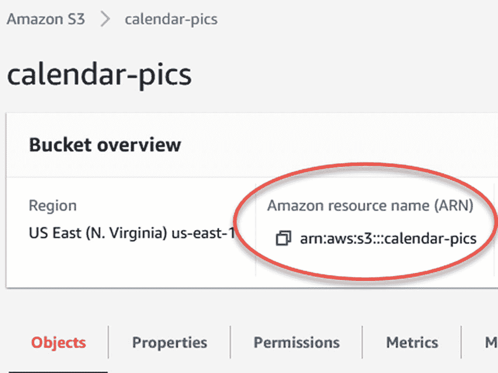
图 7-8 复制 `S3` 存储桶的 ARN

我们还需要能够识别用户并为他们提供对其数据的安全访问。这需要账户关联，我们接下来将配置它。

### 账户关联

根据用户是否关联了他们的亚马逊账户，我们将有两种版本的技能行为。如果未关联，用户可以从他们的生日创建日历，并且不存储任何事件。通过关联账户，我们可以安全地为他们存储事件，以便我们可以为日历着色并让他们访问他们的照片。

账户关联^(¹⁸)是一项功能，使您能够将 Alexa 技能链接到用户的亚马逊、微软、谷歌或其他账户。通常，您会希望链接到用户的亚马逊账户，然后使用该身份验证来访问您系统中的数据。

当用户启用您的技能时，Alexa 会为他们创建一个用户 ID。如果您希望持久化会话信息，如果数据不需要安全保护，用户 ID 可能是识别用户并存储其会话信息的合适方式。另一方面，为了保存个人信息，关联账户提供了一个安全的身份验证层。当您关联账户时，Alexa 会生成一个安全访问令牌，您可以使用它来识别用户的个人数据。这为您的技能提供了更高的安全性，并允许您安全地连接到外部服务。首先，我们将为我们的技能创建一个应用程序安全配置文件，用于关联账户。

#### 应用程序安全配置文件

应用程序安全配置文件将我们的 Alexa 技能识别为一个应用程序，并为我们提供将 Alexa 技能链接到用户亚马逊账户所需的凭证。要创建该配置文件：

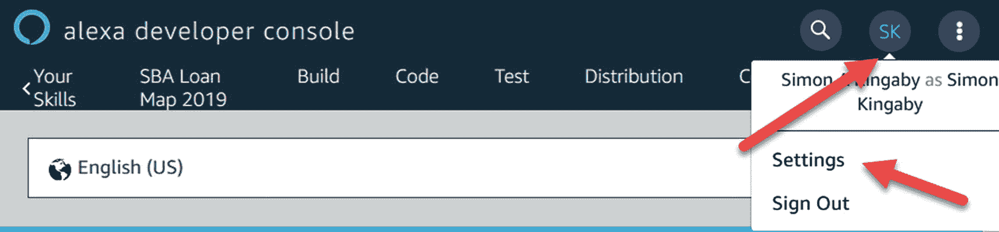
图 7-9 选择 `Settings` 菜单选项

1. 在 Alexa 开发者控制台（使用你的亚马逊账户登录）中，从右上角菜单选择你的姓名首字母，然后选择 `Settings`（参见图 7-9）。

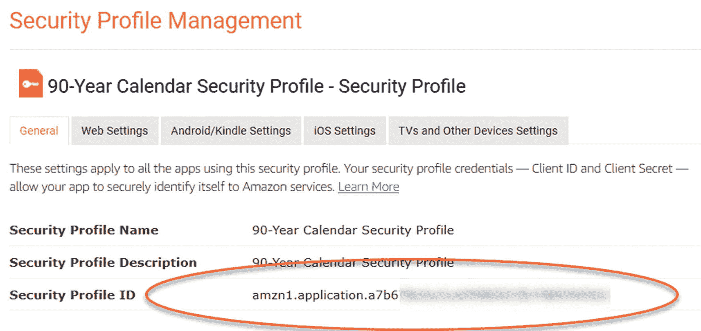
图 7-10 复制安全配置文件 ID

1. 从菜单栏中选择 `Security Profiles`。
2. 点击 `Create a New Security Profile` 按钮。
3. 为你的安全配置文件输入 `Name` 和 `Description`。例如，“**90 年日历安全配置文件**”。
4. 点击 `Save`。
5. 在安全配置文件屏幕上，将安全配置文件 ID 复制到 Notepad++ 中。（参见图 7-10。）

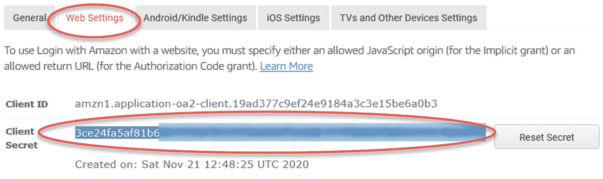
图 7-11 复制客户端密钥

1. 选择 `Web Settings` 选项卡。
2. 将 `Client ID` 复制到 Notepad++ 中。
3. 点击 `Show Secret` 按钮。
4. 将 `Client Secret` 复制到 Notepad++ 中。（参见图 7-11。）

现在我们已经有了一个安全配置文件，可以设置账户关联了。

## 配置账户关联

仍在 Alexa 开发者控制台中，切换回技能的 `Build` 选项卡，我们将按如下方式填入配置文件凭证：

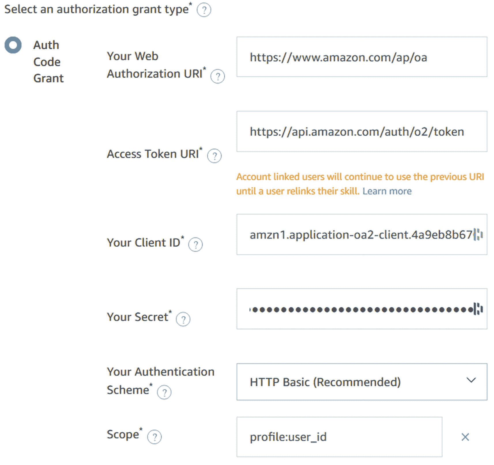
**图 7-12** 填写完成的账户关联表单

1.  点击 `Build` 选项卡。
2.  点击左侧导航栏中的 `Tools`。
3.  点击左侧导航栏中的 `Account Linking`。
4.  开启“是否允许用户创建账户或关联到你现有的账户”选项。
5.  开启“允许用户在不关联账户的情况下启用技能”选项。
6.  在“安全提供商信息”下，选择 `Auth Code Grant` 选项。
7.  对于 `Web Authorization URI`，输入 `https://www.amazon.com/ap/oa`。
8.  对于 `Access Token URI`，输入 `https://api.amazon.com/auth/o2/token`。
9.  对于 `Your Client ID`，粘贴之前保存到 Notepad++ 中的 `Client ID`。
10. 对于 `Your Secret`，粘贴之前的 `Client Secret`。
11. 对于 `Your Authentication Scheme`，选择 `HTTP Basic`。
12. 对于 `Scope`，输入 `profile:user_id`。
13. 滚动到页面顶部并点击 `Save`。
14. 填写完成的表单应如图 7-12 所示。

现在，我们需要将 Alexa 重定向 URL 复制到我们刚刚创建的安全配置文件中。

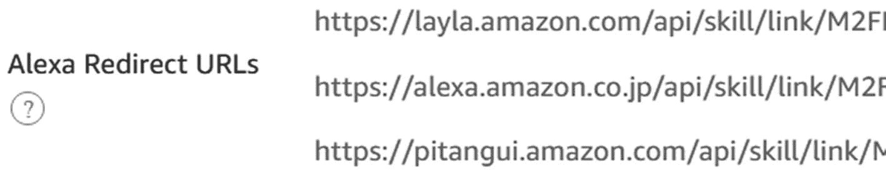
**图 7-13** Alexa 重定向 URL

1.  在“关联账户”屏幕底部，`Alexa Redirect URLs` 部分有三个 URL；参见图 7-13。

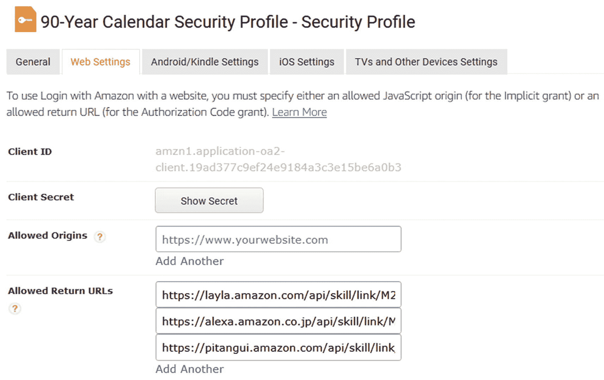
**图 7-14** 将允许的返回 URL 添加到安全配置文件

1.  将这三个 URL 复制到安全配置文件 Web 设置选项卡的 `Allowed Return URLs` 部分；参见图 7-14。
2.  在屏幕顶部，再次点击 `Save` 按钮。

还有一步。我们需要使用“使用亚马逊登录”功能注册我们的安全配置文件。

1.  在浏览器中，导航至 `https://developer.amazon.com/loginwithamazon/console/site/lwa/overview.html`。
2.  在下拉菜单中，选择**90 年日历安全配置文件**。
3.  点击 `Confirm`。
4.  提供你的隐私政策 URL。（如果你没有，可以在 `https://datadrivenskills.com/privacy-policy` 查看示例。）
5.  提供一个图标图形。（任何图形都可以。）
6.  点击 `Save` 按钮。

就这样。账户关联已设置完成。下一步是为后端创建 lambda 函数。

## Lambda 函数

在亚马逊云服务（AWS）中，lambda 函数是一种无服务器计算服务或云函数。它不需要我们预置需要管理的虚拟机或容器。AWS 服务完全管理基础设施资源。这使得 lambda 函数成为 Alexa 技能后端的首选解决方案。即使在 Alexa 托管的技能中，`Code` 选项卡也包含一个 lambda 函数。

创建 AWS lambda 函数有两个步骤。首先，我们需要预置一个安全角色，我们的技能将使用该角色来访问 lambda 函数，然后我们需要创建 lambda 函数本身。

### 创建安全角色

在创建 Lambda 函数之前，我们需要在 IAM（身份与访问管理）控制台中创建一个安全角色。

要创建安全角色，我们需要登录 AWS 账户并进入 IAM 服务：

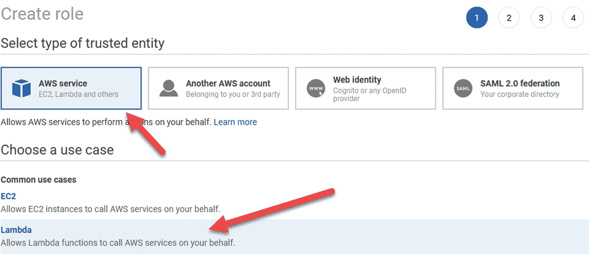
**图 7-15** 选择 Lambda 服务用例

1.  登录 AWS（`https://aws.amazon.com`）。输入账户编号、管理员用户名和密码。请勿使用根用户选项。
2.  搜索并选择 IAM 服务。
3.  在左侧，选择 *角色*，然后点击 *创建角色*。
4.  在顶部选择 *AWS 服务*，并在中间选择 *Lambda* 作为用例。（参见图 7-15。）

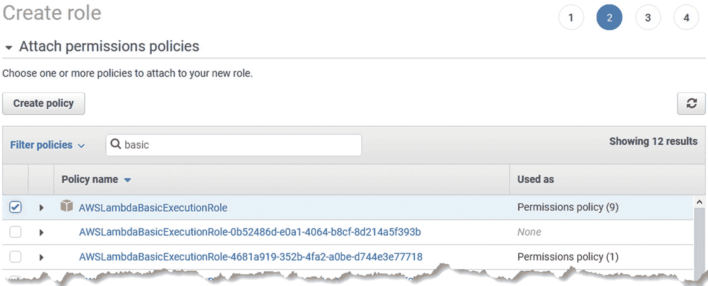
**图 7-16** 选择 AWSLambdaBasicExecutionRole

1.  点击右下角的 *下一步：权限*。
2.  在 *筛选策略* 框中，搜索 `basic`。
3.  选中 `AWSLambdaBasicExecutionRole` 旁边的复选框。（参见图 7-16。）

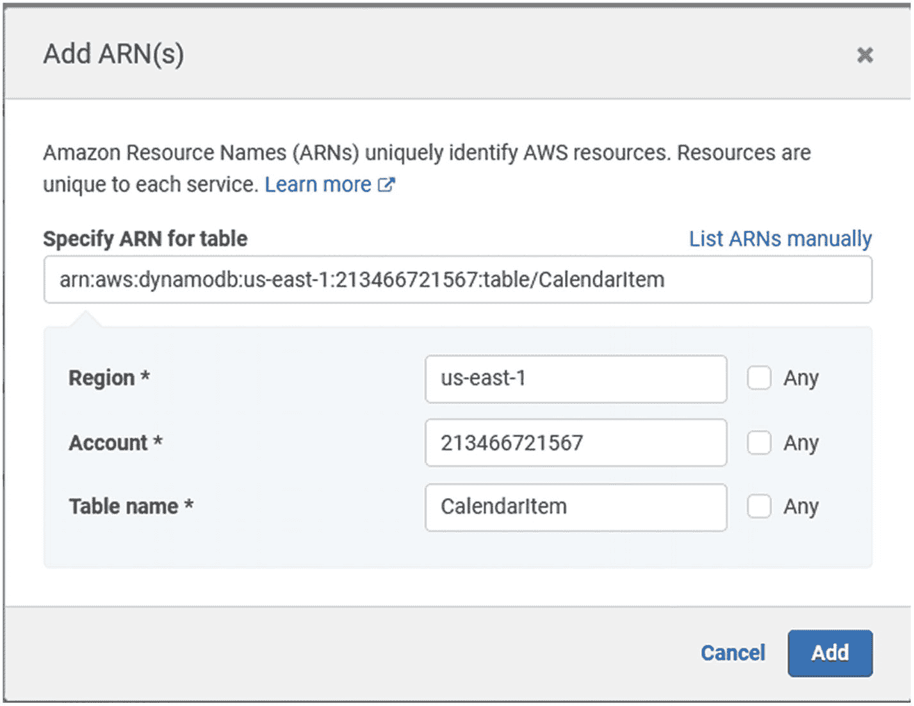
**图 7-17** 粘贴表的 ARN

1.  现在点击顶部的 *创建策略* 按钮。
2.  对于 *选择服务*，选择 **DynamoDB**。
3.  在 *访问级别* 下，展开 *读取* 的选项框。
4.  选择 `GetItem` 和 `Query`。
5.  展开 *写入* 的选项框，并选择 `DeleteItem`、`PutItem` 和 `UpdateItem`。
6.  现在点击 *资源* 旁边的橙色文字。
7.  在 *表* 旁边，点击 *添加 ARN* 链接。
8.  粘贴表的 *ARN*，或者添加您保存到 Notepad++ 中的 *区域*、*账户* 和 *表名称*。（参见图 7-17。）

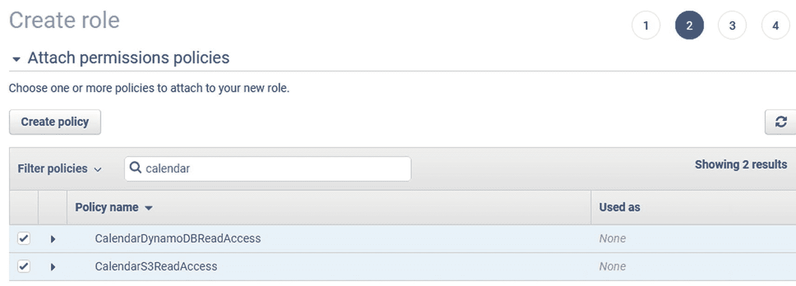
**图 7-18** 选择两个日历策略

1.  点击 *添加* 按钮。
2.  点击 *下一步：标签* 按钮。
3.  现在点击 *下一步：审核* 按钮。
4.  为策略命名，例如 `CalendarDynamoDBReadAccess`。
5.  点击 *创建策略* 按钮。
6.  切换回 *创建角色* 标签页。
7.  再次点击顶部的 *创建策略* 按钮。
8.  对于 *选择服务*，选择 **S3**。
9.  展开 *访问级别列表* 的选项框，并选择 `ListBucket`。
10. 展开 *访问级别读取* 的选项框，并选择 `GetObject`。
11. 现在点击 *资源* 旁边的橙色文字。
12. 在 *存储桶* 旁边，点击 *添加 ARN* 链接。
13. 粘贴 S3 存储桶的 ARN。
14. 点击 *添加* 按钮。
15. 在 *对象* 旁边，点击 *添加 ARN* 链接。
16. 在 *存储桶名称* 框中输入存储桶的名称（`calendar-pics`）。
17. 勾选 *对象名称* 旁边的 *任意* 复选框。
18. 点击 *添加* 按钮。
19. 点击 *下一步：标签* 按钮。
20. 点击 *下一步：审核* 按钮。
21. 为策略命名，例如 `CalendarS3ReadAccess`。
22. 点击 *创建策略* 按钮。
23. 切换回 *创建角色* 标签页。
24. 刷新策略列表。
25. 使用关键词 `calendar` 筛选策略。
26. 选择我们刚刚创建的两个策略。（参见图 7-18。）

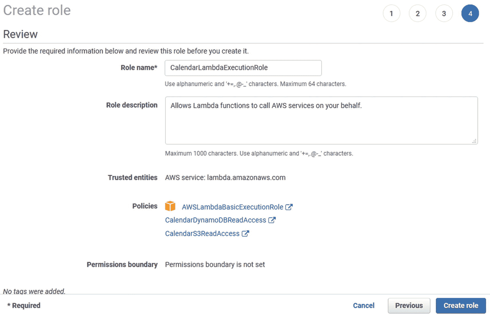
**图 7-19** 完成的 Lambda 执行角色

1.  点击 *下一步：标签*。
2.  点击 *下一步：审核*。
3.  为 *角色名称* 命名，例如 `CalendarLambdaExecutionRole`。
4.  点击 *创建角色*。（参见图 7-19。)

现在我们已经创建了角色，可以开始处理 Lambda 函数了。

### 创建 Lambda 函数

仍在 AWS 中，我们现在需要开始创建 Lambda 函数本身。创建 Lambda 函数需要执行以下步骤：

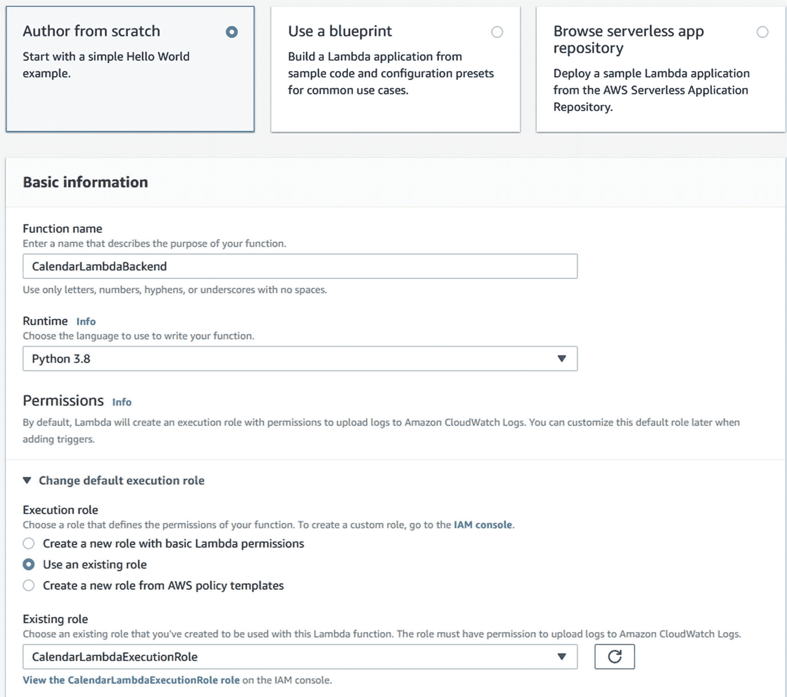
**图 7-20** 完成的 Lambda 函数创建对话框

1.  选择左上角的 *服务* 菜单。
2.  搜索并选择 Lambda。
3.  在右上角，选择 *创建函数*。
4.  选择 *从头开始创作*。
5.  输入 *函数名称*，例如 `CalendarLambdaBackend`。
6.  对于 *运行时*，在列表顶部的 *最新支持* 部分下选择 **Python 3.8** 或更高版本。
7.  在 *权限* 下，展开 *更改默认执行角色*。
8.  选择 *使用现有角色*。
9.  选择我们之前创建的 `CalendarLambdaExecutionRole` 角色。（参见图 7-20。)

现在您将能够配置您的 Lambda 函数。

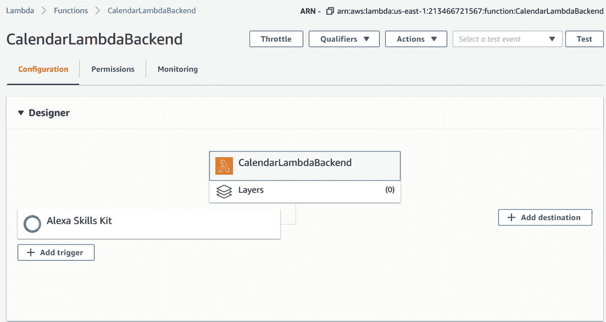
**图 7-21** 完成的触发器

1.  在左侧，选择 *添加触发器*，然后选择 *Alexa Skills Kit* 触发器。
2.  在 *技能 ID* 框中，粘贴您从 Notepad++ 中复制的 90 年日历技能的 *Alexa 技能 ID*。（完成的触发器参见图 7-21。)

现在选择 Lambda 函数（图 7-21 中标记为 `CalendarLambdaBackend` 的框）以显示函数代码。您可能需要向下滚动才能看到代码（参见图 7-22）。

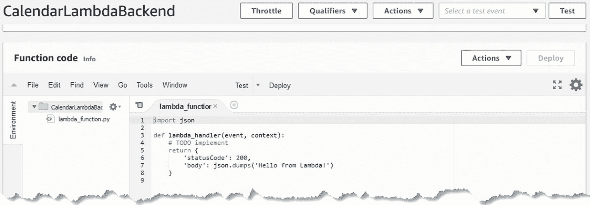
**图 7-22** Lambda 函数代码

至此，您已经准备好编写后端代码，并且我们已经配置了在技能中所需的所有组件。

## 总结

在本章中，我们为新的技能创建了一个骨架。它包含一个 Alexa 技能、一个用于技能设计的 Botmock 项目、一个用于捕获用户数据的 DynamoDB 数据库表、一个用于检索图片的 S3 存储桶，以及一个带有适当安全策略的 Lambda 函数，用于后端代码。

在下一章中，我们将为 90 年日历技能设计 VUI。
