## 8. 超越 Hello World

在上一章中，您设置了构建增强版 90 年日历技能所需的所有账户和服务。本章将介绍 VUI 设计，以及如何为更复杂的技能设计对话流程。

我们的技能将有两种风格。如图 8-1 所示，第一种是 90 年日历的简单呈现。这是未认证用户所能使用的全部功能。

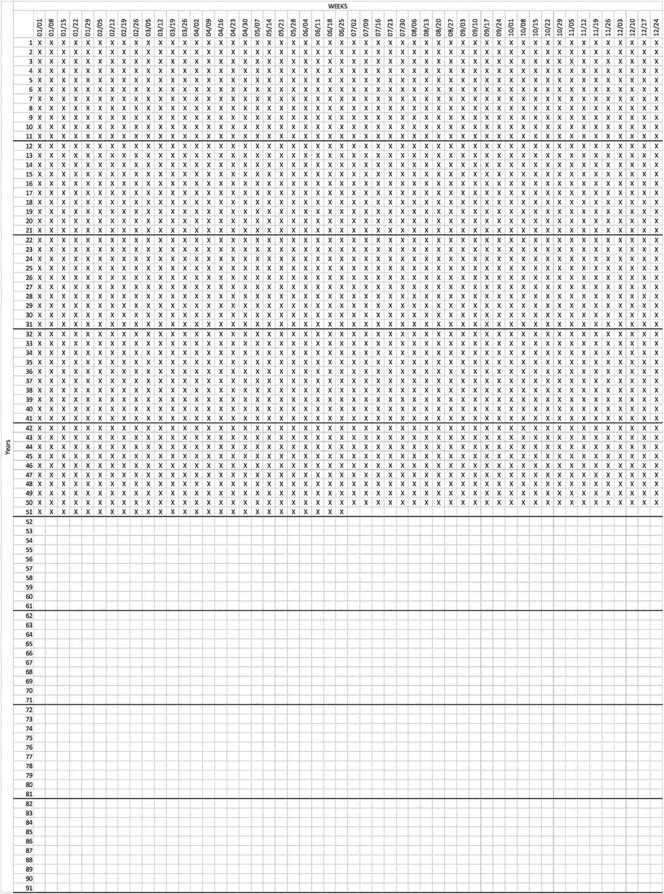
**图 8-1** 一个 90 年人生日历

一旦用户将我们的 Alexa 技能关联到他们的亚马逊账户，我们就可以询问并存储用户生活中的重要事件。这将使我们能够呈现一个增强版本，最终看起来类似于图 8-2。

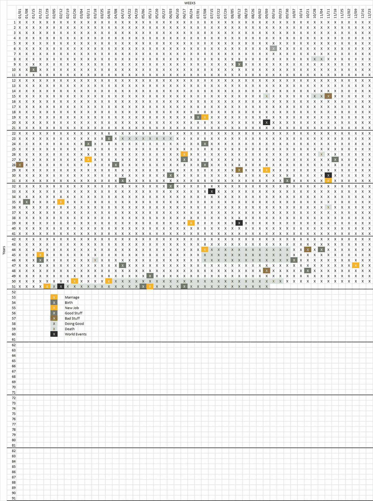
**图 8-2** 一个增强版 90 年人生日历

在下一节中，我们将探讨一些关于语音优先 VUI 设计的考量。

### VUI 设计

语音用户界面设计可能是一个复杂的过程，尤其是与传统的图形用户界面设计相比。在为应用构思 GUI 时，你通常会创建一个菜单结构来访问各种功能。用户随后会点击某个菜单选项，打开某种表单来输入数据或执行操作。表单会布置一系列用于输入或选择选项的控件，并附带几个操作按钮，例如“确定”和“取消”。这些设计都无法很好地迁移到语音优先的用户界面。相反，“菜单”需要是一个宽而扁平的结构，允许用户说出不同的指令来访问应用的所有功能。“表单”则需要让用户能够以几乎任意顺序说出内容。VUI 还必须像 GUI 那样容纳各种同义词。

例如，假设你想为你的车查询更换机油的价格。过程可能如下：

1.  你在手机上打开应用。
2.  你点击应用中的注册链接。
3.  你输入电子邮件和密码，点击接受条款，然后点击注册按钮。
4.  接着你输入名字、姓氏和邮政编码，然后点击“完成”。
5.  然后你点击允许应用在使用时访问你的位置。
6.  接着你对应用关于通知的询问点击“不允许”。
7.  然后你可以在地图上点击本地门店、搜索门店、点击按钮打开主菜单，或者点击底部栏查看优惠券。
8.  点击菜单按钮会打开一个多级菜单。
9.  点击地图上的本地门店后，你会看到一个屏幕，让你在以下选项中选择：
    1.  关闭屏幕。
    2.  收藏该位置。
    3.  查看热门时段图表。
    4.  获取路线（这会启动你默认的地图/导航应用）。
    5.  查看可用的优惠券。
    6.  查看评价。
    7.  如果向下滚动，你可以看到可用服务的简要列表。
10.  经过所有这些操作后，你沮丧地关闭了应用，因为这个应用不提供价格信息，也无法预约服务。

现在，想象一下语音优先的体验。

```
用户：Alexa，我需要换机油。
Alexa：我找到了几个选项。1st Chance Tire，距离 1.3 英里。Valvoline Instant Oil Change，距离 2.5 英里。
用户：选择 Valvoline。
Alexa：欢迎来到 Valvoline。您想预约换机油吗？
用户：是的。
Alexa：为哪辆车？
用户：2019 款福特 C-Max。
Alexa：您想什么时候去？
用户：今天下午，下班后。
Alexa：2019 款福特 C-Max 的里程数是多少？
用户：我不知道，大概 115,000 英里。
Alexa：好的。我可以为您预约明天下午 5:30 在 Smyrna 的 Valvoline 为 2019 款福特 C-Max 进行高里程机油更换。您有一张 7 美元的优惠券，因此根据您选择的机油，费用大约在 33 到 48 美元之间。需要我预约吗？
用户：是的。
Alexa：好的。我已为您预约了明天下午 5:30。
```

这两种交互之间最显著的差异是什么？想想 Alexa 是如何直奔主题的，而 GUI 却必须将所有内容都塞进菜单、屏幕和点击操作中。想想 Alexa 是如何将 115,000 英里转换为“高里程”，以及将“下班后”转换为“下午 5:30”的。Alexa 必须更加灵活，以处理用户可能说出的各种内容。想想每次交互对用户的要求是什么。

语音优先设计是一种策略，它将语音交互置于屏幕和点击操作之上。虽然屏幕可以是 VUI 设计的一个组成部分，但优先考虑的是模拟用户与 Alexa 之间的对话。你要寻找的是用户能够完成流程、达成预期结果的方式。当然，我们会模拟一条“快乐路径”，即用户按正确顺序说出正确内容。但我们也必须处理意外情况。例如，你在预约换机油的过程中，突然决定还需要做轮胎换位。这就是传统建模工具（如 Excel、Visio 和 Lucidchart）的不足之处。绘制快乐路径很容易。但随着模型的扩展，列出同义词和所有可能的表述会变得越来越棘手。

Adobe XD 有一个用于 Alexa 技能的模板；这是一个出色的故事板工具，许多图形设计师都很熟悉。有关 XD 的全面指南，请查看 Alexa 团队提供的 My Cactus 示例。（设计资源见此处：`https://github.com/alexa/skill-sample-nodejs-web-api-my-cactus`。Alison Atwell 和 Justin Jeffress 在 Twitch 上解释该过程的视频见此处：`http://www.twitch.tv/collections/S81yydlkRBY-Pw`。)

诸如 Botmock 和 Voiceflow 之类的工具正是为了应对 VUI 设计的挑战而创建的，并且它们的学习曲线不像 Adobe XD 那样陡峭。在下一节中，我们将使用 Botmock 来设计标准模型的对话。

# 使用 Botmock 进行 VUI 设计

要开始使用 Botmock，请登录，并为“90 年日历”创建一个新项目。点击“创建新项目”后：

1.  在“项目名称”中输入`90-Year Calendar`。
2.  选择`Amazon Alexa`作为目标渠道。
3.  点击“创建项目”。

这将启动对话编辑器，我们可以在其中开始建模我们的对话。

在 BotMock 中，线条和方框代表对话模型。线条是用户的表述；方框是机器人（Alexa）说的话。见图 8-3。

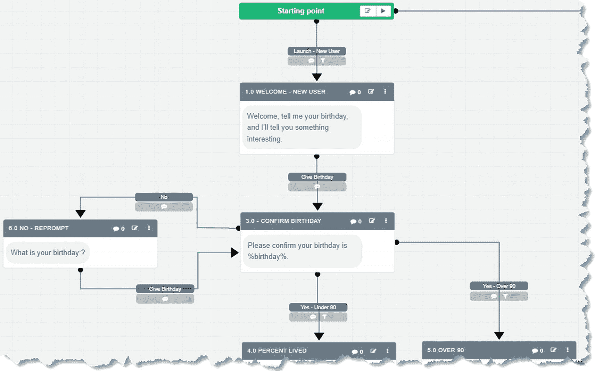

图 8-3 在 BotMock 中建模对话

如图 8-3 所示，在用户说出启动短语后，Alexa 说：“欢迎，告诉我你的生日，我会告诉你一些有趣的事情。”

然后用户意图向 Alexa 提供他们的生日，因此他们会说出一些合适的内容，例如“我的生日是 1980 年 1 月 1 日。”定义用户意图的一部分工作还包括描述他们为完成该意图可能说出的所有表述。“提供生日”意图的另一种表述可能是“我出生于 1980 年 1 月 1 日。”

然后 Alexa 确认她已将表述解码为正确的日期：“确认一下，你的生日是 `%birthday%`。”注意使用百分号来界定给定生日的变量。

此时，你可以在图中看到用户有两个选项（是或否），并且 Alexa 区分了年龄在 90 岁以上和 90 岁以下。如果用户说“否”，他们将获得另一次提供生日的机会。

如你所见，到目前为止，对话相对简单。不过，在我们详细阐述下一阶段之前，让我们先创建到目前为止的模型。

## 启动响应

与 Alexa 的对话通常始于用户启动您的技能。他们可能会说：“Alexa，启动我的九十年日历。”Alexa 通常会以愉快且礼貌的欢迎语和开始提示来回应。在我们的案例中，Alexa 会说：“欢迎，告诉我你的生日，我会告诉你一些有趣的事情。”但如果这是一位想要在日历中添加更多事件的回头用户呢？那么她应该说：“欢迎回来。您想向日历中添加更多事件吗？”在 Botmock 中，我们可以通过创建一个连接到绿色起点框的新文本框来表示这一点。

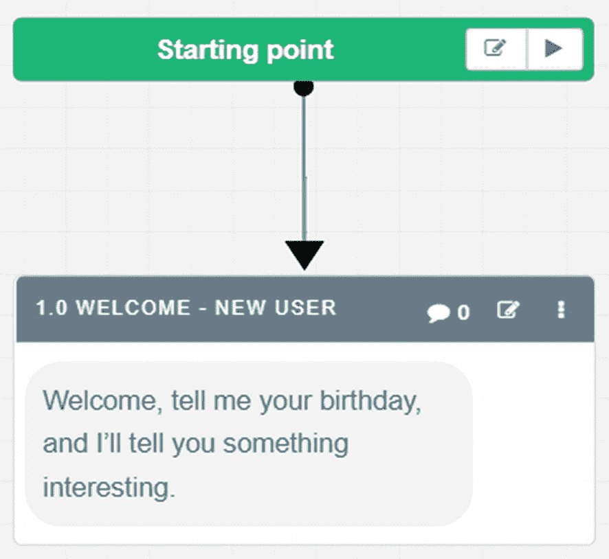

图 8-4 第一个语音框

1.  首先，点击*起点*框。
2.  会出现四个灰色箭头。点击底部的箭头。
3.  在*块选择器*中，选择*文本*。
4.  如果需要，您可以用鼠标抓住新框，并将其与起点框对齐。
5.  双击文字*机器人说*。
6.  在此对话框的最顶部，将文字*文本*改为**1.0 欢迎 – 新用户**。请注意，我们对每个文本框进行编号，以便在构建技能时保持其有序。
7.  现在，在文本文本框中，输入 Alexa 将要说的话：**欢迎，告诉我你的生日，我会告诉你一些有趣的事情。**
8.  最后，点击右下角的保存按钮。
9.  您的对话框现在应该看起来像图 8-4。

现在我们已经有了 Alexa 的欢迎语句，我们可以将启动意图添加到对话框中。

## 意图

在 BotMock 中，如同在 Alexa 对话中一样，用户是有意图的。意图是用户想要完成的事情。对于启动意图，用户希望我们的技能启动。Botmock 将意图表示为线条上的注释。首先，您定义意图，然后在图表中引用它。

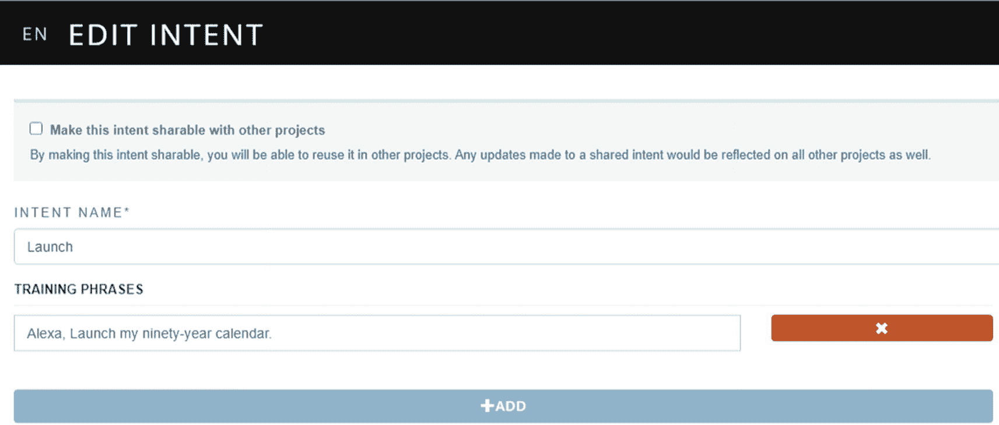

图 8-5 创建启动意图

1.  要定义一个意图，请选择左侧菜单栏上的*意图*图标。
2.  我们将定义一个启动意图，因此点击*添加新意图*。
3.  *意图名称*为**启动**。
4.  点击*训练短语*的*添加*按钮。
5.  在新的*训练短语*框中，输入**Alexa，启动我的九十年日历**。（见图 8-5。）

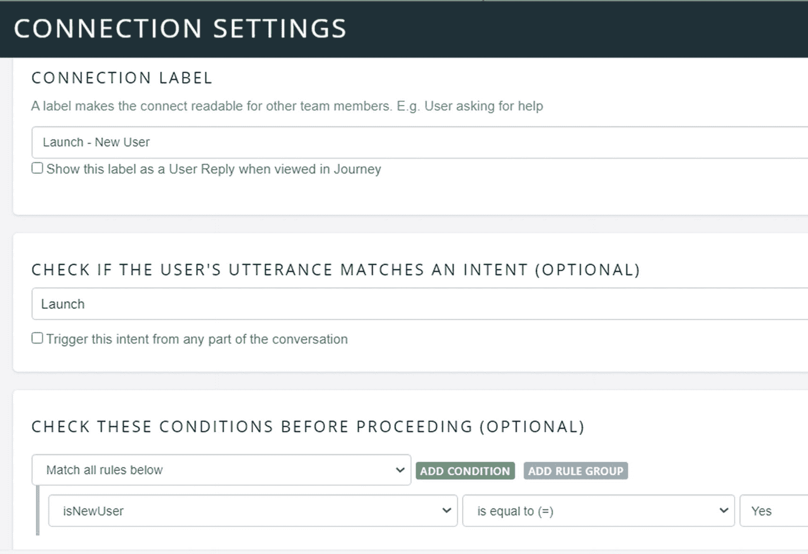

图 8-6 连接设置界面。

1.  点击右下角的*保存*按钮。
2.  然后点击意图列表顶部的箭头将其关闭。
3.  现在，按住 Shift 键并点击我们添加的*起点*框和*1.0 欢迎*框之间的连线。
4.  在*连接设置*界面中，输入**启动 – 新用户**作为*连接标签*。
5.  在*检查用户话语是否匹配意图*框中，选择我们刚刚创建的**启动**意图。
6.  在*检查这些条件*部分的*匹配以下所有规则*框旁边，点击*添加条件*按钮。
7.  在弹出的*创建新变量*界面中，输入 **isNewUser**。
8.  将条件从“为空”更改为*等于*。
9.  在文本框中输入**是**。（见图 8-6。）
10. 点击右下角的*保存*按钮。

您的图表现在应该显示该意图，如图 8-7 所示。

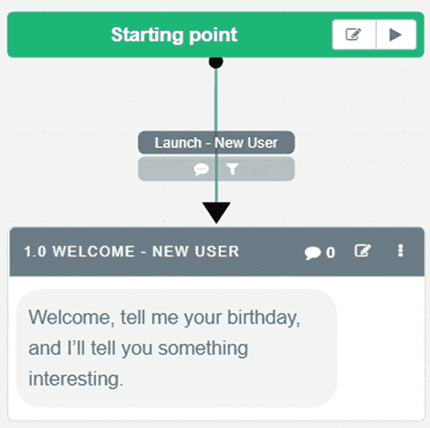

图 8-7 显示欢迎消息和启动意图的图表

接下来，我们需要添加针对回头用户的替代启动流程。为此，我们将重复之前的步骤，不同之处在于用户的启动意图相同，但 Alexa 的回应不同，并且过滤条件变为 `isNewUser = 否`。由于我们已经认识该用户，我们应该在欢迎消息中包含他们的名字。为此，我们将为用户的名字添加一个变量。

1.  点击左侧菜单栏上的*变量*。
2.  点击*创建新变量*。
3.  输入变量名称：**userName**。
4.  选择实体类型：**姓名**。
5.  点击*保存*。
6.  关闭*管理变量*弹出界面。

然后，我们像这样创建 Alexa 的回应：

1.  选择*起点*框。
2.  点击右侧箭头并添加一个新的文本框。
3.  双击该文本框，将*标题*改为“**2.0 欢迎 – 回头用户**”。
4.  将*文本*从“机器人说”改为“**欢迎 %userName%，您想向日历中添加一个事件吗？**”请注意使用百分号来界定变量 `userName`。
5.  点击*保存*。
6.  按住 Shift 键并点击从*起点*到**2.0 欢迎**的连线。
7.  输入标签：“**启动 – 回头用户**”。
8.  选择启动意图。
9.  添加一个条件。
10. 选择 **isNewUser**、**等于**，并输入**否**。
11. 点击*保存*按钮。
12. 回到图表上，点击右上角菜单栏上的*保存*按钮。

您的图表现在应该看起来像图 8-8。

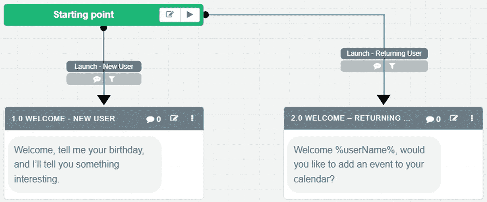

图 8-8 启动意图和欢迎消息

现在，我们准备完成新用户的快乐路径。

## 快乐路径

当一切按计划进行且所有假设都正确时，会发生什么？此时，你便走在了快乐路径上。在我们的案例中，快乐路径是指 Alexa 能正确听到并理解你的生日，然后告诉你一些关于生日的趣事。偏离快乐路径的情况属于异常和备选方案。目前，我们暂不考虑这些。我们想要创建的是快乐路径。

为此，需要创建一个新变量（图 8-9）和一个新意图（图 8-10），以便用户向我们提供他们的生日。请注意在训练短语中使用 `%birthday%` 变量，以及在槽位填充部分设置“必需”标志。然后，Alexa 会要求确认生日（图 8-11），我们可以将“提供生日”意图添加到连接线上（图 8-12）。接着，用户会说出“是”意图（图 8-13）。最后，Alexa 会告诉他们一些有趣的事情（图 8-14），我们可以将“是”意图添加到连接线上（图 8-15）。

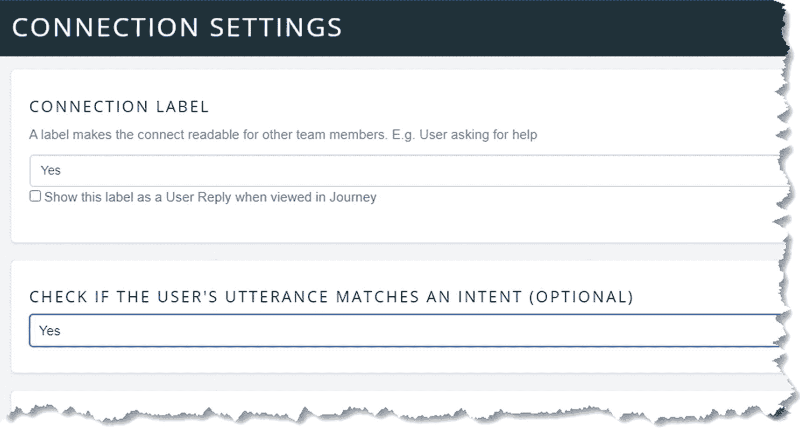

图 8-15 将“是”意图添加到连接线

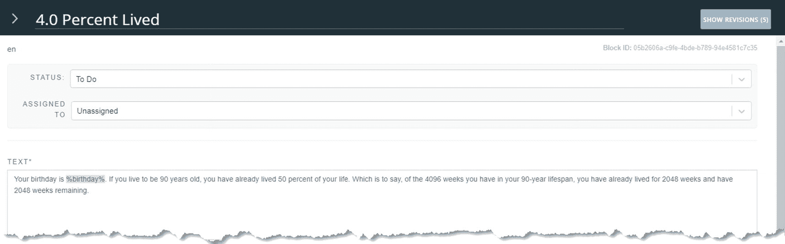

图 8-14 在文本框中告诉用户一些有趣的事情

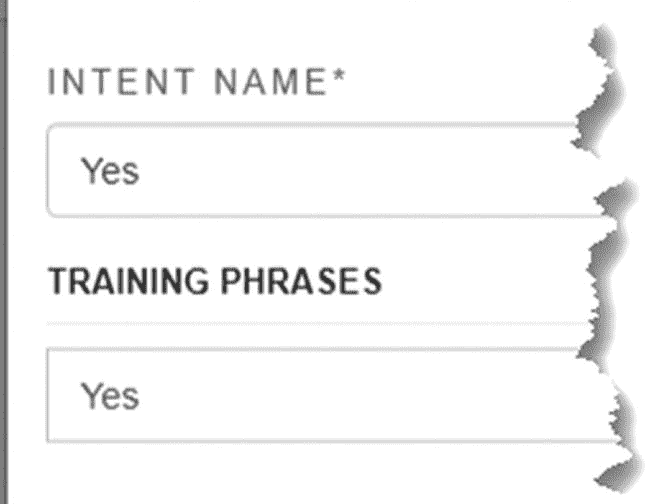

图 8-13 创建“是”意图

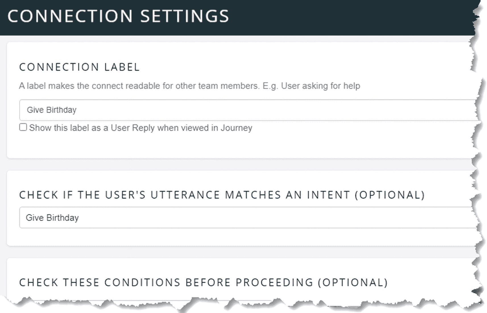

图 8-12 将“提供生日”意图添加到连接线

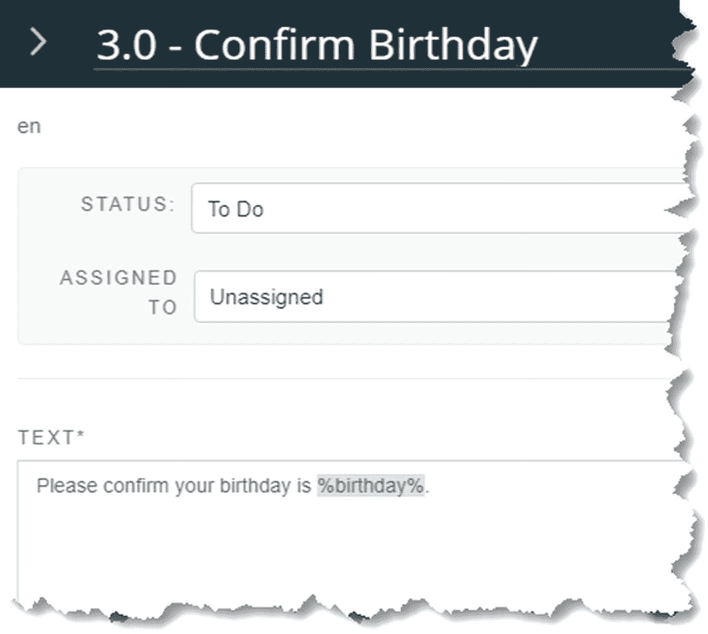

图 8-11 在文本框中添加“确认您的生日”Alexa 响应

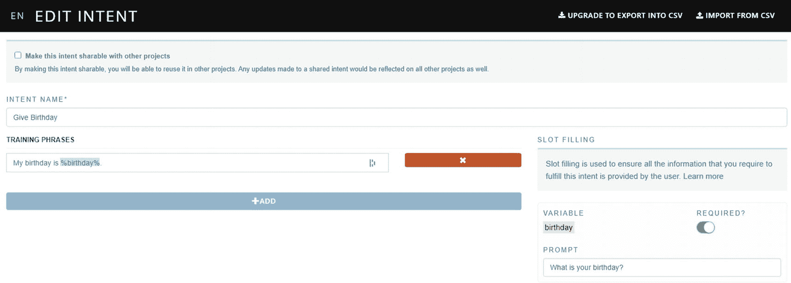

图 8-10 创建“提供生日”意图

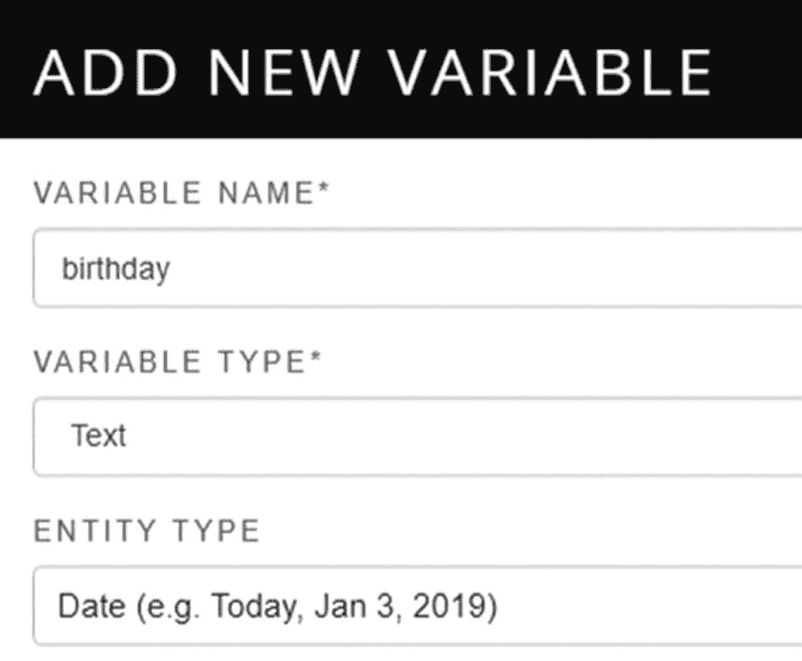

图 8-9 创建生日变量

完成以上所有步骤后，快乐路径现在如图 8-16 所示。

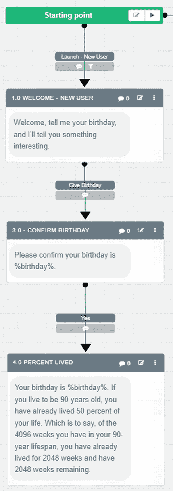

图 8-16 完成的快乐路径

如果用户已经超过 90 岁了呢？如果我们所有的计算都基于最大年龄 90 岁，那事情就会变得复杂。

## 超过 90 岁路径

为了处理超过 90 岁的情况，我们需要将“是”响应拆分为两个。第一个响应位于快乐路径上，标记为“是 – 90 岁以下”。第二个响应则不在此路径上，标记为“是 – 90 岁以上”。要添加此条件，我们需要为用户年龄添加一个变量（见图 8-17）。然后添加一个文本框，用于 Alexa 在用户超过 90 岁时做出响应（见图 8-18）。最后，为“是”路径添加条件：(1) 年龄小于 90 岁，(2) 年龄大于或等于 90 岁（见图 8-19）。

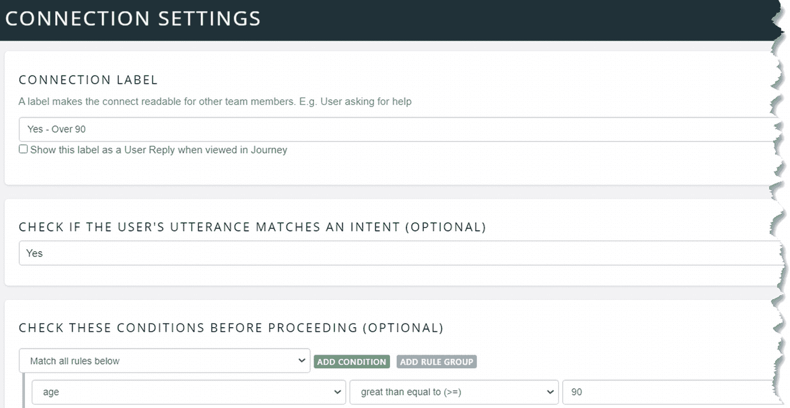

图 8-19 将“是”意图和年龄条件添加到超过 90 岁路径

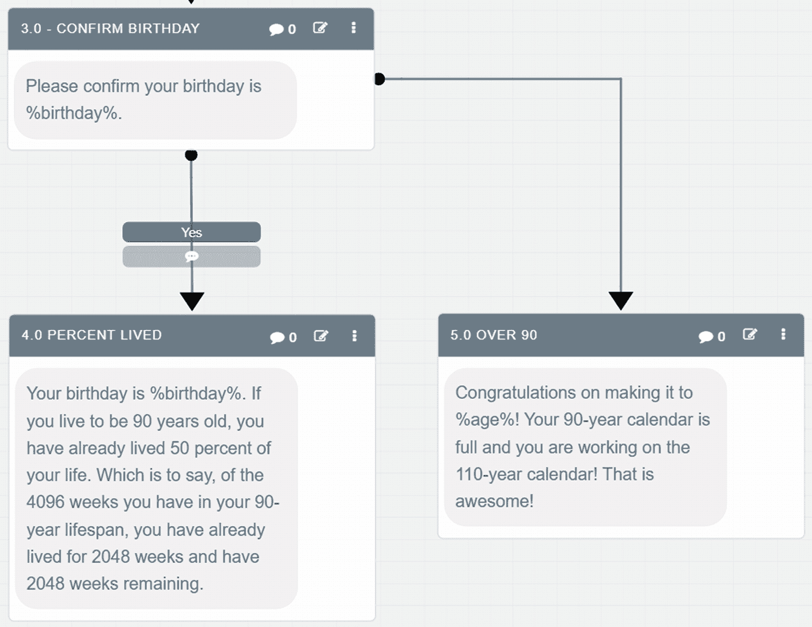

图 8-18 添加“超过 90 岁”文本框

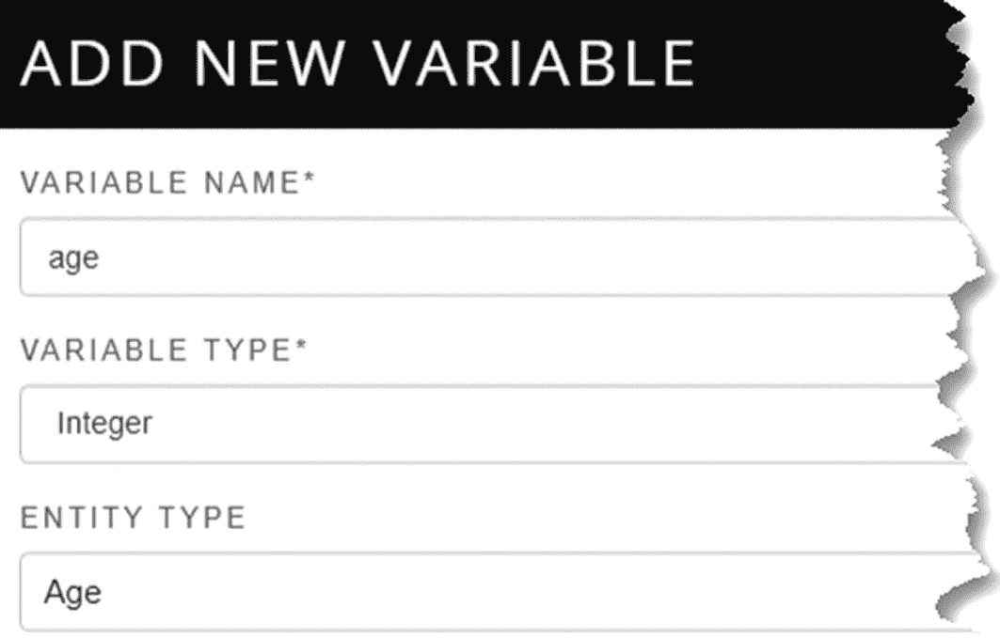

图 8-17 添加年龄变量

现在，图表将如图 8-20 所示。

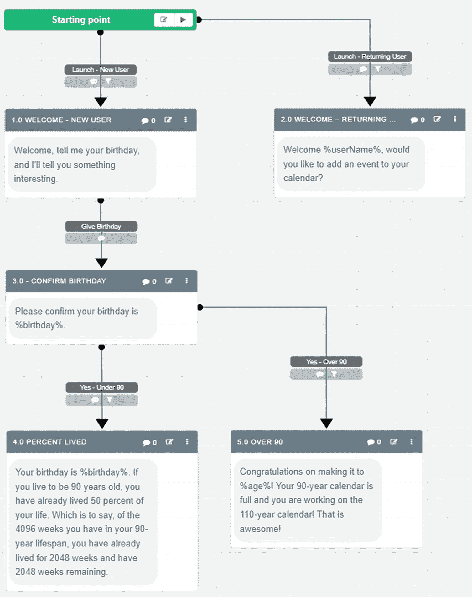

图 8-20 添加了超过 90 岁路径后的完整图表

如果用户未授权，也就是说他们尚未关联账户，那么一旦我们告知他们已活过的百分比，并且如果他们的设备有屏幕，向他们展示了 90 年或 110 年的日历后，技能就会结束。与其直接结束，我们可以提示他们是否想向日历添加项目，如果愿意，则指导他们在 Alexa 应用中关联技能。这个提示听起来比直接结束更好。

## 添加提示

添加一个向日历添加项目的提示，需要编辑图表（图 8-20）中的框 4.0 和框 5.0。在陈述结果之后，我们需要添加一个问题：“您想向日历添加一个事件吗？”如果我们还将框 2.0 下移，最终会得到如图 8-21 所示的图表。

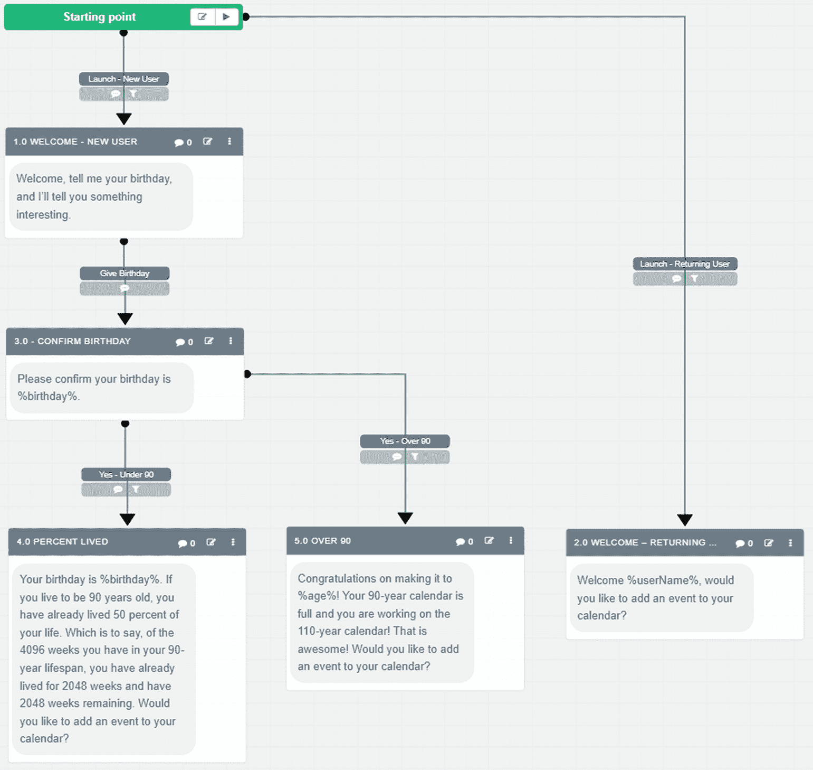

图 8-21 添加了添加事件提示后的修改图表

正如你在图表中看到的，我们现在有一个快乐路径和两个变体。那异常情况呢？我们如何处理错误？我们也需要将其添加到图表中。例如，如果 Alexa 没有正确理解日期怎么办？因此，用户在确认日期时会说“不”。

### 添加“不”意图

如果 Alexa 没有获取到正确的生日，用户在要求确认时会说“不”，Alexa 将不得不重新提示用户输入正确的生日，如图 8-22 所示。这个重新提示框意味着需要添加一个“不”意图，因此在编辑从框 3.0 到框 6.0 的连线之前，请先添加该意图。

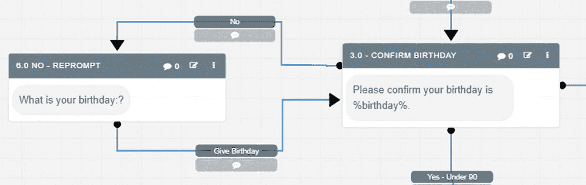

图 8-22 将“不”意图添加到确认框

请记得定期保存你的 BotMock 图表。

现在我们已经获取了用户的生日并绘制了空白日历。并且我们已经进行到询问他们是否想向日历添加事件的步骤。如果他们说不呢？

### 说再见

如果用户不想向新的空白日历添加事件，那么他们使用技能的任务就完成了，我们应该说再见。这需要添加一个新的文本框，让 Alexa 说再见，并在框 4.0 和框 5.0 中两次使用“不”意图，如图 8-23 所示。请注意，“再见”文本框是技能的终点，因此在编辑器中向下滚动，并选择“在此模块结束对话”开关。

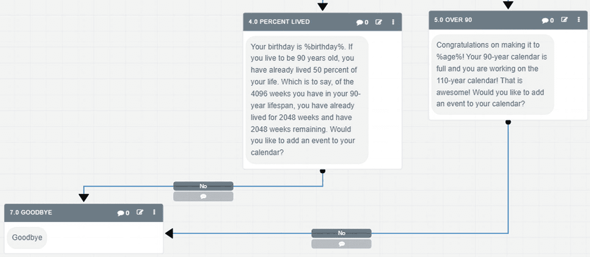

图 8-23 添加“再见”文本框

至于框 2.0，如果我们已经认识该用户，并且他们不想向日历添加事件，这可能会很有趣。他们想做什么呢？

### 你想做什么？

如果用户是回访用户，并且他们不想添加另一个事件，他们想做什么？我们应该让 Alexa 询问他们，并准备好处理许多不同的回答。请参见图 8-24 了解额外的文本框以及“不”意图的另一种用法。

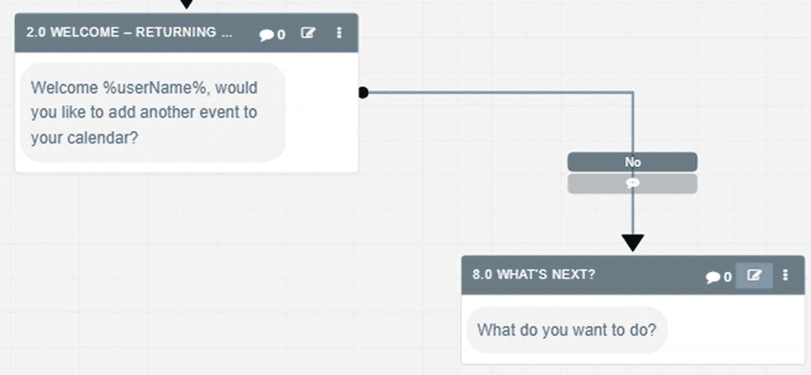

图 8-24 询问用户下一步做什么

我们的对话处理了用户告诉我们他们不想添加事件的情况。现在我们已经准备好添加“是”路径了。但是……

### 已关联账户与未关联账户

是的，用户想要将事件添加到他们的日历中。但是，如果他们的账户未关联，我们如何知道谁在登录，又如何存储这个特定用户的数据呢？因此，对于尚未关联我们技能的用户，我们需要设置一个分流路径。我们先来添加这个功能。我们需要让 Alexa 指示用户关联他们的账户。我们需要知道账户是否已关联，因此需要一个变量来记录。然后，我们可以使用 `Yes` 意图，并基于这个新变量设置一个条件，来重新引导用户，让 Alexa 说出类似这样的话：“您需要关联您的账户才能保存您的生活事件。此项服务不收取任何费用。您的数据经过加密且安全。要关联您的账户，请使用您手机上的 Alexa 应用。” 示例如图 8-25 所示。

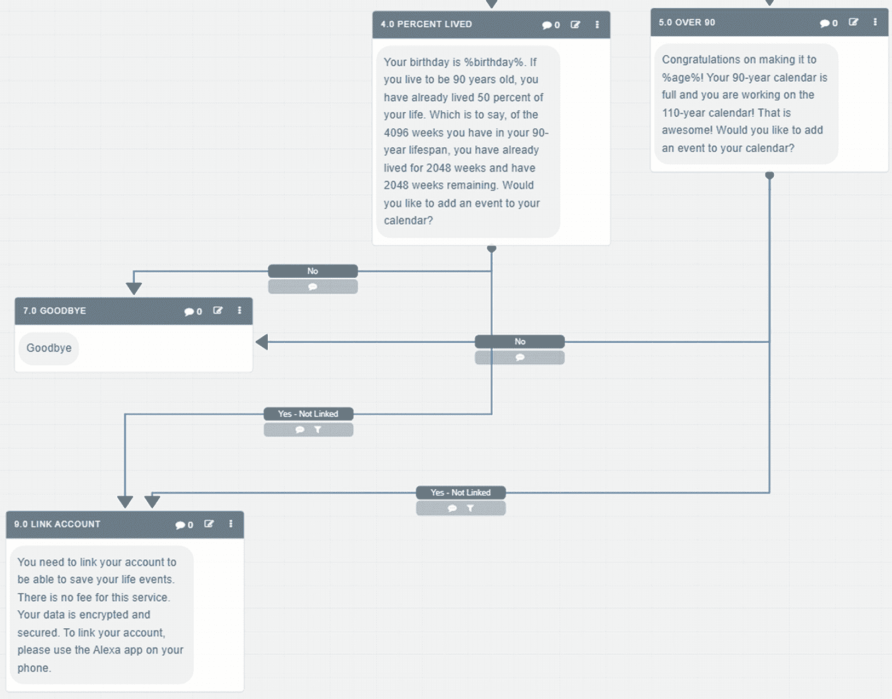

图 8-25 要求用户关联其账户

如果用户返回时账户已关联，我们就可以获取事件信息。

#### 获取事件

现在我们知道用户是谁了，Alexa 需要询问他们事件的详细信息。我们可以使用 `Intent` 模型按顺序执行此操作，或者使用对话的 `Conversations` 模型来更灵活地处理。无论哪种方式，我们都需要向用户询问`事件日期`、`事件类型`和简短的事件描述。`事件类型`将是一个可供选择的简短列表，因此当我们创建变量时，需要为`事件类型`变量添加一个`实体`。这三个变量如图 8-26 所示。

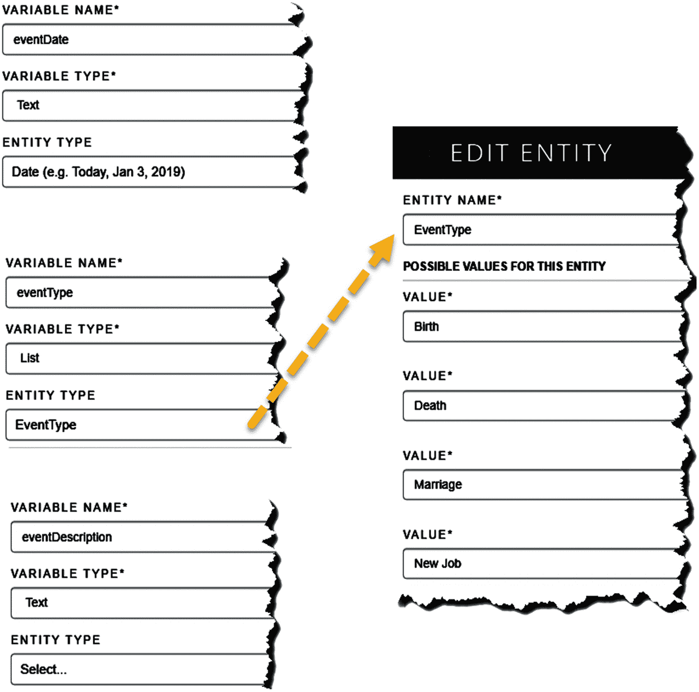
图 8-26
事件变量和 `EventType` 实体

接下来，我们需要添加意图，让用户提供`事件日期`、`类型`和`描述`，如图 8-27 所示。请注意每个意图如何填充一个变量。

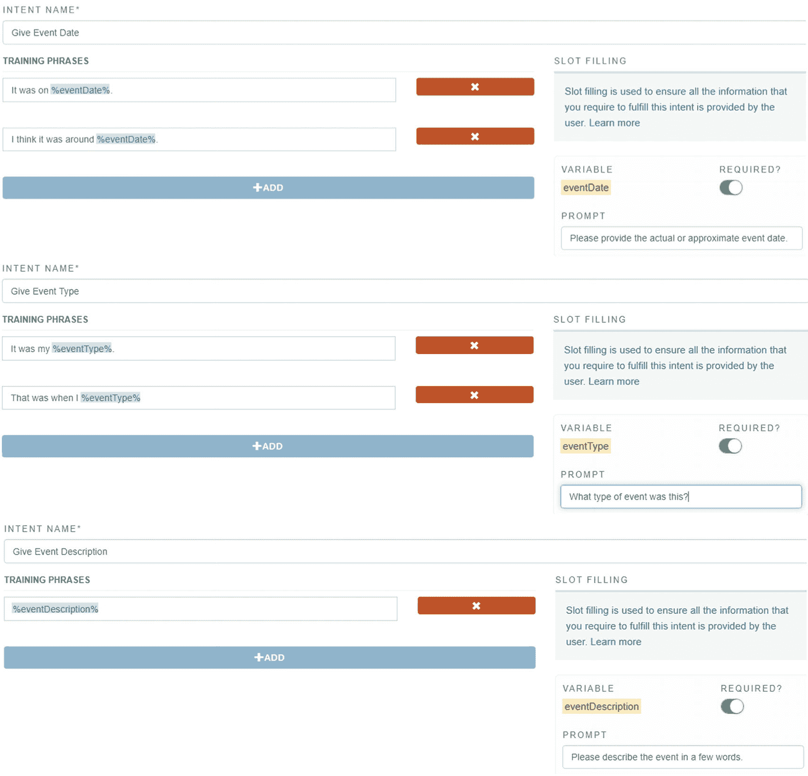
图 8-27
事件意图

现在，我们可以添加事件对话，利用这些意图为我们提供所需的事件数据。一旦用户确认了日期和类型，我们就可以重新绘制日历，并添加新事件。事件对话如图 8-28 所示。

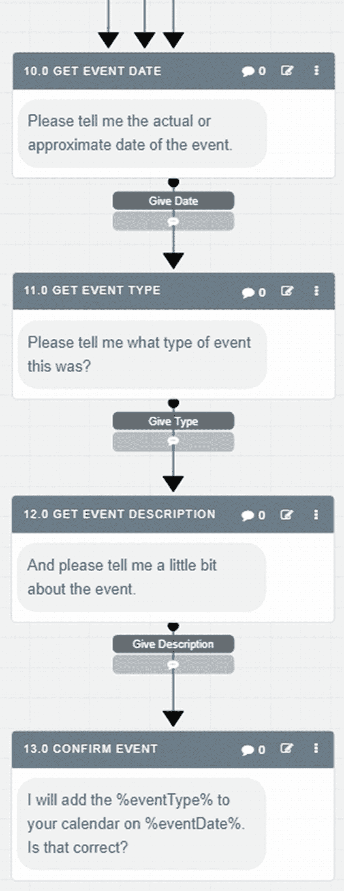
图 8-28
用于捕获我们所需事件详情的基本对话

事件确认后，我们应该询问用户是否要添加另一个事件并捕获该事件。这需要添加框 `14.0 事件已确认`。然后，您可以循环回到框 `10.0` 以获取下一个事件。如果用户说“不”，则跳转到框 `8.0` 并确定用户接下来想做什么。现在我们已经捕获了技能这一部分的理想路径，那么还有哪些其他可能的情况呢？

### 接下来会发生什么？

用户还能用我们的技能做什么？您将如何在对话中体现这一点？回到框 `8.0`，并从那里开始填充对话。（见图 8-29。）

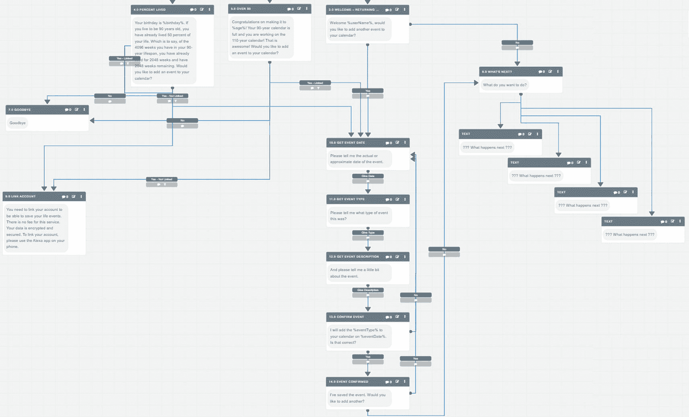
图 8-29
接下来会发生什么？

从框 `8.0` 开始的一些附加功能想法包括：
- 重新绘制日历并添加事件。
- 打印日历。
- 通过电子邮件发送 Excel、PDF 或图片格式的日历。
- 使用 API 帮助用户查找世界事件。

Botmock 的功能远不止于此。我们需要重新审视我们所有的意图，并添加更多的训练短语。例如，`GiveBirthday` 意图应该被训练以接受：

- `我的生日是 %birthday%。`
- `我的生日是 %birthday%。`
- `我的出生日期是 %birthday%。`
- `我的出生日期是 %birthday%。`
- `我出生于 %birthday%。`
- `%birthday%。`

以及您能想到的任何其他变体。

在 Botmock 中，您可以在对话中设置旅程（或路径）。（见图 8-30。）这些路径帮助您可视化用户可以通过对话采取的各种路径。您还可以交互式地运行对话并查看其流程。您可以邀请审阅者检查您的对话并发表评论。您也可以为您的流程设置用户测试。

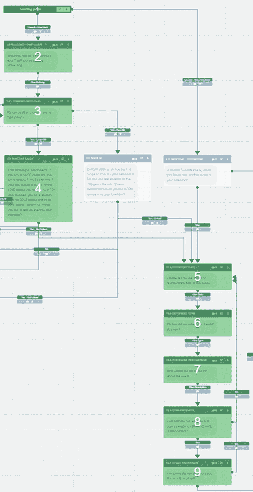
图 8-30
我们对话中的理想路径旅程

您可以导出您的对话模型并将其导入另一个名为 Botium ([`https://botium.ai`](https://botium.ai)) 的工具。Botium 是一个自动化对话测试工具，它会接收您的 Botmock 对话并将其分解为一组测试脚本，这些脚本可以作为自动化构建的一部分运行。

要从 Botmock 导出，请查看 GitHub 上的这个项目：[`https://github.com/Botmock/botmock-dialogflow-export`](https://github.com/Botmock/botmock-dialogflow-export)

要导入到 Botium，请查看 GitHub 上的这个项目：[`https://github.com/codeforequity-at/botium-exporter-botmock`](https://github.com/codeforequity-at/botium-exporter-botmock)

最后，您可以使用 GitHub 上的这个项目将您的对话导出为 Alexa Skills Kit 格式：[`https://github.com/Botmock/botmock-skills-kit-export`](https://github.com/Botmock/botmock-skills-kit-export)

### 总结

本章超越了典型的 Hello World 示例，为一个 90 年日历技能设计了对话。我们学习了意图、变量/槽位以及实体类型/列表。我们学习了如何使用 Botmock 来导航和记录一个包含多条路径和大量选项的复杂对话模型。在下一章中，我们将创建我们的新技能并配置 VUI。
