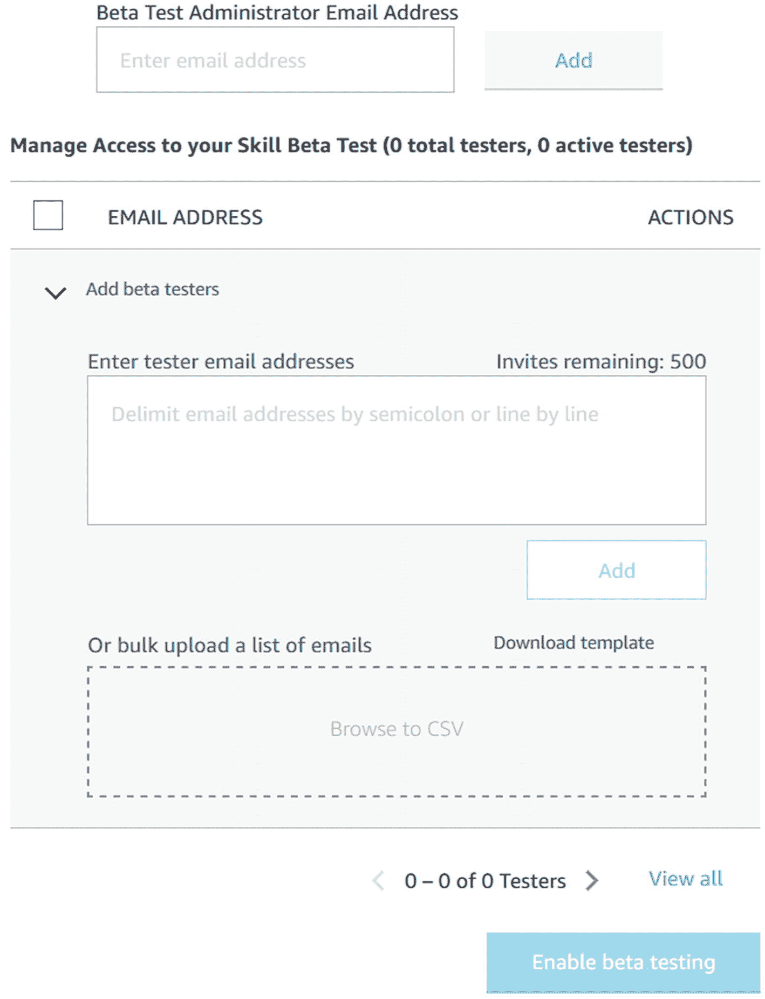
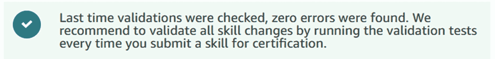

# 18. 安全策略 – 语音验证码
某些类型的技能，包括金融技能和允许超过 100 美元购买的技能，必须让客户有机会设置语音验证码（`https://developer.amazon.com/en-US/docs/alexa/custom-skills/security-testing-for-an-alexa-skill.html#voice-code-requirements`）。

即使您的技能满足所有这些策略要求，认证团队仍可能拒绝它。如果发生这种情况，他们会告诉您原因。进行必要的更正并重新提交，或者对他们的决定提出申诉，请求他们重新考虑。大多数技能在成功提交之前至少会被拒绝一次，但这通常不是因为违反策略。更常见的原因是测试失败。

## 为认证测试您的自定义技能
您的技能在获得认证团队批准之前，将经历多轮测试。大多数测试将集中在您在测试说明中输入的数据上。您可以通过执行以下操作来帮助确保您的技能通过这些测试：

1. 检查并测试您的三个示例语句。在“技能预览”页面，您必须提供三个示例语句，如本章前面所述。确保这些语句有效。
2. 确保您的技能描述和详细信息页面准确无误。测试人员会将这些内容作为指导，并验证技能描述和详细信息页面中隐含的所有功能。
3. 确保所有视觉响应（卡片、流式输出或 Alexa 演示语言 (APL) 输出）按预期工作。
4. 确保您的技能中没有损坏的链接。确保所有外部链接都能正常工作。
5. 为任何使用账户关联的技能提供链接到您开发者账户的测试凭据。
6. 确保您的账户关联技能能够正常启用、关联、取消关联和禁用。
7. 确保音频响应（流式输出或用于音频的 Alexa 演示语言 (APLA) 输出）按预期工作。
8. 如果您的技能提供可视化界面，请确保它在所有相关设备上正确显示，并且屏幕导航选项按预期工作。
9. 确保您在技能中集成的任何 API 按预期工作。
10. 不要在技能描述中声明您的技能是测试版或试用版技能。这样无法通过认证。只有正式版技能才能通过认证。
11. 检查您的意图、表述和槽位，确保它们正确、完整，并遵循语音设计最佳实践。
12. 您必须通过语音交互来测试您的技能，而不仅仅是在模拟器中输入。
13. 测试您的 VUI，确保流程顺畅且会话管理良好。确保意图和槽位协同工作正确、听起来自然，并遵循 Alexa 设计指南的建议（`https://developer.amazon.com/en-US/docs/alexa/alexa-design/get-started.html`）。确保当用户未填写所有槽位时，您的技能能提供支持性提示。
14. 如果您提供一次性体验，请确保其正常工作并按预期结束会话。
15. 确保多种表述都能正确触发您的技能。
16. 确保您能优雅地处理错误。
17. 您的技能必须提供一个帮助意图。
18. 当客户要求时，您的技能必须能够停止、取消和结束。

呼。策略和测试真不少。不过别担心。如果您的技能合理、礼貌、友好且优质，它很可能会通过策略要求；如果它能正常工作，也应该能通过测试要求。在本书后面，我们将深入讨论 VUI 设计。我们还将学习几种不同的功能测试技术，以确保技能按预期工作。

现在，我们准备进入“技能预览”页面的下一页：“可用性”。

### 可用性
您的技能一旦进入技能商店，就可以向公众开放。如果您创建的是 Alexa for Business 技能，您可以选择将技能发布到特定的商业组织。

如果您想对技能进行 Beta 测试，即将其发布到技能商店，但访问权限仅限于通过电子邮件地址指定的特定用户，您可以输入他们的电子邮件地址。（见图 6-6。）Beta 测试模式的优势在于，即使技能已在技能商店中，您仍可以继续开发它。您最多可以添加 500 名 Beta 测试人员。

图 6-6：为您的技能添加 Beta 测试人员

如果您希望您的英语（美国）技能在其他英语国家可用，您可以选择自动区域分发。这也适用于其他语言。

最后，您需要选择您的技能在哪些国家可用——是所有国家，还是仅限特定国家。

至此，您已完成预提交流程。现在，您可以进入“验证与提交”环节。

### 验证
在“验证”屏幕上，单击 `运行` 按钮，运行一系列自动化测试来验证您的技能。根据技能的复杂程度，这可能需要一些时间。如果一切顺利，您将看到一个绿色的勾选标记，如图 6-7 所示。

图 6-7：您的技能已通过验证

趁一切还没变化，赶紧点击左侧的“提交”选项卡。

### 提交
提交过程的最终决定摆在您面前。您是选择认证并发布您的技能到 Alexa 技能商店，还是费了这么大劲只是为了认证技能以便日后发布？您可能需要配合营销活动来安排发布，在这种情况下，您只需认证技能即可。所以，请仔细考虑。做出选择。然后点击那个大大的蓝色 `提交审核` 按钮（图 6-8）！

图 6-8：来吧，点击它。你知道你想点 

既然您已经提交了技能进行审核，您可以放松几天，等待认证团队完成他们的工作。然后，如果您的技能通过了认证，您就需要着手撰写营销活动方案了。否则，您会收到一封电子邮件，说明您的技能未通过的原因。

### 被拒？接下来怎么办？
如果你的技能第一次未能通过认证（这很常见），首先要做的是阅读解释未通过原因的邮件。这看似显而易见，但你会惊讶地发现，有多少开发者会直接开始重写技能。大多数拒绝原因是违反政策，而非编码错误。

大多数情况下，如果你不理解违规原因，可以通过“联系我们”页面（`https://developer.amazon.com/support/contact-us`）提交工单。收到工单编号后，你可以在“分发”选项卡的“技能预览”页面的“测试说明”框中引用该工单及其中提出的问题。

Alexa 团队整理了一个网页，详细列出了认证失败的常见原因（`https://developer.amazon.com/en-US/docs/alexa/custom-skills/troubleshooting-common-certification-failures.html`）。你可以浏览此列表，获取常见失败的更多细节和示例。以下列出其中一部分。

以下是认证失败的一些常见原因。这些原因按常见问题领域分组。

#### 技能描述问题
- 技能的详细描述应包含使用该技能所需的所有信息。
- 技能描述中描述的功能应在技能中存在并按描述正常工作。
- 描述中的任何示例语句应能完全按照书面形式在技能中正常工作。

#### 示例语句问题
- 确保技能预览中的三个示例语句按预期工作。它们不应抛出错误，应提供相关且正确的响应。
- 不要在示例语句中使用特殊字符、数字或日期。请拼写出来。例如，如果示例语句使用了日期，请完整写出：January first, nineteen-eighty（一月一日，一九八零年）。
- 示例语句必须作为语句存在于技能定义中。
- 示例语句隐含的一次性语句也应能正常工作。例如，示例语句说：“Six foot two and three hundred pounds（六英尺二英寸，三百磅）。”这暗示用户可以这样说：“Alexa，启动我的 b.m.i. 计算器，告诉它我六英尺二英寸，三百磅。”Alexa 应响应此一次性语句：“您的 b.m.i. 是 38.5。”
- 如果词语稍有变化，示例语句也应能正常工作。例如，示例“Six foot two and three hundred pounds”应按所示方式工作。但“I am six foot two and weigh three hundred pounds（我六英尺二英寸，重三百磅）”也应如此。“I am six foot two inches tall, and I weigh three hundred pounds（我六英尺二英寸高，体重三百磅）”也应如此。
- 语句在您的技能中应是唯一的，以防止两个意图冲突。
- 语句应使用正确的语言。例如，如果您的技能支持美式英语和美式西班牙语，请确保英语语句在英语区域设置中，西班牙语语句在西班牙语区域设置中。

#### 技能会话状态问题
- 确保在能直观显示麦克风状态的设备上测试您的技能（例如您的智能手机、Amazon Echo 或 Echo Show）。如果蓝灯亮起，表示 Alexa 正在监听。如果 Alexa 正在监听，她应该刚刚问了一个问题或给出了一个提示，期望用户做出回应。
- 如果您的技能是一次性技能，请确保在 Alexa 响应后结束会话。例如：
  用户说：“Alexa，我的 b.m.i. 是多少？”
  Alexa 说：“您的身高和体重是多少？” – 蓝灯亮起，Alexa 正在监听。
  用户说：“六英尺二英寸，三百磅。”
  Alexa 说：“您的 b.m.i. 是 38.5。” – 蓝灯应在会话结束时熄灭。如果蓝灯保持亮起，表示 Alexa 正在等待用户响应，您的技能将无法通过认证。请确保正确结束会话。

一旦解决了导致技能认证失败的问题，请务必更新“分发”选项卡中“技能预览”的文档，尤其注意“测试技能”框。不要犹豫，向测试人员添加注释来解释您技能的行为。您也可以通过“联系我们”页面向他们发送消息，进一步解释您的技能。准备好后，重新提交技能进行认证。重复此过程，直到技能通过。有时，由于错误或拒绝原因可能显得晦涩难懂，这会令人沮丧。我曾见过一个向玩家出售宇宙飞船的游戏技能反复被拒，因为它没有实现应用内购买来支付飞船费用。有时，您需要反复解释自己，直到通过流程。很快，您就能通过流程，您的技能将在 Alexa 技能商店上线。

### 总结
在本章中，您发布了您的技能！

哇哦，太棒了！给自己来个全方位的击掌庆祝吧。

我们填写了分发表格，提供了通过认证所需的信息。我们检查了认证清单。我们甚至回顾了 Alexa 政策以及一些认证测试建议。我们介绍了提交过程中可能遇到的情况以及如何处理拒绝。

本书第一部分到此结束。我们从零开始创建了一个 Alexa 技能，并经历了从 VUI 开发到发布的整个数据驱动技能构建过程。在第二部分中，我们将更深入地逐步探讨每个步骤。