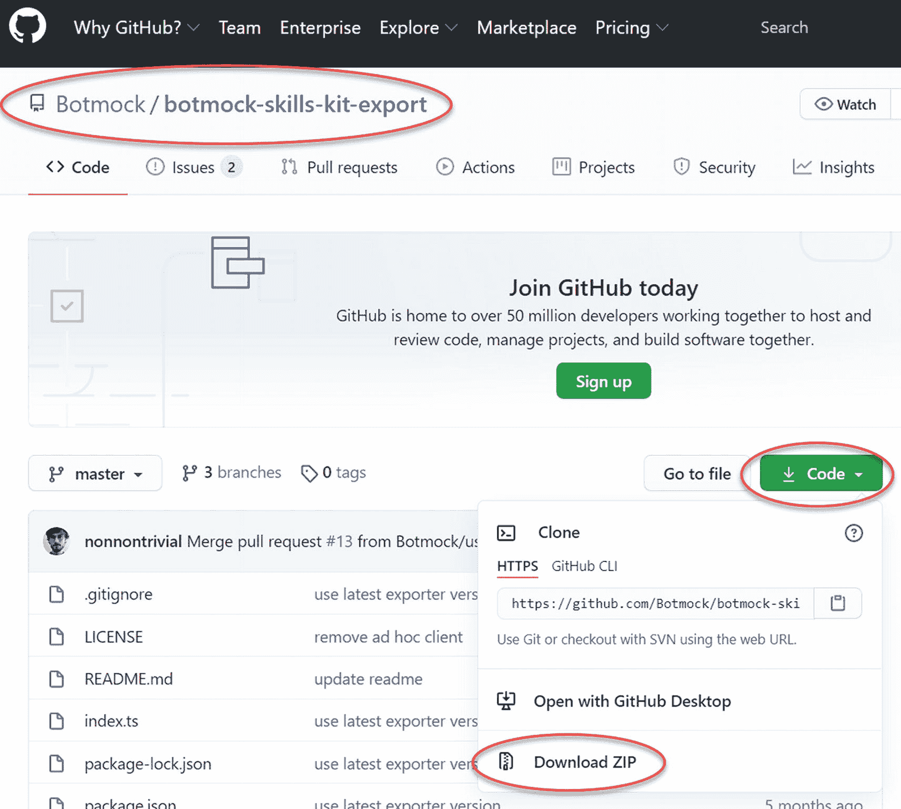
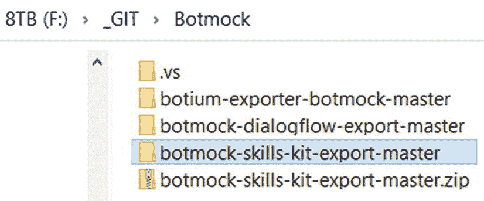
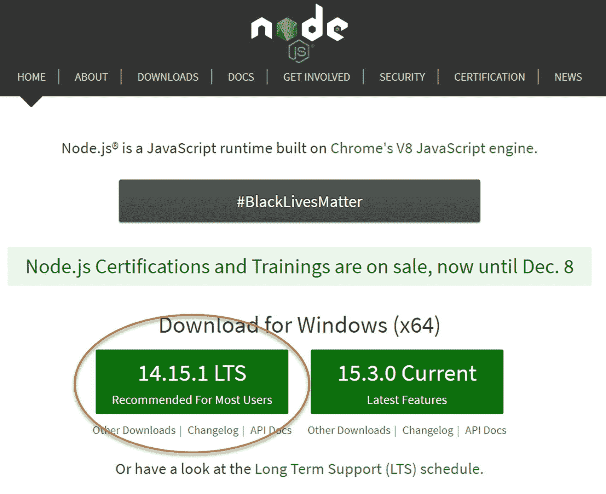
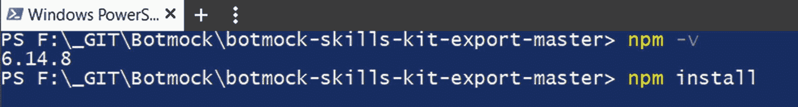
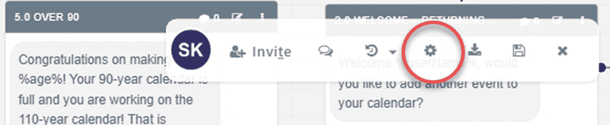
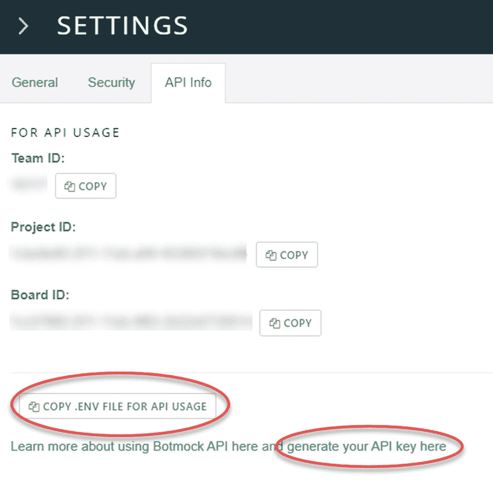
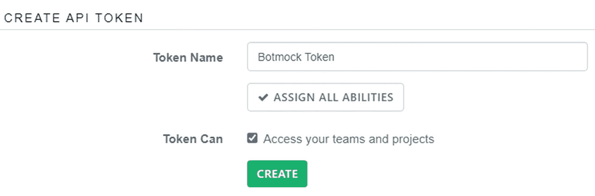
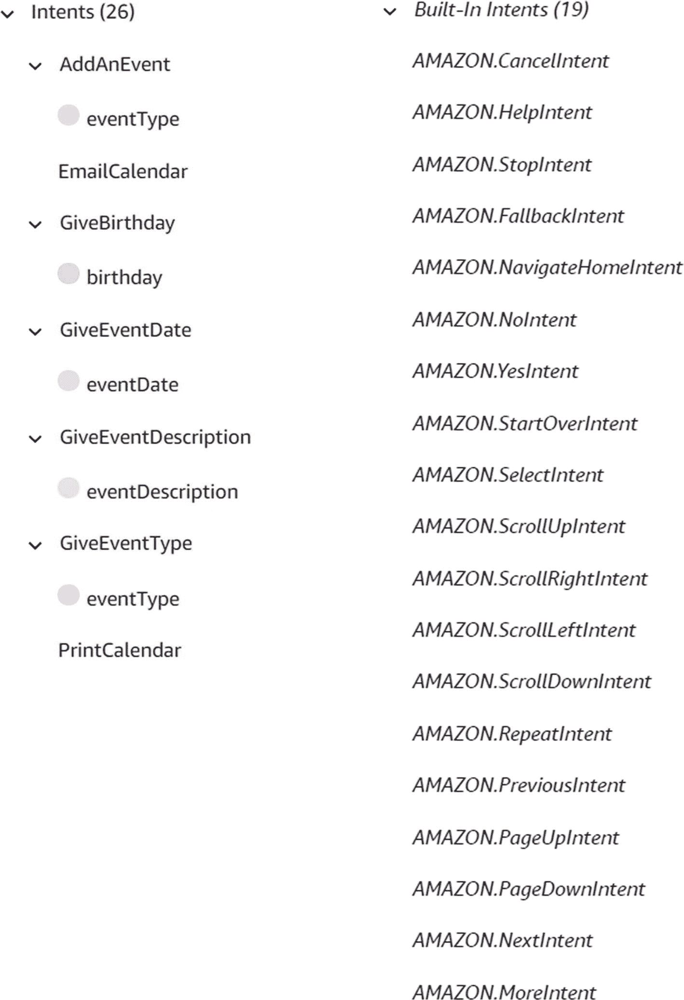

## 9. 配置 VUI

在第 8 章中，我们在 Botmock 中为我们的 90 年日历技能创建了一个对话流程图。现在，我们将把这个流程图转换为 Alexa 技能中的语音用户界面。在本章中，我们将根据该图创建意图、槽位和响应。在本节的第一部分，我们将把 Botmock 图转换为 Alexa 技能。

### 导出 Botmock 图表

要导出 Botmock 图表，我们需要下载并组装一个工具，该工具使用 Botmock API 将图表导出为 Alexa Skills Kit (ASK) 可用于构建技能的格式。我们首先从 GitHub 获取代码。

图 9-1
从 GitHub 下载 Skills Kit 导出工具

1. 在浏览器中导航至 [`https://github.com/Botmock/botmock-skills-kit-export`](https://github.com/Botmock/botmock-skills-kit-export)。
2. 点击绿色的 Code 按钮，选择最后一个选项 Download ZIP。（见图 9-1。）

图 9-2
解压后的 `botmock-skills-kit-export-master` 文件夹

3. 下载完成后，将文件移动到编码目录中的一个新文件夹中并解压。这将创建一个名为 `botmock-skills-kit-export-master` 的文件夹。（见图 9-2。）

图 9-3
下载 Node.js 安装程序

4. 从该文件夹打开命令行。为此，请按住 Shift 键并右键单击该文件夹，然后选择 a) 在此处打开命令窗口，b) 在此处打开 PowerShell 窗口，或 c) 在此处打开 Git Bash。
5. 在命令行中输入 `npm -v`。这将报告您已安装的 npm 版本。如果收到错误消息，则需要安装 npm。如果版本低于 6.14.x，则需要安装最新版本的 npm。
6. npm 随 Node.js 一起安装。要安装 Node.js，请从 [`https://nodejs.org/`](https://nodejs.org/) 下载安装程序。您很可能需要安装 LTS（长期支持）版本。示例见图 9-3。

图 9-4
运行 `npm install`

7. 安装 Node.js 后，npm 也会被安装。
8. 在命令行中运行 `npm install`。（见图 9-4。）

图 9-5
在 Botmock 中访问设置菜单

9. npm 将下载并安装运行导出所需的 npm 包。
10. 在 `npm install` 之后，最好运行 `npm audit fix`。
11. 仍在命令行中，运行 `mv ./sample.env ./.env`。
12. 在 Notepad++ 中编辑 `.env` 文件。
13. 切换到浏览器，打开您的 Botmock 项目，点击齿轮图标进入设置。（见图 9-5。）

图 9-6
从 Botmock 获取 API 信息

14. 点击 API Info 选项卡，然后点击 *Copy .env file for API usage*。（见图 9-6。）
15. 将其粘贴到 Notepad++ 的 `.env` 文件中，覆盖已有的文本。
16. 切换回 Botmock，点击 *generate your API key here* 链接。（同样见图 9-6。）

图 9-7
创建 API 令牌

17. 在 *Create API Token* 屏幕上，输入一个 *Token Name*，例如 `Botmock Token`。
18. 勾选 *Access your Teams and Projects* 复选框。
19. 点击 *Create*。（见图 9-7。）
20. 现在点击 *Copy to Clipboard* 按钮。
21. 将整个令牌粘贴到 Notepad++ 中 `.env` 文件的双引号之间。
22. 此时我本可以向你展示 `.env` 文件，但那样我就得用特工 K 的闪光装置抹去你对这件事的记忆。
23. 另外，我还需要提醒你此时保存工作吗？

下载了导出工具、安装了 npm 包并配置了 `.env` 文件后，你就可以运行导出了。

24. 在命令行中运行 `npm start`。这将创建一个包含 `90-Year Calendar.json` 文件的 `output` 文件夹。

至此，我们已经导出了对话文件。在下一节中，我们将使用该文件来创建技能的基本框架。

### 创建技能

要从导出的 Botmock 文件创建技能，我们需要启动 Alexa 开发者控制台。然后我们可以打开在第 7 章中创建的自定义技能。接着，我们将放入来自 Botmock 的 JSON，并花一些时间调整结果。

首先，打开浏览器访问 [`https://developer.amazon.com/alexa/console/ask`](https://developer.amazon.com/alexa/console/ask)。然后点击我们在第 7 章中创建的 90 年日历技能。

现在我们可以使用 Botmock 文件为我们的技能创建初始模型。尽管之后我们还需要调整和修改模型，但这将为我们节省大量时间。展开左侧导航栏中的交互模型。然后按照以下说明操作：

1. 点击 *JSON Editor*。
2. 点击 *Drag and drop a .json file*。
3. 找到并选择来自 Botmock 的 `90-Year Calendar.json` 文件。
4. 点击顶部的 *Save Model* 按钮。
5. 现在点击顶部的 *Build Model* 按钮。

查看所有错误。这些是 Botmock 模型与 Alexa 模型不完全匹配的地方。幸运的是，通过编辑意图并确保槽位正确定义，这些错误相对容易修复。无需编辑 JSON，我们可以通过 Alexa 开发者控制台修复这些问题，如下一节所述。

### 清理对话模型

从 Botmock 导入模型后，我们需要做一些修正。在此之前，你需要做出一个选择：是否使用下划线，这是个问题。也就是说，你希望在意图名称中使用下划线，还是移除空格改用驼峰式命名？我个人偏好驼峰式。但 `Under_Score` 也完全没问题。现在做出选择，但请保持一致性。

首先选择 `GiveBirthday` 意图。

1. 将意图名称从 `Give Birthday` 重命名为 `GiveBirthday`，或者如果你更喜欢，也可以改为 `Give_Birthday`。
2. 然后向下滚动到“意图槽位”，在名称栏中输入 `birthday`，并点击 `+按钮` 添加它。现在选择 `AMAZON.Date` 作为槽位类型。

选择 `Give Event Date` 意图并进行相同的修正。

3. 重命名该意图。
4. 添加 `eventDate` 槽位，并选择 `AMAZON.Date` 作为槽位类型。

选择 `Give Event Description` 意图并进行修正。

5. 重命名该意图。
6. 添加 `eventDescription` 槽位，并选择 `AMAZON.SearchQuery` 作为槽位类型。（`AMAZON.SearchQuery` 允许用户说出一个简短短语，我们可以将其捕获为事件描述。）

选择 `Give Event Type` 意图并进行修正。注意：槽位类型无需修正，因为 Botmock 模型已经为 `eventType` 设置了槽位类型。

7. 重命名该意图。

分别重命名 `EmailCalendar`、`AddEvent` 和 `PrintCalendar` 这三个意图。

接下来，我们需要删除 `LaunchIntent`。`LaunchIntent` 只需被删除，因为它实际上不是一个意图，而是调用短语。点击左侧导航栏中的 `Intents` 标题。找到 `LaunchIntent`，点击其右侧的 `Delete` 按钮。确认警告信息。

接下来，我们需要将 `Yes` 和 `No` 意图从自定义意图转换为内置意图。我们可以通过将 `AMAZON.YesIntent` 和 `AMAZON.NoIntent` 添加到意图列表中，并删除已有的 `Yes` 和 `No` 意图来实现。

此外，我们还应该添加一些其他内置意图来更好地控制技能。具体来说，添加 `AMAZON.RepeatIntent`、`AMAZON.StartOverIntent` 和 `AMAZON.StopIntent`。

最后，由于我们将管理一个事件列表，因此需要添加 `AMAZON.MoreIntent`、`AMAZON.NextIntent`、`AMAZON.PageDownIntent`、`AMAZON.PageUpIntent`、`AMAZON.PreviousIntent`、四个 `AMAZON.Scroll*Intents` 以及 `AMAZON.SelectIntent`。

当你完成内置意图的添加后，你的意图列表应如图 9-8 所示。

图 9-8
我们将进行编码的自定义意图和内置意图

现在我们已经设置好了意图，下一章将为带屏幕的 Alexa 设备创建可视化界面。

### 本章小结

在本章中，我们将 Botmock 图表转换为 Alexa 技能并配置了 VUI。在下一章中，我们将使用 Alexa 演示语言（APL）为带屏幕的 Alexa 设备创建可视化演示。
