# 第二部分 自定义技能开发

## 7. 自定义 Alexa 技能

既然您已经发布了第一个 Alexa 技能，让我们重新审视各个步骤，并更深入地了解每一个。在第一部分中，您创建了一个 Alexa 技能，从 VUI 开发到后端代码，再到在 Alexa 技能商店发布。在第二部分中，我们将开发另一个技能，并学习如何使用 Alexa 平台的一些更高级功能。

### Alexa 托管技能与完全自定义技能

在第一部分中，BMI 计算器是一个 Alexa 托管技能。这意味着前端、后端以及两者之间的所有内容都托管在 Alexa 平台内。特别是，后端代码托管在 Alexa 中，因此我们必须进入 Alexa 界面的“代码”选项卡来输入技能的代码。（见图 7-1。）

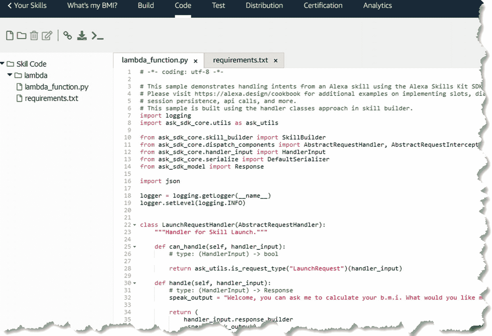
图 7-1 编辑 Alexa 托管技能的代码

在本节中，我们将创建一个完全自定义的技能，其代码和所有使用的资源都托管在亚马逊云服务（AWS）上，而不是在 Alexa 平台内。Alexa 托管技能更容易构建，但 Alexa 平台会施加一些限制。您可能需要迁移到 AWS 来实现技能所需的功能，对于媒体和数据存储尤其如此。在我们的新技能中，这两者都会用到，因此在这种情况下迁移到 AWS 是合理的。但我们的新技能是什么呢？

### 我们的新技能

几个月前，我在车里收听美国国家公共广播电台的 TED 广播时间节目。我不记得当时是谁在发言，但那是一个回顾节目，他们谈论系列节目中的亮点，包括对评论员意义重大的演讲。其中一位评论员提到，一位 TED 演讲者（我想应该称他为 TED 讲者）在演讲结尾不经意提出的一个想法让他们深受触动。经过一番搜索，我发现那位演讲者是蒂姆·厄本，演讲主题是关于拖延症的^(¹⁷)。他提出的想法是一张 90 年日历，蒂姆称之为“人生日历”，用一个小方格代表 90 年寿命中的每一周。起初，你可能会觉得有很多方格。但如果你已经 21 岁，那么你已经划掉了 1092 个小方格。原本总共只有 4680 个方格。在 21 岁时，你已经完成了 23%！

蒂姆·厄本的人生日历改变了我的生活。

### 90 年日历

我一回到家，就打开 Excel 制作了自己的 90 年日历。在划掉超过一半的方格后，我震惊于剩下的方格如此之少，并开始思考自己用那些划掉的方格换来了什么。我看到的画面是这样的（见图 7-2）。


图 7-2 一张 90 年人生日历

但这还没完。我为家里的每个人都制作了 90 年人生日历。然后，我用自己人生中的一些重要事件“增强”了我的日历。最终效果类似于图 7-3。

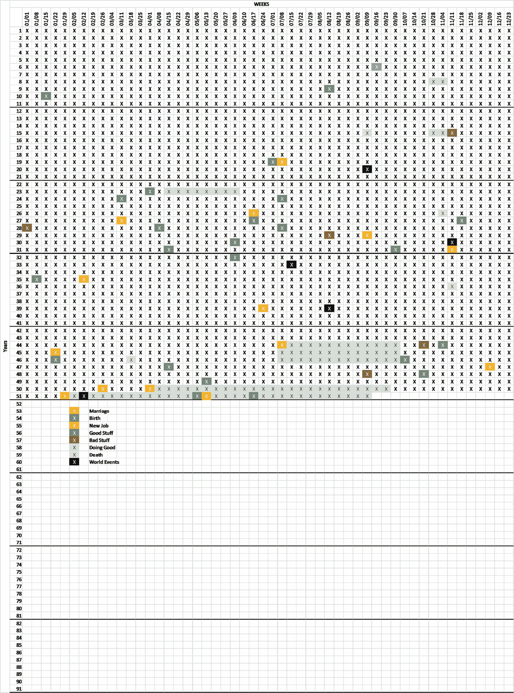
图 7-3 一张增强版 90 年人生日历

在接下来的几章中，我们将把这个增强版 90 年人生日历构建成一个 Alexa 技能。通过这个练习，我们将更深入地了解 Alexa 开发流程，并使用许多高级功能，包括：
* 语音用户界面设计
* Alexa 交互模型——意图、槽位、语句
* Alexa 对话与委派
* 使用 Alexa 演示语言在带屏幕的设备上绘制 90 年日历
* 使用 Alexa 音频演示语言通过音效增强我们的技能
* 使用 `DynamoDb` 持久化存储来安全地保存你的人生事件
* 使用 `S3` 存储来安全地链接你人生事件的图片
* 账户关联，以便安全地收集你的人生事件
* 一个 `Lambda` 函数——我们技能的大脑

在本章中，我们将创建构成一个完全自定义技能所需的账户和 AWS 服务。在接下来的章节中，我们将使用这些 AWS 服务来实现我们技能的各项功能。

### VUI 设计

我们将使用的第一个工具是 Botmock，一个 VUI 设计工具。在设计对话界面时，我们很容易想到使用 Word、Excel 和 PowerPoint，因为这些是我们最熟悉的工具。然而，这些工具都很难很好地呈现 VUI。即使是 Visio 和 Lucidchart 这样的高级工具，也不适合映射语音体验，而这正是 Botmock 和 Voiceflow 这类工具的用武之地。在本练习中，我们将使用 Botmock，因此你需要注册他们的免费账户。

1. 首先，访问[`www.botmock.com`](https://www.botmock.com)。
2. 然后点击*免费试用*。
3. 输入所需信息并点击*注册*。

登录后，你将处于免费层级，该层级允许你创建最多两个项目。在下一章中，我们将为 90 年日历创建一个项目，并学习如何使用 Botmock 设计我们的语音体验。接下来，我们将登录 Alexa 控制台并创建一个技能。

### 创建 Alexa 技能

我们需要创建一个自定义 Alexa 技能并开启若干功能。这就是我们接下来要做的事情。打开 Alexa 开发者控制台（[`https://developer.amazon.com/alexa/console/ask`](https://developer.amazon.com/alexa/console/ask)）。然后按照以下步骤操作：

1. 点击*创建技能*。
2. 输入技能名称：**90 年日历**。
3. 在选择模型时，选择自定义技能。
4. 在选择托管技能后端资源的方法时，选择自行配置。
5. 然后点击右上角的*创建技能*。
6. 在选择模板时：选择**从零开始**。
7. 然后点击右上角的*选择*。

控制台将创建一个带有 `Hello World` 意图的简单技能。接下来，我们将进行一些配置更改，然后在第 9 章中再回到交互模型。

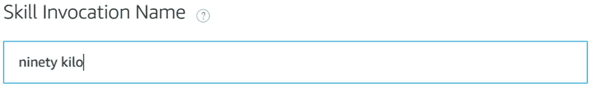
图 7-4 选择一个简单易用的调用名称

1. 点击左侧导航栏中的*调用*。
2. 将*技能调用名称*改为易于输入和发音的名称。在调试过程中，你会频繁说出和输入这个名称。在创建过程接近尾声时，你可以将其改为更合适的名称，比如“九十年日历”。现在，先使用像**ninety kilo**这样的名称——两个单词，易于输入（90 kilo 这几个键都集中在一起），易于发音，也易于记忆。（见图 7-4。）
3. 点击顶部的*保存模型*。
4. 在左侧导航栏中，选择*接口*。
5. 向下滚动到 Alexa 演示语言，并将其切换为**开启**状态。
6. 确保所有集线器和电视都被选中。
7. 向下滚动到 Alexa 对话并选择它。
8. 不要使用 Alexa 对话作为默认对话管理器。
9. 滚动回顶部并点击*保存接口*。

现在我们已经为技能创建了骨架。

我们需要导航回技能列表（[`https://developer.amazon.com/alexa/console/ask`](https://developer.amazon.com/alexa/console/ask)）。在技能列表中，选择*复制技能 ID*（见图 7-5）并将其粘贴到 Notepad++中。稍后我们会在安全配置文件中用到它。

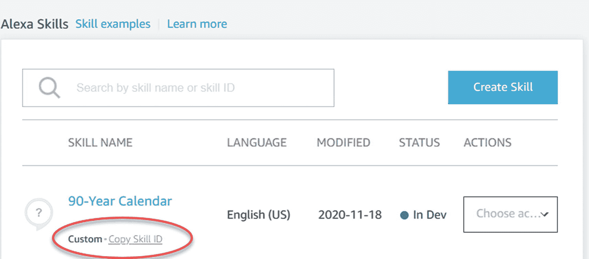
图 7-5 复制技能 ID 以备后用

接下来，我们需要一个数据库来存储 Alexa 将收集的人生事件。

### DynamoDb

当 Alexa 收集信息时，信息会以 JSON 文档的形式传输。我们需要一个地方来存储这些文档。最可能的选择是 NoSQL 数据库，在 Amazon AWS 技术栈中，它被称为 `DynamoDb`。在这种情况下，NoSQL 相比传统关系型数据库有几个优势。第一，我们将拥有一个包含许多相关详细信息的关键记录。第二，我们的数据将全部采用 JSON 格式。第三，NoSQL 数据库可以非常快速地读写这些 JSON 文档。因此，我们需要创建一个 `DynamoDb` 表。

1. 首先，以管理员用户（而非 root 用户）身份登录 AWS 开发者控制台。AWS 控制台地址为：[`https://console.aws.amazon.com`](https://console.aws.amazon.com)。
2. 登录后，在“查找服务”框中搜索 `DynamoDb`。
3. 选择 `DynamoDb` 后，您将进入 `DynamoDb` 控制台。
4. 在左侧导航栏中，选择 `Tables`。
5. 在右侧，点击 `Create Table` 按钮。

NoSQL 表与 SQL（关系型）表不同，尽管它们使用一些相同的术语。每个 NoSQL 表必须有一个分区键和一个可选的排序键。主键由这两个属性组成，并且对于每个项目必须是唯一的。`DynamoDb` 对分区键进行哈希处理，以确定将项目存储在数据库的哪个分区中。在小型数据库中可能只有一个分区，但随着数据库的增长，可以有多个分区。有关选择分区键的更多信息，请查看此文档：[`https://aws.amazon.com/blogs/database/choosing-the-right-dynamodb-partition-key/`](https://aws.amazon.com/blogs/database/choosing-the-right-dynamodb-partition-key/)。对于我们的用例——为个人创建一个 90 年的日历——使用对每个个体唯一的 `PersonId` 作为分区键似乎是合理的，并且我们不需要排序键。填写表表单时，输入以下内容（参见图 7-6）：

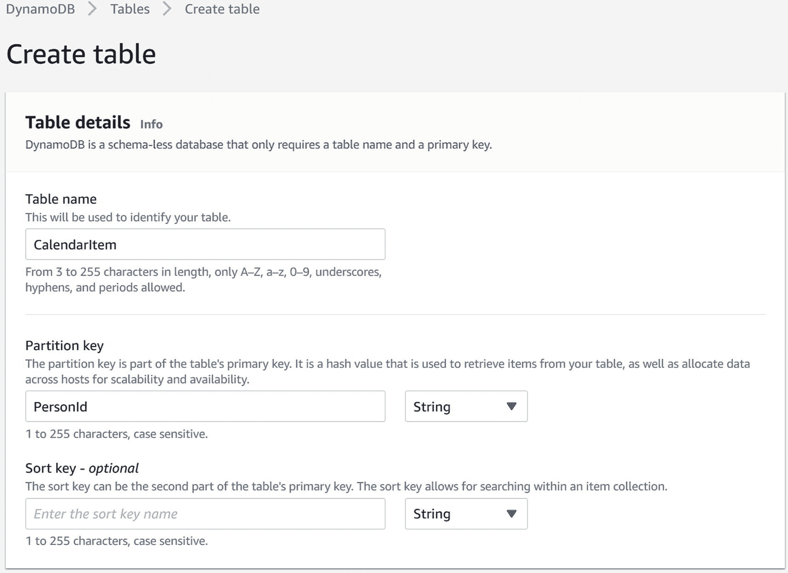
图 7-6 为日历项目创建 `DynamoDb` 表

1. 对于表名，输入 `CalendarItem`。
2. 对于分区键，输入 `PersonId`。
3. 滚动到底部，点击 `Create`。

`DynamoDb` 将需要大约一分钟来配置表。完成后，将 `DynamoDB` 表的 ARN 复制到 `Notepad++`（参见图 7-7）。在创建安全角色时，我们将需要它。

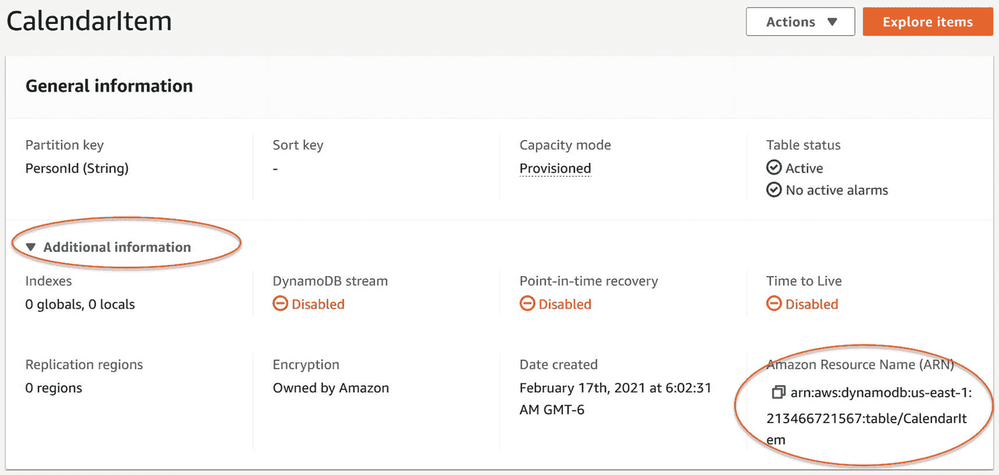
图 7-7 复制 `DynamoDB` 表的 ARN

接下来，我们将创建我们的 `S3` 存储账户。

### S3 存储

虽然 `DynamoDb` 是存储您生活事件数据的绝佳场所，但它不是存储与这些事件相关的图片的正确位置。图像是一种二进制大对象，即 Blob 数据。Blob 数据最好保存在文件系统中，这样可以轻松且廉价地存储。后者是 `S3` 存储桶的主要优势。`S3` 是 Simple Storage Service（简单存储服务）的缩写，是亚马逊用于文件存储的云解决方案。在您的本地机器上，您有磁盘驱动器；在 `S3` 中，您有存储桶。在本地，您有文件夹来存放文件；在 `S3` 中，您也有文件夹来组织您的对象。为了为我们将为技能存储的图像创建一个 `S3` 存储桶，请导航到任何 AWS 控制台左上角的“服务”菜单，并按照以下步骤操作：

1. 首先，以管理员用户（而非 root 用户）身份登录 AWS 开发者控制台。AWS 控制台地址为：[`https://console.aws.amazon.com`](https://console.aws.amazon.com)。
2. 在 `S3` 控制台中，点击右上角的橙色 `Create bucket` 按钮。
3. 对于存储桶名称：`calendar-pics-12345`。（必须全部小写。名称需要唯一，因此根据需要更改数字。）
4. 选择正确的区域。
5. 确保选中“阻止所有公共访问”复选框。
6. 我们不需要存储桶版本控制（也不需要与之相关的成本）。
7. 由于我们存储的是私人图片，我们需要服务器端加密，并且我们可以让亚马逊管理密钥——`Amazon S3 key (SSE-S3)`。
8. 现在向下滚动并点击橙色的 `Create bucket` 按钮。

创建存储桶后，我们需要编辑其中一个设置。

1. 在存储桶列表中，选择存储桶名称链接。
2. 点击 `Permissions` 选项卡。
3. 滚动到底部。
4. 在“跨源资源共享 (CORS)”旁边，点击 `Edit`。
5. 输入以下 JSON：

```json
[
{
"AllowedHeaders": [
"*"
],
"AllowedMethods": [
"PUT",
"GET",
"POST",
"DELETE",
"HEAD"
],
"AllowedOrigins": [
"https://www.example.com"
],
"ExposeHeaders": [
"ETag"
]
}
]
```

6. 点击 `Save changes`。

目前，我们对 `S3` 存储桶需要做的就这些。将 `S3` 存储桶的 ARN 复制到 `Notepad++`。（参见图 7-8。）在创建安全角色时，我们将需要它。

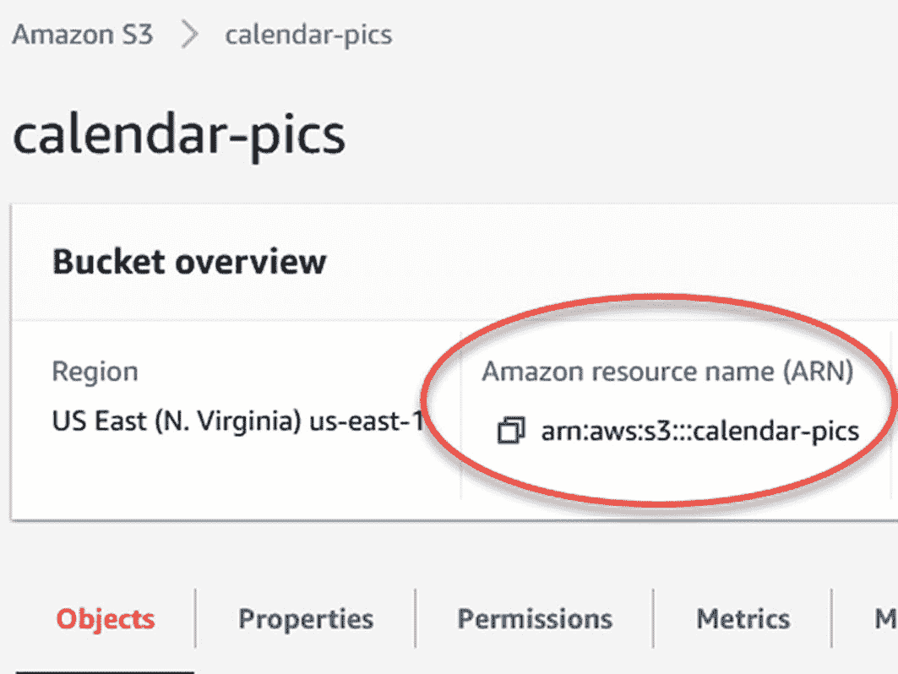
图 7-8 复制 `S3` 存储桶的 ARN

我们还需要能够识别用户并为他们提供对其数据的安全访问。这需要账户关联，我们接下来将配置它。

### 账户关联

根据用户是否关联了他们的亚马逊账户，我们将有两种版本的技能行为。如果未关联，用户可以从他们的生日创建日历，并且不存储任何事件。通过关联账户，我们可以安全地为他们存储事件，以便我们可以为日历着色并让他们访问他们的照片。

账户关联^(¹⁸)是一项功能，使您能够将 Alexa 技能链接到用户的亚马逊、微软、谷歌或其他账户。通常，您会希望链接到用户的亚马逊账户，然后使用该身份验证来访问您系统中的数据。

当用户启用您的技能时，Alexa 会为他们创建一个用户 ID。如果您希望持久化会话信息，如果数据不需要安全保护，用户 ID 可能是识别用户并存储其会话信息的合适方式。另一方面，为了保存个人信息，关联账户提供了一个安全的身份验证层。当您关联账户时，Alexa 会生成一个安全访问令牌，您可以使用它来识别用户的个人数据。这为您的技能提供了更高的安全性，并允许您安全地连接到外部服务。首先，我们将为我们的技能创建一个应用程序安全配置文件，用于关联账户。

#### 应用程序安全配置文件

应用程序安全配置文件将我们的 Alexa 技能识别为一个应用程序，并为我们提供将 Alexa 技能链接到用户亚马逊账户所需的凭证。要创建该配置文件：

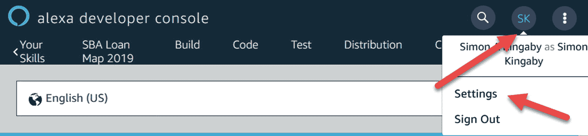
图 7-9 选择 `Settings` 菜单选项

1. 在 Alexa 开发者控制台（使用你的亚马逊账户登录）中，从右上角菜单选择你的姓名首字母，然后选择 `Settings`（参见图 7-9）。

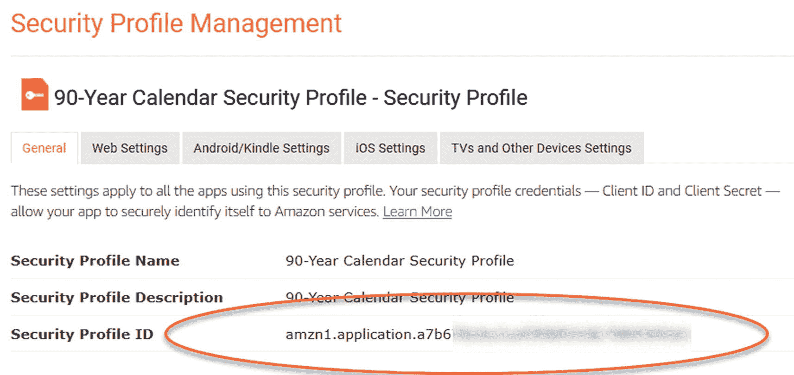
图 7-10 复制安全配置文件 ID

1. 从菜单栏中选择 `Security Profiles`。
2. 点击 `Create a New Security Profile` 按钮。
3. 为你的安全配置文件输入 `Name` 和 `Description`。例如，“**90 年日历安全配置文件**”。
4. 点击 `Save`。
5. 在安全配置文件屏幕上，将安全配置文件 ID 复制到 Notepad++ 中。（参见图 7-10。）

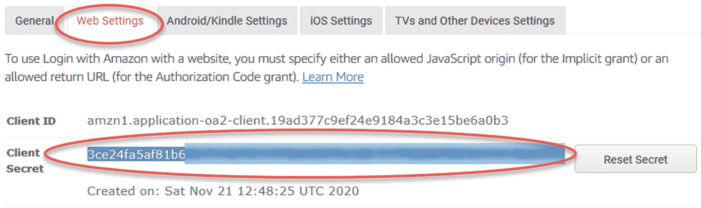
图 7-11 复制客户端密钥

1. 选择 `Web Settings` 选项卡。
2. 将 `Client ID` 复制到 Notepad++ 中。
3. 点击 `Show Secret` 按钮。
4. 将 `Client Secret` 复制到 Notepad++ 中。（参见图 7-11。）

现在我们已经有了一个安全配置文件，可以设置账户关联了。

## 配置账户关联

仍在 Alexa 开发者控制台中，切换回技能的 `Build` 选项卡，我们将按如下方式填入配置文件凭证：

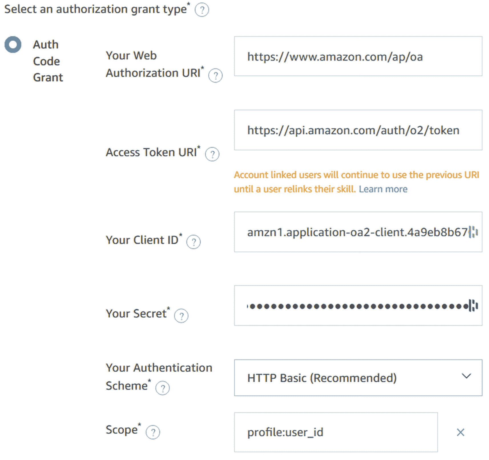
**图 7-12** 填写完成的账户关联表单

1.  点击 `Build` 选项卡。
2.  点击左侧导航栏中的 `Tools`。
3.  点击左侧导航栏中的 `Account Linking`。
4.  开启“是否允许用户创建账户或关联到你现有的账户”选项。
5.  开启“允许用户在不关联账户的情况下启用技能”选项。
6.  在“安全提供商信息”下，选择 `Auth Code Grant` 选项。
7.  对于 `Web Authorization URI`，输入 `https://www.amazon.com/ap/oa`。
8.  对于 `Access Token URI`，输入 `https://api.amazon.com/auth/o2/token`。
9.  对于 `Your Client ID`，粘贴之前保存到 Notepad++ 中的 `Client ID`。
10. 对于 `Your Secret`，粘贴之前的 `Client Secret`。
11. 对于 `Your Authentication Scheme`，选择 `HTTP Basic`。
12. 对于 `Scope`，输入 `profile:user_id`。
13. 滚动到页面顶部并点击 `Save`。
14. 填写完成的表单应如图 7-12 所示。

现在，我们需要将 Alexa 重定向 URL 复制到我们刚刚创建的安全配置文件中。

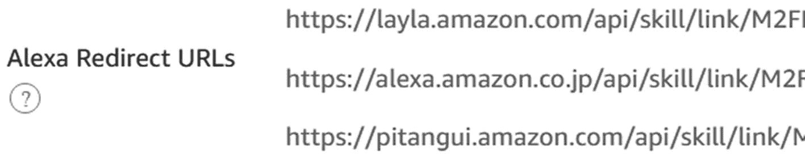
**图 7-13** Alexa 重定向 URL

1.  在“关联账户”屏幕底部，`Alexa Redirect URLs` 部分有三个 URL；参见图 7-13。

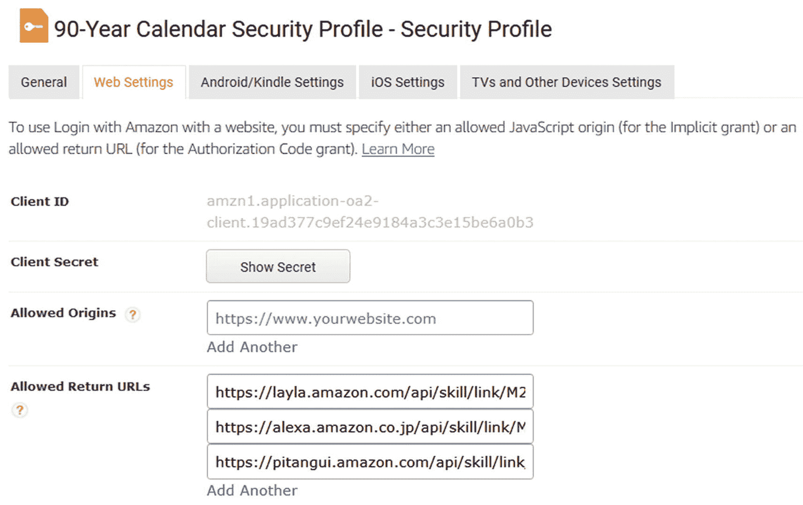
**图 7-14** 将允许的返回 URL 添加到安全配置文件

1.  将这三个 URL 复制到安全配置文件 Web 设置选项卡的 `Allowed Return URLs` 部分；参见图 7-14。
2.  在屏幕顶部，再次点击 `Save` 按钮。

还有一步。我们需要使用“使用亚马逊登录”功能注册我们的安全配置文件。

1.  在浏览器中，导航至 `https://developer.amazon.com/loginwithamazon/console/site/lwa/overview.html`。
2.  在下拉菜单中，选择**90 年日历安全配置文件**。
3.  点击 `Confirm`。
4.  提供你的隐私政策 URL。（如果你没有，可以在 `https://datadrivenskills.com/privacy-policy` 查看示例。）
5.  提供一个图标图形。（任何图形都可以。）
6.  点击 `Save` 按钮。

就这样。账户关联已设置完成。下一步是为后端创建 lambda 函数。

## Lambda 函数

在亚马逊云服务（AWS）中，lambda 函数是一种无服务器计算服务或云函数。它不需要我们预置需要管理的虚拟机或容器。AWS 服务完全管理基础设施资源。这使得 lambda 函数成为 Alexa 技能后端的首选解决方案。即使在 Alexa 托管的技能中，`Code` 选项卡也包含一个 lambda 函数。

创建 AWS lambda 函数有两个步骤。首先，我们需要预置一个安全角色，我们的技能将使用该角色来访问 lambda 函数，然后我们需要创建 lambda 函数本身。

### 创建安全角色

在创建 Lambda 函数之前，我们需要在 IAM（身份与访问管理）控制台中创建一个安全角色。

要创建安全角色，我们需要登录 AWS 账户并进入 IAM 服务：

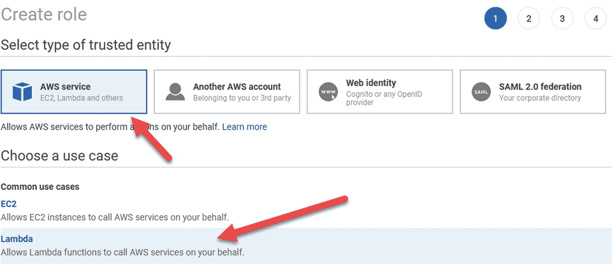
**图 7-15** 选择 Lambda 服务用例

1.  登录 AWS（`https://aws.amazon.com`）。输入账户编号、管理员用户名和密码。请勿使用根用户选项。
2.  搜索并选择 IAM 服务。
3.  在左侧，选择 *角色*，然后点击 *创建角色*。
4.  在顶部选择 *AWS 服务*，并在中间选择 *Lambda* 作为用例。（参见图 7-15。）

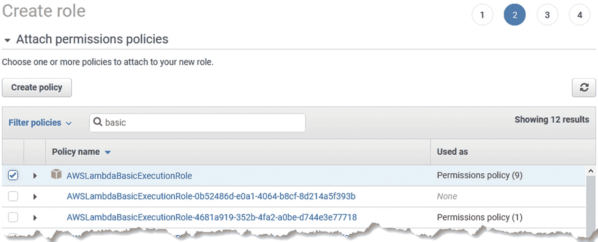
**图 7-16** 选择 AWSLambdaBasicExecutionRole

1.  点击右下角的 *下一步：权限*。
2.  在 *筛选策略* 框中，搜索 `basic`。
3.  选中 `AWSLambdaBasicExecutionRole` 旁边的复选框。（参见图 7-16。）

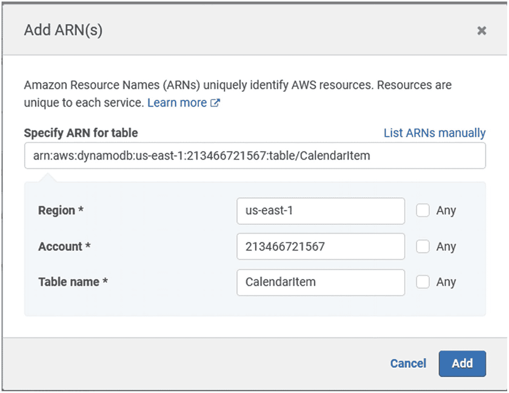
**图 7-17** 粘贴表的 ARN

1.  现在点击顶部的 *创建策略* 按钮。
2.  对于 *选择服务*，选择 **DynamoDB**。
3.  在 *访问级别* 下，展开 *读取* 的选项框。
4.  选择 `GetItem` 和 `Query`。
5.  展开 *写入* 的选项框，并选择 `DeleteItem`、`PutItem` 和 `UpdateItem`。
6.  现在点击 *资源* 旁边的橙色文字。
7.  在 *表* 旁边，点击 *添加 ARN* 链接。
8.  粘贴表的 *ARN*，或者添加您保存到 Notepad++ 中的 *区域*、*账户* 和 *表名称*。（参见图 7-17。）

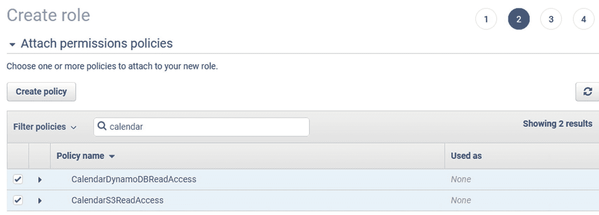
**图 7-18** 选择两个日历策略

1.  点击 *添加* 按钮。
2.  点击 *下一步：标签* 按钮。
3.  现在点击 *下一步：审核* 按钮。
4.  为策略命名，例如 `CalendarDynamoDBReadAccess`。
5.  点击 *创建策略* 按钮。
6.  切换回 *创建角色* 标签页。
7.  再次点击顶部的 *创建策略* 按钮。
8.  对于 *选择服务*，选择 **S3**。
9.  展开 *访问级别列表* 的选项框，并选择 `ListBucket`。
10. 展开 *访问级别读取* 的选项框，并选择 `GetObject`。
11. 现在点击 *资源* 旁边的橙色文字。
12. 在 *存储桶* 旁边，点击 *添加 ARN* 链接。
13. 粘贴 S3 存储桶的 ARN。
14. 点击 *添加* 按钮。
15. 在 *对象* 旁边，点击 *添加 ARN* 链接。
16. 在 *存储桶名称* 框中输入存储桶的名称（`calendar-pics`）。
17. 勾选 *对象名称* 旁边的 *任意* 复选框。
18. 点击 *添加* 按钮。
19. 点击 *下一步：标签* 按钮。
20. 点击 *下一步：审核* 按钮。
21. 为策略命名，例如 `CalendarS3ReadAccess`。
22. 点击 *创建策略* 按钮。
23. 切换回 *创建角色* 标签页。
24. 刷新策略列表。
25. 使用关键词 `calendar` 筛选策略。
26. 选择我们刚刚创建的两个策略。（参见图 7-18。）

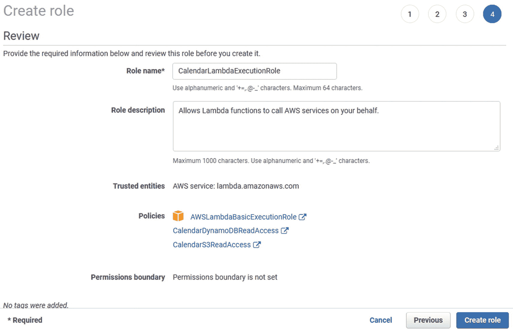
**图 7-19** 完成的 Lambda 执行角色

1.  点击 *下一步：标签*。
2.  点击 *下一步：审核*。
3.  为 *角色名称* 命名，例如 `CalendarLambdaExecutionRole`。
4.  点击 *创建角色*。（参见图 7-19。)

现在我们已经创建了角色，可以开始处理 Lambda 函数了。

### 创建 Lambda 函数

仍在 AWS 中，我们现在需要开始创建 Lambda 函数本身。创建 Lambda 函数需要执行以下步骤：

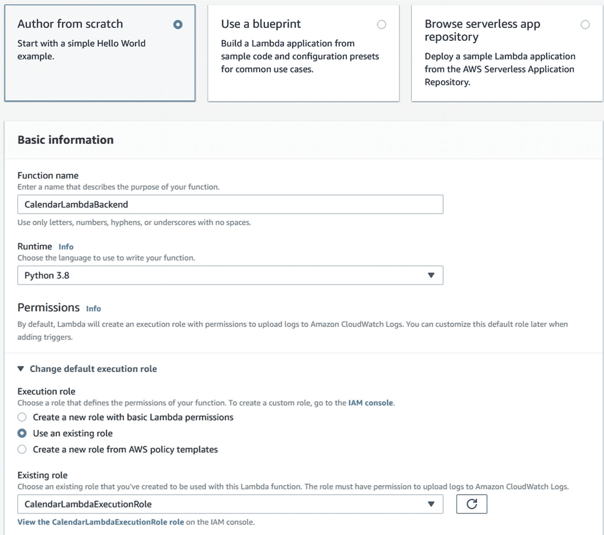
**图 7-20** 完成的 Lambda 函数创建对话框

1.  选择左上角的 *服务* 菜单。
2.  搜索并选择 Lambda。
3.  在右上角，选择 *创建函数*。
4.  选择 *从头开始创作*。
5.  输入 *函数名称*，例如 `CalendarLambdaBackend`。
6.  对于 *运行时*，在列表顶部的 *最新支持* 部分下选择 **Python 3.8** 或更高版本。
7.  在 *权限* 下，展开 *更改默认执行角色*。
8.  选择 *使用现有角色*。
9.  选择我们之前创建的 `CalendarLambdaExecutionRole` 角色。（参见图 7-20。)

现在您将能够配置您的 Lambda 函数。

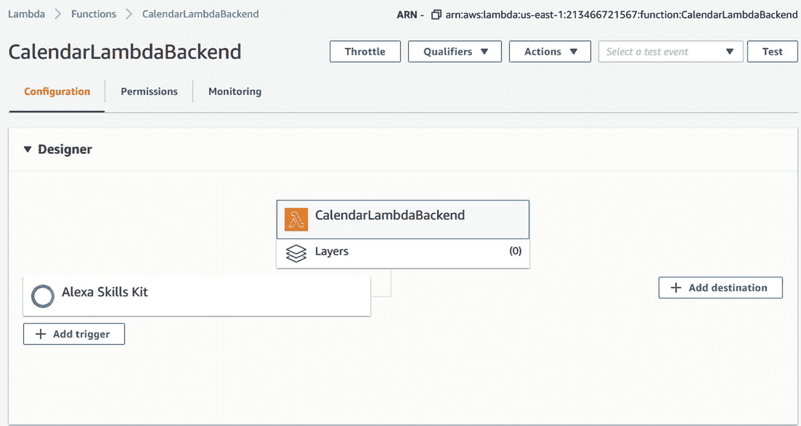
**图 7-21** 完成的触发器

1.  在左侧，选择 *添加触发器*，然后选择 *Alexa Skills Kit* 触发器。
2.  在 *技能 ID* 框中，粘贴您从 Notepad++ 中复制的 90 年日历技能的 *Alexa 技能 ID*。（完成的触发器参见图 7-21。)

现在选择 Lambda 函数（图 7-21 中标记为 `CalendarLambdaBackend` 的框）以显示函数代码。您可能需要向下滚动才能看到代码（参见图 7-22）。

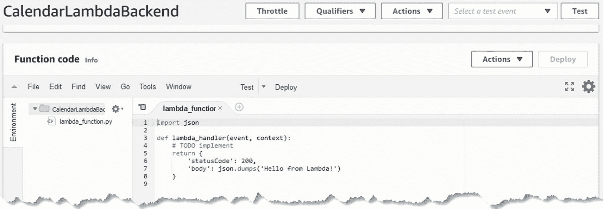
**图 7-22** Lambda 函数代码

至此，您已经准备好编写后端代码，并且我们已经配置了在技能中所需的所有组件。

## 总结

在本章中，我们为新的技能创建了一个骨架。它包含一个 Alexa 技能、一个用于技能设计的 Botmock 项目、一个用于捕获用户数据的 DynamoDB 数据库表、一个用于检索图片的 S3 存储桶，以及一个带有适当安全策略的 Lambda 函数，用于后端代码。

在下一章中，我们将为 90 年日历技能设计 VUI。

## 8. 超越 Hello World

在上一章中，您设置了构建增强版 90 年日历技能所需的所有账户和服务。本章将介绍 VUI 设计，以及如何为更复杂的技能设计对话流程。

我们的技能将有两种风格。如图 8-1 所示，第一种是 90 年日历的简单呈现。这是未认证用户所能使用的全部功能。


**图 8-1** 一个 90 年人生日历

一旦用户将我们的 Alexa 技能关联到他们的亚马逊账户，我们就可以询问并存储用户生活中的重要事件。这将使我们能够呈现一个增强版本，最终看起来类似于图 8-2。

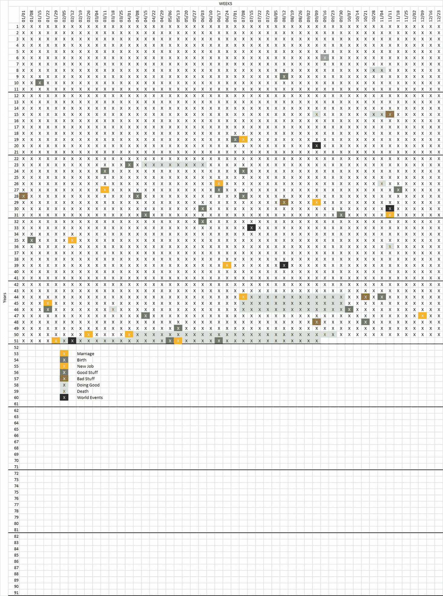
**图 8-2** 一个增强版 90 年人生日历

在下一节中，我们将探讨一些关于语音优先 VUI 设计的考量。

### VUI 设计

语音用户界面设计可能是一个复杂的过程，尤其是与传统的图形用户界面设计相比。在为应用构思 GUI 时，你通常会创建一个菜单结构来访问各种功能。用户随后会点击某个菜单选项，打开某种表单来输入数据或执行操作。表单会布置一系列用于输入或选择选项的控件，并附带几个操作按钮，例如“确定”和“取消”。这些设计都无法很好地迁移到语音优先的用户界面。相反，“菜单”需要是一个宽而扁平的结构，允许用户说出不同的指令来访问应用的所有功能。“表单”则需要让用户能够以几乎任意顺序说出内容。VUI 还必须像 GUI 那样容纳各种同义词。

例如，假设你想为你的车查询更换机油的价格。过程可能如下：

1.  你在手机上打开应用。
2.  你点击应用中的注册链接。
3.  你输入电子邮件和密码，点击接受条款，然后点击注册按钮。
4.  接着你输入名字、姓氏和邮政编码，然后点击“完成”。
5.  然后你点击允许应用在使用时访问你的位置。
6.  接着你对应用关于通知的询问点击“不允许”。
7.  然后你可以在地图上点击本地门店、搜索门店、点击按钮打开主菜单，或者点击底部栏查看优惠券。
8.  点击菜单按钮会打开一个多级菜单。
9.  点击地图上的本地门店后，你会看到一个屏幕，让你在以下选项中选择：
    1.  关闭屏幕。
    2.  收藏该位置。
    3.  查看热门时段图表。
    4.  获取路线（这会启动你默认的地图/导航应用）。
    5.  查看可用的优惠券。
    6.  查看评价。
    7.  如果向下滚动，你可以看到可用服务的简要列表。
10.  经过所有这些操作后，你沮丧地关闭了应用，因为这个应用不提供价格信息，也无法预约服务。

现在，想象一下语音优先的体验。

```
用户：Alexa，我需要换机油。
Alexa：我找到了几个选项。1st Chance Tire，距离 1.3 英里。Valvoline Instant Oil Change，距离 2.5 英里。
用户：选择 Valvoline。
Alexa：欢迎来到 Valvoline。您想预约换机油吗？
用户：是的。
Alexa：为哪辆车？
用户：2019 款福特 C-Max。
Alexa：您想什么时候去？
用户：今天下午，下班后。
Alexa：2019 款福特 C-Max 的里程数是多少？
用户：我不知道，大概 115,000 英里。
Alexa：好的。我可以为您预约明天下午 5:30 在 Smyrna 的 Valvoline 为 2019 款福特 C-Max 进行高里程机油更换。您有一张 7 美元的优惠券，因此根据您选择的机油，费用大约在 33 到 48 美元之间。需要我预约吗？
用户：是的。
Alexa：好的。我已为您预约了明天下午 5:30。
```

这两种交互之间最显著的差异是什么？想想 Alexa 是如何直奔主题的，而 GUI 却必须将所有内容都塞进菜单、屏幕和点击操作中。想想 Alexa 是如何将 115,000 英里转换为“高里程”，以及将“下班后”转换为“下午 5:30”的。Alexa 必须更加灵活，以处理用户可能说出的各种内容。想想每次交互对用户的要求是什么。

语音优先设计是一种策略，它将语音交互置于屏幕和点击操作之上。虽然屏幕可以是 VUI 设计的一个组成部分，但优先考虑的是模拟用户与 Alexa 之间的对话。你要寻找的是用户能够完成流程、达成预期结果的方式。当然，我们会模拟一条“快乐路径”，即用户按正确顺序说出正确内容。但我们也必须处理意外情况。例如，你在预约换机油的过程中，突然决定还需要做轮胎换位。这就是传统建模工具（如 Excel、Visio 和 Lucidchart）的不足之处。绘制快乐路径很容易。但随着模型的扩展，列出同义词和所有可能的表述会变得越来越棘手。

Adobe XD 有一个用于 Alexa 技能的模板；这是一个出色的故事板工具，许多图形设计师都很熟悉。有关 XD 的全面指南，请查看 Alexa 团队提供的 My Cactus 示例。（设计资源见此处：`https://github.com/alexa/skill-sample-nodejs-web-api-my-cactus`。Alison Atwell 和 Justin Jeffress 在 Twitch 上解释该过程的视频见此处：`http://www.twitch.tv/collections/S81yydlkRBY-Pw`。)

诸如 Botmock 和 Voiceflow 之类的工具正是为了应对 VUI 设计的挑战而创建的，并且它们的学习曲线不像 Adobe XD 那样陡峭。在下一节中，我们将使用 Botmock 来设计标准模型的对话。

# 使用 Botmock 进行 VUI 设计

要开始使用 Botmock，请登录，并为“90 年日历”创建一个新项目。点击“创建新项目”后：

1.  在“项目名称”中输入`90-Year Calendar`。
2.  选择`Amazon Alexa`作为目标渠道。
3.  点击“创建项目”。

这将启动对话编辑器，我们可以在其中开始建模我们的对话。

在 BotMock 中，线条和方框代表对话模型。线条是用户的表述；方框是机器人（Alexa）说的话。见图 8-3。

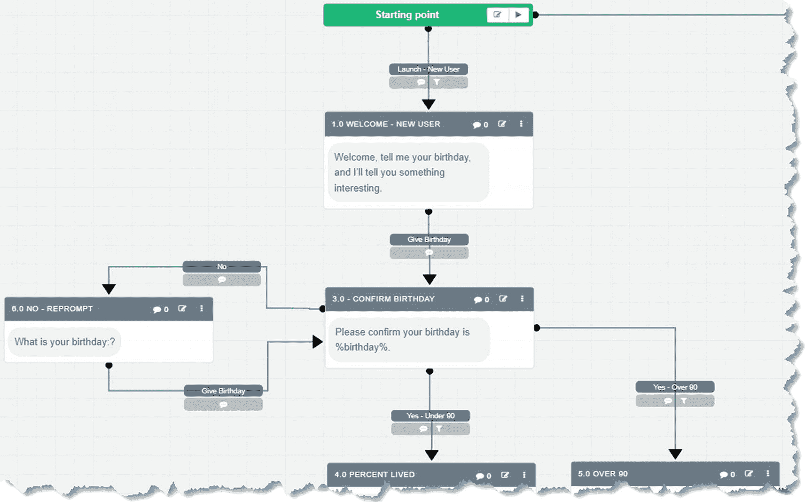

图 8-3 在 BotMock 中建模对话

如图 8-3 所示，在用户说出启动短语后，Alexa 说：“欢迎，告诉我你的生日，我会告诉你一些有趣的事情。”

然后用户意图向 Alexa 提供他们的生日，因此他们会说出一些合适的内容，例如“我的生日是 1980 年 1 月 1 日。”定义用户意图的一部分工作还包括描述他们为完成该意图可能说出的所有表述。“提供生日”意图的另一种表述可能是“我出生于 1980 年 1 月 1 日。”

然后 Alexa 确认她已将表述解码为正确的日期：“确认一下，你的生日是 `%birthday%`。”注意使用百分号来界定给定生日的变量。

此时，你可以在图中看到用户有两个选项（是或否），并且 Alexa 区分了年龄在 90 岁以上和 90 岁以下。如果用户说“否”，他们将获得另一次提供生日的机会。

如你所见，到目前为止，对话相对简单。不过，在我们详细阐述下一阶段之前，让我们先创建到目前为止的模型。

## 启动响应

与 Alexa 的对话通常始于用户启动您的技能。他们可能会说：“Alexa，启动我的九十年日历。”Alexa 通常会以愉快且礼貌的欢迎语和开始提示来回应。在我们的案例中，Alexa 会说：“欢迎，告诉我你的生日，我会告诉你一些有趣的事情。”但如果这是一位想要在日历中添加更多事件的回头用户呢？那么她应该说：“欢迎回来。您想向日历中添加更多事件吗？”在 Botmock 中，我们可以通过创建一个连接到绿色起点框的新文本框来表示这一点。

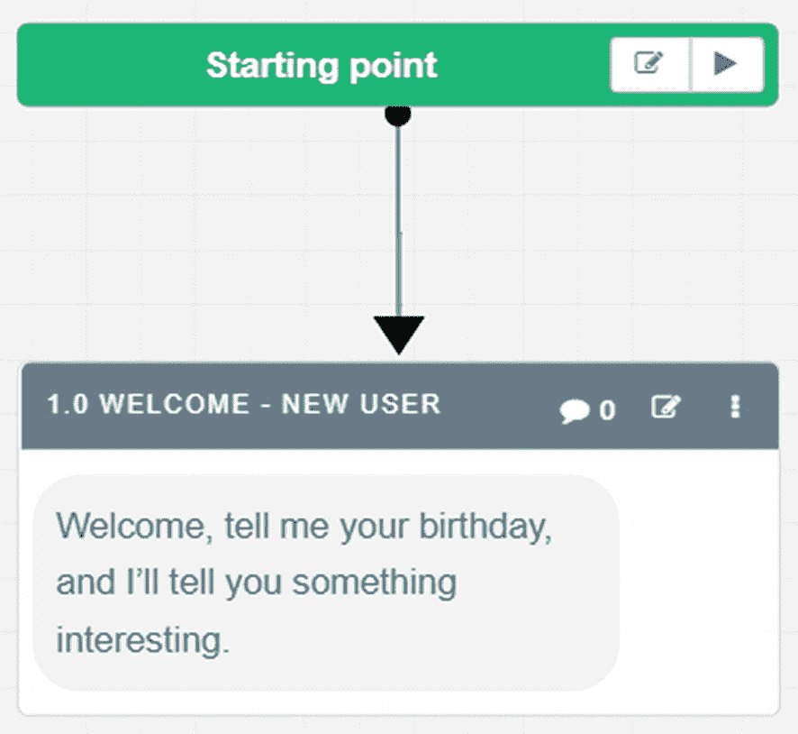

图 8-4 第一个语音框

1.  首先，点击*起点*框。
2.  会出现四个灰色箭头。点击底部的箭头。
3.  在*块选择器*中，选择*文本*。
4.  如果需要，您可以用鼠标抓住新框，并将其与起点框对齐。
5.  双击文字*机器人说*。
6.  在此对话框的最顶部，将文字*文本*改为**1.0 欢迎 – 新用户**。请注意，我们对每个文本框进行编号，以便在构建技能时保持其有序。
7.  现在，在文本文本框中，输入 Alexa 将要说的话：**欢迎，告诉我你的生日，我会告诉你一些有趣的事情。**
8.  最后，点击右下角的保存按钮。
9.  您的对话框现在应该看起来像图 8-4。

现在我们已经有了 Alexa 的欢迎语句，我们可以将启动意图添加到对话框中。

## 意图

在 BotMock 中，如同在 Alexa 对话中一样，用户是有意图的。意图是用户想要完成的事情。对于启动意图，用户希望我们的技能启动。Botmock 将意图表示为线条上的注释。首先，您定义意图，然后在图表中引用它。

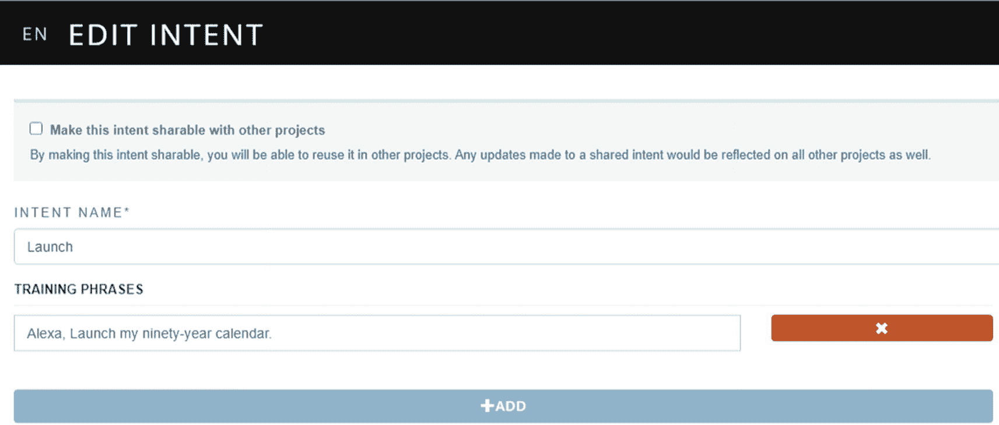

图 8-5 创建启动意图

1.  要定义一个意图，请选择左侧菜单栏上的*意图*图标。
2.  我们将定义一个启动意图，因此点击*添加新意图*。
3.  *意图名称*为**启动**。
4.  点击*训练短语*的*添加*按钮。
5.  在新的*训练短语*框中，输入**Alexa，启动我的九十年日历**。（见图 8-5。）

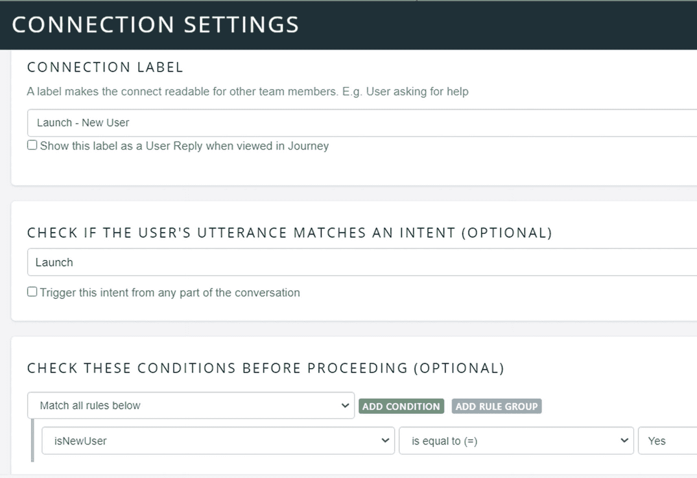

图 8-6 连接设置界面。

1.  点击右下角的*保存*按钮。
2.  然后点击意图列表顶部的箭头将其关闭。
3.  现在，按住 Shift 键并点击我们添加的*起点*框和*1.0 欢迎*框之间的连线。
4.  在*连接设置*界面中，输入**启动 – 新用户**作为*连接标签*。
5.  在*检查用户话语是否匹配意图*框中，选择我们刚刚创建的**启动**意图。
6.  在*检查这些条件*部分的*匹配以下所有规则*框旁边，点击*添加条件*按钮。
7.  在弹出的*创建新变量*界面中，输入 **isNewUser**。
8.  将条件从“为空”更改为*等于*。
9.  在文本框中输入**是**。（见图 8-6。）
10. 点击右下角的*保存*按钮。

您的图表现在应该显示该意图，如图 8-7 所示。

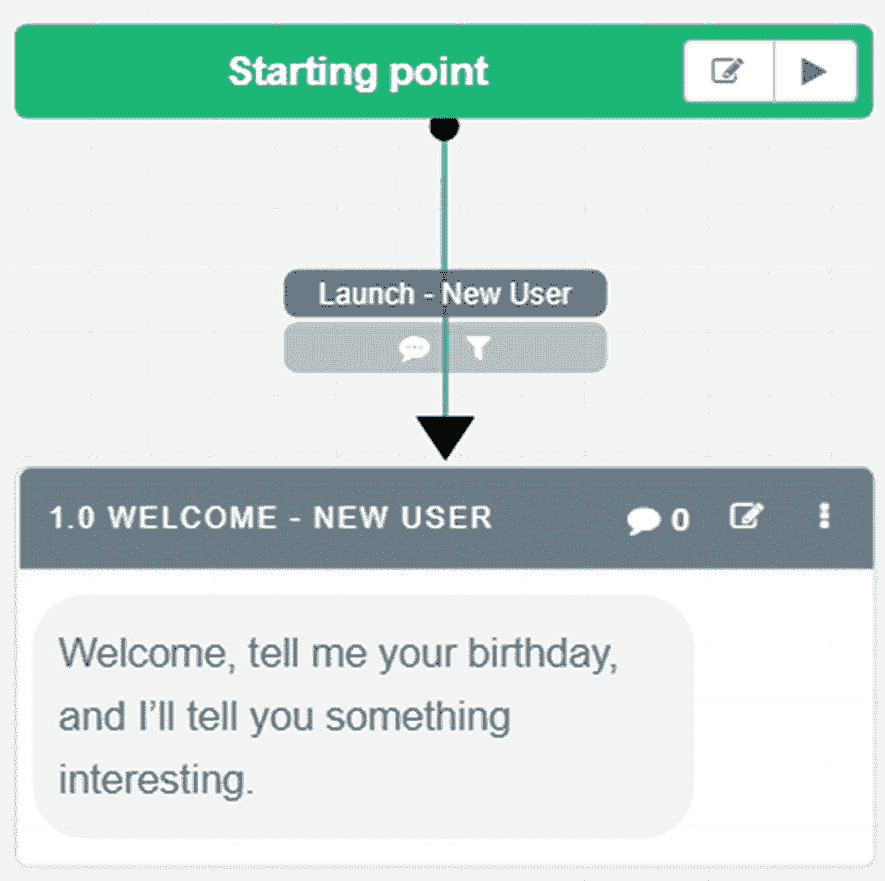

图 8-7 显示欢迎消息和启动意图的图表

接下来，我们需要添加针对回头用户的替代启动流程。为此，我们将重复之前的步骤，不同之处在于用户的启动意图相同，但 Alexa 的回应不同，并且过滤条件变为 `isNewUser = 否`。由于我们已经认识该用户，我们应该在欢迎消息中包含他们的名字。为此，我们将为用户的名字添加一个变量。

1.  点击左侧菜单栏上的*变量*。
2.  点击*创建新变量*。
3.  输入变量名称：**userName**。
4.  选择实体类型：**姓名**。
5.  点击*保存*。
6.  关闭*管理变量*弹出界面。

然后，我们像这样创建 Alexa 的回应：

1.  选择*起点*框。
2.  点击右侧箭头并添加一个新的文本框。
3.  双击该文本框，将*标题*改为“**2.0 欢迎 – 回头用户**”。
4.  将*文本*从“机器人说”改为“**欢迎 %userName%，您想向日历中添加一个事件吗？**”请注意使用百分号来界定变量 `userName`。
5.  点击*保存*。
6.  按住 Shift 键并点击从*起点*到**2.0 欢迎**的连线。
7.  输入标签：“**启动 – 回头用户**”。
8.  选择启动意图。
9.  添加一个条件。
10. 选择 **isNewUser**、**等于**，并输入**否**。
11. 点击*保存*按钮。
12. 回到图表上，点击右上角菜单栏上的*保存*按钮。

您的图表现在应该看起来像图 8-8。

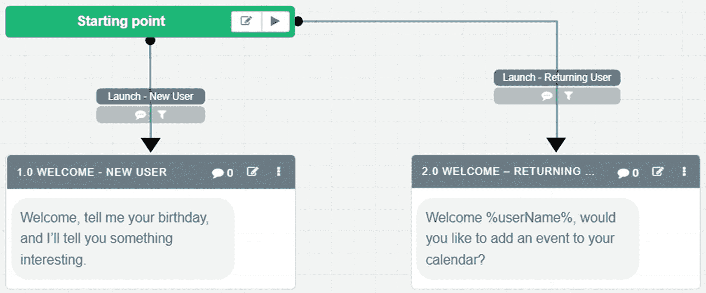

图 8-8 启动意图和欢迎消息

现在，我们准备完成新用户的快乐路径。

## 快乐路径

当一切按计划进行且所有假设都正确时，会发生什么？此时，你便走在了快乐路径上。在我们的案例中，快乐路径是指 Alexa 能正确听到并理解你的生日，然后告诉你一些关于生日的趣事。偏离快乐路径的情况属于异常和备选方案。目前，我们暂不考虑这些。我们想要创建的是快乐路径。

为此，需要创建一个新变量（图 8-9）和一个新意图（图 8-10），以便用户向我们提供他们的生日。请注意在训练短语中使用 `%birthday%` 变量，以及在槽位填充部分设置“必需”标志。然后，Alexa 会要求确认生日（图 8-11），我们可以将“提供生日”意图添加到连接线上（图 8-12）。接着，用户会说出“是”意图（图 8-13）。最后，Alexa 会告诉他们一些有趣的事情（图 8-14），我们可以将“是”意图添加到连接线上（图 8-15）。

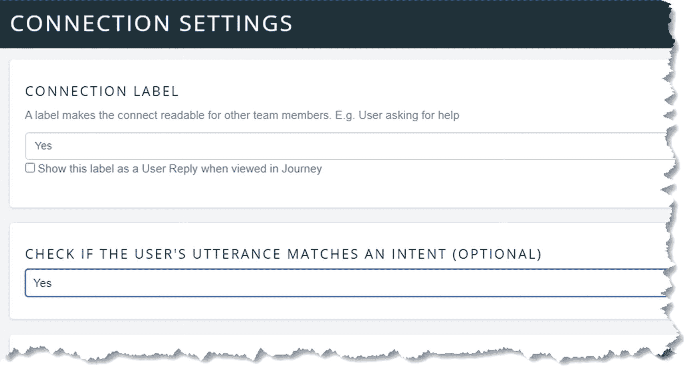

图 8-15 将“是”意图添加到连接线

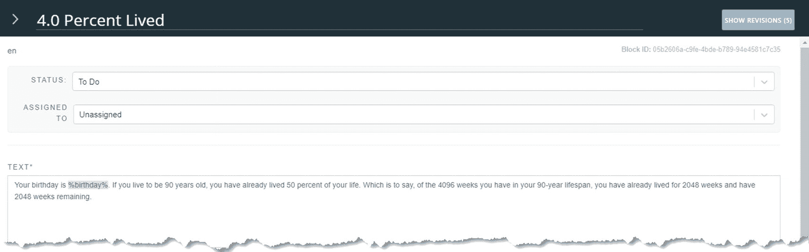

图 8-14 在文本框中告诉用户一些有趣的事情

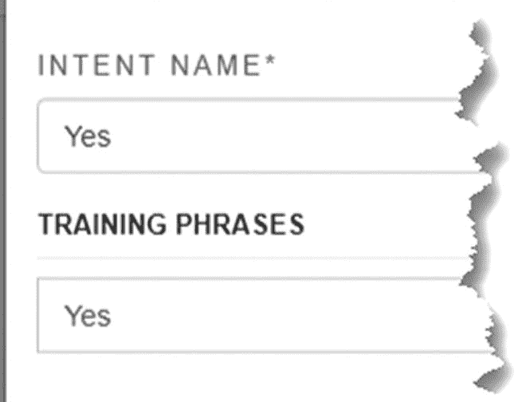

图 8-13 创建“是”意图

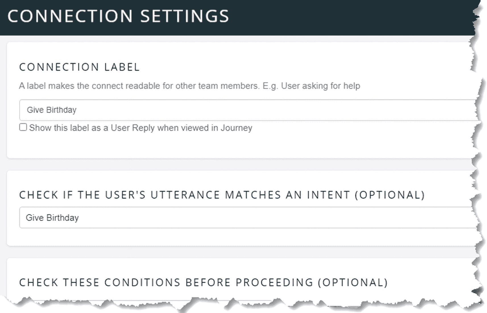

图 8-12 将“提供生日”意图添加到连接线

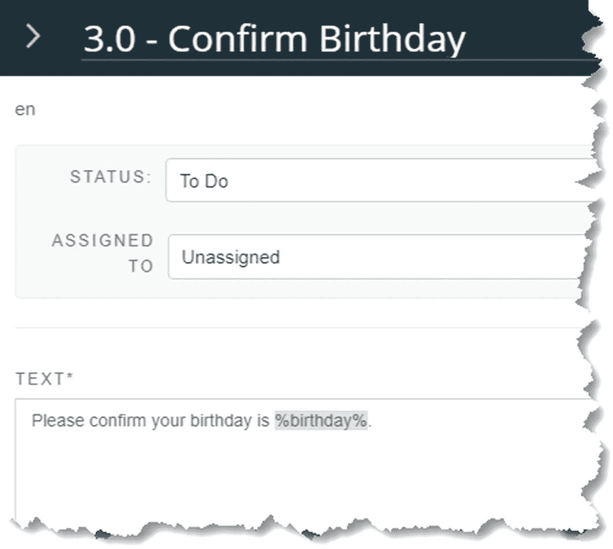

图 8-11 在文本框中添加“确认您的生日”Alexa 响应

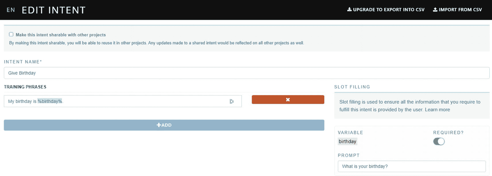

图 8-10 创建“提供生日”意图

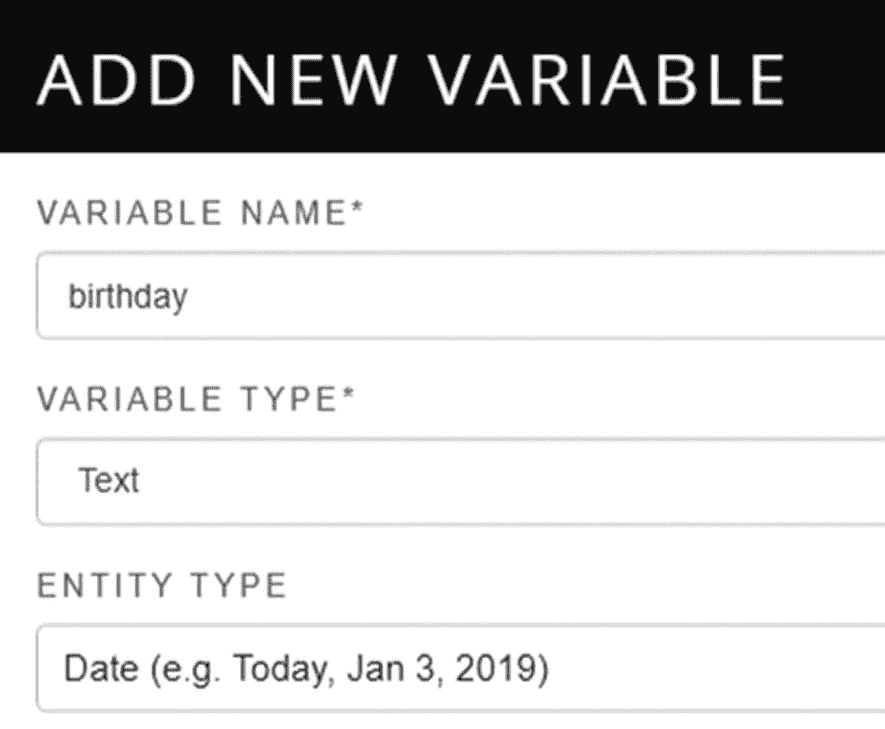

图 8-9 创建生日变量

完成以上所有步骤后，快乐路径现在如图 8-16 所示。

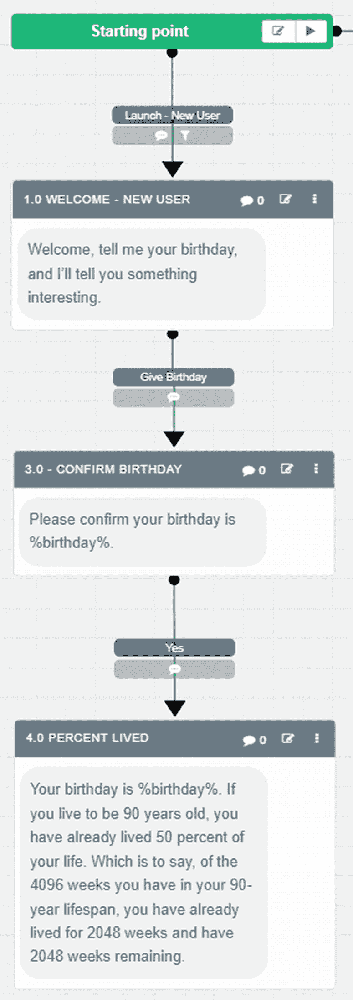

图 8-16 完成的快乐路径

如果用户已经超过 90 岁了呢？如果我们所有的计算都基于最大年龄 90 岁，那事情就会变得复杂。

## 超过 90 岁路径

为了处理超过 90 岁的情况，我们需要将“是”响应拆分为两个。第一个响应位于快乐路径上，标记为“是 – 90 岁以下”。第二个响应则不在此路径上，标记为“是 – 90 岁以上”。要添加此条件，我们需要为用户年龄添加一个变量（见图 8-17）。然后添加一个文本框，用于 Alexa 在用户超过 90 岁时做出响应（见图 8-18）。最后，为“是”路径添加条件：(1) 年龄小于 90 岁，(2) 年龄大于或等于 90 岁（见图 8-19）。

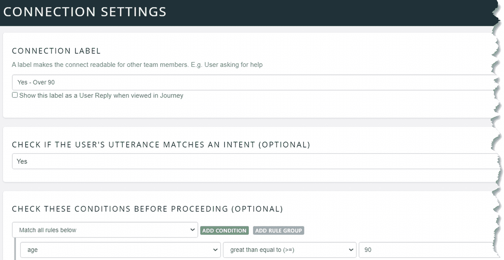

图 8-19 将“是”意图和年龄条件添加到超过 90 岁路径

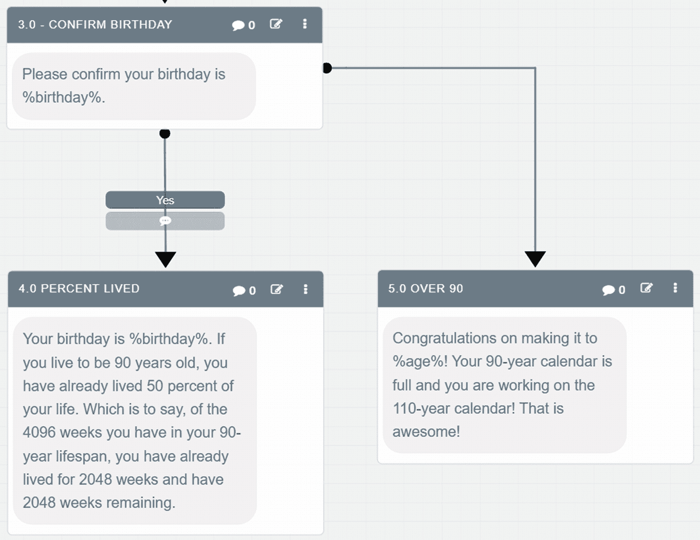

图 8-18 添加“超过 90 岁”文本框

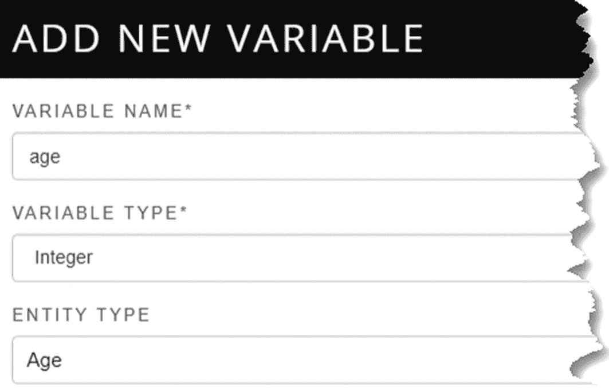

图 8-17 添加年龄变量

现在，图表将如图 8-20 所示。

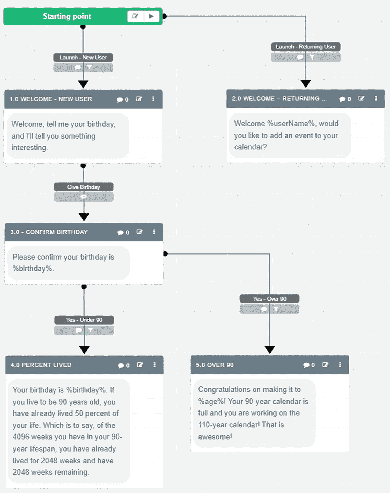

图 8-20 添加了超过 90 岁路径后的完整图表

如果用户未授权，也就是说他们尚未关联账户，那么一旦我们告知他们已活过的百分比，并且如果他们的设备有屏幕，向他们展示了 90 年或 110 年的日历后，技能就会结束。与其直接结束，我们可以提示他们是否想向日历添加项目，如果愿意，则指导他们在 Alexa 应用中关联技能。这个提示听起来比直接结束更好。

## 添加提示

添加一个向日历添加项目的提示，需要编辑图表（图 8-20）中的框 4.0 和框 5.0。在陈述结果之后，我们需要添加一个问题：“您想向日历添加一个事件吗？”如果我们还将框 2.0 下移，最终会得到如图 8-21 所示的图表。

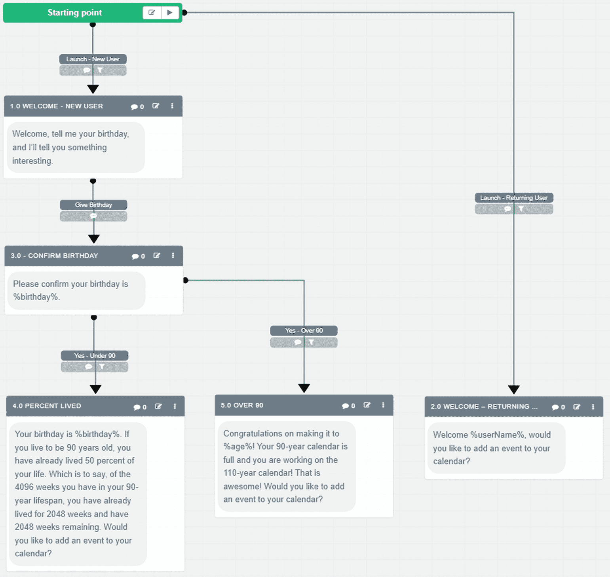

图 8-21 添加了添加事件提示后的修改图表

正如你在图表中看到的，我们现在有一个快乐路径和两个变体。那异常情况呢？我们如何处理错误？我们也需要将其添加到图表中。例如，如果 Alexa 没有正确理解日期怎么办？因此，用户在确认日期时会说“不”。

### 添加“不”意图

如果 Alexa 没有获取到正确的生日，用户在要求确认时会说“不”，Alexa 将不得不重新提示用户输入正确的生日，如图 8-22 所示。这个重新提示框意味着需要添加一个“不”意图，因此在编辑从框 3.0 到框 6.0 的连线之前，请先添加该意图。

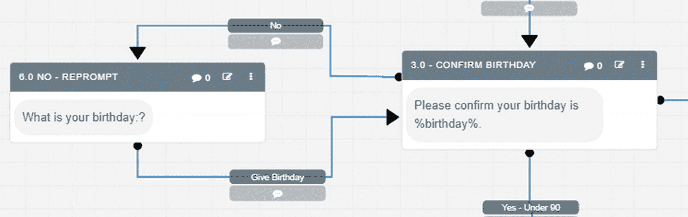

图 8-22 将“不”意图添加到确认框

请记得定期保存你的 BotMock 图表。

现在我们已经获取了用户的生日并绘制了空白日历。并且我们已经进行到询问他们是否想向日历添加事件的步骤。如果他们说不呢？

### 说再见

如果用户不想向新的空白日历添加事件，那么他们使用技能的任务就完成了，我们应该说再见。这需要添加一个新的文本框，让 Alexa 说再见，并在框 4.0 和框 5.0 中两次使用“不”意图，如图 8-23 所示。请注意，“再见”文本框是技能的终点，因此在编辑器中向下滚动，并选择“在此模块结束对话”开关。

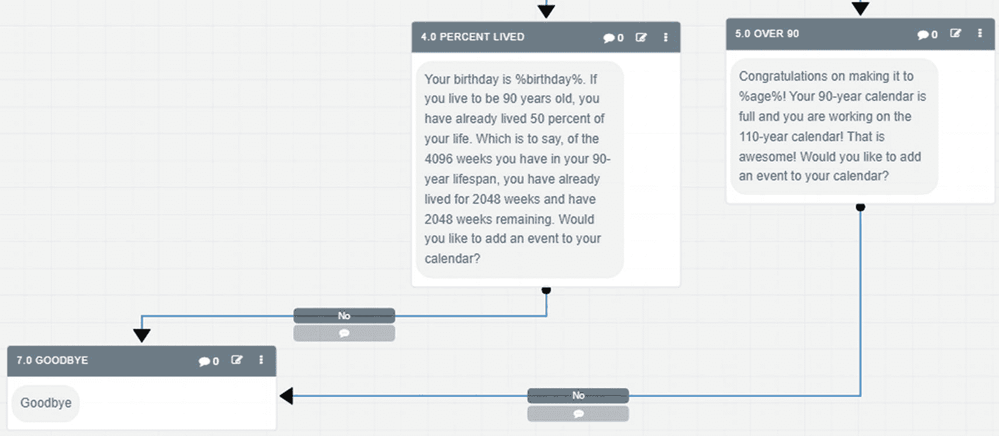

图 8-23 添加“再见”文本框

至于框 2.0，如果我们已经认识该用户，并且他们不想向日历添加事件，这可能会很有趣。他们想做什么呢？

### 你想做什么？

如果用户是回访用户，并且他们不想添加另一个事件，他们想做什么？我们应该让 Alexa 询问他们，并准备好处理许多不同的回答。请参见图 8-24 了解额外的文本框以及“不”意图的另一种用法。

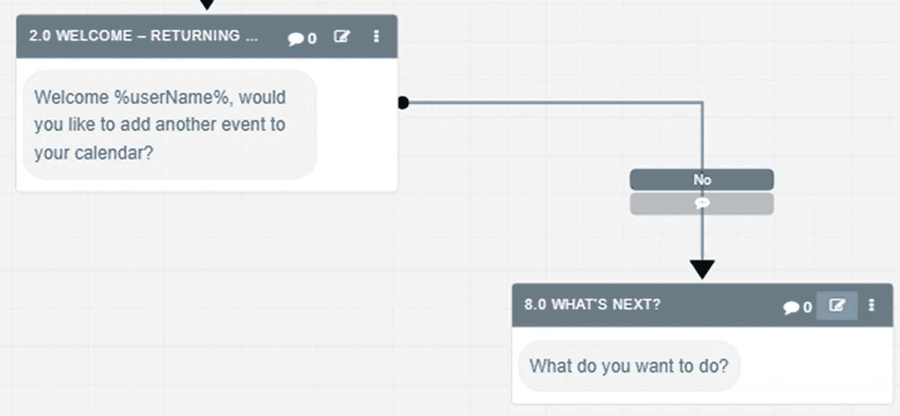

图 8-24 询问用户下一步做什么

我们的对话处理了用户告诉我们他们不想添加事件的情况。现在我们已经准备好添加“是”路径了。但是……

### 已关联账户与未关联账户

是的，用户想要将事件添加到他们的日历中。但是，如果他们的账户未关联，我们如何知道谁在登录，又如何存储这个特定用户的数据呢？因此，对于尚未关联我们技能的用户，我们需要设置一个分流路径。我们先来添加这个功能。我们需要让 Alexa 指示用户关联他们的账户。我们需要知道账户是否已关联，因此需要一个变量来记录。然后，我们可以使用 `Yes` 意图，并基于这个新变量设置一个条件，来重新引导用户，让 Alexa 说出类似这样的话：“您需要关联您的账户才能保存您的生活事件。此项服务不收取任何费用。您的数据经过加密且安全。要关联您的账户，请使用您手机上的 Alexa 应用。” 示例如图 8-25 所示。

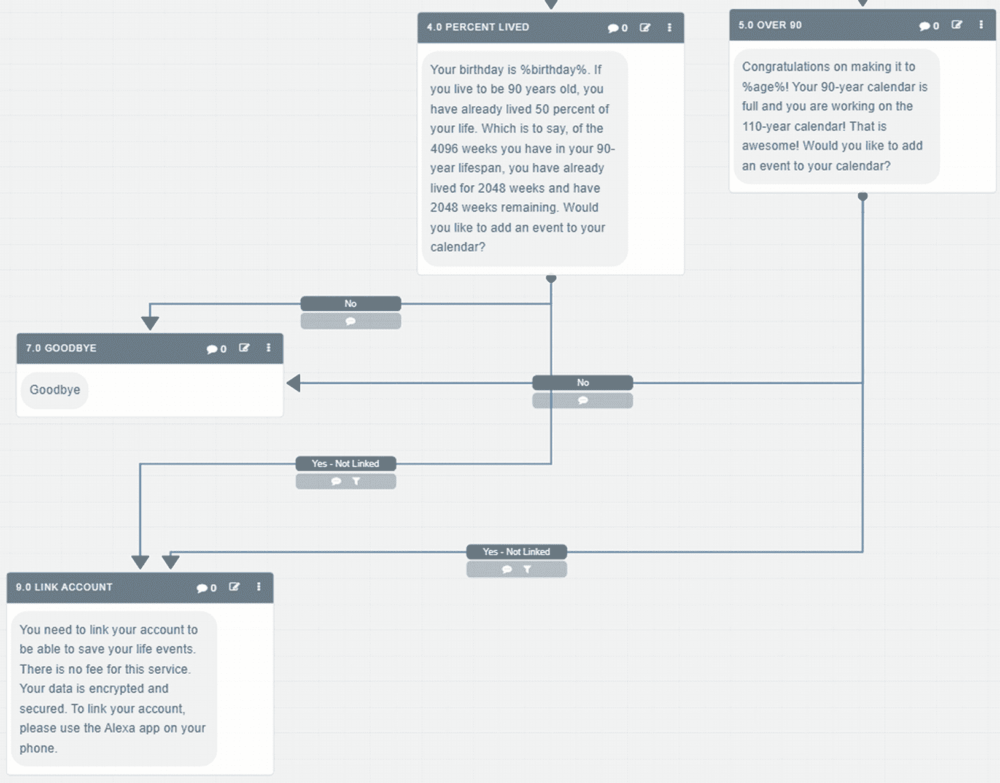

图 8-25 要求用户关联其账户

如果用户返回时账户已关联，我们就可以获取事件信息。

#### 获取事件

现在我们知道用户是谁了，Alexa 需要询问他们事件的详细信息。我们可以使用 `Intent` 模型按顺序执行此操作，或者使用对话的 `Conversations` 模型来更灵活地处理。无论哪种方式，我们都需要向用户询问`事件日期`、`事件类型`和简短的事件描述。`事件类型`将是一个可供选择的简短列表，因此当我们创建变量时，需要为`事件类型`变量添加一个`实体`。这三个变量如图 8-26 所示。

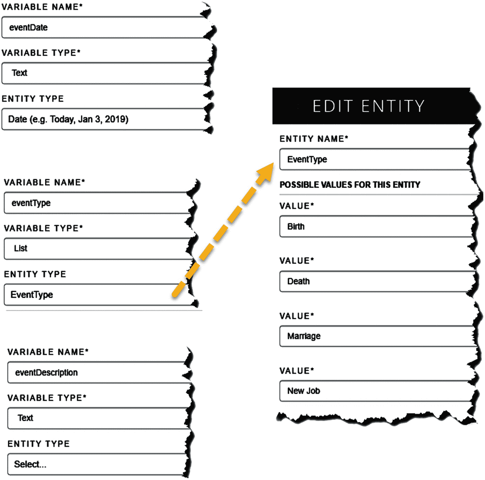
图 8-26
事件变量和 `EventType` 实体

接下来，我们需要添加意图，让用户提供`事件日期`、`类型`和`描述`，如图 8-27 所示。请注意每个意图如何填充一个变量。

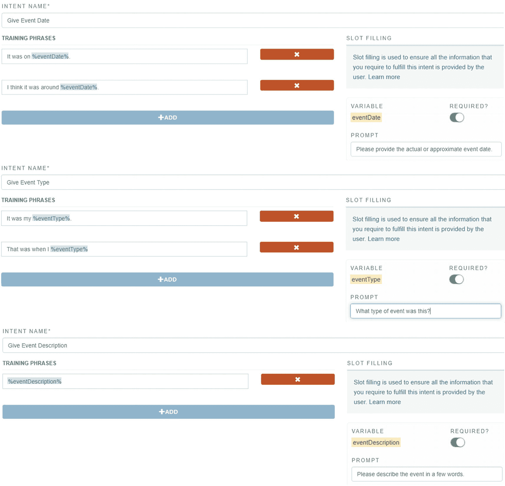
图 8-27
事件意图

现在，我们可以添加事件对话，利用这些意图为我们提供所需的事件数据。一旦用户确认了日期和类型，我们就可以重新绘制日历，并添加新事件。事件对话如图 8-28 所示。

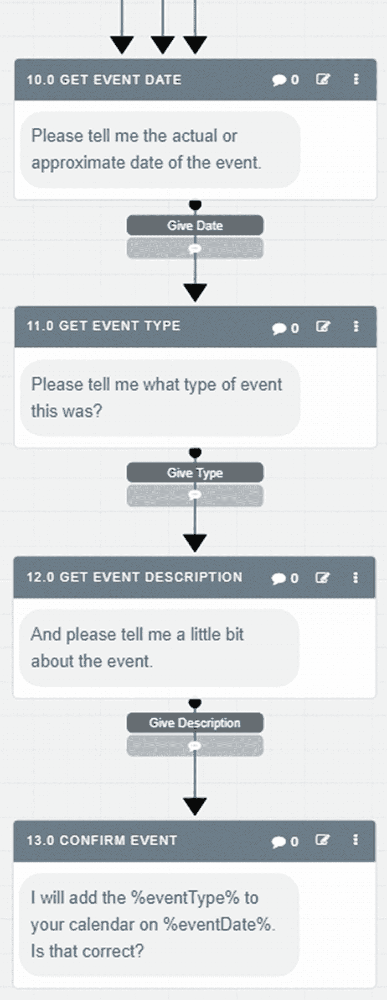
图 8-28
用于捕获我们所需事件详情的基本对话

事件确认后，我们应该询问用户是否要添加另一个事件并捕获该事件。这需要添加框 `14.0 事件已确认`。然后，您可以循环回到框 `10.0` 以获取下一个事件。如果用户说“不”，则跳转到框 `8.0` 并确定用户接下来想做什么。现在我们已经捕获了技能这一部分的理想路径，那么还有哪些其他可能的情况呢？

### 接下来会发生什么？

用户还能用我们的技能做什么？您将如何在对话中体现这一点？回到框 `8.0`，并从那里开始填充对话。（见图 8-29。）

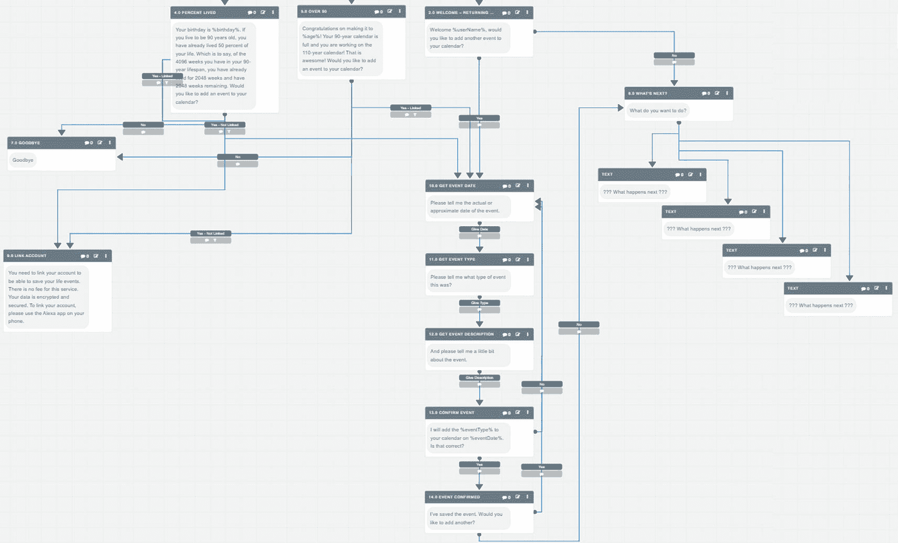
图 8-29
接下来会发生什么？

从框 `8.0` 开始的一些附加功能想法包括：
- 重新绘制日历并添加事件。
- 打印日历。
- 通过电子邮件发送 Excel、PDF 或图片格式的日历。
- 使用 API 帮助用户查找世界事件。

Botmock 的功能远不止于此。我们需要重新审视我们所有的意图，并添加更多的训练短语。例如，`GiveBirthday` 意图应该被训练以接受：

- `我的生日是 %birthday%。`
- `我的生日是 %birthday%。`
- `我的出生日期是 %birthday%。`
- `我的出生日期是 %birthday%。`
- `我出生于 %birthday%。`
- `%birthday%。`

以及您能想到的任何其他变体。

在 Botmock 中，您可以在对话中设置旅程（或路径）。（见图 8-30。）这些路径帮助您可视化用户可以通过对话采取的各种路径。您还可以交互式地运行对话并查看其流程。您可以邀请审阅者检查您的对话并发表评论。您也可以为您的流程设置用户测试。

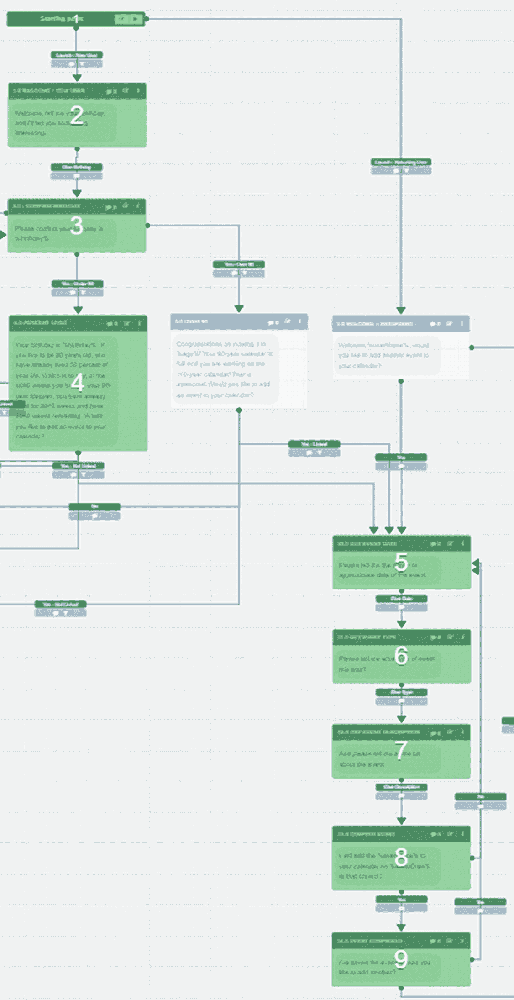
图 8-30
我们对话中的理想路径旅程

您可以导出您的对话模型并将其导入另一个名为 Botium ([`https://botium.ai`](https://botium.ai)) 的工具。Botium 是一个自动化对话测试工具，它会接收您的 Botmock 对话并将其分解为一组测试脚本，这些脚本可以作为自动化构建的一部分运行。

要从 Botmock 导出，请查看 GitHub 上的这个项目：[`https://github.com/Botmock/botmock-dialogflow-export`](https://github.com/Botmock/botmock-dialogflow-export)

要导入到 Botium，请查看 GitHub 上的这个项目：[`https://github.com/codeforequity-at/botium-exporter-botmock`](https://github.com/codeforequity-at/botium-exporter-botmock)

最后，您可以使用 GitHub 上的这个项目将您的对话导出为 Alexa Skills Kit 格式：[`https://github.com/Botmock/botmock-skills-kit-export`](https://github.com/Botmock/botmock-skills-kit-export)

### 总结

本章超越了典型的 Hello World 示例，为一个 90 年日历技能设计了对话。我们学习了意图、变量/槽位以及实体类型/列表。我们学习了如何使用 Botmock 来导航和记录一个包含多条路径和大量选项的复杂对话模型。在下一章中，我们将创建我们的新技能并配置 VUI。

## 9. 配置 VUI

在第 8 章中，我们在 Botmock 中为我们的 90 年日历技能创建了一个对话流程图。现在，我们将把这个流程图转换为 Alexa 技能中的语音用户界面。在本章中，我们将根据该图创建意图、槽位和响应。在本节的第一部分，我们将把 Botmock 图转换为 Alexa 技能。

### 导出 Botmock 图表

要导出 Botmock 图表，我们需要下载并组装一个工具，该工具使用 Botmock API 将图表导出为 Alexa Skills Kit (ASK) 可用于构建技能的格式。我们首先从 GitHub 获取代码。


图 9-1
从 GitHub 下载 Skills Kit 导出工具

1. 在浏览器中导航至 [`https://github.com/Botmock/botmock-skills-kit-export`](https://github.com/Botmock/botmock-skills-kit-export)。
2. 点击绿色的 Code 按钮，选择最后一个选项 Download ZIP。（见图 9-1。）


图 9-2
解压后的 `botmock-skills-kit-export-master` 文件夹

3. 下载完成后，将文件移动到编码目录中的一个新文件夹中并解压。这将创建一个名为 `botmock-skills-kit-export-master` 的文件夹。（见图 9-2。）


图 9-3
下载 Node.js 安装程序

4. 从该文件夹打开命令行。为此，请按住 Shift 键并右键单击该文件夹，然后选择 a) 在此处打开命令窗口，b) 在此处打开 PowerShell 窗口，或 c) 在此处打开 Git Bash。
5. 在命令行中输入 `npm -v`。这将报告您已安装的 npm 版本。如果收到错误消息，则需要安装 npm。如果版本低于 6.14.x，则需要安装最新版本的 npm。
6. npm 随 Node.js 一起安装。要安装 Node.js，请从 [`https://nodejs.org/`](https://nodejs.org/) 下载安装程序。您很可能需要安装 LTS（长期支持）版本。示例见图 9-3。


图 9-4
运行 `npm install`

7. 安装 Node.js 后，npm 也会被安装。
8. 在命令行中运行 `npm install`。（见图 9-4。）


图 9-5
在 Botmock 中访问设置菜单

9. npm 将下载并安装运行导出所需的 npm 包。
10. 在 `npm install` 之后，最好运行 `npm audit fix`。
11. 仍在命令行中，运行 `mv ./sample.env ./.env`。
12. 在 Notepad++ 中编辑 `.env` 文件。
13. 切换到浏览器，打开您的 Botmock 项目，点击齿轮图标进入设置。（见图 9-5。）


图 9-6
从 Botmock 获取 API 信息

14. 点击 API Info 选项卡，然后点击 *Copy .env file for API usage*。（见图 9-6。）
15. 将其粘贴到 Notepad++ 的 `.env` 文件中，覆盖已有的文本。
16. 切换回 Botmock，点击 *generate your API key here* 链接。（同样见图 9-6。）


图 9-7
创建 API 令牌

17. 在 *Create API Token* 屏幕上，输入一个 *Token Name*，例如 `Botmock Token`。
18. 勾选 *Access your Teams and Projects* 复选框。
19. 点击 *Create*。（见图 9-7。）
20. 现在点击 *Copy to Clipboard* 按钮。
21. 将整个令牌粘贴到 Notepad++ 中 `.env` 文件的双引号之间。
22. 此时我本可以向你展示 `.env` 文件，但那样我就得用特工 K 的闪光装置抹去你对这件事的记忆。
23. 另外，我还需要提醒你此时保存工作吗？

下载了导出工具、安装了 npm 包并配置了 `.env` 文件后，你就可以运行导出了。

24. 在命令行中运行 `npm start`。这将创建一个包含 `90-Year Calendar.json` 文件的 `output` 文件夹。

至此，我们已经导出了对话文件。在下一节中，我们将使用该文件来创建技能的基本框架。

### 创建技能

要从导出的 Botmock 文件创建技能，我们需要启动 Alexa 开发者控制台。然后我们可以打开在第 7 章中创建的自定义技能。接着，我们将放入来自 Botmock 的 JSON，并花一些时间调整结果。

首先，打开浏览器访问 [`https://developer.amazon.com/alexa/console/ask`](https://developer.amazon.com/alexa/console/ask)。然后点击我们在第 7 章中创建的 90 年日历技能。

现在我们可以使用 Botmock 文件为我们的技能创建初始模型。尽管之后我们还需要调整和修改模型，但这将为我们节省大量时间。展开左侧导航栏中的交互模型。然后按照以下说明操作：

1. 点击 *JSON Editor*。
2. 点击 *Drag and drop a .json file*。
3. 找到并选择来自 Botmock 的 `90-Year Calendar.json` 文件。
4. 点击顶部的 *Save Model* 按钮。
5. 现在点击顶部的 *Build Model* 按钮。

查看所有错误。这些是 Botmock 模型与 Alexa 模型不完全匹配的地方。幸运的是，通过编辑意图并确保槽位正确定义，这些错误相对容易修复。无需编辑 JSON，我们可以通过 Alexa 开发者控制台修复这些问题，如下一节所述。

### 清理对话模型

从 Botmock 导入模型后，我们需要做一些修正。在此之前，你需要做出一个选择：是否使用下划线，这是个问题。也就是说，你希望在意图名称中使用下划线，还是移除空格改用驼峰式命名？我个人偏好驼峰式。但 `Under_Score` 也完全没问题。现在做出选择，但请保持一致性。

首先选择 `GiveBirthday` 意图。

1. 将意图名称从 `Give Birthday` 重命名为 `GiveBirthday`，或者如果你更喜欢，也可以改为 `Give_Birthday`。
2. 然后向下滚动到“意图槽位”，在名称栏中输入 `birthday`，并点击 `+按钮` 添加它。现在选择 `AMAZON.Date` 作为槽位类型。

选择 `Give Event Date` 意图并进行相同的修正。

3. 重命名该意图。
4. 添加 `eventDate` 槽位，并选择 `AMAZON.Date` 作为槽位类型。

选择 `Give Event Description` 意图并进行修正。

5. 重命名该意图。
6. 添加 `eventDescription` 槽位，并选择 `AMAZON.SearchQuery` 作为槽位类型。（`AMAZON.SearchQuery` 允许用户说出一个简短短语，我们可以将其捕获为事件描述。）

选择 `Give Event Type` 意图并进行修正。注意：槽位类型无需修正，因为 Botmock 模型已经为 `eventType` 设置了槽位类型。

7. 重命名该意图。

分别重命名 `EmailCalendar`、`AddEvent` 和 `PrintCalendar` 这三个意图。

接下来，我们需要删除 `LaunchIntent`。`LaunchIntent` 只需被删除，因为它实际上不是一个意图，而是调用短语。点击左侧导航栏中的 `Intents` 标题。找到 `LaunchIntent`，点击其右侧的 `Delete` 按钮。确认警告信息。

接下来，我们需要将 `Yes` 和 `No` 意图从自定义意图转换为内置意图。我们可以通过将 `AMAZON.YesIntent` 和 `AMAZON.NoIntent` 添加到意图列表中，并删除已有的 `Yes` 和 `No` 意图来实现。

此外，我们还应该添加一些其他内置意图来更好地控制技能。具体来说，添加 `AMAZON.RepeatIntent`、`AMAZON.StartOverIntent` 和 `AMAZON.StopIntent`。

最后，由于我们将管理一个事件列表，因此需要添加 `AMAZON.MoreIntent`、`AMAZON.NextIntent`、`AMAZON.PageDownIntent`、`AMAZON.PageUpIntent`、`AMAZON.PreviousIntent`、四个 `AMAZON.Scroll*Intents` 以及 `AMAZON.SelectIntent`。

当你完成内置意图的添加后，你的意图列表应如图 9-8 所示。


图 9-8
我们将进行编码的自定义意图和内置意图

现在我们已经设置好了意图，下一章将为带屏幕的 Alexa 设备创建可视化界面。

### 本章小结

在本章中，我们将 Botmock 图表转换为 Alexa 技能并配置了 VUI。在下一章中，我们将使用 Alexa 演示语言（APL）为带屏幕的 Alexa 设备创建可视化演示。

## 10. 使用 APL 在屏幕上进行演示

在第 9 章中，我们将 Botmock 图表转换为 Alexa 技能并配置了 VUI。然而，我们 90 年日历技能的主要目的是向你展示你的 90 年日历。为此，我们需要检查设备是否有屏幕，如果有，我们可以使用 Alexa 演示语言（APL）创建一个 90 年日历演示。“APL 文档是一个 JSON 结构，它定义了一个在视口上显示的模板。该文档控制视觉响应的整体结构和布局。”^(19) 换句话说，APL 是一个改变设备显示的 JSON 文件。本章将研究该文件及其绑定的数据，以在屏幕上绘制一个简单的 90 年日历，首先从介绍 APL 编辑器开始。

### APL 编辑器

要从 Alexa 开发者控制台进入 APL 编辑器，请确保你位于`Build`选项卡，并且左侧导航栏中的`Assets`已展开。然后选择`Interfaces`。向下滚动到`Alexa Presentation Language`，通过切换开关打开该功能，并确保选择所有`Viewport Profiles`。点击`Save Interfaces`按钮。现在，从左侧导航栏中选择`Multimodal Responses`。参见图 10-1。


**图 10-1** 用于接口和多模态响应的左侧导航栏

浏览器中将打开一个新标签页。选择`Visual responses`选项。然后点击`Create Visual Response`。接下来，选择`Start from scratch`选项。这将打开 APL 编辑器。参见图 10-2。


**图 10-2** APL 编辑器

查看 APL 编辑器，我们可以看到：

1. 左侧导航栏，我们将用它来访问 APL 文档的各个部分
2. 文本面板，我们可以在其中看到 APL 文档的组件或 JSON 文本
3. 所选组件的详细信息
4. 目标屏幕选项
5. APL 文档的视觉预览
6. 组件工具栏，用于向 APL 模板添加组件
7. 在技能模拟器中查看 APL 文档的选项
8. 主工具栏，我们可以在其中预览、保存和下载 APL

在下一节中，我们将规划 UI 的一些组件。

### 90 年日历界面

遗憾的是，我们不能直接用`APL`在屏幕上放一个 Excel 电子表格。相反，我们将使用自定义代码来渲染日历界面。具体来说，我们将使用`SVG`（可缩放矢量图形），采用 Alexa 风格。可以说，使用`SVG`（文档中有时称为 Alexa 矢量图形，即`AVG`），我们可以在带屏幕的设备上绘制任何我们想要的内容。

我们的 90 年日历将使用`SVG`为 90 年中的每一周绘制一个方框。已经过去的周次，我们将方框填满；尚未到来的周次，则保持方框空白。出于性能考虑，我们需要划分三个区域。中间区域是当前年份，其中部分方框填满，部分留空。顶部区域是过去，所有方框都填满。底部区域的所有方框则全部留空。参见图 10-3。


**图 10-3** 我们将绘制的三个区域

为了实现这一点，我们需要在`APL` JSON 格式中定义几个项目。首先，我们要定义一些颜色资源。这些资源允许我们在整个`APL`模型中使用颜色代码，而无需指定具体的颜色名称。因此，我们从黑色和白色开始，但如果你愿意，也可以轻松地将其改为红色和黄色或任何其他颜色。点击左侧导航栏上的“资源”按钮，并输入以下 JSON 代码：

```json
[{
"colors": {
"C0": "black",
"C1": "white"
}
}]
```

定义好颜色后，我们可以创建一个数据集，并将`APL`绑定到该数据集上，以便动态渲染。该数据集将代表区域 1、2 和 3，如图 10-3 所示。在区域 1 和区域 3 中，数据集中的单个条目代表该行的背景颜色。在区域 2 中，单个条目代表该行中每个方块的颜色。在开发阶段，我们只需要少量行。在测试和最终技能中，区域 1 和区域 3 总共需要 89 行（每年一行），区域 2 的单行需要 52 列（每周一列）。要输入数据，请选择左侧导航栏中的“数据”图标，并输入以下 JSON 代码：

```json
{
"data": {
"type": "object",
"properties": {
"zone1": [
"C1",
"C1",
"C1",
"C1",
"C1",
"C1",
"C1"
],
"zone2": [
"C0",
"C0",
"C0",
"C0",
"C0",
"C0",
"C0",
"C0",
"C0",
"C1",
"C0",
"C0",
"C0",
"C0",
"C0",
"C0",
"C0",
"C0",
"C0",
"C1",
"C0",
"C0",
"C0",
"C0",
"C0",
"C0",
"C0",
"C0",
"C0",
"C1",
"C0",
"C0",
"C0",
"C0",
"C0",
"C0",
"C0",
"C0",
"C0",
"C1",
"C0",
"C0",
"C0",
"C0",
"C0",
"C0",
"C0",
"C0",
"C0",
"C1",
"C0",
"C0"
],
"zone3": [
"C0",
"C0",
"C0",
"C0",
"C0"
]
}
}
}
```

对于每个区域，我们还需要知道另一个动态参数——它的高度（以像素为单位）。最终，高度将在我们的技能代码中计算得出，但对于示例数据，我们可以对其进行硬编码。在图 10-3 中，每个方框有 2 像素的边框，并且包括边框在内是 32 像素见方。对于区域 1，我们的示例数据有 7 行。区域 2 有 1 行。区域 3 有 5 行。因此，各区域的高度为：

- 区域 1：7 × 32 = 224。
- 区域 2：1 × 32 = 32。
- 区域 3：5 × 32 = 160。
- 总宽度：52 × 32 = 1664。
- 总高度：90 × 32 = 2880。

在数据集的区域 3 数据之后，我们需要添加以下 JSON 代码：

```json
"zone1Height": 224,
"zone2Height": 32,
"zone3Height": 160,
"totalWidth": 1664,
"totalHeight": 2880
```

添加这些项目后，JSON 代码将如图 10-4 所示。


**图 10-4** 数据 JSON 条目（区域已折叠）

至此，我们可以配置文档的导入。

### 配置文档的导入

我们需要导入`alexa-styles`模块和`alexa-layouts`模块。点击左侧导航栏上的“文档”图标，并输入以下 JSON 代码：

```json
{
"type": "APL",
"version": "1.5",
"theme": "dark",
"import": [{
"name": "alexa-styles",
"version": "1.1.0"
},
{
"name": "alexa-layouts",
"version": "1.2.0"
}
]
}
```

接下来，我们需要为 90 年日历定义三个形状——每个区域一个。

#### 绘制三个区域

区域 2 的形状是一个简单的方框。区域 1 和区域 3 则是复杂的方框行。在 SVG 中，绘制一个简单的正方形，需要将笔移动到一个顶点，然后向每个顶点画线，形成正方形的边。就像这样：

`M0,0 L0,6 L6,6 L6,0 L0,0`（见图 10-5）。


**图 10-5**

在 SVG 中绘制正方形

在我们的案例中，对于区域 2，我们希望绘制一个 32×32 且带有 2 像素边框的方框。SVG 命令将是：

```
M0,0 L0,31 L31,31 L31,0 L0,0 M1,1 L1,30 L30,30 L30,1 L1,1
```

使用此命令，我们可以创建绘制区域 2 中方框所需的图形。点击左侧导航栏上的“图形”图标，并输入以下 Json 代码：

```json
{
"blackBox": {
"type": "AVG",
"version": "1.0",
"height": 32,
"width": 32,
"items": [{
"type": "path",
"stroke": "@C1",
"pathData": "M0,0 L0,31 L31,31 L31,0 L0,0 M1,1 L1,30 L30,30 L30,1 L1,1",
"fill": "@C0"
}]
},
"whiteBox": {
"type": "AVG",
"version": "1.0",
"height": 32,
"width": 32,
"items": [{
"type": "path",
"stroke": "@C0",
"pathData": "M0,0 L0,31 L31,31 L31,0 L0,0 M1,1 L1,30 L30,30 L30,1 L1,1",
"fill": "@C1"
}]
}
}
```

**提示：** 尽早保存，经常保存。请确保经常保存你的工作。（首次保存时，你需要为模板命名。）

有了这些基础构件，我们就可以开始组合 APL 文档的主模板了。`mainTemplate`部分接受一个名为`payload`的参数，该参数绑定到我们之前在模板中输入的数据。我们的数据对象具有一些属性，我们可以使用 APL 变量替换来访问它们，例如：`"${payload.data.properties.propertyname}"`。

我们有三个区域，我们将为每个区域使用一个 APL `GridSequence`对象。这些对象都将放在一个 APL `Container`对象中。点击左侧导航栏上的“APL”图标。向下滚动找到以下代码块：

```json
"mainTemplate": {
"parameters": [
"payload"
],
"items": []
}
```

然后，通过添加`Container`和三个`GridSequences`来修改该代码，如下所示：

```json
"mainTemplate": {
"parameters": [
"payload"
],
"items": [{
"type": "Container",
"width": "${payload.data.properties.totalWidth}",
"height": "${payload.data.properties.totalHeight}",
"paddingLeft": "10",
"paddingTop": "10",
"paddingRight": "10",
"paddingBottom": "10",
"items": [{
"type": "GridSequence",
"width": "${payload.data.properties.totalWidth}",
"height": "${payload.data.properties.zone1Height}",
"childHeight": "32",
"childWidth": "32",
"data": "${payload.data.properties.zone1}",
"items": [{
"type": "VectorGraphic",
"source": "blackBox"
}]
},
{
"type": "GridSequence",
"width": "${payload.data.properties.totalWidth}",
"height": "${payload.data.properties.zone2Height}",
"childHeight": "32",
"childWidth": "32",
"data": "${payload.data.properties.zone2}",
"items": [{
"type": "VectorGraphic",
"source": "blackBox"
}]
},
{
"type": "GridSequence",
"width": "${payload.data.properties.totalWidth}",
"height": "${payload.data.properties.zone3Height}",
"childHeight": "32",
"childWidth": "32",
"data": "${payload.data.properties.zone3}",
"items": [{
"type": "VectorGraphic",
"source": "whiteBox"
}]
}
]
}]
}
```

有了这段代码，右侧渲染出的示例应如图 10-6 所示。


**图 10-6**

在划分出三个区域后渲染出的示例

接下来，我们可以为区域 2 的方框添加一个`when`子句，使它们根据数据值改变颜色。如下所示修改区域 2 的代码：

```json
"data": "${payload.data.properties.zone2}",
"items": [{
"when": "${data == 'C1'}",
"type": "VectorGraphic",
"source": "whiteBox"
},
{
"when": "${data == 'C0'}",
"type": "VectorGraphic",
"source": "blackBox"
}
]
```

请注意，`data`这个术语是在`items`之前声明的，这样我们就可以为`data`数组中的每个元素获取一个`item`。在`items`内部，我们引用的是`data`术语，而不是`properties.zone2`术语。

现在到了棘手的部分。如果我们像绘制区域 2 中的单行那样绘制其他行，整个绘制过程将耗费大量时间。为了提高性能，我们需要一次性绘制整行。这需要大量的数学计算，因此在 Excel 中组合 SVG 表达式是最简单的方法。首先，我们可以创建一个光标/笔需要移动以绘制线条的路径图，类似于图 10-7。


**图 10-7**

绘制一行线条时光标移动路径图

因此，完成的 SVG 表达式将如下所示：

```
M0,0 L1663,0 L1663,1 L0,1 L0,2 L0,29 L1,29 L1,2 M30,2 L30,29 L31,29 L31,2 L32,2 L32,29 L33,29 L33,2 M62,2 L62,29 L63,29 L63,2 M1662,2 L1662,29 L1663,29 L1663,2 M1663,30 L0,30 L0,31 L1663,31
```

我们需要弄清楚中间部分（前面代码中箭头所指的位置）应该是什么。回到 Excel 中，我们将通过查看垂直线的顶点来输入 SVG 表达式的初始值。在图 10-7 中，这些顶点从`L0,2`开始，然后向下到`L0,29`，再向右到`L1,29`，然后到`L1,2`，接着是`M30,2`，依此类推。这种模式在第八个条目之后重复。在一个新的工作表中，在 A 列中，输入每个顶点的第一个数字：0, 0, 1, 1, 30, 30, 31, 31。在 B 列中，输入每个顶点的第二个数字：2, 29, 29, 2, 2, 29, 29, 2。在 C 列中，输入每个顶点对应的笔移动字母：L, L, L, L, M, L, L, L，如图 10-8 所示。


**图 10-8**

SVG 表达式的初始值

现在，我们可以在第九行输入公式，如下所示：

|   | A | B | C |
|--- |--- |--- |--- |
| **9** | `=A1+32` | `=B1` | `=C1` |

此外，在 E 列和 F 列的第 1 行和第 2 行，输入公式以连接 A、B、C 列生成的值：

|   | E | F |
|--- |--- |--- |
| **1** | `=CONCAT(C1,A1,",",B1," ")` | `=E1` |
| **2** | `=CONCAT(C2,A2,",",B2," ")` | `=CONCAT(F1, E2)` |

现在将`E2:F2`的公式向下复制到第 3:9 行。然后小心地将`A9:F9`的公式向下复制到第 10:416 行。最终的工作表将如图 10-9 所示。


图 10-9 包含完整 SVG 表达式的最终工作表

因此，完成的 SVG 表达式将由顶部两行组成：

```
M0,0 L1663,0 L1663,1 L0,1
```

接着是来自 Excel 单元格`F416`的大字符串：

```
L0,2 L0,29 L1,29 L1,2 M30,2 L30,29 L31,29 L31,2 L32,2 L32,29 L33,29 L33,2 M62,2 L62,29 L63,29 L63,2 L64,2 L64,29 L65,29 L65,2 L1601,2 M1630,2 L1630,29 L1631,29 L1631,2 L1632,2 L1632,29 L1633,29 L1633,2 M1662,2 L1662,29 L1663,29 L1663,2
```

最后是底部两行：

```
M1663,30 L0,30 L0,31 L1663,31
```

回到 Alexa 开发者控制台，我们将复制并粘贴`blackBox`和`whiteBox`图形代码，以创建`blackRow`和`whiteRow`图形。为此，点击左侧导航栏上的“图形”图标，复制`blackBox`和`whiteBox`代码，并分别重命名为`blackRow`和`whiteRow`。然后将宽度改为 1664，并将`pathData`改为前面展示的巨大 SVG 表达式。我们可以移除行的填充，因为我们绘制的不是闭合形状，所以填充无关紧要。但我们需要为区域 3 的行添加白色背景，因此我们将添加一个纯色填充矩形来实现这一点。代码如下：

```json
{
"blackRow": {
"type": "AVG",
"version": "1.2",
"height": 32,
"width": 1664,
"viewportHeight": 32,
"viewportWidth": 1664,
"items": [{
"type": "path",
"stroke": "@C1",
"pathData": "M0,0 L1663,0 L1663,1 L0,1 L0,2 L0,29 L1,29 L1,2 M30,2 L30,29 L31,29 L31,2 L32,2 L32,29 L33,29 L33,2 M62,2 L1630,29 L1631,29 L1631,2 L1632,2 L1632,29 L1633,29 L1633,2 M1662,2 L1662,29 L1663,29 L1663,2 M1663,30 L0,30 L0,31 L1663,31"
}]
},
"whiteRow": {
"type": "AVG",
"version": "1.2",
"height": 32,
"width": 1664,
"viewportHeight": 32,
"viewportWidth": 1664,
"items": [{
"type": "path",
"stroke": "@C1",
"pathData": "M0,0 L1663,0 L1663,31 L0,31",
"fill": "@C1"
},
{
"type": "path",
"stroke": "@C0",
"pathData": "M0,0 L1663,0 L1663,1 L0,1 L0,2 L0,29 L1,29 L1,2 M30,2 L30,29 L31,29 L31,2 L32,2 L32,29 L33,29 L33,2 L1630,29 L1631,29 L1631,2 L1632,2 L1632,29 L1633,29 L1633,2 M1662,2 L1662,29 L1663,29 L1663,2 M1663,30 L0,30 L0,31 L1663,31"
}
]
}
}
```

完成后，你应该会看到如图 10-10 所示的代码。


图 10-10 `blackRow` 和 `whiteRow` 的图形定义

请注意新增的 `viewportHeight` 和 `viewportWidth` 属性。这些属性表示图形的完整尺寸（32 × 1664）。而 `height` 和 `width` 属性将是缩放后的版本。

现在，我们将对 `height` 和 `width` 进行参数化，以便图形能够针对不同的 Echo 设备正确缩放。

### 参数化高度和宽度

切换回 APL 模板（点击左侧导航栏中的 APL 图标）。在这里，我们将把区域 1 和区域 3 的 `childHeight` 和 `childWidth` 分别更改为 `${payload.data.properties.boxHeight}` 和 `${payload.data.properties.rowWidth}`。同时，我们将把区域 1 和区域 3 的 `blackBox`/`whiteBox` 源更改为 `blackRow`/`whiteRow`。最终你将得到如图 10-11 所示的代码。


图 10-11 切换到行图形后区域 1 和区域 3 的代码

最后，我们需要将图 10-10 中的代码属性添加到示例数据中。方法是点击左侧导航栏中的数据图标，并将以下 JSON 添加到数据底部：

```
"zone1Height": 1600,
"zone2Height": 32,
"zone3Height": 1248,
"totalWidth": 1664,
"totalHeight": 2880,
"boxHeight": 32,
"boxWidth": 32,
"rowWidth": 1664
```

完成所有这些设置后，最终的预览效果应如图 10-12 所示。


图 10-12 切换到行图形后的预览效果

现在我们需要更改数据以处理缩放问题。

### 缩放方块和行以适配屏幕

首先，我们将添加剩余的示例数据，然后缩放区域高度以适配 Echo Show 2 的屏幕。

点击左侧导航栏中的数据图标。更新代码，使区域 1 有 50 行，区域 3 有 39 行。加上区域 2 现有的 52 列（一行），我们得到 50 + 1 + 39 = 90 年的周数据。因此，完整的数据 JSON 如下：

```
{
"data": {
"type": "object",
"properties": {
"zone1": [
"C1",
"C1",
"C1",
...
"C1",
"C1",
"C1"
],
"zone2": [
"C1",
"C1",
...
"C0",
"C0"
],
"zone3": [
"C0",
"C0",
"C0",
...
"C0",
"C0",
"C0"
],
"zone1Height": 1600,
"zone2Height": 32,
"zone3Height": 1248,
"totalWidth": 1664,
"totalHeight": 2880,
"boxHeight": 32,
"boxWidth": 32,
"rowWidth": 1664
}
}
}
```

为了将方块缩放以适配分辨率为 1280 x 800 像素的 Echo Show 2，我们需要按如下方式减小方块高度：

*   800 像素除以 90 行 = 800 / 90 = 8.889 ~ 8

并按如下方式减小方块宽度：

*   1280 像素除以 52 列 = 1280 / 52 = 24.231 ~ 24

因此，一行的净宽度为：

*   24 × 52 = 1248。

各区域的高度则为：

*   区域 1：8 × 50 = 400
*   区域 2：8
*   区域 3：8 × 39 = 312

将这些值代入数据属性后，数据变为：

```
"zone1Height": 400,
"zone2Height": 8,
"zone3Height": 312,
"totalWidth": 1664,
"totalHeight": 2880,
"boxHeight": 8,
"boxWidth": 24,
"rowWidth": 1248
```

现在我们已经输入了数据并配置了参数，你应该会得到一个如图 10-13 所示的图表。


图 10-13 完成的 90 年日历

### 完成的 APL 代码

最终的 APL 模板如下：

```json
{
"type": "APL",
"version": "1.5",
"theme": "dark",
"import": [{
"name": "alexa-styles",
"version": "1.1.0"
},
{
"name": "alexa-layouts",
"version": "1.2.0"
}
],
"settings": {},
"resources": [{
"colors": {
"C0": "black",
"C1": "white"
}
}],
"styles": {},
"onMount": [],
"graphics": {
"blackBox": {
"type": "AVG",
"version": "1.2",
"height": 32,
"width": 32,
"viewportHeight": 32,
"viewportWidth": 32,
"items": [{
"type": "path",
"stroke": "@C1",
"pathData": "M0,0 L0,31 L31,31 L31,0 L0,0 M1,1 L1,30 L30,30 L30,1 L1,1",
"fill": "@C0"
}]
},
"whiteBox": {
"type": "AVG",
"version": "1.2",
"height": 32,
"width": 32,
"viewportHeight": 32,
"viewportWidth": 32,
"items": [{
"type": "path",
"stroke": "@C0",
"pathData": "M0,0 L0,31 L31,31 L31,0 L0,0 M1,1 L1,30 L30,30 L30,1 L1,1",
"fill": "@C1"
}]
},
"blackRow": {
"type": "AVG",
"version": "1.2",
"height": 32,
"width": 1664,
"viewportHeight": 32,
"viewportWidth": 1664,
"items": [{
"type": "path",
"stroke": "@C1",
"pathData": "M0,0 L1663,0 L1663,1 L0,1 L0,2 L0,29 L1,29 L1,2 M30,2 L30,29 L31,29 L31,2 L32,2 L32,29 L33,2M1662,2 L1662,29 L1663,29 L1663,2 M1663,30 L0,30 L0,31 L1663,31"
}]
},
"whiteRow": {
"type": "AVG",
"version": "1.2",
"height": 32,
"width": 1664,
"viewportHeight": 32,
"viewportWidth": 1664,
"items": [{
"type": "path",
"stroke": "@C1",
"pathData": "M0,0 L1663,0 L1663,31 L0,31",
"fill": "@C1"
},
{
"type": "path",
"stroke": "@C0",
"pathData": "M0,0 L1663,0 L1663,1 L0,1 L0,2 L0,29 L1,29 L1,2 M30,2 L30,29 L31,29 L31,2 L32,2 L32,29 L33,2 M1662,2 L1662,29 L1663,29 L1663,2 M1663,30 L0,30 L0,31 L1663,31"
}
]
}
},
"commands": {},
"layouts": {},
"mainTemplate": {
"parameters": [
"payload"
],
"items": [{
"type": "Container",
"height": "${payload.data.properties.totalHeight}",
"width": "${payload.data.properties.totalWidth}",
"paddingLeft": "10",
"paddingTop": "10",
"paddingRight": "10",
"paddingBottom": "10",
"items": [{
"type": "GridSequence",
"height": "${payload.data.properties.zone1Height}",
"childHeight": "${payload.data.properties.boxHeight}",
"childWidth": "${payload.data.properties.rowWidth}",
"data": "${payload.data.properties.zone1}",
"items": [{
"type": "VectorGraphic",
"source": "blackRow",
"height": "${payload.data.properties.boxHeight}",
"width": "${payload.data.properties.rowWidth}"
}]
},
{
"type": "GridSequence",
"width": "${payload.data.properties.totalWidth}",
"height": "${payload.data.properties.zone2Height}",
"childHeight": "${payload.data.properties.boxHeight}",
"childWidth": "${payload.data.properties.boxWidth}",
"data": "${payload.data.properties.zone2}",
"items": [{
"when": "${data == 'C1'}",
"type": "VectorGraphic",
"source": "whiteBox",
"height": "${payload.data.properties.boxHeight}",
"width": "${payload.data.properties.boxWidth}"
},
{
"when": "${data == 'C0'}",
"type": "VectorGraphic",
"source": "blackBox",
"height": "${payload.data.properties.boxHeight}",
"width": "${payload.data.properties.boxWidth}"
}
]
},
{
"type": "GridSequence",
"height": "${payload.data.properties.zone3Height}",
"childHeight": "${payload.data.properties.boxHeight}",
"childWidth": "${payload.data.properties.rowWidth}",
"data": "${payload.data.properties.zone3}",
"items": [{
"type": "VectorGraphic",
"source": "whiteRow",
"height": "${payload.data.properties.boxHeight}",
"width": "${payload.data.properties.rowWidth}"
}]
}
]
}]
}
}
```

### 总结

在前面的章节中，你为 90 年日历技能设计并实现了 VUI。在本章中，你使用 APL、SVG 和 Json 为带屏幕的 Alexa 设备构建了视觉呈现。在下一章中，我们将创建后端 lambda 函数，为 VUI 提供代码支持，并将 VUI 连接到 APL。

脚注 1

# 11. 编写 Lambda 函数

## 开始之前

首先，在第 9 章中，我们将 Botmock 图表转换为 Alexa 技能并配置了 VUI。在第 10 章中，我们为 90 年日历的视觉显示添加了 APL 呈现。在本章中，我们将创建后端 lambda 函数，为 VUI 提供代码支持，并将 VUI 连接到 APL。由于我们没有使用 Alexa 托管的技能，因此在第 7 章中，我们将 lambda 函数配置为亚马逊网络服务。

1.  首先，以管理员用户身份（而非 root 用户）登录 AWS 开发者控制台。AWS 控制台地址为：`https://console.aws.amazon.com`。
2.  选择服务 | 计算 | `Lambda`。
3.  选择我们在第 7 章中创建的 `CalendarLambdaBackend`。

你应该会在 `lambda_function.py` 文件中看到一小段代码：

```
import json
def lambda_handler(event, context): #TODO implement
return {
'statusCode': 200,
'body': json.dumps('Hello from Lambda!')
}
```

此时，我们需要完成以下几件事：

1.  将 VUI 连接到 lambda 函数。
2.  创建所有将处理意图的函数。
3.  进行计算以得出 90 年日历的值。
4.  定义 90 年日历视觉显示要绑定的数据集。
5.  进行计算以将视觉显示缩放到当前设备的屏幕。
6.  将渲染后的 APL 和语音输出作为响应对象返回。
7.  在 lambda 函数底部定义 `Skill Builder` 对象。

## 将 VUI 连接到 Lambda 函数

要将 VUI 连接到 lambda 函数，我们需要将 Alexa 技能中的技能 ID 复制到 lambda 函数，并将 lambda 函数中的 ARN（亚马逊资源名称）复制到 Alexa 技能。


图 11-1：lambda 函数的 ARN

1.  在 lambda 函数的右上角，你可以看到 ARN。（见图 11-1。）点击图标复制 ARN。
2.  切换到 90 年日历 Alexa 技能。Alexa 开发者控制台地址为：`https://developer.amazon.com/alexa/console/ask`。
3.  从左侧导航栏中选择端点。
4.  将 ARN 粘贴到默认区域框中。
5.  点击顶部的“保存端点”按钮。你应该会看到一条绿色的成功消息。
6.  切换回 AWS 中的 lambda 函数。

在下一节中，我们将创建意图处理器。

## 创建意图处理器

我们的 Alexa 技能交互模型包含许多意图。每个意图都需要在 lambda 函数中进行处理。要创建意图处理器，我们需要导入以下 Python 模块：

```
import json
import logging
import ask_sdk_core.utils as ask_utils
from ask_sdk_core.skill_builder import SkillBuilder
from ask_sdk_core.dispatch_components import AbstractRequestHandler
from ask_sdk_core.dispatch_components import AbstractExceptionHandler
from ask_sdk_core.handler_input import HandlerInput
from ask_sdk_model import Response
```

直接用这些导入语句完全替换已有的代码片段。然后使用以下代码行开启日志记录：

```
logger = logging.getLogger(__name__)
logger.setLevel(logging.INFO)
```

接下来，我们可以查看意图处理器的结构。

### 意图处理程序的结构

意图处理程序的结构如下：

```
class xxxIntentHandler(AbstractRequestHandler):
    """用于 xxx 意图的处理程序。"""
    # 第 A 部分 – 可处理声明
    def can_handle(self, handler_input):
        return ask_utils.is_intent_name("AMAZON.HelpIntent")(handler_input)
    # 第 B 部分 – 处理函数
    def handle(self, handler_input):
        speak_output = """语音内容。"""
        handler_input.attributes_manager.session_attributes["last_speech"] = speak_output
        #第 C 部分 - 返回响应
        return (
            handler_input.response_builder
                .speak(speak_output)
                .ask(speak_output)
                .response
        )
```

如上所示，共有三个部分，具体描述如下。

#### 第 A 部分 – 可处理声明

每个处理程序声明它要处理哪个意图。例如，内置帮助意图的处理程序如下所示：

```
def can_handle(self, handler_input):
    return ask_utils.is_intent_name("AMAZON.HelpIntent")(handler_input)
```

而自定义的“获取完成百分比”意图的处理程序如下所示：

```
def can_handle(self, handler_input):
    return ask_utils.is_intent_name("GetPercentDone")(handler_input)
```

Alexa 的 AI 会遍历所有声明的意图处理程序，并调用与用户所说意图匹配的那个。一旦确定了正确的处理程序类，Alexa 将调用该类的处理函数。

#### 第 B 部分 – 处理函数

每个意图处理程序类都声明一个处理函数，该函数负责确定 Alexa 将说什么来处理用户的意图。例如，90 年日历的内置帮助意图处理程序如下所示：

```
def handle(self, handler_input):
    speak_output = """请尝试以月、日、年的格式说出您的生日。例如，一九八零年一月一日。
    告诉我您的生日，我会告诉您一些有趣的事情。"""
    handler_input.attributes_manager.session_attributes["last_speech"] = speak_output
```

在这个处理程序中，有两行代码。第一行定义了 Alexa 在响应用户寻求帮助时将说的语音内容。第二行是一个辅助函数，将此响应作为 Alexa 最后说的话存储在会话属性中。在某些情况下，我们需要知道 Alexa 最后说了什么。

定义语音内容后，我们将其作为响应对象返回。

#### 第 C 部分 – 返回响应

一旦我们创建了要输出的语音内容，就需要将其转换为响应对象。这是由响应构建器完成的，如下所示：

```
return (
    handler_input.response_builder
        .speak(speak_output)
        .ask(speak_output)
        .response
)
```

第一行调用 `response_builder`。第二行将我们之前创建的语音内容定义为 Alexa 将说的话。第三行将相同的语音内容定义为她向用户提问以继续对话的问题（不过她不会说两次）。第四行是正在返回的已创建的响应对象。

现在我们有了意图处理程序的结构，就可以创建我们将要使用的意图处理程序了。

### 构建意图处理程序

当我们从 Botmock 导入项目时，最终得到了 26 个意图。我们目前不会为所有这些意图创建处理程序。我们将处理那些渲染基本 90 年日历的意图，以及一些内置意图。我们将在接下来的几章中构建其他一些意图。有些将作为练习留给您完成。

我们需要在 `GiveBirthday` 意图处理程序中放入相当多的代码，以便渲染日历。所以我们暂时先不管它，专注于内置意图。我们需要的内置意图有：
*   帮助
*   回退
*   取消
*   停止
*   重复
*   重新开始

#### 帮助意图

我们技能的帮助意图处理程序开始时非常简单。随着我们在后续章节中向技能添加日历事件，帮助意图处理程序应该通过以特定上下文的方式响应来变得更有帮助。目前，我们将帮助响应限制在生日提示上。首先，我们应用前面显示的模板。然后我们更改类和意图名称。然后我们定义语音响应。代码如下：

```
class HelpIntentHandler(AbstractRequestHandler):
    """用于帮助意图的处理程序。"""
    def can_handle(self, handler_input):
        return ask_utils.is_intent_name("AMAZON.HelpIntent")(handler_input)

    def handle(self, handler_input):
        speak_output = """请尝试以月、日、年的格式说出您的生日。例如，一九八零年一月一日。
        告诉我您的生日，我会告诉您一些有趣的事情。"""
        handler_input.attributes_manager.session_attributes["last_speech"] = speak_output
        return (
            handler_input.response_builder
                .speak(speak_output)
                .ask(speak_output)
                .response
        )
```

#### 回退意图

如果用户的话语无法解析到任何其他意图处理程序，那么如果定义了回退意图处理程序，Alexa 将调用它。您应该始终定义一个。与之前的帮助意图类似，这个意图处理程序可能有更复杂的版本，但我们在第一次实现中保持简单。代码如下：

```
class FallbackIntentHandler(AbstractRequestHandler):
    """用于回退意图的处理程序。"""
    def can_handle(self, handler_input):
        return ask_utils.is_intent_name("AMAZON.FallbackIntent")(handler_input)

    def handle(self, handler_input):
        speak_output = """九十年日历无法处理这个，但我可以帮助您了解一些关于您生活的有趣信息。
        告诉我您的生日，我会告诉您一些有趣的事情。"""
        handler_input.attributes_manager.session_attributes["last_speech"] = speak_output
        return (
            handler_input.response_builder
                .speak(speak_output)
                .ask(speak_output)
                .response
        )
```

#### 取消和停止意图

当我们的技能变得更高级时，取消和停止意图之间可能存在一些差异，但目前，它们服务于相同的目的，即结束技能。在这里，我们通过使用 `OR` 逻辑组合条件来合并处理程序。代码如下：

```
class CancelOrStopIntentHandler(AbstractRequestHandler):
    """用于取消和停止意图的单一处理程序。"""
    def can_handle(self, handler_input):
        return (ask_utils.is_intent_name("AMAZON.CancelIntent")(handler_input) or
                ask_utils.is_intent_name("AMAZON.StopIntent")(handler_input))

    def handle(self, handler_input):
        speak_output = "再见！"
        return (
            handler_input.response_builder
                .speak(speak_output)
                .response
        )
```

`last_speech` 会话属性在此无关紧要，因为我们要在此结束技能。

#### 重复意图

当用户没有听到或听错 Alexa 的话时，他们可能会要求她重复刚才说的话。这就是为什么我们在其他处理程序中一直在收集 `last_speech` 会话属性。在这个意图处理程序中，我们将重复我们上次说过的话，或者如果 `last_speech` 尚未设置，则提示用户。代码如下：

```
class RepeatIntentHandler(AbstractRequestHandler):
    """用于重复意图的处理程序。"""
    def can_handle(self, handler_input):
        return ask_utils.is_intent_name("AMAZON.RepeatIntent")(handler_input)

    def handle(self, handler_input):
        if "last_speech" in handler_input.attributes_manager.session_attributes:
            speak_output = handler_input.attributes_manager.session_attributes["last_speech"]
        else:
            speak_output = """告诉我您的生日，我会告诉您一些有趣的事情。"""

        handler_input.attributes_manager.session_attributes["last_speech"] = speak_output
        return (
            handler_input.response_builder
                .speak(speak_output)
                .ask(speak_output)
                .response
        )
```

#### 重新开始意图

```
class StartOverIntentHandler(AbstractRequestHandler):
    """用于处理重新开始意图的处理器。"""
    def can_handle(self, handler_input):
        return ask_utils.is_request_type("AMAZON.StartOverIntent")(handler_input)

    def handle(self, handler_input):
        speak_output = "欢迎，告诉我你的生日，我会告诉你一些有趣的事情。"
        handler_input.attributes_manager.session_attributes["last_speech"] = speak_output
        return (
            handler_input.response_builder
                .speak(speak_output)
                .ask(speak_output)
                .response
        )
```

很好！我们已经为基础日历定义了必要的意图处理器。除此之外，我们还需要一些系统定义的处理器：
*   启动请求处理器
*   会话结束请求处理器
*   用于调试的意图反射器处理器
*   用于处理任何异常的全捕获异常处理器

##### 启动请求处理器

当技能启动时，Alexa 会调用启动请求处理器。这将返回启动我们技能的初始提示。在我们的案例中，我们需要询问用户的生日。代码如下：

```
class LaunchRequestHandler(AbstractRequestHandler):
    """用于技能启动的处理器。"""
    def can_handle(self, handler_input):
        return ask_utils.is_request_type("LaunchRequest")(handler_input)

    def handle(self, handler_input):
        speak_output = "欢迎，告诉我你的生日，我会告诉你一些有趣的事情。"
        handler_input.attributes_manager.session_attributes["last_speech"] = speak_output
        return (
            handler_input.response_builder
                .speak(speak_output)
                .ask(speak_output)
                .response
        )
```

##### 会话结束请求处理器

当用户停止或取消会话，或者代码退出会话时，会调用会话结束请求处理器。它负责执行任何清理逻辑，例如关闭打开的数据库连接。我们目前还没有任何清理逻辑。我们将暂时存根化会话结束请求处理器。代码如下：

```
class SessionEndedRequestHandler(AbstractRequestHandler):
    """用于会话结束的处理器。"""
    def can_handle(self, handler_input):
        return ask_utils.is_request_type("SessionEndedRequest")(handler_input)

    def handle(self, handler_input):
        # 任何清理逻辑都放在这里。
        return handler_input.response_builder.response
```

## 意图反射器处理器

在测试时，你可能想知道哪些意图被触发了。意图反射器处理器就是为此而设计的。只需在`can_handle`逻辑中通过`OR`运算加入你想要宣布的意图，就像我们对取消和停止意图所做的那样。代码如下：

```python
class IntentReflectorHandler(AbstractRequestHandler):
    """意图反射器用于交互模型测试和调试。
    它会简单地重复用户说出的意图。你可以通过在上面定义自定义处理器，
    然后将它们添加到下面的请求处理器链中，来为你的意图创建自定义处理器。
    """
    def can_handle(self, handler_input):
        return ask_utils.is_request_type("IntentRequest")(handler_input)

    def handle(self, handler_input):
        intent_name = ask_utils.get_intent_name(handler_input)
        speak_output = "你刚刚触发了 " + intent_name + "。"

        return (
            handler_input.response_builder
                .speak(speak_output)
                # .ask("如果你想保持会话打开让用户回复，请添加一个重新提示")
                .response
        )
```

要反射（宣布）帮助意图，你可以通过`OR`运算将其添加到`can_handle`中，如下所示：

```python
def can_handle(self, handler_input):
    return (ask_utils.is_request_type("IntentRequest")(handler_input) or
            ask_utils.is_intent_name("AMAZON.HelpIntent")(handler_input))
```

要添加另一个意图，请使用`OR`将它们链接在一起。

## 全捕获异常处理器

如果出现任何问题，Alexa 只会停止并说：“抱歉，我不知道。”为了避免这种情况并说出更有帮助的内容，我们需要一个全捕获异常处理器。注意添加了`logger.error()`来记录异常。根据所处理的异常，你可以让 Alexa 说出不同的内容。在我们的示例中，我们只是对默认消息进行详细说明。代码如下：

```python
class CatchAllExceptionHandler(AbstractExceptionHandler):
    """通用错误处理，用于捕获任何语法或路由错误。如果你收到错误
    提示未找到请求处理器链，说明你尚未为正在调用的意图实现处理器，
    或者未将其包含在下面的技能构建器中。
    """
    def can_handle(self, handler_input, exception):
        return True

    def handle(self, handler_input, exception):
        logger.error(exception, exc_info=True)

        speak_output = "抱歉，我在执行你的请求时遇到了问题。请再试一次。"
        handler_input.attributes_manager.session_attributes["last_speech"] = speak_output

        return (
            handler_input.response_builder
                .speak(speak_output)
                .ask(speak_output)
                .response
        )
```

就是这样。这些就是我们需要的内置意图处理器。在接下来的几个部分中，我们将添加`GiveBirthday`意图处理器并对其进行完善。

## GiveBirthday 意图处理器

首先，我们将存根化`GiveBirthday`意图处理器：

```python
class GiveBirthdayIntentHandler(AbstractRequestHandler):
    """用于处理 GiveBirthday 意图的处理器。"""
    def can_handle(self, handler_input):
        return ask_utils.is_intent_name("GiveBirthday")(handler_input)

    def handle(self, handler_input):
        speak_output = """语音内容。"""
        handler_input.attributes_manager.session_attributes["last_speech"] = speak_output

        return (
            handler_input.response_builder
                .speak(speak_output)
                .ask(speak_output)
                .response
        )
```

请记住，在启动请求处理器中，我们提示用户：“欢迎，告诉我你的生日，我会告诉你一些有趣的事情”。`GiveBirthday`意图处理器接受用户的出生日期，并返回“有趣的事情”，即他们 90 年寿命中已流逝的部分。在下一节中，我们将计算这个数值。

### 计算 90 年日历数值

首先，我们将处理日期，因此需要额外导入一些模块。在模块顶部添加以下内容：

```python
from datetime import datetime, timedelta
import calendar
import regex as re
```

然后，在模块底部添加以下实用函数。这些函数在进行日期操作时会派上用场：

```python
def addYears(d, years):
    try:
        # 返回当前年份的同一天
        return d.replace(year=d.year + years)
    except ValueError:
        # 如果日期不存在，则返回其他日期，例如 2 月 29 日变为 3 月 1 日等。
        return d + (datetime.date(d.year + years, 1, 1) - datetime.date(d.year, 1, 1))

def days_between(d1, d2):
    return abs((d2 - d1).days)

def period_from_amazon_date20(iso):
    logger.info("正在转换 AMAZON.DATE: {}".format(iso))

def no_future(date):
    dnow = datetime.now()
    today = datetime(dnow.year, dnow.month, dnow.day)
    if date > today:
        return datetime(date.year-1, date.month, date.day)
    else:
        return date

def week_to_start_date(week_wanted):
    now = datetime.now()
    year, week, day = now.isocalendar()
    this_week_start = datetime(now.year, now.month, now.day) - timedelta(days=day)
    wanted_week_start = this_week_start - timedelta(days=(week - week_wanted) * 7)
    return wanted_week_start

period = None
    start = None
    end = None
    wutterance = None
    if re.match("\\d{4}-\\d{2}-\\d{2}", iso):
        # 单日
        start = datetime.fromisoformat(iso)
        end = datetime(start.year, start.month, start.day) + timedelta(days=1)
        period = "day"
        utterance = "{} of {}".format(start.day, calendar.month_name[start.month])
    elif re.match("\\d{4}-W\\d{2}", iso) or re.match("\\d{4}-W\\d{2}-XX", iso):
        # 周
        # start = datetime.fromisocalendar(int(iso[0:4]), int(iso[6:8]), 1)
        # ^python 3.7 没有 fromisocalendar 方法
        start = week_to_start_date(int(iso[6:8]))
        end = datetime(start.year, start.month, start.day) + timedelta(days=7)
        period = "week"
        utterance = "the week number {} of {}".format(iso[6:8], start.year)
    elif re.match("\\d{4}-\\d{2}", iso) or re.match("\\d{4}-\\d{2}-XX", iso):
        # 月
        start = datetime(int(iso[0:4]), int(iso[5:7]), 1)
        start = no_future(start)
        end = datetime(start.year, start.month+1, start.day)
        period = "month"
        utterance = "{}".format(calendar.month_name[start.month])
    elif re.match("\\d{4}", iso) or re.match("\\d{4}-XX-XX", iso) or re.match("\\d{4}-XX", iso):
        # 年
        start = datetime(int(iso[0:4]), 1, 1)
        start = no_future(start)
        end = datetime(start.year+1, start.month, start.day)
        period = "year"
        utterance = "{}".format(start.year)
    if not start:
        logger.error("获取日期失败。")
        return None
    logger.info("{} - {} - {} - {}".format(period, start, end, utterance))
    now = datetime.now()
    if start > now:
        logger.info("未来日期")
        return None
    if end > now:
        end = datetime(now.year, now.month, now.day)
    return start, end, period, utterance
```

现在，我们准备进行日期操作，以确定 90 年日历的边界。具体来说，我们需要知道以下变量：

| 变量 | 含义 | 计算方式 |
| --- | --- | --- |
| `bday` | 生日 | 意图槽位中获取 |
| `today` | 今天 | `datetime.today()` |
| `dday` | 90 年寿命的终点 | `bday` + 90 年 |
| `lived` | 已活天数 | `days_between(bday, today)` |
| `weeksLived` | 已活周数 | `lived` / 7 |
| `life` | 90 年寿命的总天数 | `days_between(bday, dday)` |
| `weeksLife` | 寿命总周数 | `life` / 7 |
| `remain` | 剩余天数 | `days_between(today, dday)` |
| `weeksRemain` | 剩余周数 | `remain` / 7 |
| `livedPercent` | 已活寿命百分比 | `lived` / `life` |
| `yearsLived` | 已活年数 | `weeksLived` / 52 |
| `weeksInYear` | 当前年份已过周数 | `weeksLived` 对 52 取模 |

相关代码放置在`GiveBirthdayIntentHandler`的`handle`函数中，如下所示：

```python
def handle(self, handler_input):
    bday_str = handler_input.request_envelope.request.intent.slots["birthday"].value
    logger.info(f"生日: {bday_str}")
    bday, _, _, _ = period_from_amazon_date(bday_str)
    today = datetime.today()
    dday = addYears(bday, 90)
    lived = days_between(bday, today)
    weeksLived = round(lived / 7.0, 1)
    life = days_between(bday, dday)
    weeksLife = round(life / 7.0, 1)
    remain = days_between(today, dday)
    weeksRemain = round(remain / 7.0, 1)
    livedPercent = round(lived / life * 100.0, 1)
    yearsLived = int(weeksLived / 52)
    weeksInYear = int(weeksLived % 52)
```

处理好所有日期后，我们可以生成关于用户 90 年日历的陈述。例如：

```python
speak_output = f"""您的生日是：{bday}。
如果您能活到 90 岁，您已经度过了
{livedPercent}% 的人生。
也就是说，在您 90 年寿命的
{weeksLife} 周中，您已经度过了
{weeksLived} 周，还剩下
{weeksRemain} 周。"""
logger.info(f"语音输出: {speak_output}")
handler_input.attributes_manager.session_attributes["last_speech"] = speak_output
```

至此，我们已准备好构建 APL 模板的数据源。

### 定义 90 年日历的数据集

根据上一节计算出的所有周和年数值，我们可以轻松构建 90 年日历的 APL 数据集。基于第 10 章的工作，数据集包含三个区域。区域 1 为每个已活年份设置`@C1`。区域 3 为每个未活年份设置`@C0`。区域 2 为今天之前的每周设置`@C1`，为今天之后的每周设置`@C0`。生成这些数据的代码可能如下所示：

```python
zone1 = []
for z1 in range(0, yearsLived):
    zone1.append("@C1")

zone2 = []
for z2 in range(0, 52):
    if z2 <= weeksInYear:
        zone2.append("@C1")
    else:
        zone2.append("@C0")

zone3 = []
for z3 in range(yearsLived + 1, 90):
    zone3.append("@C0")
```

定义好这些区域后，我们可以根据 Alexa 屏幕（如果有）调整区域和方框的尺寸。

#### 根据当前屏幕缩放视觉效果

现在，我们需要确定区域和方框的最终尺寸，使其适应当前 Alexa 设备的屏幕（即视口）。如果 Alexa 设备有屏幕，我们可以获取视口状态，并确定最终的方框高度和宽度。根据这些值，我们可以确定最终的行宽和区域高度。实现此功能的代码将包裹之前的区域代码，因为如果没有屏幕，构建区域就没有意义。构建缩放后数据集的最终代码如下：

```python
if ask_utils.get_supported_interfaces(handler_input) \
        .alexa_presentation_apl is not None:
    logger.info("APL 已启用")
    viewportWidth = 0
    viewportHeight = 0
    viewport_state = handler_input.request_envelope.context.viewport
    if viewport_state:
        viewportWidth = int(viewport_state.current_pixel_width)
        viewportHeight = int(viewport_state.current_pixel_height)
    boxHeight = int(viewportHeight / 90)
    boxWidth = int(viewportWidth / 52)
    zone1 = []
    for z1 in range(0, yearsLived):
        zone1.append("@C1")
    zone2 = []
    for z2 in range(0, 52):
        if z2 <= weeksInYear:
            zone2.append("@C1")
        else:
            zone2.append("@C0")
    zone3 = []
    for z3 in range(yearsLived + 1, 90):
        zone3.append("@C0")
    dataset = {
        "data": {
            "type": "object",
            "properties": {
                "zone1": zone1,
                "zone2": zone2,
                "zone3": zone3,
                "zone1Height": boxHeight * yearsLived,
                "zone2Height": boxHeight,
                "zone3Height": boxHeight * (90 - yearsLived - 1),
                "totalWidth": 32 * 52,
                "totalHeight": 32 * 90,
                "boxHeight": boxHeight,
                "boxWidth": boxWidth,
                "rowWidth": boxWidth * 52
            }
        }
    }
    logger.info(f"数据: {dataset}")
```

创建好最终数据集后，我们需要将其封装到 Response Builder 中，并返回一个 Response 对象。

#### 返回渲染后的 APL 和响应

在我们的标准意图处理程序中，`Response` 对象由以下代码行创建：

```python
return (
    handler_input.response_builder
    .speak(speak_output)
    .ask(speak_output)
    .response
)
```

我们可以将其拆分，并将 `response_builder` 移到单独的一行，如下所示：

```python
rb = handler_input.response_builder
...
return (
    rb
    .speak(speak_output)
    .ask(speak_output)
    .response
)
```

这样，如果存在屏幕，我们就可以将 `RenderApl` 指令添加到响应构建器中。因此，在 `if ask_utils.get_supported_interfaces(handler_input)` 之前，我们需要放置 `rb = handler_input.response_builder`。然后，在 `logger.info(f"Data: {dataset}")` 这一行之后，我们需要添加以下内容：

```python
rb.add_directive(
    RenderApl(
        token = CALENDAR_TOKEN,
        document = load_apl_document(calendarPath),
        datasources = dataset
    )
)
```

此指令需要在模块顶部、导入语句之后插入几行代码。

```python
calendarPath = "90-year week calendar APL.json"
CALENDAR_TOKEN = "CalendarToken"
```

它需要一个新的导入：

```python
from ask_sdk_model.interfaces.alexa.presentation.apl import RenderDocumentDirective as RenderApl
```

并且需要这个工具函数：

```python
def load_apl_document(file_path):
    """将指定路径的 apl json 文档加载到字典对象中。"""
    c = os.getcwd()
    logger.info(f"CWD: {c}")
    with open(file_path) as f:
        return json.load(f)
```

最后，我们需要从响应构建器返回响应对象，如下所示：

```python
return (
    rb
    .speak(speak_output)
    #.ask("您想个性化您的日历吗？")
    .set_should_end_session(True)
    .response
)
```

请注意，目前我们将 `set_should_end_session` 设置为 `True`，而不是询问用户是否想要个性化他们的日历。在后面的章节中，我们将切换这些设置。

完成后的 `GiveBirthdayIntentHandler` 将如下所示：

```python
class GiveBirthdayIntentHandler(AbstractRequestHandler):
    """GiveBirthday 意图的处理程序。"""
    def can_handle(self, handler_input):
        return ask_utils.is_intent_name("GiveBirthday")(handler_input)

    def handle(self, handler_input):
        bday_str = handler_input.request_envelope.request.intent.slots["birthday"].value
        logger.info(f"生日: {bday_str}")
        bday, _, _, _ = period_from_amazon_date(bday_str)
        today = datetime.today()
        dday = addYears(bday, 90)
        lived = days_between(bday, today)
        weeksLived = round(lived / 7.0, 1)
        life = days_between(bday, dday)
        weeksLife = round(life / 7.0, 1)
        remain = days_between(today, dday)
        weeksRemain = round(remain / 7.0, 1)
        livedPercent = round(lived / life * 100.0, 1)
        yearsLived = int(weeksLived / 52)
        weeksInYear = int(weeksLived % 52)
        speak_output = f"""您的生日是: {bday}。如果您活到 90 岁，
        您已经度过了 {livedPercent}% 的人生。
        也就是说，在您 90 年寿命中的 {weeksLife} 周里，您已经度过了 {weeksLived} 周，还剩 {weeksRemain} 周。"""
        logger.info(f"语音: {speak_output}")
        handler_input.attributes_manager.session_attributes["last_speech"] = speak_output
        rb = handler_input.response_builder
        if ask_utils.get_supported_interfaces(handler_input) \
                .alexa_presentation_apl is not None:
            logger.info("APL 已启用")
            viewportWidth = 0
            viewportHeight = 0
            viewport_state = handler_input.request_envelope.context.viewport
            if viewport_state:
                viewportWidth = int(viewport_state.current_pixel_width)
                viewportHeight = int(viewport_state.current_pixel_height)
            boxHeight = int(viewportHeight / 90)
            boxWidth = int(viewportWidth / 52)
            zone1 = []
            for z1 in range(0, yearsLived):
                zone1.append("@C1")
            zone2 = []
            for z2 in range(0, 52):
                if z2 <= weeksInYear:
                    zone2.append("@C1")
                else:
                    zone2.append("@C0")
            zone3 = []
            for z3 in range(yearsLived + 1, 90):
                zone3.append("@C0")
            dataset = {
                "data": {
                    "type": "object",
                    "properties": {
                        "zone1": zone1,
                        "zone2": zone2,
                        "zone3": zone3,
                        "zone1Height": boxHeight * yearsLived,
                        "zone2Height": boxHeight,
                        "zone3Height": boxHeight * (90 - yearsLived - 1),
                        "totalWidth": 32 * 52,
                        "totalHeight": 32 * 90,
                        "boxHeight": boxHeight,
                        "boxWidth": boxWidth,
                        "rowWidth": boxWidth * 52
                    }
                }
            }
            logger.info(f"数据: {dataset}")
            rb.add_directive(
                RenderApl(
                    token = CALENDAR_TOKEN,
                    document = load_apl_document(calendarPath),
                    datasources = dataset
                )
            )
        return (
            rb
            .speak(speak_output)
            #.ask("您想个性化您的日历吗？")
            .set_should_end_session(True)
            .response
        )
```

完成 lambda 函数还需要最后一项活动。我们需要定义 Skill Builder 对象。

## 定义 Skill Builder

现在我们已经定义了导入、工具函数、常量和意图处理程序类，还需要编写一段必需的代码。我们需要定义 Skill Builder。Skill Builder 是技能的入口点，负责将意图和请求路由到正确的处理程序。每个意图/请求处理程序都会被添加到 Skill Builder 中，最后是意图反射器和捕获所有异常的处理程序。完成后的 Skill Builder 随后会绑定到 AWS Lambda 处理程序。Skill Builder 的代码如下所示：

```python
# SkillBuilder 对象充当技能的入口点，将所有请求和响应
# 负载路由到上面的处理程序。确保您定义的任何新处理程序或拦截器
# 都包含在下面。顺序很重要——它们会从上到下处理。
sb = SkillBuilder()
sb.add_request_handler(LaunchRequestHandler())
sb.add_request_handler(GiveBirthdayIntentHandler())
sb.add_request_handler(StartOverIntentHandler())
sb.add_request_handler(HelpIntentHandler())
sb.add_request_handler(CancelOrStopIntentHandler())
sb.add_request_handler(SessionEndedRequestHandler())
sb.add_request_handler(RepeatIntentHandler())
sb.add_request_handler(FallbackIntentHandler())
# 确保 IntentReflectorHandler 和 CatchAllExceptionHandler
# 放在最后，这样它们就不会覆盖您的自定义意图处理程序
sb.add_request_handler(IntentReflectorHandler())
sb.add_exception_handler(CatchAllExceptionHandler())
lambda_handler = sb.lambda_handler()
```

朋友们，这代码量可真不少。关于完整的模块，请参阅本章附带的代码。

## 总结

在本章中，我们编写了代码，将 VUI 意图和 APL 视觉效果与我们用来表示 90 年日历中每年周数的数据绑定在一起。我们在 AWS 中定义了 lambda 函数，并添加了意图处理程序和技能构建器，使 Alexa 技能能够工作。我们已经准备好进行一些单元测试来验证我们的代码，并确保其正确运行。在下一章中，我们将手动和以编程方式测试我们的 Alexa 技能。

脚注 1

## 单元测试 Alexa 技能

在上一章中，我们编写了作为技能后端的 lambda 函数代码。在本章中，我们将学习一些对该代码进行单元测试的方法，以确保其按预期工作。

对于一个小型技能来说，单元测试的主要方法很可能是手动测试。但是，随着技能的增长，您会希望自动化部分测试。手动测试有几个阶段。首先，确保 lambda 函数能够编译并正常工作。其次，确保用户话语能够解析为正确的意图。第三，确保您的技能在与您交互时能正常工作。

### 单元测试 Lambda 函数

在创建 lambda 函数的过程中，我们可能本应一直在进行单元测试。这种技术被称为测试驱动开发（TDD）。TDD 是指在创建代码的同时创建单元测试。和太多程序员一样，我们把测试留到了最后。但并非全无希望。对于 lambda 函数，我们仍然可以向代码中添加单元测试。

## 对启动意图进行单元测试

首先，你需要在 Lambda 控制台中找到 `Test` 按钮。


图 12-1 定位测试按钮

1. 启动 AWS 控制台（`https://console.aws.amazon.com`），并使用你的管理员账户（而非根用户）登录。
2. 选择 `Lambda` 服务。
3. 选择你的 `CalendarLambda`。
4. 在代码窗口上方，如果 `Deploy` 按钮可用，请点击它。
5. 如图 12-1 所示，有两个 `Test` 按钮。

点击任意一个 `Test` 按钮都会打开 `Configure Test Event` 对话框。你可以在此处创建单元测试，具体步骤如下：


图 12-2 已完成的 `LaunchCalendar` 测试事件

1. 确保在 `Configure Test Event` 对话框顶部选中了 `Create new test event` 按钮。
2. 在 `Event template` 下拉菜单中，向下滚动直到找到 Alexa 模板，然后选择 `Amazon Alexa Start Session`。
3. 为你的单元测试事件命名，例如 `LaunchCalendar`。参见图 12-2。
4. 点击 `Create`。

现在，你已为启动意图创建了一个单元测试。

1. 再次点击 `Test` 按钮来运行测试。

你会收到一条错误消息，提示我们缺少一个库。参见图 12-3。


图 12-3 运行单元测试时我们将看到的众多错误中的第一个

要修复此错误（`No Module named 'ask_sdk_core'`），我们需要使用所需的 Python 库来配置 lambda 函数。最佳做法是添加一个层，并将库的 zip 文件上传到该层。首先，按照以下步骤创建 zip 文件：
1. 在你的本地机器上创建一个文件夹。
2. 使用 `pip` 将我们需要的包安装到该文件夹中。
3. 将该文件夹压缩。
4. 将其上传到 lambda 函数中的一个新层。

你可以在命令行中使用以下代码执行这些步骤：
```
md package\python\lib\python3.8\site-packages
cd package\python\lib\python3.8\site-packages
pip install -–target . datetime
pip install -–target . ask_sdk_core
```

请注意 `pip install` 这两行。这对大多数模块都有效，但有些模块（如 `regex`）是以二进制文件形式分发的，你不能直接使用 `pip install` 安装它们。相反，你需要遵循以下步骤：
1. 打开浏览器访问 `https://pypi.org/project/regex`。
2. 点击 `Download Files` 链接。
3. 找到正确的文件。我们需要的是 Python 3.8 的文件，文件名中包含 `manylinux1_x86_64` 字样。因此，文件的完整名称是：
   ```
   regex-2021.08.21-cp38-cp38-manylinux1_x86_64.whl
   ```
4. 下载完成后，解压该文件，并将解压后的两个文件夹从你的下载目录复制到 `package\python\lib\python3.8\site-packages` 文件夹中。

回到命令行，你可以运行以下命令：
```
zip -r .\deployment-package.zip .\package
```

**注意：** 你的系统路径中可能没有 `zip` 工具，因此你可能需要相应地修改最后一行。例如，我使用的是安装在 `E:` 盘的 7-Zip，所以我的命令行需要是：
```
"E:\Program Files\7-Zip\7z.exe" a -r ./deployment-package.zip ./package
```

一旦你处理好了 `deployment-package.zip`，就需要创建层：


图 12-4 从左侧导航栏中选择 Layers

1. 在 lambda 函数界面，打开左侧导航栏并选择 `Layers`。参见图 12-4。


图 12-5 已完成的创建层对话框

1. 现在选择 `Create Layer`。
2. 为层命名，例如 `CalendarDependencies`。
3. 选择 `Upload a .zip file` 并上传 `deployment-package.zip`。
4. 选择 `Python 3.8` 作为兼容运行时。参见图 12-5。
5. 现在点击右下角的 `Create`。

创建好层之后，我们必须将其添加到 lambda 函数中。


图 12-6 选择 Layers 框

1. 导航回到 `CalendarLambdaBackend` 函数。
2. 点击 `Designer` 中间的 `Layers` 框。（参见图 12-6。）
3. 在出现的 `Layers` 列表（位于 `Designer` 下方）中，点击 `Add a layer`。
4. 然后选择 `Custom Layers`。
5. 选择 `CalendarDependencies` 自定义层。
6. 选择版本 1。
7. 点击右下角的 `Add`。

现在再次点击 `Test` 按钮。这次你应该会收到来自你的技能的友好欢迎。参见图 12-7。


图 12-7 来自启动意图的欢迎消息

现在我们可以为其他意图创建单元测试了，首先从“提供生日”意图开始。

## 对提供生日意图进行单元测试

成功测试启动意图后，我们测试次要意图，例如“提供生日”意图。第一步是在 Alexa 开发者控制台中打开该技能。进入后，点击 `Test` 选项卡，并将 `Off` 下拉菜单更改为 `Development`。现在你可以使用 Alexa 模拟器了。

## 在 Alexa 模拟器中测试

在模拟器中点击或输入你的启动短语（`90 kilo`）。（见图 12-8。）


图 12-8：在模拟器中输入你的启动短语

按下回车键后，Alexa 会做出响应。如果 Alexa 立即说“请求的技能响应出现问题”，那么你的 lambda 函数中可能存在编译错误。（见图 12-9。）


图 12-9：这表明 lambda 函数存在问题

希望你能看到一条欢迎消息，如图 12-10 所示。


图 12-10：启动意图（Launch Intent）运行中

继续，告诉 Alexa 你的生日。使用我们在话语中规划的一种格式。（见图 12-11。）


图 12-11：提供生日意图（Give Birthday intent）的话语

我们可以用以下短语测试这个意图：
```
I was born on Jan 1, 1975
```
见图 12-12。


图 12-12：以 Alexa 友好的方式输入你的生日

Alexa 可能会说：“抱歉，我无法完成你的请求。”（见图 12-13。）


图 12-13：哎呀，出现了一个错误

注意到右侧所有的 JSON 了吗？第一个面板是输入，它来自我们告诉 Alexa 生日时产生的数据。第二个面板是来自 lambda 函数中 `CatchAllExceptionHandler` 的 JSON 输出。输入的 JSON 正是我们进行“提供生日”意图单元测试所需的数据。另外需要注意的是，由于 `CatchAllExceptionHandler` 处理了异常，实际的错误信息已经为我们记录下来了。

首先，将输入框中的 JSON 复制并粘贴到文本编辑器中（Notepad++ 或 VS Code 均可）。其次，切换到 AWS 的 lambda 函数，下拉 `测试` 菜单，选择 `配置测试事件`，然后选择 `创建新的测试事件`。第三，为新的测试事件命名，例如 `GiveBirthday01011975`（只能包含字母和数字）。最后，将第一步复制的 JSON 代码粘贴到当前位置，替换原有内容，然后点击 `创建`。

现在，你可以像测试启动意图一样，在 lambda 函数中测试“提供生日”意图了。

## 在 Lambda 函数中测试“提供生日”意图

回到 lambda 函数，确保当前选中的测试事件是“提供生日”意图，然后点击“测试”按钮。见图 12-14。


图 12-14：选择 GiveBirthday 测试事件并点击测试

点击测试后，你会看到来自 `CatchAllExceptionHandler` 的 JSON 响应。但更有趣的是，你会看到函数日志。见图 12-15。


图 12-15：显示所发生错误的函数日志

该错误出现在如下所示的行中：
```
[ERROR] 2021-02-13T20:40:54.824Z 1daf0bc4-3300-4588-9c4e-4f3edc598211 [Errno 2] No such file or directory: '90-year week calendar APL.json'
```
这个错误意味着 lambda 函数找不到我们在第 10 章编写的所有精美的 APL 文件。由于我们使用 AWS 托管 lambda 函数，因此也需要将 APL 文件放在这里。为此，请按照以下说明操作。

### 将 APL 文件复制到 Lambda 函数

首先，切换回 Alexa 开发者控制台，选择 *构建* 选项卡。然后点击左侧导航栏中的 *多模态响应*。接着选择 *视觉*，再点击 *下载*。（见图 12-16。）


**图 12-16** 下载 `90year.json` 文件

下载好 Json 文件后，在你的 *下载* 文件夹中找到它，并用 `VS Code` 打开该文件。

接下来，切换回 `Lambda` 函数，并按照以下步骤操作。


**图 12-17** 显示第 22 行 APL 文件名的 Lambda 代码

1.  在 *函数代码* 窗格中，选择 *文件* 菜单。
2.  选择 *新建*。
3.  点击 *文件* | *另存为*。
4.  记住 `Lambda` 函数中 APL 文件的名称（`90-year week calendar APL.json` - 见图 12-17）。


**图 12-18** 完成“另存为”对话框

5.  在 *另存为* 对话框中输入该名称（见图 12-18），然后点击 *保存*。
6.  在 `VS Code` 中编辑 APL，向下滚动，删除整个 `datasources` 部分。因此，请删除从 `"datasources"` 前的花括号和逗号开始，到底部附近两个右花括号为止的这段代码。底部应只保留两个右花括号：

```
},
"datasources": {
"data": {
"type": "object",
"properties": {
"zone1": [
"C1",
"C1",
...
"boxWidth": 24,
"rowWidth": 1248
}
}
}
```

Json 文件底部将出现一个方括号后跟三个右花括号，如下所示：

7.  现在转到 APL 的顶部，删除文档标签，即删除从开头花括号到 `"document"` 后面的冒号之间的内容，以便将

```
{
"document": {
"type": "APL",
"version": "1.5",
"theme": "dark",
"import": [
```

```
"height": "${payload.data.properties.boxHeight}",
"width": "${payload.data.properties.rowWidth}"
}
]
}
]
}
]
}
}
}
```

变为：

8.  现在删除文件底部的最后一个右花括号，以便将

```
]
}
]
}
}
}
```

```
{
"type": "APL",
"version": "1.5",
"theme": "dark",
"import": [
```

变为：

9.  将 `VS Code` 中剩余的 APL 代码复制并粘贴到 `Lambda` 函数的新文件中。
10. *保存* 更改。
11. *部署* 更改。

```
]
}
]
}
```

现在再次点击 *测试* 按钮！你应该会看到大量 Json 数据，开头为

```
{
"version": "1.0",
"sessionAttributes": {
"last_speech": "Your birthday is: 1975-01-01\. If you live to be 90 years old,\n            you have already lived 51.2 percent of your life.\n            Which is to say, of the 4696.1 weeks you have in your 90 year lifespan, you have already lived for 2406.4 weeks and have 2289.6 weeks remaining."
},
"userAgent": "ask-python/1.15.0 Python/3.8.6",
"response": {
"outputSpeech": {
"type": "SSML",
"ssml": "Your birthday is: 1975-01-01\. If you live to be 90 years old,\n            you have already lived 51.2 percent of your life.\n            Which is to say, of the 4696.1 weeks you have in your 90 year lifespan, you have already lived for 2406.4 weeks and have 2289.6 weeks remaining."
},
```

向下滚动，你将找到整个 APL 文档和生成的 `datasources`，一直到底部

```
"totalHeight": 2880,
"boxHeight": 6,
"boxWidth": 19,
"rowWidth": 988
}
}
}
}
],
"shouldEndSession": true
}
}
```

最后再测试一次，再次点击切换到 Alexa 开发者控制台。点击 *测试* 选项卡。输入你的启动短语 `90 kilo`。然后输入你的生日：我出生于 `1/1/1975`。你应该会看到并听到 Alexa 告诉你一些有趣的信息。（见图 12-19。）


**图 12-19** 包含“提供生日”意图和响应的 Alexa 对话

还有更多内容；向右滚动并向下滚动，查看默认 Alexa 设备显示屏中渲染的 APL。见图 12-20。


**图 12-20** Alexa 查看器中渲染的 APL

尝试几个不同的日期，看看语音和视觉内容如何变化。

现在后端 `Lambda` 函数已经正常运行，我们需要确保 Alexa 能够理解用户所说的话。为此，我们可以使用话语分析器。

### 使用话语分析器

单元测试的另一个工具是话语分析器。它位于 Alexa 开发者控制台的“构建”选项卡中，允许你创建测试，以查看各种话语会匹配到哪个意图。需要理解的是，话语分析器仅测试 Alexa 解释话语、匹配意图并填充槽位值的能力。所有这些操作都不需要调用 `Lambda` 函数。然而，许多话语结果会促使你重新思考 `Lambda` 函数如何接收输入以及如何处理误解。

在设计技能意图时，在合理范围内，你提供的示例话语越多，Alexa 就越能更好地匹配它们并找到正确的意图。例如，在“给出生日”意图中，我们列出了四个示例话语，如图 12-21 所示。


**图 12-21** “给出生日”意图的示例话语

通过点击右上角的 *评估模型* 按钮，你可以测试话语，看看 Alexa 如何解释用户说的话。例如，如果用户说“I was born on 1/1/75”，Alexa 会听到“I was born on 1 1 75”。注意，Alexa 并没有将日期“1/1/75”解释为一个日期，而是将其听成三个数字的序列：一、一和七十五。见图 12-22。


**图 12-22** 话语分析器及一个示例话语

这些数字都包含在 `{birthday}` 的槽位值中，但它们很可能会破坏我们现有的代码，因为我们要求槽位值是一个日期：

```
bday_str = handler_input.request_envelope.request.intent.slots ["birthday"].value
logger.info(f"Birthday: {bday_str}")
bday, _, _, _ = period_from_amazon_date(bday_str)
```

这表明我们应该修改 `period_from_amazon_date` 函数中的代码，使其能够将三个数字的序列理解为一个日期。

在话语分析器中尝试其他一些日期：

| 话语 | 槽位值 |
| --- | --- |
| I was born on 1 1 75 | one one seventy-five |
| I was born on Jan 1 75 | 2022-01-01 |
| I was born on Jan 1 1975 | 1975-01-01 |
| I was born on 1 1 2000 | 2000 |
| I was born in 1975\. January the first 1975. | 1975-01-01 |
| I was born in Colorado Springs Colorado on June fifth 1962 | 1962-06-05 |

注意，有时 Alexa 能从话语中推断出正确的日期，有时则不能。注意第四条话语，你可能会期望它得到“one one two thousand”，但实际上槽位值却是“2000”。因此，我们的意图处理器应该编码为能够处理部分日期，并重新提示用户提供完整日期。假设我们想要重复测试，也许是在修改了 `Lambda` 函数中的意图处理器之后。在这种情况下，我们应该将使用的话语设置为一个注释集，以便在 `NLU`（自然语言理解）评估工具中使用。

#### NLU 评估

从话语分析器中，选择 *NLU 评估* 选项卡。这将允许你创建一个注释集，该注释集可以作为一组话语通过话语分析器运行，从而显著提高开发者的生产力。例如，我们可以将上一节中的所有话语放入一个注释集中。见图 12-23。


**图 12-23** 添加到注释集中的话语

可选的 *参考时间戳* 列用于日期槽位。它提供了当话语包含相对日期术语（例如“昨天”、“六个月前”和“二十四年前的今天”）时要使用的日期和时间。

输入注释集后，点击屏幕顶部的 *保存注释集* 按钮。保存后，点击“评估模型”按钮，然后点击“运行评估”按钮。模型会失败，因为有几个话语没有产生我们想要的槽位值。（见图 12-24。）


**图 12-24** NLU 评估显示测试失败

通过点击评估 ID，你可以深入查看测试运行的详细信息以及失败的话语，如图 12-25 所示。


**图 12-25** NLU 测试详情

注意，在图 12-25 中，测试 #7 失败了，因为期望值是 `1975-01-01`，而实际值是 `[ ]`，即空白。空白在 NLU 注释集中不是有效值，而话语分析器说实际值应该是“one one seventy-five”。这两个值都不起作用。然而，我们希望 Alexa 能将“1 1 75”理解为一个日期。为此，我们可能需要创建一个新的意图，该意图接受一个多值槽位，能够听到“1 1 75”并将其解释为三个数字。`Lambda` 函数中会有一个新的意图处理器来处理这个新意图和新的槽位值。

一旦创建了注释集，你就需要开始请朋友们“告诉我你的生日”，并观察他们的回答。看看这些回答如何融入你的话语中。如果你询问时，朋友说“On Jan 1 1975 I was born”，考虑将其作为一条话语添加到你的 `NLU` 注释集中，并查看 Alexa 是否能理解它。如果不能，则相应地修改意图话语，或者可能创建一个具有完全不同槽位的新意图。

测试的下一步是向 Alexa 发送语音录音，看看她的表现如何。

#### ASR 评估

`ASR`（自动语音识别）评估是一个强大的测试工具。它允许你创建一组录音（格式为 `MP3`、`WAV`、`OGG` 或 `AIFF` 文件），并将其作为 `标注集` 上传。或者，你也可以直接在测试中录制语音。无论哪种方式，Alexa 都会收听这些录音并进行解读，然后与你预期的转录文本进行匹配。这是测试各种语音（例如男性、女性、来自不同文化背景、带有不同口音等）的绝佳方法，并能查看 Alexa ASR 评估器如何识别它们。

要创建一个简单的 `ASR 标注集`，请选择 `ASR 评估` 选项卡，为 `标注集` 命名，然后按住按钮录制一些上述语音。为每条语音分配一个 1 到 10 的 `权重`。数值越高，表示该语音越重要。（见图 12-26。）别忘了经常保存 `标注集`。


**图 12-26** ASR 测试的录制语音

然后点击 `评估模型` 按钮，并选择 `ASR` 选项卡来测试录制的语音。（见图 12-27。）


**图 12-27** ASR 评估

接着，点击 `评估 ID` 查看详细信息。（见图 12-28。）


**图 12-28** 失败的 ASR 测试

看来我们需要稍微调整一下语音语法。让我们将 `标注集` 文本改为小写，并去掉标点符号等。（见图 12-29。）


**图 12-29** 修订后的标注集

太好了！`ASR` 测试现在通过了。（见图 12-30 和 12-31。）


**图 12-31** ASR 测试通过的测试详情


**图 12-30** ASR 测试通过

一旦你录制了 `ASR` 测试并且评估通过，你就可以将 ASR 文本导出到 `NLU 标注集`，并自动在那里测试这些语音。

所以，给你的朋友和亲戚发一个简短的脚本，请他们录制一批语音。编辑并拆分他们发给你的文件，确保每个文件只包含一条语音。将所有文件打包成 zip 并上传到一个 `ASR 标注集` 中。保存并运行测试。调整文本直到你满意为止。然后将这些文本导出到 `NLU 标注集`。填写预期的值。保存并运行这些测试。接着，修改并添加 `Lambda` 意图处理器来处理 `NLU` 标注。

当你的技能上线后，你可以使用意图历史记录（在 `构建` 选项卡中）中显示的语音作为测试标注的来源。这让你能够测试用户在实际使用中说的语音的准确性。请使用 `交互` 类型为 `MODAL` 且 `对话行为` 列为空的语音。（注意：要让你的技能显示 `意图历史记录`，你需要在一天内至少有十个活跃用户。）

至此，我们将暂时放下单元测试，转而学习如何操作事件数据，以追踪我们 90 年日历用户的生活事件。

### 总结

在本章中，我们学习了为 Alexa 技能进行单元测试的几种不同方法。首先，我们使用了 `Lambda` 函数中的内置测试来确保代码能够编译、运行并启动技能。然后，我们使用 Alexa 模拟器进一步测试技能并进入意图处理器。接着，我们结合了这两种方法，从 Alexa 模拟器中获取 Json 并在 `Lambda` 函数测试中使用它，以查找并修复出现的错误。最后，我们学习了通过为 `NLU` 和 `ASR` 测试评估创建 `标注集` 来进行语音测试。在下一章中，我们将学习如何创建和存储生活事件，以丰富我们的 90 年日历。

## 13. 存储数据

到目前为止，我们已经创建了一个可运行的 Alexa 技能，它可以询问你的出生日期，告诉你一些有趣的信息，并在有屏幕的设备上绘制一个 90 年日历。现在，我们将在此基础上，为用户增加在其生活中添加个人事件的能力——例如出生、死亡、结婚、离婚、教育和工作变动。我们已经为生活事件创建了意图和一些示例语音（见图 13-1）。


图 13-1 生活事件的 Botmock 图表和生成的意图

在本章中，我们将编写一些代码来让这些意图生效，但重点将放在将用户的响应存储在数据库中。

### 账户关联与访问令牌

为了存储用户的响应，我们需要知道用户是谁，这就是我们在第 7 章中开启账户关联的原因。此时，我们需要执行以下操作：
1. 检查账户是否已关联。
2. 如果已关联，询问他们是否要向日历添加事件。
3. 如果未关联，让他们创建一个标准的 90 年日历。

首先，我们需要将我们的开发账户关联到技能。

#### 关联你的开发账户

为了测试账户关联，你需要多次关联和取消关联你的开发账户。你需要关联的是你登录 Alexa 开发者控制台的账户，而不是你登录 AWS Lambda 的账户。关联账户的操作是在手机上的 Alexa 应用中完成的，步骤如下：


图 13-2 选择“更多”

1. 打开手机上的 Alexa 应用，选择`更多`选项卡（图 13-2）。


图 13-3 选择“开发技能”

1. 选择`技能与游戏`。
2. 选择`你的技能`。
3. 横向滑动找到`开发`技能（图 13-3）。


图 13-4 选择“设置”

1. 选择`90 年日历`技能。
2. 选择`设置`（图 13-4）。


图 13-5 选择“关联账户”

1. 选择`关联账户`（图 13-5）。


图 13-6 点击“完成”

1. 使用你的 Alexa 开发者控制台账户登录。
2. 选择`完成`（图 13-6）。

要取消关联账户，请禁用该技能。然后重新启用技能，以便继续测试。

关联账户后，你就可以看到`访问令牌`了。

#### 检查账户是否已关联

当账户未关联时，Launch 请求的 JSON 中会包含一个 `userId`。如果账户已关联，您将同时获得 `userId` 和 `accessToken`。您可以通过 Alexa 开发者控制台的“测试”选项卡查看 Launch 请求的 JSON（见图 13-7）。只需在 Alexa 模拟器中输入“90 kilo”即可启动技能。


图 13-7 获取 Launch 请求 JSON

Launch 请求 JSON 中有很多配置选项，但我们真正需要关注的是 `context/System/user/accessToken`：

```json
{
  "version": "1.0",
  "session": { },
  "context": {
    "Viewports": [ ],
    "System": {
      "application": {
        "applicationId": "amzn1.ask.skill.1111111-2222-3333-4444-5555555"
      },
      "user": {
        "userId": "amzn1.ask.account.XXXXXXXXXX",
        "accessToken": "Atza|AAAAAABBBBBBCCCCCC"
      },
      "device": { },
      "apiEndpoint": "https://api.amazonalexa.com",
      "apiAccessToken": "zzzzzzzzzz.yyyyyyyyyy.xxxxxxxxxx"
    }
  },
  "request": { }
}
```

**注意：** 在 `session` 标签中也存在一个额外的 `user` 块。但那不是我们需要的。我们要找的是 `System/user/accessToken`，而不是 `System/apiAccessToken`。

现在，我们可以在 lambda 函数中编写用于获取 Access Token 的函数。

#### 获取 Access Token

从 handler 输入中提取 Access Token 应该封装成一个函数，这样我们只需在一个地方编写该表达式（这是一种称为 DRY——Don’t Repeat Yourself——的编码原则）。为了保持代码整洁，请将 Get Access Token 函数与本章中所有其他持久化代码一起放在一个新模块中。为此，请在 lambda 函数中创建一个名为 `dynamodb.py` 的新文件（见图 13-8）。


图 13-8 将 `dynamodb.py` 文件添加到 lambda 函数项目中

用于检查是否拥有 Access Token 的函数如下：

```python
def has_access_token(handler_input):
    reqEnv = handler_input.request_envelope
    if reqEnv.context.system.user.access_token:
        return True
    else:
        return False
```

有几个地方我们需要检查账户是否已关联，即是否拥有 `accessToken`。第一个地方是在 Launch Intent 处理器中。由于我们向所有人提供基础日历，并且只需要关联账户来存储额外的日历事件，因此我们需要为用户提供关联账户的选项。这设置了三种可能的 Launch Intent 处理器：
1. 账户未关联（访客用户）。
2. 账户刚刚关联（新用户）。
3. 账户已关联，并且我们已存储了用户的个人资料（老用户）。

我们不仅需要知道账户是否已关联（即 `has_access_token()` 是否为 `True`），还需要知道我们是否已经存储了用户个人资料。这需要检查用户是否存在于我们的数据库中。如果不存在，则说明这是一个新用户账户，刚刚完成关联。如果存在，则说明是回访用户。为了测试令牌的有效性，我们需要返回四种状态之一：无令牌、新令牌、有效令牌或错误状态。在 `dynamodb.py` 文件中，添加以下枚举：

```python
from enum import Enum

class AccessTokenValidity(Enum):
    NONE = 1
    VALID = 2
    NEW = 3
    ERROR = 4
```

添加此代码后，*保存*两个模块并*部署*它们。然后运行我们在第 12 章中创建的 Launch 测试。您应该会看到欢迎响应。如果没有，请先修复错误再继续。这是单元测试的好处之一；您可以经常运行它们以确保您的更改没有错误。

在下一节中，我们将使用 Alexa 持久化适配器来访问我们的数据库。

### 从 DynamoDB 获取用户个人资料

在第 7 章中，我们设置了一个 DynamoDB 表用于存储用户个人资料。在编写访问该数据库的代码之前，我们应该启用日志记录。这可以通过在 `dynamodb.py` 模块中添加以下代码快速完成：

```python
import logging
logger = logging.getLogger(__name__)
logger.setLevel(logging.INFO)
```

这将允许我们向数据库函数添加日志记录，以查看其内部运行情况。

接下来，我们需要添加代码来初始化 DynamoDB 持久化适配器，如下所示：

```python
from ask_sdk_dynamodb.adapter import DynamoDbAdapter
adapter = DynamoDbAdapter('CalendarItem', partition_key_name="PersonId")
```

现在，我们可以创建一个从数据库读取用户个人资料的函数：

```python
def read_user_profile(handler_input):
    validity = AccessTokenValidity.NONE
    attr = []
    hasAccessToken = has_access_token(handler_input)
    logger.info(f"AccToken: {hasAccessToken}, Response: {attr}")
    if hasAccessToken:
        amgr = handler_input.attributes_manager
        attr = amgr.persistent_attributes
        if attr:
            logger.info(f"{attr}")
            validity = AccessTokenValidity.VALID
            if type(attr["Birthday"]) == str:
                attr["Birthday"] = datetime.fromisoformat(attr["Birthday"])
        else:
            validity = AccessTokenValidity.NEW
    else:
        validity = AccessTokenValidity.NONE
    return validity, attr
```

最后，我们需要处理持久化错误。这可以通过将上述代码包裹在 `try…except` 块中来实现，如下所示：

```python
from ask_sdk_core.exceptions import PersistenceException
from datetime import datetime

def read_user_profile(handler_input):
    validity = AccessTokenValidity.NONE
    attr = []
    try:
        hasAccessToken = has_access_token(handler_input)
        logger.info(f"AccToken: {hasAccessToken}")
        if hasAccessToken:
            amgr = handler_input.attributes_manager
            attr = amgr.persistent_attributes
            if attr:
                logger.info(f"{attr}")
                validity = AccessTokenValidity.VALID
                if type(attr["Birthday"]) == str:
                    attr["Birthday"] = datetime.fromisoformat(attr["Birthday"])
            else:
                validity = AccessTokenValidity.NEW
        else:
            validity = AccessTokenValidity.NONE
    except PersistenceException as e:
        logger.error(e)
        validity = AccessTokenValidity.ERROR
        #TODO: 优雅地处理 PersistenceExceptions
    except Exception as e:
        logger.error(e)
        validity = AccessTokenValidity.ERROR
        raise e
    return validity, attr
```

添加此代码后，*保存*两个模块并*部署*它们。然后运行我们在第 12 章中创建的 Launch 测试。您应该会看到欢迎响应。如果没有，请先修复错误再继续。

现在，我们已经知道令牌是否存在且有效，可以利用这些信息来决定在 Launch 请求处理器中向用户说什么。

#### 三个启动请求处理器

现在我们已经能够读取用户资料，就可以在需要时创建额外的启动请求处理器。具体来说，当账户未关联、刚刚关联以及已关联并保存了资料时，我们需要不同的启动请求处理器。

切换到 `lambda_function.py` 模块，添加以下代码行，从 `dynamodb.py` 模块导入所需功能：

```python
from dynamodb import adapter, read_user_profile, AccessTokenValidity, has_access_token
```

现在修改原有的 `LaunchRequestHandler()`。将其重命名为 `LaunchRequestHandlerUnlinked()`，并修改 `can_handle()` 方法如下：

```python
def can_handle(self, handler_input):
    return not has_access_token(handler_input) and ask_utils.is_request_type("LaunchRequest")(handler_input)
```

在 `handle()` 方法中，修改 `speak_output` 并添加一个名为 `"question"` 的新属性，如下所示：

```python
def handle(self, handler_input):
    speak_output = """欢迎！如果您关联账户，就可以个性化您的日历。
现在要关联吗？
如果不关联，只需告诉我您的生日，我会告诉您一些有趣的事情。"""
    handler_input.attributes_manager.session_attributes["question"] = "LinkAccount"
    handler_input.attributes_manager.session_attributes["last_speech"] = speak_output
```

完成后的 `LaunchRequestHandlerUnlinked()` 将如下所示：

```python
class LaunchRequestHandlerUnlinked(AbstractRequestHandler):
    """账户未关联时的技能启动处理器。"""
    def can_handle(self, handler_input):
        return not has_access_token(handler_input) and ask_utils.is_request_type("LaunchRequest")(handler_input)

    def handle(self, handler_input):
        speak_output = """欢迎。如果您关联账户，就可以个性化您的日历。
现在要关联吗？
如果不关联，只需告诉我您的生日，我会告诉您一些有趣的事情。"""
        handler_input.attributes_manager.session_attributes["question"] = "LinkAccount"
        handler_input.attributes_manager.session_attributes["last_speech"] = speak_output
        return (
            handler_input.response_builder
            .speak(speak_output)
            .ask(speak_output)
            .response
        )
```

接下来，为账户刚刚关联的情况添加一个启动请求处理器。我们将其命名为 `LaunchRequestHandlerNew()`：

```python
class LaunchRequestHandlerNew(AbstractRequestHandler):
    """账户刚刚关联时的技能启动处理器。"""
    def can_handle(self, handler_input):
        validity, profile = read_user_profile(handler_input)
        return (validity == AccessTokenValidity.NEW) and ask_utils.is_request_type("LaunchRequest")(handler_input)

    def handle(self, handler_input):
        speak_output = "欢迎新用户！告诉我您的生日，我会告诉您一些有趣的事情。"
        handler_input.attributes_manager.session_attributes["last_speech"] = speak_output
        return (
            handler_input.response_builder
            .speak(speak_output)
            .ask(speak_output)
            .response
        )
```

现在添加第三个启动请求处理器，用于我们已经拥有有效令牌和用户资料的情况：

```python
class LaunchRequestHandlerValid(AbstractRequestHandler):
    """已知道生日时的技能启动处理器。"""
    def can_handle(self, handler_input):
        validity, profile = read_user_profile(handler_input)
        return (validity == AccessTokenValidity.VALID) and ask_utils.is_request_type("LaunchRequest")(handler_input)

    def handle(self, handler_input):
        speak_output = "欢迎回来！您可以添加事件或查看您的 90 年日历。您想做什么？"
        handler_input.attributes_manager.session_attributes["last_speech"] = speak_output
        return (
            handler_input.response_builder
            .speak(speak_output)
            .ask(speak_output)
            .response
        )
```

定义了这三个启动请求处理器后，我们需要修改 `lambda_function.py` 模块底部的 `SkillBuilder()` 代码。请记住，每当您添加或修改请求处理器时，都必须更新 `SkillBuilder()` 代码。我们将把以下代码：

```python
from ask_sdk_core.skill_builder import SkillBuilder
...
sb = SkillBuilder()
sb.add_request_handler(LaunchRequestHandler())
```

修改为：

```python
from ask_sdk_core.skill_builder import CustomSkillBuilder
...
sb = CustomSkillBuilder(persistence_adapter=adapter)
sb.add_request_handler(LaunchRequestHandlerUnlinked())
sb.add_request_handler(LaunchRequestHandlerNew())
sb.add_request_handler(LaunchRequestHandlerValid())
```

请注意导入语句和声明的更改，现在使用的是 `CustomSkillBuilder` 而不是 `SkillBuilder`。

#### 添加“是”意图处理器

在 `LaunchRequestHandlerUnlinked()` 中，我们询问用户：“现在要关联吗？”如果他们回答“是”，这将触发“是”意图，因此我们需要添加一个 `YesIntentHandler()`。它将检查 `"Question"` 属性的值，以便了解“是”意图的上下文。

首先定义类以及 `can_handle` 和 `handle` 方法：

```python
class YesIntentHandler(AbstractRequestHandler):
    """“是”意图的处理器。"""
    def can_handle(self, handler_input):
        # type: (HandlerInput) -> bool
        return ask_utils.is_intent_name("AMAZON.YesIntent")(handler_input)

    def handle(self, handler_input):
```

然后获取 `"Question"` 属性的值：

```python
question = handler_input.attributes_manager.session_attributes["question"]
```

如果问题值是 `"LinkAccount"`，我们需要在 Alexa 应用中打开一张卡片。

##### 在响应中使用卡片

Alexa 应用中有几种不同类型的卡片。它们通常用于汇总一组值。例如，卡片可以显示股票价格。另一种卡片可以显示当天的天气预报。卡片会显示在 Alexa 设备上（如果有屏幕）或用户智能手机上的 Alexa 应用中。

当您想指示用户设置账户关联时，您将使用一种名为 `LinkAccountCard` 的特殊卡片通知。此卡片会在响应中返回，以便 Alexa 应用引导用户关联其账户。实现此功能的代码如下：

```python
card_output = ui.link_account_card.LinkAccountCard()
...
return (
    handler_input.response_builder
    .set_card(card_output)
    ...
)
```

我们需要检查 `question` 变量的值是否为 `"LinkAccount"`，然后按前面所示使用卡片。以下是 `handle()` 方法的完整代码：

```python
def handle(self, handler_input):
    question = handler_input.attributes_manager.session_attributes["question"]
    # 初始化响应变量
    speak_output = ""
    endSession = False
    card_output = None

    if question == "LinkAccount":
        # 处理 LinkAccount 响应
        speak_output = "好的，我已经向 Alexa 应用发送了一些信息。打开您的 Alexa 应用，点击链接以关联您的账户。"
        endSession = True
        card_output = ui.link_account_card.LinkAccountCard()
    else:
        # 处理未设置问题值时的“是”响应
        speak_output = "抱歉，我有点困惑，请告诉我您想做什么或说“帮助”。"
        endSession = False

    handler_input.attributes_manager.session_attributes["last_speech"] = speak_output
    # 清除问题属性
    handler_input.attributes_manager.session_attributes["question"] = ""

    return (
        handler_input.response_builder
        .speak(speak_output)
        .ask(speak_output)
        .set_card(card_output)
        .set_should_end_session(endSession)
        .response
    )
```

当然，我们还需要在模块底部的 Skill Builder 中添加“是”意图请求处理器：

```python
sb = CustomSkillBuilder(persistence_adapter=adapter)
...
sb.add_request_handler(YesIntentHandler())
```

本章接下来要做的是，在用户告诉我们生日后保存其资料，这样他们就不必重复告知了。

# 保存用户资料

要保存用户资料，我们需要在 `dynamodb.py` 模块中添加一个方法。这可以通过使用 Alexa 持久化管理器来实现，如下所示：

```
def save_user_profile(handler_input, profile):
if has_access_token(handler_input):
try:
attr = {}
attr["Birthday"] = str(profile["Birthday"])
attr["Events"] = profile["Events"]
amgr = handler_input.attributes_manager
amgr.persistent_attributes = attr
amgr.save_persistent_attributes()
except PersistenceException as e:
logger.error(e)
# TODO: 优雅地处理 PersistenceException 异常
except Exception as e:
logger.error(e)
raise e
```

在这个方法中，我们传入了 `handler_input`、用户的 `birthday` 以及一个 `events` 数组。如果存在有效的访问令牌，我们定义一个属性变量（`attr`）作为键值对字典，其中一对用于生日，另一对用于事件数组。然后我们从 `handler_input` 中获取属性管理器，并将其赋值给 `amgr` 变量。接着，我们将 `attr` 字典赋值给 `amgr.persistent_attributes` 属性，并使用 `amgr` 来保存持久化属性。这样就完成了。其余代码是错误处理逻辑，在从数据库保存或加载数据时，你应该始终使用这些逻辑，以防数据库或数据库连接出现问题。

## 处理询问和终止选项

现在我们已经定义了 `save_user_profile` 方法，需要切换回 `lambda_function.py` 模块，修改 `import` 语句和 `GiveBirthdayIntentHandler()`，并添加一个新的 View Calendar 意图处理器。

首先，我们将修改 `dynamodb` 的导入语句，以包含新的保存方法。这一行：

```
from dynamodb import adapter, read_user_profile, AccessTokenValidity, has_access_token
```

变为：

```
from dynamodb import adapter, read_user_profile, AccessTokenValidity, has_access_token, save_user_profile
```

在 `GiveBirthdayIntentHandler()` 中，我们需要做一些重大修改。具体来说，我们需要拆分 Handle 函数，将所有用于计算和显示日历的逻辑放在一个单独的函数中。找到这行代码：

```
today = datetime.today()
```

在其前面添加声明：

```
def ShowCalendar(handler_input, bday, events):
```

在其底部，将返回值改为仅返回 `response builder`，而不是 `response`。因此，将这段代码：

```
handler_input.attributes_manager.session_attributes["last_speech"] = speak_output
return (
rb
.speak(speak_output)
.response
)
```

改为：

```
handler_input.attributes_manager.session_attributes["last_speech"] = speak_output
rb.speak(speak_output)
return rb
```

现在将 `GiveBirthdayIntentHandler` 的 `handle()` 方法改为：

```
def handle(self, handler_input):
# type: (HandlerInput) -> Response
validity, profile = read_user_profile(handler_input)
logger.info(f"Validity: {validity}")
bday_str = handler_input.request_envelope.request.intent.slots["birthday"].value
logger.info(f"Birthday: {bday_str}")
bday, _, _, _ = period_from_amazon_date(bday_str)
logger.info(f"bday: {bday}")
profile["Birthday"] = bday
if validity == AccessTokenValidity.NEW:
profile["Events"] = []
save_user_profile(handler_input, profile)
#### 处理询问和终止选项
ask = None
terminate = True
if validity == AccessTokenValidity.VALID or validity == AccessTokenValidity.NEW:
ask = "您想向日历中添加一些事件吗？"
handler_input.attributes_manager.session_attributes["question"] = "AddEvents"
terminate = False
rb = ShowCalendar(handler_input, bday, profile["Events"])
if ask:
rb.ask(ask)
if terminate:
rb.set_should_end_session(True)
return (rb.response)
```

在第三个启动请求处理器中，当关联账户有效且不是新账户时，我们为用户提供回答这个问题的机会：“欢迎回来！您可以添加事件或查看您的 90 年日历。您想做什么？”我们需要添加一个 View Calendar 意图和意图处理器来覆盖这种情况。

## 添加 View Calendar 意图

在添加 View Calendar 意图处理器之前，我们应该先转到 Alexa 开发者控制台并添加 View Calendar 意图。为此，请按照以下步骤操作：


图 13-9 添加 ViewCalendar 意图

1. 启动并登录 Alexa 开发者控制台。
2. 编辑您的 90 年日历技能。
3. 在左侧导航栏中选择 *交互模型*。
4. 在左侧导航栏中选择 *意图*。
5. 点击 *+ 添加意图*。（参见图 13-9。）
6. 输入意图名称：`ViewCalendar`
7. 点击 *创建自定义意图*。
8. 添加一些示例语句：
    * 查看日历
    * 查看我的日历
9. 点击顶部的 *保存模型* 按钮。
10. 点击顶部的 *构建模型* 按钮。

现在在 `lambda_function.py` 模块中的 `GiveBirthdayIntentHandler` 类之后添加 `ViewCalendarIntentHandler` 类：

```
class ViewCalendarIntentHandler(AbstractRequestHandler):
"""ViewCalendar 意图的处理器。"""
def can_handle(self, handler_input):
# type: (HandlerInput) -> bool
return ask_utils.is_intent_name("ViewCalendar")(handler_input)
def handle(self, handler_input):
# type: (HandlerInput) -> Response
validity, profile = read_user_profile(handler_input)
logger.info(f"Validity: {validity}")
ask = "您想向日历中添加一些事件吗？"
handler_input.attributes_manager.session_attributes["question"] = "AddEvents"
rb = ShowCalendar(handler_input, profile)
rb.ask(ask)
return (rb.response)
```

并将其添加到 `lambda_function.py` 模块底部的 Skill Builder 中：

```
...
sb.add_request_handler(GiveBirthdayIntentHandler())
sb.add_request_handler(ViewCalendarIntentHandler())
sb.add_request_handler(YesIntentHandler())
...
```

并将 `"AddEvents"` 代码添加到 Yes 意图处理器的 if 语句中：

```
def handle(self, handler_input):
question = handler_input.attributes_manager.session_attributes["question"]
speak_output = ""
ask = None
endSession = False
card_output = None
if question == "LinkAccount":
speak_output = "好的，我已经向 Alexa 应用发送了一些信息。打开您的 Alexa 应用，点击链接以关联您的账户。"
endSession = True
card_output = ui.link_account_card.LinkAccountCard()
elif question == "AddEvents":
speak_output = "要向日历添加事件，我需要知道事件的日期、类型和描述。如果您只知道月份或年份，日期不必精确。事件发生在什么时候？"
ask = "事件发生在什么时候？"
else:
speak_output = "抱歉，我有点困惑，请告诉我您想做什么或说“帮助”。"
handler_input.attributes_manager.session_attributes["last_speech"] = speak_output
handler_input.attributes_manager.session_attributes["question"] = ""
if not ask:
ask = speak_output
return (
handler_input.response_builder
.speak(speak_output)
.ask(ask)
.set_card(card_output)
.set_should_end_session(endSession)
.response
)
```

保存并部署您的代码。运行您的单元测试。添加代码并通过单元测试后，我们还应该测试新的 View Calendar 意图。

### 测试查看日历意图

返回 Alexa 开发者控制台。确保您已登录，并且您的账户当前已与手机 Alexa 应用中的 90 年日历技能关联。

选择“测试”选项卡并启动您的技能（`90 kilo`）。Alexa 应会回应：“欢迎回来！您可以添加事件或查看您的 90 年日历。您想做什么？”

您应回答：“查看日历。”

然后，她应会说出您（从已保存的个人资料中）的趣事，并显示日历。

图 13-10 展示了此对话。


图 13-10 有效的启动请求处理器和查看日历意图

现在，您拥有了在 Lambda 函数中进行单元测试所需的 Json 代码。（见图 13-11。）


图 13-11 用于单元测试的 `ViewCalendar` Json

复制该 Json 并将其粘贴到 Lambda 函数编辑器中的新单元测试中。（见图 13-12。）


图 13-12 配置新的单元测试

通过单击“测试”按钮运行您的新单元测试。您应会看到 `ViewCalendarIntentHandler` 的 Json 响应。

如果一切顺利，我们就可以继续了。

## 下一步可以做什么

至此，您可以朝多个方向发展。您可以添加“否”意图处理器。与“是”意图处理器类似，您需要知道用户是对哪个问题回答“否”。您可以开始添加“添加事件”意图处理器（日期、类型、描述）。注意：日期处理器有点问题，因为我们已经有生日日期处理器（`GiveBirthdayIntentHandler`）。

Alexa 如何区分用户是针对“提供生日意图”还是“提供事件日期意图”的表述？简而言之，她无法区分，因此您需要确保只有一个意图允许用户仅说出日期。另一个意图需要额外的词语。例如，“提供生日”有一个仅包含 `{birthday}` 槽位的表述。“提供事件日期”不应有仅包含 `{eventDate}` 槽位的表述。相反，`GiveBirthdayIntentHandler` 应能消除歧义，判断日期是来自 `GiveBirthday` 意图还是来自 `GiveEventDate` 意图。您可以通过传递一个会话属性来实现这一点，类似于我们为问题属性所做的那样，以便“是”意图处理器能够判断出被问的是哪个问题。

您还应添加 `GiveEventDescription` 和 `GiveEventType` 意图处理器。然后尝试使用 `AddAnEvent` 意图处理器。在开发更多代码时，请务必经常保存和部署，运行您现有的单元测试，并从 Alexa 开发者控制台“测试”选项卡中的 Json 创建更多测试。

完成测试后，将您技能的启动短语从“90 kilo”更改为更有用的内容。例如，“90-Year Calendar”。

## 总结

为自己迄今为止取得的进展表示祝贺。您已经取得了长足的进步。在本章中，我们学习了如何获取访问令牌以检查账户是否已关联，以及当账户未关联时该怎么做。我们学习了如何使用 Alexa 持久化适配器对 DynamoDB 表进行读写操作。我们修改了启动请求处理器，使其能在用户未关联、新关联以及已有个人资料的情况下正常工作。最后，我们添加了查看日历意图及其处理器。