## 10. 使用 APL 在屏幕上进行演示

在第 9 章中，我们将 Botmock 图表转换为 Alexa 技能并配置了 VUI。然而，我们 90 年日历技能的主要目的是向你展示你的 90 年日历。为此，我们需要检查设备是否有屏幕，如果有，我们可以使用 Alexa 演示语言（APL）创建一个 90 年日历演示。“APL 文档是一个 JSON 结构，它定义了一个在视口上显示的模板。该文档控制视觉响应的整体结构和布局。”^(19) 换句话说，APL 是一个改变设备显示的 JSON 文件。本章将研究该文件及其绑定的数据，以在屏幕上绘制一个简单的 90 年日历，首先从介绍 APL 编辑器开始。

### APL 编辑器

要从 Alexa 开发者控制台进入 APL 编辑器，请确保你位于`Build`选项卡，并且左侧导航栏中的`Assets`已展开。然后选择`Interfaces`。向下滚动到`Alexa Presentation Language`，通过切换开关打开该功能，并确保选择所有`Viewport Profiles`。点击`Save Interfaces`按钮。现在，从左侧导航栏中选择`Multimodal Responses`。参见图 10-1。

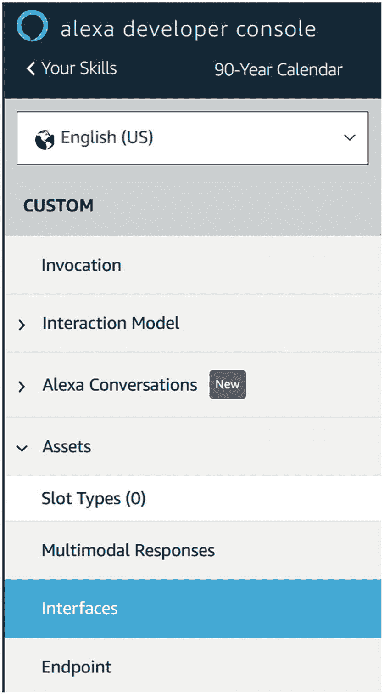

**图 10-1** 用于接口和多模态响应的左侧导航栏

浏览器中将打开一个新标签页。选择`Visual responses`选项。然后点击`Create Visual Response`。接下来，选择`Start from scratch`选项。这将打开 APL 编辑器。参见图 10-2。

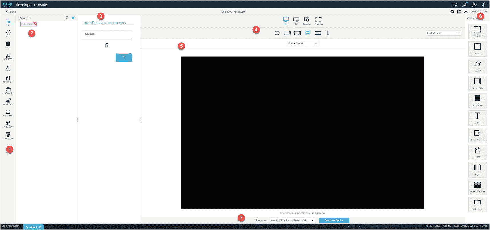

**图 10-2** APL 编辑器

查看 APL 编辑器，我们可以看到：

1. 左侧导航栏，我们将用它来访问 APL 文档的各个部分
2. 文本面板，我们可以在其中看到 APL 文档的组件或 JSON 文本
3. 所选组件的详细信息
4. 目标屏幕选项
5. APL 文档的视觉预览
6. 组件工具栏，用于向 APL 模板添加组件
7. 在技能模拟器中查看 APL 文档的选项
8. 主工具栏，我们可以在其中预览、保存和下载 APL

在下一节中，我们将规划 UI 的一些组件。

### 90 年日历界面

遗憾的是，我们不能直接用`APL`在屏幕上放一个 Excel 电子表格。相反，我们将使用自定义代码来渲染日历界面。具体来说，我们将使用`SVG`（可缩放矢量图形），采用 Alexa 风格。可以说，使用`SVG`（文档中有时称为 Alexa 矢量图形，即`AVG`），我们可以在带屏幕的设备上绘制任何我们想要的内容。

我们的 90 年日历将使用`SVG`为 90 年中的每一周绘制一个方框。已经过去的周次，我们将方框填满；尚未到来的周次，则保持方框空白。出于性能考虑，我们需要划分三个区域。中间区域是当前年份，其中部分方框填满，部分留空。顶部区域是过去，所有方框都填满。底部区域的所有方框则全部留空。参见图 10-3。

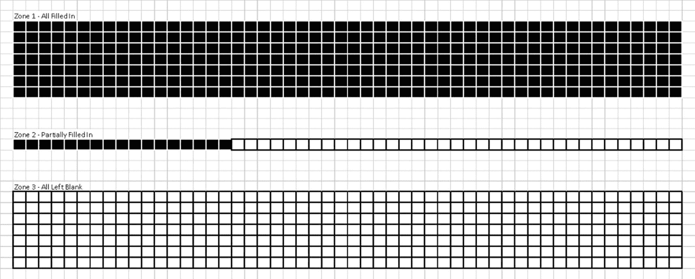

**图 10-3** 我们将绘制的三个区域

为了实现这一点，我们需要在`APL` JSON 格式中定义几个项目。首先，我们要定义一些颜色资源。这些资源允许我们在整个`APL`模型中使用颜色代码，而无需指定具体的颜色名称。因此，我们从黑色和白色开始，但如果你愿意，也可以轻松地将其改为红色和黄色或任何其他颜色。点击左侧导航栏上的“资源”按钮，并输入以下 JSON 代码：

```json
[{
"colors": {
"C0": "black",
"C1": "white"
}
}]
```

定义好颜色后，我们可以创建一个数据集，并将`APL`绑定到该数据集上，以便动态渲染。该数据集将代表区域 1、2 和 3，如图 10-3 所示。在区域 1 和区域 3 中，数据集中的单个条目代表该行的背景颜色。在区域 2 中，单个条目代表该行中每个方块的颜色。在开发阶段，我们只需要少量行。在测试和最终技能中，区域 1 和区域 3 总共需要 89 行（每年一行），区域 2 的单行需要 52 列（每周一列）。要输入数据，请选择左侧导航栏中的“数据”图标，并输入以下 JSON 代码：

```json
{
"data": {
"type": "object",
"properties": {
"zone1": [
"C1",
"C1",
"C1",
"C1",
"C1",
"C1",
"C1"
],
"zone2": [
"C0",
"C0",
"C0",
"C0",
"C0",
"C0",
"C0",
"C0",
"C0",
"C1",
"C0",
"C0",
"C0",
"C0",
"C0",
"C0",
"C0",
"C0",
"C0",
"C1",
"C0",
"C0",
"C0",
"C0",
"C0",
"C0",
"C0",
"C0",
"C0",
"C1",
"C0",
"C0",
"C0",
"C0",
"C0",
"C0",
"C0",
"C0",
"C0",
"C1",
"C0",
"C0",
"C0",
"C0",
"C0",
"C0",
"C0",
"C0",
"C0",
"C1",
"C0",
"C0"
],
"zone3": [
"C0",
"C0",
"C0",
"C0",
"C0"
]
}
}
}
```

对于每个区域，我们还需要知道另一个动态参数——它的高度（以像素为单位）。最终，高度将在我们的技能代码中计算得出，但对于示例数据，我们可以对其进行硬编码。在图 10-3 中，每个方框有 2 像素的边框，并且包括边框在内是 32 像素见方。对于区域 1，我们的示例数据有 7 行。区域 2 有 1 行。区域 3 有 5 行。因此，各区域的高度为：

- 区域 1：7 × 32 = 224。
- 区域 2：1 × 32 = 32。
- 区域 3：5 × 32 = 160。
- 总宽度：52 × 32 = 1664。
- 总高度：90 × 32 = 2880。

在数据集的区域 3 数据之后，我们需要添加以下 JSON 代码：

```json
"zone1Height": 224,
"zone2Height": 32,
"zone3Height": 160,
"totalWidth": 1664,
"totalHeight": 2880
```

添加这些项目后，JSON 代码将如图 10-4 所示。

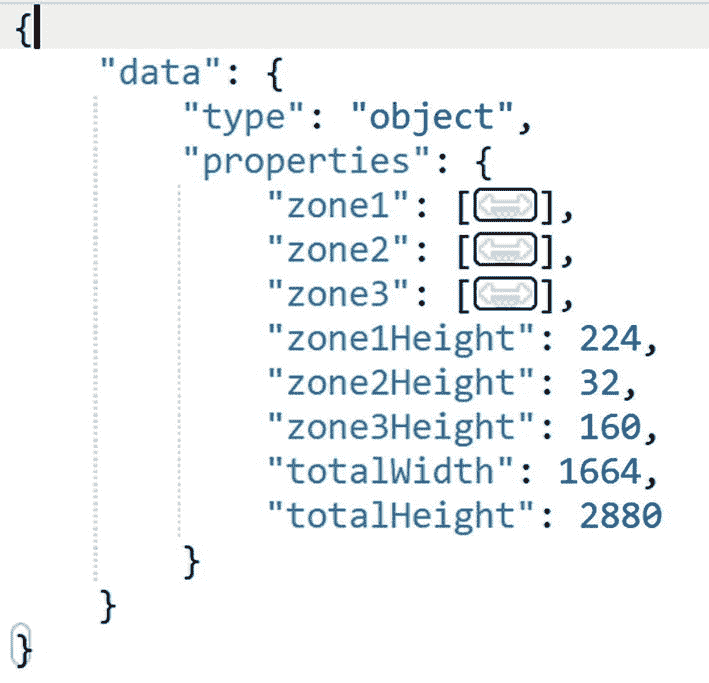

**图 10-4** 数据 JSON 条目（区域已折叠）

至此，我们可以配置文档的导入。

### 配置文档的导入

我们需要导入`alexa-styles`模块和`alexa-layouts`模块。点击左侧导航栏上的“文档”图标，并输入以下 JSON 代码：

```json
{
"type": "APL",
"version": "1.5",
"theme": "dark",
"import": [{
"name": "alexa-styles",
"version": "1.1.0"
},
{
"name": "alexa-layouts",
"version": "1.2.0"
}
]
}
```

接下来，我们需要为 90 年日历定义三个形状——每个区域一个。

#### 绘制三个区域

区域 2 的形状是一个简单的方框。区域 1 和区域 3 则是复杂的方框行。在 SVG 中，绘制一个简单的正方形，需要将笔移动到一个顶点，然后向每个顶点画线，形成正方形的边。就像这样：

`M0,0 L0,6 L6,6 L6,0 L0,0`（见图 10-5）。

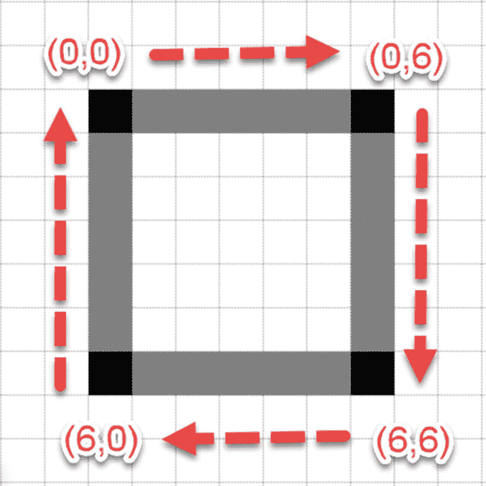

**图 10-5**

在 SVG 中绘制正方形

在我们的案例中，对于区域 2，我们希望绘制一个 32×32 且带有 2 像素边框的方框。SVG 命令将是：

```
M0,0 L0,31 L31,31 L31,0 L0,0 M1,1 L1,30 L30,30 L30,1 L1,1
```

使用此命令，我们可以创建绘制区域 2 中方框所需的图形。点击左侧导航栏上的“图形”图标，并输入以下 Json 代码：

```json
{
"blackBox": {
"type": "AVG",
"version": "1.0",
"height": 32,
"width": 32,
"items": [{
"type": "path",
"stroke": "@C1",
"pathData": "M0,0 L0,31 L31,31 L31,0 L0,0 M1,1 L1,30 L30,30 L30,1 L1,1",
"fill": "@C0"
}]
},
"whiteBox": {
"type": "AVG",
"version": "1.0",
"height": 32,
"width": 32,
"items": [{
"type": "path",
"stroke": "@C0",
"pathData": "M0,0 L0,31 L31,31 L31,0 L0,0 M1,1 L1,30 L30,30 L30,1 L1,1",
"fill": "@C1"
}]
}
}
```

**提示：** 尽早保存，经常保存。请确保经常保存你的工作。（首次保存时，你需要为模板命名。）

有了这些基础构件，我们就可以开始组合 APL 文档的主模板了。`mainTemplate`部分接受一个名为`payload`的参数，该参数绑定到我们之前在模板中输入的数据。我们的数据对象具有一些属性，我们可以使用 APL 变量替换来访问它们，例如：`"${payload.data.properties.propertyname}"`。

我们有三个区域，我们将为每个区域使用一个 APL `GridSequence`对象。这些对象都将放在一个 APL `Container`对象中。点击左侧导航栏上的“APL”图标。向下滚动找到以下代码块：

```json
"mainTemplate": {
"parameters": [
"payload"
],
"items": []
}
```

然后，通过添加`Container`和三个`GridSequences`来修改该代码，如下所示：

```json
"mainTemplate": {
"parameters": [
"payload"
],
"items": [{
"type": "Container",
"width": "${payload.data.properties.totalWidth}",
"height": "${payload.data.properties.totalHeight}",
"paddingLeft": "10",
"paddingTop": "10",
"paddingRight": "10",
"paddingBottom": "10",
"items": [{
"type": "GridSequence",
"width": "${payload.data.properties.totalWidth}",
"height": "${payload.data.properties.zone1Height}",
"childHeight": "32",
"childWidth": "32",
"data": "${payload.data.properties.zone1}",
"items": [{
"type": "VectorGraphic",
"source": "blackBox"
}]
},
{
"type": "GridSequence",
"width": "${payload.data.properties.totalWidth}",
"height": "${payload.data.properties.zone2Height}",
"childHeight": "32",
"childWidth": "32",
"data": "${payload.data.properties.zone2}",
"items": [{
"type": "VectorGraphic",
"source": "blackBox"
}]
},
{
"type": "GridSequence",
"width": "${payload.data.properties.totalWidth}",
"height": "${payload.data.properties.zone3Height}",
"childHeight": "32",
"childWidth": "32",
"data": "${payload.data.properties.zone3}",
"items": [{
"type": "VectorGraphic",
"source": "whiteBox"
}]
}
]
}]
}
```

有了这段代码，右侧渲染出的示例应如图 10-6 所示。

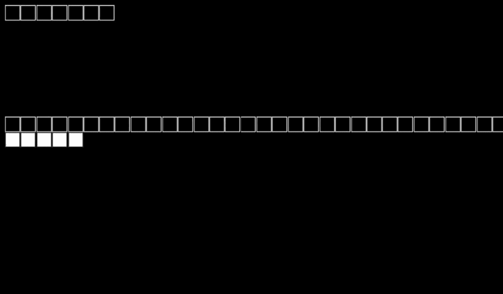

**图 10-6**

在划分出三个区域后渲染出的示例

接下来，我们可以为区域 2 的方框添加一个`when`子句，使它们根据数据值改变颜色。如下所示修改区域 2 的代码：

```json
"data": "${payload.data.properties.zone2}",
"items": [{
"when": "${data == 'C1'}",
"type": "VectorGraphic",
"source": "whiteBox"
},
{
"when": "${data == 'C0'}",
"type": "VectorGraphic",
"source": "blackBox"
}
]
```

请注意，`data`这个术语是在`items`之前声明的，这样我们就可以为`data`数组中的每个元素获取一个`item`。在`items`内部，我们引用的是`data`术语，而不是`properties.zone2`术语。

现在到了棘手的部分。如果我们像绘制区域 2 中的单行那样绘制其他行，整个绘制过程将耗费大量时间。为了提高性能，我们需要一次性绘制整行。这需要大量的数学计算，因此在 Excel 中组合 SVG 表达式是最简单的方法。首先，我们可以创建一个光标/笔需要移动以绘制线条的路径图，类似于图 10-7。

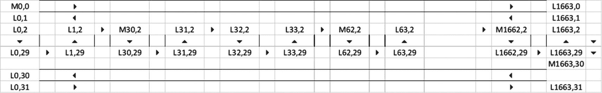

**图 10-7**

绘制一行线条时光标移动路径图

因此，完成的 SVG 表达式将如下所示：

```
M0,0 L1663,0 L1663,1 L0,1 L0,2 L0,29 L1,29 L1,2 M30,2 L30,29 L31,29 L31,2 L32,2 L32,29 L33,29 L33,2 M62,2 L62,29 L63,29 L63,2 M1662,2 L1662,29 L1663,29 L1663,2 M1663,30 L0,30 L0,31 L1663,31
```

我们需要弄清楚中间部分（前面代码中箭头所指的位置）应该是什么。回到 Excel 中，我们将通过查看垂直线的顶点来输入 SVG 表达式的初始值。在图 10-7 中，这些顶点从`L0,2`开始，然后向下到`L0,29`，再向右到`L1,29`，然后到`L1,2`，接着是`M30,2`，依此类推。这种模式在第八个条目之后重复。在一个新的工作表中，在 A 列中，输入每个顶点的第一个数字：0, 0, 1, 1, 30, 30, 31, 31。在 B 列中，输入每个顶点的第二个数字：2, 29, 29, 2, 2, 29, 29, 2。在 C 列中，输入每个顶点对应的笔移动字母：L, L, L, L, M, L, L, L，如图 10-8 所示。

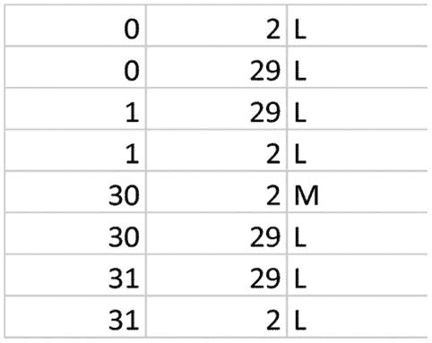

**图 10-8**

SVG 表达式的初始值

现在，我们可以在第九行输入公式，如下所示：

|   | A | B | C |
|--- |--- |--- |--- |
| **9** | `=A1+32` | `=B1` | `=C1` |

此外，在 E 列和 F 列的第 1 行和第 2 行，输入公式以连接 A、B、C 列生成的值：

|   | E | F |
|--- |--- |--- |
| **1** | `=CONCAT(C1,A1,",",B1," ")` | `=E1` |
| **2** | `=CONCAT(C2,A2,",",B2," ")` | `=CONCAT(F1, E2)` |

现在将`E2:F2`的公式向下复制到第 3:9 行。然后小心地将`A9:F9`的公式向下复制到第 10:416 行。最终的工作表将如图 10-9 所示。

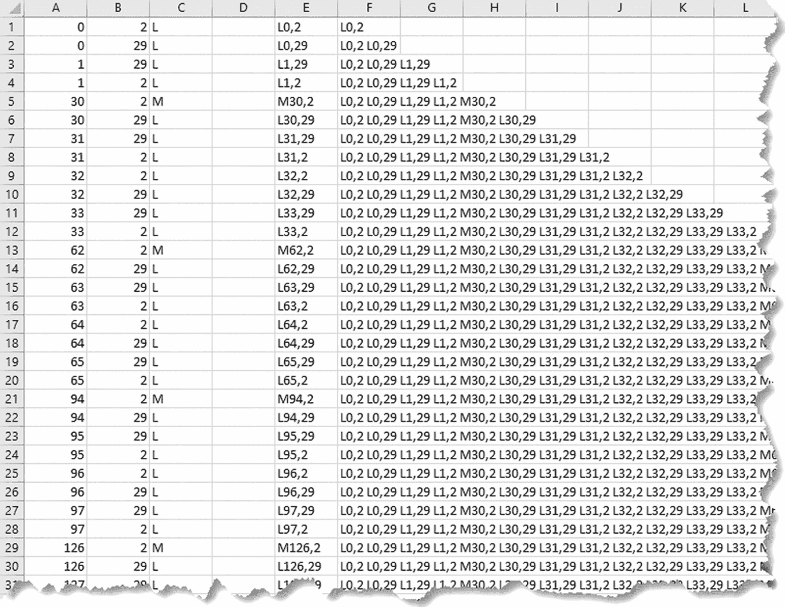
图 10-9 包含完整 SVG 表达式的最终工作表

因此，完成的 SVG 表达式将由顶部两行组成：

```
M0,0 L1663,0 L1663,1 L0,1
```

接着是来自 Excel 单元格`F416`的大字符串：

```
L0,2 L0,29 L1,29 L1,2 M30,2 L30,29 L31,29 L31,2 L32,2 L32,29 L33,29 L33,2 M62,2 L62,29 L63,29 L63,2 L64,2 L64,29 L65,29 L65,2 L1601,2 M1630,2 L1630,29 L1631,29 L1631,2 L1632,2 L1632,29 L1633,29 L1633,2 M1662,2 L1662,29 L1663,29 L1663,2
```

最后是底部两行：

```
M1663,30 L0,30 L0,31 L1663,31
```

回到 Alexa 开发者控制台，我们将复制并粘贴`blackBox`和`whiteBox`图形代码，以创建`blackRow`和`whiteRow`图形。为此，点击左侧导航栏上的“图形”图标，复制`blackBox`和`whiteBox`代码，并分别重命名为`blackRow`和`whiteRow`。然后将宽度改为 1664，并将`pathData`改为前面展示的巨大 SVG 表达式。我们可以移除行的填充，因为我们绘制的不是闭合形状，所以填充无关紧要。但我们需要为区域 3 的行添加白色背景，因此我们将添加一个纯色填充矩形来实现这一点。代码如下：

```json
{
"blackRow": {
"type": "AVG",
"version": "1.2",
"height": 32,
"width": 1664,
"viewportHeight": 32,
"viewportWidth": 1664,
"items": [{
"type": "path",
"stroke": "@C1",
"pathData": "M0,0 L1663,0 L1663,1 L0,1 L0,2 L0,29 L1,29 L1,2 M30,2 L30,29 L31,29 L31,2 L32,2 L32,29 L33,29 L33,2 M62,2 L1630,29 L1631,29 L1631,2 L1632,2 L1632,29 L1633,29 L1633,2 M1662,2 L1662,29 L1663,29 L1663,2 M1663,30 L0,30 L0,31 L1663,31"
}]
},
"whiteRow": {
"type": "AVG",
"version": "1.2",
"height": 32,
"width": 1664,
"viewportHeight": 32,
"viewportWidth": 1664,
"items": [{
"type": "path",
"stroke": "@C1",
"pathData": "M0,0 L1663,0 L1663,31 L0,31",
"fill": "@C1"
},
{
"type": "path",
"stroke": "@C0",
"pathData": "M0,0 L1663,0 L1663,1 L0,1 L0,2 L0,29 L1,29 L1,2 M30,2 L30,29 L31,29 L31,2 L32,2 L32,29 L33,29 L33,2 L1630,29 L1631,29 L1631,2 L1632,2 L1632,29 L1633,29 L1633,2 M1662,2 L1662,29 L1663,29 L1663,2 M1663,30 L0,30 L0,31 L1663,31"
}
]
}
}
```

完成后，你应该会看到如图 10-10 所示的代码。

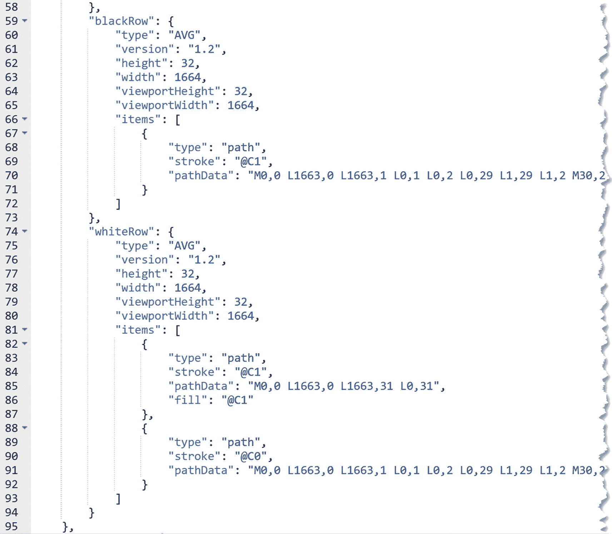
图 10-10 `blackRow` 和 `whiteRow` 的图形定义

请注意新增的 `viewportHeight` 和 `viewportWidth` 属性。这些属性表示图形的完整尺寸（32 × 1664）。而 `height` 和 `width` 属性将是缩放后的版本。

现在，我们将对 `height` 和 `width` 进行参数化，以便图形能够针对不同的 Echo 设备正确缩放。

### 参数化高度和宽度

切换回 APL 模板（点击左侧导航栏中的 APL 图标）。在这里，我们将把区域 1 和区域 3 的 `childHeight` 和 `childWidth` 分别更改为 `${payload.data.properties.boxHeight}` 和 `${payload.data.properties.rowWidth}`。同时，我们将把区域 1 和区域 3 的 `blackBox`/`whiteBox` 源更改为 `blackRow`/`whiteRow`。最终你将得到如图 10-11 所示的代码。

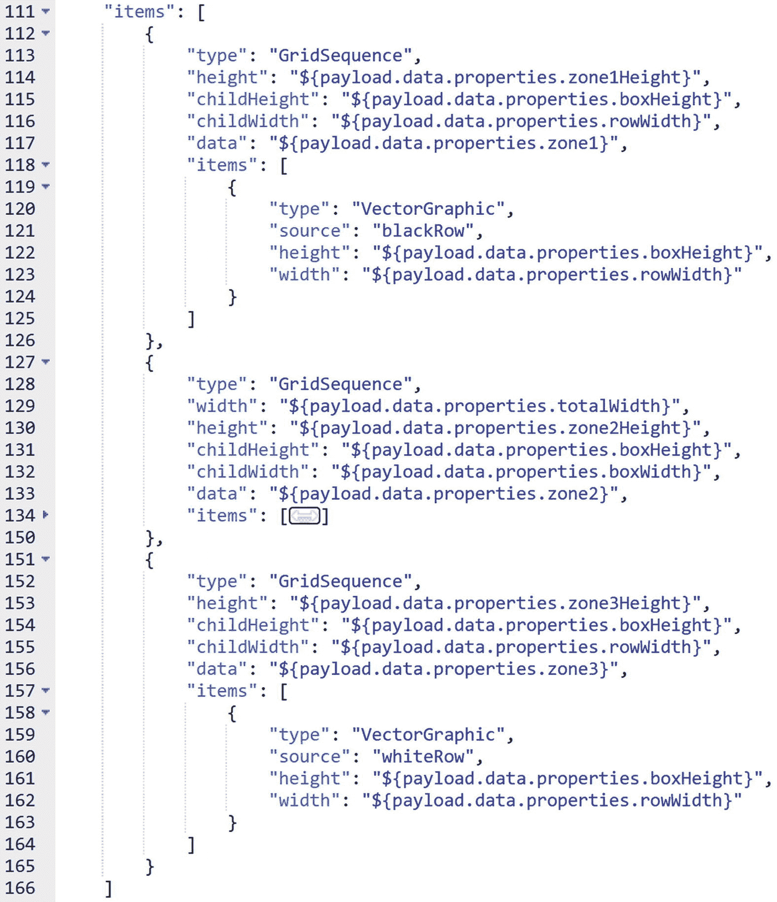
图 10-11 切换到行图形后区域 1 和区域 3 的代码

最后，我们需要将图 10-10 中的代码属性添加到示例数据中。方法是点击左侧导航栏中的数据图标，并将以下 JSON 添加到数据底部：

```
"zone1Height": 1600,
"zone2Height": 32,
"zone3Height": 1248,
"totalWidth": 1664,
"totalHeight": 2880,
"boxHeight": 32,
"boxWidth": 32,
"rowWidth": 1664
```

完成所有这些设置后，最终的预览效果应如图 10-12 所示。

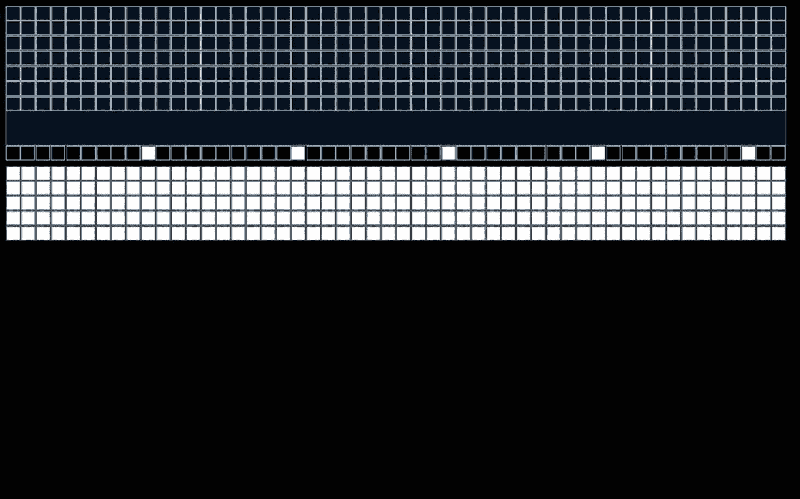
图 10-12 切换到行图形后的预览效果

现在我们需要更改数据以处理缩放问题。

### 缩放方块和行以适配屏幕

首先，我们将添加剩余的示例数据，然后缩放区域高度以适配 Echo Show 2 的屏幕。

点击左侧导航栏中的数据图标。更新代码，使区域 1 有 50 行，区域 3 有 39 行。加上区域 2 现有的 52 列（一行），我们得到 50 + 1 + 39 = 90 年的周数据。因此，完整的数据 JSON 如下：

```
{
"data": {
"type": "object",
"properties": {
"zone1": [
"C1",
"C1",
"C1",
...
"C1",
"C1",
"C1"
],
"zone2": [
"C1",
"C1",
...
"C0",
"C0"
],
"zone3": [
"C0",
"C0",
"C0",
...
"C0",
"C0",
"C0"
],
"zone1Height": 1600,
"zone2Height": 32,
"zone3Height": 1248,
"totalWidth": 1664,
"totalHeight": 2880,
"boxHeight": 32,
"boxWidth": 32,
"rowWidth": 1664
}
}
}
```

为了将方块缩放以适配分辨率为 1280 x 800 像素的 Echo Show 2，我们需要按如下方式减小方块高度：

*   800 像素除以 90 行 = 800 / 90 = 8.889 ~ 8

并按如下方式减小方块宽度：

*   1280 像素除以 52 列 = 1280 / 52 = 24.231 ~ 24

因此，一行的净宽度为：

*   24 × 52 = 1248。

各区域的高度则为：

*   区域 1：8 × 50 = 400
*   区域 2：8
*   区域 3：8 × 39 = 312

将这些值代入数据属性后，数据变为：

```
"zone1Height": 400,
"zone2Height": 8,
"zone3Height": 312,
"totalWidth": 1664,
"totalHeight": 2880,
"boxHeight": 8,
"boxWidth": 24,
"rowWidth": 1248
```

现在我们已经输入了数据并配置了参数，你应该会得到一个如图 10-13 所示的图表。

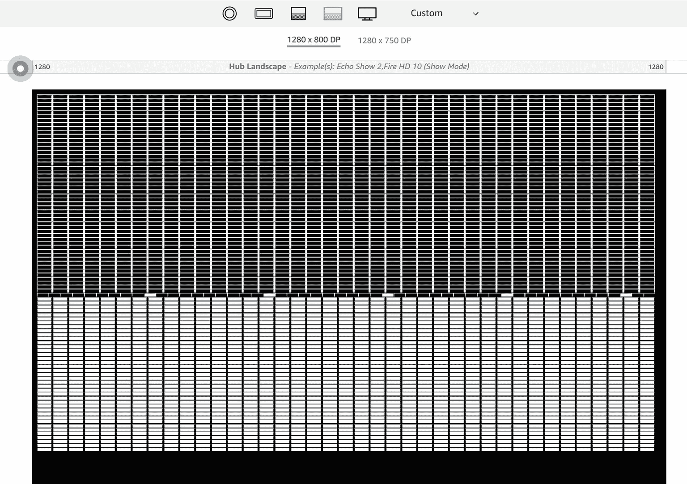
图 10-13 完成的 90 年日历

### 完成的 APL 代码

最终的 APL 模板如下：

```json
{
"type": "APL",
"version": "1.5",
"theme": "dark",
"import": [{
"name": "alexa-styles",
"version": "1.1.0"
},
{
"name": "alexa-layouts",
"version": "1.2.0"
}
],
"settings": {},
"resources": [{
"colors": {
"C0": "black",
"C1": "white"
}
}],
"styles": {},
"onMount": [],
"graphics": {
"blackBox": {
"type": "AVG",
"version": "1.2",
"height": 32,
"width": 32,
"viewportHeight": 32,
"viewportWidth": 32,
"items": [{
"type": "path",
"stroke": "@C1",
"pathData": "M0,0 L0,31 L31,31 L31,0 L0,0 M1,1 L1,30 L30,30 L30,1 L1,1",
"fill": "@C0"
}]
},
"whiteBox": {
"type": "AVG",
"version": "1.2",
"height": 32,
"width": 32,
"viewportHeight": 32,
"viewportWidth": 32,
"items": [{
"type": "path",
"stroke": "@C0",
"pathData": "M0,0 L0,31 L31,31 L31,0 L0,0 M1,1 L1,30 L30,30 L30,1 L1,1",
"fill": "@C1"
}]
},
"blackRow": {
"type": "AVG",
"version": "1.2",
"height": 32,
"width": 1664,
"viewportHeight": 32,
"viewportWidth": 1664,
"items": [{
"type": "path",
"stroke": "@C1",
"pathData": "M0,0 L1663,0 L1663,1 L0,1 L0,2 L0,29 L1,29 L1,2 M30,2 L30,29 L31,29 L31,2 L32,2 L32,29 L33,2M1662,2 L1662,29 L1663,29 L1663,2 M1663,30 L0,30 L0,31 L1663,31"
}]
},
"whiteRow": {
"type": "AVG",
"version": "1.2",
"height": 32,
"width": 1664,
"viewportHeight": 32,
"viewportWidth": 1664,
"items": [{
"type": "path",
"stroke": "@C1",
"pathData": "M0,0 L1663,0 L1663,31 L0,31",
"fill": "@C1"
},
{
"type": "path",
"stroke": "@C0",
"pathData": "M0,0 L1663,0 L1663,1 L0,1 L0,2 L0,29 L1,29 L1,2 M30,2 L30,29 L31,29 L31,2 L32,2 L32,29 L33,2 M1662,2 L1662,29 L1663,29 L1663,2 M1663,30 L0,30 L0,31 L1663,31"
}
]
}
},
"commands": {},
"layouts": {},
"mainTemplate": {
"parameters": [
"payload"
],
"items": [{
"type": "Container",
"height": "${payload.data.properties.totalHeight}",
"width": "${payload.data.properties.totalWidth}",
"paddingLeft": "10",
"paddingTop": "10",
"paddingRight": "10",
"paddingBottom": "10",
"items": [{
"type": "GridSequence",
"height": "${payload.data.properties.zone1Height}",
"childHeight": "${payload.data.properties.boxHeight}",
"childWidth": "${payload.data.properties.rowWidth}",
"data": "${payload.data.properties.zone1}",
"items": [{
"type": "VectorGraphic",
"source": "blackRow",
"height": "${payload.data.properties.boxHeight}",
"width": "${payload.data.properties.rowWidth}"
}]
},
{
"type": "GridSequence",
"width": "${payload.data.properties.totalWidth}",
"height": "${payload.data.properties.zone2Height}",
"childHeight": "${payload.data.properties.boxHeight}",
"childWidth": "${payload.data.properties.boxWidth}",
"data": "${payload.data.properties.zone2}",
"items": [{
"when": "${data == 'C1'}",
"type": "VectorGraphic",
"source": "whiteBox",
"height": "${payload.data.properties.boxHeight}",
"width": "${payload.data.properties.boxWidth}"
},
{
"when": "${data == 'C0'}",
"type": "VectorGraphic",
"source": "blackBox",
"height": "${payload.data.properties.boxHeight}",
"width": "${payload.data.properties.boxWidth}"
}
]
},
{
"type": "GridSequence",
"height": "${payload.data.properties.zone3Height}",
"childHeight": "${payload.data.properties.boxHeight}",
"childWidth": "${payload.data.properties.rowWidth}",
"data": "${payload.data.properties.zone3}",
"items": [{
"type": "VectorGraphic",
"source": "whiteRow",
"height": "${payload.data.properties.boxHeight}",
"width": "${payload.data.properties.rowWidth}"
}]
}
]
}]
}
}
```

### 总结

在前面的章节中，你为 90 年日历技能设计并实现了 VUI。在本章中，你使用 APL、SVG 和 Json 为带屏幕的 Alexa 设备构建了视觉呈现。在下一章中，我们将创建后端 lambda 函数，为 VUI 提供代码支持，并将 VUI 连接到 APL。

脚注 1
