# 第三部分：在高级技能中使用 API

## 14. 个人净资产技能

在本章中，我们将设计和实现一个个人净资产技能。在下一章中，我们将把该技能连接到一些 API（应用程序编程接口），这些接口将帮助我们获取资产的价值。在本节结束时，Alexa 将能够告诉您您的净资产。

**注意：** 您不能将此技能发布到技能商店，因为如果您不是金融机构，亚马逊不允许您创建金融技能。但是，您可以创建该技能供个人使用。

**另外：** 如果您不想使用真实账户，下一章中使用的所有 API 都允许您创建并使用测试账户和测试数据，因此您仍然可以操作示例，而无需让亚马逊/Alexa 访问您的个人数据。

首先，让我们讨论一下此技能的需求。

### 需求

想象一下 Alexa 能够告诉您您的净资产。她需要知道您房屋的价值、您投资组合的价值，以及您银行账户、抵押贷款和信用卡余额的价值。要获取您房屋的价值，她需要您的地址。要评估您的投资组合，她需要一份您持有的股票代码列表以及每种股票的数量。要评估您的其他账户，她需要访问它们的余额。

从安全性开始，我们需要使用一个关联账户。如果未关联，此技能将无法执行任何操作。

就像日历技能一样，我们需要一个 DynamoDb 表来存储用户个人资料。

接下来，我们需要一个用于获取您地址的意图，以及一个用于添加股票代码和持有股份数量的意图。同样，如果您不想，则不必使用真实账户。不过，我们确实需要一个用于获取我们净资产的意图。

以上就是对此技能需求的简要概述。

接下来，我们将设计 VUI。


### VUI 设计

在 `Botmock` 中，有多种方式可以绘制此流程。请参见图 14-1 中的一个示例流程。

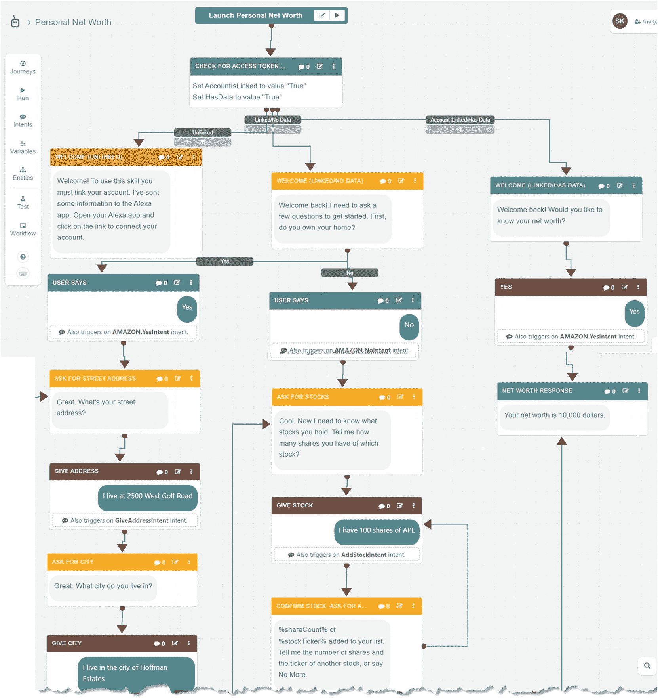

**图 14-1：** Net Worth 技能的对话流程

要创建此对话流程，首先创建我们需要的 `Alexa` 实体。

| 实体名称 |
| --- |
| `AMAZON.NUMBER` |
| `AMAZON.PostalAddress` |
| `AMAZON.US_CITY` |
| `AMAZON.US_STATE` |

然后，为我们将要追踪的股票代码创建一个自定义实体。

| 实体名称 |
| --- |
| `StockTicker` |

定义好这些实体后，我们可以在 `Botmock` 中创建一些变量。

以下变量在代码中用于管理对话流程。

| 变量名称 | 变量类型 | 实体类型 |
| --- | --- | --- |
| `AccountIsLinked` | `Boolean` | `Any` |
| `HasData` | `Boolean` | `Any` |

下一组变量将成为 `Alexa` 技能中的槽位。

| 变量名称 | 变量类型 | 实体类型 |
| --- | --- | --- |
| `street_address` | `Text` | `AMAZON.PostalAddress` |
| `City` | `Text` | `AMAZON.US_CITY` |
| `State` | `Text` | `AMAZON.US_STATE` |
| `zip_code` | `Text` | `AMAZON.NUMBER` |
| `share_count` | `Text` | `AMAZON.NUMBER` |
| `stock_ticker` | `Text` | `StockTicker` |

将槽位定义为变量后，我们就可以创建一些意图了。

| 意图名称 | 选项 |
| --- | --- |
| `AddStockIntent` |  |
| `AMAZON.YesIntent` |  |
| `GiveAddressIntent` |  |
| `LaunchRequest` |  |
| `NoMoreIntent` |  |

在 `Botmock` 中启动对话流程，使用与 90 年日历中相同的三个 `LaunchRequest` 处理器。（参见图 14-2。）

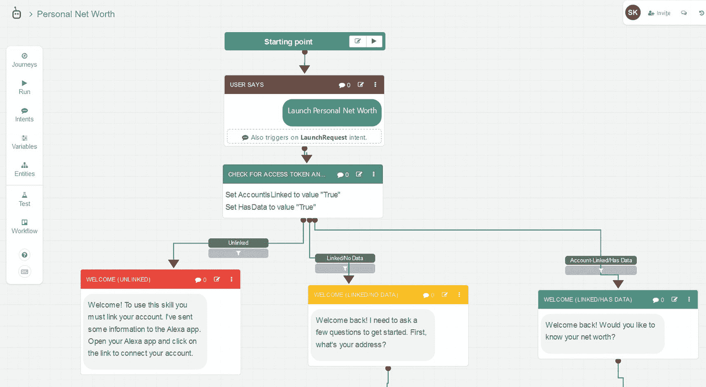

**图 14-2：** `LaunchRequest` 处理器

1.  未关联账户
2.  新关联账户
3.  已有数据的关联账户

然后添加用户意图：`Give Address`、`Give Stock`、`No More` 和 `Yes`。参见图 14-3 中的示例。


**图 14-3：** 添加用户意图

当您对 `Botmock` 图表满意后，按照第 9 章中的流程，将其迁移到 `Alexa Developer Console` 中的新技能。这主要涉及从 `Botmock` 设置菜单中复制用于 API 的 `.env` 文件。使用之前用过的相同令牌更新 `Token`。然后，通过输入 `npm start` 从命令行运行 `export-master` 项目。

现在我们可以创建技能的骨架了。

### 创建个人净资产技能

导出对话模型后，我们就可以将其加载到技能中。导航到 `Alexa Developer Console`。然后创建一个新的自定义技能。输入 `Personal Net Worth` 作为技能名称。选择构建一个 *自定义* 技能，并配备 *自行配置* 的后端。然后选择 *从头开始* 模板。

创建技能后，展开左侧导航栏中的交互模型选项卡。选择 `JSON Editor` 并注意其中的内容。注意到 `AMAZON.NavigateHomeIntent` 了吗？`Botmock` 不会生成它，但它是必需的，因此编辑您在上一节中生成的 `Botmock Personal Net Worth.json` 文件（可以使用 `NotePad++` 进行编辑），并添加 `AMAZON.NavigateHomeIntent`，如下所示：

```
...
{
"name": "AMAZON.FallbackIntent",
"samples": []
},
{
"name": "AMAZON.NavigateHomeIntent",
"samples": []
},
{
"name": "AddStockIntent",
"samples": [
"Add {sharecount} shares of {stockticker}"
],
...
```

此外，`Botmock` 导出了我们的 `LaunchRequest`，这在 `Alexa` 中是不需要的，因此我们可以安全地将其从模型中移除，如下所示：

```
...
"My address is {street_address}, {city}, {state}, {zip_code}"
]
}
]
},
{
"name": "LaunchRequest",
"samples": [
"Launch Personal Net Worth",
"Run Personal Net Worth"
],
"slots": []
},
{
"name": "NoMoreIntent",
"samples": [
"No More"
],
"slots": []
}
...
```

完成这些编辑后，将整个 `Json` 文件从 `NotePad++` 复制到 `Alexa Developer Console` 的 `JSON Editor` 窗口中。然后，单击顶部的 `Save Model` 按钮，您应该会看到一条绿色消息，显示“Skill Saved Successfully”。如果没有，请仔细检查 `Json` 文件并重试。特别是，在添加和移除前面显示的部分后，确保标点符号（逗号、花括号、方括号等）正确无误。

接下来，我们需要创建 `lambda` 函数。


#### 创建 Lambda 函数

登录 AWS 并创建一个新的 lambda 函数。从头开始编写。将其命名为 `PersonalNetWorthBackend`。选择最新版本的 Python 作为运行时。让它创建一个具有基本 Lambda 权限的新执行角色。添加一个触发器。选择 *Alexa Skills Kit* 触发器。从 Alexa 开发者控制台 | 端点选项卡粘贴技能 ID。然后将 lambda 函数的 ARN 粘贴到 Alexa 开发者控制台 | 端点选项卡 | 默认区域字段中。不要忘记点击 Alexa 开发者控制台屏幕顶部的 *保存端点* 按钮。

现在你已经有了一个空的 lambda 函数，并且它已连接到你的 Alexa 技能，你可以从 90 年日历技能的 lambda 函数中复制一些代码来开始。具体来说，让我们复制导入、日志记录、启动请求处理程序、是意图处理程序、内置意图处理程序、SkillBuilder 和持久化代码。实际上，我们不妨同时复制 `lambda_function.py` 和 `dynamodb.py` 模块以及 `requirements.txt` 文件。然后，我们可以在构建个人净资产特定代码时修改日历特定代码。将日历文件复制到净资产 lambda 后，我建议你关闭日历窗口，以免意外修改那里的文件。

现在，在 `dynamodb.py` 文件中，将其复制到 `PersonalNetWorthBackend` lambda 函数后，我们需要进行一些更改，如下所示：

```
from ask_sdk_dynamodb.adapter import DynamoDbAdapter
from ask_sdk_core.exceptions import PersistenceException
import logging
from enum import Enum
from datetime import datetime
logger = logging.getLogger(__name__)
logger.setLevel(logging.INFO)
adapter = DynamoDbAdapter('PersonalNetWorth', partition_key_name="PersonId")
class AccessTokenValidity(Enum):
NONE = 1
VALID = 2
NEW = 3
ERROR = 4
def has_access_token(handler_input):
reqEnv = handler_input.request_envelope
if reqEnv.context.system.user.access_token:
return True
else:
return False
def read_user_profile(handler_input):
validity = AccessTokenValidity.NONE
attr = []
try:
hasAccessToken = has_access_token(handler_input)
logger.info(f"AccToken: {hasAccessToken}")
if hasAccessToken:
amgr = handler_input.attributes_manager
attr = amgr.persistent_attributes
if attr:
logger.info(f"{attr}")
validity = AccessTokenValidity.VALID
else:
validity = AccessTokenValidity.NEW
else:
validity = AccessTokenValidity.NONE
except PersistenceException as e:
logger.error(e)
validity = AccessTokenValidity.ERROR
# TODO: 优雅地处理 PersistenceExceptions
except Exception as e:
logger.error(e)
validity = AccessTokenValidity.ERROR
raise e
return validity, attr
def save_user_profile(handler_input, profile):
if has_access_token(handler_input):
try:
amgr = handler_input.attributes_manager
amgr.persistent_attributes = profile
amgr.save_persistent_attributes()
except PersistenceException as e:
logger.error(e)
# TODO: 优雅地处理 PersistenceExceptions
except Exception as e:
logger.error(e)
raise e
```

编辑 `lambda_function.py` 稍微复杂一些。我们需要移除以下类和函数：

```
class GiveBirthdayIntentHandler(AbstractRequestHandler)
class ViewCalendarIntentHandler(AbstractRequestHandler)
def ShowCalendar(handler_input, profile)
def load_apl_document(file_path)
def addYears(d, years)
def days_between(d1, d2)
def period_from_amazon_date(iso)
```

然后我们需要从 SkillBuilder 中移除以下行：

```
sb.add_request_handler(GiveBirthdayIntentHandler())
sb.add_request_handler(ViewCalendarIntentHandler())
```

接下来，我们需要更改 `speak_output` 行中的所有措辞，以正确反映我们个人净资产技能的意图。在本章中，我们将重点关注你的房屋以及与房屋价值相关的问题、答案和意图。这将更改以下类中的一些代码：

```
class LaunchRequestHandlerUnlinked(AbstractRequestHandler)
speak_output = """欢迎，你需要关联账户才能使用个人净资产技能。是否现在关联？"""
class LaunchRequestHandlerNew(AbstractRequestHandler)
speak_output = "欢迎！感谢你关联账户。让我们开始吧。你是否拥有自己的房屋？"
handler_input.attributes_manager.session_attributes["question"]  = "DoYouOwnYourHome"
class LaunchRequestHandlerValid(AbstractRequestHandler)
speak_output = "欢迎回来！你想知道你的净资产吗？"
handler_input.attributes_manager.session_attributes["question"] = "GetNetWorth"
handler_input.attributes_manager.session_attributes["last_speech"] = speak_output
class YesIntentHandler(AbstractRequestHandler)
if question == "LinkAccount":
speak_output = "好的，我已向 Alexa 应用发送了一些信息。打开你的 Alexa 应用并点击链接以关联你的账户。"
endSession = True
card_output = ui.link_account_card.LinkAccountCard()
elif question == "DoYouOwnYourHome":
speak_output = "太好了！你主要住所的街道地址是什么？"
ask = "你的街道地址是什么？"
handler_input.attributes_manager.session_attributes["question"] = "What's your street address?"
elif question == "GetNetWorth":
# TODO: 计算净资产
speak_output = "你当前的净资产是："
endSession = True
elif question == "ClearAndStartOver":
# TODO: 清除并重新开始
speak_output = "我已清除你的个人数据。首先，你主要住所的街道地址是什么？"
ask = "你的街道地址是什么？"
handler_input.attributes_manager.session_attributes["question"] = "What's your street address?"
else:
speak_output = "抱歉，我搞混了，请告诉我你想做什么或说“帮助”。"
class HelpIntentHandler(AbstractRequestHandler)
if question == "LinkAccount":
speak_output = "好的，我已向手机上的 Alexa 应用发送了一些信息。打开你的 Alexa 应用并点击链接以关联你的账户。"
elif question == "What's your street address?":
speak_output = "试着说出你的门牌号和街道名称。"
class StartOverIntentHandler(AbstractRequestHandler)
speak_output = "好的。你确定要清除个人信息并重新开始吗？"
handler_input.attributes_manager.session_attributes["question"] = "ClearAndStartOver"
handler_input.attributes_manager.session_attributes["last_speech"] = speak_output
class FallbackIntentHandler(AbstractRequestHandler)
speak_output = """你的个人净资产技能无法处理这个请求，
但我可以帮助你确定你的净资产。尝试请求帮助。"""
class RepeatIntentHandler(AbstractRequestHandler)
else:
speak_output = """我可以帮你计算你的净资产。尝试请求帮助。"""
class CatchAllExceptionHandler(AbstractExceptionHandler)
speak_output = "抱歉，我在执行你的请求时遇到了问题。请重试或尝试请求帮助。"
```

完成这些编辑后，`lambda_function.py` 模块就可以开始添加新的意图处理程序来捕获和保存你的主要住所地址了。此时，该模块应该看起来像本书代码中名为 `lambda_function.py after converting from calendar to net worth.py` 的列表。

接下来，你需要像我们在第 12 章中所做的那样添加资源模块层。选择添加自定义层的选项，并选择最新版本的 CalendarDependencies，因为目前它包含我们所需的所有资源。（参见图 14-4。）

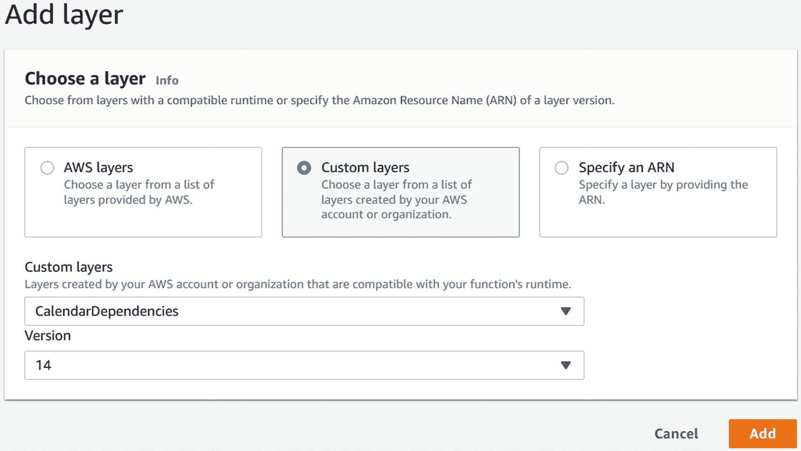

图 14-4

向我们的 lambda 函数添加自定义层


现在，您需要基于 *Amazon Alexa 启动会话* 事件模板配置一个测试事件，以测试您的 Lambda 函数，确保没有编译错误，并且未链接的启动请求处理器能正确触发。当您部署代码并运行测试时，应看到来自 `LaunchRequestHandlerUnlinked` 类的“欢迎”响应，如图 14-5 所示。如果未看到，请先修复所有错误再继续。


图 14-5

“欢迎”响应

Lambda 函数进展顺利后，我们就可以添加用于地址收集和估值的处理器和代码了。

#### 提供地址意图

`GiveAddressIntent` 定义了两个示例语句：

```
I live at {street_address} {city} {state} {zip_code}
My address is {street_address} {city} {state} {zip_code}
```

并且槽位定义如下：

| 槽位名称 | 槽位类型 |
| --- | --- |
| `{street_address}` | `AMAZON.PostalAddress` |
| `{city}` | `AMAZON.US_CITY` |
| `{state}` | `AMAZON.US_STATE` |
| `{zip_code}` | `AMAZON.Number` |

我们应该使用语句分析器（在 Alexa 开发者控制台的“构建”选项卡中，点击“评估模型”按钮）进行测试。输入语句：1058 Crossings Circle, Spring Hill, Tennessee 37174。嗯，它触发了 `AMAZON.FallbackIntent`。这并非我们预期。注意：语句分析器不会触及我们的 Lambda 函数。所以是其他方面出了问题。我们可能需要将这个意图拆分为四个意图——每个槽位对应一个。

回到 Botmock，将 `GiveAddressIntent` 拆分为四个部分：

| **意图** | `GiveCityIntent` |
| **语句** | My zip code is %zip_code%My zip is %zip_code% |
| **槽位提示** | What’s your zip code? |

| **意图** | `GiveStateIntent` |
| **语句** | In the state of %state% |
| **槽位提示** | What state do you live in? |

| **意图** | `GiveCityIntent` |
| **语句** | In %city%I live in the city of %city%In the city of %city% |
| **槽位提示** | What city do you live in? |

| **意图** | `GiveAddressIntent` |
| **语句** | My address is %street_address%I live at %street_address% |
| **槽位提示** | What's your street address? |

更新模型，使用全部四个槽位，而不是仅用一个。（见图 14-6。）


图 14-6

修改后的 Botmock 模型

模型更新后，再次导出，按之前所示编辑 JSON，并将 JSON 复制到 Alexa 开发者控制台的 JSON 编辑器中。保存模型并构建。修复所有错误。在语句分析器中再次测试模型。

| 语句 | 选中的意图 |
| --- | --- |
| I live at 1058 Crossings Circle. | `GiveAddressIntent` |
| In the city of Spring Hill | `GiveCityIntent` |
| In the state of Tennessee | `GiveStateIntent` |
| My zip is 37174 | `GiveZipCodeIntent` |

现在它按预期工作了。接下来我们可以编写意图处理器的代码。前三个（地址、城市和州）非常相似。它们都从 `handler_input` 中提取传入的槽位值，检查配置文件是否已启动，将槽位值添加到配置文件中，保存配置文件，并按顺序询问下一个问题。

| **GiveAddressIntentHandler** |
| --- |
| `class GiveAddressIntentHandler(AbstractRequestHandler):` |
| `"""Handler for Give Address Intent."""` |
| `def can_handle(self, handler_input):` |
| `validity, _ = read_user_profile(handler_input)` |
| `return (validity == AccessTokenValidity.VALID) and ask_utils.is_request_type("GiveAddressIntent")(handler_input)` |
| `def handle(self, handler_input):` |
| `_, profile = read_user_profile(handler_input)` |
| `street_address = handler_input.request_envelope.request.intent.slots[` |
| `"street_address"].value` |
| `if not profile:` |
| `profile = {}` |
| `profile["street_address"] = street_address` |
| `save_user_profile(handler_input, profile)` |
| `speak_output = "Great. What city do you live in?"` |
| `handler_input.attributes_manager.session_attributes["question"] = "City"` |
| `handler_input.attributes_manager.session_attributes["last_speech"] = speak_output` |
| `return (` |
| `handler_input.response_builder` |
| `.speak(speak_output)` |
| `.ask(speak_output)` |
| `.response` |
| `)` |

| **GiveCityIntentHandler** |
| --- |
| `class GiveCityIntentHandler(AbstractRequestHandler):` |
| `"""Handler for Give City Intent."""` |
| `def can_handle(self, handler_input):` |
| `validity, _ = read_user_profile(handler_input)` |
| `return (validity == AccessTokenValidity.VALID) and ask_utils.is_request_type("GiveCityIntent")(handler_input)` |
| `def handle(self, handler_input):` |
| `_, profile = read_user_profile(handler_input)` |
| `city = handler_input.request_envelope.request.intent.slots[` |
| `"city"].value` |
| `if not profile:` |
| `profile = {}` |
| `profile["city"] = city` |
| `save_user_profile(handler_input, profile)` |
| `speak_output = "Cool. What state do you live in?"` |
| `handler_input.attributes_manager.session_attributes["question"] = "State"` |
| `handler_input.attributes_manager.session_attributes["last_speech"] = speak_output` |
| `return (` |
| `handler_input.response_builder` |
| `.speak(speak_output)` |
| `.ask(speak_output)` |
| `.response` |
| `)` |

| **GiveStateIntentHandler** |
| --- |
| `class GiveStateIntentHandler(AbstractRequestHandler):` |
| `"""Handler for Give State Intent."""` |
| `def can_handle(self, handler_input):` |
| `validity, _ = read_user_profile(handler_input)` |
| `return (validity == AccessTokenValidity.VALID) and ask_utils.is_request_type("GiveStateIntent")(handler_input)` |
| `def handle(self, handler_input):` |
| `_, profile = read_user_profile(handler_input)` |
| `state = handler_input.request_envelope.request.intent.slots[` |
| `"state"].value` |
| `if not profile:` |
| `profile = {}` |
| `profile["state"] = state` |
| `save_user_profile(handler_input, profile)` |
| `speak_output = "Awesome. What is your zip code?"` |
| `handler_input.attributes_manager.session_attributes["question"] = "ZipCode"` |
| `handler_input.attributes_manager.session_attributes["last_speech"] = speak_output` |
| `return (` |
| `handler_input.response_builder` |
| `.speak(speak_output)` |
| `.ask(speak_output)` |
| `.response` |
| `)` |

邮政编码意图处理器则完全不同。首先，我们需要一个辅助函数来处理以零开头的邮政编码。具体来说，我们需要添加一个 `right()` 函数，该函数可以从“00000”与输入的邮政编码数值拼接后的字符串中提取最右边的五个字符。例如，如果邮政编码槽位中存储的是 4829，我们在其前面加上“00000”，得到“000004829”，然后取最右边的五个字符，就得到了邮政编码“04829”，这很可能就是用户最初告诉我们的内容。以下是 `right()` 函数：


```python
def right(s, amount):
    if s == None:
        return None
    elif amount == None:
        return None  # 或者抛出缺少参数的错误
    s = str(s)
    if amount > len(s):
        return s
    elif amount == 0:
        return ""
    else:
        return s[-amount:]
```

邮政编码意图处理器的第二个主要区别在于，我们期望它在地址序列中最后出现，但用户可能会通过跳步来迷惑我们。在这种情况下，邮政编码处理器需要检查我们是否拥有完整的地址，并跳回去获取我们缺失的地址部分。例如：

```python
if not "street_address" in profile:
    speak_output = "我错过了你的街道地址。请问是什么？"
    handler_input.attributes_manager.session_attributes["question"] = "StreetAddress"
```

因此，该处理器将是 **`GiveZipCodeIntentHandler`**：

```python
class GiveZipCodeIntentHandler(AbstractRequestHandler):
    """处理提供邮政编码意图的处理器。"""
    def can_handle(self, handler_input):
        validity, _ = read_user_profile(handler_input)
        return (validity == AccessTokenValidity.VALID) and ask_utils.is_request_type("GiveZipCodeIntent")(handler_input)

    def handle(self, handler_input):
        _, profile = read_user_profile(handler_input)
        zip_code = handler_input.request_envelope.request.intent.slots[
            "zip_code"].value
        if not profile:
            profile = {}
        profile["zip_code"] = right("00000" + str(zip_code), 5)
        save_user_profile(handler_input, profile)
        if not "street_address" in profile:
            speak_output = "我错过了你的街道地址。请问是什么？"
            handler_input.attributes_manager.session_attributes["question"] = "StreetAddress"
        elif not "city" in profile:
            speak_output = "我缺少你的城市信息。请问是什么？"
            handler_input.attributes_manager.session_attributes["question"] = "City"
        elif not "state" in profile:
            speak_output = "我缺少你的州信息。请问是什么？"
            handler_input.attributes_manager.session_attributes["question"] = "State"
        elif not "zip_code" in profile:
            speak_output = "我缺少你的邮政编码。请问是什么？"
            handler_input.attributes_manager.session_attributes["question"] = "ZipCode"
        else:
            speak_output = f"""谢谢。我已将你的地址记录为
{profile["street_address"]},
{profile["city"]}, {profile["state"]}, {profile["zip_code"]}.
是否正确？"""
            handler_input.attributes_manager.session_attributes["question"] = "ConfirmAddress"
        handler_input.attributes_manager.session_attributes["last_speech"] = speak_output
        return (
            handler_input.response_builder
            .speak(speak_output)
            .ask(speak_output)
            .response
        )
```

接下来，我们将把你的投资组合添加到个人净资产技能中。

#### 提供股票意图

`GiveStock` 意图的语句都包含两个槽位：股票代码和持股数量。在 `GiveStock` 意图处理器中，我们需要从各自的槽位中获取这两个值，如下所示：

```python
stock_ticker = handler_input.request_envelope.request.intent.slots["stock_ticker"].value
share_count = handler_input.request_envelope.request.intent.slots["share_count"].value
```

然后我们可以将它们添加到配置文件中的 Python 字典里。我们使用字典而不是列表，因为键值对语法非常适合捕获每项投资的键（股票代码）和值（持股数量）。例如，`profile["stocks"]["AMZN"] = 25` 表示你拥有 25 股 `AMZN`。字典允许我们自动处理更新或新增操作，因为如果键已存在，我们只需更新数量；如果不存在，则添加股票代码和数量。例如：

```python
profile["stocks"][stock_ticker] = share_count
```

我们可能应该确认每次添加。在下一章中，我们将使用 API 从股票代码获取股票名称，以便同时使用股票代码和名称进行确认。目前，我们仅使用股票代码进行确认。例如：

```python
if stock_ticker in profile["stocks"]:
    speak_output = f'{stock_ticker} 的持股数量正在从 {profile["stocks"][stock_ticker]} 更新为 {share_count}。是否正确？'
else:
    speak_output = f'正在将 {share_count} 股 {stock_ticker} 添加到你的投资组合中。是否正确？'
```

假设当我们询问“是否正确？”时，用户回答“否”。我们需要撤销 `profile["stocks"][stock_ticker] = share_count` 的赋值。在更改数量之前，让我们将先前的数量存储在 `session_attributes` 中；如果用户说“否”，我们可以恢复先前的数量。除非先前的数量为零，那么我们可以从字典中删除该股票代码。例如，如果我们将以下代码放入 `GiveStock` 意图处理器中：

```python
if stock_ticker in profile["stocks"]:
    handler_input.attributes_manager.session_attributes["previous_share_count"] = profile["stocks"][stock_ticker]
else:
    handler_input.attributes_manager.session_attributes["previous_share_count"] = 0
handler_input.attributes_manager.session_attributes["previous_stock_ticker"] = stock_ticker
profile["stocks"][stock_ticker] = share_count
save_user_profile(handler_input, profile)
```

那么我们可以将以下代码放入 `No` 意图处理器中，以撤销添加/更新操作：

```python
elif question == "ConfirmShares":
    if handler_input.attributes_manager.session_attributes["previous_share_count"] == 0:
        del profile["stocks"][handler_input.attributes_manager.session_attributes["previous_stock_ticker"]]
    else:
        profile["stocks"][handler_input.attributes_manager.session_attributes["previous_stock_ticker"]] = handler_input.attributes_manager.session_attributes["previous_share_count"]
```

因此，完成的 `GiveStockIntentHandler` 将是：

```python
class GiveStockIntentHandler(AbstractRequestHandler):
    """处理提供股票意图的处理器。"""
    def can_handle(self, handler_input):
        validity, _ = read_user_profile(handler_input)
        return (validity == AccessTokenValidity.VALID) and ask_utils.is_request_type("GiveStockIntent")(handler_input)

    def handle(self, handler_input):
        _, profile = read_user_profile(handler_input)
        stock_ticker = handler_input.request_envelope.request.intent.slots[
            "stock_ticker"].value
        share_count = handler_input.request_envelope.request.intent.slots[
            "share_count"].value
        if not profile:
            profile = {}
        profile["stocks"] = {}
        if stock_ticker in profile["stocks"]:
            handler_input.attributes_manager.session_attributes[
                "previous_share_count"] = profile["stocks"][stock_ticker]
            speak_output = f'{stock_ticker} 的持股数量正在从 {profile["stocks"][stock_ticker]} 更新为 {share_count}。是否正确？'
        else:
            handler_input.attributes_manager.session_attributes["previous_share_count"] = 0
            speak_output = f'正在将 {share_count} 股 {stock_ticker} 添加到你的投资组合中。是否正确？'
        handler_input.attributes_manager.session_attributes["previous_stock_ticker"] = stock_ticker
        profile["stocks"][stock_ticker] = share_count
        save_user_profile(handler_input, profile)
        handler_input.attributes_manager.session_attributes["last_speech"] = speak_output
        ask = "是否正确？"
        handler_input.attributes_manager.session_attributes["question"] = "ConfirmShares"
        return (
            handler_input.response_builder
            .speak(speak_output)
            .ask(ask)
            .response
        )
```

现在我们已经有了 `Give*` 意图处理器，接下来需要查看 `Yes` 和 `No` 意图处理器。


#### 是/否意图

在其他意图中，我们会向用户提出几个是/否问题。具体来说，我们会询问：

```
您现在要链接[您的账户]吗？
您是否拥有自己的住房？
您想知道自己的净资产吗？
信息正确吗？[地址确认]
信息正确吗？[更新持股数量]
信息正确吗？[添加股票代码和数量]
```

在每种情况下，我们都会将`"question"`项添加到会话属性中，以便知道用户是对什么内容说“是”或“否”。因此，是/否意图处理程序的基本结构是一系列`if...elif...else`语句。例如，下面是处理对`LinkAccount`问题回答`Yes`的第一个`if`语句：

```
if question == "LinkAccount":
speak_output = "好的，我已向 Alexa 应用发送了一些信息。请打开您的 Alexa 应用并点击链接以连接您的账户。"
endSession = True
card_output = ui.link_account_card.LinkAccountCard()
```

以及针对`LinkAccount`问题对应的`No`处理程序：

```
if question == "LinkAccount":
speak_output = "好的，您可以稍后回来链接您的账户以开始使用。谢谢。"
endSession = True
```

关于是/否处理程序的一个特殊情况是，如果用户的访问令牌尚未生效，且问题是`"LinkAccount"`，我们仍然需要运行处理程序代码。为了实现这一点，我们需要修改`can_handle`逻辑，如下所示：

```
def can_handle(self, handler_input):
validity, _ = read_user_profile(handler_input)
question = handler_input.attributes_manager.session_attributes["question"]
return (validity == AccessTokenValidity.VALID
or validity == AccessTokenValidity.NEW
or question == "LinkAccount") \
and ask_utils.is_intent_name("AMAZON.YesIntent")(handler_input)
```

这将确保无论账户是否已链接，只要问题是`"LinkAccount"`，代码都会运行。

综合起来，我们最终得到一个如下所示的“是”意图处理程序：

```
class YesIntentHandler(AbstractRequestHandler):
"""用于处理“是”意图的处理程序。"""
def can_handle(self, handler_input):
# type: (HandlerInput) -> bool
validity, _ = read_user_profile(handler_input)
question = handler_input.attributes_manager.session_attributes["question"]
return (validity == AccessTokenValidity.VALID
or validity == AccessTokenValidity.NEW
or question == "LinkAccount") \
and ask_utils.is_intent_name("AMAZON.YesIntent")(handler_input)
def handle(self, handler_input):
_, profile = read_user_profile(handler_input)
question = handler_input.attributes_manager.session_attributes["question"]
speak_output = ""
ask = None
endSession = False
card_output = None
if question == "LinkAccount":
speak_output = "好的，我已向 Alexa 应用发送了一些信息。请打开您的 Alexa 应用并点击链接以连接您的账户。"
endSession = True
card_output = ui.link_account_card.LinkAccountCard()
elif question == "DoYouOwnYourHome":
speak_output = "太好了！您主要住所的街道地址是什么？"
ask = "您的街道地址是什么？"
handler_input.attributes_manager.session_attributes[
"question"] = "StreetAddress"
if not profile:
profile = {}
profile["own_home"] = True
save_user_profile(handler_input, profile)
elif question == "ConfirmAddress":
speak_output = "太棒了！现在我们可以继续处理您的投资了。请告诉我您持有的每种投资的股票代码和数量。或者说“没有更多”以停止添加股票。"
ask = "请告诉我您持有某个股票代码的股份数量。"
handler_input.attributes_manager.session_attributes[
"question"] = "AddStock"
elif question == "ConfirmShares":
speak_output = "那么多？哇！请告诉我您另一项投资的股票代码和持股数量。或者说“没有更多”以停止添加股票。"
ask = "请告诉我您持有某个股票代码的股份数量。"
handler_input.attributes_manager.session_attributes[
"question"] = "AddStock"
elif question == "GetNetWorth":
# TODO: 计算净资产
speak_output = "您当前的净资产是："
endSession = True
elif question == "ClearAndStartOver":
profile = {}
save_user_profile(handler_input, profile)
speak_output = "我已清除您的个人数据。首先，您是否拥有自己的住房？"
ask = "您是否拥有自己的住房？"
handler_input.attributes_manager.session_attributes[
"question"] = "DoYouOwnYourHome"
else:
speak_output = "抱歉，我有点困惑，请告诉我您想做什么，或者说“帮助”。"
handler_input.attributes_manager.session_attributes["last_speech"] = speak_output
if not ask:
ask = speak_output
return (
handler_input.response_builder
.speak(speak_output)
.ask(ask)
.set_card(card_output)
.set_should_end_session(endSession)
.response
)
```

我们还需要一个对应的“否”意图处理程序，如下所示：

```
class NoIntentHandler(AbstractRequestHandler):
"""用于处理“否”意图的处理程序。"""
def can_handle(self, handler_input):
# type: (HandlerInput) -> bool
validity, _ = read_user_profile(handler_input)
question = handler_input.attributes_manager.session_attributes["question"]
return (validity == AccessTokenValidity.VALID
or validity == AccessTokenValidity.NEW
or question == "LinkAccount") \
and ask_utils.is_intent_name("AMAZON.NoIntent")(handler_input)
def handle(self, handler_input):
_, profile = read_user_profile(handler_input)
question = handler_input.attributes_manager.session_attributes["question"]
speak_output = ""
ask = None
endSession = False
if question == "LinkAccount":
speak_output = "好的，您可以稍后回来链接您的账户以开始使用。谢谢。"
endSession = True
elif question == "DoYouOwnYourHome":
speak_output = "好的。让我们继续处理您的投资。请告诉我您持有的每种投资的股票代码和数量。或者说“没有更多”以停止添加股票。"
ask = "请告诉我您持有某个股票代码的股份数量。"
handler_input.attributes_manager.session_attributes[
"question"] = "AddStock"
elif question == "ConfirmAddress":
speak_output = "好的。让我们再试一次。您主要住所的街道地址是什么？"
ask = "您的街道地址是什么？"
handler_input.attributes_manager.session_attributes["question"] = "StreetAddress"
profile = {}
profile["own_home"] = True
save_user_profile(handler_input, profile)
elif question == "ConfirmShares":
speak_output = "哎呀。让我们再试一次。请告诉我您持有的每种投资的股票代码和数量。或者说“没有更多”以停止添加股票。"
ask = "请告诉我您持有某个股票代码的股份数量。"
if handler_input.attributes_manager.session_attributes["previous_share_count"] == 0:
del profile["stocks"][handler_input.attributes_manager.session_attributes["previous_stock_ticker"]]
else:
profile["stocks"][handler_input.attributes_manager.session_attributes["previous_stock_ticker"]
] = handler_input.attributes_manager.session_attributes["previous_share_count"]
handler_input.attributes_manager.session_attributes[
"question"] = "AddStock"
elif question == "GetNetWorth":
speak_output = "好的。现在不是好时机。我明白了。欢迎您稍后回来查询您的净资产。只需一分钟。"
endSession = True
elif question == "ClearAndStartOver":
# 被拒绝。不清除并重新开始
speak_output = "呼。我还以为您要删除所有内容。但您没有。太好了。您想知道自己的净资产吗？"
ask = "您想知道自己的净资产吗？"
handler_input.attributes_manager.session_attributes[
"question"] = "GetNetWorth"
else:
speak_output = "抱歉，我有点困惑，请告诉我您想做什么，或者说“帮助”。"
handler_input.attributes_manager.session_attributes["last_speech"] = speak_output
if not ask:
ask = speak_output
return (
handler_input.response_builder
.speak(speak_output)
.ask(ask)
.set_should_end_session(endSession)
.response
)
```

本章要介绍的最后一个内容是“没有更多”意图处理程序。


#### 停止添加意图

当用户想要停止向投资组合中添加股票时，他们需要说“不再添加”。此时，我们需要停止询问股票信息，转而询问是否要获取其净资产。因此，停止添加意图处理器将如下所示：

```
class NoMoreIntentHandler(AbstractRequestHandler):
    """停止添加意图的处理器。"""
    def can_handle(self, handler_input):
        validity, _ = read_user_profile(handler_input)
        return (validity == AccessTokenValidity.VALID) and ask_utils.is_request_type("NoMoreIntent")(handler_input)

    def handle(self, handler_input):
        speak_output = "好的。您想知道您的净资产吗？"
        handler_input.attributes_manager.session_attributes["question"] = "GetNetWorth"
        handler_input.attributes_manager.session_attributes["last_speech"] = speak_output
        return (
            handler_input.response_builder
            .speak(speak_output)
            .ask(speak_output)
            .response
        )
```

现在我们需要将新的意图添加到技能构建器中。在模块底部，按如下所示更新技能构建器部分：

```
sb = CustomSkillBuilder(persistence_adapter=adapter)
sb.add_request_handler(LaunchRequestHandlerUnlinked())
sb.add_request_handler(LaunchRequestHandlerNew())
sb.add_request_handler(LaunchRequestHandlerValid())
sb.add_request_handler(GiveAddressIntentHandler())
sb.add_request_handler(GiveCityIntentHandler())
sb.add_request_handler(GiveStateIntentHandler())
sb.add_request_handler(GiveZipCodeIntentHandler())
sb.add_request_handler(GiveStockIntentHandler())
sb.add_request_handler(NoMoreIntentHandler())
sb.add_request_handler(YesIntentHandler())
sb.add_request_handler(NoIntentHandler())
sb.add_request_handler(HelpIntentHandler())
sb.add_request_handler(NavigateHomeIntentValidHandler())
sb.add_request_handler(NavigateHomeIntentInvalidHandler())
sb.add_request_handler(StartOverIntentHandler())
sb.add_request_handler(CancelOrStopIntentHandler())
sb.add_request_handler(SessionEndedRequestHandler())
sb.add_request_handler(RepeatIntentHandler())
sb.add_request_handler(FallbackIntentHandler())
# 确保 IntentReflectorHandler 和 CatchAllExceptionHandler
# 位于最后，这样它们就不会覆盖您的自定义意图处理器
sb.add_request_handler(IntentReflectorHandler())
sb.add_exception_handler(CatchAllExceptionHandler())
```

您的任务是更新 `HelpIntentHandler`、`NavigateHomeIntent*Handlers` 以及所有其他内置意图的处理器，使其能够适用于此技能。您还应在 lambda 环境中创建单元测试来测试您的函数。请记住，这涉及使用 Alexa 开发者控制台获取意图的 Json，然后将其复制到 lambda 函数的测试中。

至此，我们已经为个人净资产技能创建了前端（VUI）和后端（`lambda_function` 和 `dynamodb` 模块）。不过，还有一个明显的遗漏。我们在“是”意图处理器中留下了一个待办事项：

```
# TODO: CalculateNetWorth
```

这将是下一章的内容。

### 总结

在本章中，我们创建了个人净资产技能的雏形。首先，我们确定了需求。这使我们能够在 Botmock 中设计 VUI。然后，我们将该设计导出为 Json 并导入到 Alexa 开发者控制台。接着，我们创建了后端 lambda 函数，并在其中编写了启动意图处理器。我们添加了一个 `dynamodb` 模块，用于读取和保存用户配置文件。我们添加了提供地址意图处理器和提供股票意图处理器。然后，我们研究了“是”和“否”意图处理器。最后，我们添加了停止添加意图处理器，并更新了 lambda 函数的技能构建器部分。在下一章中，我们将使用金融 API 来获取本章收集的资产的价值。

## 15. 房地产 API

在本章中，我们将基于上一章构建的个人理财技能，添加第一个资产价值计算功能，该功能将告诉我们房屋和投资的价值。同样，此技能可能会接触到大量个人数据，但所有这些数据都将安全地存储在受保护的数据库中，并经过加密以保护您的安全。在所有情况下，您都可以选择使用测试账户和虚假数据进行开发，因此完全不需要涉及真实数据。

我们将使用两个 API：一个房地产 API 和一个股票市场 API。本章将介绍 API——如何对其进行身份验证以及如何使用它们。然后，我们将在 lambda 函数中添加一个模块，该模块调用房地产 API 来计算我们房屋的价值，以便 Alexa 能够告诉我们房屋值多少钱。

首先，介绍 API。

### 应用程序编程接口

应用程序编程接口（通常称为 API）是一种让开发者发布功能的方式（在本例中是在网络上），以便其他开发者可以访问这些功能并在其程序中使用。许多 API 被称为 RESTful 的。^((21)) 这意味着很多内容，但就我们的目的而言，这意味着它们可以通过精心构造的 URL^((22)) 访问，而不是通过更复杂的机制。

例如，Numbers API 是一项免费服务，可为给定数字提供冷知识。这是一个 RESTful API，因此您可以通过标准互联网浏览器访问它。只需导航到 [`http://numbersapi.com/100`](http://numbersapi.com/100)。您可以将 100 替换为任何数字。例如，[`http://numbersapi.com/8`](http://numbersapi.com/8) 可能会回复：“8 是一个字节中的比特数。”有些数字并不引人注目。许多数字会提供关于该数字的几条简单冷知识之一。您可以在 [`http://numbersapi.com/`](http://numbersapi.com/) 查看 Numbers API 的主页和附加功能。

您也可以从 Python 的 `requests` 模块调用 Numbers API 或任何 RESTful API。例如：

```
import requests
response = requests.request("GET", "http://numbersapi.com/17")
print(response.text)
输出：
17 是掷弹兵卫队手榴弹帽徽章上火焰的数量。
```

了解了如何使用 Python 的 `requests` 模块调用 API 后，我们现在可以寻找一个能够评估我们房产价值的 API。


### 房地产估值 API

通过谷歌搜索可以找到各种房产估值 API。起初，这可能会让人不知所措。然而，有一个网站让查找和使用 API 交互变得简单得多：[`https://rapidapi.com`](https://rapidapi.com)。Rapid API 是一个供 API 开发者以某种标准化方式公开其 API 的中心。它让订阅免费增值网站变得容易，并提供了用多种编程语言调用 API 的示例代码。注册成为开发者后，在 Rapid API 中快速搜索房产估值 API，就能找到几个可能的候选。（见图 15-1。）


图 15-1

在 Rapid API 中搜索房产估值

点击“热门房地产 API (MLS)”集合结果，我们找到了几个可能符合要求的 API。其中一个特别引人注目。将鼠标悬停在 Realty Mole 上（见图 15-2），我们看到 API 中有一个 `GET Sale Price Estimate` 方法。这正是我们需要的。

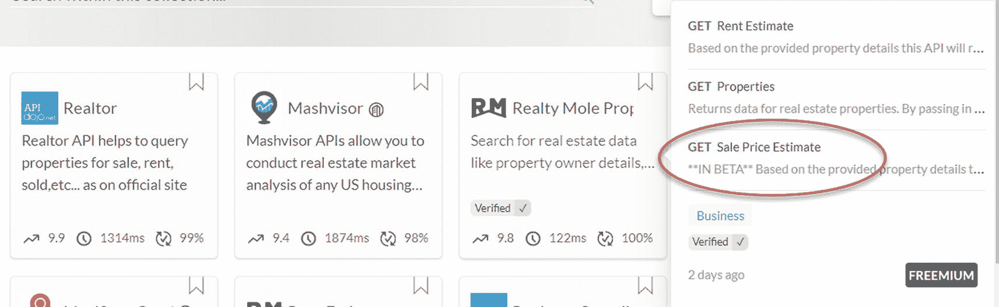

图 15-2

找到“售价估算”方法

点击进入 Realty Mole API，我们找到了文档、端点测试以及使用 API 的代码片段。还有一个“订阅测试”按钮。（见图 15-3。）


图 15-3

Realty Mole 房产 API

继续点击“订阅测试”。然后选择“基础（免费）”计划。这样我们每月就有 50 次 API 调用配额，足够我们测试了。订阅免费计划后（是的，你仍然需要提供信用卡，以防超出 50 次免费 API 调用），你会被重定向回 API 文档页面，现在页面上有一个“测试端点”按钮。点击它。API 应该在右侧返回一条状态 200 的消息，并附带一些租金费率。（见图 15-4。）

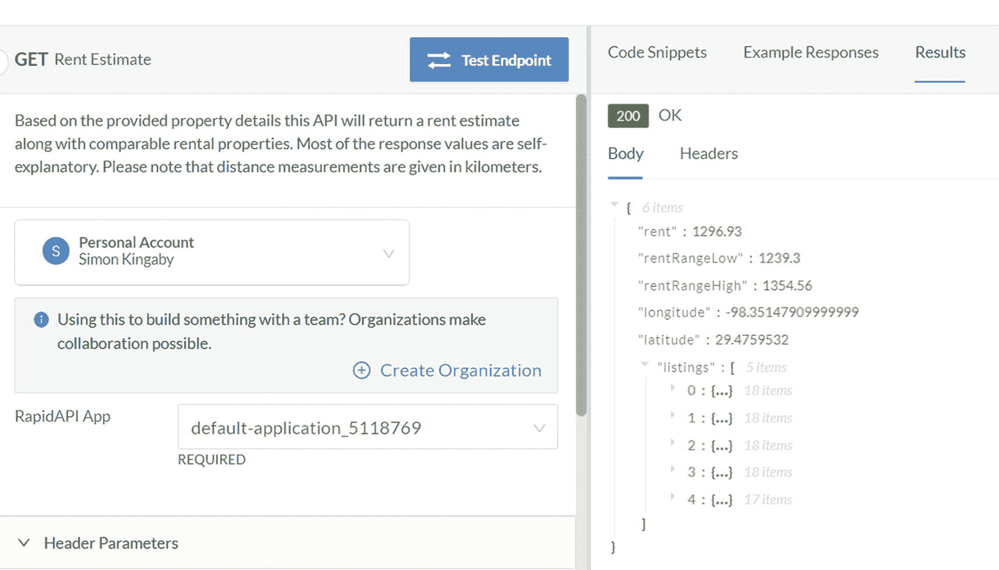

图 15-4

测试端点，我们得到一条包含租金费率的消息

切换到左侧的“售价估算”方法。向下滚动并输入你房屋的详细信息，特别是面积、浴室数量、地址（不包括邮政编码）、卧室数量和房产类型。选择 Python | Requests 的代码片段。（见图 15-5。）

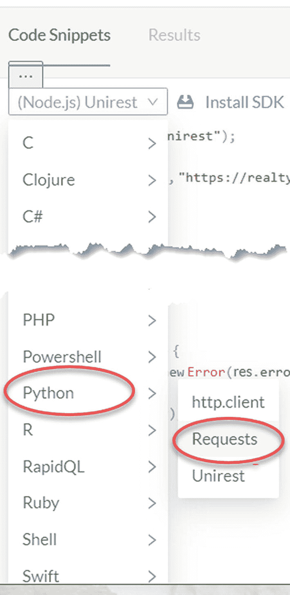

图 15-5

选择 Python Requests

再次点击“测试端点”。这次，可以看到 JSON 结果中包含的是价格，而不是租金费率。（见图 15-6。）

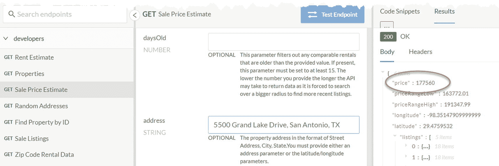

图 15-6

“售价估算”方法返回一个价格

这看起来正是我们需要的。现在我们需要更新 VUI 来收集这些信息。

### 添加“提供房屋统计信息”意图

我们需要让用户提供面积、浴室数量、卧室数量和房产类型。由于房产类型的可选值有限，你需要在 Botmock 中添加一个实体，或在 Alexa 开发者控制台中添加一个槽位类型。

| Botmock | Alexa 开发者控制台 |
| --- | --- |
| 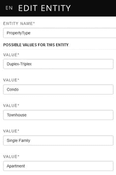 |  |

然后添加一个用于提供房屋统计信息的意图。


在 Botmock 中，可以按图 15-7 所示更新图表。


图 15-7

更新后的 Botmock 图表，包含“提供房屋统计信息”意图

现在我们可以为新意图添加代码。由于我们是在一次对话中收集所有统计信息，因此可以在一个意图处理器中处理它们。

```
class GiveHomeStatsIntentHandler(AbstractRequestHandler):
"""处理提供房屋统计信息意图的处理器。"""
def can_handle(self, handler_input):
validity, _ = read_user_profile(handler_input)
return (validity == AccessTokenValidity.VALID) and ask_utils.is_request_type("GiveHomeStatsIntent")(handler_input)
def handle(self, handler_input):
_, profile = read_user_profile(handler_input)
property_type = handler_input.request_envelope.request.intent.slots["property_type"].value
square_footage = handler_input.request_envelope.request.intent.slots["square_footage"].value
bedrooms = handler_input.request_envelope.request.intent.slots["bedrooms"].value
baths = handler_input.request_envelope.request.intent.slots["baths"].value
if not profile:
profile = {}
profile["homestats"] = {
"property_type": property_type,
"square_footage": square_footage,
"bedrooms": bedrooms,
"baths": baths
}
save_user_profile(handler_input, profile)
speak_output = f"您的房子是{property_type}，面积为{square_footage}平方英尺，有{bedrooms}间卧室和{baths}间浴室。对吗？"
handler_input.attributes_manager.session_attributes["last_speech"] = speak_output
ask = "对吗？"
handler_input.attributes_manager.session_attributes["question"] = "ConfirmStats"
return (
handler_input.response_builder
.speak(speak_output)
.ask(ask)
.response
)
```

我们还需要在“是”和“否”意图处理器中添加条件语句。

| 是意图处理器 |
| --- |
| `elif question == "ConfirmAddress":`   `speak_output = "太好了。请告诉我一些关于您房子的信息。房子是什么类型，有多少平方英尺，几间卧室，几间浴室？"`   `ask = "房子是什么类型，有多少平方英尺，几间卧室，几间浴室？"`   `handler_input.attributes_manager.session_attributes["question"] = "HomeStats"``elif question == "ConfirmStats":`   `speak_output = "太棒了！现在我们可以继续了解您的投资了。请告诉我您持有多少股以及每项投资的股票代码。或者说“没有更多”来停止添加股票。"`   `ask = "告诉我您持有某只股票代码的多少股。"`   `handler_input.attributes_manager.session_attributes["question"] = "AddStock"` |
| **否意图处理器** |
| `elif question == "ConfirmStats":`   `speak_output = "哎呀。我们再试一次。房子是什么类型，有多少平方英尺，几间卧室，几间浴室？"`   `ask = "房子是什么类型，有多少平方英尺，几间卧室，几间浴室？"`    `handler_input.attributes_manager.session_attributes[`        `"question"] = "HomeStats"` |

并且不要忘记在帮助意图处理器中添加一些帮助信息，并将新的 `GiveHomeStatsIntentHandler` 添加到技能构建器中。

```
sb.add_request_handler(GiveHomeStatsIntentHandler())
```

现在我们已经能够收集房屋统计信息，可以回到计算您房屋价值的工作上来了。


### 回到房地产 API

我们已经有了地址和房屋统计数据。现在需要将这些信息传递给 API，获取房屋估值。我们需要两样东西：(1) 调用 API 的代码，(2) 测试它的方法。至于代码，我们在 Python Requests 的 API 代码片段中已经有了大部分所需内容：

```
import requests
url = "https://realty-mole-property-api.p.rapidapi.com/salePrice"
querystring = {"compCount":"5","squareFootage":"1600","bathrooms":"2","address":"5500 Grand Lake Drive, San Antonio, TX","bedrooms":"4","propertyType":"Single Family"}
headers = {
'x-rapidapi-key': "b912ba32xxxxxxxxxxxxxxxxxxxxxxxxxxxxxxxxxx899e140d",
'x-rapidapi-host': "realty-mole-property-api.p.rapidapi.com"
}
response = requests.request("GET", url, headers=headers, params=querystring)
print(response.text)
```

为了测试，我们可以向 Launch 请求处理程序插入一些内容，确保管道畅通。然后，在 Alexa 开发者控制台的测试标签页中创建必要的 JSON，用我们的数据进行测试。接着，将其连接到缺失的`CalculateNetWorth`函数（我们将添加该函数）。听起来是个好计划。

首先，我们将这段代码放入一个新模块，这样就不会把 API 调用埋没在意图处理程序中。在 lambda 函数的`PersonalNetWorthBackend`文件夹中，紧邻`lambda_function.py`和`dynamodb.py`，添加另一个文件：`api_calls.py`。然后粘贴 API 代码片段中的代码（如上所示）。接着，我们需要做一个关键修改。

这段代码包含了我们的 API 密钥：

```
headers = {
'x-rapidapi-key': "b912ba32xxxxxxxxxxxxxxxxxxxxxxxxxxxxxxxxxx899e140d",
```

API 密钥就是“通往王国的钥匙”。任何人都可以用你的密钥代表你调用 API，这对你的技能来说没问题，但如果黑客获取了你的密钥并将其放到暗网上，那对你来说就非常不妙了。你**绝对不应该**把密钥留在代码中。这就像把车钥匙留在停车场的车里，然后指望回来时车还在一样。祝你好运。

如果不能把密钥留在代码里，那该放在哪里呢？最好的地方是环境变量。这样既把密钥从代码中移出，又让它们仍然可供使用。在 AWS Lambda 中，配置环境变量相当容易：


图 15-8

选择配置标签页

1.  选择代码窗口上方的*配置*标签页（见图 15-8）。

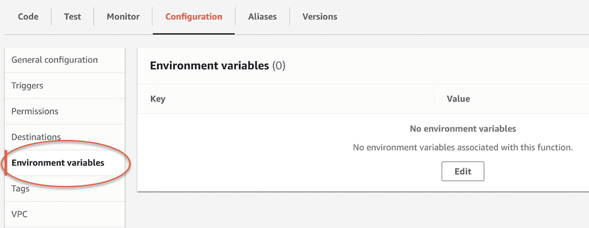

图 15-9

在左侧选择环境变量菜单选项

1.  从左侧导航菜单中选择*环境变量*选项（见图 15-9）。

1.  点击屏幕中央的*编辑*按钮。

2.  点击*添加环境变量*按钮。

3.  环境变量是键值对。在我们的例子中，键是我们为 API 密钥指定的名称，值就是密钥本身。

4.  在*键*输入框中，输入`RAPID_API_KEY`。（按照惯例，环境变量全部使用大写字符。）

5.  在*值*输入框中，粘贴代码片段中的 API 密钥：`b912ba32xxxxxxxxxxxxxxxxxxxxxxxxxxxxxxxxxx899e140d`

6.  点击右下角的*保存*按钮。

环境变量在静态时使用默认的 Lambda 服务密钥进行加密。这对我们的目的来说已经足够了。但是，如果你想在传输过程中加密密钥，可以选择使用 AWS 密钥管理服务（KMS）来加密环境变量。如果要启用此选项，则需要在现有代码基础上补充 KMS 示例中提供的代码。

现在我们已经将 API 密钥存储在环境变量中，可以修改代码，从环境变量中获取密钥，而不是硬编码密钥值。将以下代码：

```
headers = {
'x-rapidapi-key': "b912ba32xxxxxxxxxxxxxxxxxxxxxxxxxxxxxxxxxx899e140d",
```

替换为对环境变量的调用：

```
headers = {
'x-rapidapi-key': os.environ['RAPID_API_KEY'],
```

这需要在模块顶部添加一个额外的导入语句：

```
import os
```

最后需要做的是，将 API 调用封装在一个函数定义中，该函数将接收用户配置文件（从计算净资产的意图处理程序传入），并返回房屋价值（来自 API 调用）。完成这些修改后，`api_calls.py`模块应该如下所示：

```
import requests
import os
import logging
import json
logger = logging.getLogger(__name__)
logger.setLevel(logging.INFO)
url = "https://realty-mole-property-api.p.rapidapi.com/salePrice"
def GetHomeValue(profile):
querystring = {
"compCount": "10",
"squareFootage": profile["homestats"]["square_footage"],
"bathrooms": profile["homestats"]["baths"],
"address": f'{profile["street_address"]}, {profile["city"]}, {profile["state"]}',
"bedrooms": profile["homestats"]["bedrooms"],
"propertyType": profile["homestats"]["property_type"]
}
headers = {
'x-rapidapi-key': os.environ['RAPID_API_KEY'],
'x-rapidapi-host': "realty-mole-property-api.p.rapidapi.com"
}
response = requests.request(
"GET", url, headers=headers, params=querystring)
if response.text:
logger.info(f"{response.text}")
result = json.loads(response.text)
if result["price"]:
return result["price"]
return None
```

定义好环境变量并完成代码后，我们就可以测试 API 调用了。


#### 测试 API 调用

如何高效地测试 API 调用？我暂时不想与 Alexa 进行完整对话，尽管稍后我们需要这样做。相反，我们可以将 API 调用插入到 `LaunchRequest` 处理器中，并直接使用其测试。首先，我们需要为 `LaunchRequest` 处理器编写一个测试。如果你还没有，那么你该为至今未做任何测试而自责了。如果你已经有了，请给自己点个赞。感谢你成为那 1% 在将代码投入生产环境前真正进行测试的开发者^(²³)。如果你还没有机会为 `LaunchRequest` 创建测试，别担心，还有机会。你现在就可以创建一个：

1.  点击 *Test* 按钮的下拉菜单，选择 *Configure test event*。
2.  选中 *Create new test event* 单选按钮。
3.  选择 `alexa-skills-kit-start-session` 事件模板。
4.  将测试命名为：`LaunchRequestNoLink`。
5.  点击底部的 *Save*。
6.  点击 *Test* 按钮运行测试。

你应该能在 JSON 结果中看到欢迎消息：

```
Response
{
"version": "1.0",
"sessionAttributes": {
"question": "LinkAccount",
"last_speech": "Welcome, you need to link your account to use the Personal Net Worth skill.\n            Would you like to link it now?"
},
```

相反，如果你看到错误消息，请调试代码，直到看到欢迎消息后再继续。

现在，我们都有了 `LaunchRequest` 处理器的单元测试，可以插入 API 调用了。首先，在 `lambda_function.py` 模块顶部 `import` `GetHomeValue()` 函数。

接下来，我们将 API 测试插入到 `LaunchRequestHandlerUnlinked` 类的 `handle()` 函数中间。

```
def handle(self, handler_input):
speak_output = """Welcome, you need to link your account to use the Personal Net Worth skill.
Would you like to link it now?"""
handler_input.attributes_manager.session_attributes["question"] = "LinkAccount"
====> API Call goes here
handler_input.attributes_manager.session_attributes["last_speech"] = speak_output
return (
handler_input.response_builder
.speak(speak_output)
.ask(speak_output)
.response
)
```

对 API 的调用需要填充 Profile，为了本次测试我们将对其进行硬编码。它将返回房屋价值，我们将在 `response` 的 `speak_output` 中让 Alexa 播报该值。

加载 profile 的代码如下：

```
profile = {}
profile["street_address"] = "1234 Main Street"
profile["city"] = "Nashville"
profile["state"] = "TN"
profile["zip_code"] = 37206
profile["homestats"] = {
"property_type": "Single Family",
"square_footage": 2250,
"bedrooms": 4,
"baths": 3
}
```

而对 API 函数的调用仅需一行代码：

```
homeValue = GetHomeValue(profile)
```

最后，我们需要输出房屋价值，以便在 Alexa 的响应中听到/看到它：

```
speak_output = f"The home value is {homeValue}"
```

完成的 `LaunchRequest` 处理器将如下所示：

```
class LaunchRequestHandlerUnlinked(AbstractRequestHandler):
"""Handler for Skill Launch when the Account is not linked."""
def can_handle(self, handler_input):
return not has_access_token(handler_input) and ask_utils.is_request_type("LaunchRequest")(handler_input)
def handle(self, handler_input):
speak_output = """Welcome, you need to link your account to use the Personal Net Worth skill.
Would you like to link it now?"""
handler_input.attributes_manager.session_attributes["question"] = "LinkAccount"
# ====>
profile = {}
profile["street_address"] = "1234 Main Street"
profile["city"] = "Nashville"
profile["state"] = "TN"
profile["zip_code"] = 37206
profile["homestats"] = {
"property_type": "Single Family",
"square_footage": 2250,
"bedrooms": 4,
"baths": 3
}
homeValue = GetHomeValue(profile)
speak_output = f"The home value is {homeValue}"
# ====>
handler_input.attributes_manager.session_attributes["last_speech"] = speak_output
return (
handler_input.response_builder
.speak(speak_output)
.ask(speak_output)
.response
)
```

我们可以重新运行启动测试。我们应该能在响应中看到房屋价值的估算值，如图 15-10 所示。


**图 15-10** `LaunchRequest` 处理器正在运行 API 测试代码

现在测试已经运行，我们可以将代码放到正确的位置。首先，注释掉我们添加到 `LaunchRequest` 处理器中的代码。然后，在 Yes 意图处理器中，找到 `"GetNetWorth"` 的 `elif` 分支，并修改它以调用 `GetHomeValue()` 函数。

在 `LaunchRequest` 处理器中注释掉代码，并在 Yes 意图处理器中修改代码后，我们就可以在 Alexa 开发者控制台的测试标签页中进行测试了。尝试一下。修复你遇到的任何错误。你应该能够完整地测试整个技能。请记住，你需要完整的地址、房屋类型、面积、卧室数量和浴室数量。调试你遇到的任何问题。完成技能测试后，我们可以进入下一章，将股票投资组合的价值添加到你的净资产中。

### 总结

在本章中，我们研究了 API。我们了解了 Numbers API。我们引入了来自 Realty Mole 的房地产估值 API，通过调用 Realty Mole Property API 的 Sale Price Estimate 端点，可以获取房屋的近似价格。我们在 VUI 中添加了必要的意图，并在 lambda 函数中添加了相应的处理器来收集统计数据。然后，我们学习了如何通过将 API 调用放入 `LaunchRequest` 处理器来直接测试它。一旦它正常工作，我们将其移动到 Yes 意图处理器中的正确位置，并在 Alexa 开发者控制台中测试了该技能。完成这些工作后，我们就可以进入下一章，调用股票估值 API 了。

脚注 1 2 3

## 16. 股票市场 API

在本章中，我们将使用前几章构建的个人理财技能，并添加第二个资产价值计算功能，以告知我们投资的价值。同样，这个技能可能会接触到我们大量的个人数据，但所有这些数据都将安全地存放在受保护的数据库中，并经过加密以保护你的安全。在所有情况下，你都可以选择使用测试账户和虚假数据进行开发，因此完全不需要涉及真实数据。

要计算你股票投资组合的当前价值，我们需要知道每只股票的代码、持股数量和当前收盘价。前两项我们在技能中收集。对于第三项，我们需要找到一个 API。

搜索股票市场 API 会找到数百个。其中一个流行的是 Yahoo Finance API。


### Yahoo Finance API

在 Rapid API 中，你可以通过以下链接找到 Yahoo Finance API：[`https://rapidapi.com/apidojo/api/Yahoo-Finance1`](https://rapidapi.com/apidojo/api/Yahoo-Finance1)。

浏览左侧股票标题下可用的 API 调用，第一个 `stock/v2/get-summary` 看起来很有用。订阅该 API 并测试 `get-summary` 调用。在结果中，我们看到大量数据。在“`price`”部分下，有一个“`regularMarketPrice`”部分，其中包含 `raw`（数值）和 `fmt`（格式化字符串）格式的价格。这正是我们需要的。股票类别中还有其他几个调用也会返回 `regularMarketPrice`。然而，Yahoo Finance API 非常“嘈杂”——它返回的数据远多于我们所需。

查看定价也很有必要。（见图 16-1。）Yahoo Finance 采用免费增值模式。免费（基础）层每月有 500 次配额，并设有硬性限制。这意味着我们每月总共只能进行 500 次 API 调用，平均每个工作日约 25 次。达到 500 次后，我们将被限制访问。此外，请注意每秒 5 次请求的速率限制，这意味着如果你投资了 20 只股票，获取价格请求需要 4 秒。最后，专业版（最低付费层）每月费用为 10 美元。

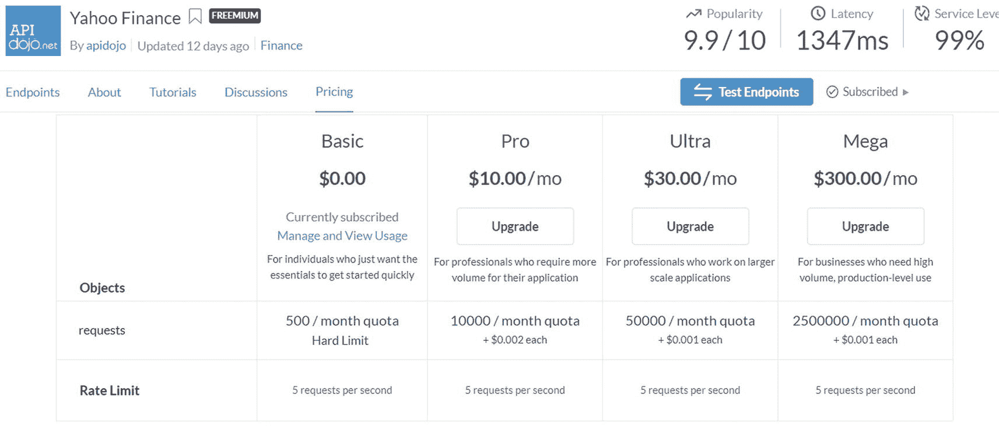

图 16-1

Yahoo Finance 的定价模式

让我们寻找另一个提供更好免费选项且返回更直接响应的 API。

### Alpha Vantage API

在 Rapid API 中，你可以通过以下链接找到 Alpha Vantage API：[`https://rapidapi.com/alphavantage/api/alpha-vantage/`](https://rapidapi.com/alphavantage/api/alpha-vantage/)。

该 API 有一个默认端点，可提供股票、外汇、加密货币等的定价。返回的结果非常简洁且易于阅读：

```
{
"Global Quote": {
"01\. symbol": "TSLA",
"02\. open": "688.3700",
"03\. high": "692.4203",
"04\. low": "659.4200",
"05\. price": "661.7500",
"06\. volume": "35298378",
"07\. latest trading day": "2021-04-01",
"08\. previous close": "667.9300",
"09\. change": "-6.1800",
"10\. change percent": "-0.9252%"
}
}
```

查看定价，看起来很有希望。（见图 16-2。）每天 500 次调用的配额是 Yahoo 允许限制的 30 倍。但是，我们每分钟只能进行 5 次免费请求。这意味着 20 只股票需要 4 分钟。而第一个专业版级别每月费用接近 50 美元。

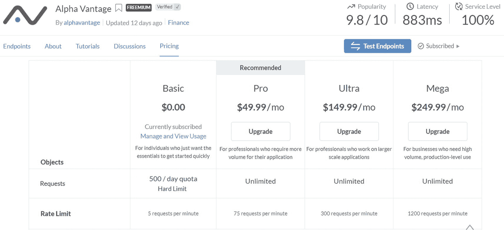

图 16-2

Alpha Vantage 的定价模式

在本章中，我们将看到这两个 API 的代码。Yahoo API 提供更多信息，并且轮询速率更快。Alpha Vantage API 返回更简洁的结果，但轮询速率较慢。两者都能让我们计算截至最近市场收盘的股票价格。在下一节中，我们将创建 Stock API 模块。

### Stock API 模块

为了保持 Stock API 代码的组织性，并将其与 `lambda_function.py` 中的主要技能代码分离，我们将把它附加到上一章添加的 `api_calls.py` 模块中。

首先，我们将创建一个模块级常量，用于指定要使用的 `STOCK_API`：

```
STOCK_API = 'YAHOO' # 或
# STOCK_API = 'ALPHA'
```

然后，我们需要将 Realty Mole 的 URL 移动到 `GetHomeValue` 函数内部。（在上一章中，它是我们唯一关心的 URL，我们将其放在了模块级别。）因此，代码现在应如下所示：

```
def GetHomeValue(profile):
url = "https://realty-mole-property-api.p.rapidapi.com/salePrice"
querystring = {
"compCount": "10",
```

现在，我们可以添加一个函数，该函数遍历 `profile["stocks"]` 字典。如果没有股票，则返回 0。如果有，我们需要查找最新的收盘价，将其乘以持有的股票数量，并累加到运行总计中。

请记住，当我们将股票存储在 profile 中时，我们使用股票代码作为键，股票数量作为值，如下所示：

```
profile["stocks"][stock_ticker] = share_count
```

现在，在 `api_calls.py` 中，我们需要定义一个函数，用于根据 profile 计算总股票价值：

```
def GetStockValue(profile):
```

接下来，我们将定义一组变量来保存请求信息：

```
stockUrl = ''
querystring = {}
headers = {}
```

直接从 Rapid API 的 Python 定义中提取每个 API 的请求示例，并用我们的环境变量替换密钥，得到以下内容：

```
if STOCK_API == 'YAHOO':
stockurl = "https://apidojo-yahoo-finance-v1.p.rapidapi.com/stock/v2/get-summary"
querystring = {"symbol":"TSLA","region":"US"}
headers = {
'x-rapidapi-key': os.environ['RAPID_API_KEY'],
'x-rapidapi-host': "apidojo-yahoo-finance-v1.p.rapidapi.com"
}
else:
stockurl = "https://alpha-vantage.p.rapidapi.com/query"
querystring = {"function":"GLOBAL_QUOTE","symbol":"TSLA"}
headers = {
'x-rapidapi-key': os.environ['RAPID_API_KEY'],
'x-rapidapi-host': "alpha-vantage.p.rapidapi.com"
}
```

配置好 API 请求后，我们可以开始检查是否存在股票：

```
if not "stocks" in profile:
return 0
if len(profile["stocks"]) == 0:
return 0
```

然后，我们可以遍历 profile 中的股票：

```
for ticker, quantity in profile["stocks"].items():
```

并为每个股票代码调用 `requests.request` 方法：

```
querystring["symbol"] = ticker
response = requests.request("GET", stockurl, headers=headers, params=querystring)
```

根据我们使用的 API，我们必须从返回的 JSON 中提取不同的属性。对于 Yahoo，它是 `price.regularMarketPrice.raw`；对于 Alpha Vantage，它是 `"Global Quote"."05\. price"`。生成的代码可能如下所示：

```
totalValue = float(0)
for ticker, quantity in profile["stocks"].items():
if quantity != 0:
querystring["symbol"] = ticker
response = requests.request("GET", stockurl, headers=headers, params=querystring)
if response:
if response.text:
result = json.loads(response.text)
price = float(0)
if STOCK_API == 'YAHOO':
try:
price = float(
result["price"]["regularMarketPrice"]["raw"])
except:
price = 0
else:
try:
price = float(result["Global Quote"]["05\. price"])
except:
price = 0
```

接下来，我们可以进行计算，以跟踪总价值的运行总和：

```
totalValue += price * float(quantity)
```

`for` 循环完成后，我们可以返回总价值：

```
return round(totalValue, 2)
```

这样就完成了该函数。真的完成了吗？关于我们在一段时间内可以发出的 API 请求数量的限制呢？

#### 为 For 循环添加延迟

为了添加延迟，避免在短时间内发出过多请求，我们需要导入 `time.sleep()` 函数。首先导入 `time` 模块：

```
import time
```

接下来，我们需要计算延迟的秒数。对于 Yahoo，速率是每秒 5 个请求。因此，速率为 1 秒除以 5 个请求，即每个请求 0.2 秒。对于 Alpha Vantage，速率是每分钟 5 个请求。该速率计算为 60 秒除以 5 个请求，即每个请求 12 秒。要添加的代码如下所示：

```
if STOCK_API == 'YAHOO':
rate = 1.0 / 5.0
else:
rate = 60.0 / 5.0
```

计算出每个请求的速率后，我们可以通过以下代码行将延迟添加到 `for` 循环中：

```
time.sleep(rate)
```

现在，我们已经完成了该函数，如下一节所示。


#### 完整的 `GetStockValue` 函数

综合以上所有内容，我们得到以下函数：

```python
def GetStockValue(profile):
    stockurl = ''
    querystring = {}
    headers = {}
    rate = 0
    if STOCK_API == 'YAHOO':
        stockurl = "https://apidojo-yahoo-finance-v1.p.rapidapi.com/stock/v2/get-summary"
        querystring = {"symbol": "TSLA", "region": "US"}
        headers = {
            'x-rapidapi-key': os.environ['RAPID_API_KEY'],
            'x-rapidapi-host': "apidojo-yahoo-finance-v1.p.rapidapi.com"
        }
        rate = 1.0 / 5.0
    else:
        stockurl = "https://alpha-vantage.p.rapidapi.com/query"
        querystring = {"function": "GLOBAL_QUOTE", "symbol": "TSLA"}
        headers = {
            'x-rapidapi-key': os.environ['RAPID_API_KEY'],
            'x-rapidapi-host': "alpha-vantage.p.rapidapi.com"
        }
        rate = 60.0 / 5.0
    if not "stocks" in profile:
        return 0
    if len(profile["stocks"]) == 0:
        return 0
    totalValue = float(0)
    for ticker, quantity in profile["stocks"].items():
        if quantity != 0:
            querystring["symbol"] = ticker
            response = requests.request(
                "GET", stockurl, headers=headers, params=querystring)
            if response:
                if response.text:
                    result = json.loads(response.text)
                    price = float(0)
                    if STOCK_API == 'YAHOO':
                        try:
                            price = float(
                                result["price"]["regularMarketPrice"]["raw"])
                        except:
                            price = 0
                    else:
                        try:
                            price = float(result["Global Quote"]["05\. price"])
                        except:
                            price = 0
                    totalValue += price * float(quantity)
            time.sleep(rate)
    return round(totalValue, 2)
```

现在我们需要用几种不同的方式来测试这个函数。

#### 对 `GetStockValue` 函数进行单元测试

我们需要在以下条件下测试 `GetStockValue` 函数：

1.  缺少 `profile["stocks"]` 字典
2.  空的 `profile["stocks"]` 字典
3.  一个包含一只股票且数量有效（非零）的配置文件（用于测试 API 请求）
4.  一个包含无效股票代码和有效数量的配置文件（用于测试错误处理）
5.  一个包含一只股票且数量为零的配置文件（用于测试跳过逻辑）
6.  一个包含三只股票，每只数量都有效的配置文件（用于测试循环）
7.  一个包含三只股票，其中一只数量为零的配置文件（用于测试循环中的跳过逻辑）
8.  一个包含 20 只股票的配置文件（用于正确测试延迟）

呼！测试真不少。如果我们像处理房屋价值那样，把这些测试直接插入到启动请求处理器中，会使它变得杂乱不堪。那我们该怎么办呢？

创建单元测试的一种常见方法是将它们放在一个并行的模块中，也就是说，在 `api_calls.py` 模块旁边，我们可以添加一个 `api_calls_tests.py` 模块。（见图 16-3。）


**图 16-3** 添加 `api_calls_tests.py` 模块

在新的测试模块中，添加日志记录和 `api_calls` 的导入（包括新的 `GetStockValue` 函数）：

```python
import logging
from api_calls import GetHomeValue, GetStockValue
logger = logging.getLogger(__name__)
logger.setLevel(logging.INFO)
```

然后添加一个名为 `UnitTests()` 的函数：

```python
def UnitTests():
```

现在，将我们之前插入到启动请求处理器中的 `GetHomeValue` 测试代码全部移入这个新模块的一个测试函数中。之后，该模块应如下所示：

```python
import logging
from api_calls import GetHomeValue, GetStockValue
logger = logging.getLogger(__name__)
logger.setLevel(logging.INFO)

def UnitTests():
    TestGetHomeValue()

def TestGetHomeValue():
    profile = {}
    profile["street_address"] = "1234 Main Street"
    profile["city"] = "Nashville"
    profile["state"] = "TN"
    profile["zip_code"] = 37206
    profile["homestats"] = {
        "property_type": "Single Family",
        "square_footage": 2250,
        "bedrooms": 4,
        "baths": 3
    }
    logger.info(f"Calling GetHomeValue with profile: {profile}")
    homeValue = GetHomeValue(profile)
    logger.info(
        f"Back from calling GetHomeValue, asserting homeValue is non-zero. HomeValue is {homeValue}")
    assert homeValue != 0, "Home Value is 0, expected a non-zero result."
```

请注意使用日志记录来明确单元测试的进度。同时，注意最后一行中 `assert` 语句的使用。这就是 Python 确保我们在使用示例地址调用 `GetHomeValue` 函数时能获得一个值的方式。

要运行测试，请编辑 `lambda_function.py`。修改与之前相同的启动请求处理器。现在它将调用 `UnitTests` 函数，而不是自己进行测试。首先，编辑导入部分：

```python
from api_calls import GetHomeValue, GetStockValue
from api_calls_tests import UnitTests
```

向模块中添加一个标志，用于打开或关闭单元测试：

```python
RUN_UNIT_TESTS = True
```

并按如下所示修改启动请求处理器：

```python
class LaunchRequestHandlerUnlinked(AbstractRequestHandler):
    """Handler for Skill Launch when the Account is not linked."""
    def can_handle(self, handler_input):
        return not has_access_token(handler_input) and ask_utils.is_request_type("LaunchRequest")(handler_input)

    def handle(self, handler_input):
        speak_output = """Welcome, you need to link your account to use the Personal Net Worth skill.
Would you like to link it now?"""
        handler_input.attributes_manager.session_attributes["question"] = "LinkAccount"
        # ====>
        if RUN_UNIT_TESTS:
            UnitTests()
            speak_output = "The Unit Tests have Passed."
        # ====>
        handler_input.attributes_manager.session_attributes["last_speech"] = speak_output
        return (
            handler_input.response_builder
            .speak(speak_output)
            .ask(speak_output)
            .response
        )
```

你应该会收到一条消息，显示“The Unit Tests have Passed.”。如果没有，请先进行调试再继续。将 `TestGetHomeValue` 函数从 `lambda_function.py` 移出到 `api_calls_tests.py` 后，我们就可以开始为 `GetStockValue` 函数构建测试用例了。

首先，添加一个 `TestGetStockValue` 函数，该函数将调用其他的 `GetStockValue` 测试。然后将该函数调用添加到主 `UnitTests()` 函数中。将每个针对 `GetStockValue` 的特定单元测试添加到 `TestGetStockValue()` 函数中。例如：

```python
def UnitTests():
    TestGetHomeValue()
    TestGetStockValue()

def TestGetStockValue():
    delay = 0.2  # Yahoo API 为 0.2 秒，Alpha Vantage 为 12 秒
    TestGetStockValueMissingProfile()
    TestGetStockValueEmptyStocks()
    TestGetStockValueOneValidStock()
    time.sleep(delay)
```

#### 缺少 `profile["stocks"]` 字典

```python
def TestGetStockValueMissingProfile() :
    # A missing profile["stocks"] dictionary.
    profile = {}
    logger.info(
        f"TestGetStockValueMissingProfile: Calling GetStockValue with profile: {profile}")
    stockValue = GetStockValue(profile)
    logger.info(
        f"-   Back from Calling GetStockValue. StockValue is {stockValue}")
    assert stockValue == 0, f"Stock Value should be 0, got {stockValue} instead."
```

#### 空的 `profile["stocks"]` 字典

```python
def TestGetStockValueEmptyStocks():
    # An empty profile["stocks"] dictionary.
    profile = {}
    profile["stocks"] = {}
    logger.info(
        f"TestGetStockValueEmptyStocks: Calling GetStockValue with profile: {profile}")
    stockValue = GetStockValue(profile)
    logger.info(
        f"-   Back from Calling GetStockValue. StockValue is {stockValue}")
    assert stockValue == 0, f"Stock Value should be 0, got {stockValue} instead."
```

#### 一个包含一只股票且数量有效（非零）的配置文件（用于测试 API 请求）

```python
def TestGetStockValueOneValidStock():
    # A profile with one stock with a valid (non-zero) quantity (to test the API request).
    profile = {}
    profile["stocks"] = {"TSLA": 10.0}
    logger.info(
        f"TestGetStockValueOneValidStock: Calling GetStockValue with profile: {profile}")
    stockValue = GetStockValue(profile)
    logger.info(
        f"-   Back from Calling GetStockValue. StockValue is {stockValue}")
    assert stockValue != 0, f"Stock Value should be non-zero, got 0 instead."
```

> **注意：** 你应该经常部署和测试你的单元测试。即使在添加每个函数之后也要这样做。另外，不要忘记在 API 调用之间添加延迟，以免超出速度限制。


#### 包含无效股票代码和有效数量的配置文件（用于测试错误处理）

```
def TestGetStockValueOneInvalidStock():
# 包含无效股票代码和有效数量的配置文件（用于测试错误处理）。
profile = {}
profile["stocks"] = {"Bustopher Jones": 10.0}  # 无效股票代码
logger.info(
f"TestGetStockValueOneInvalidStock: Calling GetStockValue with profile: {profile}")
stockValue = GetStockValue(profile)
logger.info(
f"-   Back from Calling GetStockValue. StockValue is {stockValue}")
assert stockValue == 0, f"Stock Value should be 0, got {stockValue} instead."
```

**注意**

此测试耗时稍长，很可能在完成前超时。要解决此问题，请编辑 `Function | Configuration | General Configuration | Timeout`（参见图 16-4）。将其增加到 5 分钟（最多可增加到 15 分钟）。


**图 16-4** 设置函数的超时时间

#### 包含一个数量为零的股票的配置文件（用于测试跳过逻辑）

```
def TestGetStockValueValidStockWithZeroQuantity():
# 包含一个数量为零的股票的配置文件（用于测试跳过逻辑）。
profile = {}
profile["stocks"] = {"TSLA": 0.0}  # 数量为零
logger.info(
f"TestGetStockValueValidStockWithZeroQuantity: Calling GetStockValue with profile: {profile}")
stockValue = GetStockValue(profile)
logger.info(
f"-   Back from Calling GetStockValue. StockValue is {stockValue}")
assert stockValue == 0, f"Stock Value should be 0, got {stockValue} instead."
```

#### 包含三只股票且每只股票数量均有效的配置文件（用于测试循环）

```
def TestGetStockValueThreeValidStocks():
# 包含三只股票且每只股票数量均有效的配置文件（用于测试循环）。
profile = {}
profile["stocks"] = {"TSLA": 10.0, "MSFT": 20, "AAPL": 15.5}
logger.info(
f"TestGetStockValueThreeValidStocks: Calling GetStockValue with profile: {profile}")
stockValue = GetStockValue(profile)
logger.info(
f"-   Back from Calling GetStockValue. StockValue is {stockValue}")
assert stockValue != 0, f"Stock Value should be non-zero, got 0 instead."
```

#### 包含三只股票且其中一只数量为零的配置文件（用于测试循环中的跳过逻辑）

```
def TestGetStockValueThreeValidStocksOneWithZeroQuantity():
# 包含三只股票且其中一只数量为零的配置文件（用于测试循环中的跳过逻辑）。
profile = {}
profile["stocks"] = {"TSLA": 10.0, "MSFT": 0, "AAPL": 15.5}
logger.info(
f"TestGetStockValueThreeValidStocksOneWithZeroQuantity: Calling GetStockValue with profile: {profile}")
stockValue = GetStockValue(profile)
logger.info(
f"-   Back from Calling GetStockValue. StockValue is {stockValue}")
assert stockValue != 0, f"Stock Value should be non-zero, got 0 instead."
```

#### 包含二十只股票的配置文件（用于正确测试延迟）

```
def TestGetStockValueTwentyStocks():
# 包含二十只股票的配置文件（用于正确测试延迟）。
profile = {}
profile["stocks"] = {"TSLA": 10.0, "MSFT": 20, "AAPL": 15.5, "GE": 4, "NKE": 5,
"MCD": 6, "AMZN": 7, "GOOG": 8, "GMWKF": 9, "SONY": 10,
"RRGB": 11, "TACO": 12, "DPZ": 13, "DIS": 14, "WMT": 15,
"WFC": 16, "BAC": 17, "TD": 18, "C": 19, "JNJ": 20}
logger.info(
f"TestGetStockValueTwentyStocks: Calling GetStockValue with profile: {profile}")
stockValue = GetStockValue(profile)
logger.info(
f"-   Back from Calling GetStockValue. StockValue is {stockValue}")
assert stockValue != 0, f"Stock Value should be non-zero, got 0 instead."
```

将所有子测试函数添加到股票价值的主测试函数后，得到如下结果：

```
def TestGetStockValue():
delay = 0.2  # Yahoo API 为 0.2 秒，Alpha Vantage 为 12 秒
TestGetStockValueMissingProfile()
TestGetStockValueEmptyStocks()
TestGetStockValueOneValidStock()
time.sleep(delay)
TestGetStockValueOneInvalidStock()
time.sleep(delay)
TestGetStockValueValidStockWithZeroQuantity()
time.sleep(delay)
TestGetStockValueThreeValidStocks()
time.sleep(delay)
TestGetStockValueThreeValidStocksOneWithZeroQuantity()
time.sleep(delay)
TestGetStockValueTwentyStocks()
```

按照上一章的方法运行测试，并调试遇到的任何错误。我发现，当我为 Yahoo API 运行所有测试时，耗时约 42 秒。当我为速度限制低得多的 Alpha Vantage API 运行测试时，耗时约 6.5 分钟。如果所有单元测试都通过，则说明您已完成本章的代码。选择一个 API，并思考下一步要做什么。

### 接下来可以做什么？

我们可以通过以下几种方式提升技能。

首先，我们可以将所有股票的价格作为配置文件的一部分返回。这样我们就可以将价格保存到数据库中，进而能够 (a) 确保每个股票代码返回的价格正确，以及 (b) 计算今日与昨日的价值差异，并告知用户其投资组合是上涨还是下跌。

其次，我们可以扩展股票功能，纳入共同基金、加密货币等更多品种。Yahoo API 提供了所有这些功能。

第三，我们可以在对话模型中添加股票查询功能，这样当用户提供股票代码时，我们会尝试从 Yahoo API 获取其价格。然后，通过向用户回显股票名称和价格，确认我们获取了正确的股票代码。

第四，我们可以添加更多测试。特别是添加一个测试来审计 `GetStockValue` 方法的结果，确保其结果始终 100% 正确。我们还可以确保流程的所有部分都能正确处理小数值。

第五，世界尽在掌握。思考如何利用这些 API 为用户提供更多信息。需要什么样的对话（意图和表述）来支持这些功能？

### 总结

在本章中，我们研究了两种可用于获取股票价格的金融 API。我们将它们连接起来，根据在第 15 章中收集的股票代码和持股数量，获取股票投资组合的总价值。我们还花了一些时间，在单元测试方面加深了对程序结构的理解。我们创建了一个用于存放单元测试的并行模块。然后，我们设置了各种单元测试来测试新的 `GetStockValue` 函数。

## 17. 下一步是什么？

### 结论

在第一部分中，我们开始学习语音用户界面的世界。然后，我们研究了 Alexa 例程和蓝图。接着，我们创建并发布了一个身体质量指数 Alexa 技能。这也介绍了 Alexa 对话。

然后，在第二部分中，我们通过 90 年日历技能超越了“Hello World”。我们使用 Botmock 设计了 VUI，使用 Alexa 演示语言创建了可视化界面，并编写了后端 lambda 函数。接着，我们看到了几种对 lambda 函数和 Alexa 技能进行单元测试的方法。

最后，在第三部分中，我们从房地产和股票市场 API 中提取数据，构建了一个个人净资产技能。


### 下一步做什么？

在本书中，你已经接触了多种数据源，包括像 `DynamoDb` 这样的数据库，以及像 Realty Mole Property API 这样的接口。此外，你还创建并测试了作为云端后端应用的 `lambda` 函数。这些 Lambda 后端可以从任何地方拉取数据，并通过 Alexa 技能接口将其呈现出来。

下一步做什么？例如，你可以从犯罪数据浏览器（`https://crime-data-explorer.app.cloud.gov/`）中拉取 FBI 犯罪数据，创建一个 Alexa 犯罪数据浏览器。然后，或许再通过谷歌地图平台（`https://developers.google.com/maps/gmp-get-started`）添加地理空间数据，构建一个“这个城市的犯罪率是多少？”的技能。

你也可以与你喜欢的企业云应用的 API 配合使用，创建一个能处理该应用数据的 Alexa 技能。例如，开发一个通过 Salesforce Lightning Platform REST API（`https://developer.salesforce.com/docs/atlas.en-us.api_rest.meta/api_rest/intro_what_is_rest_api.htm`）查询和更新 Salesforce 的技能。

或许可以构建一个 Alexa 对话界面，通过 ServiceNow 的 Now Platform Rest API（`https://docs.servicenow.com/bundle/rome-application-development/page/integrate/inbound-rest/concept/c_RESTAPI.html`）来记录 ServiceNow 工单。

你可以通过 Quandl API（`www.quandl.com/tools/api`）添加股市详情，来扩展个人净资产技能。你可以让 Alexa 通过 Alpaca API（`https://alpaca.markets/docs/api-documentation/api-v2/`）为你进行交易。再结合 AWS Sagemaker（`https://sagemaker.readthedocs.io/en/stable/`）加入一些机器学习，你就能让 Alexa 成为你的算法交易伙伴和智能经纪人。想象一下这样的对话：

> *你：Alexa，今天有什么股票推荐？*
>
> *Alexa：你好 Dave，我推荐 OTRK。Ontrak Inc. 是一家利用人工智能和远程医疗技术实现虚拟化门诊治疗的医疗公司。其市值接近 5 亿美元，流通股为 1860 万股。2021 年 3 月，其股价从 93.46 美元跌至 24.39 美元。基于当前 32 美元的价格，你应该在 30 美元时做空，因为其股价仍处于下跌趋势。*
>
> *你：很好。在 30 美元时做空 1000 股 OTRK，止损设在 31 美元，目标价设在 28 美元。*
>
> *Alexa：以 30 美元的价格做空 1000 股 OTRK（Ontrak Inc.），止损设在 31 美元，目标价设在 28 美元。我需要您的 PIN 码来确认此交易。*
>
> *你：1234。*
>
> *Alexa：PIN 码已确认。我已下达订单。*

这本书只是你数据驱动型 Alexa 技能之旅的起点。我迫不及待想听听你会构建出什么。


## 索引

### A

- 账户关联
- 应用程序安全配置文件客户端密钥
- 已完成表单配置配置文件凭据
- 重定向 URL
- 安全配置文件
- 安全配置文件 ID
- 设置菜单选项
- 用户 ID 创建
- 版本

- Alexa
  - 后端流程
  - Blueprint 对话模型
  - 开发者账户
  - 开发者控制台
  - 行业领先的智能音箱
  - 意图模型注册
  - 例程
  - 技能开发控制台
  - 技能商店
  - 语音用户界面

- Alexa 表示语言 (APL)
  - 文档图标配置编辑器
  - 组件
  - 多模态响应
  - 导航栏响应
  - 选项高度/宽度参数
  - Json 条目
  - 90 年日历
  - 缩放框/行
  - 源代码区域绘制
  - `blackBox`/`whiteBox` 图形代码
  - 代码块
  - 光标移动
  - 图形定义
  - `GridSequences` Json 代码
  - 渲染块
  - 种子值
  - 方形绘制 SVG 命令
  - SVG 表达式值生成
  - `when` 子句

- Alexa 技能套件 (ASK)
- Alexa 技能商店
  - 账户关联 (参见 账户关联)
  - 可用性
  - Beta 测试人员
  - 认证流程清单
  - 认证广告/促销信息
  - 紧急服务/内容
  - 金融技能
  - 健康技能
  - 调用名称要求
  - 政策
  - 色情与性
  - 推荐、补偿和购买要求
  - 安全策略测试
  - 暴力
  - 网络搜索创建
  - 描述
  - 设计工具
  - 开发流程
  - 分发/验证
  - 详细描述
  - 开发者控制台图形
  - 图标构建器
  - 隐私/合规部分
  - 隐私政策生成器
  - 产品卡片句子描述
  - 技能预览部分
  - 测试说明

- `DynamoDb` 特性
  - 托管 *vs*. 完全自定义交互模型
  - Lambda (参见 Lambda 函数)
  - 拒绝
  - S3 存储
  - 提交流程
  - TED 演讲者话语
  - 验证屏幕

- 90 年人生日历
- Alpha Vantage API
- Amazon 开发者账户
- Amazon 资源名称 (ARN)
- Amazon Web Services (AWS)
  - 免费套餐账户
  - IAM (参见 身份与访问管理 (IAM))
  - Lambda (参见 Lambda 函数)
  - 管理控制台
  - 支持计划选择

- Anaconda 提示符
- 应用程序编程接口 (API)
  - Alexa 对话模型
  - `botmock`/槽位类型
  - `CalculateBMIApiHandler` 类
  - `CalculateBMI` 代码
  - `CalculateBMI` 函数定义
  - `getApiSlots` 辅助函数
  - `handler` 模式
  - 家庭统计意图处理器
  - 含义
  - Numbers API/RESTful API
  - 请求
  - Python 的 `requests` 模块
  - 股票市场 (参见 股票市场 API)
  - `TellThemTheBmi` 意图

- 自动语音识别 (ASR)
  - 注释集
  - 评估模型按钮
  - 评估工具
  - 通过测试记录工具
  - 查看详情

### B

- 后端代码
  - API 处理器
  - BMI 方法
  - 辅助函数
  - 意图处理器
  - 启动请求处理器
  - 修改
  - Python 模块
  - 请求处理器/SkillBuilder
  - 测试
  - Alexa 响应
  - BMI 对话
  - 断点调试环境
  - 启动短语
  - `SkillBuilder()` 代码
  - 技能启动工具/语言
  - 扩展市场
  - Git 设置
  - 安装
  - 编写代码

- `HelloWorldHandler` 代码
- Hello World 模板
- `lambda` 文件夹
- 请求/意图处理器

- Blueprints
  - 分配和安排家务
  - 家务图表
  - 家务列表
  - 主屏幕
  - 家庭成员列表
  - 引导指南选择
  - 文本消息

- 身体质量指数 (BMI)
  - 后端代码基础技能
  - Alexa 技能开发控制台创建
  - 界面模型/方法选择
  - 草稿模板技能创建
  - 配置对话框配置
  - 附加响应
  - Alexa 对话模型
  - 再见响应选择
  - `CalculateBMI` API
  - 对话框选项卡
  - `GetHeightAndWeight`
  - 身高/体重参数
  - 身高提示
  - Hello World 意图
  - 高亮与识别
  - `InformHeightAndWeight` 话语集
  - 意图模型
  - 交互模型
  - 调用 API
  - 行选择
  - 映射变量
  - 请求参数
  - 响应配置
  - 保存按钮/话语
  - `TellThemTheBmi` 意图
  - 用户/Alexa 对话话语集
  - 身高/体重交互模型代码模块
  - 对话框屏幕
  - 意图
  - 调用名称
  - 问题陈述
  - 技能构建器界面
  - 槽位值
  - Alexa 开发者控制台应用程序窗口
  - 批量编辑 CSV 文件
  - Excel 粘贴值
  - 身高选项卡
  - 公制测量
  - 源代码
  - `SpellNumber` 函数
  - 电子表格 (身高)
  - 电子表格 (体重)
  - 同义词公式 (身高)
  - 类型
  - 单位组合
  - VBA 代码模块
  - `VBAProject` 菜单选项
  - 体重列
  - `xlsm` 文件

- `Botmock` 图表
  - API 设置
  - 内置意图
  - 对话框模型
  - GitHub 步骤
  - `node.js` 安装程序
  - `npm` 安装
  - 设置菜单
  - 技能创建
  - 技能套件导出工具
  - 令牌创建
  - 解压过程

### C

- 逗号分隔值 (CSV) 文件
- 犯罪数据探索器

### D, E, F

- 数据存储
  - 账户关联/访问令牌
  - 访问令牌检查过程
  - 开发账户开发技能选择
  - `dynamodb.py`
  - 启动请求 Json 点设置
  - `botmock` 图表
  - `DynamoDB` 表
  - `GiveBirthday` 意图
  - 启动请求处理器
  - 个人事件
  - `SkillBuilder()` 代码
  - 用户个人资料查看日历意图
  - `function.py` 模块 Json 代码步骤
  - 处理器测试
  - 单元测试
  - 有效启动请求
  - `ViewCalendar` 意图
  - `Yes` 意图处理器
  - `Yes` 意图处理器卡片通知
  - `handle()` 方法
  - `handle`/`handle` 方法
  - `LinkAccountCard`

- 设计 VUI
  - 附加功能
  - Adobe XD
  - `botmock`
  - 不同文本框
  - 事件详情
  - `EventType` 实体
  - 再见文本框
  - 快乐路径生日变量
  - 完成路径连接线
  - 文本框变量创建
  - 是意图创建
  - 意图交互
  - 启动响应
  - 已关联 *vs*. 未关联账户
  - 菜单流程
  - 菜单结构/功能
  - 否意图
  - 超过 90 情况
  - 个人净值技能
  - 提示图
  - 传统建模工具
  - 训练短语
  - 语音优先体验

- 开发者账户
  - Alexa 控制台
  - Amazon AWS 账户
  - 数据驱动流程
  - GitHub 访问
  - IAM/账户安全
  - Jira 和 Microsoft 的 Azure DevOps

### G

- GitHub 访问

### H

- Hello World, 90 年日历

### I

- 身份与访问管理 (IAM)
  - `AdministratorAccess` 策略
  - 管理员用户
  - AWS 管理控制台
  - `csv` 文件
  - 12 位账户号码
  - 组创建
  - 一次性密码
  - 根用户账户
  - 登录屏幕 URL 文件
  - 用户选择

- 交互模型/意图
  - Alexa 技能商店
  - `can_handle` 函数
  - 连接设置屏幕
  - 定义图
  - `handle` 函数
  - Lambda 函数
  - 启动意图创建响应
  - `TellThemTheBmi` 意图
  - `TellThemTheBMI` 意图处理器
  - 欢迎消息/启动意图

### J

- Jira 软件

### K

- 密钥管理服务 (KMS)

### L, M

- Lambda 函数
  - Amazon Web Service
  - ARN 表
  - `AWSLambdaBasicExecutionRole`
  - 内置意图
  - 取消和停止意图
  - 捕获所有异常回退
  - `GiveBirthday`
  - 帮助
  - 启动请求
  - 反射器处理器
  - 重复
  - 会话结束请求
  - `StartOverIntentHandler`
  - 步骤日历
  - 策略
  - 类和函数创建
  - 对话框当前屏幕
  - 自定义层定义
  - `dynamodb.py` 文件
  - 函数代码
  - `function.py` 模块
  - 给予生日意图 APL 文件
  - 文档标签函数
  - 日志保存对话框
  - 源代码测试按钮
  - `90year.json` 文件
  - 连接/VUI
  - IAM 服务
  - 意图处理器
  - 内置意图声明函数
  - Python 导入
  - 响应构建器结构
  - `lambda_function.py` 文件
  - `PersonalNetWorthBackend` 点
  - 响应对象
  - 安全角色
  - 技能构建器触发器
  - 单元测试
  - 用例工具函数
  - 欢迎响应
  - 90 年日历值计算
  - 数据集定义
  - 日期操作
  - `GiveBirthdayIntentHandler`
  - Lightning Platform REST API

### N, O

- 自然语言理解 (NLU)
  - 注释集
  - 评估工具
  - 测试详情
  - 测试过程

### P, Q

- 个人净值技能
  - `AMAZON.NavigateHomeIntent`
  - `GiveAddressIntent`
  - `botmock` 模型
  - `GiveStateIntentHandler`
  - `GiveZipCodeIntentHandler`
  - `handler_input`
  - `right()` 函数
  - 话语分析器
  - `HelpIntentHandler`
  - Lambda 函数
  - `LaunchRequest`
  - `LinkAccount`
  - 无更多意图处理器
  - 需求
  - 技能构建器部分
  - 股票意图
  - VUI 设计
  - `botmock` 对话流程
  - 实体
  - 意图
  - 启动请求处理器
  - 用户意图
  - 变量
  - 是/否意图

- 发布 (参见 Alexa 技能商店)
- Python 模块

### R

- 房地产估值 API
  - API (参见 应用程序编程接口 (API))
  - `calls.py` 模块
  - 配置选项卡
  - 环境变量
  - `GetHomeValue()`/`handle()` 函数
  - 房屋估值关键代码
  - KMS 编码
  - 启动请求处理器
  - 菜单选项
  - 物业估值
  - Python 请求
  - Realty Mole 物业售价估算方法
  - 测试网站

- 例程

### S

- 可缩放矢量图形 (SVG)
- 语音理解研究 (SUR) 计划
- 股票市场 API
  - Alpha Vantage API
  - `GetStockValue` 函数
  - `api_calls_tests.py` 模块
  - 空配置文件特性
  - 查询特性
  - 无效股票
  - 缺失配置文件字典
  - 非零数量/API 请求
  - Oyster 源代码
  - 测试函数
  - `TestGetStockValue()` 函数
  - 测试过程
  - 二十只股票
  - 单元测试
  - 有效数量
  - 零数量模块
  - `GetHomeValue` 函数
  - `for` 循环
  - 模块级常量
  - Python 定义
  - `requests.request` 方法
  - 源代码机会
  - Yahoo 财经 API

### T

- 测试驱动开发 (TDD)

### U

- 单元测试
  - 给予生日意图
  - `CatchAllExceptionHandler`
  - Lambda 函数
  - 启动短语模拟器
  - 话语
  - Lambda 函数
  - 错误消息
  - `LaunchCalendar` 测试事件
  - 层选择
  - 测试按钮
  - 欢迎消息
  - Zip 文件

- 话语分析器 (参见 话语分析器)
- 话语分析器
  - 自动语音识别工具
  - 构建选项卡
  - 评估模型按钮
  - 给予生日意图
  - NLU 评估
  - `period_from_amazon_date` 函数

### V, W, X

- Visual Studio Code (VS Code)
  - 代码按钮
  - 调试环境
  - 开发模式
  - Lambda 函数
  - Lambda 工具栏
  - `launch.json` 文件
  - 技能项目

- 语音操作演示器 (VODER)
- 语音用户界面 (VUI)
  - Alexa 语音助手
  - 贝尔实验室
  - 冷战设计 (参见 设计 VUI)
  - 设计工具
  - 全球市场份额百分比
  - Google 语音搜索
  - 历史
  - 行业领先的智能音箱
  - 基础设施和硬件问题
  - 基于格局的系统
  - 智能设备
  - 智能音箱
  - 语音激活个人助理
  - 语音界面
  - 语音技术

### Y, Z

- Yahoo 财经 API
