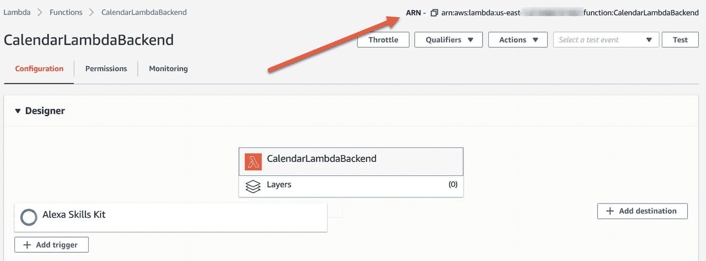

# 11. 编写 Lambda 函数

## 开始之前

首先，在第 9 章中，我们将 Botmock 图表转换为 Alexa 技能并配置了 VUI。在第 10 章中，我们为 90 年日历的视觉显示添加了 APL 呈现。在本章中，我们将创建后端 lambda 函数，为 VUI 提供代码支持，并将 VUI 连接到 APL。由于我们没有使用 Alexa 托管的技能，因此在第 7 章中，我们将 lambda 函数配置为亚马逊网络服务。

1.  首先，以管理员用户身份（而非 root 用户）登录 AWS 开发者控制台。AWS 控制台地址为：`https://console.aws.amazon.com`。
2.  选择服务 | 计算 | `Lambda`。
3.  选择我们在第 7 章中创建的 `CalendarLambdaBackend`。

你应该会在 `lambda_function.py` 文件中看到一小段代码：

```
import json
def lambda_handler(event, context): #TODO implement
return {
'statusCode': 200,
'body': json.dumps('Hello from Lambda!')
}
```

此时，我们需要完成以下几件事：

1.  将 VUI 连接到 lambda 函数。
2.  创建所有将处理意图的函数。
3.  进行计算以得出 90 年日历的值。
4.  定义 90 年日历视觉显示要绑定的数据集。
5.  进行计算以将视觉显示缩放到当前设备的屏幕。
6.  将渲染后的 APL 和语音输出作为响应对象返回。
7.  在 lambda 函数底部定义 `Skill Builder` 对象。

## 将 VUI 连接到 Lambda 函数

要将 VUI 连接到 lambda 函数，我们需要将 Alexa 技能中的技能 ID 复制到 lambda 函数，并将 lambda 函数中的 ARN（亚马逊资源名称）复制到 Alexa 技能。


图 11-1：lambda 函数的 ARN

1.  在 lambda 函数的右上角，你可以看到 ARN。（见图 11-1。）点击图标复制 ARN。
2.  切换到 90 年日历 Alexa 技能。Alexa 开发者控制台地址为：`https://developer.amazon.com/alexa/console/ask`。
3.  从左侧导航栏中选择端点。
4.  将 ARN 粘贴到默认区域框中。
5.  点击顶部的“保存端点”按钮。你应该会看到一条绿色的成功消息。
6.  切换回 AWS 中的 lambda 函数。

在下一节中，我们将创建意图处理器。

## 创建意图处理器

我们的 Alexa 技能交互模型包含许多意图。每个意图都需要在 lambda 函数中进行处理。要创建意图处理器，我们需要导入以下 Python 模块：

```
import json
import logging
import ask_sdk_core.utils as ask_utils
from ask_sdk_core.skill_builder import SkillBuilder
from ask_sdk_core.dispatch_components import AbstractRequestHandler
from ask_sdk_core.dispatch_components import AbstractExceptionHandler
from ask_sdk_core.handler_input import HandlerInput
from ask_sdk_model import Response
```

直接用这些导入语句完全替换已有的代码片段。然后使用以下代码行开启日志记录：

```
logger = logging.getLogger(__name__)
logger.setLevel(logging.INFO)
```

接下来，我们可以查看意图处理器的结构。

### 意图处理程序的结构

意图处理程序的结构如下：

```
class xxxIntentHandler(AbstractRequestHandler):
    """用于 xxx 意图的处理程序。"""
    # 第 A 部分 – 可处理声明
    def can_handle(self, handler_input):
        return ask_utils.is_intent_name("AMAZON.HelpIntent")(handler_input)
    # 第 B 部分 – 处理函数
    def handle(self, handler_input):
        speak_output = """语音内容。"""
        handler_input.attributes_manager.session_attributes["last_speech"] = speak_output
        #第 C 部分 - 返回响应
        return (
            handler_input.response_builder
                .speak(speak_output)
                .ask(speak_output)
                .response
        )
```

如上所示，共有三个部分，具体描述如下。

#### 第 A 部分 – 可处理声明

每个处理程序声明它要处理哪个意图。例如，内置帮助意图的处理程序如下所示：

```
def can_handle(self, handler_input):
    return ask_utils.is_intent_name("AMAZON.HelpIntent")(handler_input)
```

而自定义的“获取完成百分比”意图的处理程序如下所示：

```
def can_handle(self, handler_input):
    return ask_utils.is_intent_name("GetPercentDone")(handler_input)
```

Alexa 的 AI 会遍历所有声明的意图处理程序，并调用与用户所说意图匹配的那个。一旦确定了正确的处理程序类，Alexa 将调用该类的处理函数。

#### 第 B 部分 – 处理函数

每个意图处理程序类都声明一个处理函数，该函数负责确定 Alexa 将说什么来处理用户的意图。例如，90 年日历的内置帮助意图处理程序如下所示：

```
def handle(self, handler_input):
    speak_output = """请尝试以月、日、年的格式说出您的生日。例如，一九八零年一月一日。
    告诉我您的生日，我会告诉您一些有趣的事情。"""
    handler_input.attributes_manager.session_attributes["last_speech"] = speak_output
```

在这个处理程序中，有两行代码。第一行定义了 Alexa 在响应用户寻求帮助时将说的语音内容。第二行是一个辅助函数，将此响应作为 Alexa 最后说的话存储在会话属性中。在某些情况下，我们需要知道 Alexa 最后说了什么。

定义语音内容后，我们将其作为响应对象返回。

#### 第 C 部分 – 返回响应

一旦我们创建了要输出的语音内容，就需要将其转换为响应对象。这是由响应构建器完成的，如下所示：

```
return (
    handler_input.response_builder
        .speak(speak_output)
        .ask(speak_output)
        .response
)
```

第一行调用 `response_builder`。第二行将我们之前创建的语音内容定义为 Alexa 将说的话。第三行将相同的语音内容定义为她向用户提问以继续对话的问题（不过她不会说两次）。第四行是正在返回的已创建的响应对象。

现在我们有了意图处理程序的结构，就可以创建我们将要使用的意图处理程序了。

### 构建意图处理程序

当我们从 Botmock 导入项目时，最终得到了 26 个意图。我们目前不会为所有这些意图创建处理程序。我们将处理那些渲染基本 90 年日历的意图，以及一些内置意图。我们将在接下来的几章中构建其他一些意图。有些将作为练习留给您完成。

我们需要在 `GiveBirthday` 意图处理程序中放入相当多的代码，以便渲染日历。所以我们暂时先不管它，专注于内置意图。我们需要的内置意图有：
*   帮助
*   回退
*   取消
*   停止
*   重复
*   重新开始

#### 帮助意图

我们技能的帮助意图处理程序开始时非常简单。随着我们在后续章节中向技能添加日历事件，帮助意图处理程序应该通过以特定上下文的方式响应来变得更有帮助。目前，我们将帮助响应限制在生日提示上。首先，我们应用前面显示的模板。然后我们更改类和意图名称。然后我们定义语音响应。代码如下：

```
class HelpIntentHandler(AbstractRequestHandler):
    """用于帮助意图的处理程序。"""
    def can_handle(self, handler_input):
        return ask_utils.is_intent_name("AMAZON.HelpIntent")(handler_input)

    def handle(self, handler_input):
        speak_output = """请尝试以月、日、年的格式说出您的生日。例如，一九八零年一月一日。
        告诉我您的生日，我会告诉您一些有趣的事情。"""
        handler_input.attributes_manager.session_attributes["last_speech"] = speak_output
        return (
            handler_input.response_builder
                .speak(speak_output)
                .ask(speak_output)
                .response
        )
```

#### 回退意图

如果用户的话语无法解析到任何其他意图处理程序，那么如果定义了回退意图处理程序，Alexa 将调用它。您应该始终定义一个。与之前的帮助意图类似，这个意图处理程序可能有更复杂的版本，但我们在第一次实现中保持简单。代码如下：

```
class FallbackIntentHandler(AbstractRequestHandler):
    """用于回退意图的处理程序。"""
    def can_handle(self, handler_input):
        return ask_utils.is_intent_name("AMAZON.FallbackIntent")(handler_input)

    def handle(self, handler_input):
        speak_output = """九十年日历无法处理这个，但我可以帮助您了解一些关于您生活的有趣信息。
        告诉我您的生日，我会告诉您一些有趣的事情。"""
        handler_input.attributes_manager.session_attributes["last_speech"] = speak_output
        return (
            handler_input.response_builder
                .speak(speak_output)
                .ask(speak_output)
                .response
        )
```

#### 取消和停止意图

当我们的技能变得更高级时，取消和停止意图之间可能存在一些差异，但目前，它们服务于相同的目的，即结束技能。在这里，我们通过使用 `OR` 逻辑组合条件来合并处理程序。代码如下：

```
class CancelOrStopIntentHandler(AbstractRequestHandler):
    """用于取消和停止意图的单一处理程序。"""
    def can_handle(self, handler_input):
        return (ask_utils.is_intent_name("AMAZON.CancelIntent")(handler_input) or
                ask_utils.is_intent_name("AMAZON.StopIntent")(handler_input))

    def handle(self, handler_input):
        speak_output = "再见！"
        return (
            handler_input.response_builder
                .speak(speak_output)
                .response
        )
```

`last_speech` 会话属性在此无关紧要，因为我们要在此结束技能。

#### 重复意图

当用户没有听到或听错 Alexa 的话时，他们可能会要求她重复刚才说的话。这就是为什么我们在其他处理程序中一直在收集 `last_speech` 会话属性。在这个意图处理程序中，我们将重复我们上次说过的话，或者如果 `last_speech` 尚未设置，则提示用户。代码如下：

```
class RepeatIntentHandler(AbstractRequestHandler):
    """用于重复意图的处理程序。"""
    def can_handle(self, handler_input):
        return ask_utils.is_intent_name("AMAZON.RepeatIntent")(handler_input)

    def handle(self, handler_input):
        if "last_speech" in handler_input.attributes_manager.session_attributes:
            speak_output = handler_input.attributes_manager.session_attributes["last_speech"]
        else:
            speak_output = """告诉我您的生日，我会告诉您一些有趣的事情。"""

        handler_input.attributes_manager.session_attributes["last_speech"] = speak_output
        return (
            handler_input.response_builder
                .speak(speak_output)
                .ask(speak_output)
                .response
        )
```

#### 重新开始意图

```
class StartOverIntentHandler(AbstractRequestHandler):
    """用于处理重新开始意图的处理器。"""
    def can_handle(self, handler_input):
        return ask_utils.is_request_type("AMAZON.StartOverIntent")(handler_input)

    def handle(self, handler_input):
        speak_output = "欢迎，告诉我你的生日，我会告诉你一些有趣的事情。"
        handler_input.attributes_manager.session_attributes["last_speech"] = speak_output
        return (
            handler_input.response_builder
                .speak(speak_output)
                .ask(speak_output)
                .response
        )
```

很好！我们已经为基础日历定义了必要的意图处理器。除此之外，我们还需要一些系统定义的处理器：
*   启动请求处理器
*   会话结束请求处理器
*   用于调试的意图反射器处理器
*   用于处理任何异常的全捕获异常处理器

##### 启动请求处理器

当技能启动时，Alexa 会调用启动请求处理器。这将返回启动我们技能的初始提示。在我们的案例中，我们需要询问用户的生日。代码如下：

```
class LaunchRequestHandler(AbstractRequestHandler):
    """用于技能启动的处理器。"""
    def can_handle(self, handler_input):
        return ask_utils.is_request_type("LaunchRequest")(handler_input)

    def handle(self, handler_input):
        speak_output = "欢迎，告诉我你的生日，我会告诉你一些有趣的事情。"
        handler_input.attributes_manager.session_attributes["last_speech"] = speak_output
        return (
            handler_input.response_builder
                .speak(speak_output)
                .ask(speak_output)
                .response
        )
```

##### 会话结束请求处理器

当用户停止或取消会话，或者代码退出会话时，会调用会话结束请求处理器。它负责执行任何清理逻辑，例如关闭打开的数据库连接。我们目前还没有任何清理逻辑。我们将暂时存根化会话结束请求处理器。代码如下：

```
class SessionEndedRequestHandler(AbstractRequestHandler):
    """用于会话结束的处理器。"""
    def can_handle(self, handler_input):
        return ask_utils.is_request_type("SessionEndedRequest")(handler_input)

    def handle(self, handler_input):
        # 任何清理逻辑都放在这里。
        return handler_input.response_builder.response
```

## 意图反射器处理器

在测试时，你可能想知道哪些意图被触发了。意图反射器处理器就是为此而设计的。只需在`can_handle`逻辑中通过`OR`运算加入你想要宣布的意图，就像我们对取消和停止意图所做的那样。代码如下：

```python
class IntentReflectorHandler(AbstractRequestHandler):
    """意图反射器用于交互模型测试和调试。
    它会简单地重复用户说出的意图。你可以通过在上面定义自定义处理器，
    然后将它们添加到下面的请求处理器链中，来为你的意图创建自定义处理器。
    """
    def can_handle(self, handler_input):
        return ask_utils.is_request_type("IntentRequest")(handler_input)

    def handle(self, handler_input):
        intent_name = ask_utils.get_intent_name(handler_input)
        speak_output = "你刚刚触发了 " + intent_name + "。"

        return (
            handler_input.response_builder
                .speak(speak_output)
                # .ask("如果你想保持会话打开让用户回复，请添加一个重新提示")
                .response
        )
```

要反射（宣布）帮助意图，你可以通过`OR`运算将其添加到`can_handle`中，如下所示：

```python
def can_handle(self, handler_input):
    return (ask_utils.is_request_type("IntentRequest")(handler_input) or
            ask_utils.is_intent_name("AMAZON.HelpIntent")(handler_input))
```

要添加另一个意图，请使用`OR`将它们链接在一起。

## 全捕获异常处理器

如果出现任何问题，Alexa 只会停止并说：“抱歉，我不知道。”为了避免这种情况并说出更有帮助的内容，我们需要一个全捕获异常处理器。注意添加了`logger.error()`来记录异常。根据所处理的异常，你可以让 Alexa 说出不同的内容。在我们的示例中，我们只是对默认消息进行详细说明。代码如下：

```python
class CatchAllExceptionHandler(AbstractExceptionHandler):
    """通用错误处理，用于捕获任何语法或路由错误。如果你收到错误
    提示未找到请求处理器链，说明你尚未为正在调用的意图实现处理器，
    或者未将其包含在下面的技能构建器中。
    """
    def can_handle(self, handler_input, exception):
        return True

    def handle(self, handler_input, exception):
        logger.error(exception, exc_info=True)

        speak_output = "抱歉，我在执行你的请求时遇到了问题。请再试一次。"
        handler_input.attributes_manager.session_attributes["last_speech"] = speak_output

        return (
            handler_input.response_builder
                .speak(speak_output)
                .ask(speak_output)
                .response
        )
```

就是这样。这些就是我们需要的内置意图处理器。在接下来的几个部分中，我们将添加`GiveBirthday`意图处理器并对其进行完善。

## GiveBirthday 意图处理器

首先，我们将存根化`GiveBirthday`意图处理器：

```python
class GiveBirthdayIntentHandler(AbstractRequestHandler):
    """用于处理 GiveBirthday 意图的处理器。"""
    def can_handle(self, handler_input):
        return ask_utils.is_intent_name("GiveBirthday")(handler_input)

    def handle(self, handler_input):
        speak_output = """语音内容。"""
        handler_input.attributes_manager.session_attributes["last_speech"] = speak_output

        return (
            handler_input.response_builder
                .speak(speak_output)
                .ask(speak_output)
                .response
        )
```

请记住，在启动请求处理器中，我们提示用户：“欢迎，告诉我你的生日，我会告诉你一些有趣的事情”。`GiveBirthday`意图处理器接受用户的出生日期，并返回“有趣的事情”，即他们 90 年寿命中已流逝的部分。在下一节中，我们将计算这个数值。

### 计算 90 年日历数值

首先，我们将处理日期，因此需要额外导入一些模块。在模块顶部添加以下内容：

```python
from datetime import datetime, timedelta
import calendar
import regex as re
```

然后，在模块底部添加以下实用函数。这些函数在进行日期操作时会派上用场：

```python
def addYears(d, years):
    try:
        # 返回当前年份的同一天
        return d.replace(year=d.year + years)
    except ValueError:
        # 如果日期不存在，则返回其他日期，例如 2 月 29 日变为 3 月 1 日等。
        return d + (datetime.date(d.year + years, 1, 1) - datetime.date(d.year, 1, 1))

def days_between(d1, d2):
    return abs((d2 - d1).days)

def period_from_amazon_date20(iso):
    logger.info("正在转换 AMAZON.DATE: {}".format(iso))

def no_future(date):
    dnow = datetime.now()
    today = datetime(dnow.year, dnow.month, dnow.day)
    if date > today:
        return datetime(date.year-1, date.month, date.day)
    else:
        return date

def week_to_start_date(week_wanted):
    now = datetime.now()
    year, week, day = now.isocalendar()
    this_week_start = datetime(now.year, now.month, now.day) - timedelta(days=day)
    wanted_week_start = this_week_start - timedelta(days=(week - week_wanted) * 7)
    return wanted_week_start

period = None
    start = None
    end = None
    wutterance = None
    if re.match("\\d{4}-\\d{2}-\\d{2}", iso):
        # 单日
        start = datetime.fromisoformat(iso)
        end = datetime(start.year, start.month, start.day) + timedelta(days=1)
        period = "day"
        utterance = "{} of {}".format(start.day, calendar.month_name[start.month])
    elif re.match("\\d{4}-W\\d{2}", iso) or re.match("\\d{4}-W\\d{2}-XX", iso):
        # 周
        # start = datetime.fromisocalendar(int(iso[0:4]), int(iso[6:8]), 1)
        # ^python 3.7 没有 fromisocalendar 方法
        start = week_to_start_date(int(iso[6:8]))
        end = datetime(start.year, start.month, start.day) + timedelta(days=7)
        period = "week"
        utterance = "the week number {} of {}".format(iso[6:8], start.year)
    elif re.match("\\d{4}-\\d{2}", iso) or re.match("\\d{4}-\\d{2}-XX", iso):
        # 月
        start = datetime(int(iso[0:4]), int(iso[5:7]), 1)
        start = no_future(start)
        end = datetime(start.year, start.month+1, start.day)
        period = "month"
        utterance = "{}".format(calendar.month_name[start.month])
    elif re.match("\\d{4}", iso) or re.match("\\d{4}-XX-XX", iso) or re.match("\\d{4}-XX", iso):
        # 年
        start = datetime(int(iso[0:4]), 1, 1)
        start = no_future(start)
        end = datetime(start.year+1, start.month, start.day)
        period = "year"
        utterance = "{}".format(start.year)
    if not start:
        logger.error("获取日期失败。")
        return None
    logger.info("{} - {} - {} - {}".format(period, start, end, utterance))
    now = datetime.now()
    if start > now:
        logger.info("未来日期")
        return None
    if end > now:
        end = datetime(now.year, now.month, now.day)
    return start, end, period, utterance
```

现在，我们准备进行日期操作，以确定 90 年日历的边界。具体来说，我们需要知道以下变量：

| 变量 | 含义 | 计算方式 |
| --- | --- | --- |
| `bday` | 生日 | 意图槽位中获取 |
| `today` | 今天 | `datetime.today()` |
| `dday` | 90 年寿命的终点 | `bday` + 90 年 |
| `lived` | 已活天数 | `days_between(bday, today)` |
| `weeksLived` | 已活周数 | `lived` / 7 |
| `life` | 90 年寿命的总天数 | `days_between(bday, dday)` |
| `weeksLife` | 寿命总周数 | `life` / 7 |
| `remain` | 剩余天数 | `days_between(today, dday)` |
| `weeksRemain` | 剩余周数 | `remain` / 7 |
| `livedPercent` | 已活寿命百分比 | `lived` / `life` |
| `yearsLived` | 已活年数 | `weeksLived` / 52 |
| `weeksInYear` | 当前年份已过周数 | `weeksLived` 对 52 取模 |

相关代码放置在`GiveBirthdayIntentHandler`的`handle`函数中，如下所示：

```python
def handle(self, handler_input):
    bday_str = handler_input.request_envelope.request.intent.slots["birthday"].value
    logger.info(f"生日: {bday_str}")
    bday, _, _, _ = period_from_amazon_date(bday_str)
    today = datetime.today()
    dday = addYears(bday, 90)
    lived = days_between(bday, today)
    weeksLived = round(lived / 7.0, 1)
    life = days_between(bday, dday)
    weeksLife = round(life / 7.0, 1)
    remain = days_between(today, dday)
    weeksRemain = round(remain / 7.0, 1)
    livedPercent = round(lived / life * 100.0, 1)
    yearsLived = int(weeksLived / 52)
    weeksInYear = int(weeksLived % 52)
```

处理好所有日期后，我们可以生成关于用户 90 年日历的陈述。例如：

```python
speak_output = f"""您的生日是：{bday}。
如果您能活到 90 岁，您已经度过了
{livedPercent}% 的人生。
也就是说，在您 90 年寿命的
{weeksLife} 周中，您已经度过了
{weeksLived} 周，还剩下
{weeksRemain} 周。"""
logger.info(f"语音输出: {speak_output}")
handler_input.attributes_manager.session_attributes["last_speech"] = speak_output
```

至此，我们已准备好构建 APL 模板的数据源。

### 定义 90 年日历的数据集

根据上一节计算出的所有周和年数值，我们可以轻松构建 90 年日历的 APL 数据集。基于第 10 章的工作，数据集包含三个区域。区域 1 为每个已活年份设置`@C1`。区域 3 为每个未活年份设置`@C0`。区域 2 为今天之前的每周设置`@C1`，为今天之后的每周设置`@C0`。生成这些数据的代码可能如下所示：

```python
zone1 = []
for z1 in range(0, yearsLived):
    zone1.append("@C1")

zone2 = []
for z2 in range(0, 52):
    if z2 <= weeksInYear:
        zone2.append("@C1")
    else:
        zone2.append("@C0")

zone3 = []
for z3 in range(yearsLived + 1, 90):
    zone3.append("@C0")
```

定义好这些区域后，我们可以根据 Alexa 屏幕（如果有）调整区域和方框的尺寸。

#### 根据当前屏幕缩放视觉效果

现在，我们需要确定区域和方框的最终尺寸，使其适应当前 Alexa 设备的屏幕（即视口）。如果 Alexa 设备有屏幕，我们可以获取视口状态，并确定最终的方框高度和宽度。根据这些值，我们可以确定最终的行宽和区域高度。实现此功能的代码将包裹之前的区域代码，因为如果没有屏幕，构建区域就没有意义。构建缩放后数据集的最终代码如下：

```python
if ask_utils.get_supported_interfaces(handler_input) \
        .alexa_presentation_apl is not None:
    logger.info("APL 已启用")
    viewportWidth = 0
    viewportHeight = 0
    viewport_state = handler_input.request_envelope.context.viewport
    if viewport_state:
        viewportWidth = int(viewport_state.current_pixel_width)
        viewportHeight = int(viewport_state.current_pixel_height)
    boxHeight = int(viewportHeight / 90)
    boxWidth = int(viewportWidth / 52)
    zone1 = []
    for z1 in range(0, yearsLived):
        zone1.append("@C1")
    zone2 = []
    for z2 in range(0, 52):
        if z2 <= weeksInYear:
            zone2.append("@C1")
        else:
            zone2.append("@C0")
    zone3 = []
    for z3 in range(yearsLived + 1, 90):
        zone3.append("@C0")
    dataset = {
        "data": {
            "type": "object",
            "properties": {
                "zone1": zone1,
                "zone2": zone2,
                "zone3": zone3,
                "zone1Height": boxHeight * yearsLived,
                "zone2Height": boxHeight,
                "zone3Height": boxHeight * (90 - yearsLived - 1),
                "totalWidth": 32 * 52,
                "totalHeight": 32 * 90,
                "boxHeight": boxHeight,
                "boxWidth": boxWidth,
                "rowWidth": boxWidth * 52
            }
        }
    }
    logger.info(f"数据: {dataset}")
```

创建好最终数据集后，我们需要将其封装到 Response Builder 中，并返回一个 Response 对象。

#### 返回渲染后的 APL 和响应

在我们的标准意图处理程序中，`Response` 对象由以下代码行创建：

```python
return (
    handler_input.response_builder
    .speak(speak_output)
    .ask(speak_output)
    .response
)
```

我们可以将其拆分，并将 `response_builder` 移到单独的一行，如下所示：

```python
rb = handler_input.response_builder
...
return (
    rb
    .speak(speak_output)
    .ask(speak_output)
    .response
)
```

这样，如果存在屏幕，我们就可以将 `RenderApl` 指令添加到响应构建器中。因此，在 `if ask_utils.get_supported_interfaces(handler_input)` 之前，我们需要放置 `rb = handler_input.response_builder`。然后，在 `logger.info(f"Data: {dataset}")` 这一行之后，我们需要添加以下内容：

```python
rb.add_directive(
    RenderApl(
        token = CALENDAR_TOKEN,
        document = load_apl_document(calendarPath),
        datasources = dataset
    )
)
```

此指令需要在模块顶部、导入语句之后插入几行代码。

```python
calendarPath = "90-year week calendar APL.json"
CALENDAR_TOKEN = "CalendarToken"
```

它需要一个新的导入：

```python
from ask_sdk_model.interfaces.alexa.presentation.apl import RenderDocumentDirective as RenderApl
```

并且需要这个工具函数：

```python
def load_apl_document(file_path):
    """将指定路径的 apl json 文档加载到字典对象中。"""
    c = os.getcwd()
    logger.info(f"CWD: {c}")
    with open(file_path) as f:
        return json.load(f)
```

最后，我们需要从响应构建器返回响应对象，如下所示：

```python
return (
    rb
    .speak(speak_output)
    #.ask("您想个性化您的日历吗？")
    .set_should_end_session(True)
    .response
)
```

请注意，目前我们将 `set_should_end_session` 设置为 `True`，而不是询问用户是否想要个性化他们的日历。在后面的章节中，我们将切换这些设置。

完成后的 `GiveBirthdayIntentHandler` 将如下所示：

```python
class GiveBirthdayIntentHandler(AbstractRequestHandler):
    """GiveBirthday 意图的处理程序。"""
    def can_handle(self, handler_input):
        return ask_utils.is_intent_name("GiveBirthday")(handler_input)

    def handle(self, handler_input):
        bday_str = handler_input.request_envelope.request.intent.slots["birthday"].value
        logger.info(f"生日: {bday_str}")
        bday, _, _, _ = period_from_amazon_date(bday_str)
        today = datetime.today()
        dday = addYears(bday, 90)
        lived = days_between(bday, today)
        weeksLived = round(lived / 7.0, 1)
        life = days_between(bday, dday)
        weeksLife = round(life / 7.0, 1)
        remain = days_between(today, dday)
        weeksRemain = round(remain / 7.0, 1)
        livedPercent = round(lived / life * 100.0, 1)
        yearsLived = int(weeksLived / 52)
        weeksInYear = int(weeksLived % 52)
        speak_output = f"""您的生日是: {bday}。如果您活到 90 岁，
        您已经度过了 {livedPercent}% 的人生。
        也就是说，在您 90 年寿命中的 {weeksLife} 周里，您已经度过了 {weeksLived} 周，还剩 {weeksRemain} 周。"""
        logger.info(f"语音: {speak_output}")
        handler_input.attributes_manager.session_attributes["last_speech"] = speak_output
        rb = handler_input.response_builder
        if ask_utils.get_supported_interfaces(handler_input) \
                .alexa_presentation_apl is not None:
            logger.info("APL 已启用")
            viewportWidth = 0
            viewportHeight = 0
            viewport_state = handler_input.request_envelope.context.viewport
            if viewport_state:
                viewportWidth = int(viewport_state.current_pixel_width)
                viewportHeight = int(viewport_state.current_pixel_height)
            boxHeight = int(viewportHeight / 90)
            boxWidth = int(viewportWidth / 52)
            zone1 = []
            for z1 in range(0, yearsLived):
                zone1.append("@C1")
            zone2 = []
            for z2 in range(0, 52):
                if z2 <= weeksInYear:
                    zone2.append("@C1")
                else:
                    zone2.append("@C0")
            zone3 = []
            for z3 in range(yearsLived + 1, 90):
                zone3.append("@C0")
            dataset = {
                "data": {
                    "type": "object",
                    "properties": {
                        "zone1": zone1,
                        "zone2": zone2,
                        "zone3": zone3,
                        "zone1Height": boxHeight * yearsLived,
                        "zone2Height": boxHeight,
                        "zone3Height": boxHeight * (90 - yearsLived - 1),
                        "totalWidth": 32 * 52,
                        "totalHeight": 32 * 90,
                        "boxHeight": boxHeight,
                        "boxWidth": boxWidth,
                        "rowWidth": boxWidth * 52
                    }
                }
            }
            logger.info(f"数据: {dataset}")
            rb.add_directive(
                RenderApl(
                    token = CALENDAR_TOKEN,
                    document = load_apl_document(calendarPath),
                    datasources = dataset
                )
            )
        return (
            rb
            .speak(speak_output)
            #.ask("您想个性化您的日历吗？")
            .set_should_end_session(True)
            .response
        )
```

完成 lambda 函数还需要最后一项活动。我们需要定义 Skill Builder 对象。

## 定义 Skill Builder

现在我们已经定义了导入、工具函数、常量和意图处理程序类，还需要编写一段必需的代码。我们需要定义 Skill Builder。Skill Builder 是技能的入口点，负责将意图和请求路由到正确的处理程序。每个意图/请求处理程序都会被添加到 Skill Builder 中，最后是意图反射器和捕获所有异常的处理程序。完成后的 Skill Builder 随后会绑定到 AWS Lambda 处理程序。Skill Builder 的代码如下所示：

```python
# SkillBuilder 对象充当技能的入口点，将所有请求和响应
# 负载路由到上面的处理程序。确保您定义的任何新处理程序或拦截器
# 都包含在下面。顺序很重要——它们会从上到下处理。
sb = SkillBuilder()
sb.add_request_handler(LaunchRequestHandler())
sb.add_request_handler(GiveBirthdayIntentHandler())
sb.add_request_handler(StartOverIntentHandler())
sb.add_request_handler(HelpIntentHandler())
sb.add_request_handler(CancelOrStopIntentHandler())
sb.add_request_handler(SessionEndedRequestHandler())
sb.add_request_handler(RepeatIntentHandler())
sb.add_request_handler(FallbackIntentHandler())
# 确保 IntentReflectorHandler 和 CatchAllExceptionHandler
# 放在最后，这样它们就不会覆盖您的自定义意图处理程序
sb.add_request_handler(IntentReflectorHandler())
sb.add_exception_handler(CatchAllExceptionHandler())
lambda_handler = sb.lambda_handler()
```

朋友们，这代码量可真不少。关于完整的模块，请参阅本章附带的代码。

## 总结

在本章中，我们编写了代码，将 VUI 意图和 APL 视觉效果与我们用来表示 90 年日历中每年周数的数据绑定在一起。我们在 AWS 中定义了 lambda 函数，并添加了意图处理程序和技能构建器，使 Alexa 技能能够工作。我们已经准备好进行一些单元测试来验证我们的代码，并确保其正确运行。在下一章中，我们将手动和以编程方式测试我们的 Alexa 技能。

脚注 1
