## 单元测试 Alexa 技能

在上一章中，我们编写了作为技能后端的 lambda 函数代码。在本章中，我们将学习一些对该代码进行单元测试的方法，以确保其按预期工作。

对于一个小型技能来说，单元测试的主要方法很可能是手动测试。但是，随着技能的增长，您会希望自动化部分测试。手动测试有几个阶段。首先，确保 lambda 函数能够编译并正常工作。其次，确保用户话语能够解析为正确的意图。第三，确保您的技能在与您交互时能正常工作。

### 单元测试 Lambda 函数

在创建 lambda 函数的过程中，我们可能本应一直在进行单元测试。这种技术被称为测试驱动开发（TDD）。TDD 是指在创建代码的同时创建单元测试。和太多程序员一样，我们把测试留到了最后。但并非全无希望。对于 lambda 函数，我们仍然可以向代码中添加单元测试。

## 对启动意图进行单元测试

首先，你需要在 Lambda 控制台中找到 `Test` 按钮。

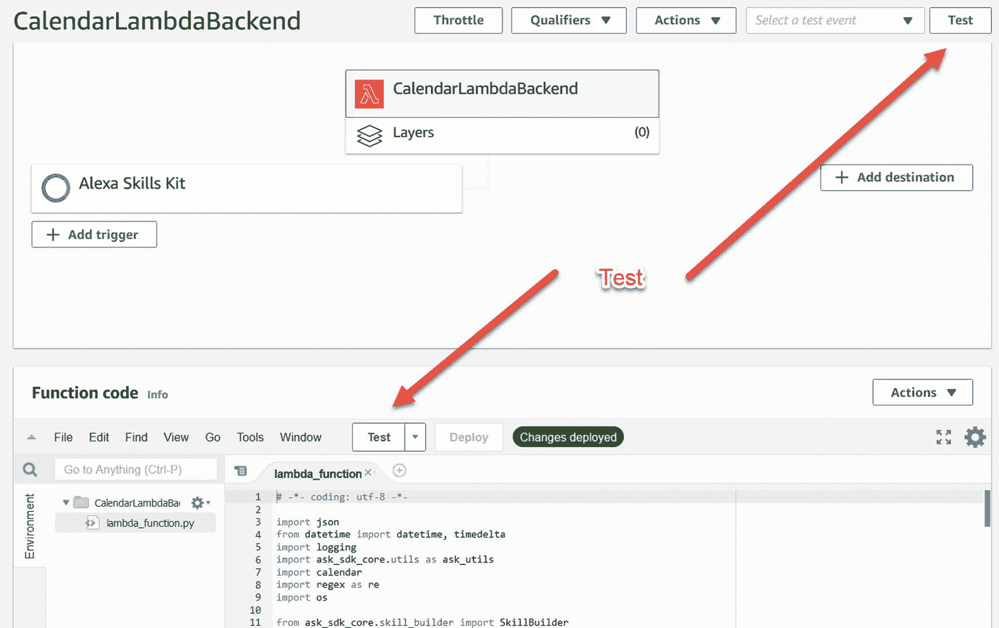
图 12-1 定位测试按钮

1. 启动 AWS 控制台（`https://console.aws.amazon.com`），并使用你的管理员账户（而非根用户）登录。
2. 选择 `Lambda` 服务。
3. 选择你的 `CalendarLambda`。
4. 在代码窗口上方，如果 `Deploy` 按钮可用，请点击它。
5. 如图 12-1 所示，有两个 `Test` 按钮。

点击任意一个 `Test` 按钮都会打开 `Configure Test Event` 对话框。你可以在此处创建单元测试，具体步骤如下：

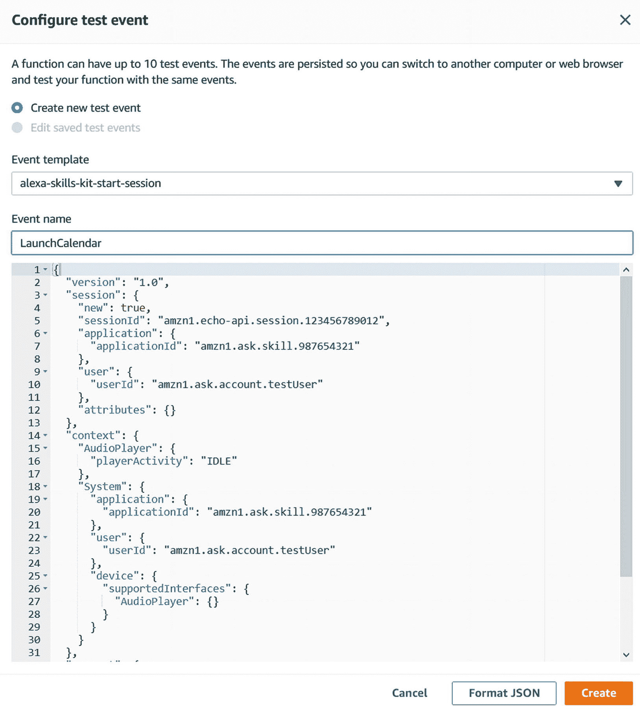
图 12-2 已完成的 `LaunchCalendar` 测试事件

1. 确保在 `Configure Test Event` 对话框顶部选中了 `Create new test event` 按钮。
2. 在 `Event template` 下拉菜单中，向下滚动直到找到 Alexa 模板，然后选择 `Amazon Alexa Start Session`。
3. 为你的单元测试事件命名，例如 `LaunchCalendar`。参见图 12-2。
4. 点击 `Create`。

现在，你已为启动意图创建了一个单元测试。

1. 再次点击 `Test` 按钮来运行测试。

你会收到一条错误消息，提示我们缺少一个库。参见图 12-3。

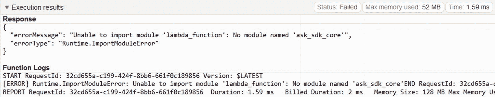
图 12-3 运行单元测试时我们将看到的众多错误中的第一个

要修复此错误（`No Module named 'ask_sdk_core'`），我们需要使用所需的 Python 库来配置 lambda 函数。最佳做法是添加一个层，并将库的 zip 文件上传到该层。首先，按照以下步骤创建 zip 文件：
1. 在你的本地机器上创建一个文件夹。
2. 使用 `pip` 将我们需要的包安装到该文件夹中。
3. 将该文件夹压缩。
4. 将其上传到 lambda 函数中的一个新层。

你可以在命令行中使用以下代码执行这些步骤：
```
md package\python\lib\python3.8\site-packages
cd package\python\lib\python3.8\site-packages
pip install -–target . datetime
pip install -–target . ask_sdk_core
```

请注意 `pip install` 这两行。这对大多数模块都有效，但有些模块（如 `regex`）是以二进制文件形式分发的，你不能直接使用 `pip install` 安装它们。相反，你需要遵循以下步骤：
1. 打开浏览器访问 `https://pypi.org/project/regex`。
2. 点击 `Download Files` 链接。
3. 找到正确的文件。我们需要的是 Python 3.8 的文件，文件名中包含 `manylinux1_x86_64` 字样。因此，文件的完整名称是：
   ```
   regex-2021.08.21-cp38-cp38-manylinux1_x86_64.whl
   ```
4. 下载完成后，解压该文件，并将解压后的两个文件夹从你的下载目录复制到 `package\python\lib\python3.8\site-packages` 文件夹中。

回到命令行，你可以运行以下命令：
```
zip -r .\deployment-package.zip .\package
```

**注意：** 你的系统路径中可能没有 `zip` 工具，因此你可能需要相应地修改最后一行。例如，我使用的是安装在 `E:` 盘的 7-Zip，所以我的命令行需要是：
```
"E:\Program Files\7-Zip\7z.exe" a -r ./deployment-package.zip ./package
```

一旦你处理好了 `deployment-package.zip`，就需要创建层：

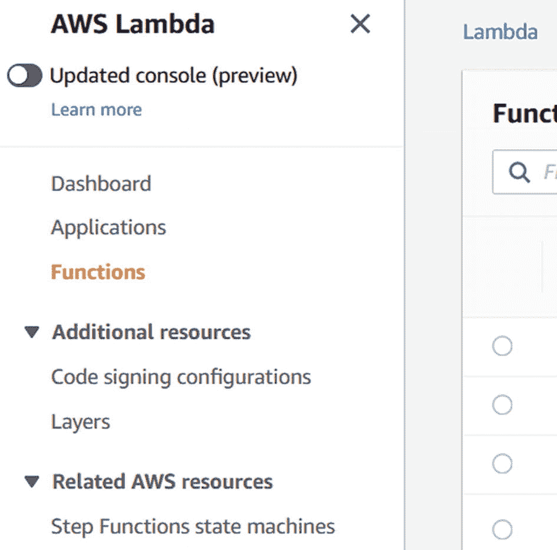
图 12-4 从左侧导航栏中选择 Layers

1. 在 lambda 函数界面，打开左侧导航栏并选择 `Layers`。参见图 12-4。

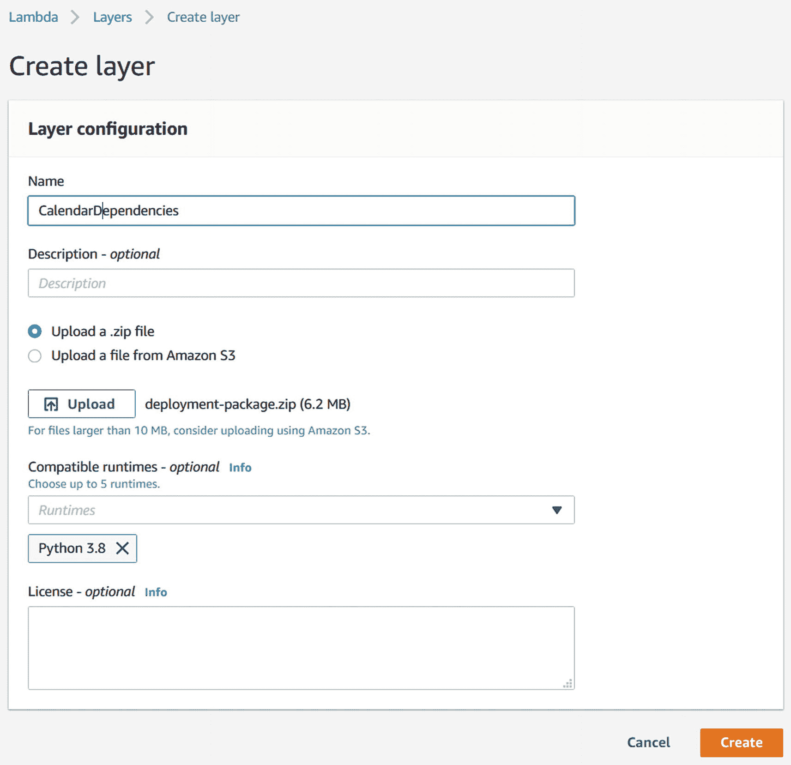
图 12-5 已完成的创建层对话框

1. 现在选择 `Create Layer`。
2. 为层命名，例如 `CalendarDependencies`。
3. 选择 `Upload a .zip file` 并上传 `deployment-package.zip`。
4. 选择 `Python 3.8` 作为兼容运行时。参见图 12-5。
5. 现在点击右下角的 `Create`。

创建好层之后，我们必须将其添加到 lambda 函数中。

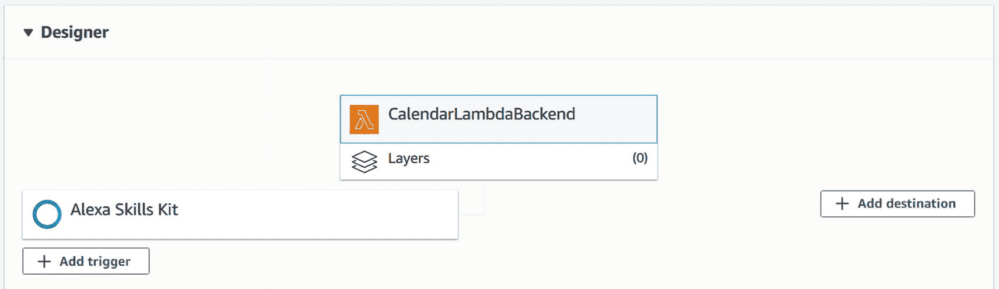
图 12-6 选择 Layers 框

1. 导航回到 `CalendarLambdaBackend` 函数。
2. 点击 `Designer` 中间的 `Layers` 框。（参见图 12-6。）
3. 在出现的 `Layers` 列表（位于 `Designer` 下方）中，点击 `Add a layer`。
4. 然后选择 `Custom Layers`。
5. 选择 `CalendarDependencies` 自定义层。
6. 选择版本 1。
7. 点击右下角的 `Add`。

现在再次点击 `Test` 按钮。这次你应该会收到来自你的技能的友好欢迎。参见图 12-7。

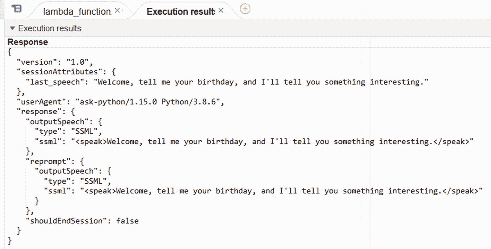
图 12-7 来自启动意图的欢迎消息

现在我们可以为其他意图创建单元测试了，首先从“提供生日”意图开始。

## 对提供生日意图进行单元测试

成功测试启动意图后，我们测试次要意图，例如“提供生日”意图。第一步是在 Alexa 开发者控制台中打开该技能。进入后，点击 `Test` 选项卡，并将 `Off` 下拉菜单更改为 `Development`。现在你可以使用 Alexa 模拟器了。

## 在 Alexa 模拟器中测试

在模拟器中点击或输入你的启动短语（`90 kilo`）。（见图 12-8。）

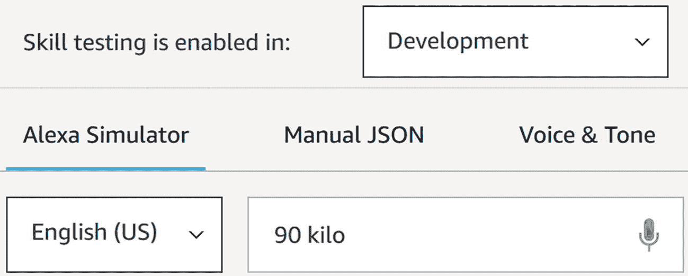
图 12-8：在模拟器中输入你的启动短语

按下回车键后，Alexa 会做出响应。如果 Alexa 立即说“请求的技能响应出现问题”，那么你的 lambda 函数中可能存在编译错误。（见图 12-9。）

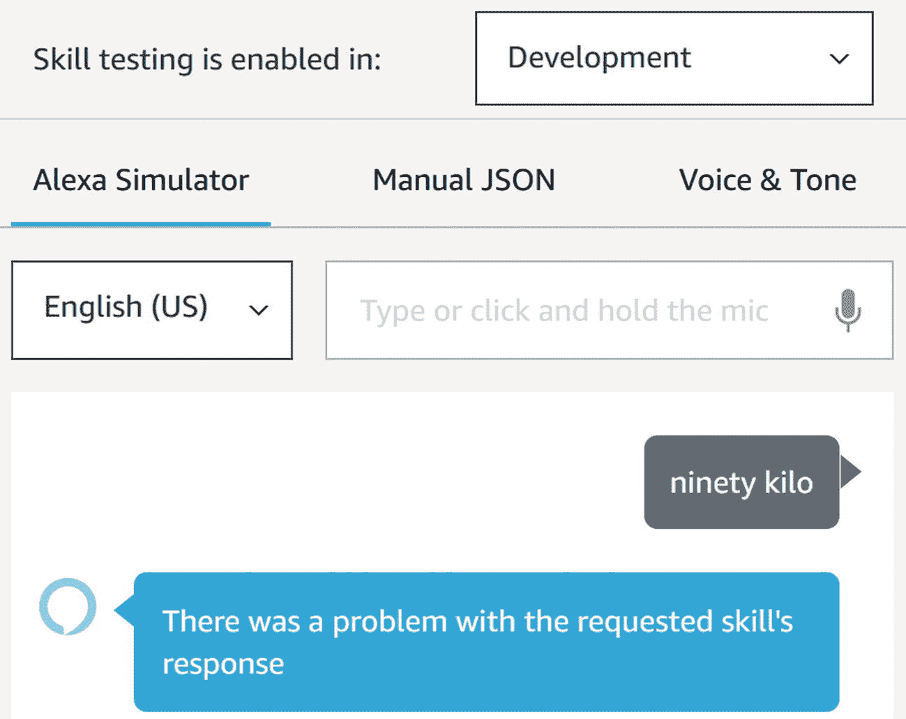
图 12-9：这表明 lambda 函数存在问题

希望你能看到一条欢迎消息，如图 12-10 所示。

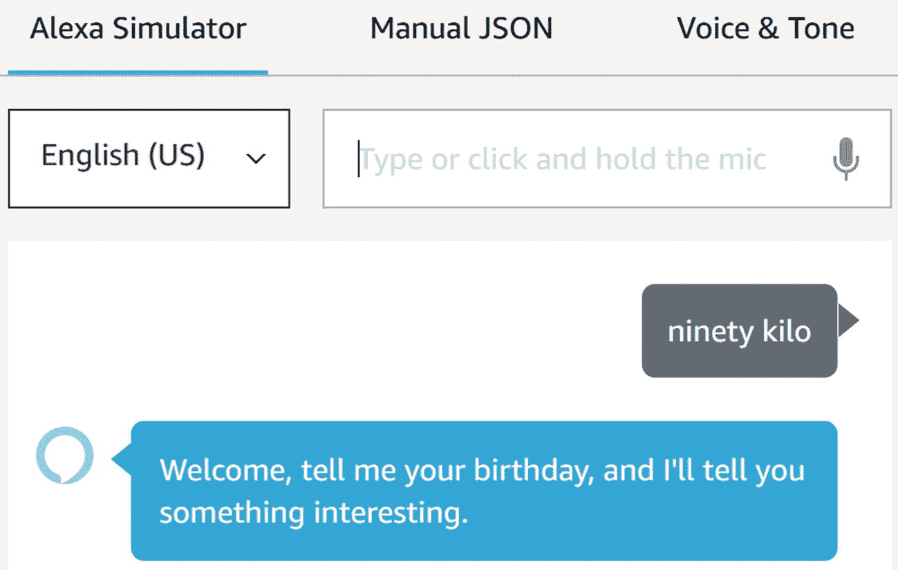
图 12-10：启动意图（Launch Intent）运行中

继续，告诉 Alexa 你的生日。使用我们在话语中规划的一种格式。（见图 12-11。）

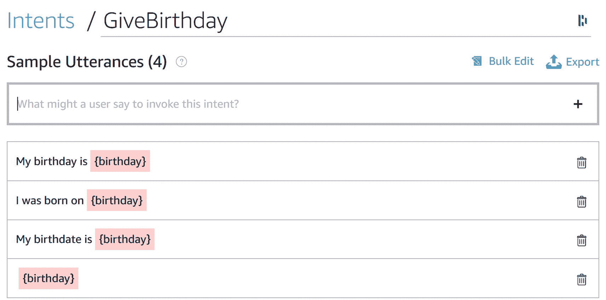
图 12-11：提供生日意图（Give Birthday intent）的话语

我们可以用以下短语测试这个意图：
```
I was born on Jan 1, 1975
```
见图 12-12。

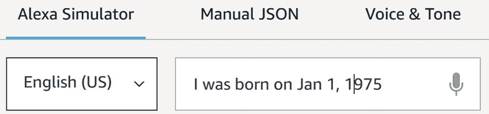
图 12-12：以 Alexa 友好的方式输入你的生日

Alexa 可能会说：“抱歉，我无法完成你的请求。”（见图 12-13。）

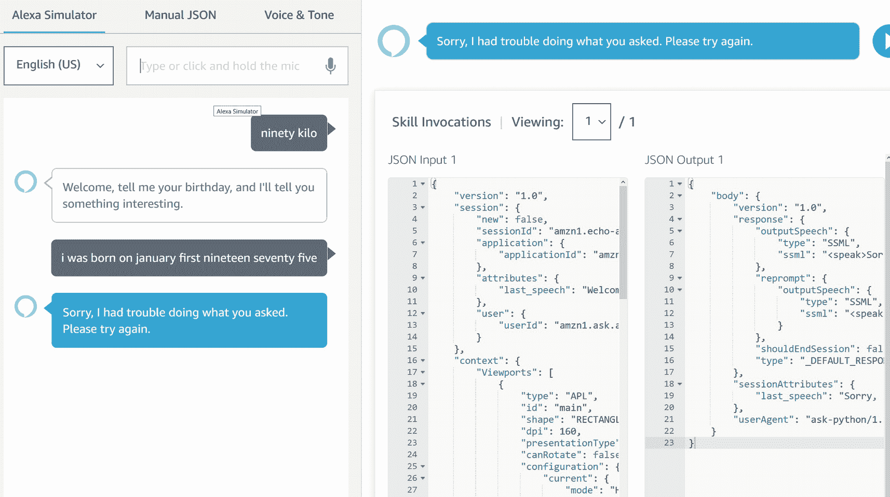
图 12-13：哎呀，出现了一个错误

注意到右侧所有的 JSON 了吗？第一个面板是输入，它来自我们告诉 Alexa 生日时产生的数据。第二个面板是来自 lambda 函数中 `CatchAllExceptionHandler` 的 JSON 输出。输入的 JSON 正是我们进行“提供生日”意图单元测试所需的数据。另外需要注意的是，由于 `CatchAllExceptionHandler` 处理了异常，实际的错误信息已经为我们记录下来了。

首先，将输入框中的 JSON 复制并粘贴到文本编辑器中（Notepad++ 或 VS Code 均可）。其次，切换到 AWS 的 lambda 函数，下拉 `测试` 菜单，选择 `配置测试事件`，然后选择 `创建新的测试事件`。第三，为新的测试事件命名，例如 `GiveBirthday01011975`（只能包含字母和数字）。最后，将第一步复制的 JSON 代码粘贴到当前位置，替换原有内容，然后点击 `创建`。

现在，你可以像测试启动意图一样，在 lambda 函数中测试“提供生日”意图了。

## 在 Lambda 函数中测试“提供生日”意图

回到 lambda 函数，确保当前选中的测试事件是“提供生日”意图，然后点击“测试”按钮。见图 12-14。

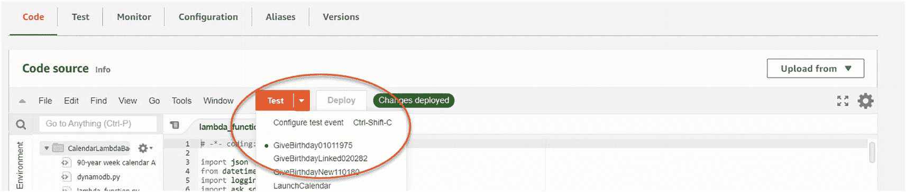
图 12-14：选择 GiveBirthday 测试事件并点击测试

点击测试后，你会看到来自 `CatchAllExceptionHandler` 的 JSON 响应。但更有趣的是，你会看到函数日志。见图 12-15。

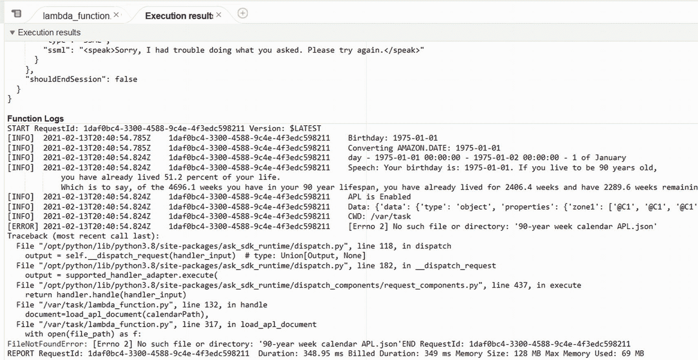
图 12-15：显示所发生错误的函数日志

该错误出现在如下所示的行中：
```
[ERROR] 2021-02-13T20:40:54.824Z 1daf0bc4-3300-4588-9c4e-4f3edc598211 [Errno 2] No such file or directory: '90-year week calendar APL.json'
```
这个错误意味着 lambda 函数找不到我们在第 10 章编写的所有精美的 APL 文件。由于我们使用 AWS 托管 lambda 函数，因此也需要将 APL 文件放在这里。为此，请按照以下说明操作。

### 将 APL 文件复制到 Lambda 函数

首先，切换回 Alexa 开发者控制台，选择 *构建* 选项卡。然后点击左侧导航栏中的 *多模态响应*。接着选择 *视觉*，再点击 *下载*。（见图 12-16。）

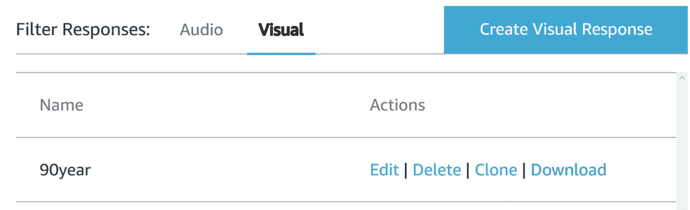

**图 12-16** 下载 `90year.json` 文件

下载好 Json 文件后，在你的 *下载* 文件夹中找到它，并用 `VS Code` 打开该文件。

接下来，切换回 `Lambda` 函数，并按照以下步骤操作。

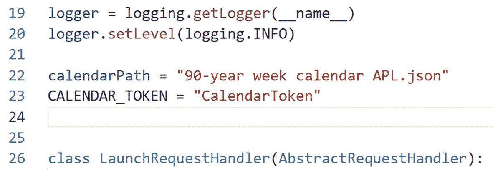

**图 12-17** 显示第 22 行 APL 文件名的 Lambda 代码

1.  在 *函数代码* 窗格中，选择 *文件* 菜单。
2.  选择 *新建*。
3.  点击 *文件* | *另存为*。
4.  记住 `Lambda` 函数中 APL 文件的名称（`90-year week calendar APL.json` - 见图 12-17）。

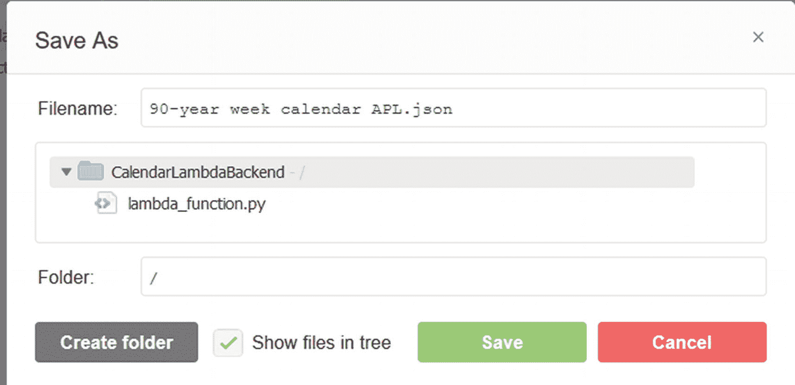

**图 12-18** 完成“另存为”对话框

5.  在 *另存为* 对话框中输入该名称（见图 12-18），然后点击 *保存*。
6.  在 `VS Code` 中编辑 APL，向下滚动，删除整个 `datasources` 部分。因此，请删除从 `"datasources"` 前的花括号和逗号开始，到底部附近两个右花括号为止的这段代码。底部应只保留两个右花括号：

```
},
"datasources": {
"data": {
"type": "object",
"properties": {
"zone1": [
"C1",
"C1",
...
"boxWidth": 24,
"rowWidth": 1248
}
}
}
```

Json 文件底部将出现一个方括号后跟三个右花括号，如下所示：

7.  现在转到 APL 的顶部，删除文档标签，即删除从开头花括号到 `"document"` 后面的冒号之间的内容，以便将

```
{
"document": {
"type": "APL",
"version": "1.5",
"theme": "dark",
"import": [
```

```
"height": "${payload.data.properties.boxHeight}",
"width": "${payload.data.properties.rowWidth}"
}
]
}
]
}
]
}
}
}
```

变为：

8.  现在删除文件底部的最后一个右花括号，以便将

```
]
}
]
}
}
}
```

```
{
"type": "APL",
"version": "1.5",
"theme": "dark",
"import": [
```

变为：

9.  将 `VS Code` 中剩余的 APL 代码复制并粘贴到 `Lambda` 函数的新文件中。
10. *保存* 更改。
11. *部署* 更改。

```
]
}
]
}
```

现在再次点击 *测试* 按钮！你应该会看到大量 Json 数据，开头为

```
{
"version": "1.0",
"sessionAttributes": {
"last_speech": "Your birthday is: 1975-01-01\. If you live to be 90 years old,\n            you have already lived 51.2 percent of your life.\n            Which is to say, of the 4696.1 weeks you have in your 90 year lifespan, you have already lived for 2406.4 weeks and have 2289.6 weeks remaining."
},
"userAgent": "ask-python/1.15.0 Python/3.8.6",
"response": {
"outputSpeech": {
"type": "SSML",
"ssml": "Your birthday is: 1975-01-01\. If you live to be 90 years old,\n            you have already lived 51.2 percent of your life.\n            Which is to say, of the 4696.1 weeks you have in your 90 year lifespan, you have already lived for 2406.4 weeks and have 2289.6 weeks remaining."
},
```

向下滚动，你将找到整个 APL 文档和生成的 `datasources`，一直到底部

```
"totalHeight": 2880,
"boxHeight": 6,
"boxWidth": 19,
"rowWidth": 988
}
}
}
}
],
"shouldEndSession": true
}
}
```

最后再测试一次，再次点击切换到 Alexa 开发者控制台。点击 *测试* 选项卡。输入你的启动短语 `90 kilo`。然后输入你的生日：我出生于 `1/1/1975`。你应该会看到并听到 Alexa 告诉你一些有趣的信息。（见图 12-19。）

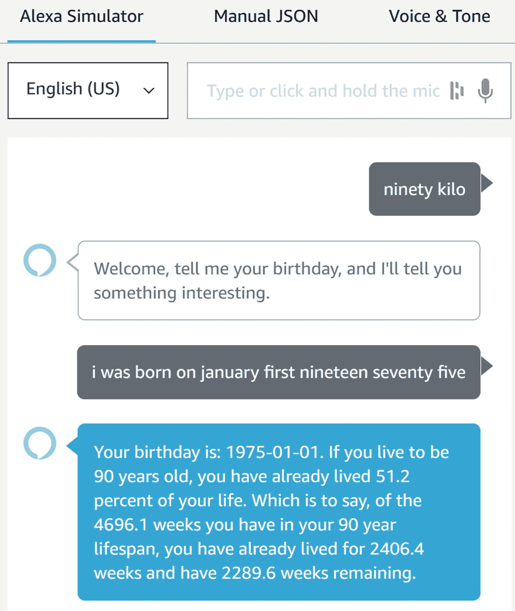

**图 12-19** 包含“提供生日”意图和响应的 Alexa 对话

还有更多内容；向右滚动并向下滚动，查看默认 Alexa 设备显示屏中渲染的 APL。见图 12-20。

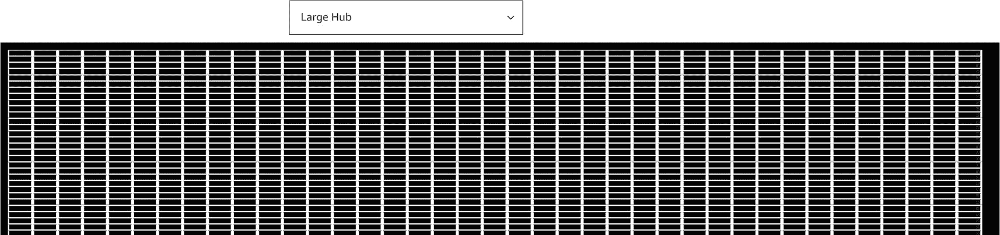

**图 12-20** Alexa 查看器中渲染的 APL

尝试几个不同的日期，看看语音和视觉内容如何变化。

现在后端 `Lambda` 函数已经正常运行，我们需要确保 Alexa 能够理解用户所说的话。为此，我们可以使用话语分析器。

### 使用话语分析器

单元测试的另一个工具是话语分析器。它位于 Alexa 开发者控制台的“构建”选项卡中，允许你创建测试，以查看各种话语会匹配到哪个意图。需要理解的是，话语分析器仅测试 Alexa 解释话语、匹配意图并填充槽位值的能力。所有这些操作都不需要调用 `Lambda` 函数。然而，许多话语结果会促使你重新思考 `Lambda` 函数如何接收输入以及如何处理误解。

在设计技能意图时，在合理范围内，你提供的示例话语越多，Alexa 就越能更好地匹配它们并找到正确的意图。例如，在“给出生日”意图中，我们列出了四个示例话语，如图 12-21 所示。

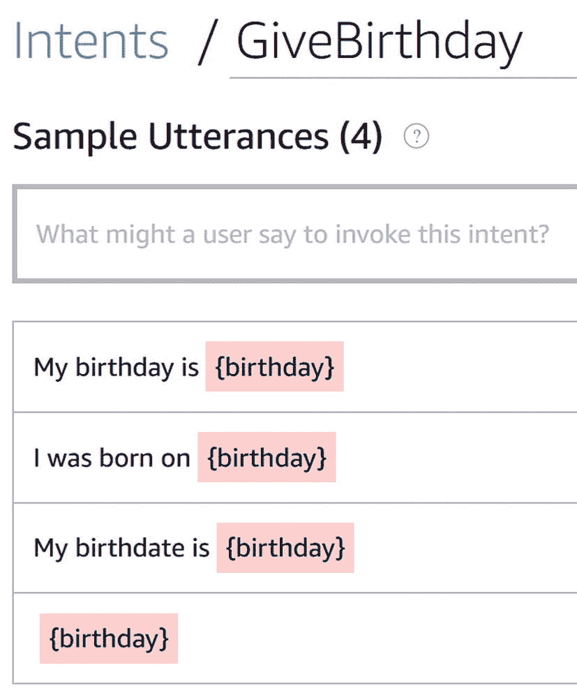

**图 12-21** “给出生日”意图的示例话语

通过点击右上角的 *评估模型* 按钮，你可以测试话语，看看 Alexa 如何解释用户说的话。例如，如果用户说“I was born on 1/1/75”，Alexa 会听到“I was born on 1 1 75”。注意，Alexa 并没有将日期“1/1/75”解释为一个日期，而是将其听成三个数字的序列：一、一和七十五。见图 12-22。

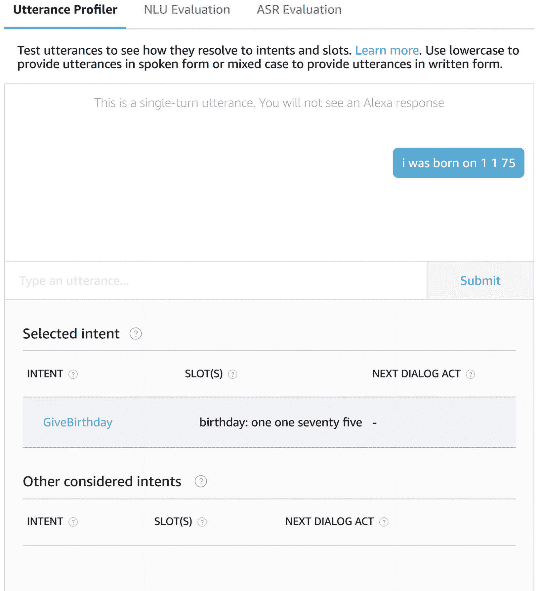

**图 12-22** 话语分析器及一个示例话语

这些数字都包含在 `{birthday}` 的槽位值中，但它们很可能会破坏我们现有的代码，因为我们要求槽位值是一个日期：

```
bday_str = handler_input.request_envelope.request.intent.slots ["birthday"].value
logger.info(f"Birthday: {bday_str}")
bday, _, _, _ = period_from_amazon_date(bday_str)
```

这表明我们应该修改 `period_from_amazon_date` 函数中的代码，使其能够将三个数字的序列理解为一个日期。

在话语分析器中尝试其他一些日期：

| 话语 | 槽位值 |
| --- | --- |
| I was born on 1 1 75 | one one seventy-five |
| I was born on Jan 1 75 | 2022-01-01 |
| I was born on Jan 1 1975 | 1975-01-01 |
| I was born on 1 1 2000 | 2000 |
| I was born in 1975\. January the first 1975. | 1975-01-01 |
| I was born in Colorado Springs Colorado on June fifth 1962 | 1962-06-05 |

注意，有时 Alexa 能从话语中推断出正确的日期，有时则不能。注意第四条话语，你可能会期望它得到“one one two thousand”，但实际上槽位值却是“2000”。因此，我们的意图处理器应该编码为能够处理部分日期，并重新提示用户提供完整日期。假设我们想要重复测试，也许是在修改了 `Lambda` 函数中的意图处理器之后。在这种情况下，我们应该将使用的话语设置为一个注释集，以便在 `NLU`（自然语言理解）评估工具中使用。

#### NLU 评估

从话语分析器中，选择 *NLU 评估* 选项卡。这将允许你创建一个注释集，该注释集可以作为一组话语通过话语分析器运行，从而显著提高开发者的生产力。例如，我们可以将上一节中的所有话语放入一个注释集中。见图 12-23。

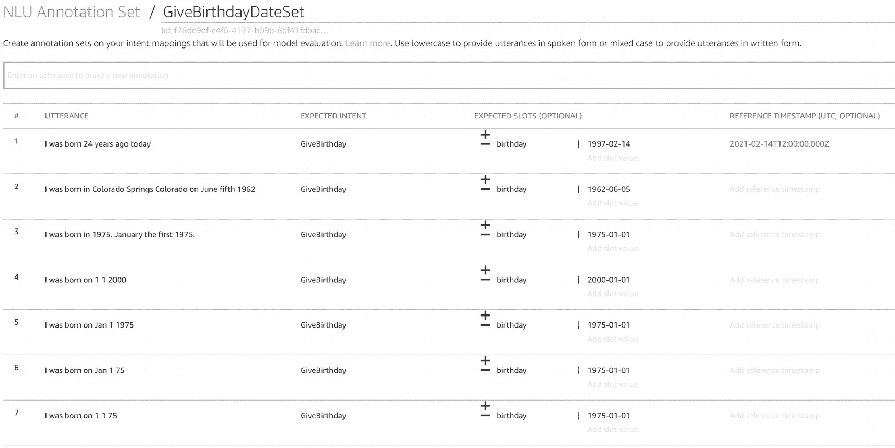

**图 12-23** 添加到注释集中的话语

可选的 *参考时间戳* 列用于日期槽位。它提供了当话语包含相对日期术语（例如“昨天”、“六个月前”和“二十四年前的今天”）时要使用的日期和时间。

输入注释集后，点击屏幕顶部的 *保存注释集* 按钮。保存后，点击“评估模型”按钮，然后点击“运行评估”按钮。模型会失败，因为有几个话语没有产生我们想要的槽位值。（见图 12-24。）

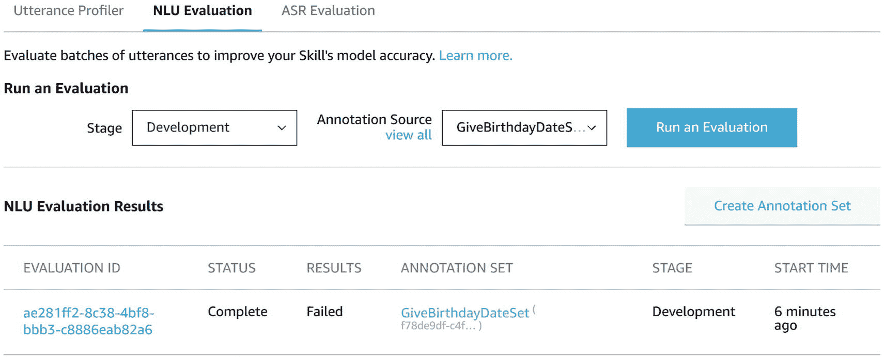

**图 12-24** NLU 评估显示测试失败

通过点击评估 ID，你可以深入查看测试运行的详细信息以及失败的话语，如图 12-25 所示。

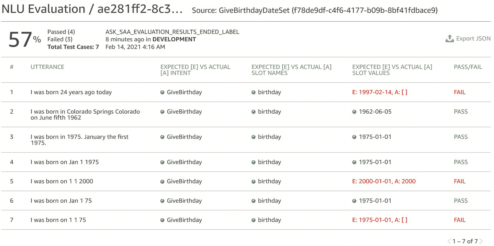

**图 12-25** NLU 测试详情

注意，在图 12-25 中，测试 #7 失败了，因为期望值是 `1975-01-01`，而实际值是 `[ ]`，即空白。空白在 NLU 注释集中不是有效值，而话语分析器说实际值应该是“one one seventy-five”。这两个值都不起作用。然而，我们希望 Alexa 能将“1 1 75”理解为一个日期。为此，我们可能需要创建一个新的意图，该意图接受一个多值槽位，能够听到“1 1 75”并将其解释为三个数字。`Lambda` 函数中会有一个新的意图处理器来处理这个新意图和新的槽位值。

一旦创建了注释集，你就需要开始请朋友们“告诉我你的生日”，并观察他们的回答。看看这些回答如何融入你的话语中。如果你询问时，朋友说“On Jan 1 1975 I was born”，考虑将其作为一条话语添加到你的 `NLU` 注释集中，并查看 Alexa 是否能理解它。如果不能，则相应地修改意图话语，或者可能创建一个具有完全不同槽位的新意图。

测试的下一步是向 Alexa 发送语音录音，看看她的表现如何。

#### ASR 评估

`ASR`（自动语音识别）评估是一个强大的测试工具。它允许你创建一组录音（格式为 `MP3`、`WAV`、`OGG` 或 `AIFF` 文件），并将其作为 `标注集` 上传。或者，你也可以直接在测试中录制语音。无论哪种方式，Alexa 都会收听这些录音并进行解读，然后与你预期的转录文本进行匹配。这是测试各种语音（例如男性、女性、来自不同文化背景、带有不同口音等）的绝佳方法，并能查看 Alexa ASR 评估器如何识别它们。

要创建一个简单的 `ASR 标注集`，请选择 `ASR 评估` 选项卡，为 `标注集` 命名，然后按住按钮录制一些上述语音。为每条语音分配一个 1 到 10 的 `权重`。数值越高，表示该语音越重要。（见图 12-26。）别忘了经常保存 `标注集`。

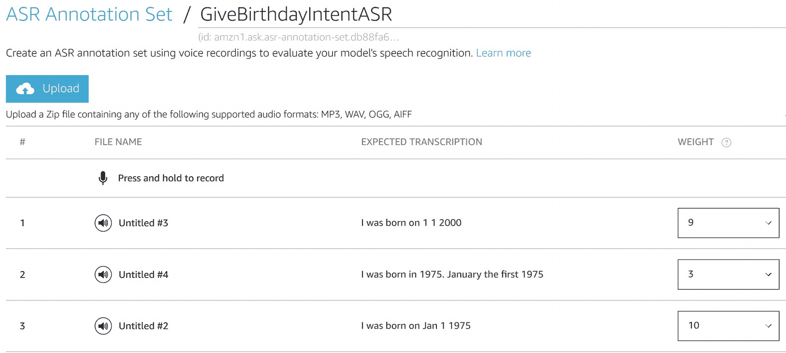

**图 12-26** ASR 测试的录制语音

然后点击 `评估模型` 按钮，并选择 `ASR` 选项卡来测试录制的语音。（见图 12-27。）

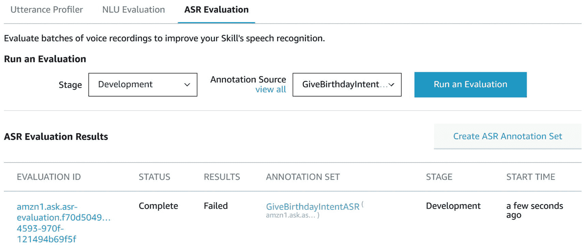

**图 12-27** ASR 评估

接着，点击 `评估 ID` 查看详细信息。（见图 12-28。）

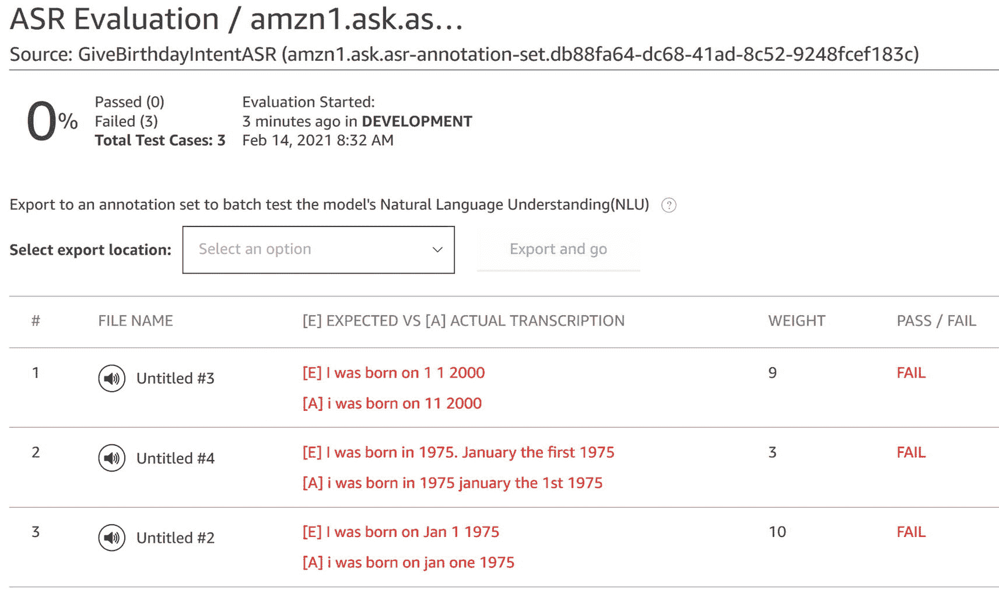

**图 12-28** 失败的 ASR 测试

看来我们需要稍微调整一下语音语法。让我们将 `标注集` 文本改为小写，并去掉标点符号等。（见图 12-29。）

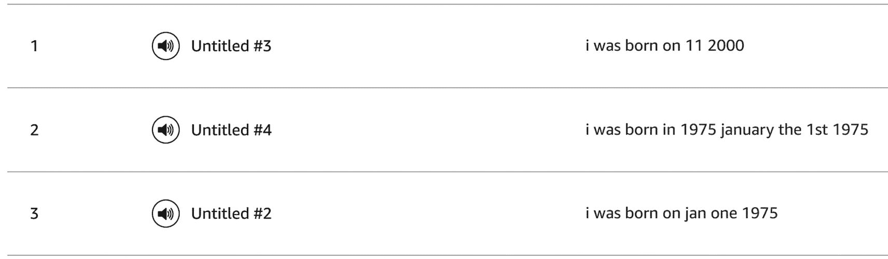

**图 12-29** 修订后的标注集

太好了！`ASR` 测试现在通过了。（见图 12-30 和 12-31。）

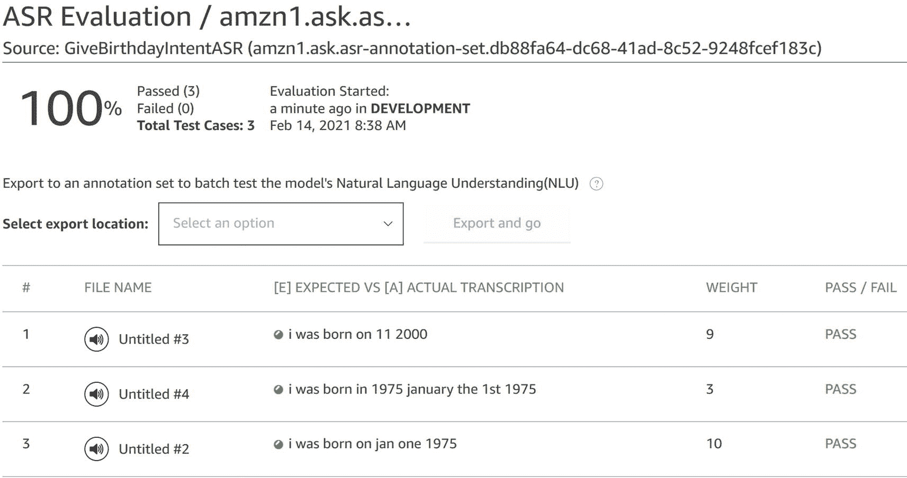

**图 12-31** ASR 测试通过的测试详情

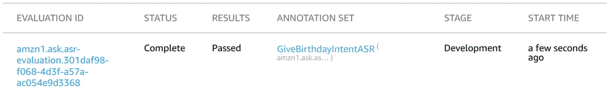

**图 12-30** ASR 测试通过

一旦你录制了 `ASR` 测试并且评估通过，你就可以将 ASR 文本导出到 `NLU 标注集`，并自动在那里测试这些语音。

所以，给你的朋友和亲戚发一个简短的脚本，请他们录制一批语音。编辑并拆分他们发给你的文件，确保每个文件只包含一条语音。将所有文件打包成 zip 并上传到一个 `ASR 标注集` 中。保存并运行测试。调整文本直到你满意为止。然后将这些文本导出到 `NLU 标注集`。填写预期的值。保存并运行这些测试。接着，修改并添加 `Lambda` 意图处理器来处理 `NLU` 标注。

当你的技能上线后，你可以使用意图历史记录（在 `构建` 选项卡中）中显示的语音作为测试标注的来源。这让你能够测试用户在实际使用中说的语音的准确性。请使用 `交互` 类型为 `MODAL` 且 `对话行为` 列为空的语音。（注意：要让你的技能显示 `意图历史记录`，你需要在一天内至少有十个活跃用户。）

至此，我们将暂时放下单元测试，转而学习如何操作事件数据，以追踪我们 90 年日历用户的生活事件。

### 总结

在本章中，我们学习了为 Alexa 技能进行单元测试的几种不同方法。首先，我们使用了 `Lambda` 函数中的内置测试来确保代码能够编译、运行并启动技能。然后，我们使用 Alexa 模拟器进一步测试技能并进入意图处理器。接着，我们结合了这两种方法，从 Alexa 模拟器中获取 Json 并在 `Lambda` 函数测试中使用它，以查找并修复出现的错误。最后，我们学习了通过为 `NLU` 和 `ASR` 测试评估创建 `标注集` 来进行语音测试。在下一章中，我们将学习如何创建和存储生活事件，以丰富我们的 90 年日历。
