## 13. 存储数据

到目前为止，我们已经创建了一个可运行的 Alexa 技能，它可以询问你的出生日期，告诉你一些有趣的信息，并在有屏幕的设备上绘制一个 90 年日历。现在，我们将在此基础上，为用户增加在其生活中添加个人事件的能力——例如出生、死亡、结婚、离婚、教育和工作变动。我们已经为生活事件创建了意图和一些示例语音（见图 13-1）。

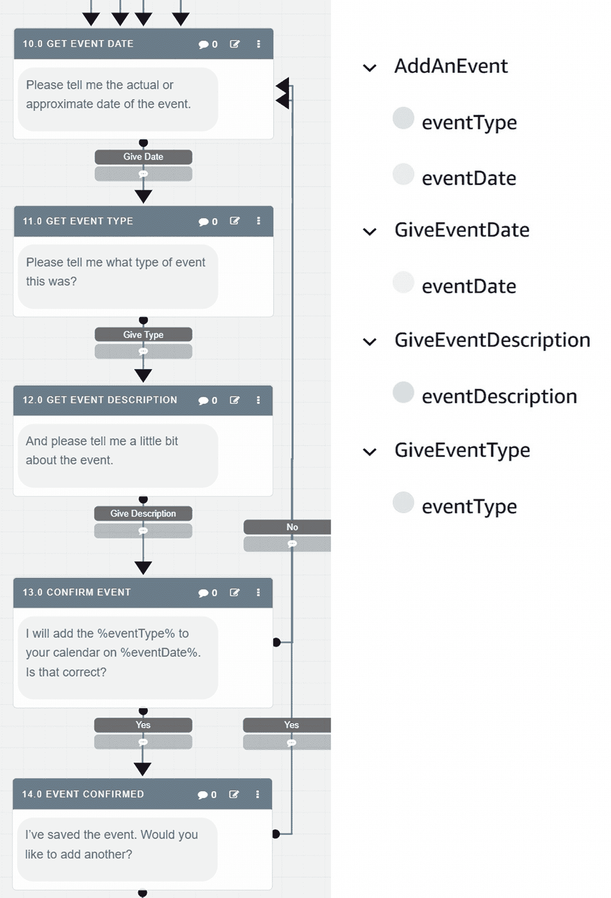

图 13-1 生活事件的 Botmock 图表和生成的意图

在本章中，我们将编写一些代码来让这些意图生效，但重点将放在将用户的响应存储在数据库中。

### 账户关联与访问令牌

为了存储用户的响应，我们需要知道用户是谁，这就是我们在第 7 章中开启账户关联的原因。此时，我们需要执行以下操作：
1. 检查账户是否已关联。
2. 如果已关联，询问他们是否要向日历添加事件。
3. 如果未关联，让他们创建一个标准的 90 年日历。

首先，我们需要将我们的开发账户关联到技能。

#### 关联你的开发账户

为了测试账户关联，你需要多次关联和取消关联你的开发账户。你需要关联的是你登录 Alexa 开发者控制台的账户，而不是你登录 AWS Lambda 的账户。关联账户的操作是在手机上的 Alexa 应用中完成的，步骤如下：

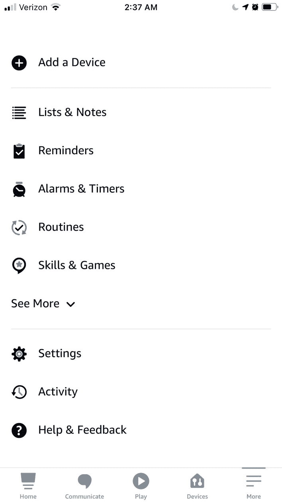

图 13-2 选择“更多”

1. 打开手机上的 Alexa 应用，选择`更多`选项卡（图 13-2）。

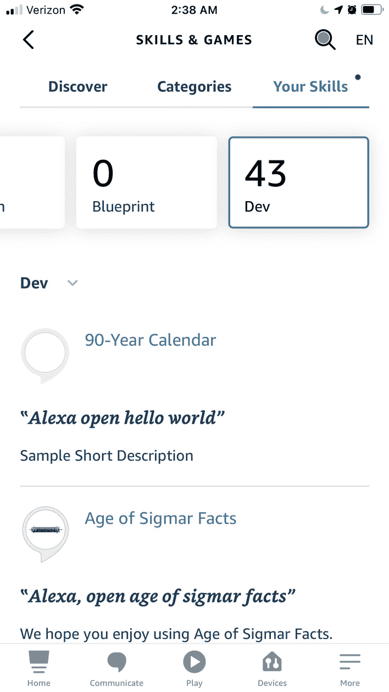

图 13-3 选择“开发技能”

1. 选择`技能与游戏`。
2. 选择`你的技能`。
3. 横向滑动找到`开发`技能（图 13-3）。

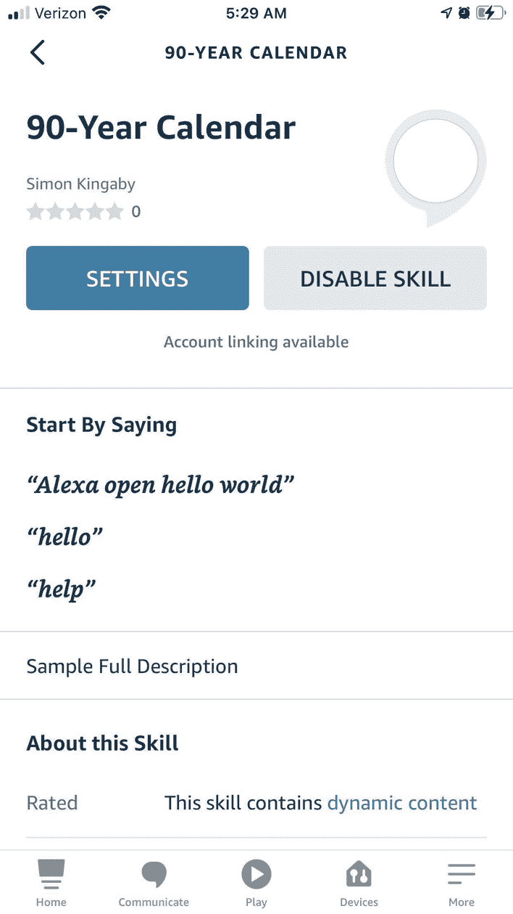

图 13-4 选择“设置”

1. 选择`90 年日历`技能。
2. 选择`设置`（图 13-4）。

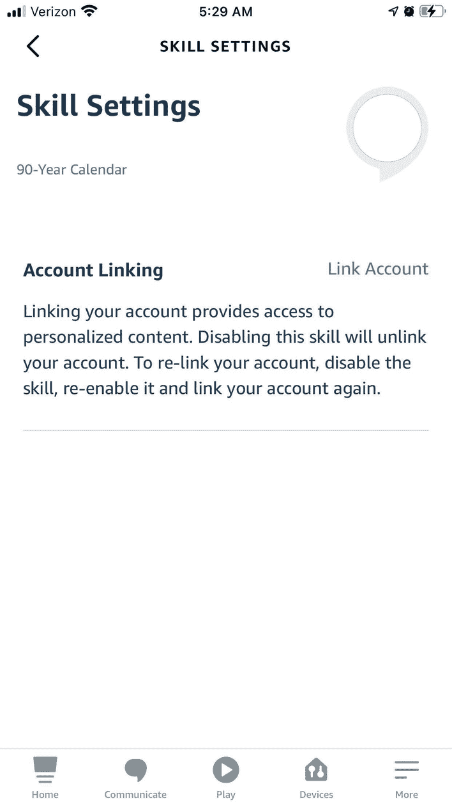

图 13-5 选择“关联账户”

1. 选择`关联账户`（图 13-5）。

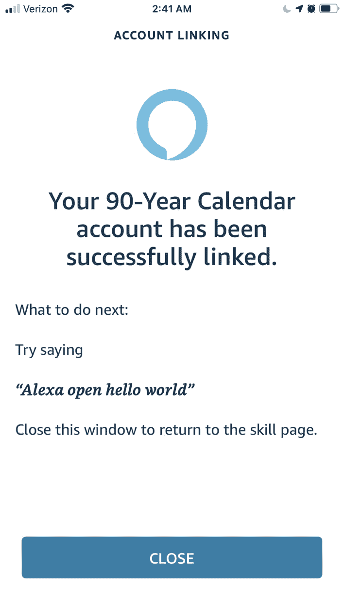

图 13-6 点击“完成”

1. 使用你的 Alexa 开发者控制台账户登录。
2. 选择`完成`（图 13-6）。

要取消关联账户，请禁用该技能。然后重新启用技能，以便继续测试。

关联账户后，你就可以看到`访问令牌`了。

#### 检查账户是否已关联

当账户未关联时，Launch 请求的 JSON 中会包含一个 `userId`。如果账户已关联，您将同时获得 `userId` 和 `accessToken`。您可以通过 Alexa 开发者控制台的“测试”选项卡查看 Launch 请求的 JSON（见图 13-7）。只需在 Alexa 模拟器中输入“90 kilo”即可启动技能。

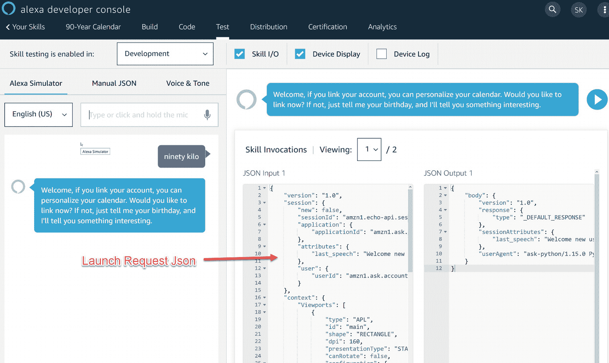

图 13-7 获取 Launch 请求 JSON

Launch 请求 JSON 中有很多配置选项，但我们真正需要关注的是 `context/System/user/accessToken`：

```json
{
  "version": "1.0",
  "session": { },
  "context": {
    "Viewports": [ ],
    "System": {
      "application": {
        "applicationId": "amzn1.ask.skill.1111111-2222-3333-4444-5555555"
      },
      "user": {
        "userId": "amzn1.ask.account.XXXXXXXXXX",
        "accessToken": "Atza|AAAAAABBBBBBCCCCCC"
      },
      "device": { },
      "apiEndpoint": "https://api.amazonalexa.com",
      "apiAccessToken": "zzzzzzzzzz.yyyyyyyyyy.xxxxxxxxxx"
    }
  },
  "request": { }
}
```

**注意：** 在 `session` 标签中也存在一个额外的 `user` 块。但那不是我们需要的。我们要找的是 `System/user/accessToken`，而不是 `System/apiAccessToken`。

现在，我们可以在 lambda 函数中编写用于获取 Access Token 的函数。

#### 获取 Access Token

从 handler 输入中提取 Access Token 应该封装成一个函数，这样我们只需在一个地方编写该表达式（这是一种称为 DRY——Don’t Repeat Yourself——的编码原则）。为了保持代码整洁，请将 Get Access Token 函数与本章中所有其他持久化代码一起放在一个新模块中。为此，请在 lambda 函数中创建一个名为 `dynamodb.py` 的新文件（见图 13-8）。

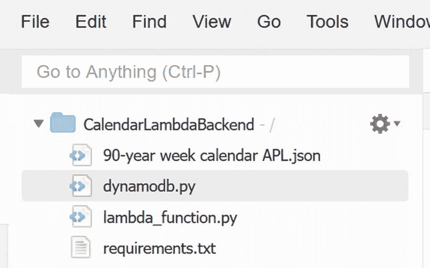

图 13-8 将 `dynamodb.py` 文件添加到 lambda 函数项目中

用于检查是否拥有 Access Token 的函数如下：

```python
def has_access_token(handler_input):
    reqEnv = handler_input.request_envelope
    if reqEnv.context.system.user.access_token:
        return True
    else:
        return False
```

有几个地方我们需要检查账户是否已关联，即是否拥有 `accessToken`。第一个地方是在 Launch Intent 处理器中。由于我们向所有人提供基础日历，并且只需要关联账户来存储额外的日历事件，因此我们需要为用户提供关联账户的选项。这设置了三种可能的 Launch Intent 处理器：
1. 账户未关联（访客用户）。
2. 账户刚刚关联（新用户）。
3. 账户已关联，并且我们已存储了用户的个人资料（老用户）。

我们不仅需要知道账户是否已关联（即 `has_access_token()` 是否为 `True`），还需要知道我们是否已经存储了用户个人资料。这需要检查用户是否存在于我们的数据库中。如果不存在，则说明这是一个新用户账户，刚刚完成关联。如果存在，则说明是回访用户。为了测试令牌的有效性，我们需要返回四种状态之一：无令牌、新令牌、有效令牌或错误状态。在 `dynamodb.py` 文件中，添加以下枚举：

```python
from enum import Enum

class AccessTokenValidity(Enum):
    NONE = 1
    VALID = 2
    NEW = 3
    ERROR = 4
```

添加此代码后，*保存*两个模块并*部署*它们。然后运行我们在第 12 章中创建的 Launch 测试。您应该会看到欢迎响应。如果没有，请先修复错误再继续。这是单元测试的好处之一；您可以经常运行它们以确保您的更改没有错误。

在下一节中，我们将使用 Alexa 持久化适配器来访问我们的数据库。

### 从 DynamoDB 获取用户个人资料

在第 7 章中，我们设置了一个 DynamoDB 表用于存储用户个人资料。在编写访问该数据库的代码之前，我们应该启用日志记录。这可以通过在 `dynamodb.py` 模块中添加以下代码快速完成：

```python
import logging
logger = logging.getLogger(__name__)
logger.setLevel(logging.INFO)
```

这将允许我们向数据库函数添加日志记录，以查看其内部运行情况。

接下来，我们需要添加代码来初始化 DynamoDB 持久化适配器，如下所示：

```python
from ask_sdk_dynamodb.adapter import DynamoDbAdapter
adapter = DynamoDbAdapter('CalendarItem', partition_key_name="PersonId")
```

现在，我们可以创建一个从数据库读取用户个人资料的函数：

```python
def read_user_profile(handler_input):
    validity = AccessTokenValidity.NONE
    attr = []
    hasAccessToken = has_access_token(handler_input)
    logger.info(f"AccToken: {hasAccessToken}, Response: {attr}")
    if hasAccessToken:
        amgr = handler_input.attributes_manager
        attr = amgr.persistent_attributes
        if attr:
            logger.info(f"{attr}")
            validity = AccessTokenValidity.VALID
            if type(attr["Birthday"]) == str:
                attr["Birthday"] = datetime.fromisoformat(attr["Birthday"])
        else:
            validity = AccessTokenValidity.NEW
    else:
        validity = AccessTokenValidity.NONE
    return validity, attr
```

最后，我们需要处理持久化错误。这可以通过将上述代码包裹在 `try…except` 块中来实现，如下所示：

```python
from ask_sdk_core.exceptions import PersistenceException
from datetime import datetime

def read_user_profile(handler_input):
    validity = AccessTokenValidity.NONE
    attr = []
    try:
        hasAccessToken = has_access_token(handler_input)
        logger.info(f"AccToken: {hasAccessToken}")
        if hasAccessToken:
            amgr = handler_input.attributes_manager
            attr = amgr.persistent_attributes
            if attr:
                logger.info(f"{attr}")
                validity = AccessTokenValidity.VALID
                if type(attr["Birthday"]) == str:
                    attr["Birthday"] = datetime.fromisoformat(attr["Birthday"])
            else:
                validity = AccessTokenValidity.NEW
        else:
            validity = AccessTokenValidity.NONE
    except PersistenceException as e:
        logger.error(e)
        validity = AccessTokenValidity.ERROR
        #TODO: 优雅地处理 PersistenceExceptions
    except Exception as e:
        logger.error(e)
        validity = AccessTokenValidity.ERROR
        raise e
    return validity, attr
```

添加此代码后，*保存*两个模块并*部署*它们。然后运行我们在第 12 章中创建的 Launch 测试。您应该会看到欢迎响应。如果没有，请先修复错误再继续。

现在，我们已经知道令牌是否存在且有效，可以利用这些信息来决定在 Launch 请求处理器中向用户说什么。

#### 三个启动请求处理器

现在我们已经能够读取用户资料，就可以在需要时创建额外的启动请求处理器。具体来说，当账户未关联、刚刚关联以及已关联并保存了资料时，我们需要不同的启动请求处理器。

切换到 `lambda_function.py` 模块，添加以下代码行，从 `dynamodb.py` 模块导入所需功能：

```python
from dynamodb import adapter, read_user_profile, AccessTokenValidity, has_access_token
```

现在修改原有的 `LaunchRequestHandler()`。将其重命名为 `LaunchRequestHandlerUnlinked()`，并修改 `can_handle()` 方法如下：

```python
def can_handle(self, handler_input):
    return not has_access_token(handler_input) and ask_utils.is_request_type("LaunchRequest")(handler_input)
```

在 `handle()` 方法中，修改 `speak_output` 并添加一个名为 `"question"` 的新属性，如下所示：

```python
def handle(self, handler_input):
    speak_output = """欢迎！如果您关联账户，就可以个性化您的日历。
现在要关联吗？
如果不关联，只需告诉我您的生日，我会告诉您一些有趣的事情。"""
    handler_input.attributes_manager.session_attributes["question"] = "LinkAccount"
    handler_input.attributes_manager.session_attributes["last_speech"] = speak_output
```

完成后的 `LaunchRequestHandlerUnlinked()` 将如下所示：

```python
class LaunchRequestHandlerUnlinked(AbstractRequestHandler):
    """账户未关联时的技能启动处理器。"""
    def can_handle(self, handler_input):
        return not has_access_token(handler_input) and ask_utils.is_request_type("LaunchRequest")(handler_input)

    def handle(self, handler_input):
        speak_output = """欢迎。如果您关联账户，就可以个性化您的日历。
现在要关联吗？
如果不关联，只需告诉我您的生日，我会告诉您一些有趣的事情。"""
        handler_input.attributes_manager.session_attributes["question"] = "LinkAccount"
        handler_input.attributes_manager.session_attributes["last_speech"] = speak_output
        return (
            handler_input.response_builder
            .speak(speak_output)
            .ask(speak_output)
            .response
        )
```

接下来，为账户刚刚关联的情况添加一个启动请求处理器。我们将其命名为 `LaunchRequestHandlerNew()`：

```python
class LaunchRequestHandlerNew(AbstractRequestHandler):
    """账户刚刚关联时的技能启动处理器。"""
    def can_handle(self, handler_input):
        validity, profile = read_user_profile(handler_input)
        return (validity == AccessTokenValidity.NEW) and ask_utils.is_request_type("LaunchRequest")(handler_input)

    def handle(self, handler_input):
        speak_output = "欢迎新用户！告诉我您的生日，我会告诉您一些有趣的事情。"
        handler_input.attributes_manager.session_attributes["last_speech"] = speak_output
        return (
            handler_input.response_builder
            .speak(speak_output)
            .ask(speak_output)
            .response
        )
```

现在添加第三个启动请求处理器，用于我们已经拥有有效令牌和用户资料的情况：

```python
class LaunchRequestHandlerValid(AbstractRequestHandler):
    """已知道生日时的技能启动处理器。"""
    def can_handle(self, handler_input):
        validity, profile = read_user_profile(handler_input)
        return (validity == AccessTokenValidity.VALID) and ask_utils.is_request_type("LaunchRequest")(handler_input)

    def handle(self, handler_input):
        speak_output = "欢迎回来！您可以添加事件或查看您的 90 年日历。您想做什么？"
        handler_input.attributes_manager.session_attributes["last_speech"] = speak_output
        return (
            handler_input.response_builder
            .speak(speak_output)
            .ask(speak_output)
            .response
        )
```

定义了这三个启动请求处理器后，我们需要修改 `lambda_function.py` 模块底部的 `SkillBuilder()` 代码。请记住，每当您添加或修改请求处理器时，都必须更新 `SkillBuilder()` 代码。我们将把以下代码：

```python
from ask_sdk_core.skill_builder import SkillBuilder
...
sb = SkillBuilder()
sb.add_request_handler(LaunchRequestHandler())
```

修改为：

```python
from ask_sdk_core.skill_builder import CustomSkillBuilder
...
sb = CustomSkillBuilder(persistence_adapter=adapter)
sb.add_request_handler(LaunchRequestHandlerUnlinked())
sb.add_request_handler(LaunchRequestHandlerNew())
sb.add_request_handler(LaunchRequestHandlerValid())
```

请注意导入语句和声明的更改，现在使用的是 `CustomSkillBuilder` 而不是 `SkillBuilder`。

#### 添加“是”意图处理器

在 `LaunchRequestHandlerUnlinked()` 中，我们询问用户：“现在要关联吗？”如果他们回答“是”，这将触发“是”意图，因此我们需要添加一个 `YesIntentHandler()`。它将检查 `"Question"` 属性的值，以便了解“是”意图的上下文。

首先定义类以及 `can_handle` 和 `handle` 方法：

```python
class YesIntentHandler(AbstractRequestHandler):
    """“是”意图的处理器。"""
    def can_handle(self, handler_input):
        # type: (HandlerInput) -> bool
        return ask_utils.is_intent_name("AMAZON.YesIntent")(handler_input)

    def handle(self, handler_input):
```

然后获取 `"Question"` 属性的值：

```python
question = handler_input.attributes_manager.session_attributes["question"]
```

如果问题值是 `"LinkAccount"`，我们需要在 Alexa 应用中打开一张卡片。

##### 在响应中使用卡片

Alexa 应用中有几种不同类型的卡片。它们通常用于汇总一组值。例如，卡片可以显示股票价格。另一种卡片可以显示当天的天气预报。卡片会显示在 Alexa 设备上（如果有屏幕）或用户智能手机上的 Alexa 应用中。

当您想指示用户设置账户关联时，您将使用一种名为 `LinkAccountCard` 的特殊卡片通知。此卡片会在响应中返回，以便 Alexa 应用引导用户关联其账户。实现此功能的代码如下：

```python
card_output = ui.link_account_card.LinkAccountCard()
...
return (
    handler_input.response_builder
    .set_card(card_output)
    ...
)
```

我们需要检查 `question` 变量的值是否为 `"LinkAccount"`，然后按前面所示使用卡片。以下是 `handle()` 方法的完整代码：

```python
def handle(self, handler_input):
    question = handler_input.attributes_manager.session_attributes["question"]
    # 初始化响应变量
    speak_output = ""
    endSession = False
    card_output = None

    if question == "LinkAccount":
        # 处理 LinkAccount 响应
        speak_output = "好的，我已经向 Alexa 应用发送了一些信息。打开您的 Alexa 应用，点击链接以关联您的账户。"
        endSession = True
        card_output = ui.link_account_card.LinkAccountCard()
    else:
        # 处理未设置问题值时的“是”响应
        speak_output = "抱歉，我有点困惑，请告诉我您想做什么或说“帮助”。"
        endSession = False

    handler_input.attributes_manager.session_attributes["last_speech"] = speak_output
    # 清除问题属性
    handler_input.attributes_manager.session_attributes["question"] = ""

    return (
        handler_input.response_builder
        .speak(speak_output)
        .ask(speak_output)
        .set_card(card_output)
        .set_should_end_session(endSession)
        .response
    )
```

当然，我们还需要在模块底部的 Skill Builder 中添加“是”意图请求处理器：

```python
sb = CustomSkillBuilder(persistence_adapter=adapter)
...
sb.add_request_handler(YesIntentHandler())
```

本章接下来要做的是，在用户告诉我们生日后保存其资料，这样他们就不必重复告知了。

# 保存用户资料

要保存用户资料，我们需要在 `dynamodb.py` 模块中添加一个方法。这可以通过使用 Alexa 持久化管理器来实现，如下所示：

```
def save_user_profile(handler_input, profile):
if has_access_token(handler_input):
try:
attr = {}
attr["Birthday"] = str(profile["Birthday"])
attr["Events"] = profile["Events"]
amgr = handler_input.attributes_manager
amgr.persistent_attributes = attr
amgr.save_persistent_attributes()
except PersistenceException as e:
logger.error(e)
# TODO: 优雅地处理 PersistenceException 异常
except Exception as e:
logger.error(e)
raise e
```

在这个方法中，我们传入了 `handler_input`、用户的 `birthday` 以及一个 `events` 数组。如果存在有效的访问令牌，我们定义一个属性变量（`attr`）作为键值对字典，其中一对用于生日，另一对用于事件数组。然后我们从 `handler_input` 中获取属性管理器，并将其赋值给 `amgr` 变量。接着，我们将 `attr` 字典赋值给 `amgr.persistent_attributes` 属性，并使用 `amgr` 来保存持久化属性。这样就完成了。其余代码是错误处理逻辑，在从数据库保存或加载数据时，你应该始终使用这些逻辑，以防数据库或数据库连接出现问题。

## 处理询问和终止选项

现在我们已经定义了 `save_user_profile` 方法，需要切换回 `lambda_function.py` 模块，修改 `import` 语句和 `GiveBirthdayIntentHandler()`，并添加一个新的 View Calendar 意图处理器。

首先，我们将修改 `dynamodb` 的导入语句，以包含新的保存方法。这一行：

```
from dynamodb import adapter, read_user_profile, AccessTokenValidity, has_access_token
```

变为：

```
from dynamodb import adapter, read_user_profile, AccessTokenValidity, has_access_token, save_user_profile
```

在 `GiveBirthdayIntentHandler()` 中，我们需要做一些重大修改。具体来说，我们需要拆分 Handle 函数，将所有用于计算和显示日历的逻辑放在一个单独的函数中。找到这行代码：

```
today = datetime.today()
```

在其前面添加声明：

```
def ShowCalendar(handler_input, bday, events):
```

在其底部，将返回值改为仅返回 `response builder`，而不是 `response`。因此，将这段代码：

```
handler_input.attributes_manager.session_attributes["last_speech"] = speak_output
return (
rb
.speak(speak_output)
.response
)
```

改为：

```
handler_input.attributes_manager.session_attributes["last_speech"] = speak_output
rb.speak(speak_output)
return rb
```

现在将 `GiveBirthdayIntentHandler` 的 `handle()` 方法改为：

```
def handle(self, handler_input):
# type: (HandlerInput) -> Response
validity, profile = read_user_profile(handler_input)
logger.info(f"Validity: {validity}")
bday_str = handler_input.request_envelope.request.intent.slots["birthday"].value
logger.info(f"Birthday: {bday_str}")
bday, _, _, _ = period_from_amazon_date(bday_str)
logger.info(f"bday: {bday}")
profile["Birthday"] = bday
if validity == AccessTokenValidity.NEW:
profile["Events"] = []
save_user_profile(handler_input, profile)
#### 处理询问和终止选项
ask = None
terminate = True
if validity == AccessTokenValidity.VALID or validity == AccessTokenValidity.NEW:
ask = "您想向日历中添加一些事件吗？"
handler_input.attributes_manager.session_attributes["question"] = "AddEvents"
terminate = False
rb = ShowCalendar(handler_input, bday, profile["Events"])
if ask:
rb.ask(ask)
if terminate:
rb.set_should_end_session(True)
return (rb.response)
```

在第三个启动请求处理器中，当关联账户有效且不是新账户时，我们为用户提供回答这个问题的机会：“欢迎回来！您可以添加事件或查看您的 90 年日历。您想做什么？”我们需要添加一个 View Calendar 意图和意图处理器来覆盖这种情况。

## 添加 View Calendar 意图

在添加 View Calendar 意图处理器之前，我们应该先转到 Alexa 开发者控制台并添加 View Calendar 意图。为此，请按照以下步骤操作：

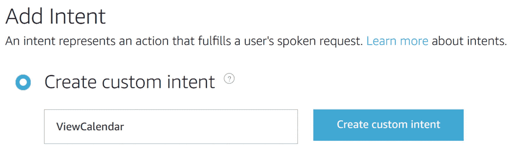
图 13-9 添加 ViewCalendar 意图

1. 启动并登录 Alexa 开发者控制台。
2. 编辑您的 90 年日历技能。
3. 在左侧导航栏中选择 *交互模型*。
4. 在左侧导航栏中选择 *意图*。
5. 点击 *+ 添加意图*。（参见图 13-9。）
6. 输入意图名称：`ViewCalendar`
7. 点击 *创建自定义意图*。
8. 添加一些示例语句：
    * 查看日历
    * 查看我的日历
9. 点击顶部的 *保存模型* 按钮。
10. 点击顶部的 *构建模型* 按钮。

现在在 `lambda_function.py` 模块中的 `GiveBirthdayIntentHandler` 类之后添加 `ViewCalendarIntentHandler` 类：

```
class ViewCalendarIntentHandler(AbstractRequestHandler):
"""ViewCalendar 意图的处理器。"""
def can_handle(self, handler_input):
# type: (HandlerInput) -> bool
return ask_utils.is_intent_name("ViewCalendar")(handler_input)
def handle(self, handler_input):
# type: (HandlerInput) -> Response
validity, profile = read_user_profile(handler_input)
logger.info(f"Validity: {validity}")
ask = "您想向日历中添加一些事件吗？"
handler_input.attributes_manager.session_attributes["question"] = "AddEvents"
rb = ShowCalendar(handler_input, profile)
rb.ask(ask)
return (rb.response)
```

并将其添加到 `lambda_function.py` 模块底部的 Skill Builder 中：

```
...
sb.add_request_handler(GiveBirthdayIntentHandler())
sb.add_request_handler(ViewCalendarIntentHandler())
sb.add_request_handler(YesIntentHandler())
...
```

并将 `"AddEvents"` 代码添加到 Yes 意图处理器的 if 语句中：

```
def handle(self, handler_input):
question = handler_input.attributes_manager.session_attributes["question"]
speak_output = ""
ask = None
endSession = False
card_output = None
if question == "LinkAccount":
speak_output = "好的，我已经向 Alexa 应用发送了一些信息。打开您的 Alexa 应用，点击链接以关联您的账户。"
endSession = True
card_output = ui.link_account_card.LinkAccountCard()
elif question == "AddEvents":
speak_output = "要向日历添加事件，我需要知道事件的日期、类型和描述。如果您只知道月份或年份，日期不必精确。事件发生在什么时候？"
ask = "事件发生在什么时候？"
else:
speak_output = "抱歉，我有点困惑，请告诉我您想做什么或说“帮助”。"
handler_input.attributes_manager.session_attributes["last_speech"] = speak_output
handler_input.attributes_manager.session_attributes["question"] = ""
if not ask:
ask = speak_output
return (
handler_input.response_builder
.speak(speak_output)
.ask(ask)
.set_card(card_output)
.set_should_end_session(endSession)
.response
)
```

保存并部署您的代码。运行您的单元测试。添加代码并通过单元测试后，我们还应该测试新的 View Calendar 意图。

### 测试查看日历意图

返回 Alexa 开发者控制台。确保您已登录，并且您的账户当前已与手机 Alexa 应用中的 90 年日历技能关联。

选择“测试”选项卡并启动您的技能（`90 kilo`）。Alexa 应会回应：“欢迎回来！您可以添加事件或查看您的 90 年日历。您想做什么？”

您应回答：“查看日历。”

然后，她应会说出您（从已保存的个人资料中）的趣事，并显示日历。

图 13-10 展示了此对话。

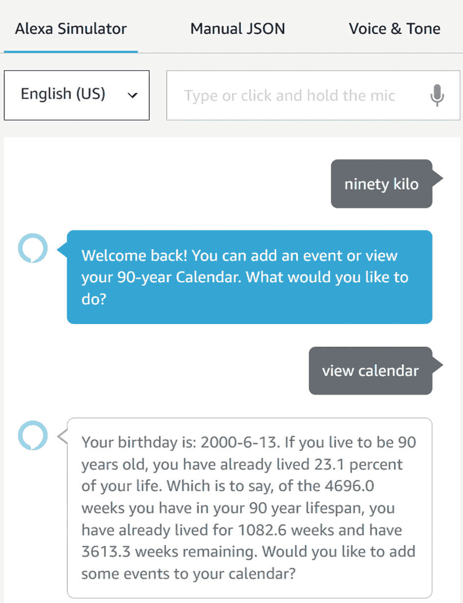
图 13-10 有效的启动请求处理器和查看日历意图

现在，您拥有了在 Lambda 函数中进行单元测试所需的 Json 代码。（见图 13-11。）

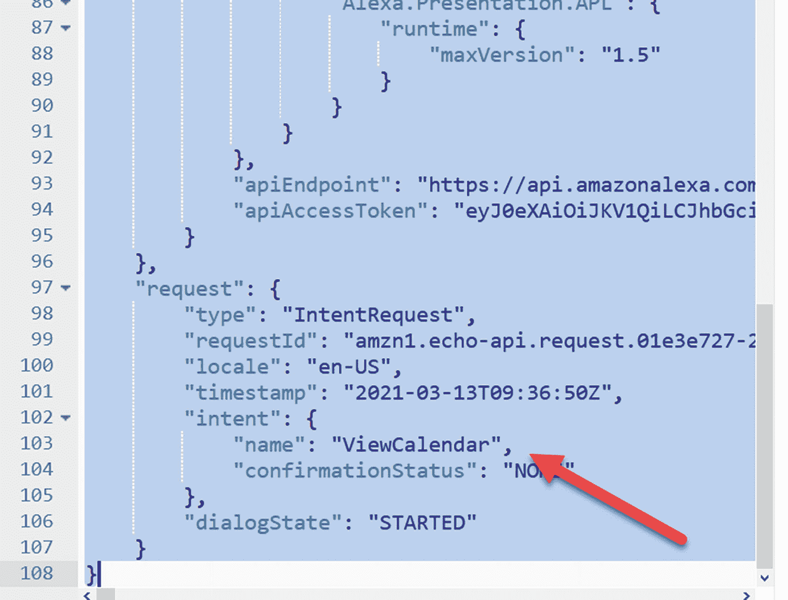
图 13-11 用于单元测试的 `ViewCalendar` Json

复制该 Json 并将其粘贴到 Lambda 函数编辑器中的新单元测试中。（见图 13-12。）

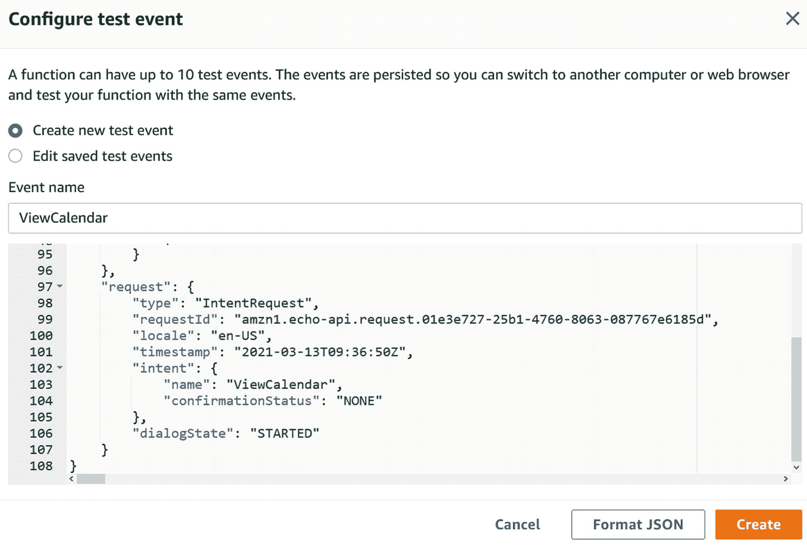
图 13-12 配置新的单元测试

通过单击“测试”按钮运行您的新单元测试。您应会看到 `ViewCalendarIntentHandler` 的 Json 响应。

如果一切顺利，我们就可以继续了。

## 下一步可以做什么

至此，您可以朝多个方向发展。您可以添加“否”意图处理器。与“是”意图处理器类似，您需要知道用户是对哪个问题回答“否”。您可以开始添加“添加事件”意图处理器（日期、类型、描述）。注意：日期处理器有点问题，因为我们已经有生日日期处理器（`GiveBirthdayIntentHandler`）。

Alexa 如何区分用户是针对“提供生日意图”还是“提供事件日期意图”的表述？简而言之，她无法区分，因此您需要确保只有一个意图允许用户仅说出日期。另一个意图需要额外的词语。例如，“提供生日”有一个仅包含 `{birthday}` 槽位的表述。“提供事件日期”不应有仅包含 `{eventDate}` 槽位的表述。相反，`GiveBirthdayIntentHandler` 应能消除歧义，判断日期是来自 `GiveBirthday` 意图还是来自 `GiveEventDate` 意图。您可以通过传递一个会话属性来实现这一点，类似于我们为问题属性所做的那样，以便“是”意图处理器能够判断出被问的是哪个问题。

您还应添加 `GiveEventDescription` 和 `GiveEventType` 意图处理器。然后尝试使用 `AddAnEvent` 意图处理器。在开发更多代码时，请务必经常保存和部署，运行您现有的单元测试，并从 Alexa 开发者控制台“测试”选项卡中的 Json 创建更多测试。

完成测试后，将您技能的启动短语从“90 kilo”更改为更有用的内容。例如，“90-Year Calendar”。

## 总结

为自己迄今为止取得的进展表示祝贺。您已经取得了长足的进步。在本章中，我们学习了如何获取访问令牌以检查账户是否已关联，以及当账户未关联时该怎么做。我们学习了如何使用 Alexa 持久化适配器对 DynamoDB 表进行读写操作。我们修改了启动请求处理器，使其能在用户未关联、新关联以及已有个人资料的情况下正常工作。最后，我们添加了查看日历意图及其处理器。


