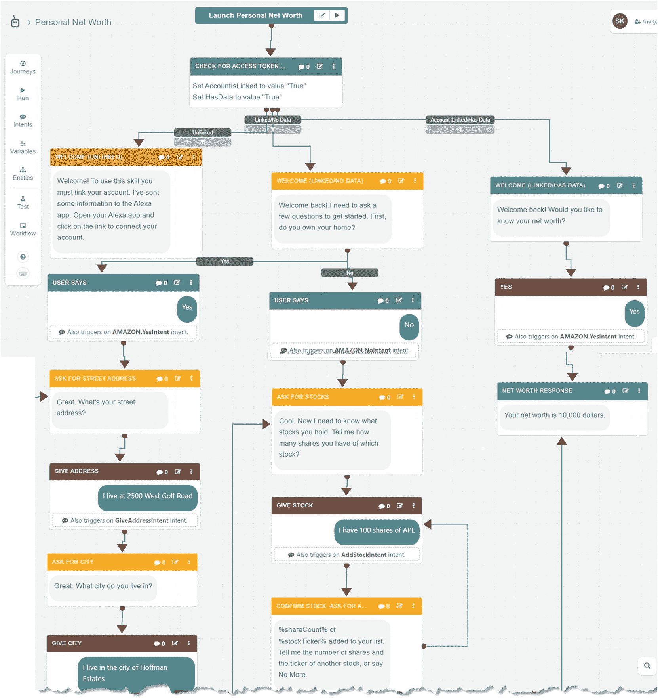
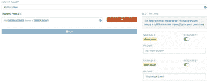
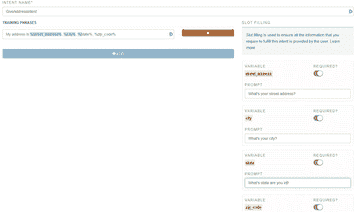
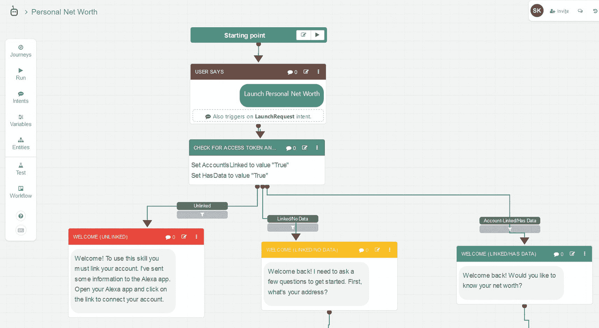
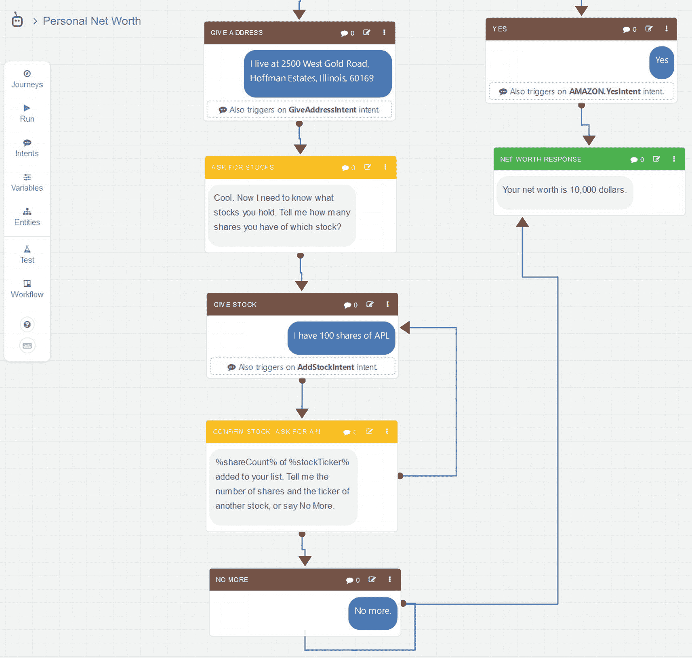
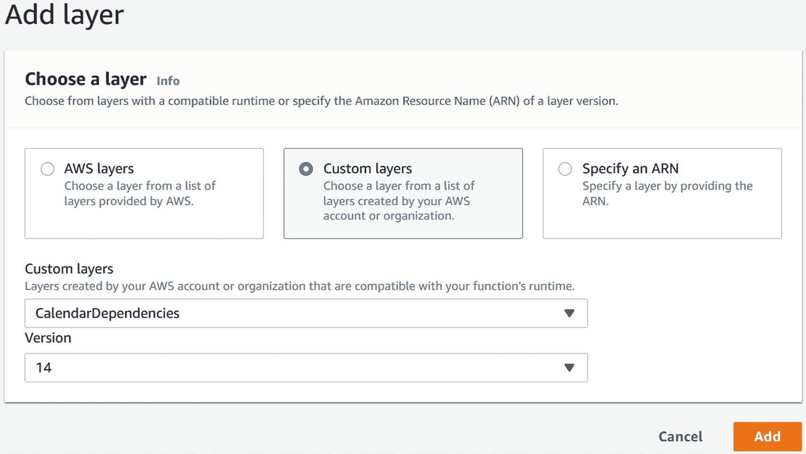
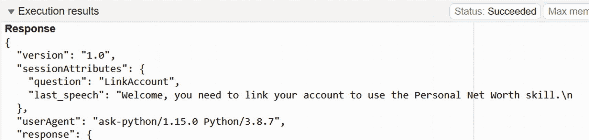
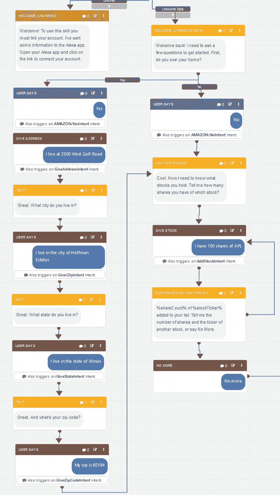

## 14. 个人净资产技能

在本章中，我们将设计和实现一个个人净资产技能。在下一章中，我们将把该技能连接到一些 API（应用程序编程接口），这些接口将帮助我们获取资产的价值。在本节结束时，Alexa 将能够告诉您您的净资产。

**注意：** 您不能将此技能发布到技能商店，因为如果您不是金融机构，亚马逊不允许您创建金融技能。但是，您可以创建该技能供个人使用。

**另外：** 如果您不想使用真实账户，下一章中使用的所有 API 都允许您创建并使用测试账户和测试数据，因此您仍然可以操作示例，而无需让亚马逊/Alexa 访问您的个人数据。

首先，让我们讨论一下此技能的需求。

### 需求

想象一下 Alexa 能够告诉您您的净资产。她需要知道您房屋的价值、您投资组合的价值，以及您银行账户、抵押贷款和信用卡余额的价值。要获取您房屋的价值，她需要您的地址。要评估您的投资组合，她需要一份您持有的股票代码列表以及每种股票的数量。要评估您的其他账户，她需要访问它们的余额。

从安全性开始，我们需要使用一个关联账户。如果未关联，此技能将无法执行任何操作。

就像日历技能一样，我们需要一个 `DynamoDb` 表来存储用户个人资料。

接下来，我们需要一个用于获取您地址的意图，以及一个用于添加股票代码和持有股份数量的意图。同样，如果您不想，则不必使用真实账户。不过，我们确实需要一个用于获取我们净资产的意图。

以上就是对此技能需求的简要概述。

接下来，我们将设计 VUI。

### VUI 设计

在 `Botmock` 中，有多种方式可以绘制此流程。请参见图 14-1 中的一个示例流程。



**图 14-1：** `Net Worth` 技能的对话流程

要创建此对话流程，首先创建我们需要的 `Alexa` 实体。

| 实体名称 |
| --- |
| `AMAZON.NUMBER` |
| `AMAZON.PostalAddress` |
| `AMAZON.US_CITY` |
| `AMAZON.US_STATE` |

然后，为我们将要追踪的股票代码创建一个自定义实体。

| 实体名称 |
| --- |
| `StockTicker` |

定义好这些实体后，我们可以在 `Botmock` 中创建一些变量。

以下变量在代码中用于管理对话流程。

| 变量名称 | 变量类型 | 实体类型 |
| --- | --- | --- |
| `AccountIsLinked` | `Boolean` | `Any` |
| `HasData` | `Boolean` | `Any` |

下一组变量将成为 `Alexa` 技能中的槽位。

| 变量名称 | 变量类型 | 实体类型 |
| --- | --- | --- |
| `street_address` | `Text` | `AMAZON.PostalAddress` |
| `City` | `Text` | `AMAZON.US_CITY` |
| `State` | `Text` | `AMAZON.US_STATE` |
| `zip_code` | `Text` | `AMAZON.NUMBER` |
| `share_count` | `Text` | `AMAZON.NUMBER` |
| `stock_ticker` | `Text` | `StockTicker` |

将槽位定义为变量后，我们就可以创建一些意图了。

| 意图名称 | 选项 |
| --- | --- |
| `AddStockIntent` |  |
| `AMAZON.YesIntent` |  |
| `GiveAddressIntent` |  |
| `LaunchRequest` |  |
| `NoMoreIntent` |  |

在 `Botmock` 中启动对话流程，使用与 90 年日历中相同的三个 `LaunchRequest` 处理器。（参见图 14-2。）



**图 14-2：** `LaunchRequest` 处理器

1. 未关联账户
2. 新关联账户
3. 已有数据的关联账户

然后添加用户意图：`Give Address`、`Give Stock`、`No More` 和 `Yes`。参见图 14-3 中的示例。



**图 14-3：** 添加用户意图

当您对 `Botmock` 图表满意后，按照第 9 章中的流程，将其迁移到 `Alexa Developer Console` 中的新技能。这主要涉及从 `Botmock` 设置菜单中复制用于 API 的 `.env` 文件。使用之前用过的相同令牌更新 `Token`。然后，通过输入 `npm start` 从命令行运行 `export-master` 项目。

现在我们可以创建技能的骨架了。

### 创建个人净资产技能

导出对话模型后，我们就可以将其加载到技能中。导航到 `Alexa Developer Console`。然后创建一个新的自定义技能。输入 `Personal Net Worth` 作为技能名称。选择构建一个 *自定义* 技能，并配备 *自行配置* 的后端。然后选择 *从头开始* 模板。

创建技能后，展开左侧导航栏中的交互模型选项卡。选择 `JSON Editor` 并注意其中的内容。注意到 `AMAZON.NavigateHomeIntent` 了吗？`Botmock` 不会生成它，但它是必需的，因此编辑您在上一节中生成的 `Botmock Personal Net Worth.json` 文件（可以使用 `NotePad++` 进行编辑），并添加 `AMAZON.NavigateHomeIntent`，如下所示：

```json
...
{
"name": "AMAZON.FallbackIntent",
"samples": []
},
{
"name": "AMAZON.NavigateHomeIntent",
"samples": []
},
{
"name": "AddStockIntent",
"samples": [
"Add {sharecount} shares of {stockticker}"
],
...
```

此外，`Botmock` 导出了我们的 `LaunchRequest`，这在 `Alexa` 中是不需要的，因此我们可以安全地将其从模型中移除，如下所示：

```json
...
"My address is {street_address}, {city}, {state}, {zip_code}"
]
}
]
},
{
"name": "LaunchRequest",
"samples": [
"Launch Personal Net Worth",
"Run Personal Net Worth"
],
"slots": []
},
{
"name": "NoMoreIntent",
"samples": [
"No More"
],
"slots": []
}
...
```

完成这些编辑后，将整个 `Json` 文件从 `NotePad++` 复制到 `Alexa Developer Console` 的 `JSON Editor` 窗口中。然后，单击顶部的 `Save Model` 按钮，您应该会看到一条绿色消息，显示“Skill Saved Successfully”。如果没有，请仔细检查 `Json` 文件并重试。特别是，在添加和移除前面显示的部分后，确保标点符号（逗号、花括号、方括号等）正确无误。

接下来，我们需要创建 `lambda` 函数。

## 创建 Lambda 函数

登录 AWS 并创建一个新的 lambda 函数。从头开始编写。将其命名为 `PersonalNetWorthBackend`。选择最新版本的 Python 作为运行时。让它创建一个具有基本 Lambda 权限的新执行角色。添加一个触发器。选择 `Alexa Skills Kit` 触发器。从 Alexa 开发者控制台 | 端点选项卡粘贴技能 ID。然后将 lambda 函数的 ARN 粘贴到 Alexa 开发者控制台 | 端点选项卡 | 默认区域字段中。不要忘记点击 Alexa 开发者控制台屏幕顶部的 `保存端点` 按钮。

现在你已经有了一个空的 lambda 函数，并且它已连接到你的 Alexa 技能，你可以从 90 年日历技能的 lambda 函数中复制一些代码来开始。具体来说，让我们复制导入、日志记录、启动请求处理程序、是意图处理程序、内置意图处理程序、SkillBuilder 和持久化代码。实际上，我们不妨同时复制 `lambda_function.py` 和 `dynamodb.py` 模块以及 `requirements.txt` 文件。然后，我们可以在构建个人净资产特定代码时修改日历特定代码。将日历文件复制到净资产 lambda 后，我建议你关闭日历窗口，以免意外修改那里的文件。

现在，在 `dynamodb.py` 文件中，将其复制到 `PersonalNetWorthBackend` lambda 函数后，我们需要进行一些更改，如下所示：

```
from ask_sdk_dynamodb.adapter import DynamoDbAdapter
from ask_sdk_core.exceptions import PersistenceException
import logging
from enum import Enum
from datetime import datetime
logger = logging.getLogger(__name__)
logger.setLevel(logging.INFO)
adapter = DynamoDbAdapter('PersonalNetWorth', partition_key_name="PersonId")
class AccessTokenValidity(Enum):
NONE = 1
VALID = 2
NEW = 3
ERROR = 4
def has_access_token(handler_input):
reqEnv = handler_input.request_envelope
if reqEnv.context.system.user.access_token:
return True
else:
return False
def read_user_profile(handler_input):
validity = AccessTokenValidity.NONE
attr = []
try:
hasAccessToken = has_access_token(handler_input)
logger.info(f"AccToken: {hasAccessToken}")
if hasAccessToken:
amgr = handler_input.attributes_manager
attr = amgr.persistent_attributes
if attr:
logger.info(f"{attr}")
validity = AccessTokenValidity.VALID
else:
validity = AccessTokenValidity.NEW
else:
validity = AccessTokenValidity.NONE
except PersistenceException as e:
logger.error(e)
validity = AccessTokenValidity.ERROR
# TODO: 优雅地处理 PersistenceExceptions
except Exception as e:
logger.error(e)
validity = AccessTokenValidity.ERROR
raise e
return validity, attr
def save_user_profile(handler_input, profile):
if has_access_token(handler_input):
try:
amgr = handler_input.attributes_manager
amgr.persistent_attributes = profile
amgr.save_persistent_attributes()
except PersistenceException as e:
logger.error(e)
# TODO: 优雅地处理 PersistenceExceptions
except Exception as e:
logger.error(e)
raise e
```

编辑 `lambda_function.py` 稍微复杂一些。我们需要移除以下类和函数：

```
class GiveBirthdayIntentHandler(AbstractRequestHandler)
class ViewCalendarIntentHandler(AbstractRequestHandler)
def ShowCalendar(handler_input, profile)
def load_apl_document(file_path)
def addYears(d, years)
def days_between(d1, d2)
def period_from_amazon_date(iso)
```

然后我们需要从 `SkillBuilder` 中移除以下行：

```
sb.add_request_handler(GiveBirthdayIntentHandler())
sb.add_request_handler(ViewCalendarIntentHandler())
```

接下来，我们需要更改 `speak_output` 行中的所有措辞，以正确反映我们个人净资产技能的意图。在本章中，我们将重点关注你的房屋以及与房屋价值相关的问题、答案和意图。这将更改以下类中的一些代码：

```
class LaunchRequestHandlerUnlinked(AbstractRequestHandler)
speak_output = """欢迎，你需要关联账户才能使用个人净资产技能。是否现在关联？"""
class LaunchRequestHandlerNew(AbstractRequestHandler)
speak_output = "欢迎！感谢你关联账户。让我们开始吧。你是否拥有自己的房屋？"
handler_input.attributes_manager.session_attributes["question"]  = "DoYouOwnYourHome"
class LaunchRequestHandlerValid(AbstractRequestHandler)
speak_output = "欢迎回来！你想知道你的净资产吗？"
handler_input.attributes_manager.session_attributes["question"] = "GetNetWorth"
handler_input.attributes_manager.session_attributes["last_speech"] = speak_output
class YesIntentHandler(AbstractRequestHandler)
if question == "LinkAccount":
speak_output = "好的，我已向 Alexa 应用发送了一些信息。打开你的 Alexa 应用并点击链接以关联你的账户。"
endSession = True
card_output = ui.link_account_card.LinkAccountCard()
elif question == "DoYouOwnYourHome":
speak_output = "太好了！你主要住所的街道地址是什么？"
ask = "你的街道地址是什么？"
handler_input.attributes_manager.session_attributes["question"] = "What's your street address?"
elif question == "GetNetWorth":
# TODO: 计算净资产
speak_output = "你当前的净资产是："
endSession = True
elif question == "ClearAndStartOver":
# TODO: 清除并重新开始
speak_output = "我已清除你的个人数据。首先，你主要住所的街道地址是什么？"
ask = "你的街道地址是什么？"
handler_input.attributes_manager.session_attributes["question"] = "What's your street address?"
else:
speak_output = "抱歉，我搞混了，请告诉我你想做什么或说“帮助”。"
class HelpIntentHandler(AbstractRequestHandler)
if question == "LinkAccount":
speak_output = "好的，我已向手机上的 Alexa 应用发送了一些信息。打开你的 Alexa 应用并点击链接以关联你的账户。"
elif question == "What's your street address?":
speak_output = "试着说出你的门牌号和街道名称。"
class StartOverIntentHandler(AbstractRequestHandler)
speak_output = "好的。你确定要清除个人信息并重新开始吗？"
handler_input.attributes_manager.session_attributes["question"] = "ClearAndStartOver"
handler_input.attributes_manager.session_attributes["last_speech"] = speak_output
class FallbackIntentHandler(AbstractRequestHandler)
speak_output = """你的个人净资产技能无法处理这个请求，
但我可以帮助你确定你的净资产。尝试请求帮助。"""
class RepeatIntentHandler(AbstractRequestHandler)
else:
speak_output = """我可以帮你计算你的净资产。尝试请求帮助。"""
class CatchAllExceptionHandler(AbstractExceptionHandler)
speak_output = "抱歉，我在执行你的请求时遇到了问题。请重试或尝试请求帮助。"
```

完成这些编辑后，`lambda_function.py` 模块就可以开始添加新的意图处理程序来捕获和保存你的主要住所地址了。此时，该模块应该看起来像本书代码中名为 `lambda_function.py after converting from calendar to net worth.py` 的列表。

接下来，你需要像我们在第 12 章中所做的那样添加资源模块层。选择添加自定义层的选项，并选择最新版本的 `CalendarDependencies`，因为目前它包含我们所需的所有资源。（参见图 14-4。）



图 14-4

向我们的 lambda 函数添加自定义层

现在，您需要基于 `Amazon Alexa 启动会话` 事件模板配置一个测试事件，以测试您的 Lambda 函数，确保没有编译错误，并且未链接的启动请求处理器能正确触发。当您部署代码并运行测试时，应看到来自 `LaunchRequestHandlerUnlinked` 类的“欢迎”响应，如图 14-5 所示。如果未看到，请先修复所有错误再继续。



图 14-5

“欢迎”响应

Lambda 函数进展顺利后，我们就可以添加用于地址收集和估值的处理器和代码了。

## 提供地址意图

`GiveAddressIntent` 定义了两个示例语句：

```
I live at {street_address} {city} {state} {zip_code}
My address is {street_address} {city} {state} {zip_code}
```

并且槽位定义如下：

| 槽位名称 | 槽位类型 |
| --- | --- |
| `{street_address}` | `AMAZON.PostalAddress` |
| `{city}` | `AMAZON.US_CITY` |
| `{state}` | `AMAZON.US_STATE` |
| `{zip_code}` | `AMAZON.Number` |

我们应该使用语句分析器（在 Alexa 开发者控制台的“构建”选项卡中，点击“评估模型”按钮）进行测试。输入语句：1058 Crossings Circle, Spring Hill, Tennessee 37174。嗯，它触发了`AMAZON.FallbackIntent`。这并非我们预期。注意：语句分析器不会触及我们的 Lambda 函数。所以是其他方面出了问题。我们可能需要将这个意图拆分为四个意图——每个槽位对应一个。

回到 Botmock，将`GiveAddressIntent`拆分为四个部分：

| 意图 | 语句 | 槽位提示 |
| --- | --- | --- |
| `GiveCityIntent` | My zip code is %zip_code%<br>My zip is %zip_code% | What’s your zip code? |
| `GiveStateIntent` | In the state of %state% | What state do you live in? |
| `GiveCityIntent` | In %city%<br>I live in the city of %city%<br>In the city of %city% | What city do you live in? |
| `GiveAddressIntent` | My address is %street_address%<br>I live at %street_address% | What's your street address? |

更新模型，使用全部四个槽位，而不是仅用一个。（见图 14-6。）



图 14-6

修改后的 Botmock 模型

模型更新后，再次导出，按之前所示编辑 JSON，并将 JSON 复制到 Alexa 开发者控制台的 JSON 编辑器中。保存模型并构建。修复所有错误。在语句分析器中再次测试模型。

| 语句 | 选中的意图 |
| --- | --- |
| I live at 1058 Crossings Circle. | `GiveAddressIntent` |
| In the city of Spring Hill | `GiveCityIntent` |
| In the state of Tennessee | `GiveStateIntent` |
| My zip is 37174 | `GiveZipCodeIntent` |

现在它按预期工作了。接下来我们可以编写意图处理器的代码。前三个（地址、城市和州）非常相似。它们都从`handler_input`中提取传入的槽位值，检查配置文件是否已启动，将槽位值添加到配置文件中，保存配置文件，并按顺序询问下一个问题。

### GiveAddressIntentHandler

```python
class GiveAddressIntentHandler(AbstractRequestHandler):
    """Handler for Give Address Intent."""
    def can_handle(self, handler_input):
        validity, _ = read_user_profile(handler_input)
        return (validity == AccessTokenValidity.VALID) and ask_utils.is_request_type("GiveAddressIntent")(handler_input)
    def handle(self, handler_input):
        _, profile = read_user_profile(handler_input)
        street_address = handler_input.request_envelope.request.intent.slots[
            "street_address"].value
        if not profile:
            profile = {}
        profile["street_address"] = street_address
        save_user_profile(handler_input, profile)
        speak_output = "Great. What city do you live in?"
        handler_input.attributes_manager.session_attributes["question"] = "City"
        handler_input.attributes_manager.session_attributes["last_speech"] = speak_output
        return (
            handler_input.response_builder
            .speak(speak_output)
            .ask(speak_output)
            .response
        )
```

### GiveCityIntentHandler

```python
class GiveCityIntentHandler(AbstractRequestHandler):
    """Handler for Give City Intent."""
    def can_handle(self, handler_input):
        validity, _ = read_user_profile(handler_input)
        return (validity == AccessTokenValidity.VALID) and ask_utils.is_request_type("GiveCityIntent")(handler_input)
    def handle(self, handler_input):
        _, profile = read_user_profile(handler_input)
        city = handler_input.request_envelope.request.intent.slots[
            "city"].value
        if not profile:
            profile = {}
        profile["city"] = city
        save_user_profile(handler_input, profile)
        speak_output = "Cool. What state do you live in?"
        handler_input.attributes_manager.session_attributes["question"] = "State"
        handler_input.attributes_manager.session_attributes["last_speech"] = speak_output
        return (
            handler_input.response_builder
            .speak(speak_output)
            .ask(speak_output)
            .response
        )
```

### GiveStateIntentHandler

```python
class GiveStateIntentHandler(AbstractRequestHandler):
    """Handler for Give State Intent."""
    def can_handle(self, handler_input):
        validity, _ = read_user_profile(handler_input)
        return (validity == AccessTokenValidity.VALID) and ask_utils.is_request_type("GiveStateIntent")(handler_input)
    def handle(self, handler_input):
        _, profile = read_user_profile(handler_input)
        state = handler_input.request_envelope.request.intent.slots[
            "state"].value
        if not profile:
            profile = {}
        profile["state"] = state
        save_user_profile(handler_input, profile)
        speak_output = "Awesome. What is your zip code?"
        handler_input.attributes_manager.session_attributes["question"] = "ZipCode"
        handler_input.attributes_manager.session_attributes["last_speech"] = speak_output
        return (
            handler_input.response_builder
            .speak(speak_output)
            .ask(speak_output)
            .response
        )
```

邮政编码意图处理器则完全不同。首先，我们需要一个辅助函数来处理以零开头的邮政编码。具体来说，我们需要添加一个`right()`函数，该函数可以从“00000”与输入的邮政编码数值拼接后的字符串中提取最右边的五个字符。例如，如果邮政编码槽位中存储的是 4829，我们在其前面加上“00000”，得到“000004829”，然后取最右边的五个字符，就得到了邮政编码“04829”，这很可能就是用户最初告诉我们的内容。以下是`right()`函数：

```python
def right(s, amount):
    if s == None:
        return None
    elif amount == None:
        return None  # 或者抛出缺少参数的错误
    s = str(s)
    if amount > len(s):
        return s
    elif amount == 0:
        return ""
    else:
        return s[-amount:]
```

邮政编码意图处理器的第二个主要区别在于，我们期望它在地址序列中最后出现，但用户可能会通过跳步来迷惑我们。在这种情况下，邮政编码处理器需要检查我们是否拥有完整的地址，并跳回去获取我们缺失的地址部分。例如：

```python
if not "street_address" in profile:
    speak_output = "我错过了你的街道地址。请问是什么？"
    handler_input.attributes_manager.session_attributes["question"] = "StreetAddress"
```

因此，该处理器将是`GiveZipCodeIntentHandler`：

```python
class GiveZipCodeIntentHandler(AbstractRequestHandler):
    """处理提供邮政编码意图的处理器。"""
    def can_handle(self, handler_input):
        validity, _ = read_user_profile(handler_input)
        return (validity == AccessTokenValidity.VALID) and ask_utils.is_request_type("GiveZipCodeIntent")(handler_input)

    def handle(self, handler_input):
        _, profile = read_user_profile(handler_input)
        zip_code = handler_input.request_envelope.request.intent.slots[
            "zip_code"].value
        if not profile:
            profile = {}
        profile["zip_code"] = right("00000" + str(zip_code), 5)
        save_user_profile(handler_input, profile)
        if not "street_address" in profile:
            speak_output = "我错过了你的街道地址。请问是什么？"
            handler_input.attributes_manager.session_attributes["question"] = "StreetAddress"
        elif not "city" in profile:
            speak_output = "我缺少你的城市信息。请问是什么？"
            handler_input.attributes_manager.session_attributes["question"] = "City"
        elif not "state" in profile:
            speak_output = "我缺少你的州信息。请问是什么？"
            handler_input.attributes_manager.session_attributes["question"] = "State"
        elif not "zip_code" in profile:
            speak_output = "我缺少你的邮政编码。请问是什么？"
            handler_input.attributes_manager.session_attributes["question"] = "ZipCode"
        else:
            speak_output = f"""谢谢。我已将你的地址记录为
{profile["street_address"]},
{profile["city"]}, {profile["state"]}, {profile["zip_code"]}.
是否正确？"""
            handler_input.attributes_manager.session_attributes["question"] = "ConfirmAddress"
        handler_input.attributes_manager.session_attributes["last_speech"] = speak_output
        return (
            handler_input.response_builder
            .speak(speak_output)
            .ask(speak_output)
            .response
        )
```

接下来，我们将把你的投资组合添加到个人净资产技能中。

### 提供股票意图

`GiveStock` 意图的语句都包含两个槽位：股票代码和持股数量。在 `GiveStock` 意图处理器中，我们需要从各自的槽位中获取这两个值，如下所示：

```python
stock_ticker = handler_input.request_envelope.request.intent.slots["stock_ticker"].value
share_count = handler_input.request_envelope.request.intent.slots["share_count"].value
```

然后我们可以将它们添加到配置文件中的 Python 字典里。我们使用字典而不是列表，因为键值对语法非常适合捕获每项投资的键（股票代码）和值（持股数量）。例如，`profile["stocks"]["AMZN"] = 25` 表示你拥有 25 股 `AMZN`。字典允许我们自动处理更新或新增操作，因为如果键已存在，我们只需更新数量；如果不存在，则添加股票代码和数量。例如：

```python
profile["stocks"][stock_ticker] = share_count
```

我们可能应该确认每次添加。在下一章中，我们将使用 API 从股票代码获取股票名称，以便同时使用股票代码和名称进行确认。目前，我们仅使用股票代码进行确认。例如：

```python
if stock_ticker in profile["stocks"]:
    speak_output = f'{stock_ticker} 的持股数量正在从 {profile["stocks"][stock_ticker]} 更新为 {share_count}。是否正确？'
else:
    speak_output = f'正在将 {share_count} 股 {stock_ticker} 添加到你的投资组合中。是否正确？'
```

假设当我们询问“是否正确？”时，用户回答“否”。我们需要撤销 `profile["stocks"][stock_ticker] = share_count` 的赋值。在更改数量之前，让我们将先前的数量存储在 `session_attributes` 中；如果用户说“否”，我们可以恢复先前的数量。除非先前的数量为零，那么我们可以从字典中删除该股票代码。例如，如果我们将以下代码放入 `GiveStock` 意图处理器中：

```python
if stock_ticker in profile["stocks"]:
    handler_input.attributes_manager.session_attributes["previous_share_count"] = profile["stocks"][stock_ticker]
else:
    handler_input.attributes_manager.session_attributes["previous_share_count"] = 0
handler_input.attributes_manager.session_attributes["previous_stock_ticker"] = stock_ticker
profile["stocks"][stock_ticker] = share_count
save_user_profile(handler_input, profile)
```

那么我们可以将以下代码放入 `No` 意图处理器中，以撤销添加/更新操作：

```python
elif question == "ConfirmShares":
    if handler_input.attributes_manager.session_attributes["previous_share_count"] == 0:
        del profile["stocks"][handler_input.attributes_manager.session_attributes["previous_stock_ticker"]]
    else:
        profile["stocks"][handler_input.attributes_manager.session_attributes["previous_stock_ticker"]] = handler_input.attributes_manager.session_attributes["previous_share_count"]
```

因此，完成的 `GiveStockIntentHandler` 将是：

```python
class GiveStockIntentHandler(AbstractRequestHandler):
    """处理提供股票意图的处理器。"""
    def can_handle(self, handler_input):
        validity, _ = read_user_profile(handler_input)
        return (validity == AccessTokenValidity.VALID) and ask_utils.is_request_type("GiveStockIntent")(handler_input)

    def handle(self, handler_input):
        _, profile = read_user_profile(handler_input)
        stock_ticker = handler_input.request_envelope.request.intent.slots[
            "stock_ticker"].value
        share_count = handler_input.request_envelope.request.intent.slots[
            "share_count"].value
        if not profile:
            profile = {}
        profile["stocks"] = {}
        if stock_ticker in profile["stocks"]:
            handler_input.attributes_manager.session_attributes[
                "previous_share_count"] = profile["stocks"][stock_ticker]
            speak_output = f'{stock_ticker} 的持股数量正在从 {profile["stocks"][stock_ticker]} 更新为 {share_count}。是否正确？'
        else:
            handler_input.attributes_manager.session_attributes["previous_share_count"] = 0
            speak_output = f'正在将 {share_count} 股 {stock_ticker} 添加到你的投资组合中。是否正确？'
        handler_input.attributes_manager.session_attributes["previous_stock_ticker"] = stock_ticker
        profile["stocks"][stock_ticker] = share_count
        save_user_profile(handler_input, profile)
        handler_input.attributes_manager.session_attributes["last_speech"] = speak_output
        ask = "是否正确？"
        handler_input.attributes_manager.session_attributes["question"] = "ConfirmShares"
        return (
            handler_input.response_builder
            .speak(speak_output)
            .ask(ask)
            .response
        )
```

现在我们已经有了 `Give*` 意图处理器，接下来需要查看 `Yes` 和 `No` 意图处理器。

### 是/否意图

在其他意图中，我们会向用户提出几个是/否问题。具体来说，我们会询问：

```
您现在要链接[您的账户]吗？
您是否拥有自己的住房？
您想知道自己的净资产吗？
信息正确吗？[地址确认]
信息正确吗？[更新持股数量]
信息正确吗？[添加股票代码和数量]
```

在每种情况下，我们都会将`"question"`项添加到会话属性中，以便知道用户是对什么内容说“是”或“否”。因此，是/否意图处理程序的基本结构是一系列`if...elif...else`语句。例如，下面是处理对`LinkAccount`问题回答`Yes`的第一个`if`语句：

```
if question == "LinkAccount":
    speak_output = "好的，我已向 Alexa 应用发送了一些信息。请打开您的 Alexa 应用并点击链接以连接您的账户。"
    endSession = True
    card_output = ui.link_account_card.LinkAccountCard()
```

以及针对`LinkAccount`问题对应的`No`处理程序：

```
if question == "LinkAccount":
    speak_output = "好的，您可以稍后回来链接您的账户以开始使用。谢谢。"
    endSession = True
```

关于是/否处理程序的一个特殊情况是，如果用户的访问令牌尚未生效，且问题是`"LinkAccount"`，我们仍然需要运行处理程序代码。为了实现这一点，我们需要修改`can_handle`逻辑，如下所示：

```
def can_handle(self, handler_input):
    validity, _ = read_user_profile(handler_input)
    question = handler_input.attributes_manager.session_attributes["question"]
    return (validity == AccessTokenValidity.VALID
            or validity == AccessTokenValidity.NEW
            or question == "LinkAccount") \
           and ask_utils.is_intent_name("AMAZON.YesIntent")(handler_input)
```

这将确保无论账户是否已链接，只要问题是`"LinkAccount"`，代码都会运行。

综合起来，我们最终得到一个如下所示的“是”意图处理程序：

```
class YesIntentHandler(AbstractRequestHandler):
    """用于处理“是”意图的处理程序。"""
    def can_handle(self, handler_input):
        # type: (HandlerInput) -> bool
        validity, _ = read_user_profile(handler_input)
        question = handler_input.attributes_manager.session_attributes["question"]
        return (validity == AccessTokenValidity.VALID
                or validity == AccessTokenValidity.NEW
                or question == "LinkAccount") \
               and ask_utils.is_intent_name("AMAZON.YesIntent")(handler_input)

    def handle(self, handler_input):
        _, profile = read_user_profile(handler_input)
        question = handler_input.attributes_manager.session_attributes["question"]
        speak_output = ""
        ask = None
        endSession = False
        card_output = None

        if question == "LinkAccount":
            speak_output = "好的，我已向 Alexa 应用发送了一些信息。请打开您的 Alexa 应用并点击链接以连接您的账户。"
            endSession = True
            card_output = ui.link_account_card.LinkAccountCard()
        elif question == "DoYouOwnYourHome":
            speak_output = "太好了！您主要住所的街道地址是什么？"
            ask = "您的街道地址是什么？"
            handler_input.attributes_manager.session_attributes["question"] = "StreetAddress"
            if not profile:
                profile = {}
            profile["own_home"] = True
            save_user_profile(handler_input, profile)
        elif question == "ConfirmAddress":
            speak_output = "太棒了！现在我们可以继续处理您的投资了。请告诉我您持有的每种投资的股票代码和数量。或者说“没有更多”以停止添加股票。"
            ask = "请告诉我您持有某个股票代码的股份数量。"
            handler_input.attributes_manager.session_attributes["question"] = "AddStock"
        elif question == "ConfirmShares":
            speak_output = "那么多？哇！请告诉我您另一项投资的股票代码和持股数量。或者说“没有更多”以停止添加股票。"
            ask = "请告诉我您持有某个股票代码的股份数量。"
            handler_input.attributes_manager.session_attributes["question"] = "AddStock"
        elif question == "GetNetWorth":
            # TODO: 计算净资产
            speak_output = "您当前的净资产是："
            endSession = True
        elif question == "ClearAndStartOver":
            profile = {}
            save_user_profile(handler_input, profile)
            speak_output = "我已清除您的个人数据。首先，您是否拥有自己的住房？"
            ask = "您是否拥有自己的住房？"
            handler_input.attributes_manager.session_attributes["question"] = "DoYouOwnYourHome"
        else:
            speak_output = "抱歉，我有点困惑，请告诉我您想做什么，或者说“帮助”。"
            handler_input.attributes_manager.session_attributes["last_speech"] = speak_output

        if not ask:
            ask = speak_output

        return (
            handler_input.response_builder
                .speak(speak_output)
                .ask(ask)
                .set_card(card_output)
                .set_should_end_session(endSession)
                .response
        )
```

我们还需要一个对应的“否”意图处理程序，如下所示：

```
class NoIntentHandler(AbstractRequestHandler):
    """用于处理“否”意图的处理程序。"""
    def can_handle(self, handler_input):
        # type: (HandlerInput) -> bool
        validity, _ = read_user_profile(handler_input)
        question = handler_input.attributes_manager.session_attributes["question"]
        return (validity == AccessTokenValidity.VALID
                or validity == AccessTokenValidity.NEW
                or question == "LinkAccount") \
               and ask_utils.is_intent_name("AMAZON.NoIntent")(handler_input)

    def handle(self, handler_input):
        _, profile = read_user_profile(handler_input)
        question = handler_input.attributes_manager.session_attributes["question"]
        speak_output = ""
        ask = None
        endSession = False

        if question == "LinkAccount":
            speak_output = "好的，您可以稍后回来链接您的账户以开始使用。谢谢。"
            endSession = True
        elif question == "DoYouOwnYourHome":
            speak_output = "好的。让我们继续处理您的投资。请告诉我您持有的每种投资的股票代码和数量。或者说“没有更多”以停止添加股票。"
            ask = "请告诉我您持有某个股票代码的股份数量。"
            handler_input.attributes_manager.session_attributes["question"] = "AddStock"
        elif question == "ConfirmAddress":
            speak_output = "好的。让我们再试一次。您主要住所的街道地址是什么？"
            ask = "您的街道地址是什么？"
            handler_input.attributes_manager.session_attributes["question"] = "StreetAddress"
            profile = {}
            profile["own_home"] = True
            save_user_profile(handler_input, profile)
        elif question == "ConfirmShares":
            speak_output = "哎呀。让我们再试一次。请告诉我您持有的每种投资的股票代码和数量。或者说“没有更多”以停止添加股票。"
            ask = "请告诉我您持有某个股票代码的股份数量。"
            if handler_input.attributes_manager.session_attributes["previous_share_count"] == 0:
                del profile["stocks"][handler_input.attributes_manager.session_attributes["previous_stock_ticker"]]
            else:
                profile["stocks"][handler_input.attributes_manager.session_attributes["previous_stock_ticker"]] = handler_input.attributes_manager.session_attributes["previous_share_count"]
            handler_input.attributes_manager.session_attributes["question"] = "AddStock"
        elif question == "GetNetWorth":
            speak_output = "好的。现在不是好时机。我明白了。欢迎您稍后回来查询您的净资产。只需一分钟。"
            endSession = True
        elif question == "ClearAndStartOver":
            # 被拒绝。不清除并重新开始
            speak_output = "呼。我还以为您要删除所有内容。但您没有。太好了。您想知道自己的净资产吗？"
            ask = "您想知道自己的净资产吗？"
            handler_input.attributes_manager.session_attributes["question"] = "GetNetWorth"
        else:
            speak_output = "抱歉，我有点困惑，请告诉我您想做什么，或者说“帮助”。"
            handler_input.attributes_manager.session_attributes["last_speech"] = speak_output

        if not ask:
            ask = speak_output

        return (
            handler_input.response_builder
                .speak(speak_output)
                .ask(ask)
                .set_should_end_session(endSession)
                .response
        )
```

本章要介绍的最后一个内容是“没有更多”意图处理程序。

#### 停止添加意图

当用户想要停止向投资组合中添加股票时，他们需要说“不再添加”。此时，我们需要停止询问股票信息，转而询问是否要获取其净资产。因此，停止添加意图处理器将如下所示：

```python
class NoMoreIntentHandler(AbstractRequestHandler):
    """停止添加意图的处理器。"""
    def can_handle(self, handler_input):
        validity, _ = read_user_profile(handler_input)
        return (validity == AccessTokenValidity.VALID) and ask_utils.is_request_type("NoMoreIntent")(handler_input)

    def handle(self, handler_input):
        speak_output = "好的。您想知道您的净资产吗？"
        handler_input.attributes_manager.session_attributes["question"] = "GetNetWorth"
        handler_input.attributes_manager.session_attributes["last_speech"] = speak_output
        return (
            handler_input.response_builder
            .speak(speak_output)
            .ask(speak_output)
            .response
        )
```

现在我们需要将新的意图添加到技能构建器中。在模块底部，按如下所示更新技能构建器部分：

```python
sb = CustomSkillBuilder(persistence_adapter=adapter)
sb.add_request_handler(LaunchRequestHandlerUnlinked())
sb.add_request_handler(LaunchRequestHandlerNew())
sb.add_request_handler(LaunchRequestHandlerValid())
sb.add_request_handler(GiveAddressIntentHandler())
sb.add_request_handler(GiveCityIntentHandler())
sb.add_request_handler(GiveStateIntentHandler())
sb.add_request_handler(GiveZipCodeIntentHandler())
sb.add_request_handler(GiveStockIntentHandler())
sb.add_request_handler(NoMoreIntentHandler())
sb.add_request_handler(YesIntentHandler())
sb.add_request_handler(NoIntentHandler())
sb.add_request_handler(HelpIntentHandler())
sb.add_request_handler(NavigateHomeIntentValidHandler())
sb.add_request_handler(NavigateHomeIntentInvalidHandler())
sb.add_request_handler(StartOverIntentHandler())
sb.add_request_handler(CancelOrStopIntentHandler())
sb.add_request_handler(SessionEndedRequestHandler())
sb.add_request_handler(RepeatIntentHandler())
sb.add_request_handler(FallbackIntentHandler())
# 确保 IntentReflectorHandler 和 CatchAllExceptionHandler
# 位于最后，这样它们就不会覆盖您的自定义意图处理器
sb.add_request_handler(IntentReflectorHandler())
sb.add_exception_handler(CatchAllExceptionHandler())
```

您的任务是更新 `HelpIntentHandler`、`NavigateHomeIntent*Handlers` 以及所有其他内置意图的处理器，使其能够适用于此技能。您还应在 `lambda` 环境中创建单元测试来测试您的函数。请记住，这涉及使用 Alexa 开发者控制台获取意图的 `Json`，然后将其复制到 `lambda` 函数的测试中。

至此，我们已经为个人净资产技能创建了前端（VUI）和后端（`lambda_function` 和 `dynamodb` 模块）。不过，还有一个明显的遗漏。我们在“是”意图处理器中留下了一个待办事项：

```python
# TODO: CalculateNetWorth
```

这将是下一章的内容。

### 总结

在本章中，我们创建了个人净资产技能的雏形。首先，我们确定了需求。这使我们能够在 `Botmock` 中设计 VUI。然后，我们将该设计导出为 `Json` 并导入到 Alexa 开发者控制台。接着，我们创建了后端 `lambda` 函数，并在其中编写了启动意图处理器。我们添加了一个 `dynamodb` 模块，用于读取和保存用户配置文件。我们添加了提供地址意图处理器和提供股票意图处理器。然后，我们研究了“是”和“否”意图处理器。最后，我们添加了停止添加意图处理器，并更新了 `lambda` 函数的技能构建器部分。在下一章中，我们将使用金融 API 来获取本章收集的资产的价值。
