## 15. 房地产 API

在本章中，我们将基于上一章构建的个人理财技能，添加第一个资产价值计算功能，该功能将告诉我们房屋和投资的价值。同样，此技能可能会接触到大量个人数据，但所有这些数据都将安全地存储在受保护的数据库中，并经过加密以保护您的安全。在所有情况下，您都可以选择使用测试账户和虚假数据进行开发，因此完全不需要涉及真实数据。

我们将使用两个 API：一个房地产 API 和一个股票市场 API。本章将介绍 API——如何对其进行身份验证以及如何使用它们。然后，我们将在 `lambda` 函数中添加一个模块，该模块调用房地产 API 来计算我们房屋的价值，以便 Alexa 能够告诉我们房屋值多少钱。

首先，介绍 API。

### 应用程序编程接口

应用程序编程接口（通常称为 API）是一种让开发者发布功能的方式（在本例中是在网络上），以便其他开发者可以访问这些功能并在其程序中使用。许多 API 被称为 RESTful 的。^((21)) 这意味着很多内容，但就我们的目的而言，这意味着它们可以通过精心构造的 URL^((22)) 访问，而不是通过更复杂的机制。

例如，Numbers API 是一项免费服务，可为给定数字提供冷知识。这是一个 RESTful API，因此您可以通过标准互联网浏览器访问它。只需导航到 [`http://numbersapi.com/100`](http://numbersapi.com/100)。您可以将 `100` 替换为任何数字。例如，[`http://numbersapi.com/8`](http://numbersapi.com/8) 可能会回复：“8 是一个字节中的比特数。”有些数字并不引人注目。许多数字会提供关于该数字的几条简单冷知识之一。您可以在 [`http://numbersapi.com/`](http://numbersapi.com/) 查看 Numbers API 的主页和附加功能。

您也可以从 Python 的 `requests` 模块调用 Numbers API 或任何 RESTful API。例如：

```python
import requests
response = requests.request("GET", "http://numbersapi.com/17")
print(response.text)
```
输出：
`17 是掷弹兵卫队手榴弹帽徽章上火焰的数量。`

了解了如何使用 Python 的 `requests` 模块调用 API 后，我们现在可以寻找一个能够评估我们房产价值的 API。

### 房地产估值 API

通过谷歌搜索可以找到各种房产估值 API。起初，这可能会让人不知所措。然而，有一个网站让查找和使用 API 交互变得简单得多：[`https://rapidapi.com`](https://rapidapi.com)。Rapid API 是一个供 API 开发者以某种标准化方式公开其 API 的中心。它让订阅免费增值网站变得容易，并提供了用多种编程语言调用 API 的示例代码。注册成为开发者后，在 Rapid API 中快速搜索房产估值 API，就能找到几个可能的候选。（见图 15-1。）

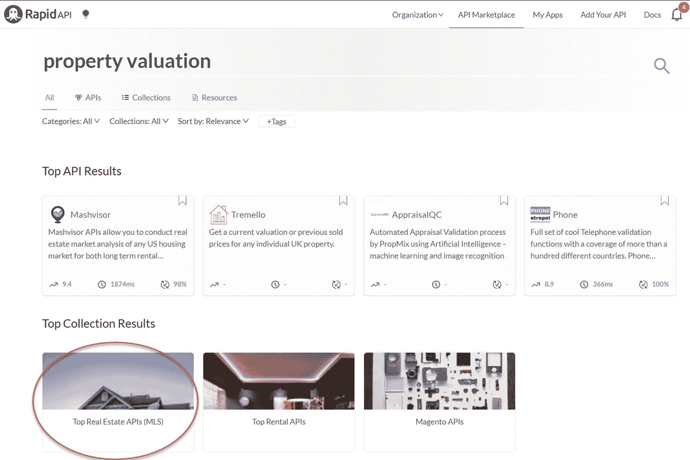

**图 15-1**
在 Rapid API 中搜索房产估值

点击“热门房地产 API (MLS)”集合结果，我们找到了几个可能符合要求的 API。其中一个特别引人注目。将鼠标悬停在 `Realty Mole` 上（见图 15-2），我们看到 API 中有一个 `GET Sale Price Estimate` 方法。这正是我们需要的。

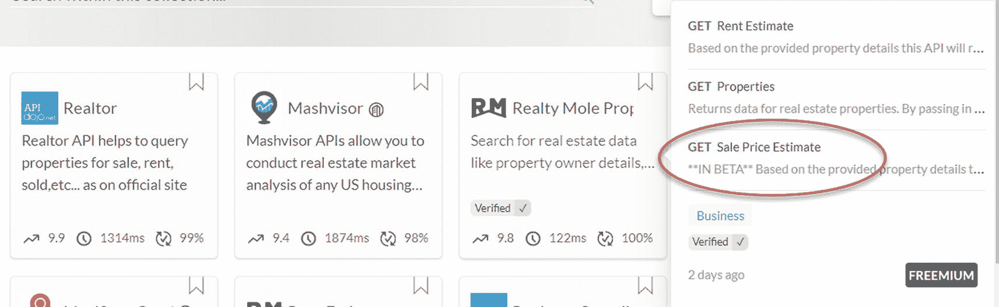

**图 15-2**
找到“售价估算”方法

点击进入 `Realty Mole API`，我们找到了文档、端点测试以及使用 API 的代码片段。还有一个“订阅测试”按钮。（见图 15-3。）

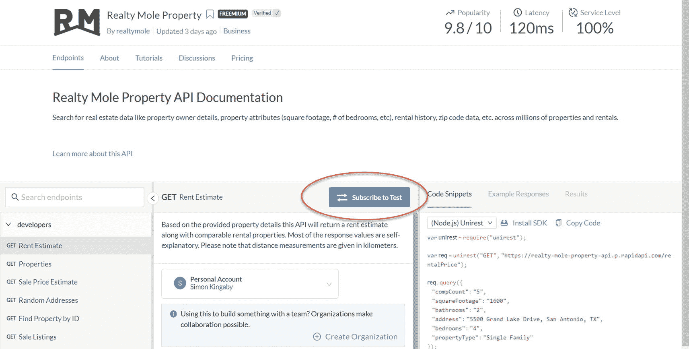

**图 15-3**
`Realty Mole` 房产 API

继续点击“订阅测试”。然后选择“基础（免费）”计划。这样我们每月就有 50 次 API 调用配额，足够我们测试了。订阅免费计划后（是的，你仍然需要提供信用卡，以防超出 50 次免费 API 调用），你会被重定向回 API 文档页面，现在页面上有一个“测试端点”按钮。点击它。API 应该在右侧返回一条状态 200 的消息，并附带一些租金费率。（见图 15-4。）

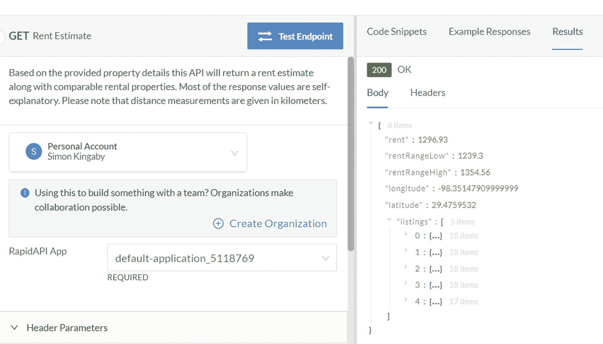

**图 15-4**
测试端点，我们得到一条包含租金费率的消息

切换到左侧的“售价估算”方法。向下滚动并输入你房屋的详细信息，特别是面积、浴室数量、地址（不包括邮政编码）、卧室数量和房产类型。选择 Python | Requests 的代码片段。（见图 15-5。）

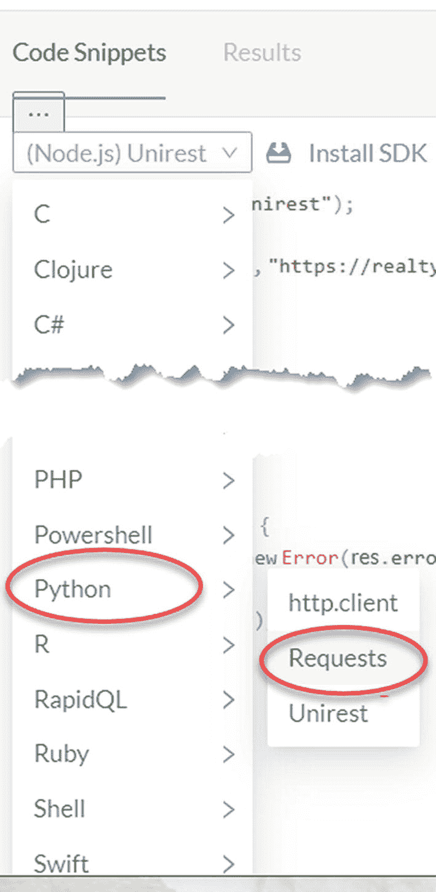

**图 15-5**
选择 Python Requests

再次点击“测试端点”。这次，可以看到 JSON 结果中包含的是价格，而不是租金费率。（见图 15-6。）

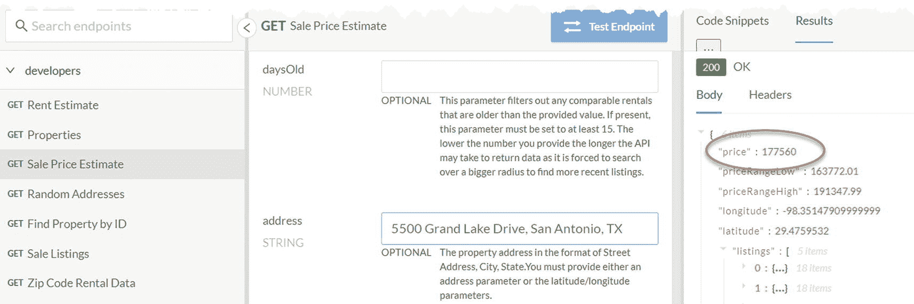

**图 15-6**
“售价估算”方法返回一个价格

这看起来正是我们需要的。现在我们需要更新 VUI 来收集这些信息。

### 添加“提供房屋统计信息”意图

我们需要让用户提供面积、浴室数量、卧室数量和房产类型。由于房产类型的可选值有限，你需要在 Botmock 中添加一个实体，或在 Alexa 开发者控制台中添加一个槽位类型。

| Botmock | Alexa 开发者控制台 |
| --- | --- |
| 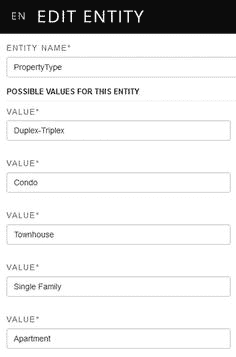 | 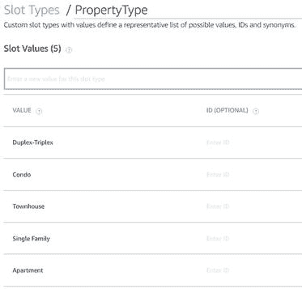 |

然后添加一个用于提供房屋统计信息的意图。

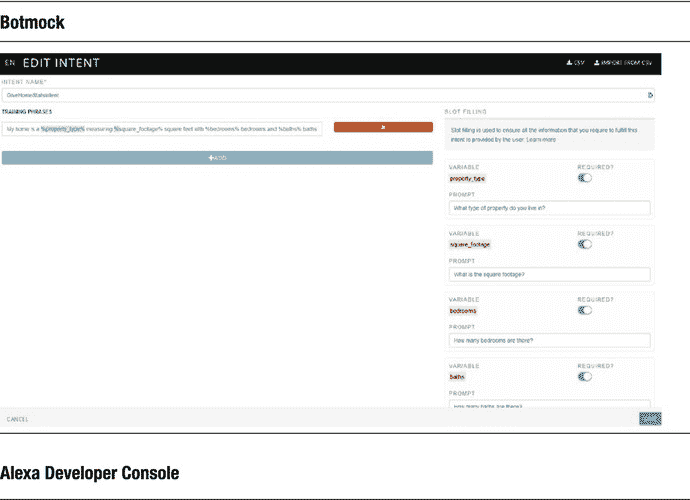

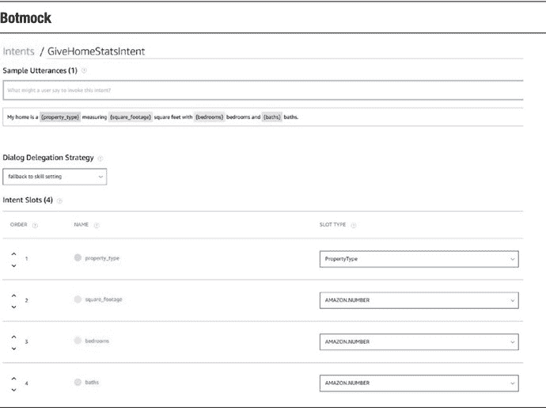

在 Botmock 中，可以按图 15-7 所示更新图表。

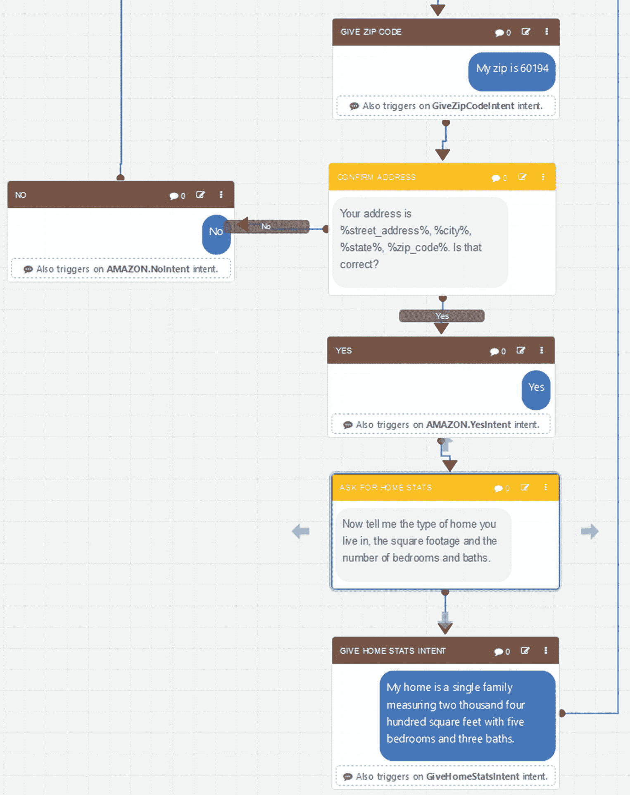
图 15-7 更新后的 Botmock 图表，包含“提供房屋统计信息”意图

现在我们可以为新意图添加代码。由于我们是在一次对话中收集所有统计信息，因此可以在一个意图处理器中处理它们。

```
class GiveHomeStatsIntentHandler(AbstractRequestHandler):
    """处理提供房屋统计信息意图的处理器。"""
    def can_handle(self, handler_input):
        validity, _ = read_user_profile(handler_input)
        return (validity == AccessTokenValidity.VALID) and ask_utils.is_request_type("GiveHomeStatsIntent")(handler_input)
    def handle(self, handler_input):
        _, profile = read_user_profile(handler_input)
        property_type = handler_input.request_envelope.request.intent.slots["property_type"].value
        square_footage = handler_input.request_envelope.request.intent.slots["square_footage"].value
        bedrooms = handler_input.request_envelope.request.intent.slots["bedrooms"].value
        baths = handler_input.request_envelope.request.intent.slots["baths"].value
        if not profile:
            profile = {}
        profile["homestats"] = {
            "property_type": property_type,
            "square_footage": square_footage,
            "bedrooms": bedrooms,
            "baths": baths
        }
        save_user_profile(handler_input, profile)
        speak_output = f"您的房子是{property_type}，面积为{square_footage}平方英尺，有{bedrooms}间卧室和{baths}间浴室。对吗？"
        handler_input.attributes_manager.session_attributes["last_speech"] = speak_output
        ask = "对吗？"
        handler_input.attributes_manager.session_attributes["question"] = "ConfirmStats"
        return (
            handler_input.response_builder
                .speak(speak_output)
                .ask(ask)
                .response
        )
```

我们还需要在“是”和“否”意图处理器中添加条件语句。

| 是意图处理器 |
| --- |
| `elif question == "ConfirmAddress":` `speak_output = "太好了。请告诉我一些关于您房子的信息。房子是什么类型，有多少平方英尺，几间卧室，几间浴室？"` `ask = "房子是什么类型，有多少平方英尺，几间卧室，几间浴室？"` `handler_input.attributes_manager.session_attributes["question"] = "HomeStats"` `elif question == "ConfirmStats":` `speak_output = "太棒了！现在我们可以继续了解您的投资了。请告诉我您持有多少股以及每项投资的股票代码。或者说“没有更多”来停止添加股票。"` `ask = "告诉我您持有某只股票代码的多少股。"` `handler_input.attributes_manager.session_attributes["question"] = "AddStock"` |
| **否意图处理器** |
| `elif question == "ConfirmStats":` `speak_output = "哎呀。我们再试一次。房子是什么类型，有多少平方英尺，几间卧室，几间浴室？"` `ask = "房子是什么类型，有多少平方英尺，几间卧室，几间浴室？"` `handler_input.attributes_manager.session_attributes[` `"question"] = "HomeStats"` |

并且不要忘记在帮助意图处理器中添加一些帮助信息，并将新的 `GiveHomeStatsIntentHandler` 添加到技能构建器中。

```
sb.add_request_handler(GiveHomeStatsIntentHandler())
```

现在我们已经能够收集房屋统计信息，可以回到计算您房屋价值的工作上来了。

### 回到房地产 API

我们已经有了地址和房屋统计数据。现在需要将这些信息传递给 API，获取房屋估值。我们需要两样东西：(1) 调用 API 的代码，(2) 测试它的方法。至于代码，我们在 Python Requests 的 API 代码片段中已经有了大部分所需内容：

```
import requests
url = "https://realty-mole-property-api.p.rapidapi.com/salePrice"
querystring = {"compCount":"5","squareFootage":"1600","bathrooms":"2","address":"5500 Grand Lake Drive, San Antonio, TX","bedrooms":"4","propertyType":"Single Family"}
headers = {
    'x-rapidapi-key': "b912ba32xxxxxxxxxxxxxxxxxxxxxxxxxxxxxxxxxx899e140d",
    'x-rapidapi-host': "realty-mole-property-api.p.rapidapi.com"
}
response = requests.request("GET", url, headers=headers, params=querystring)
print(response.text)
```

为了测试，我们可以向 Launch 请求处理程序插入一些内容，确保管道畅通。然后，在 Alexa 开发者控制台的测试标签页中创建必要的 JSON，用我们的数据进行测试。接着，将其连接到缺失的`CalculateNetWorth`函数（我们将添加该函数）。听起来是个好计划。

首先，我们将这段代码放入一个新模块，这样就不会把 API 调用埋没在意图处理程序中。在 `lambda` 函数的`PersonalNetWorthBackend`文件夹中，紧邻`lambda_function.py`和`dynamodb.py`，添加另一个文件：`api_calls.py`。然后粘贴 API 代码片段中的代码（如上所示）。接着，我们需要做一个关键修改。

这段代码包含了我们的 API 密钥：

```
headers = {
    'x-rapidapi-key': "b912ba32xxxxxxxxxxxxxxxxxxxxxxxxxxxxxxxxxx899e140d",
```

API 密钥就是“通往王国的钥匙”。任何人都可以用你的密钥代表你调用 API，这对你的技能来说没问题，但如果黑客获取了你的密钥并将其放到暗网上，那对你来说就非常不妙了。你**绝对不应该**把密钥留在代码中。这就像把车钥匙留在停车场的车里，然后指望回来时车还在一样。祝你好运。

如果不能把密钥留在代码里，那该放在哪里呢？最好的地方是环境变量。这样既把密钥从代码中移出，又让它们仍然可供使用。在 AWS Lambda 中，配置环境变量相当容易：

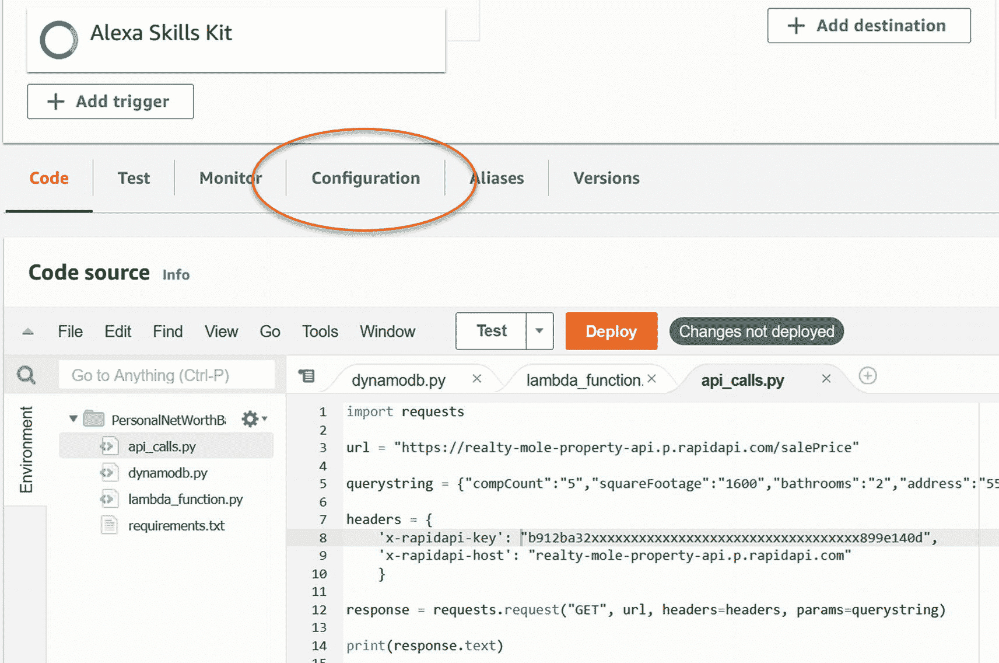
图 15-8 选择配置标签页

1.  选择代码窗口上方的*配置*标签页（见图 15-8）。

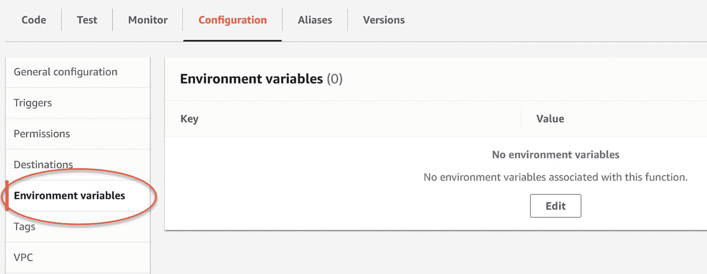
图 15-9 在左侧选择环境变量菜单选项

1.  从左侧导航菜单中选择*环境变量*选项（见图 15-9）。
2.  点击屏幕中央的*编辑*按钮。
3.  点击*添加环境变量*按钮。
4.  环境变量是键值对。在我们的例子中，键是我们为 API 密钥指定的名称，值就是密钥本身。
5.  在*键*输入框中，输入`RAPID_API_KEY`。（按照惯例，环境变量全部使用大写字符。）
6.  在*值*输入框中，粘贴代码片段中的 API 密钥：`b912ba32xxxxxxxxxxxxxxxxxxxxxxxxxxxxxxxxxx899e140d`
7.  点击右下角的*保存*按钮。

环境变量在静态时使用默认的 `Lambda` 服务密钥进行加密。这对我们的目的来说已经足够了。但是，如果你想在传输过程中加密密钥，可以选择使用 AWS 密钥管理服务（`KMS`）来加密环境变量。如果要启用此选项，则需要在现有代码基础上补充 `KMS` 示例中提供的代码。

现在我们已经将 API 密钥存储在环境变量中，可以修改代码，从环境变量中获取密钥，而不是硬编码密钥值。将以下代码：

```
headers = {
    'x-rapidapi-key': "b912ba32xxxxxxxxxxxxxxxxxxxxxxxxxxxxxxxxxx899e140d",
```

替换为对环境变量的调用：

```
headers = {
    'x-rapidapi-key': os.environ['RAPID_API_KEY'],
```

这需要在模块顶部添加一个额外的导入语句：

```
import os
```

最后需要做的是，将 API 调用封装在一个函数定义中，该函数将接收用户配置文件（从计算净资产的意图处理程序传入），并返回房屋价值（来自 API 调用）。完成这些修改后，`api_calls.py`模块应该如下所示：

```
import requests
import os
import logging
import json

logger = logging.getLogger(__name__)
logger.setLevel(logging.INFO)

url = "https://realty-mole-property-api.p.rapidapi.com/salePrice"

def GetHomeValue(profile):
    querystring = {
        "compCount": "10",
        "squareFootage": profile["homestats"]["square_footage"],
        "bathrooms": profile["homestats"]["baths"],
        "address": f'{profile["street_address"]}, {profile["city"]}, {profile["state"]}',
        "bedrooms": profile["homestats"]["bedrooms"],
        "propertyType": profile["homestats"]["property_type"]
    }
    headers = {
        'x-rapidapi-key': os.environ['RAPID_API_KEY'],
        'x-rapidapi-host': "realty-mole-property-api.p.rapidapi.com"
    }
    response = requests.request(
        "GET", url, headers=headers, params=querystring)
    if response.text:
        logger.info(f"{response.text}")
        result = json.loads(response.text)
        if result["price"]:
            return result["price"]
    return None
```

定义好环境变量并完成代码后，我们就可以测试 API 调用了。

## 测试 API 调用

如何高效地测试 API 调用？我暂时不想与 Alexa 进行完整对话，尽管稍后我们需要这样做。相反，我们可以将 API 调用插入到 `LaunchRequest` 处理器中，并直接使用其测试。首先，我们需要为 `LaunchRequest` 处理器编写一个测试。如果你还没有，那么你该为至今未做任何测试而自责了。如果你已经有了，请给自己点个赞。感谢你成为那 1% 在将代码投入生产环境前真正进行测试的开发者^(²³)。如果你还没有机会为 `LaunchRequest` 创建测试，别担心，还有机会。你现在就可以创建一个：

1.  点击 *Test* 按钮的下拉菜单，选择 *Configure test event*。
2.  选中 *Create new test event* 单选按钮。
3.  选择 `alexa-skills-kit-start-session` 事件模板。
4.  将测试命名为：`LaunchRequestNoLink`。
5.  点击底部的 *Save*。
6.  点击 *Test* 按钮运行测试。

你应该能在 JSON 结果中看到欢迎消息：

```
Response
{
"version": "1.0",
"sessionAttributes": {
"question": "LinkAccount",
"last_speech": "Welcome, you need to link your account to use the Personal Net Worth skill.\n            Would you like to link it now?"
},
```

相反，如果你看到错误消息，请调试代码，直到看到欢迎消息后再继续。

现在，我们都有了 `LaunchRequest` 处理器的单元测试，可以插入 API 调用了。首先，在 `lambda_function.py` 模块顶部 `import` `GetHomeValue()` 函数。

接下来，我们将 API 测试插入到 `LaunchRequestHandlerUnlinked` 类的 `handle()` 函数中间。

```
def handle(self, handler_input):
speak_output = """Welcome, you need to link your account to use the Personal Net Worth skill.
Would you like to link it now?"""
handler_input.attributes_manager.session_attributes["question"] = "LinkAccount"
====> API Call goes here
handler_input.attributes_manager.session_attributes["last_speech"] = speak_output
return (
handler_input.response_builder
.speak(speak_output)
.ask(speak_output)
.response
)
```

对 API 的调用需要填充 `profile`，为了本次测试我们将对其进行硬编码。它将返回房屋价值，我们将在 `response` 的 `speak_output` 中让 Alexa 播报该值。

加载 `profile` 的代码如下：

```
profile = {}
profile["street_address"] = "1234 Main Street"
profile["city"] = "Nashville"
profile["state"] = "TN"
profile["zip_code"] = 37206
profile["homestats"] = {
"property_type": "Single Family",
"square_footage": 2250,
"bedrooms": 4,
"baths": 3
}
```

而对 API 函数的调用仅需一行代码：

```
homeValue = GetHomeValue(profile)
```

最后，我们需要输出房屋价值，以便在 Alexa 的响应中听到/看到它：

```
speak_output = f"The home value is {homeValue}"
```

完成的 `LaunchRequest` 处理器将如下所示：

```
class LaunchRequestHandlerUnlinked(AbstractRequestHandler):
    """Handler for Skill Launch when the Account is not linked."""
    def can_handle(self, handler_input):
        return not has_access_token(handler_input) and ask_utils.is_request_type("LaunchRequest")(handler_input)
    def handle(self, handler_input):
        speak_output = """Welcome, you need to link your account to use the Personal Net Worth skill.
        Would you like to link it now?"""
        handler_input.attributes_manager.session_attributes["question"] = "LinkAccount"
        # ====>
        profile = {}
        profile["street_address"] = "1234 Main Street"
        profile["city"] = "Nashville"
        profile["state"] = "TN"
        profile["zip_code"] = 37206
        profile["homestats"] = {
            "property_type": "Single Family",
            "square_footage": 2250,
            "bedrooms": 4,
            "baths": 3
        }
        homeValue = GetHomeValue(profile)
        speak_output = f"The home value is {homeValue}"
        # ====>
        handler_input.attributes_manager.session_attributes["last_speech"] = speak_output
        return (
            handler_input.response_builder
            .speak(speak_output)
            .ask(speak_output)
            .response
        )
```

我们可以重新运行启动测试。我们应该能在响应中看到房屋价值的估算值，如图 15-10 所示。

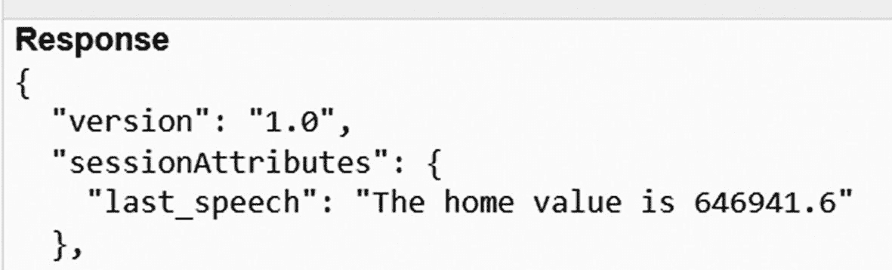

**图 15-10** `LaunchRequest` 处理器正在运行 API 测试代码

现在测试已经运行，我们可以将代码放到正确的位置。首先，注释掉我们添加到 `LaunchRequest` 处理器中的代码。然后，在 `Yes` 意图处理器中，找到 `"GetNetWorth"` 的 `elif` 分支，并修改它以调用 `GetHomeValue()` 函数。

在 `LaunchRequest` 处理器中注释掉代码，并在 `Yes` 意图处理器中修改代码后，我们就可以在 Alexa 开发者控制台的测试标签页中进行测试了。尝试一下。修复你遇到的任何错误。你应该能够完整地测试整个技能。请记住，你需要完整的地址、房屋类型、面积、卧室数量和浴室数量。调试你遇到的任何问题。完成技能测试后，我们可以进入下一章，将股票投资组合的价值添加到你的净资产中。

### 总结

在本章中，我们研究了 API。我们了解了 Numbers API。我们引入了来自 Realty Mole 的房地产估值 API，通过调用 Realty Mole Property API 的 Sale Price Estimate 端点，可以获取房屋的近似价格。我们在 VUI 中添加了必要的意图，并在 `lambda` 函数中添加了相应的处理器来收集统计数据。然后，我们学习了如何通过将 API 调用放入 `LaunchRequest` 处理器来直接测试它。一旦它正常工作，我们将其移动到 `Yes` 意图处理器中的正确位置，并在 Alexa 开发者控制台中测试了该技能。完成这些工作后，我们就可以进入下一章，调用股票估值 API 了。

脚注 1 2 3
