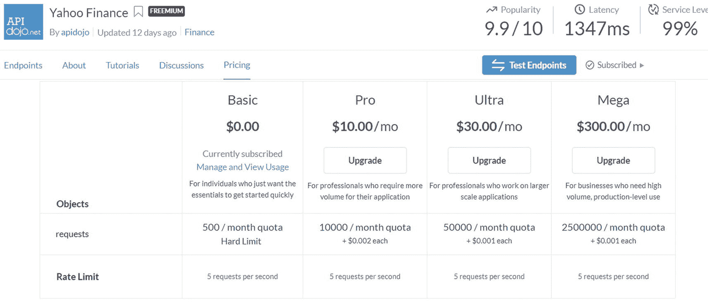
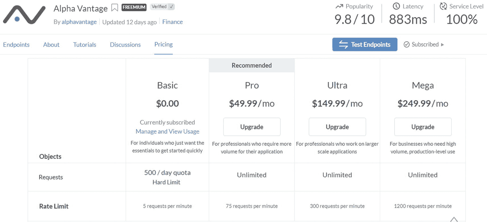
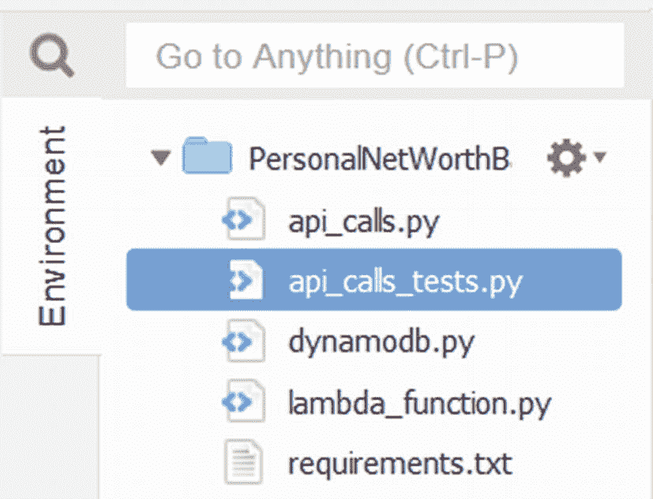
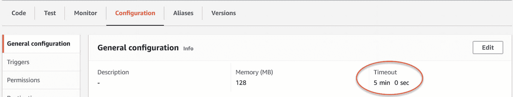

## 16. 股票市场 API

在本章中，我们将使用前几章构建的个人理财技能，并添加第二个资产价值计算功能，以告知我们投资的价值。同样，这个技能可能会接触到我们大量的个人数据，但所有这些数据都将安全地存放在受保护的数据库中，并经过加密以保护你的安全。在所有情况下，你都可以选择使用测试账户和虚假数据进行开发，因此完全不需要涉及真实数据。

要计算你股票投资组合的当前价值，我们需要知道每只股票的代码、持股数量和当前收盘价。前两项我们在技能中收集。对于第三项，我们需要找到一个 API。

搜索股票市场 API 会找到数百个。其中一个流行的是 Yahoo Finance API。

### Yahoo Finance API

在 Rapid API 中，你可以通过以下链接找到 Yahoo Finance API：[`https://rapidapi.com/apidojo/api/Yahoo-Finance1`](https://rapidapi.com/apidojo/api/Yahoo-Finance1)。

浏览左侧股票标题下可用的 API 调用，第一个 `stock/v2/get-summary` 看起来很有用。订阅该 API 并测试 `get-summary` 调用。在结果中，我们看到大量数据。在 “`price`” 部分下，有一个 “`regularMarketPrice`” 部分，其中包含 `raw`（数值）和 `fmt`（格式化字符串）格式的价格。这正是我们需要的。股票类别中还有其他几个调用也会返回 `regularMarketPrice`。然而，Yahoo Finance API 非常 “嘈杂” —— 它返回的数据远多于我们所需。

查看定价也很有必要。（见图 16-1。）Yahoo Finance 采用免费增值模式。免费（基础）层每月有 500 次配额，并设有硬性限制。这意味着我们每月总共只能进行 500 次 API 调用，平均每个工作日约 25 次。达到 500 次后，我们将被限制访问。此外，请注意每秒 5 次请求的速率限制，这意味着如果你投资了 20 只股票，获取价格请求需要 4 秒。最后，专业版（最低付费层）每月费用为 10 美元。



图 16-1

Yahoo Finance 的定价模式

让我们寻找另一个提供更好免费选项且返回更直接响应的 API。

### Alpha Vantage API

在 Rapid API 中，你可以通过以下链接找到 Alpha Vantage API：[`https://rapidapi.com/alphavantage/api/alpha-vantage/`](https://rapidapi.com/alphavantage/api/alpha-vantage/)。

该 API 有一个默认端点，可提供股票、外汇、加密货币等的定价。返回的结果非常简洁且易于阅读：

```
{
    "Global Quote": {
        "01. symbol": "TSLA",
        "02. open": "688.3700",
        "03. high": "692.4203",
        "04. low": "659.4200",
        "05. price": "661.7500",
        "06. volume": "35298378",
        "07. latest trading day": "2021-04-01",
        "08. previous close": "667.9300",
        "09. change": "-6.1800",
        "10. change percent": "-0.9252%"
    }
}
```

查看定价，看起来很有希望。（见图 16-2。）每天 500 次调用的配额是 Yahoo 允许限制的 30 倍。但是，我们每分钟只能进行 5 次免费请求。这意味着 20 只股票需要 4 分钟。而第一个专业版级别每月费用接近 50 美元。



图 16-2

Alpha Vantage 的定价模式

在本章中，我们将看到这两个 API 的代码。Yahoo API 提供更多信息，并且轮询速率更快。Alpha Vantage API 返回更简洁的结果，但轮询速率较慢。两者都能让我们计算截至最近市场收盘的股票价格。在下一节中，我们将创建 Stock API 模块。

### Stock API 模块

为了保持 Stock API 代码的组织性，并将其与`lambda_function.py`中的主要技能代码分离，我们将把它附加到上一章添加的`api_calls.py`模块中。

首先，我们将创建一个模块级常量，用于指定要使用的`STOCK_API`：

```
STOCK_API = 'YAHOO' # 或
# STOCK_API = 'ALPHA'
```

然后，我们需要将 Realty Mole 的 URL 移动到`GetHomeValue`函数内部。（在上一章中，它是我们唯一关心的 URL，我们将其放在了模块级别。）因此，代码现在应如下所示：

```
def GetHomeValue(profile):
url = "https://realty-mole-property-api.p.rapidapi.com/salePrice"
querystring = {
"compCount": "10",
```

现在，我们可以添加一个函数，该函数遍历`profile["stocks"]`字典。如果没有股票，则返回 0。如果有，我们需要查找最新的收盘价，将其乘以持有的股票数量，并累加到运行总计中。

请记住，当我们将股票存储在 profile 中时，我们使用股票代码作为键，股票数量作为值，如下所示：

```
profile["stocks"][stock_ticker] = share_count
```

现在，在`api_calls.py`中，我们需要定义一个函数，用于根据 profile 计算总股票价值：

```
def GetStockValue(profile):
```

接下来，我们将定义一组变量来保存请求信息：

```
stockUrl = ''
querystring = {}
headers = {}
```

直接从 Rapid API 的 Python 定义中提取每个 API 的请求示例，并用我们的环境变量替换密钥，得到以下内容：

```
if STOCK_API == 'YAHOO':
stockurl = "https://apidojo-yahoo-finance-v1.p.rapidapi.com/stock/v2/get-summary"
querystring = {"symbol":"TSLA","region":"US"}
headers = {
'x-rapidapi-key': os.environ['RAPID_API_KEY'],
'x-rapidapi-host': "apidojo-yahoo-finance-v1.p.rapidapi.com"
}
else:
stockurl = "https://alpha-vantage.p.rapidapi.com/query"
querystring = {"function":"GLOBAL_QUOTE","symbol":"TSLA"}
headers = {
'x-rapidapi-key': os.environ['RAPID_API_KEY'],
'x-rapidapi-host': "alpha-vantage.p.rapidapi.com"
}
```

配置好 API 请求后，我们可以开始检查是否存在股票：

```
if not "stocks" in profile:
return 0
if len(profile["stocks"]) == 0:
return 0
```

然后，我们可以遍历 profile 中的股票：

```
for ticker, quantity in profile["stocks"].items():
```

并为每个股票代码调用`requests.request`方法：

```
querystring["symbol"] = ticker
response = requests.request("GET", stockurl, headers=headers, params=querystring)
```

根据我们使用的 API，我们必须从返回的 JSON 中提取不同的属性。对于 Yahoo，它是`price.regularMarketPrice.raw`；对于 Alpha Vantage，它是`"Global Quote"."05\. price"`。生成的代码可能如下所示：

```
totalValue = float(0)
for ticker, quantity in profile["stocks"].items():
if quantity != 0:
querystring["symbol"] = ticker
response = requests.request("GET", stockurl, headers=headers, params=querystring)
if response:
if response.text:
result = json.loads(response.text)
price = float(0)
if STOCK_API == 'YAHOO':
try:
price = float(
result["price"]["regularMarketPrice"]["raw"])
except:
price = 0
else:
try:
price = float(result["Global Quote"]["05\. price"])
except:
price = 0
```

接下来，我们可以进行计算，以跟踪总价值的运行总和：

```
totalValue += price * float(quantity)
```

`for`循环完成后，我们可以返回总价值：

```
return round(totalValue, 2)
```

这样就完成了该函数。真的完成了吗？关于我们在一段时间内可以发出的 API 请求数量的限制呢？

#### 为 For 循环添加延迟

为了添加延迟，避免在短时间内发出过多请求，我们需要导入`time.sleep()`函数。首先导入`time`模块：

```
import time
```

接下来，我们需要计算延迟的秒数。对于 Yahoo，速率是每秒 5 个请求。因此，速率为 1 秒除以 5 个请求，即每个请求 0.2 秒。对于 Alpha Vantage，速率是每分钟 5 个请求。该速率计算为 60 秒除以 5 个请求，即每个请求 12 秒。要添加的代码如下所示：

```
if STOCK_API == 'YAHOO':
rate = 1.0 / 5.0
else:
rate = 60.0 / 5.0
```

计算出每个请求的速率后，我们可以通过以下代码行将延迟添加到`for`循环中：

```
time.sleep(rate)
```

现在，我们已经完成了该函数，如下一节所示。

#### 完整的`GetStockValue`函数

综合以上所有内容，我们得到以下函数：

```python
def GetStockValue(profile):
    stockurl = ''
    querystring = {}
    headers = {}
    rate = 0
    if STOCK_API == 'YAHOO':
        stockurl = "https://apidojo-yahoo-finance-v1.p.rapidapi.com/stock/v2/get-summary"
        querystring = {"symbol": "TSLA", "region": "US"}
        headers = {
            'x-rapidapi-key': os.environ['RAPID_API_KEY'],
            'x-rapidapi-host': "apidojo-yahoo-finance-v1.p.rapidapi.com"
        }
        rate = 1.0 / 5.0
    else:
        stockurl = "https://alpha-vantage.p.rapidapi.com/query"
        querystring = {"function": "GLOBAL_QUOTE", "symbol": "TSLA"}
        headers = {
            'x-rapidapi-key': os.environ['RAPID_API_KEY'],
            'x-rapidapi-host': "alpha-vantage.p.rapidapi.com"
        }
        rate = 60.0 / 5.0
    if not "stocks" in profile:
        return 0
    if len(profile["stocks"]) == 0:
        return 0
    totalValue = float(0)
    for ticker, quantity in profile["stocks"].items():
        if quantity != 0:
            querystring["symbol"] = ticker
            response = requests.request(
                "GET", stockurl, headers=headers, params=querystring)
            if response:
                if response.text:
                    result = json.loads(response.text)
                    price = float(0)
                    if STOCK_API == 'YAHOO':
                        try:
                            price = float(
                                result["price"]["regularMarketPrice"]["raw"])
                        except:
                            price = 0
                    else:
                        try:
                            price = float(result["Global Quote"]["05\. price"])
                        except:
                            price = 0
                    totalValue += price * float(quantity)
            time.sleep(rate)
    return round(totalValue, 2)
```

现在我们需要用几种不同的方式来测试这个函数。

#### 对`GetStockValue`函数进行单元测试

我们需要在以下条件下测试`GetStockValue`函数：

1.  缺少`profile["stocks"]`字典
2.  空的`profile["stocks"]`字典
3.  一个包含一只股票且数量有效（非零）的配置文件（用于测试API请求）
4.  一个包含无效股票代码和有效数量的配置文件（用于测试错误处理）
5.  一个包含一只股票且数量为零的配置文件（用于测试跳过逻辑）
6.  一个包含三只股票，每只数量都有效的配置文件（用于测试循环）
7.  一个包含三只股票，其中一只数量为零的配置文件（用于测试循环中的跳过逻辑）
8.  一个包含20只股票的配置文件（用于正确测试延迟）

呼！测试真不少。如果我们像处理房屋价值那样，把这些测试直接插入到启动请求处理器中，会使它变得杂乱不堪。那我们该怎么办呢？

创建单元测试的一种常见方法是将它们放在一个并行的模块中，也就是说，在`api_calls.py`模块旁边，我们可以添加一个`api_calls_tests.py`模块。（见图16-3。）



图16-3：添加`api_calls_tests.py`模块

在新的测试模块中，添加日志记录和`api_calls`的导入（包括新的`GetStockValue`函数）：

```python
import logging
from api_calls import GetHomeValue, GetStockValue
logger = logging.getLogger(__name__)
logger.setLevel(logging.INFO)
```

然后添加一个名为`UnitTests()`的函数：

```python
def UnitTests():
```

现在，将我们之前插入到启动请求处理器中的`GetHomeValue`测试代码全部移入这个新模块的一个测试函数中。之后，该模块应如下所示：

```python
import logging
from api_calls import GetHomeValue, GetStockValue
logger = logging.getLogger(__name__)
logger.setLevel(logging.INFO)

def UnitTests():
    TestGetHomeValue()

def TestGetHomeValue():
    profile = {}
    profile["street_address"] = "1234 Main Street"
    profile["city"] = "Nashville"
    profile["state"] = "TN"
    profile["zip_code"] = 37206
    profile["homestats"] = {
        "property_type": "Single Family",
        "square_footage": 2250,
        "bedrooms": 4,
        "baths": 3
    }
    logger.info(f"Calling GetHomeValue with profile: {profile}")
    homeValue = GetHomeValue(profile)
    logger.info(
        f"Back from calling GetHomeValue, asserting homeValue is non-zero. HomeValue is {homeValue}")
    assert homeValue != 0, "Home Value is 0, expected a non-zero result."
```

请注意使用日志记录来明确单元测试的进度。同时，注意最后一行中`assert`语句的使用。这就是Python确保我们在使用示例地址调用`GetHomeValue`函数时能获得一个值的方式。

要运行测试，请编辑`lambda_function.py`。修改与之前相同的启动请求处理器。现在它将调用`UnitTests`函数，而不是自己进行测试。首先，编辑导入部分：

```python
from api_calls import GetHomeValue, GetStockValue
from api_calls_tests import UnitTests
```

向模块中添加一个标志，用于打开或关闭单元测试：

```python
RUN_UNIT_TESTS = True
```

并按如下所示修改启动请求处理器：

```python
class LaunchRequestHandlerUnlinked(AbstractRequestHandler):
    """Handler for Skill Launch when the Account is not linked."""
    def can_handle(self, handler_input):
        return not has_access_token(handler_input) and ask_utils.is_request_type("LaunchRequest")(handler_input)

    def handle(self, handler_input):
        speak_output = """Welcome, you need to link your account to use the Personal Net Worth skill.
Would you like to link it now?"""
        handler_input.attributes_manager.session_attributes["question"] = "LinkAccount"
        # ====>
        if RUN_UNIT_TESTS:
            UnitTests()
            speak_output = "The Unit Tests have Passed."
        # ====>
        handler_input.attributes_manager.session_attributes["last_speech"] = speak_output
        return (
            handler_input.response_builder
            .speak(speak_output)
            .ask(speak_output)
            .response
        )
```

你应该会收到一条消息，显示“The Unit Tests have Passed.”。如果没有，请先进行调试再继续。将`TestGetHomeValue`函数从`lambda_function.py`移出到`api_calls_tests.py`后，我们就可以开始为`GetStockValue`函数构建测试用例了。

首先，添加一个`TestGetStockValue`函数，该函数将调用其他的`GetStockValue`测试。然后将该函数调用添加到主`UnitTests()`函数中。将每个针对`GetStockValue`的特定单元测试添加到`TestGetStockValue()`函数中。例如：

```python
def UnitTests():
    TestGetHomeValue()
    TestGetStockValue()

def TestGetStockValue():
    delay = 0.2  # Yahoo API 为 0.2 秒，Alpha Vantage 为 12 秒
    TestGetStockValueMissingProfile()
    TestGetStockValueEmptyStocks()
    TestGetStockValueOneValidStock()
    time.sleep(delay)
```

#### 缺少`profile["stocks"]`字典

```python
def TestGetStockValueMissingProfile() :
    # A missing profile["stocks"] dictionary.
    profile = {}
    logger.info(
        f"TestGetStockValueMissingProfile: Calling GetStockValue with profile: {profile}")
    stockValue = GetStockValue(profile)
    logger.info(
        f"-   Back from Calling GetStockValue. StockValue is {stockValue}")
    assert stockValue == 0, f"Stock Value should be 0, got {stockValue} instead."
```

#### 空的`profile["stocks"]`字典

```python
def TestGetStockValueEmptyStocks():
    # An empty profile["stocks"] dictionary.
    profile = {}
    profile["stocks"] = {}
    logger.info(
        f"TestGetStockValueEmptyStocks: Calling GetStockValue with profile: {profile}")
    stockValue = GetStockValue(profile)
    logger.info(
        f"-   Back from Calling GetStockValue. StockValue is {stockValue}")
    assert stockValue == 0, f"Stock Value should be 0, got {stockValue} instead."
```

#### 一个包含一只股票且数量有效（非零）的配置文件（用于测试API请求）

```python
def TestGetStockValueOneValidStock():
    # A profile with one stock with a valid (non-zero) quantity (to test the API request).
    profile = {}
    profile["stocks"] = {"TSLA": 10.0}
    logger.info(
        f"TestGetStockValueOneValidStock: Calling GetStockValue with profile: {profile}")
    stockValue = GetStockValue(profile)
    logger.info(
        f"-   Back from Calling GetStockValue. StockValue is {stockValue}")
    assert stockValue != 0, f"Stock Value should be non-zero, got 0 instead."
```

> **注意：** 你应该经常部署和测试你的单元测试。即使在添加每个函数之后也要这样做。另外，不要忘记在API调用之间添加延迟，以免超出速度限制。

#### 包含无效股票代码和有效数量的配置文件（用于测试错误处理）

```python
def TestGetStockValueOneInvalidStock():
    # A profile with an invalid stock symbol and a valid quantity (to test error handling).
    profile = {}
    profile["stocks"] = {"Bustopher Jones": 10.0}  # Invalid stock symbol
    logger.info(
        f"TestGetStockValueOneInvalidStock: Calling GetStockValue with profile: {profile}")
    stockValue = GetStockValue(profile)
    logger.info(
        f"-   Back from Calling GetStockValue. StockValue is {stockValue}")
    assert stockValue == 0, f"Stock Value should be 0, got {stockValue} instead."
```

**注意**

此测试耗时稍长，很可能在完成前超时。要解决此问题，请编辑`Function | Configuration | General Configuration | Timeout`（参见图16-4）。将其增加到5分钟（最多可增加到15分钟）。



图16-4：设置函数的超时时间

#### 包含一个数量为零的股票的配置文件（用于测试跳过逻辑）

```python
def TestGetStockValueValidStockWithZeroQuantity():
    # A profile with a stock with zero quantity (to test the skip logic).
    profile = {}
    profile["stocks"] = {"TSLA": 0.0}  # Zero quantity
    logger.info(
        f"TestGetStockValueValidStockWithZeroQuantity: Calling GetStockValue with profile: {profile}")
    stockValue = GetStockValue(profile)
    logger.info(
        f"-   Back from Calling GetStockValue. StockValue is {stockValue}")
    assert stockValue == 0, f"Stock Value should be 0, got {stockValue} instead."
```

#### 包含三只股票且每只股票数量均有效的配置文件（用于测试循环）

```python
def TestGetStockValueThreeValidStocks():
    # A profile with three stocks each with a valid quantity (to test the loop).
    profile = {}
    profile["stocks"] = {"TSLA": 10.0, "MSFT": 20, "AAPL": 15.5}
    logger.info(
        f"TestGetStockValueThreeValidStocks: Calling GetStockValue with profile: {profile}")
    stockValue = GetStockValue(profile)
    logger.info(
        f"-   Back from Calling GetStockValue. StockValue is {stockValue}")
    assert stockValue != 0, f"Stock Value should be non-zero, got 0 instead."
```

#### 包含三只股票且其中一只数量为零的配置文件（用于测试循环中的跳过逻辑）

```python
def TestGetStockValueThreeValidStocksOneWithZeroQuantity():
    # A profile with three stocks where one has zero quantity (to test the skip logic within the loop).
    profile = {}
    profile["stocks"] = {"TSLA": 10.0, "MSFT": 0, "AAPL": 15.5}
    logger.info(
        f"TestGetStockValueThreeValidStocksOneWithZeroQuantity: Calling GetStockValue with profile: {profile}")
    stockValue = GetStockValue(profile)
    logger.info(
        f"-   Back from Calling GetStockValue. StockValue is {stockValue}")
    assert stockValue != 0, f"Stock Value should be non-zero, got 0 instead."
```

#### 包含二十只股票的配置文件（用于正确测试延迟）

```
def TestGetStockValueTwentyStocks():
    # 包含二十只股票的配置文件（用于正确测试延迟）。
    profile = {}
    profile["stocks"] = {"TSLA": 10.0, "MSFT": 20, "AAPL": 15.5, "GE": 4, "NKE": 5,
                         "MCD": 6, "AMZN": 7, "GOOG": 8, "GMWKF": 9, "SONY": 10,
                         "RRGB": 11, "TACO": 12, "DPZ": 13, "DIS": 14, "WMT": 15,
                         "WFC": 16, "BAC": 17, "TD": 18, "C": 19, "JNJ": 20}
    logger.info(
        f"TestGetStockValueTwentyStocks: Calling GetStockValue with profile: {profile}")
    stockValue = GetStockValue(profile)
    logger.info(
        f"-   Back from Calling GetStockValue. StockValue is {stockValue}")
    assert stockValue != 0, f"Stock Value should be non-zero, got 0 instead."
```

将所有子测试函数添加到股票价值的主测试函数后，得到如下结果：

```
def TestGetStockValue():
    delay = 0.2  # Yahoo API 为 0.2 秒，Alpha Vantage 为 12 秒
    TestGetStockValueMissingProfile()
    TestGetStockValueEmptyStocks()
    TestGetStockValueOneValidStock()
    time.sleep(delay)
    TestGetStockValueOneInvalidStock()
    time.sleep(delay)
    TestGetStockValueValidStockWithZeroQuantity()
    time.sleep(delay)
    TestGetStockValueThreeValidStocks()
    time.sleep(delay)
    TestGetStockValueThreeValidStocksOneWithZeroQuantity()
    time.sleep(delay)
    TestGetStockValueTwentyStocks()
```

按照上一章的方法运行测试，并调试遇到的任何错误。我发现，当我为 `Yahoo API` 运行所有测试时，耗时约 42 秒。当我为速度限制低得多的 `Alpha Vantage API` 运行测试时，耗时约 6.5 分钟。如果所有单元测试都通过，则说明您已完成本章的代码。选择一个 API，并思考下一步要做什么。

### 接下来可以做什么？

我们可以通过以下几种方式提升技能。

首先，我们可以将所有股票的价格作为配置文件的一部分返回。这样我们就可以将价格保存到数据库中，进而能够 (a) 确保每个股票代码返回的价格正确，以及 (b) 计算今日与昨日的价值差异，并告知用户其投资组合是上涨还是下跌。

其次，我们可以扩展股票功能，纳入共同基金、加密货币等更多品种。`Yahoo API` 提供了所有这些功能。

第三，我们可以在对话模型中添加股票查询功能，这样当用户提供股票代码时，我们会尝试从 `Yahoo API` 获取其价格。然后，通过向用户回显股票名称和价格，确认我们获取了正确的股票代码。

第四，我们可以添加更多测试。特别是添加一个测试来审计 `GetStockValue` 方法的结果，确保其结果始终 100% 正确。我们还可以确保流程的所有部分都能正确处理小数值。

第五，世界尽在掌握。思考如何利用这些 API 为用户提供更多信息。需要什么样的对话（意图和表述）来支持这些功能？

### 总结

在本章中，我们研究了两种可用于获取股票价格的金融 API。我们将它们连接起来，根据在第 15 章中收集的股票代码和持股数量，获取股票投资组合的总价值。我们还花了一些时间，在单元测试方面加深了对程序结构的理解。我们创建了一个用于存放单元测试的并行模块。然后，我们设置了各种单元测试来测试新的 `GetStockValue` 函数。
