# 关键词研究

用户在搜索引擎中输入的每个查询背后，都是一个或一系列词语。例如，用户可能正在寻找“酒店”或“纽约市的酒店”。在搜索引擎优化（SEO）中，关键词始终是目标，它提供了一种理解这些查询需求的有用方式，并有助于更有效地理解用户搜索产品、服务、组织以及最终答案的各种方式。

SEO 不仅始于关键词，也往往终于关键词，因为一个 SEO 活动可能会根据关键词贡献的价值来评估。即使谷歌向我们隐藏了这些信息，许多 SEO 工具也试图推断用户到达网站所使用的关键词。

在本章中，我们将为你提供数据驱动的方法，为你的网站寻找有价值的关键词（使你能更深入地理解用户需求）。

同样值得注意的是，鉴于关键词排名跟踪是有成本的（通常按跟踪的每个关键词收费，或设定关键词总数上限），了解哪些关键词值得付出跟踪成本是明智之举。

## 数据来源

在进行关键词研究时，有多种数据来源可供选择，我们将其列举如下：

- `Google Search Console`
- `竞争对手分析`
- `搜索引擎结果页面`
- `Google Trends`
- `Google Ads`
- `Google 搜索建议`

我们将重点介绍加粗标注的数据来源，因为它们不仅信息量更丰富，而且能够随着数据科学方法的应用而扩展规模。`Google Ads` 的数据只有基于实际展示数据时才具有吸引力。

我们还将向您展示如何预测关键词数据，包括：如果您在搜索结果首页（排名第 1 至第 10 位）获得排名，您将获得的展示次数，以及这一影响在六个月内的变化趋势。

深入了解客户*如何*搜索后，您将能够更有效地评估自身索引与这种需求之间的差距（从而了解可把握的机遇），同时在调整网站和 SEO 活动以瞄准该需求时，也能更加以客户为中心。

让我们开始吧。

### `Google Search Console` (GSC)

`Google Search Console` (GSC) 是一个（免费的）第一方数据源，其中蕴含着丰富的市场情报。难怪谷歌会竭尽全力让解析这些数据变得困难，更不用说在尝试按日期和关键词级别查询 API 时，还会故意混淆数据。

GSC 数据是我进行关键词研究时的首选，因为其数据具有一致性。与第三方数据不同，您获得的数据并非基于映射到排名的通用点击率。^(¹)

整体策略是寻找那些展示次数显著高于其排名位置平均水平的搜索查询。为什么关注展示次数？因为展示次数更丰富，代表着潜在机会，而点击往往发生在“事后”，即机会实现后的结果。

什么是“显著”？例如，这可以是任何展示次数水平高于平均值两个标准差（西格玛）的搜索查询。

这里没有硬性规定。两个西格玛仅意味着该搜索查询与平均搜索查询相似的概率低于 5%，因此像一个西格玛这样较低的显著性阈值也完全可以满足需求。

#### 导入、清洗并整理数据

```python
import pandas as pd
import numpy as np
import glob
import os
```

这些数据是从 `Google Search Console` (GSC) 导出的多个文件，每个文件包含基于若干筛选条件的前 1000 行数据。也可以使用 API，第 10 章提供了相关代码示例。

目前，我们正在读取存储在本地文件夹中的多个 GSC 导出文件。

设置读取文件的路径：

```python
data_dir = os.path.join('data', 'csvs')
gsc_csvs = glob.glob(data_dir + "/*.csv")
```

初始化一个空列表，用于存储读取的数据：

```python
gsc_li = []
```

`for` 循环遍历每个导出文件，将文件名作为用于筛选结果的修饰符，然后将其追加到前面的列表中：

```python
for cf in gsc_csvs:
    df = pd.read_csv(cf, index_col=None, header=0)
    df['modifier'] = os.path.basename(cf)
    df.modifier = df.modifier.str.replace('_queries.csv', '')
    gsc_li.append(df)
```

当列表填充完导出数据后，将其合并到一个单独的数据框中：

```python
gsc_raw_df = pd.DataFrame()
gsc_raw_df = pd.concat(gsc_li, axis=0, ignore_index=True)
```

对列名进行格式化，使其更便于数据处理：

```python
gsc_raw_df.columns = gsc_raw_df.columns.str.strip().str.lower().str.replace(' ', '_').str.replace('(', '').str.replace(')', '')
gsc_raw_df.head()
```

结果如下：

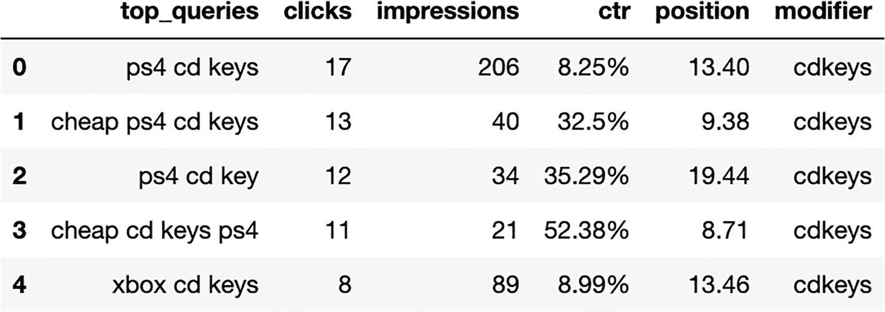

一个包含 13 列 10 行的表格截图。列标题为 `query`、`clicks`、`impressions`、`ctr`、`position`、`segment`、`rank_bracket`、`average_imps`、`imps_median`、`imps_uq` 和 `n_count`。行从 0 到 4 开始，到 15862 到 15866 结束。

数据导入后，我们需要格式化列值，以便能够进行汇总。例如，我们将移除 `ctr` 列中的百分号，并将其转换为数值格式：

```python
gsc_clean_ctr_df['ctr'] = gsc_clean_ctr_df['ctr'].str.replace('%', '')
gsc_clean_ctr_df['ctr'] = pd.to_numeric(gsc_clean_ctr_df['ctr'])
```

GSC 数据在 `impressions` 和 `clicks` 列中，对于小于 10 的值包含一个特殊字符“<”；我们的任务是清理这些字符，然后按降序排列展示次数。在 Python 中，代码如下：

```python
gsc_clean_ctr_df['impressions'] = gsc_clean_ctr_df.impressions.str.replace('<', '')
pd.to_numeric(gsc_import_df.impressions)
```

我们还将对 `top_queries` 列进行去重：

```python
gsc_dedupe_df = gsc_clean_ctr_df.drop_duplicates(subset='top_queries', keep="first")
```

#### 按查询类型分段

下一步是按类型对查询进行分段。这样做的原因是，我们希望在细分市场内比较展示量，而不是与整个网站进行比较。

这使得数据在突出细分市场内的机会方面更有意义。否则，如果我们将展示量与网站平均值进行比较，可能会错失有价值的搜索查询机会。

我们在 Python 中使用的方法是，根据 `query` 列中找到的修饰符字符串进行分类：

```python
retail_vex = ['cdkeys', 'argos', 'smyth', 'amazon', 'cyberpunk', 'GAME']
platform_vex = ['ps5', 'xbox', 'playstation', 'switch', 'ps4', 'nintendo']
title_vex = ['blackops', 'pokemon', 'minecraft', 'mario', 'outriders','fifa', 'animalcrossing', 'resident', 'spiderman', 'newhorizons', 'callofduty']
network_vex = ['ee', 'o2', 'vodafone','carphone']
gsc_segment_strdetect = gsc_dedupe_df[['query', 'clicks', 'impressions', 'ctr', 'position']]
```

创建条件列表：

```python
query_conds = [
    gsc_segment_strdetect['query'].str.contains('|'.join(retail_vex)),
    gsc_segment_strdetect['query'].str.contains('|'.join(platform_vex)),
    gsc_segment_strdetect['query'].str.contains('|'.join(title_vex)),
    gsc_segment_strdetect['query'].str.contains('|'.join(network_vex))
]
```

创建我们想要为每个条件分配的值列表：

```python
segment_values = ['Retailer', 'Console', 'Title', 'Network']
```

创建一个新列，并使用 `np.select` 根据我们的列表作为参数为其赋值：

```python
gsc_segment_strdetect['segment'] = np.select(query_conds, segment_values)
gsc_segment_strdetect
```

输出结果如下：

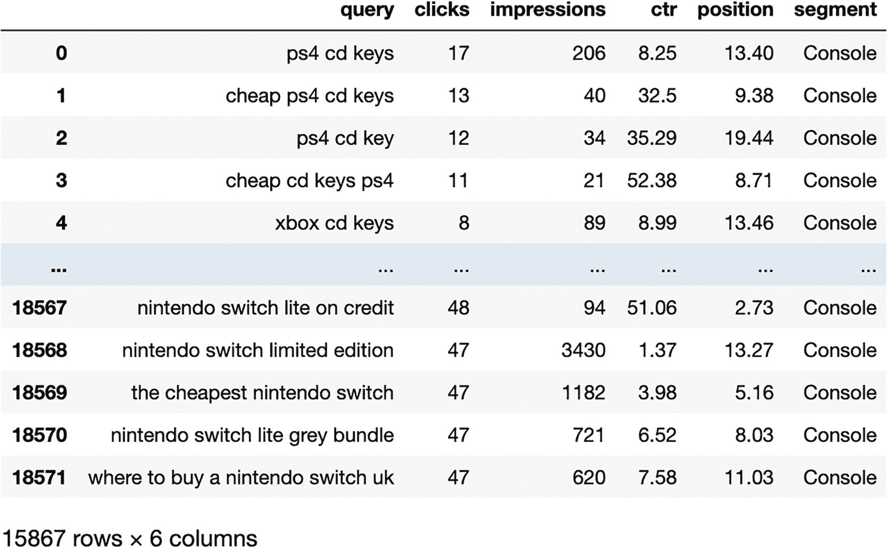

一个包含 7 列 10 行的表格截图。列标题为 `query`、`clicks`、`impressions`、`ctr`、`position` 和 `segment`。行从 0 到 4 开始，到 18567 到 18571 结束。

#### 将排名数据四舍五入为整数

由于 `position` 列是浮点数（即包含小数），我们这样做的原因是因为我们将要计算每个四舍五入后的排名位置的展示统计量。这将给我们 100 个统计量。现在想象一下，如果我们不进行四舍五入，我们可能会得到 10,000 个排名位置的展示统计量，而并非所有统计量都是有用的。

```python
gsc_segment_strdetect['rank_bracket'] = gsc_segment_strdetect.position.round(0)
gsc_segment_strdetect
```

结果如下：

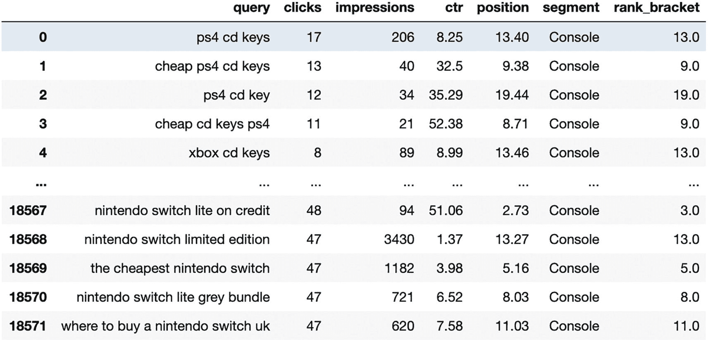

一个包含 8 列 10 行的表格截图。列标题为 `query`、`clicks`、`impressions`、`ctr`、`position`、`segment` 和 `rank_bracket`。行从 0 到 4 开始，到 18567 到 18571 结束。

#### 计算分段平均值与变异量

现在数据已分段，我们计算排名位置的平均展示次数，以及展示次数的下百分位数和上百分位数。目的是找出展示次数比排名位置高出两个标准差或更多的查询。这意味着该查询很可能是一个绝佳的 SEO 机会，非常值得监控。

我们之所以采用这种方法，而不是直接选择高展示次数的关键词本身，是因为许多关键词查询仅仅因为排在搜索结果前 20 名，就自然获得了高展示次数。这会导致需要跟踪的查询数量变得相当庞大且成本高昂。

```python
queries_rank_imps = gsc_segment_strdetect[['rank_bracket', 'impressions']]
group_by_rank_bracket = queries_rank_imps.groupby(['rank_bracket'], as_index=False)
def imp_aggregator(col):
d = {}
d['avg_imps'] = col['impressions'].mean()
d['imps_median'] = col['impressions'].quantile(0.5)
d['imps_lq'] = col['impressions'].quantile(0.25)
d['imps_uq'] = col['impressions'].quantile(0.95)
d['n_count'] = col['impressions'].count()
return pd.Series(d, index=['avg_imps', 'imps_median', 'imps_lq', 'imps_uq', 'n_count'])
overall_rankimps_agg = group_by_rank_bracket.apply(imp_aggregator)
overall_rankimps_agg
```

结果如下：

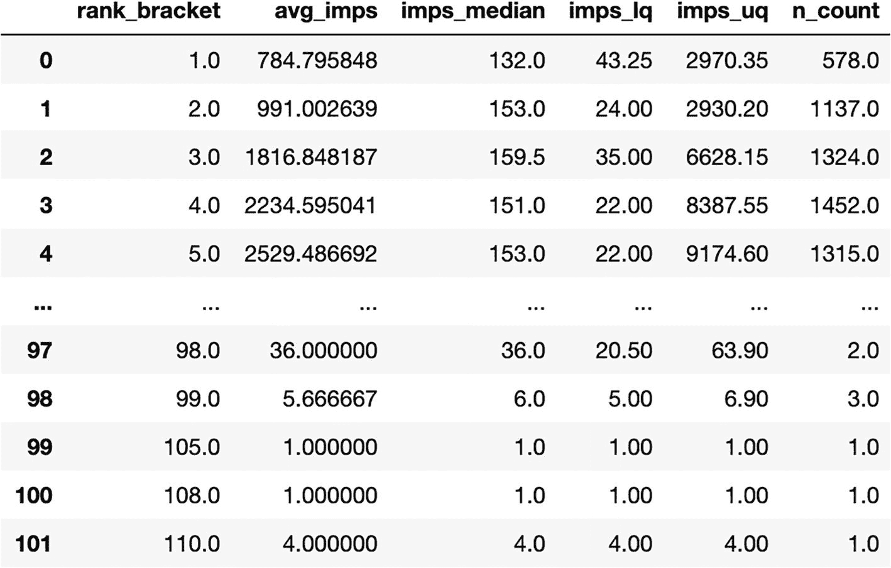

一张包含 7 列 10 行的表格截图。列标题分别为：排名区间、平均展示次数、展示次数中位数、展示次数下四分位数、展示次数上四分位数、计数。行数据从 0 到 4，结束于 97 到 101。

在这个案例中，我们选择了第 25 和第 95 百分位数。较低的百分位数不那么重要，因为我们更感兴趣的是找出平均值超过第 95 百分位数的查询。如果能做到这一点，我们就找到了一个有价值的关键词。快速提示：在数据科学中，百分位数也被称为“分位数”。

我们能否为每个细分市场都制作一个表格？例如，按部分展示每个排名位置的展示次数统计。是的，当然可以，理论上，这能提供对查询表现与其细分市场平均值之间更具上下文关联的分析。是否这样做，取决于每个排名区间有多少数据点（即排名查询）来使其有价值（即统计上稳健）。要做到这一点，每个区间至少需要 30 个数据点。

#### 将展示次数水平与平均值进行比较

好了，现在让我们将上一步生成的表格进行左连接（可以理解为 `vlookup` 或 `index match`），然后将其连接到分段数据上。这样我们就得到了一个数据框，其中显示了查询数据与预期平均值和上分位数的对比。

通过 `rank_bracket` 将 `accessories_rankimps_agg` 连接到 `accessory_queries`：

```python
query_quantile_stats = gsc_segment_strdetect.merge(overall_rankimps_agg, on =['rank_bracket'], how='left')
query_quantile_stats
```

结果如下：

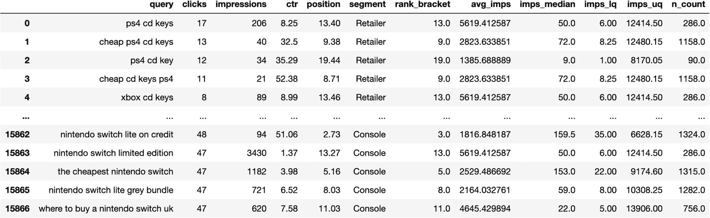

一张包含 13 列 10 行的表格截图。列标题分别为：查询、点击次数、展示次数、点击率、排名位置、细分市场、排名区间、平均展示次数、展示次数中位数、展示次数下四分位数、展示次数上四分位数、计数。行数据从 0 到 4，结束于 15862 到 15866。

### 探索数据

现在你可能想知道，有多少关键词的表现超出了或低于其应有水平（即相对于其排名位置，高于或低于其分位数界限），以及这些关键词是什么？

获取具有高展示次数的关键词数量：

```python
query_stats_uq = query_quantile_stats.loc[query_quantile_stats.impressions > query_quantile_stats.imps_uq]
query_stats_uq['query'].count()
```

结果如下：

获取展示次数和排名均超出第一页的关键词数量：

```python
query_stats_uq_p2b = query_quantile_stats.loc[(query_quantile_stats.impressions > query_quantile_stats.imps_uq) & (query_quantile_stats.rank_bracket > 10)]
query_stats_uq_p2b['query'].count()
```

结果如下：

根据你的资源情况，你可能希望跟踪全部 8390 个关键词，或者只跟踪其中的 2510 个。让我们看看展示次数在整个排名位置范围内的分布情况：

```python
import seaborn as sns
import matplotlib.pyplot as plt
from pylab import savefig
```

设置图表尺寸：

```python
sns.set(rc={'figure.figsize':(15, 6)})
```

绘制展示次数与 `rank_bracket` 的关系图：

```python
imprank_plt = sns.relplot(x = "rank_bracket", y = "impressions",
hue = "quantiled", style = "quantiled",
kind = "line", data = overall_rankimps_agg_long)
```

将图 2-1 保存为文件，用于你的 PowerPoint 演示文稿或其他用途：

```python
imprank_plt.savefig("images/imprank_plt.png")
```

有趣的是，上分位数展示次数的关键词并非全部位于前 10 名，而是很多出现在搜索结果页的第 2、4 和 6 页（图 2-1）。这表明该网站要么是针对高展示次数的关键词但未能获得高排名，要么是根本没有针对这些高展示次数的短语。

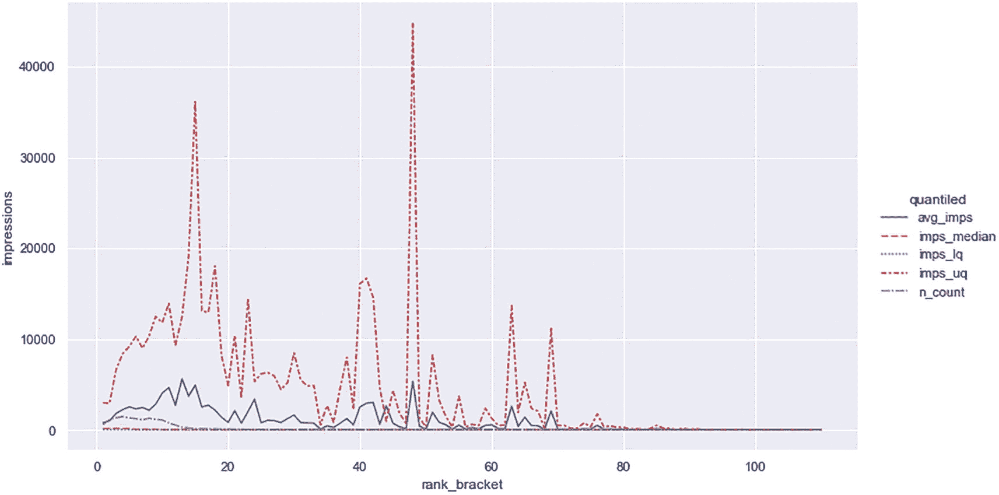

一张展示次数与排名区间的多线图。线条分别代表平均展示次数、展示次数中位数、展示次数下四分位数、展示次数上四分位数和计数。展示次数中位数在超过 45000 展示次数处达到最高峰值。

**图 2-1** 折线图，展示每个分布分位数下，按排名位置区间划分的 GSC 展示次数

让我们对这个细分市场进行分解。

按细分市场绘制展示次数与 `rank_bracket` 的关系图：

```python
imprank_seg = sns.relplot(x="rank_bracket", y="impressions",
hue="quantiled", col="segment",
kind="line", data = overall_rankimps_agg_long, facet_kws=dict(sharex=False))
```

导出文件：

```python
imprank_seg.savefig("images/imprank_seg.png")
```

大多数高展示次数的关键词出现在配件、游戏机，当然还有前 1000 名中（图 2-2）。

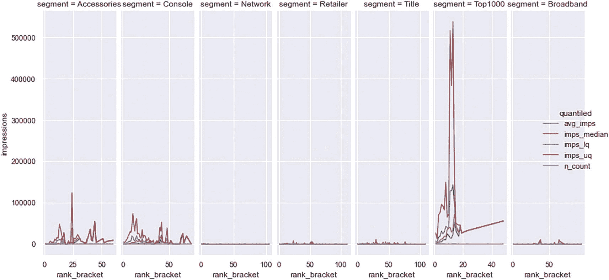

7 张展示次数与排名区间的多线图，细分市场包括配件、游戏机、网络、零售商、瓷砖、前 1000 名和宽带。线条分别代表平均展示次数、展示次数中位数、展示次数下四分位数、展示次数上四分位数和计数。前 1000 名细分市场的展示次数中位数在 55000 展示次数处达到最高峰值。

**图 2-2** 折线图，展示每个分布分位数下，按排名位置区间划分的 GSC 展示次数，并按细分市场分面

#### 导出你的高价值关键词列表

现在你已经有了关键词，只需筛选并导出为 CSV 文件即可。

将数据框导出为 CSV：

```python
query_stats_uq_p2b.to_csv('exports/query_stats_uq_p2b_TOTRACK.csv')
```

#### 激活

既然你已经识别出高展示价值的关键词，你可以：

*   将这些关键词替换或添加到当前正在跟踪和推广的关键词中
*   研究在首页排名所需的内容体验
*   思考如何将这些新目标整合到你的策略中
*   探索这些关键词的页面内优化水平，包括寻找“低垂的果实”机会，更有效地将针对这些关键词的着陆页进行内部链接（例如通过博客文章或内容页面）
*   考虑是否适合通过内容营销和公关来增加这些新着陆页的外部链接流行度

显然，上述列表是简化版的，但至少你有了更好的非品牌目标，以更好地服务于你的 SEO 活动。

### Google Trends

`Google Trends` 是另一个（免费的）第三方数据源，它能够显示过去五年内任何有搜索需求的关键词的时间序列数据（随时间变化的数据点）。`Google Trends` 还可以帮助你比较某个搜索词是处于上升（还是下降）趋势，同时与其他搜索词进行对比。这对于预测非常有用。

尽管没有官方的 `Google Trends` API，但 Python 中有一些包（例如 `pytrends`）可以自动提取这些数据，具体方法如下：

```python
import pandas as pd
from pytrends.request import TrendReq
import time
```

#### 单个关键词

现在你已经确定了高展示价值的关键词，可以查看它们在过去五年中的趋势变化：

```python
kw_list = ["Blockchain"]
pytrends.build_payload(kw_list, cat=0, timeframe='today 5-y', geo='GB', gprop='')
pytrends.interest_over_time()
```

结果如下：

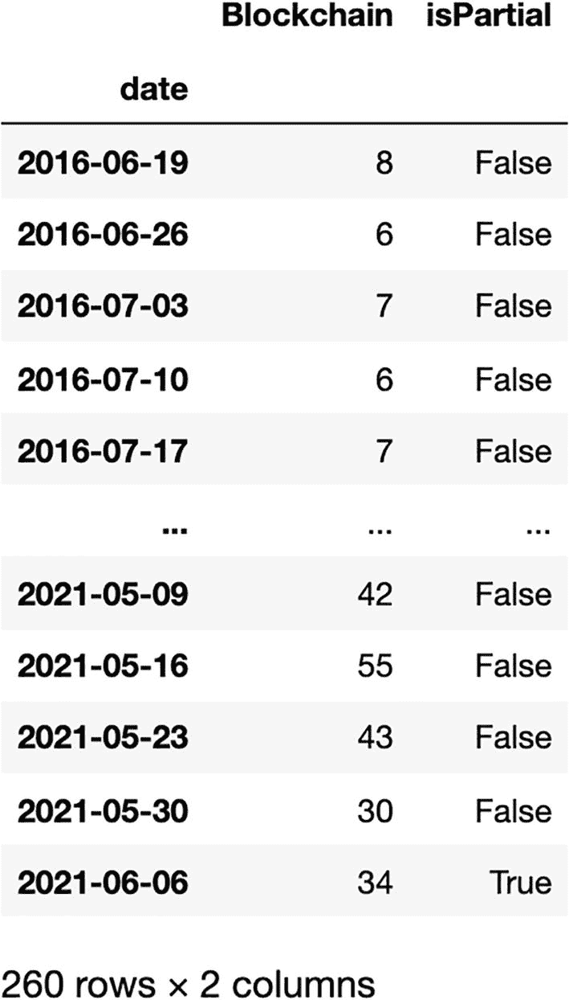

一个包含 3 列 10 行的表格截图。列标题分别为日期、区块链和是否部分。2021 年 6 月 6 日的 34 个区块链中，部分为真。其他部分为假。

#### 多个关键词

如上所示，你会得到一个包含日期、关键词和点击量（范围从 0 到 100）的数据框，这非常棒。但如果你有 10,000 个关键词需要查看趋势呢？

在这种情况下，你需要使用一个 `for` 循环来逐个查询搜索词，并将它们全部合并到一个数据框中，如下所示：

读取你的目标关键词数据：

```python
csv_raw = pd.read_csv('data/your_keyword_file.csv')
keywords_df = csv_raw[['query']]
keywords_list = keywords_df['query'].values.tolist()
keywords_list
```

以下是 `keywords_list` 的输出示例：

```python
['nintendo switch',
'ps4',
'xbox one controller',
'xbox one',
'xbox controller',
'ps4 vr',
'Ps5' ...]
```

现在，让我们将所有关键词的 Google Trends 数据放入一个数据框中：

```python
dataset = []
exceptions = []
for q in keywords_list:
    q_lst = [q]
    try:
        pytrends.build_payload(kw_list=q_lst, timeframe='today 5-y', geo='GB', gprop='')
        data = pytrends.interest_over_time()
        data = data.drop(labels=['isPartial'], axis='columns')
        dataset.append(data)
        time.sleep(3)
    except:
        exceptions.append(q_lst)
gtrends_long = pd.concat(dataset, axis=1)
```

结果如下：

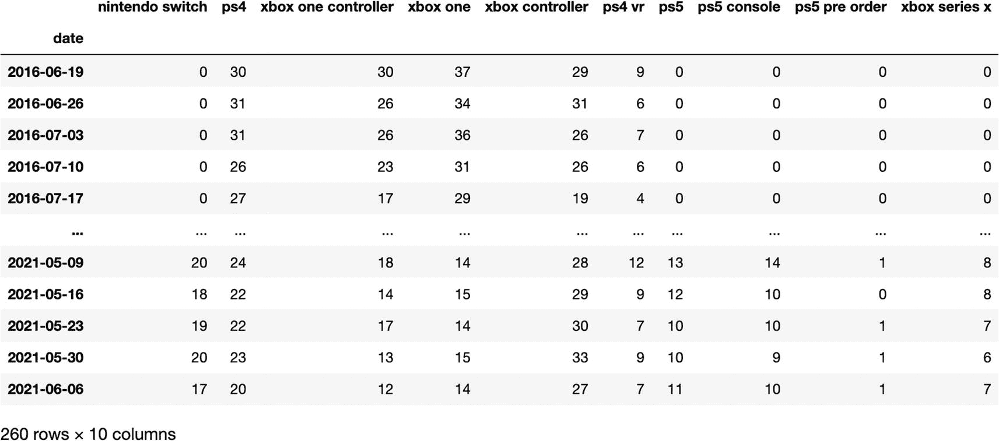

一个包含 11 列 10 行的表格截图。列标题分别为日期、Nintendo switch、p s 4、x box one、x box controller、p s 4 v r、p s 5、p s 5 console、p s 5 preorder 和 x box series x。行从 2016 年 6 月 19 日开始，到 2021 年 6 月 6 日结束。

让我们将其转换为长格式：

```python
gtrends_long = gtrends_raw.melt(id_vars=['date'], var_name='query', value_name='hits')
gtrends_long
```

结果如下：

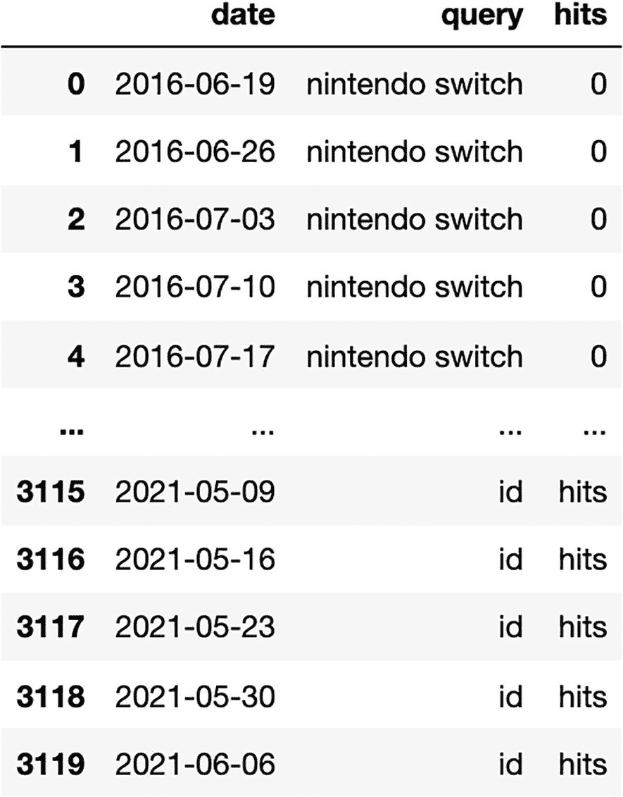

一个包含 4 列 10 行的表格截图。列标题分别为序号、日期、查询和点击量。行从 3115 开始，到 3119 结束。点击量从 0 到 4 均为 0。

查看 `Google Trends` 原始数据，我们现在有了长格式的数据，包含：

- 日期
- 关键词
- 点击量

让我们可视化其中一些数据随时间的变化。首先对数据框进行子集筛选：

```python
k_list = ['ps5', 'xbox one', 'ps4', 'xbox series x', 'nintendo switch']
keyword_gtrends = gtrends_long.loc[gtrends_long['query'].isin(k_list)]
keyword_gtrends
```

结果如下：

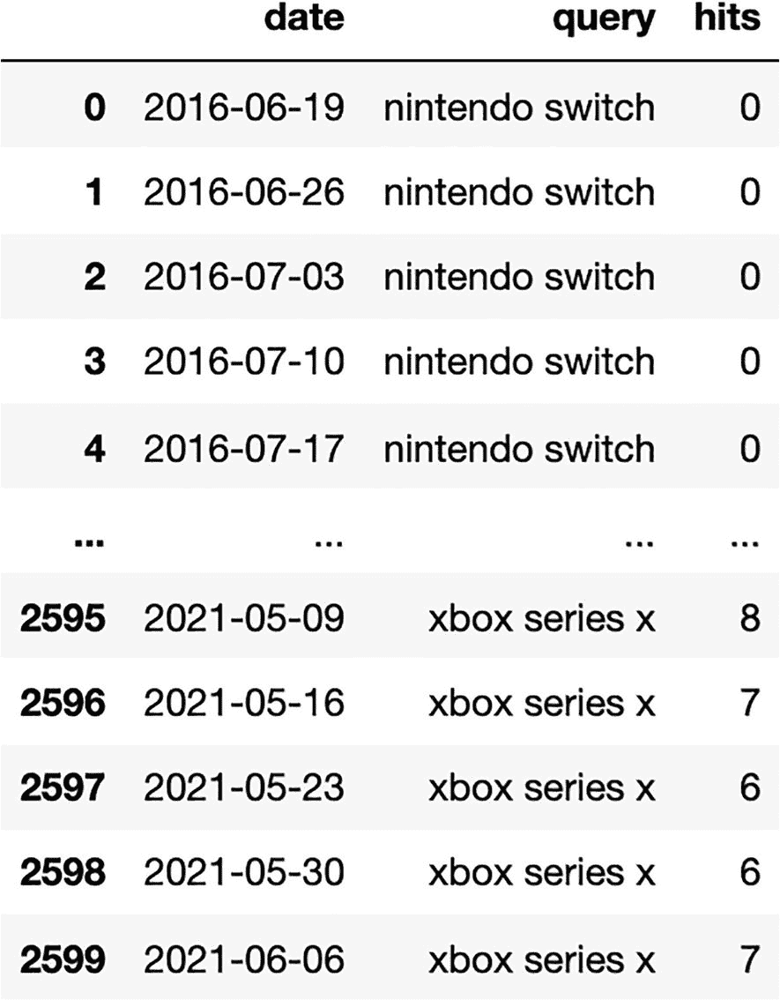

一个包含 4 列 10 行的表格截图。列标题分别为序号、日期、查询和点击量。行从 2595 开始，到 2599 结束。最后 5 行的点击量分别为 8、7、6、6 和 7。

#### 可视化 Google Trends

好了，现在我们准备将时间序列数据绘制成图表，首先导入库：

```python
import seaborn as sns
```

设置图表大小：

```python
sns.set(rc={'figure.figsize':(15, 6)})
```

构建并绘制图表：

```python
keyword_gtrends_plt = sns.lineplot(data=keyword_gtrends, x='date', y='hits', hue='query')
```

将图像保存到文件，以便用于你的 PowerPoint 演示文稿或其他用途：

```python
keyword_gtrends_plt.figure.savefig("images/keyword_gtrends.png")
keyword_gtrends_plt
```

在这里，我们可以看到“`ps5`”和“`xbox series x`”呈现出近乎相同的趋势，并且显著上升，而其他型号则相对稳定且具有季节性，直到新机型的出现。

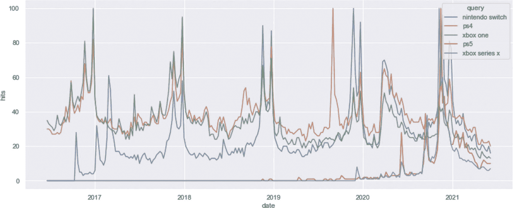

一个关于点击量与年份（2017 年至 2021 年）的多线图。线条分别代表 Nintendo switch、p s 4、x box one、p s 5 和 x box series x。所有线条在 2021 年都达到峰值。

**图 2-3** `Google Trends` 关键词的时间序列图

## 预测未来需求

了解过去五年发生的事情固然很好，但展望未来可能发生的情况也同样重要。幸运的是，Python 提供了实现这一目标的工具。预测最常见的应用场景是客户提案和报告。

### 探索数据

```python
import pandas as pd
from statsmodels.tsa.statespace.sarimax import SARIMAX
from statsmodels.graphics.tsaplots import plot_acf, plot_pacf
from statsmodels.tsa.seasonal import seasonal_decompose
from sklearn.metrics import mean_squared_error
from statsmodels.tools.eval_measures import rmse
import warnings
warnings.filterwarnings("ignore")
from pmdarima import auto_arima
```

导入 `Google Trends` 数据：

```python
df = pd.read_csv("exports/keyword_gtrends_df.csv", index_col=0)
df.head()
```

结果如下：

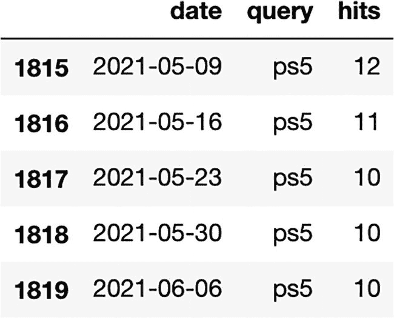

一个包含 4 列 5 行的表格截图。列标题分别为序号、日期、查询和点击量。行从 1815 到 1819，它们的点击量分别为 12、11、10、10 和 10。

正如我们所料，`Google Trends` 的数据是一个非常简单的包含日期、查询和点击量的时间序列，跨越五年时间。现在将数据框从长格式转换为宽格式：

```python
df_unstacked = ps_trends.set_index(["date", "query"]).unstack(level=-1)
df_unstacked.columns.set_names(['hits', 'query'], inplace=True)
ps_unstacked = df_unstacked.droplevel('hits', axis=1)
ps_unstacked.columns = [c.replace(' ', '_') for c in ps_unstacked.columns]
ps_unstacked = ps_unstacked.reset_index()
ps_unstacked.head()
```

结果如下：

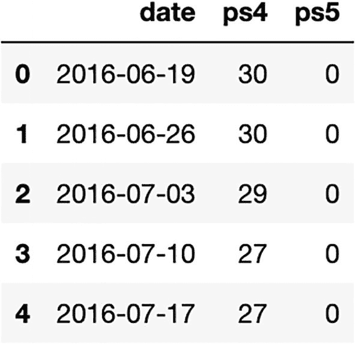

一个包含 4 列 5 行的表格截图。列标题分别为序号、日期、p s 4 和 p s 5。行从 0 到 4。p s 4 的数据分别为 30、30、29、27 和 27，而所有 p s 5 的数据均为 0。

我们不再有 `hits` 列，因为这些值现在作为查询值分别位于各自的列中。这种格式不仅适用于 SARIMA（我们将在下面探讨），也适用于神经网络，例如长短期记忆网络（LSTM）。让我们绘制数据：

```python
ps_unstacked.plot(figsize=(10,5))
```

从图（图 2-4）中，你会注意到“`PS4`”和“`PS5`”的曲线特征是不同的。

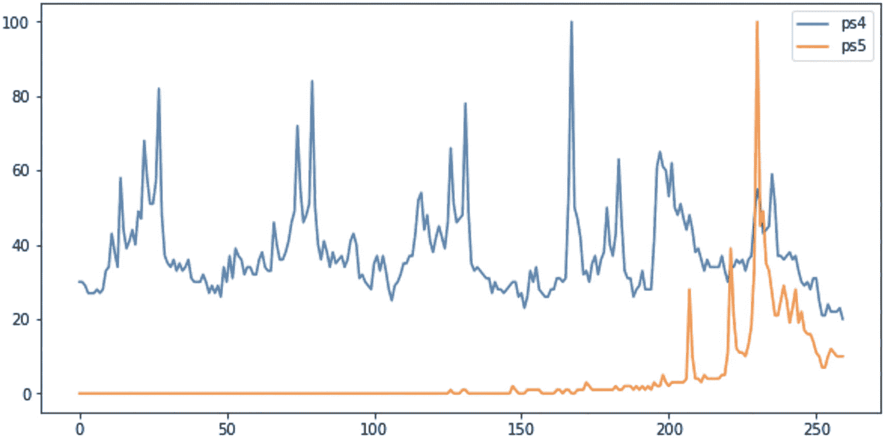

一个关于 p s 4 和 p s 5 的时间序列多线图。p s 4 的线条有多个峰值，而 p s 5 的峰值大约在 225 处。

**图 2-4** `ps4` 和 `ps5` 的时间序列图

对于不玩游戏的人来说，“`PS4`”是索尼 PlayStation 游戏机的第四代，“`PS5`”是第五代。“`PS4`”的搜索量具有很强的季节性，并且具有规律的模式，直到“`PS5`”出现时才发生变化。“`PS5`”在五年前并不存在，这解释了前一张图中前四年没有趋势的原因。

## 分解趋势

现在我们来分解每个趋势的季节性（或非季节性）特征：

```python
ps_unstacked.set_index("date", inplace=True)
ps_unstacked.index = pd.to_datetime(ps_unstacked.index)
query_col = 'ps5'
a = seasonal_decompose(ps_unstacked[query_col], model = "add")
a.plot();
```

图 2-5 展示了时间序列数据以及整体平滑趋势，该趋势显示其从 2020 年开始上升。


**图 2-5** `ps5` 时间序列的分解

季节性趋势图显示了重复出现的峰值，这表明从 2016 年起就存在季节性，尽管考虑到从 2016 年到 2020 年时间序列相当平坦，这一结论似乎并不可靠。同样可疑的是，季节性图显示出一个几乎均匀的周期性重复模式，缺乏噪声。

残差（`Resid`）显示了在剔除季节性和趋势后，时间序列数据剩余部分的任何模式。实际上，在 2020 年之前，由于大部分时间都为零，所以几乎没有任何模式。

对于“`ps4`”，请参见图 2-6。


**图 2-6** `ps4` 时间序列的分解

我们可以看到短期（季节性）和长期（趋势）的波动，并伴有一些噪声（残差）。下一步是使用增强迪基-福勒检验（ADF）来统计检验给定的时间序列是否平稳：

```python
from pmdarima.arima import ADFTest
adf_test = ADFTest(alpha=0.05)
adf_test.should_diff(ps_unstacked[query_col])
```

```
PS4: (0.09760939899434763, True)
PS5: (0.01, False)
```

我们可以看到，前面显示的“`PS5`”的 `p` 值大于 0.05，这意味着该时间序列数据不平稳，因此需要进行差分。另一方面，“`PS4`”的 `p` 值为 0.01，小于 0.05，表明它是平稳的，不需要进行差分。

所有这些工作的意义在于理解，如果我们手动构建一个预测谷歌搜索趋势的模型，将会使用哪些参数。

## 拟合你的 SARIMA 模型

由于我们稍后将使用自动化方法来估计最佳拟合模型参数，因此我们不会为 SARIMA 模型估计参数数量。

为了估计 SARIMA 模型的参数，请注意我们将 `m` 设置为 52，因为一年有 52 周，这也是谷歌趋势中周期的间隔方式。我们还将所有参数初始值设为 0，以便让 `auto_arima` 承担繁重的工作，并搜索最适合数据预测的参数值：

```python
ps5_s = auto_arima(ps_unstacked['ps4'],
trace=True,
m=52, #每个季节有 52 个周期（周数据）
start_p=0,
start_d=0,
start_q=0,
seasonal=False)
```

这将产生以下结果：

```
Performing stepwise search to minimize aic
ARIMA(3,0,3)(0,0,0)[0]             : AIC=1842.301, Time=0.26 sec
ARIMA(0,0,0)(0,0,0)[0]             : AIC=2651.089, Time=0.01 sec
ARIMA(1,0,0)(0,0,0)[0]             : AIC=1865.936, Time=0.02 sec
ARIMA(0,0,1)(0,0,0)[0]             : AIC=2370.569, Time=0.05 sec
ARIMA(2,0,3)(0,0,0)[0]             : AIC=1845.911, Time=0.12 sec
ARIMA(3,0,2)(0,0,0)[0]             : AIC=1845.959, Time=0.16 sec
ARIMA(4,0,3)(0,0,0)[0]             : AIC=1838.349, Time=0.34 sec
ARIMA(4,0,2)(0,0,0)[0]             : AIC=1846.701, Time=0.22 sec
ARIMA(5,0,3)(0,0,0)[0]             : AIC=1843.754, Time=0.25 sec
ARIMA(4,0,4)(0,0,0)[0]             : AIC=1842.801, Time=0.27 sec
ARIMA(3,0,4)(0,0,0)[0]             : AIC=1841.447, Time=0.36 sec
ARIMA(5,0,2)(0,0,0)[0]             : AIC=1841.893, Time=0.24 sec
ARIMA(5,0,4)(0,0,0)[0]             : AIC=1845.734, Time=0.29 sec
ARIMA(4,0,3)(0,0,0)[0] intercept   : AIC=1824.187, Time=0.82 sec
ARIMA(3,0,3)(0,0,0)[0] intercept   : AIC=1824.769, Time=0.34 sec
ARIMA(4,0,2)(0,0,0)[0] intercept   : AIC=1826.970, Time=0.34 sec
ARIMA(5,0,3)(0,0,0)[0] intercept   : AIC=1826.789, Time=0.44 sec
ARIMA(4,0,4)(0,0,0)[0] intercept   : AIC=1827.114, Time=0.43 sec
ARIMA(3,0,2)(0,0,0)[0] intercept   : AIC=1831.587, Time=0.32 sec
ARIMA(3,0,4)(0,0,0)[0] intercept   : AIC=1825.359, Time=0.42 sec
ARIMA(5,0,2)(0,0,0)[0] intercept   : AIC=1827.292, Time=0.40 sec
ARIMA(5,0,4)(0,0,0)[0] intercept   : AIC=1829.109, Time=0.51 sec
Best model:  ARIMA(4,0,3)(0,0,0)[0] intercept
Total fit time: 6.601 seconds
```

上述输出显示，获得最佳结果的参数是：

```
PS4: ARIMA(4,0,3)(0,0,0)
PS5: ARIMA(3,1,3)(0,0,0)
```

打印模型摘要时，`PS5` 的估计值会进一步详细说明：

```python
ps5_s.summary()
```

这将产生以下结果：


其原理是，该函数旨在最小化由赤池信息准则（`AIC`）和贝叶斯信息准则（`BIC`）衡量的误差概率：

```math
AIC = -2Log(L) + 2(p + q + k + 1)
```

其中 `L` 是数据的似然值，如果 `c ≠ 0`，则 `k = 1`；如果 `c = 0`，则 `k = 0`。

```math
BIC = AIC + [log(T) - 2] + (p + q + k + 1)
```

通过最小化 `AIC` 和 `BIC`，我们得到了 `p` 和 `q` 的最佳估计参数。

## 测试模型

现在我们已经有了参数，可以开始对两种产品进行预测：

```python
ps4_order = ps4_s.get_params()['order']
ps4_seasorder = ps4_s.get_params()['seasonal_order']
ps5_order = ps5_s.get_params()['order']
ps5_seasorder = ps5_s.get_params()['seasonal_order']
params = {
"ps4": {"order": ps4_order, "seasonal_order": ps4_seasorder},
"ps5": {"order": ps5_order, "seasonal_order": ps5_seasorder}
}
```

创建一个空列表来存储预测结果：

```python
results = []
fig, axs = plt.subplots(len(X.columns), 1, figsize=(24, 12))
```

遍历各列以拟合最佳 SARIMA 模型：

```python
for i, col in enumerate(X.columns):
    arima_model = SARIMAX(train_data[col],
                          order = params[col]["order"],
                          seasonal_order = params[col]["seasonal_order"])
    arima_result = arima_model.fit()
```

进行预测：

```python
arima_pred = arima_result.predict(start = len(train_data),
                                 end = len(X)-1, typ="levels")\
                                 .rename("ARIMA 预测值")
```

绘制预测结果：

```python
test_data[col].plot(figsize = (8,4), legend=True, ax=axs[i])
arima_pred.plot(legend = True, ax=axs[i])
arima_rmse_error = rmse(test_data[col], arima_pred)
mean_value = X[col].mean()
results.append((col, arima_pred, arima_rmse_error, mean_value))
print(f'列: {col} --> RMSE 误差: {arima_rmse_error} - 均值: {mean_value}\n')
```

得到如下结果：

```
Column: ps4 --> RMSE Error: 8.626764032898576 - Mean: 37.83461538461538
Column: ps5 --> RMSE Error: 27.552818032476257 - Mean: 3.973076923076923
```

对于 `ps4`，从开始到三月份搜索值开始出现偏差之前，预测都相当准确（图 2-7），而 `ps5` 的预测则似乎完全不佳，这并不令人意外。


**图 2-7** 比较 `ps4` 和 `ps5` 预测值与实际数据的时间序列折线图

预测结果表明，当历史数据足够充分时，模型表现良好，直到数据发生突变（例如 `PS4` 从三月份开始的情况）。对于 `PS5`，模型几乎从一开始就毫无效果。我们知道这一点是因为 `PS4` 的均方根误差（`RMSE`）为 8.62，不到 `PS5` 的 `RMSE`（27.5）的三分之一，而鉴于 Google Trends 的取值范围为 0 到 100，这相当于 27% 的误差幅度。

## 预测未来

现在，我们将基于目前掌握的数据，进行一次鲁莽的未来预测尝试：

```
oos_train_data = ps_unstacked
oos_train_data.tail()
```

得到如下结果：

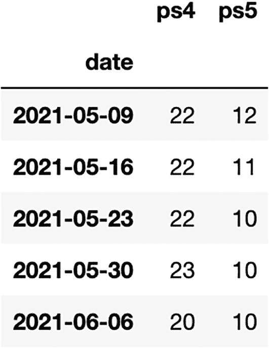

一张包含 3 列 5 行的表格截图。列标题为：日期、ps4 和 ps5。行数据从 2021 年 5 月 9 日开始，到 2021 年 6 月 6 日结束。

从上表摘录可以看出，我们现在使用了所有可用数据。接下来，我们将通过以下代码预测未来六个月（定义为 26 周）：

```
oos_results = []
weeks_to_predict = 26
fig, axs = plt.subplots(len(ps_unstacked.columns), 1, figsize=(24, 12))
```

再次遍历各列，每次拟合最佳模型：

```
for i, col in enumerate(ps_unstacked.columns):
    s = auto_arima(oos_train_data[col], trace=True)
    oos_arima_model = SARIMAX(oos_train_data[col],
        order = s.get_params()['order'],
        seasonal_order = s.get_params()['seasonal_order'])
    oos_arima_result = oos_arima_model.fit()
```

进行预测：

```
oos_arima_pred = oos_arima_result.predict(start = len(oos_train_data),
    end = len(oos_train_data) + weeks_to_predict, typ="levels").rename("ARIMA 预测值")
```

绘制预测结果：

```
oos_arima_pred.plot(legend = True, ax=axs[i])
axs[i].legend([col]);
mean_value = ps_unstacked[col].mean()
oos_results.append((col, oos_arima_pred, mean_value))
print(f'列: {col} - 均值: {mean_value}\n')
```

以下是输出结果：

```
Performing stepwise search to minimize aic
ARIMA(2,0,2)(0,0,0)[0] intercept   : AIC=1829.734, Time=0.21 sec
ARIMA(0,0,0)(0,0,0)[0] intercept   : AIC=1999.661, Time=0.01 sec
ARIMA(1,0,0)(0,0,0)[0] intercept   : AIC=1827.518, Time=0.03 sec
ARIMA(0,0,1)(0,0,0)[0] intercept   : AIC=1882.388, Time=0.05 sec
ARIMA(0,0,0)(0,0,0)[0]             : AIC=2651.089, Time=0.01 sec
ARIMA(2,0,0)(0,0,0)[0] intercept   : AIC=1829.254, Time=0.04 sec
ARIMA(1,0,1)(0,0,0)[0] intercept   : AIC=1829.136, Time=0.09 sec
ARIMA(2,0,1)(0,0,0)[0] intercept   : AIC=1829.381, Time=0.26 sec
ARIMA(1,0,0)(0,0,0)[0]             : AIC=1865.936, Time=0.02 sec
Best model:  ARIMA(1,0,0)(0,0,0)[0] intercept
Total fit time: 0.722 seconds
Column: ps4 - Mean: 37.83461538461538
Performing stepwise search to minimize aic
ARIMA(2,1,2)(0,0,0)[0] intercept   : AIC=1657.990, Time=0.19 sec
ARIMA(0,1,0)(0,0,0)[0] intercept   : AIC=1696.958, Time=0.01 sec
ARIMA(1,1,0)(0,0,0)[0] intercept   : AIC=1673.340, Time=0.04 sec
ARIMA(0,1,1)(0,0,0)[0] intercept   : AIC=1666.878, Time=0.05 sec
ARIMA(0,1,0)(0,0,0)[0]             : AIC=1694.967, Time=0.01 sec
ARIMA(1,1,2)(0,0,0)[0] intercept   : AIC=1656.899, Time=0.14 sec
ARIMA(0,1,2)(0,0,0)[0] intercept   : AIC=1663.729, Time=0.04 sec
ARIMA(1,1,1)(0,0,0)[0] intercept   : AIC=1656.787, Time=0.07 sec
ARIMA(2,1,1)(0,0,0)[0] intercept   : AIC=1656.351, Time=0.16 sec
ARIMA(2,1,0)(0,0,0)[0] intercept   : AIC=1672.668, Time=0.04 sec
ARIMA(3,1,1)(0,0,0)[0] intercept   : AIC=1657.661, Time=0.11 sec
ARIMA(3,1,0)(0,0,0)[0] intercept   : AIC=1670.698, Time=0.05 sec
ARIMA(3,1,2)(0,0,0)[0] intercept   : AIC=1653.392, Time=0.33 sec
ARIMA(4,1,2)(0,0,0)[0] intercept   : AIC=inf, Time=0.40 sec
ARIMA(3,1,3)(0,0,0)[0] intercept   : AIC=1643.872, Time=0.45 sec
ARIMA(2,1,3)(0,0,0)[0] intercept   : AIC=1659.698, Time=0.23 sec
ARIMA(4,1,3)(0,0,0)[0] intercept   : AIC=inf, Time=0.48 sec
ARIMA(3,1,4)(0,0,0)[0] intercept   : AIC=inf, Time=0.47 sec
ARIMA(2,1,4)(0,0,0)[0] intercept   : AIC=1645.994, Time=0.52 sec
ARIMA(4,1,4)(0,0,0)[0] intercept   : AIC=1647.585, Time=0.56 sec
ARIMA(3,1,3)(0,0,0)[0]             : AIC=1641.790, Time=0.37 sec
ARIMA(2,1,3)(0,0,0)[0]             : AIC=1648.325, Time=0.38 sec
ARIMA(3,1,2)(0,0,0)[0]             : AIC=1651.416, Time=0.24 sec
ARIMA(4,1,3)(0,0,0)[0]             : AIC=1650.077, Time=0.59 sec
ARIMA(3,1,4)(0,0,0)[0]             : AIC=inf, Time=0.58 sec
ARIMA(2,1,2)(0,0,0)[0]             : AIC=1656.290, Time=0.10 sec
ARIMA(2,1,4)(0,0,0)[0]             : AIC=1644.099, Time=0.38 sec
ARIMA(4,1,2)(0,0,0)[0]             : AIC=inf, Time=0.38 sec
ARIMA(4,1,4)(0,0,0)[0]             : AIC=1645.756, Time=0.56 sec
Best model:  ARIMA(3,1,3)(0,0,0)[0]
Total fit time: 7.954 seconds
Column: ps5 - Mean: 3.973076923076923
```

这一次，我们自动寻找最佳拟合参数，并将其直接输入模型。

预测结果看起来并不理想（图 2-8），因为数据的最后几周发生了很大变化；不过，这只是针对这两个关键词的情况。

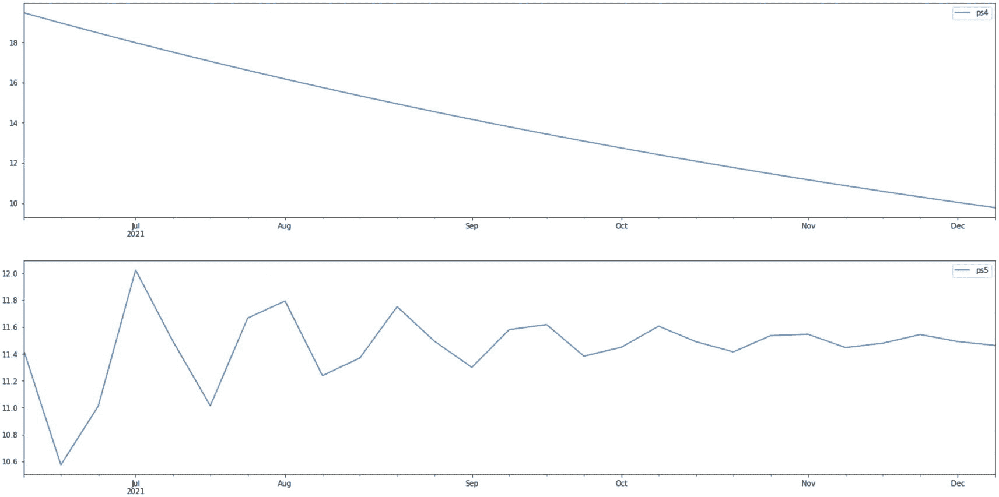

关于 ps4 和 ps5 在 2021 年 7 月至 2021 年 12 月期间的折线图。1. 线条呈对角线下降趋势。2. 线条有少量峰值，且走势平行。

图 2-8

Google Trends 中 `ps4` 和 `ps5` 的样本外预测

预测质量将取决于历史模式的稳定性，并且显然无法考虑像 COVID-19 这样的不可预见事件。

导出你的预测结果：

```
df_pred = pd.concat([pd.Series(res[1]) for res in oos_results], axis=1)
df_pred.columns = [x + str('_preds') for x in ps_unstacked.columns]
df_pred.to_csv('your_forecast_data.csv')
```

我们在这里学到的是，在哪些情况下使用统计模型进行预测是有用的，或者可能为预测增加价值，特别是在仪表盘等自动化系统中，也就是说，当存在历史数据时，而不是像 PS5 那样出现突然激增的情况。

## 按搜索意图聚类

搜索意图是用户在 Google 上搜索时输入的查询背后的含义。因此，你可能会遇到以下查询：

- “风衣”
- “女士风衣”
- “人寿保险”

“风衣”与“女士风衣”具有相同的搜索意图，但与“人寿保险”的意图不同。要解决这个问题，只需比较这两个搜索短语在 Google 中排名前 10 的网站，就能强烈暗示 Google 如何看待这两个短语之间的搜索意图。

这不是一个完美的方法，但它效果很好，因为你使用的是排名结果，这些结果是 Google 迄今为止所学到的关于哪些内容能满足搜索查询意图的所有知识的提炼（基于每年数万亿次的全球搜索）。因此，可以合理地推断，如果两个搜索查询具有足够相似的 SERP，那么这些关键词之间就共享搜索意图。

这在很多方面都很有用：

- **排名跟踪成本**：如果你的预算有限，那么了解搜索意图意味着你可以避免跟踪与已跟踪关键词具有相同意图的关键词，从而避免产生额外费用。但这存在风险，因为消费者会发生变化，未被跟踪的关键词可能不再具有相同的意图。
- **核心更新**：随着消费者搜索模式的变化，意图也会发生变化，这意味着你可以通过比较更新前后关键词的搜索意图聚类，来查看关键词是否改变了聚类，这将有助于指导你的应对策略。
- **关键词内容映射**：了解意图意味着你可以成功地将关键词映射到着陆页。这对于确保你的网站架构包含与用户搜索需求相匹配的着陆页尤其有用。
- **付费搜索广告**：良好的关键词内容映射也意味着你可以改善付费搜索活动的账户结构和由此产生的质量得分。

### 起点

好了，开始聚类。我们假设你已经将每个关键词的前 100 个 SERP^(³) 结果存储为一个 Python 数据框 `serps_input`。这些数据很容易从排名跟踪工具中获得，尤其是如果它们有 API 的话：

```
serps_input
```

结果如下：

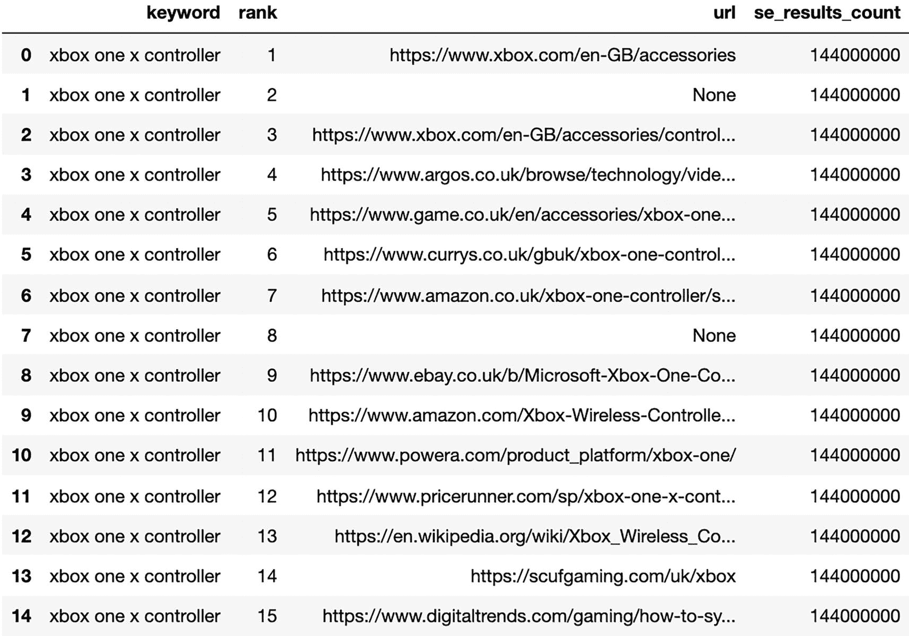

一个包含 5 列 15 行的表格截图。列标题为 keyword、rank、url 和 serps results count。

这里，我们使用的是 DataForSEO 的 SERP API，^(⁴) 并且我们将列名从 `rank_absolute` 重命名为 `rank`。

### 筛选第 1 页数据

由于 DataForSEO 对单个结果的编号包含在轮播、其他人还问等组件中，因此我们需要比较每个 SERP 的前 20 个结果，以获得第 1 页的近似结果。我们还将过滤掉值为 `None` 的 URL。我们将采用的编程方法是“拆分-应用-合并”。什么是拆分-应用-合并？

- 将数据框拆分为关键词组
- 对每个组应用过滤公式
- 合并每个组的关键词

具体操作如下：

拆分：

```
serps_grpby_keyword = serps_input.groupby("keyword")
```

在合并之前应用函数：

```
def filter_twenty_urls(group_df):
    filtered_df = group_df.loc[group_df['url'].notnull()]
    filtered_df = filtered_df.loc[filtered_df['rank'] <= 20]
    return filtered_df

filtered_serps = serps_grpby_keyword.apply(filter_twenty_urls)
```

合并并为列名添加前缀：

```
normed = normed.add_prefix('normed_')
```

与初始数据框连接：

```
filtered_serps_df = pd.concat([filtered_serps], axis=0)
```

### 将排名 URL 转换为字符串

为了比较每个关键词的 SERP，我们需要将 SERP 的 URL 转换为字符串。这是因为存在一对多（一个关键词对应多个 SERP URL）的关系。实现这一目标的方法很简单：再次使用“拆分-应用-合并”方法，将每个关键词的 URL 字符串连接起来。使用 SAC 将结果转换为字符串：

```python
filtserps_grpby_keyword = filtered_serps_df.groupby("keyword")
def string_serps(df):
    df['serp_string'] = ''.join(df['url'])
    return df
strung_serps = filtserps_grpby_keyword.apply(string_serps)
```

与初始数据框连接并清理：

```python
strung_serps = pd.concat([strung_serps],axis=0)
strung_serps = strung_serps[['keyword', 'serp_string']]#.head(30)
strung_serps = strung_serps.drop_duplicates()
strung_serps
```

结果如下：

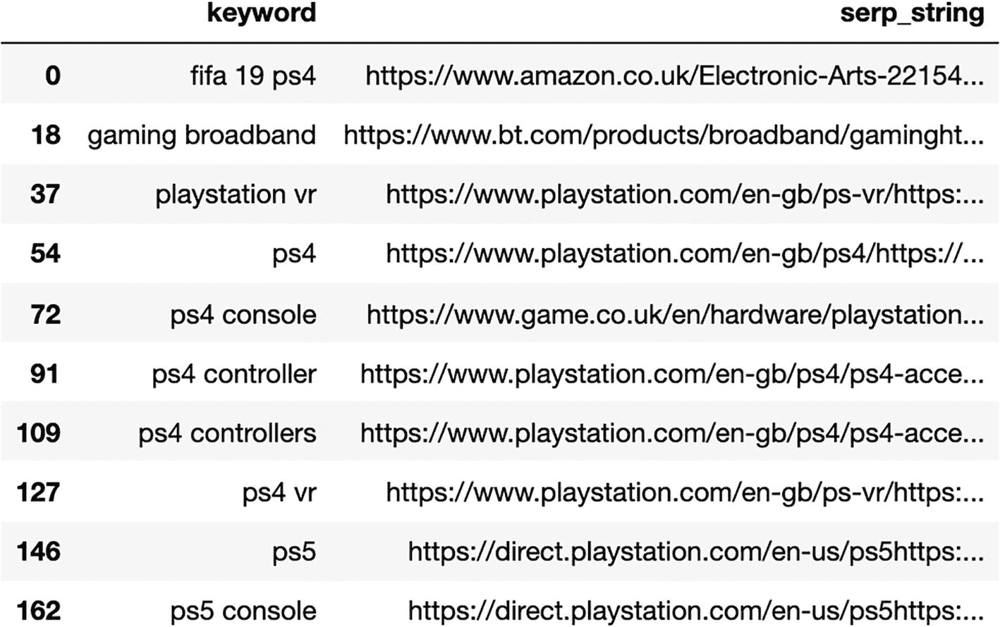

一个包含 3 列 15 行的表格截图。列标题为 `keyword` 和`serp_string`。行索引从 0 开始，到 120 结束。

现在我们有了一个显示关键词及其 SERP 字符串的表格，可以开始比较 SERP 了。以下是“fifa 19 ps4”的 SERP 字符串示例：

```python
strung_serps.loc[1, 'serp_string']
```

结果如下：

```
'https://www.amazon.co.uk/Electronic-Arts-221545-FIFA-PS4/dp/B07DLXBGN8https://www.amazon.co.uk/FIFA-19-GAMES/dp/B07DL2SY2Bhttps://www.game.co.uk/en/fifa-19-2380636https://www.ebay.co.uk/b/FIFA-19-Sony-PlayStation-4-Video-Games/139973/bn_7115134270https://www.pricerunner.com/pl/1422-4602670/PlayStation-4-Games/FIFA-19-Compare-Priceshttps://pricespy.co.uk/games-consoles/computer-video-games/ps4/fifa-19-ps4--p4766432https://store.playstation.com/en-gb/search/fifa%2019https://www.amazon.com/FIFA-19-Standard-PlayStation-4/dp/B07DL2SY2Bhttps://www.tesco.com/groceries/en-GB/products/301926084https://groceries.asda.com/product/ps-4-games/ps-4-fifa-19/1000076097883https://uk.webuy.com/product-detail/?id=5030945121916&categoryName=playstation4-software&superCatName=gaming&title=fifa-19https://www.pushsquare.com/reviews/ps4/fifa_19https://en.wikipedia.org/wiki/FIFA_19https://www.amazon.in/Electronic-Arts-Fifa19SEPS4-Fifa-PS4/dp/B07DVWWF44https://www.vgchartz.com/game/222165/fifa-19/https://www.metacritic.com/game/playstation-4/fifa-19https://www.johnlewis.com/fifa-19-ps4/p3755803https://www.ebay.com/p/22045274968'
```

### 比较 SERP 距离

SERP 比较将使用字符串距离技术，这使我们能够看出一个关键词的 SERP 与其他关键词的 SERP 之间的相似或差异程度。这项技术与遗传学家比较 DNA 序列的方法类似。

自然，我们需要将 SERP 转换为 Python 可以比较的格式。为此，我们需要将每个 SERP 转换为字符串，然后将它们并排放置。按关键词对表格进行分组：

```python
filtserps_grpby_keyword = filtered_serps_df.groupby("keyword")
def string_serps(df):
    df['serp_string'] = ' '.join(df['url'])
    return df
```

使用上述函数进行合并：

```python
strung_serps = filtserps_grpby_keyword.apply(string_serps)
```

与初始数据框连接并清理：

```python
strung_serps = pd.concat([strung_serps],axis=0)
strung_serps = strung_serps[['keyword', 'serp_string']]#.head(30)
strung_serps = strung_serps.drop_duplicates()
#strung_serps['serp_string'] = strung_serps.serp_string.str.replace("https://www\.", "")
strung_serps.head(15)
```

结果如下：

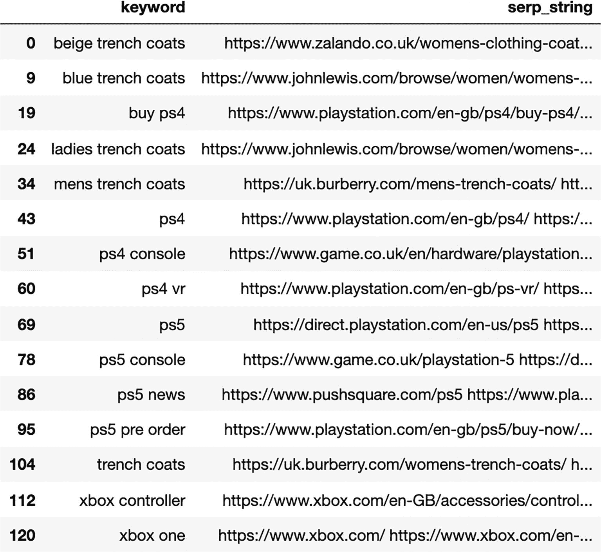

一个包含 3 列 15 行的表格截图。列标题为 `keyword` 和`serp_string`。行索引从 0 开始，到 120 结束。

现在，我们已将关键词及其各自的 SERP 全部转换为字符串，并放入单个单元格中。例如，“beige trench coats”的搜索结果如下：

```
'https://www.zalando.co.uk/womens-clothing-coats-trench-coats/_beige/ https://www.asos.com/women/coats-jackets/trench-coats/cat/?cid=15143 https://uk.burberry.com/womens-trench-coats/beige/ https://www2.hm.com/en_gb/productpage.0751992002.xhtml https://www.hobbs.com/clothing/coats-jackets/trench/beige/ https://www.zara.com/uk/en/woman-outerwear-trench-l1202.xhtml https://www.ebay.co.uk/b/Beige-Trench-Coats-for-Women/63862/bn_7028370345 https://www.johnlewis.com/browse/women/womens-coats-jackets/trench-coats/_/N-flvZ1z0rnyl https://www.elle.com/uk/fashion/what-to-wear/articles/g30975/best-trench-coats-beige-navy-black/'
```

是时候将它们并排放置了。我们实际上是在对列自身进行乘积运算，即求平方，以便获得所有可能的 SERP 组合，从而将 SERP 并排放置。

添加一个对齐 SERP 的函数：

```python
def serps_align(k, df):
    prime_df = df.loc[df.keyword == k]
    prime_df = prime_df.rename(columns = {"serp_string" : "serp_string_a", 'keyword': 'keyword_a'})
    comp_df = df.loc[df.keyword != k].reset_index(drop=True)
    prime_df = prime_df.loc[prime_df.index.repeat(len(comp_df.index))].reset_index(drop=True)
    prime_df = pd.concat([prime_df, comp_df], axis=1)
    prime_df = prime_df.rename(columns = {"serp_string" : "serp_string_b", 'keyword': 'keyword_b', "serp_string_a" : "serp_string", 'keyword_a': 'keyword'})
    return prime_df
```

在单个关键词上测试该函数：

```python
serps_align('ps4', strung_serps)
```

设置所需的数据框列：

```python
columns = ['keyword', 'serp_string', 'keyword_b', 'serp_string_b']
matched_serps = pd.DataFrame(columns=columns)
matched_serps = matched_serps.fillna(0)
```

为每个关键词调用该函数：

```python
for q in queries:
    temp_df = serps_align(q, strung_serps)
    matched_serps = matched_serps.append(temp_df)
```

结果如下：

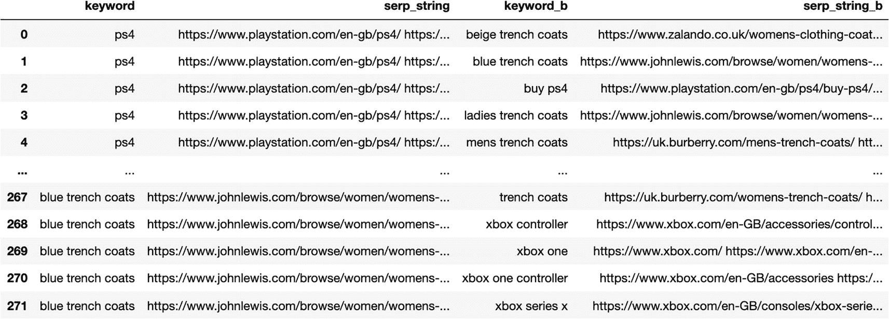

一个包含 5 列 10 行的表格。列标题为 `keyword`、`serp_string`、`keyword_b`和`serp_string_b`。行索引从 0 到 4，结束于 267 和 271。

上述结果显示，所有关键词的 SERP 都与其他关键词及其 SERP 进行了并排比较。接下来，我们将通过比较`serp_strings`来推断关键词意图的相似性，但在此之前，先对 Levenshtein、Jaccard 等方法做一个说明。

莱文斯坦距离是基于编辑次数的度量，即把一个字符串（本例中为 `serp_string`）转换为另一个字符串（`serp_string_b`）所需的编辑次数。这种方法效果不佳，因为 SERP 字符串中的网站是独立的标记，而非一个连续的字符串。

Sørensen-Dice 系数更好，因为它基于标记，即将每个独立网站视为独立的项目或标记。使用集合相似度方法，其逻辑是找出共同的标记，然后通过合并两个集合，用共同标记数除以总标记数。它不考虑顺序，因此我们需要更进一步。

M 度量同时考虑了标记重叠和标记顺序，即对顺序靠前的标记（即排名更高的网站/标记）赋予比靠后标记更高的权重。遗憾的是，目前没有现成的 API，因此我们在此为您编写了函数：

```python
import py_stringmatching as sm
ws_tok = sm.WhitespaceTokenizer()
```

仅比较前 `k_urls` 个结果：

```markdown
# 关键词分析与主题聚类

## 相似度函数定义

我们首先定义一个用于计算两个 SERP（搜索引擎结果页面）字符串之间相似度的函数 `serps_similarity`。

```python
def serps_similarity(serps_str1, serps_str2, k=15):
    denom = k+1
    norm = sum([2*(1/i - 1.0/(denom)) for i in range(1, denom)])
    # 用于对 URL 进行分词
    ws_tok = sm.WhitespaceTokenizer()
    # 仅保留前 k 个 URL
    serps_1 = ws_tok.tokenize(serps_str1)[:k]
    serps_2 = ws_tok.tokenize(serps_str2)[:k]
    # 获取匹配项的位置
    match = lambda a, b: [b.index(x)+1 if x in b else None for x in a]
    # 位置交集，形式为 [(pos_1, pos_2), ...]
    pos_intersections = [(i+1,j) for i,j in enumerate(match(serps_1, serps_2)) if j is not None]
    pos_in1_not_in2 = [i+1 for i,j in enumerate(match(serps_1, serps_2)) if j is None]
    pos_in2_not_in1 = [i+1 for i,j in enumerate(match(serps_2, serps_1)) if j is None]
    a_sum = sum([abs(1/i -1/j) for i,j in pos_intersections])
    b_sum = sum([abs(1/i -1/denom) for i in pos_in1_not_in2])
    c_sum = sum([abs(1/i -1/denom) for i in pos_in2_not_in1])
    intent_prime = a_sum + b_sum + c_sum
    intent_dist = 1 - (intent_prime/norm)
    return intent_dist
```

## 应用与数据准备

应用该函数到数据集：

```python
matched_serps['si_simi'] = matched_serps.apply(lambda x: serps_similarity(x.serp_string, x.serp_string_b), axis=1)
matched_serps[["keyword", "keyword_b", "si_simi"]]
```

这是生成的数据框：

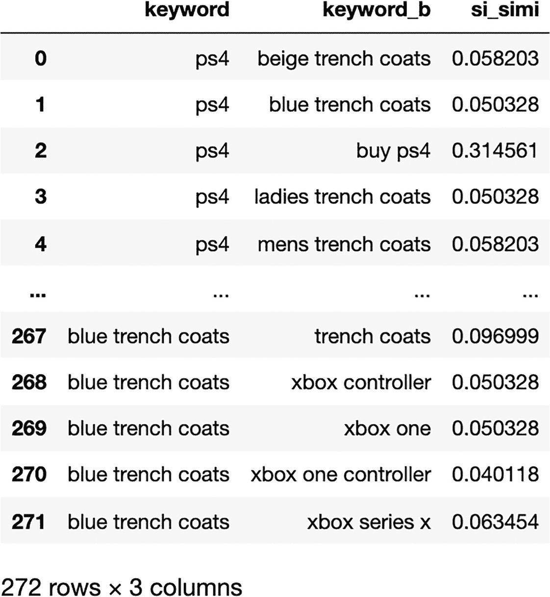
*一个包含 4 列 10 行的表格截图。列标题为 keyword、keyword b 和 s i s i m i。行从 267 开始，到 271 结束。*

在将关键词排序到主题组之前，我们先为每个关键词添加搜索量。这可以是一个导入的表格，如下面名为 `keysv_df` 的表格：

```
keysv_df
```

结果如下：

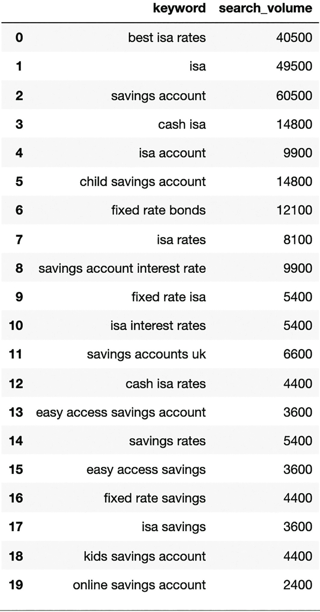
*一个包含 3 列 20 行的表格截图。列标题为 keyword 和 search volume。行从 0 开始，到 19 结束。*

现在让我们合并数据。我们在这里所做的是让 Python 能够根据 SERP 相似度对关键词进行分组，并根据搜索量最高的关键词来命名主题组。

根据相似度阈值按搜索意图对关键词进行分组。在本例中，关键词搜索结果必须具有 40% 或更高的相似度。这个数字是基于反复试验得出的，具体数值可能因搜索空间、语言或其他因素而异。

```
simi_lim = 0.4
```

附加主题搜索量：

```
keywords_crossed_vols = serps_compared.merge(keysv_df, on = 'keyword', how = 'left')
keywords_crossed_vols = keywords_crossed_vols.rename(columns = {'keyword': 'topic', 'keyword_b': 'keyword', 'search_volume': 'topic_volume'})
```

附加关键词搜索量：

```
keywords_crossed_vols = keywords_crossed_vols.merge(keysv_df, on = 'keyword', how = 'left')
```

模拟 `si_simi`：

```
#keywords_crossed_vols['si_simi'] = np.random.rand(len(keywords_crossed_vols.index))
keywords_crossed_vols.sort_values('topic_volume', ascending = False)
```

剔除数据框中的 NAN 值：

```
keywords_filtered_nonnan = keywords_crossed_vols.dropna()
```

## 主题分组

现在我们有了潜在的主题名称、关键词 SERP 相似度以及每个关键词的搜索量。您会注意到 `keyword` 和 `keyword_b` 已分别重命名为 `topic` 和 `keyword`。接下来，我们将使用列表推导式遍历数据框中的列。

列表推导式是一种遍历列表的技术。我们将其应用于 Pandas 数据框，因为它比 `.iterrows()` 函数快得多。

添加一个字典推导式，从 `keywords_filtered_nonnan` 创建带编号的主题组：

```
# {1: [k1, k2, ..., kn], 2: [k1, k2, ..., kn], ..., n: [k1, k2, ..., kn]}
```

将主题名称转换为列表：

```
queries_in_df = list(set(keywords_filtered_nonnan.topic.to_list()))
```

设置空列表和字典：

```
topic_groups_numbered = {}
topics_added = []
```

定义一个函数来查找主题编号：

```
def latest_index(dicto):
    if topic_groups_numbered == {}:
        i = 0
    else:
        i = list(topic_groups_numbered)[-1]
    return i
```

定义一个函数来将关键词分配到主题：

```
def find_topics(si, keyw, topc):
    i = latest_index(topic_groups_numbered)
    if (si >= simi_lim) and (not keyw in topics_added) and (not topc in topics_added):
        #print(si, ', kw=' , keyw,', tpc=', topc,', ', i,', ', topic_groups_numbered)
        i += 1
        topics_added.extend([keyw, topc])
        topic_groups_numbered[i] = [keyw, topc]
    elif si >= simi_lim and (keyw in topics_added) and (not topc in topics_added):
        #print(si, ', kw=' , keyw,', tpc=', topc,', ', i,', ', topic_groups_numbered)
        j = [key for key, value in topic_groups_numbered.items() if keyw in value]
        topics_added.extend(topc)
        topic_groups_numbered[j[0]].append(topc)
    elif si >= simi_lim and (not keyw in topics_added) and (not topc in topics_added):
        #print(si, ', kw=' , keyw,', tpc=', topc,', ', i,', ', topic_groups_numbered)
        j = list(mydict.keys())[list(mydict.values()).index(keyw)]
        topic_groups_numbered[j[0]].append(topc)
```

现在，列表推导式将应用该函数将关键词分组到聚类中：

```
[find_topics(x, y, z) for x, y, z in zip(keywords_filtered_nonnan.si_simi, keywords_filtered_nonnan.keyword,
                                          keywords_filtered_nonnan.topic)]
topic_groups_numbered
```

结果如下：

```
{1: ['easy access savings',
     'savings account',
     'savings accounts uk',
     'savings rates',
     'online savings account',
     'online savings account',
     'online savings account'],
 2: ['isa account', 'isa', 'isa savings', 'isa savings'],
 3: ['kids savings account', 'child savings account'],
 4: ['best isa rates',
     'cash isa',
     'fixed rate isa',
     'fixed rate isa',
     'isa rates',
     'isa rates',
     'isa rates'],
 5: ['savings account interest rate',
     'savings accounts uk',
     'online savings account'],
 6: ['easy access savings account', 'savings rates', 'online savings account'],
 7: ['cash isa rates', 'fixed rate isa', 'isa rates'],
 8: ['isa interest rates', 'isa rates'],
 9: ['fixed rate savings', 'fixed rate bonds', 'online savings account']}
```

上述结果是打印出哪些关键词属于哪个主题组的语句。我们这样做是为了确保没有重复或错误，这对于下一步的正确执行至关重要。现在，我们将把字典转换为数据框，以便您可以看到所有按搜索意图分组的关键词：

```
topic_groups_lst = []
for k, l in topic_groups_numbered.items():
    for v in l:
        topic_groups_lst.append([k, v])
topic_groups_dictdf = pd.DataFrame(topic_groups_lst, columns=['topic_group_no', 'keyword'])
topic_groups_dictdf
```

结果如下：

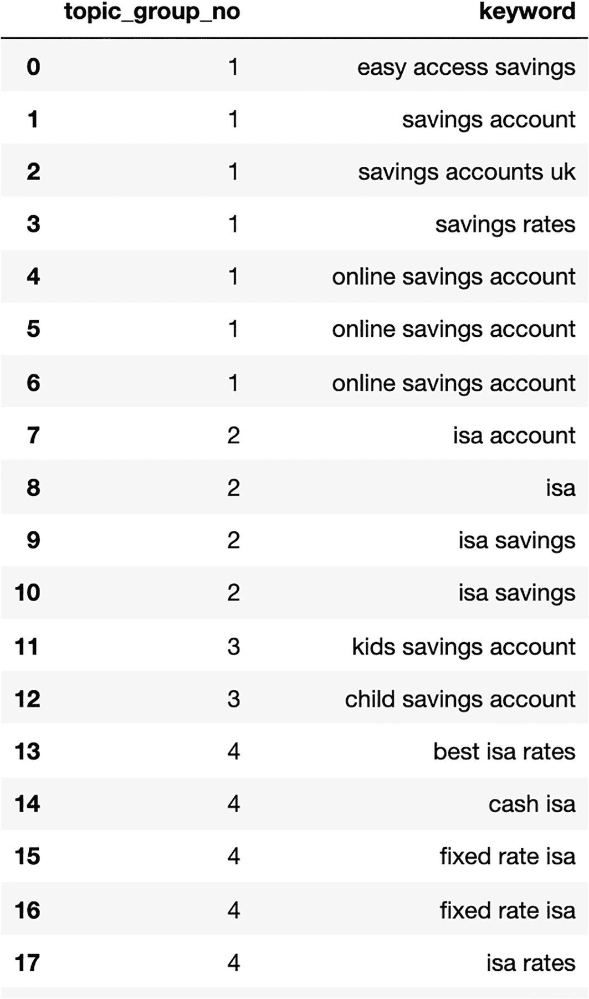
*一个包含 3 列 18 行的表格截图。列标题为 topic group number 和 keyword。行从 0 开始，到 19 结束。*

如您所见，关键词被智能地分组，就像人类 SEO 分析师会做的那样，只不过这些分组是利用谷歌从其海量用户中提炼出的智慧大规模完成的。为这些聚类命名：

## 主题命名与映射

```python
topic_groups_vols = topic_groups_dictdf.merge(keysv_df, on = 'keyword', how = 'left')
def highest_demand(df):
    df = df.sort_values('search_volume', ascending = False)
    del df['topic_group_no']
    max_sv = df.search_volume.max()
    df = df.loc[df.search_volume == max_sv]
    return df
topic_groups_vols_keywgrp = topic_groups_vols.groupby('topic_group_no')
topic_groups_vols_keywgrp.get_group(1)
```

应用并合并：

```python
high_demand_topics = topic_groups_vols_keywgrp.apply(highest_demand).reset_index()
del high_demand_topics['level_1']
high_demand_topics = high_demand_topics.rename(columns = {'keyword': 'topic'})
def shortest_name(df):
    df['k_len'] = df.topic.str.len()
    min_kl = df.k_len.min()
    df = df.loc[df.k_len == min_kl]
    del df['topic_group_no']
    del df['k_len']
    del df['search_volume']
    return df
high_demand_topics_spl = high_demand_topics.groupby('topic_group_no')
```

应用并合并：

```python
named_topics = high_demand_topics_spl.apply(shortest_name).reset_index()
del named_topics['level_1']
```

为主题编号的关键词命名：

```python
topic_keyw_map = pd.merge(named_topics, topic_groups_dictdf, on = 'topic_group_no', how = 'left')
topic_keyw_map
```

结果表显示，我们现在已经按主题对关键词进行了聚类：

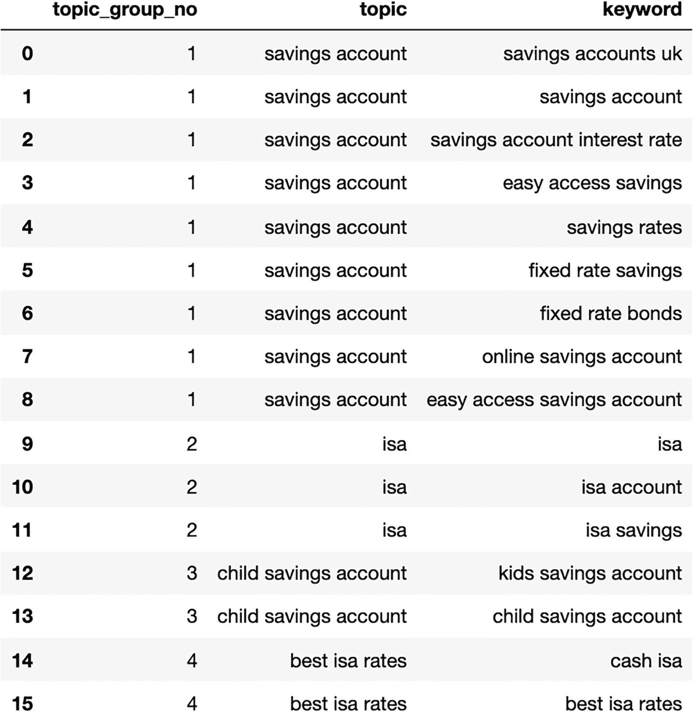
*一个包含 4 列 10 行的表格截图。列标题为主题组编号、主题和关键词。行范围从 0 到 15。*

现在添加关键词搜索量：

```python
topic_keyw_vol_map = pd.merge(topic_keyw_map, keysv_df, on = 'keyword', how = 'left')
topic_keyw_vol_map
```

结果如下：

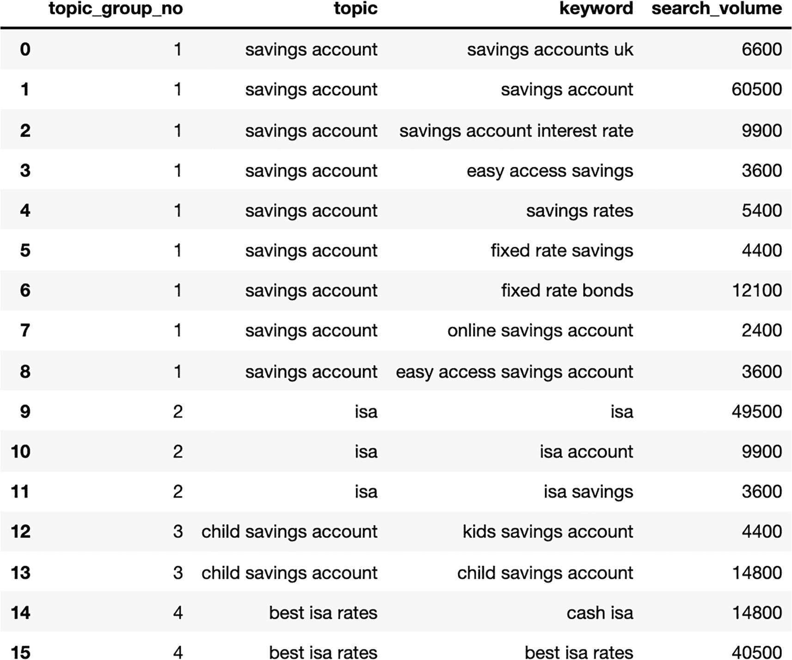
*一个包含 5 列 10 行的表格截图。列标题为主题组编号、主题、关键词和搜索量。行范围从 0 到 15。*

这已经开始成形，你可以很快看到机会的出现。

### SERP 竞争对手标题

如果你没有足够的 Google Search Console 数据或 Google Ads 数据可供挖掘，那么你可能需要求助于竞争对手。你可能想使用也可能不想使用第三方关键词研究工具，如 `SEMRush`。而且你并非必须使用它们。

像 `SEMRush`、`Keyword.io` 等工具在 SEO 行业中确实占有一席之地。在缺乏其他数据的情况下，它们是关于哪些搜索查询能产生相关流量的一个不错的现成情报来源。

然而，需要做一些工作来剔除噪音并提取高价值短语——假设这是一个竞争激烈的市场。否则，如果你的网站（或细分领域）在所提供的产品方面非常新，以至于需求不足（需要通过广告和公关来创造非品牌搜索），那么这些外部工具的价值就不大了。因此，我们的方法是：

1. 爬取你自己的网站
2. 过滤和清理数据，只保留与你销售内容相关的部分
3. 从网站标题标签中提取关键词
4. 使用 SERP 数据进行过滤（下一节）
```

# 过滤和清理数据，只保留与你销售内容相关的部分

此练习所需的数据是，使用站点审计工具^(⁵)爬取你的网站。假设你已经导出了爬取数据，只包含`URL`和标题标签这两列；我们将导入并清理：

```python
import pandas as pd
import numpy as np
crawl_import_df = pd.read_csv('data/crawler-filename.csv')
crawl_import_df
```

结果如下：

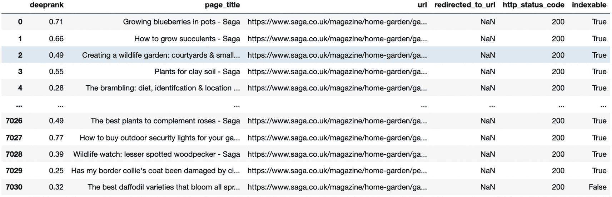

*一个包含 7 列 10 行的表格截图。列标题为深度排名、页面标题、`URL`、重定向 `URL`、HTTP 状态码和可索引性。行范围从 0-4 到 7026-7030。*

上述结果显示了我们刚刚导入的爬取数据的数据框。我们最感兴趣的是可索引的^(⁶)活跃 `URL`，因此让我们过滤并选择`page_title`和`url`列：

```python
titles_urls_df = crawl_import_df.loc[crawl_import_df.indexable == True]
titles_urls_df = titles_urls_df[['page_title', 'url']]
titles_urls_df
```

结果如下：

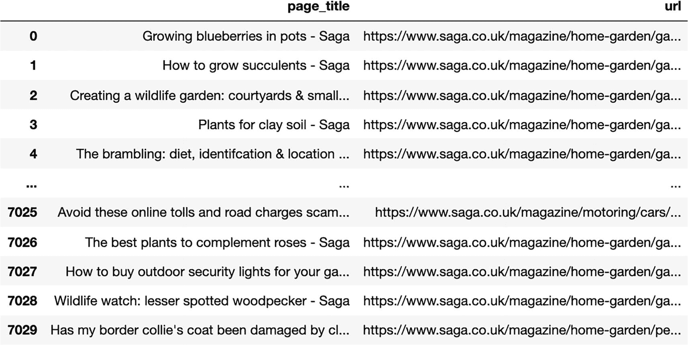

*一个包含 3 列 10 行的表格截图。列标题为页面标题和 `URL`。行范围从 0-4 到 7025-7029。*

现在我们将清理标题标签，使其变为非品牌化的，即移除站点名称和杂志板块。

```python
titles_urls_df['page_title'] = titles_urls_df.page_title.str.replace(' - Saga', '')
titles_urls_df = titles_urls_df.loc[~titles_urls_df.url.str.contains('/magazine/')]
titles_urls_df
```

结果如下：

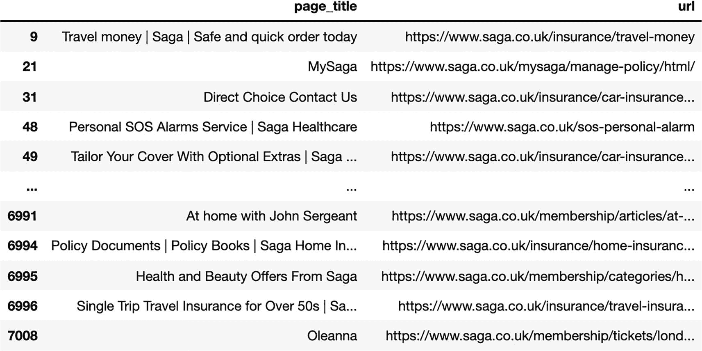

*一个包含 3 列 10 行的表格截图。列标题为页面标题和 `URL`。行范围从 9-49 到 6991-7008。*

现在我们有了 349 行数据，因此我们将查询一些关键词以说明该过程。

## 从标题标签中提取关键词

现在，我们希望从上述数据框的页面标题中提取关键词。典型的数据科学方法是将标题分解成各种组合，然后进行频率计数，可能按排名加权。

经过尝试，我们不推荐这种方法；它过于复杂，而且可能没有足够的数据使其有价值。一个更有效且更简单的方法是按标点符号分解标题。为什么？因为那些标题是由人类（或者现在可能是某些 AI）编写的，因此这些标点符号很可能是目标搜索短语的自然断点。

让我们尝试一下；将标题分解为 n-gram：

```python
pd.set_option('display.max_rows', 1000)
serps_ngrammed = filtered_serps_df.set_index(["keyword", "rank_absolute"])\
.apply(lambda x: x.str.split('[-,|?()&:;\[\]=]').explode())\
.dropna()\
.reset_index()
serps_ngrammed.head(10)
```

结果如下：

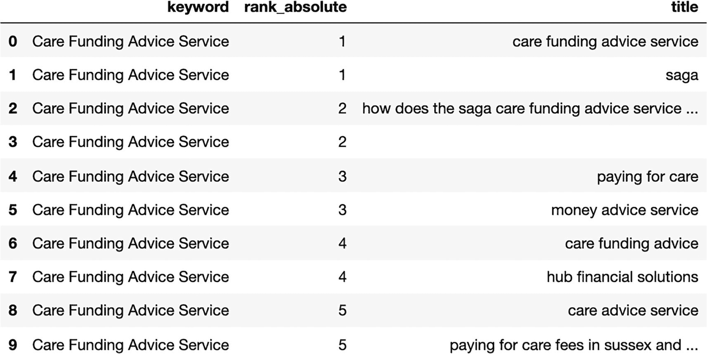

*一个包含 4 列 10 行的表格截图。列标题为关键词、绝对排名和标题。行范围从 0 到 9。*

得益于`explode`函数，数据框已被展开，使得我们可以看到关键词行被扩展，对应之前同一标题内由标点符号连接的不同文本。

## 使用 SERP 数据进行过滤

现在我们要做的就是统计前三名标题的频率，然后筛选出出现三次或以上的标题：

```python
serps_ngrammed_grp = serps_ngrammed.groupby(['keyword', 'title'])
keyword_ideas_df = serps_ngrammed_grp.size().reset_index(name='freq').sort_values(['keyword', 'freq'], ascending = False)
keyword_ideas_df = keyword_ideas_df[keyword_ideas_df.freq > 2]
keyword_ideas_df = keyword_ideas_df[keyword_ideas_df.title.str.contains('[a-z]')]
keyword_ideas_df = keyword_ideas_df.rename(columns = {'title': 'keyword_idea'})
keyword_ideas_df
```

结果如下：

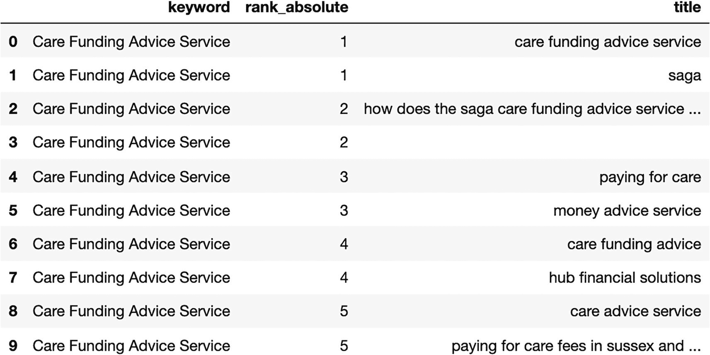

*一个包含 4 列 10 行的表格截图。列标题为关键词、主题和标题。行范围从 0 到 9。*

瞧，上述结果显示了一个从 SERP 中获取的关键词数据框。其中大部分内容是有意义的，现在可以将其添加到你的关键词列表中，以供认真考虑和跟踪。

# 总结

本章涵盖了数据驱动的关键词研究，使您能够：

- 从 GSC 数据中发现突出的关键词
- 从 Google Trends 获取趋势数据
- 使用时间序列技术预测未来的自然流量
- 按搜索意图对关键词进行聚类
- 利用 SERP 数据从竞争对手处发现关键词

下一章，我们将介绍如何将这些关键词映射到 `URL`。

脚注 1 2 3 4 5 6