# 3. 技术

技术 SEO 主要关注搜索引擎与网站之间的交互，具体包括：

- 使网站内容能够被搜索引擎发现。
- 通过内容与首页的距离，向搜索引擎暗示其优先级。
- 节省搜索引擎资源，以便访问（即爬取）那些旨在纳入搜索结果的内容。
- 再次从这些 URL 中提取内容含义，以便纳入搜索结果（即索引）。

在本章中，我们将探讨如何通过数据驱动的方法来改进技术 SEO，具体方式如下：

- `建模页面权威度`：这有助于帮助 SEO 从业者及非 SEO 人员理解技术 SEO 变更的影响。
- `内部链接优化`：改进内部链接的使用，使内容更易于被发现，并帮助向搜索引擎传达内容的优先级。
- `核心网页指标（CWV）`：虽然用户体验方面的益处常被称道，但改进 CWV 还能带来排名提升的好处，这是因为搜索引擎用于从网页提取内容的资源得到了节省。

我们绝不声称这是从技术角度对数据驱动 SEO 的最终定论。我们将要做的是，利用一些数据科学方法（如分布分析），揭示解决技术 SEO 问题的数据驱动途径。

## 数据科学的用武之地

SEO 的一个明显挑战是决定哪些页面应该对搜索引擎和用户开放，哪些不应该。虽然许多爬取工具会提供按站点深度等维度划分的页面分布可视化图表，但使用数据科学也绝无坏处。我们将深入探讨更详细、更复杂的细节，这将帮助您：

- 优化内部链接
- 根据页面内容将关键词分配到各页面
- 为孤立 URL 分配父节点

最终，上述列表将帮助您构建更有力的论据，以推动技术建议的实施。

## 建模页面权威度

技术优化通常涉及建议进行一些变更，这些变更往往会使 URL 变得不可索引或被规范化（原因有多种，例如内容重复）。提出这些变更的目的是将页面权威度集中到那些仍有资格被索引的 URL 上。

以下部分旨在帮助数据驱动的 SEO 量化有益的额外页面权威度。具体方法如下：

1. 筛选出网页
2. 检查优化前的权威度分布
3. 计算新的分布（以便在决定哪些 URL 将不再可索引后，量化其释放出的权威度可重新分配所带来的增量页面权威度）

首先，我们需要加载必要的包：

```python
import re
import time
import random
import pandas as pd
import numpy as np
import datetime
import requests
import json
from datetime import timedelta
from glob import glob
import os
from client import RestClient # 如果使用 Data For SEO API
from textdistance import sorensen_dice
from plotnine import *
import matplotlib.pyplot as plt
from pandas.api.types import is_string_dtype
from pandas.api.types import is_numeric_dtype
import uritools
from urllib.parse import urlparse
import tldextract
pd.set_option('display.max_colwidth', None)
%matplotlib inline
```

设置变量：

```python
root_domain = 'boundlesshq.com'
hostdomain = 'www.boundlesshq.com'
hostname = 'boundlesshq'
full_domain = 'https://www.boundlesshq.com'
client_name = 'Boundless'
audit_monthyear = 'jul_2022'
```

从 Sitebulb 桌面爬虫导入爬取数据。也可以使用 Screaming Frog 或任何其他网站爬取软件；不过，列名可能会有所不同：

```python
crawl_csv = pd.read_csv('data/boundlesshq_com_all_urls__excluding_uncrawled__filtered.csv')
```

使用列表推导式清理列名：

```python
crawl_csv.columns = [col.lower().replace('.','').replace('(','').replace(')','').replace(' ','_')
for col in crawl_csv.columns]
crawl_csv
```

以下是 `crawl_csv` 的结果：

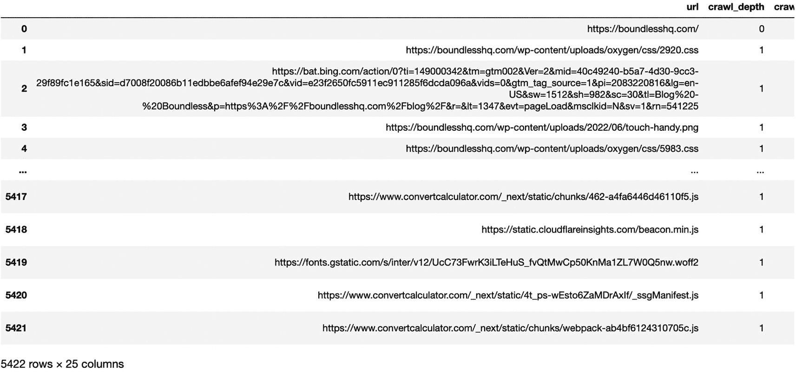

数据框的截图显示了 URL 和爬取深度数据。该数据框或表格包含 5422 行和 25 列。

该数据框已加载到 Pandas 数据框中。最重要的字段如下：

- `url`：用于检测不索引和规范化的模式
- `ur`：URL 评分，Sitebulb 用于衡量内部页面权威度的内部指标
- `content_type`：用于筛选
- `passes_pagerank`：用于了解哪些页面具有权威度
- `indexable`：是否有资格被搜索引擎索引

### 筛选网页

下一步是筛选出属于该网站且能够传递权威度的实际网页：

```python
crawl_html = crawl_csv.copy()
crawl_html = crawl_html.loc[crawl_html['content_type'] == 'HTML']
crawl_html = crawl_html.loc[crawl_html['host'] == root_domain]
crawl_html = crawl_html.loc[crawl_html['passes_pagerank'] == 'Yes']
crawl_html
```

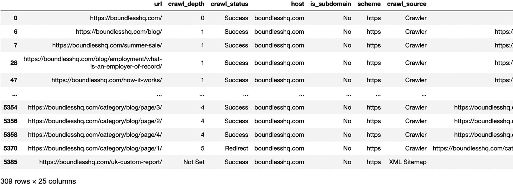

数据框的截图显示了 URL、爬取深度、爬取状态、主机、是否为子域名、方案和爬取来源数据。该数据框或表格包含 309 行和 25 列。

数据框已缩减至 309 行。为便于数据处理，我们将选择部分列：

```python
crawl_select = crawl_html[['url', 'ur', 'crawl_depth', 'crawl_source', 'http_status_code', 'indexable',
'indexable_status', 'passes_pagerank', 'total_impressions', 'first_parent_url', 'meta_robots_response']].copy()
```

### 优化前审视权限分布

这对于分组聚合和计数非常有用：

```python
crawl_select['project'] = client_name
crawl_select['count'] = 1
```

让我们快速获取一些统计数据：

```python
print(crawl_select['ur'].sum(), crawl_select['ur'].sum()/crawl_select.shape[0])
10993 35.57605177993528
```

该网站上的 URL 具有平均页面权限级别（以 `UR` 衡量）。让我们查看一些进一步的统计数据，包括可索引和不可索引的页面。我们将按 (I) 可索引和 (II) 传递 PageRank 进行维度划分，以汇总 URL 数量和 `UR`（URL 评级）：

```python
overall_pagerank_agg = crawl_select.groupby(['indexable',
'passes_pagerank']).agg({'count': 'sum',
'ur': 'sum'}).reset_index()
```

然后，我们通过将总 `UR` 除以 URL 总数来推导出每个 URL 的页面权限：

```python
overall_pagerank_agg['PA'] = overall_pagerank_agg['ur'] / overall_pagerank_agg['count']
overall_pagerank_agg
```

结果如下：

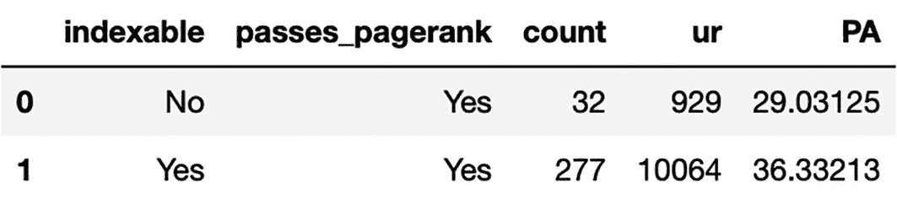

数据框的屏幕截图包含 2 行数据。列标题为 `indexable`、`passes_pagerank`、`count`、`ur` 和 `PA`。

我们看到有 32 个不可索引的 URL，总权限为 929，可以合并到可索引的 URL 中。

还有一些统计数据，这次纯粹出于好奇按站点级别进行分析：

```python
site_pagerank_agg = crawl_select.groupby(['indexable',
'crawl_depth']).agg({'count': 'sum',
'ur': 'sum'}).reset_index()
site_pagerank_agg['PA'] = site_pagerank_agg['ur'] / site_pagerank_agg['count']
site_pagerank_agg
```

结果如下：

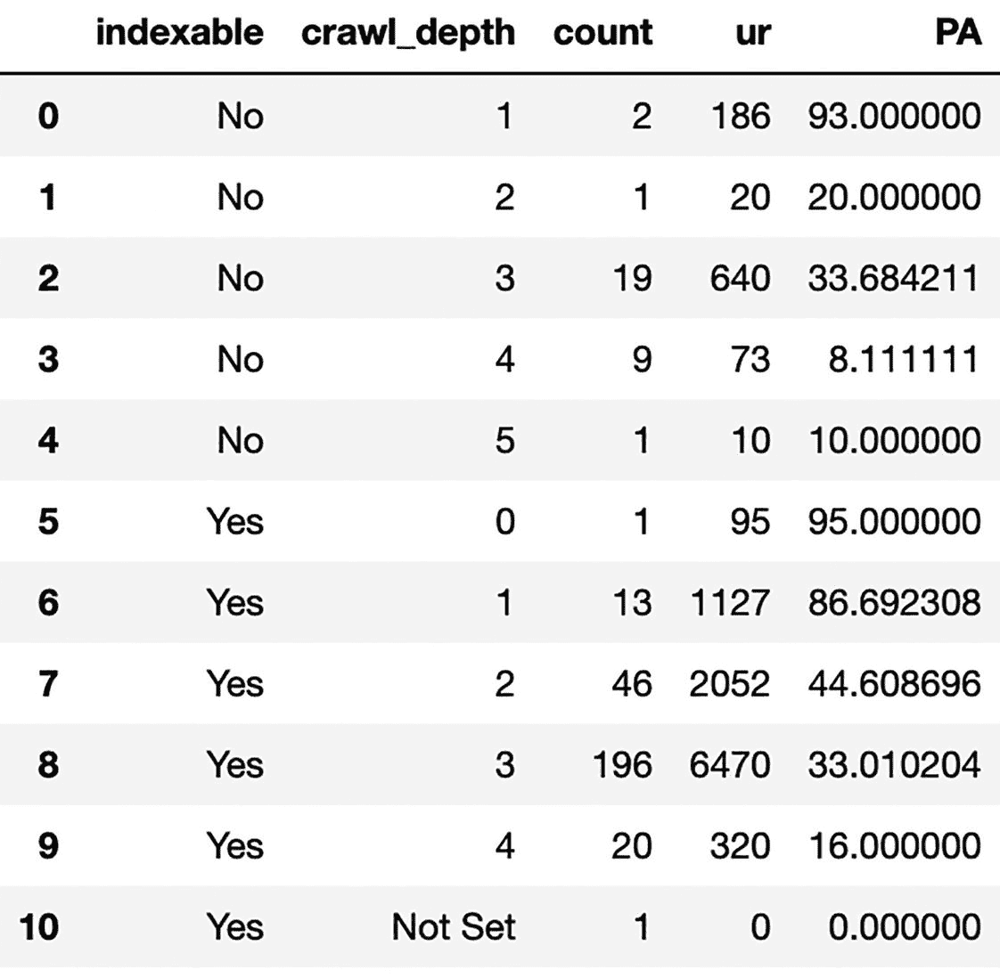

数据框的屏幕截图显示了 `indexable`、`crawl_depth`、`count`、`ur` 和 `PA` 的 0 到 10 行值。

大多数具有可重新分配权限的 URL 距离主页有四次点击的距离。

让我们使用 `geom_histogram` 函数可视化优化前的权限分布：

```python
pageauth_dist_plt = (
ggplot(crawl_select, aes(x = 'ur')) +
geom_histogram(alpha = 0.7, fill = 'blue', bins = 20) +
labs(x = 'Page Authority', y = 'URL Count') +
theme(legend_position = 'none', axis_text_x=element_text(rotation=0, hjust=1, size = 12))
)
pageauth_dist_plt.save(filename = 'images/1_pageauth_dist_plt.png',
height=5, width=8, units = 'in', dpi=1000)
pageauth_dist_plt
```

正如我们从之前计算的统计数据中所预期的那样，大多数页面的 `UR` 在 25 到 50 之间，其余页面分散分布（图 3-1）。

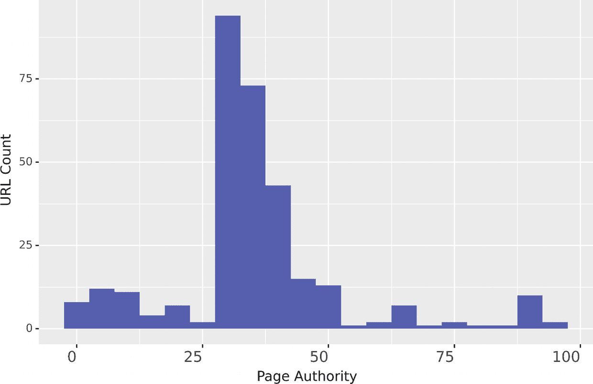

直方图绘制了 URL 数量与页面权限的关系。URL 数量和页面权限的范围从 0 到 100，间隔为 25。图表趋势在页面权限 25 到 50 之间较高。

**图 3-1.** 显示 URL 页面权限分数的 URL 数量的直方图

### 计算新的分布

在检查了当前分布之后，我们现在将量化优化后的新页面权限分布。

我们将首先获取一个按第一个父 URL 和 URL 的 `UR` 值划分的 URL 表，这将作为我们映射有多少额外权限可用的依据：

```
parent_pa_map = crawl_select[['first_parent_url', 'ur']].copy()
parent_pa_map = parent_pa_map.rename(columns = {'first_parent_url': 'url' , 'ur': 'extra_ur'})
parent_pa_map
```

结果如下：

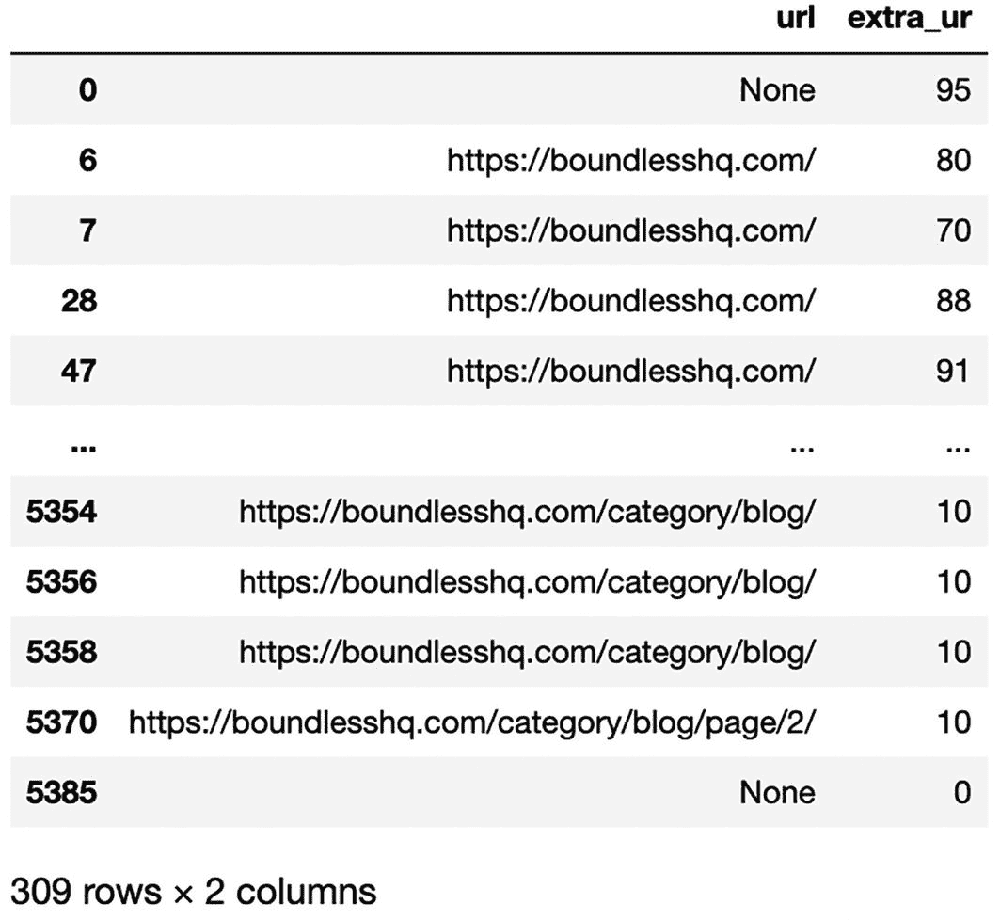

父 URL 及其映射表的屏幕截图。列标题为 `url` 和 `extra_ur`。提到该表有 309 行和 2 列。

该表显示了所有父 URL 及其映射。

下一步是标记将被设为 noindex 的页面，以便我们可以重新分配它们的权限：

```
crawl_optimised = crawl_select.copy()
```

为 noindex 创建一个 URL 模式列表：

```
reallocate_conds = [
crawl_optimised['url'].str.contains('/page/[0-9]/'),
crawl_optimised['url'].str.contains('/country/')
]
```

如果满足 URL 模式条件，则对应的值：

```
reallocate_vals = [1, 1]
```

`reallocate` 列使用 `np.select` 函数来标记要设为 noindex 的 URL。任何不设为 noindex 的 URL 都使用 `default` 参数标记为 `0`：

```
crawl_optimised['reallocate'] = np.select(reallocate_conds, reallocate_vals, default = 0)
crawl_optimised
```

结果如下：

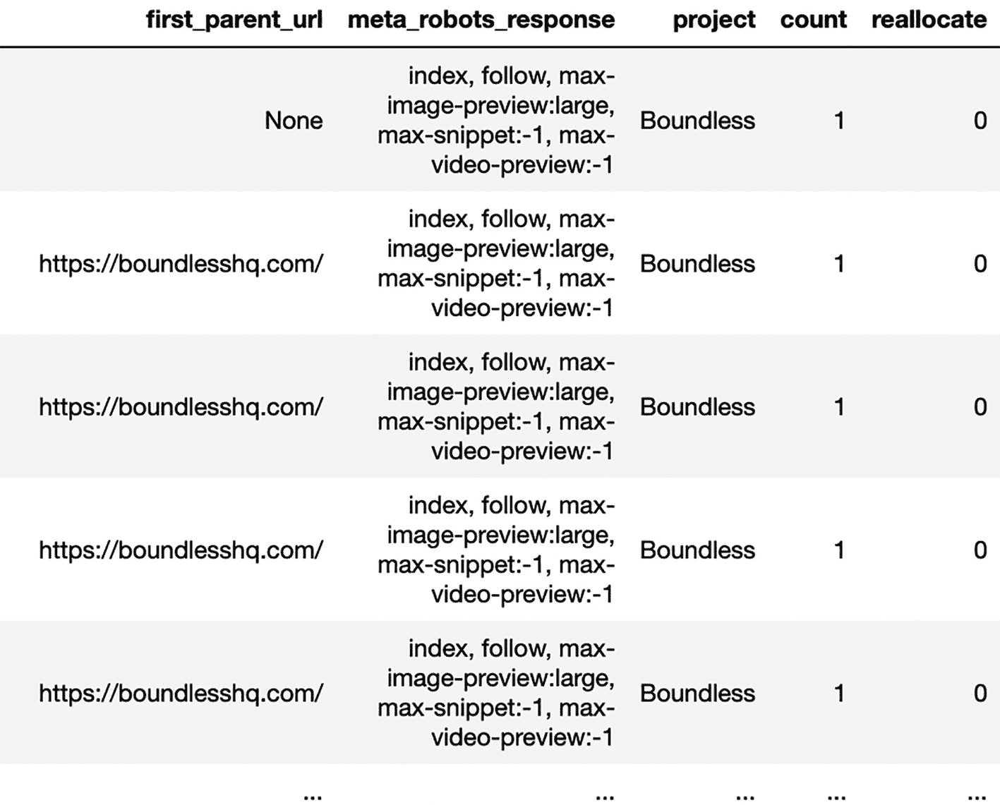

一个表格的屏幕截图，包含 `first_parent_url`、`meta_robots_response`、`project`、`count` 和 `reallocate` 的数据。

添加了 `reallocate` 列，以便我们可以开始看到重新分配的效果，即技术优化的潜在优势。

像往常一样，按 `reallocate` 进行分组操作，并计算平均 `PA`：

```
reallocate_agg = crawl_optimised.groupby('reallocate').agg({'count': sum, 'ur': sum}).reset_index()
reallocate_agg['PA'] = reallocate_agg['ur'] / reallocate_agg['count']
reallocate_agg
```

结果如下：

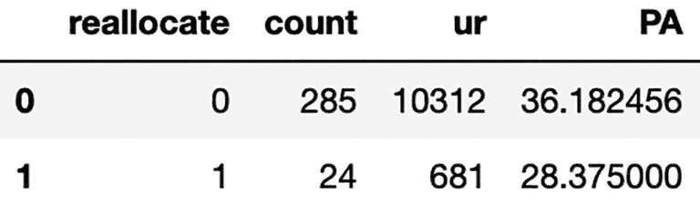

一个表格的屏幕截图，列出了 `reallocate`、`count`、`ur` 和 `PA` 相对于行值 0 和 1 的数据。`reallocate` 的值为 0 和 1，`count` 为 285、24，`ur` 为 10312、681，`PA` 为 36.182456、28.375000。

因此，我们实际上将把 681 个 `UR` 从 noindex URL 重新分配给 285 个可索引 URL。这些 noindex URL 的平均 `UR` 为 28。

我们只过滤将要设为 noindex 的 URL，以帮助我们确定额外的页面权限：

```
no_indexed = crawl_optimised.loc[crawl_optimised['reallocate'] == 1]
```

我们按第一个父 URL（父节点）聚合其中的总 URL 及其 URL，因为 `UR` 可能会重新分配给共享同一父节点的剩余可索引 URL：

```
no_indexed_map = no_indexed.groupby('first_parent_url').agg({'count': 'sum', 'ur': sum}).reset_index()
```

`add_ur` 是一个新创建的列，表示优化带来的额外权限。这是总 `UR` 除以 URL 数量：

```
no_indexed_map['add_ur'] = (no_indexed_map['ur'] / no_indexed_map['count']).round(0)
```

删除稍后连接不需要的列：

```
no_indexed_map.drop(['ur', 'count'], inplace = True,  axis = 1)
no_indexed_map
```

结果如下：

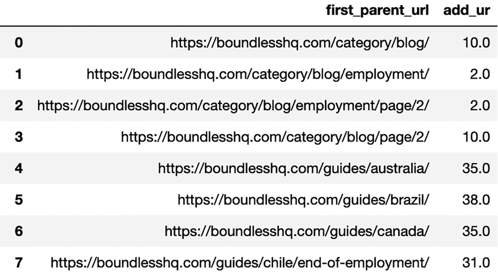

一个表格的屏幕截图，行标题编号从 0 到 7。列标题为 `first_parent_url` 和 `add_ur`。列出了 URL 链接和值。

上表将按第一个父 URL 合并到可索引 URL 中。

仅过滤可索引的 URL，并由于 noindex 重新分配 URL 而增加更多权限：

```
crawl_new = crawl_optimised.copy()
crawl_new = crawl_new.loc[crawl_new['reallocate'] == 0]
```

连接 `no_indexed_map` 以获取待添加的权威值：

```
crawl_new = crawl_new.merge(no_indexed_map, on = 'first_parent_url', how = 'left')
```

通常，在连接数据时，未出现在映射中的第一父级 URL 会出现空值。使用 `np.where()` 将这些空值替换为零，以便后续进行进一步的数据操作。

```
crawl_new['add_ur'] = np.where(crawl_new['add_ur'].isnull(), 0, crawl_new['add_ur'])
```

`new_ur` 是通过将 `ur` 与 `add_ur` 相加计算得出的新权威分数：

```
crawl_new['new_ur'] = crawl_new['ur'] + crawl_new['add_ur']
crawl_new
```

结果如下：

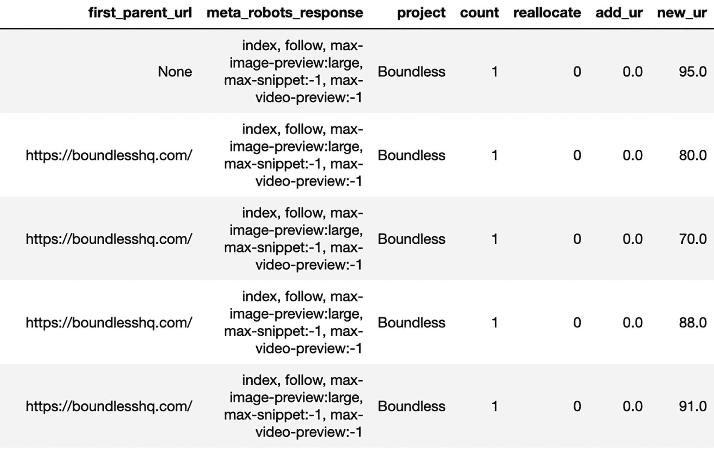

一张表格截图，包含以下数据：第一父级 URL、元数据 robots 响应、项目、计数、重新分配、add_ur 和 new_ur。

可索引的 URL 现在已获得优化后的权威分数，我们将通过以下方式进行可视化：

```
pageauth_newdist_plt = (
ggplot(crawl_new, aes(x = 'new_ur')) +
geom_histogram(alpha = 0.7, fill = 'lightgreen', bins = 20) +
labs(x = '页面权威度', y = 'URL 数量') +
theme(legend_position = 'none', axis_text_x=element_text(rotation=0, hjust=1, size = 12))
)
pageauth_newdist_plt.save(filename = 'images/2_pageauth_newdist_plt.png',
height=5, width=8, units = 'in', dpi=1000)
pageauth_newdist_plt
```

图 3-2 中的 `pageauth_newdist_plt` 展示了页面级权威度（页面权威度）的分布情况。

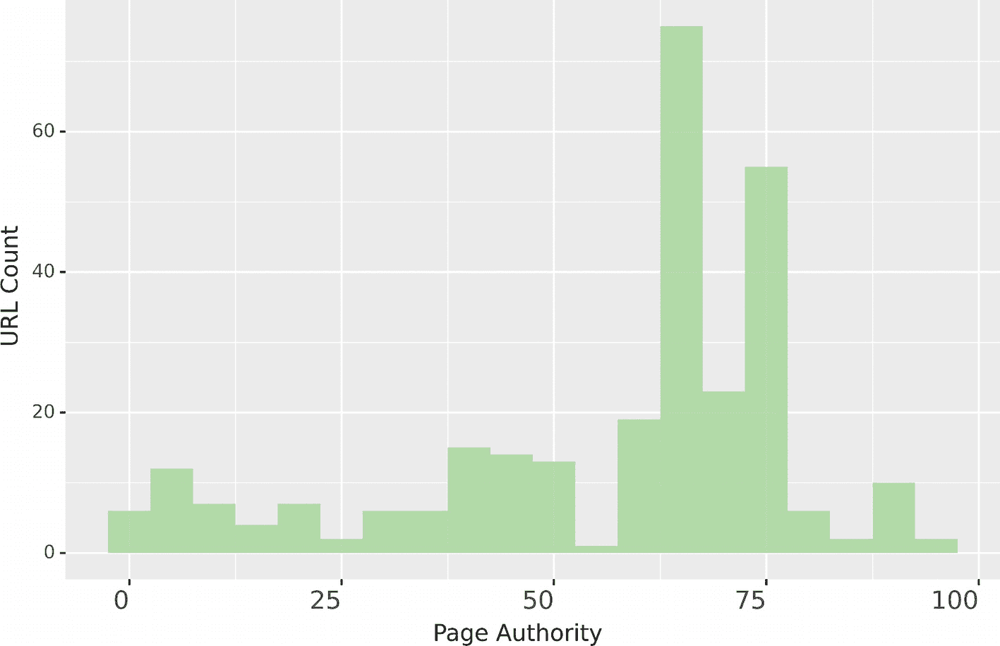

一张直方图，横轴为页面权威度（0 到 100），纵轴为 URL 数量（0 到 80）。与其他区间相比，页面权威度在 60 到 80 的区间内，URL 数量较高。数值为近似值。

图 3-2 页面级权威度（页面权威度）分布直方图

影响是显著的，我们看到优化后大多数页面的 UR 都超过了 60，如果实施推进的话。

以下是一些快速统计数据来确认：

```
new_pagerank_agg = crawl_new.groupby(['reallocate']).agg({'count': 'sum',
'ur': 'sum',
'new_ur': 'sum'}).reset_index()
new_pagerank_agg['PA'] = new_pagerank_agg['new_ur'] / new_pagerank_agg['count']
print(new_pagerank_agg)
```
```
reallocate  count     ur   new_ur    PA
0           0    285  10312  16209.0  57.0
```

平均页面权威度现在为 57，而之前是 36，这是一个显著的提升。虽然这种方法并非精确科学，但它可以帮助你构建论据，推动技术 SEO 修复的变更请求得以实施。

### 内部链接优化

搜索引擎高度依赖链接来帮助确定网站内页面的相对重要性。这是因为搜索引擎基于随机冲浪者概念，通过分配内容被用户随机发现的概率来运作。也就是说，如果某个内容有更多链接指向它，那么它被发现的概率就更高。

如果某个内容有更多的入站链接，搜索引擎也会认为该内容具有更高的价值，因为它获得了更多的链接。

搜索引擎还依赖锚文本（链接文字）来指示超链接 URL 的内容主题，从而判断其与关键词的相关性。

因此，对于 SEO 而言，内部链接在网站优化中扮演着关键角色，帮助搜索引擎决定网站上哪些页面是重要的，以及它们关联的关键词是什么。

在这里，我们将提供一些利用数据科学优化内部链接的方法，内容涵盖：
1.  按网站层级分配权威度
2.  按外部网站累积的外部页面权威度分配权威度
3.  锚文本

```
import pandas as pd
import numpy as np
from textdistance import sorensen_dice
from plotnine import *
import matplotlib.pyplot as plt
from mizani.formatters import comma_format
target_name = 'ON24'
target_filename = 'on24'
website = 'www.on24.com'
```

链接数据来源于 Sitebulb 审计软件，导入的同时简化了列名以便操作：

```
link_raw = pd.read_csv('data/'+ client_filename + '_links.csv')
link_data = link_raw.copy()
link_data.drop('Unnamed: 13', axis = 1, inplace = True)
link_data.columns = [col.lower().replace('.','').replace('(','').replace(')','').replace(' ','_')
for col in link_data.columns]
link_data
```

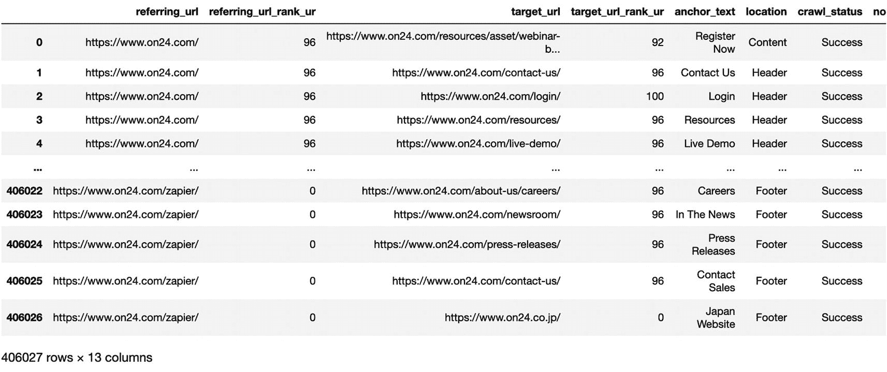

一张表格截图，包含以下数据：来源 URL、来源 URL 排名 UR、目标 URL、目标 URL 排名 UR、锚文本、位置、爬取状态等。该数据框或表格有 406027 行和 13 列。

链接数据框向我们展示了链接列表，涉及以下方面：
- **来源 URL**：链接所在的位置
- **目标 URL**：链接指向的位置
- **来源 URL 排名 UR**：来源页面的页面权威度
- **目标 URL 排名 UR**：目标页面的页面权威度
- **锚文本**：超链接中使用的文字
- **位置**：链接被发现的位置

让我们导入同样来自 Sitebulb 的爬取数据：

```
crawl_data = pd.read_csv('data/'+ client_filename + '_crawl.csv')
crawl_data.drop('Unnamed: 103', axis = 1, inplace = True)
crawl_data.columns = [col.lower().replace('.','').replace('(','').replace(')','').replace(' ','_')
for col in crawl_data.columns]
crawl_data
```

结果如下：

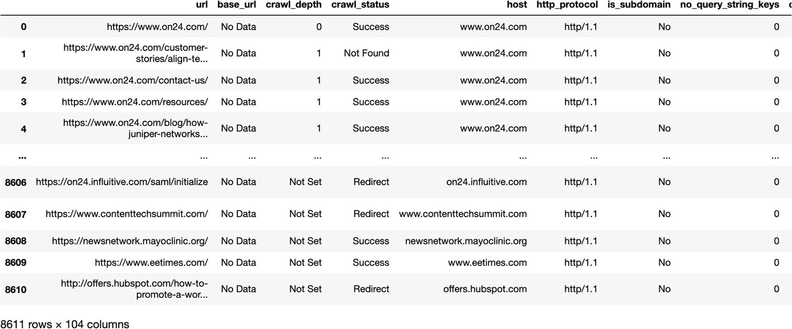

一张表格截图，包含以下数据：URL、基础 URL、爬取深度、爬取状态、主机、HTTP 协议、是否为子域名、无查询字符串键等。该数据框或表格有 8611 行和 104 列。

因此，我们得到了常见的 URL 列表及其被发现的方式（爬取来源），以及其他超过 100 列的特征。

正如你所料，链接数据的行数远远超过爬取数据框，因为链接的数量远多于页面数量！

导入外部入站链接数据：

```
ahrefs_raw = pd.read_csv('data/'+ client_filename + '_ahrefs.csv')
ahrefs_raw.columns = [col.lower().replace('.','').replace('(','').replace(')','').replace(' ','_')
for col in ahrefs_raw.columns]
ahrefs_raw
```

结果如下：

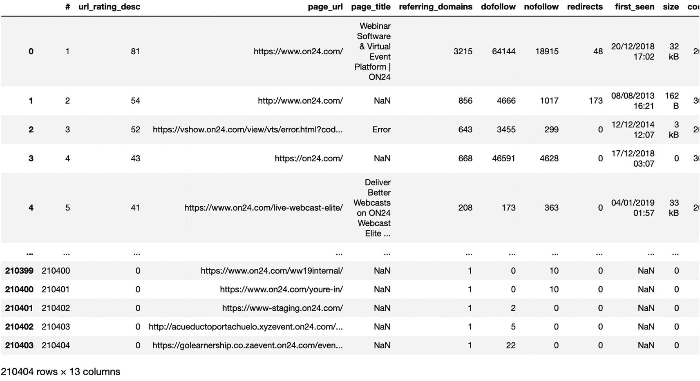

一张表格截图，包含以下数据：序号、URL 评级描述、页面 URL、页面标题、引用域、dofollow、nofollow、重定向、首次发现时间、大小。该数据框或表格有 210404 行和 13 列。

有超过 210,000 个带有反向链接的 URL，这非常棒！数据量相当大，所以我们先简化一下，删除一些列并重命名部分列，以便后续连接数据：

```
ahrefs_df = ahrefs_raw[['page_url', 'url_rating_desc', 'referring_domains']]
ahrefs_df = ahrefs_df.rename(columns = {'url_rating_desc': 'page_authority', 'page_url': 'url'})
ahrefs_df
```

结果如下：

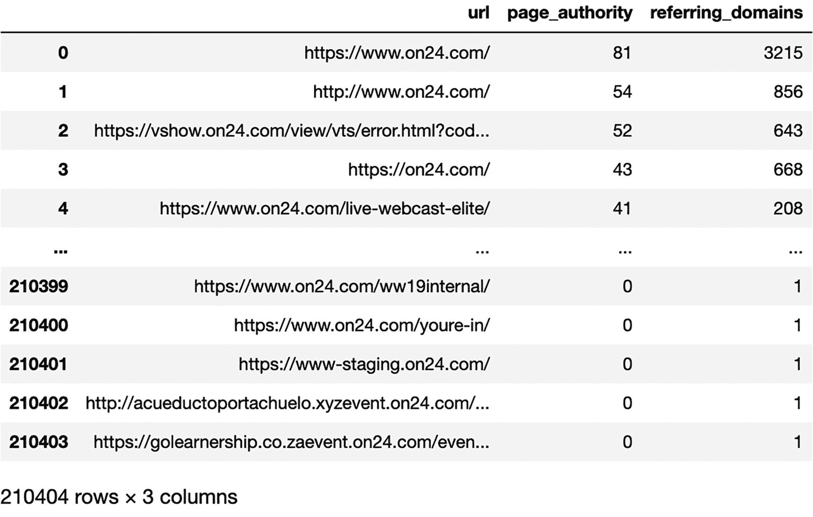

一张表格截图，包含以下数据：URL、页面权威度、引用域。该数据框或表格有 210404 行和 3 列。

现在我们得到了简化形式的数据，这很重要，因为我们不关心链接的细节，而是关心它们为目标网站带来的预估页面级权威度。

### 按站点层级分析

数据导入并清理完毕后，就可以开始分析了。

我们总是很好奇在不同站点层级上分别有多少个 URL。通过一个快速的 `groupby` 聚合函数就能实现这一点：

```python
redir_live_urls.groupby(['crawl_depth']).size()
```

结果如下：

```
crawl_depth
0             1
1            70
10            5
11            1
12            1
13            2
14            1
2           303
3           378
4           347
5           253
6           194
7            96
8            33
9            19
Not Set    2351
dtype: int64
```

我们可以看到 Python 将 `crawl_depth` 视为字符串字符，而非数字类别，我们稍后会修正这个问题。

大部分站点 URL 都位于站点深度 2 到 6 之间。有超过 2351 个孤立 URL，这意味着除非它们有反向链接，否则无法继承任何权重。

现在，我们将筛选出重定向和有效的链接：

```python
redir_live_urls = crawl_data[['url', 'crawl_depth', 'http_status_code', 'indexable', 'no_internal_links_to_url', 'host', 'title']]
```

数据框被筛选为仅包含可索引的 URL：

```python
redir_live_urls = redir_live_urls = redir_live_urls.loc[redir_live_urls['indexable'] == 'Yes']
```

将 `crawl_depth` 设置为类别并进行排序，以便 Python 将该列变量视为数字而非字符串字符类型：

```python
redir_live_urls['crawl_depth'])
redir_live_urls['crawl_depth'] = redir_live_urls['crawl_depth'].astype('category')
redir_live_urls['crawl_depth'] = redir_live_urls['crawl_depth'].cat.reorder_categories(['0', '1', '2', '3', '4',
'5', '6', '7', '8', '9',
'10', 'Not Set'
])
redir_live_urls = redir_live_urls.loc[redir_live_urls.host == website]
redir_live_urls.drop('host', axis = 1, inplace = True)
redir_live_urls
```

结果如下：

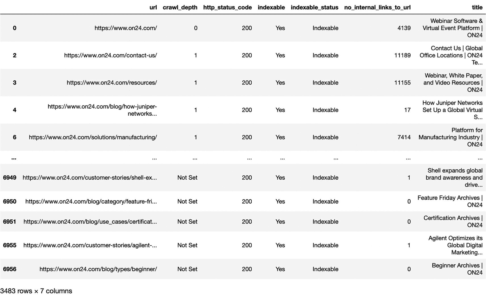

一张表格截图，数据包含 `url`、`crawl_depth`、`http_status_code`、`indexable`、`indexable_status`、`no_internal_links_to_url` 和 `title`。文中提到该数据框或表格有 3483 行和 7 列。

让我们按站点层级查看 URL 的数量。

```python
redir_live_urls.groupby(['crawl_depth']).size()
crawl_depth
0             1
1            66
2           169
3           280
4           253
5           201
6           122
7            64
8            17
9             6
10            1
Not Set    2303
dtype: int64
```

注意，数量略微下降到了 2303 个 URL。那 48 个不可索引的 URL 很可能是分页页面。

让我们将分布情况可视化：

```python
from plotnine import *
import matplotlib.pyplot as plt
pd.set_option('display.max_colwidth', None)
%matplotlib inline
# 按站点层级划分的指向 URL 的内部链接分布
ove_intlink_dist_plt = (ggplot(redir_live_urls, aes(x = 'no_internal_links_to_url')) +
geom_histogram(fill = 'blue', alpha = 0.6, bins = 7) +
labs(y = '# 指向 URL 的内部链接数') +
theme_classic() +
theme(legend_position = 'none')
)
ove_intlink_dist_plt.save(filename = 'images/1_overall_intlink_dist_plt.png',
height=5, width=5, units = 'in', dpi=1000)
ove_intlink_dist_plt
```

图 3-3 中的 `ove_intlink_dist_plt` 图是一个直方图，展示了指向一个 URL 的内部链接数量。

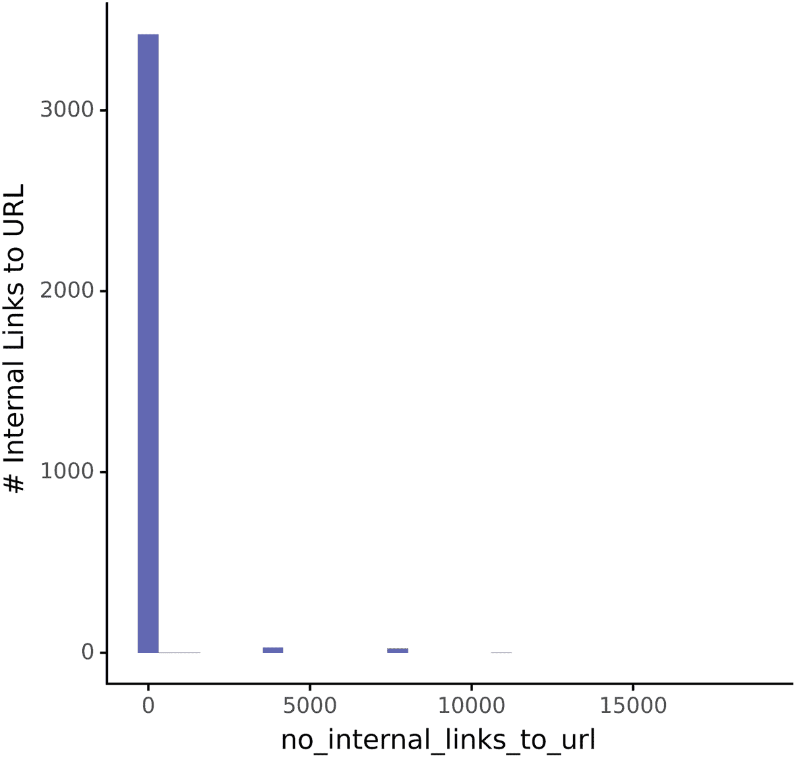

一个直方图绘制了指向 URL 的内部链接数量与 `no_internal_links_to_url` 的关系。最大范围大约在 (0, 3500) 处。

**图 3-3**  
指向一个 URL 的内部链接数量的直方图

该分布呈负偏态，大多数页面的链接数接近于零。这可能会引起 SEO 经理的担忧。

虽然整体分布提供了一种视角，但深入探究按爬取深度划分的内部链接分布会更好：

```python
redir_live_urls.groupby('crawl_depth').agg({'no_internal_links_to_url': ['describe']}).sort_values('crawl_depth')
```

结果如下：

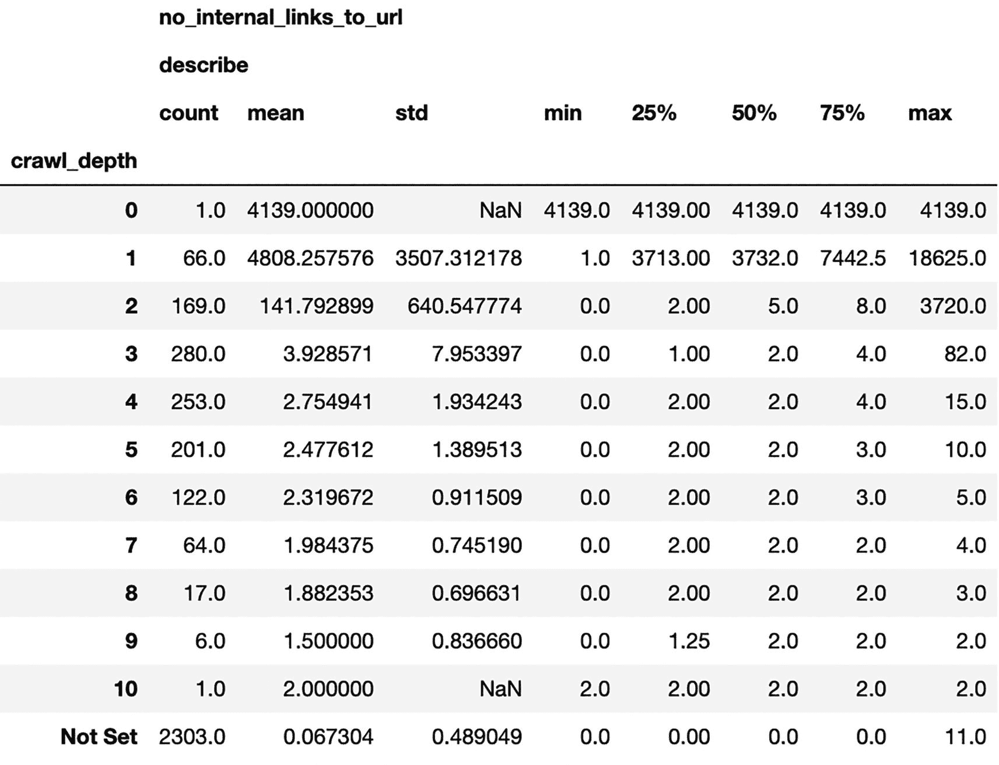

一张表格截图，展示了 `crawl_depth`、计数、均值、标准差、最小值、25%、50%、75% 和最大值的数据列表。表格顶部的文字是 `no_internal_links_to_url` 和 describe。

该表格描述了按爬取深度或站点层级划分的内部链接分布。任何距离首页 3 次或更多点击的 URL，平均预计有 2 个内部链接。这很可能是博客内容，因为营销团队会制作大量此类内容。

为了以图形方式可视化：

```python
from plotnine import *
import matplotlib.pyplot as plt
pd.set_option('display.max_colwidth', None)
%matplotlib inline
intlink_dist_plt = (ggplot(redir_live_urls, aes(x = 'crawl_depth', y = 'no_internal_links_to_url')) +
geom_boxplot(fill = 'blue', alpha = 0.8) +
labs(y = '# 指向 URL 的内部链接数', x = '站点层级') +
theme_classic() +
theme(legend_position = 'none')
)
intlink_dist_plt.save(filename = 'images/1_intlink_dist_plt.png', height=5, width=5, units = 'in', dpi=1000)
intlink_dist_plt
```

图 3-4 中的 `intlink_dist_plt` 图是一个箱线图，展示了按站点层级划分的指向一个 URL 的内部链接数量。

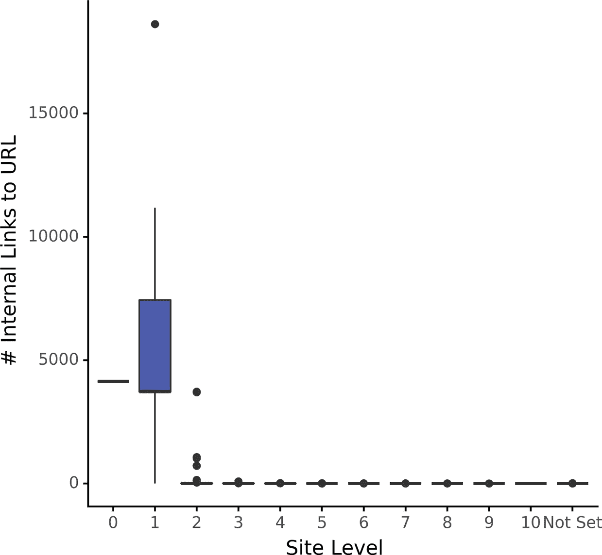

一个带有散点的箱线图展示了指向 URL 的内部链接数量与站点层级的关系。站点层级 1 的范围最大，其下四分位数和上四分位数大约在 4000 到 7000 之间。

**图 3-4**  
按站点层级划分的指向一个 URL 的内部链接数量的箱线图分布

正如所料，最大的变异出现在紧邻首页的第一层级，之后的层级变异非常小。

然而，我们可以比较站点层级 2 及更深层级内容的变异情况。为了快速查看，我们将对指向 URL 的内部链接数量使用对数刻度：

```python
from mizani.formatters import comma_format
intlink_dist_plt = (ggplot(redir_live_urls, aes(x = 'crawl_depth', y = 'no_internal_links_to_url')) +
geom_boxplot(fill = 'blue', alpha = 0.8) +
labs(y = '# 指向 URL 的内部链接数', x = '站点层级') +
scale_y_log10(labels = comma_format()) +
theme_classic() +
theme(legend_position = 'none')
)
intlink_dist_plt.save(filename = 'images/1_log_intlink_dist_plt.png', height=5, width=5, units = 'in', dpi=1000)
intlink_dist_plt
```

图片更清晰、更具洞察力，因为我们可以看到较低站点层级之间的分布相比彼此有多好、变化有多大（图 3-5）。

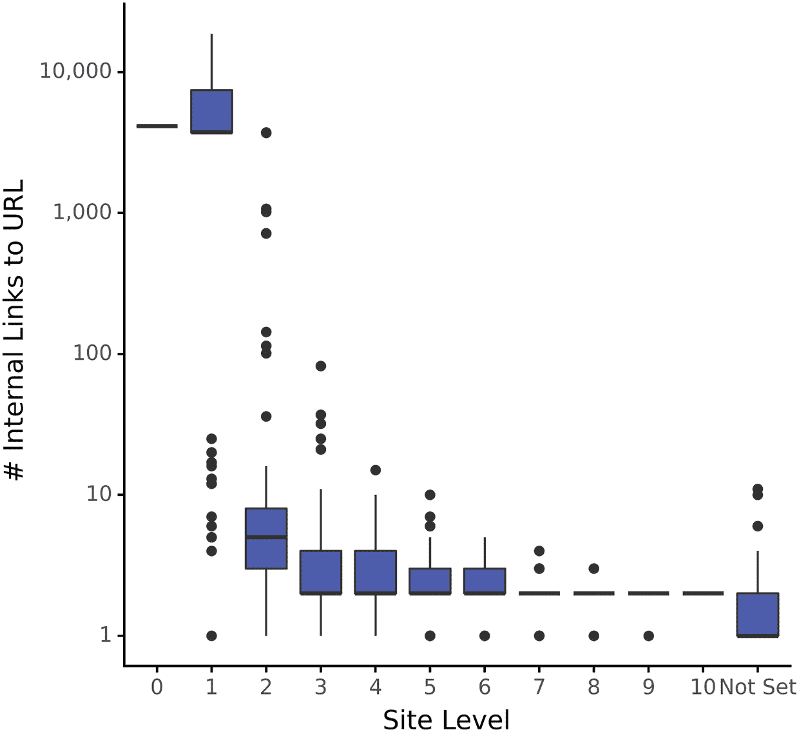

一个带有散点的箱线图展示了指向 URL 的内部链接数量与站点层级的关系。站点层级 1 的范围最大，其下四分位数和上四分位数大约在 6000 到 9000 之间，其次是站点层级 2。

**图 3-5**  
按站点层级划分的内部链接数量的箱线图分布（纵轴取对数）

例如，更明显的是，站点层级 2 上页面的入站内部链接中位数远高于较低层级。

同样非常明显的是，站点层级 3 和 4 中页面的内部入站链接变异高于层级 5 和 6。

不过请记住，前面的示例是通过对同一输入变量使用对数刻度实现的。

我们在这里学到的是，创建一个对内部链接取对数的新变量，将能提供一个更有帮助的视角来比较层级 2 到 10。

我们将通过创建一个新的列变量 `log_intlinks` 来实现这一点，该变量是内部链接计数的对数。为了避免对零取对数产生负无穷值，我们将在计算中加上 0.01：

```python
redir_live_urls['log_intlinks'] = np.log2(redir_live_urls['no_internal_links_to_url'] + .01)
```

现在，我们将使用新的对数化变量进行绘图：

```python
intlink_dist_plt = (ggplot(redir_live_urls, aes(x = 'crawl_depth', y = 'log_intlinks')) +
geom_boxplot(fill = 'blue', alpha = 0.8) +
labs(y = '# 指向 URL 的内部链接对数', x = '站点层级') +
theme_classic() +
theme(legend_position = 'none')
)
intlink_dist_plt.save(filename = 'images/1c_loglinks_dist_plt.png', height=5, width=5, units = 'in', dpi=1000)
intlink_dist_plt
```

`intlink_dist_plt` 图（图 3-6）与对数化刻度非常相似，只是这次数字更易读，因为我们使用了常规刻度作为纵轴。比较平均值和变异程度也更容易。

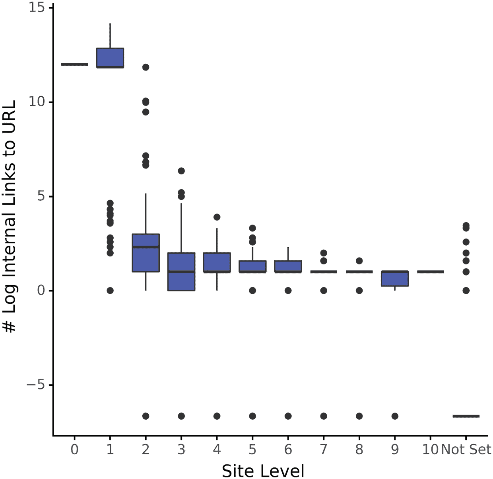

带点的箱线图展示了指向 URL 的对数化内部链接数量与站点层级的关系。站点层级 1 的范围最大，其下四分位数和上四分位数大约在 12 到 13 之间，其次是站点层级 2，范围在 1 到 3 之间。

**图 3-6** 按站点层级划分的对数化内部链接箱线图分布

### 站点层级中链接不足的 URL

现在我们已经了解了站点深度层级上分布的整体情况，可以开始深入挖掘，看看每个站点层级有多少 URL 存在链接不足的问题。

例如，如果某个站点层级上，指向 URL 的内部链接数量的第 35 百分位数为 10，那么有多少 URL 低于该百分位数？这正是我们要找出的答案。为什么是 35%而不是 25%？这其实无关紧要，只需要选择一个较低的分界点即可，因为分界点是人为设定的。

第一步是计算非对数和对数版本的内部链接平均值，稍后这些平均值将合并到主数据框中：

```python
intlink_dist = redir_live_urls.groupby('crawl_depth').agg({'no_internal_links_to_url': ['mean'],
'log_intlinks': ['mean']
}).reset_index()
intlink_dist.columns = ['_'.join(col) for col in intlink_dist.columns.values]
intlink_dist = intlink_dist.rename(columns = {'no_internal_links_to_url_mean': 'avg_int_links',
'log_intlinks_mean': 'logavg_int_links',
})
intlink_dist
```

结果如下：

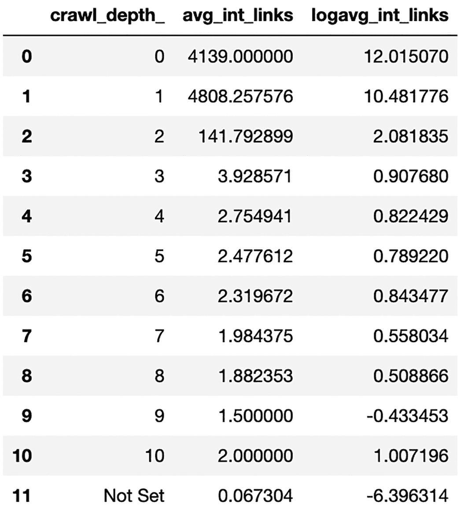

一张表格截图，数据位于列标题 `crawl_depth`、`avg_int_links` 和 `logavg_int_links` 下。行条目为数字 0 到 11。

平均值已按站点层级排列。注意，对数列如何帮助减少不同爬取深度之间数值范围的极端性和偏态性，例如，平均值的范围从 4239 到 0.06，而对数平均值的范围从 12 到 -6.39，这使得数据更容易标准化。

现在，我们将所有站点层级的下分位数设置为 35%。这将使用自定义函数 `quantile_lower`：

```python
def quantile_lower(x):
    return x.quantile(.35).round(0)

quantiled_intlinks = redir_live_urls.groupby('crawl_depth').agg({'log_intlinks':
[quantile_lower]}).reset_index()
quantiled_intlinks.columns = ['_'.join(col) for col in quantiled_intlinks.columns.values]
quantiled_intlinks = quantiled_intlinks.rename(columns = {'crawl_depth_': 'crawl_depth',
'log_intlinks_quantile_lower': 'sd_intlink_lowqua'})
quantiled_intlinks
```

结果如下：

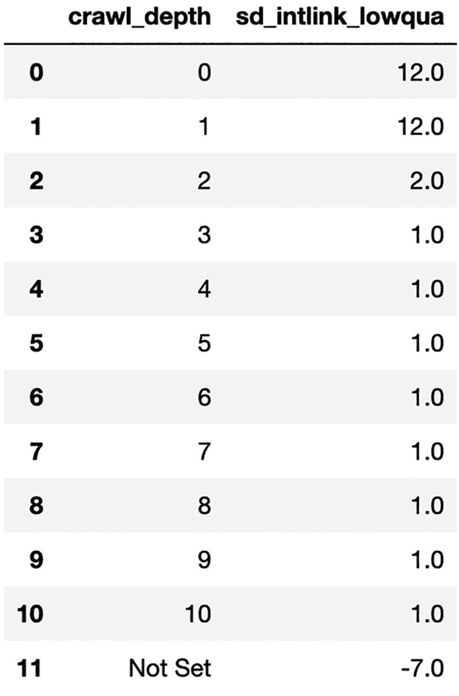

一张表格截图，数据位于列标题 `crawl_depth` 和 `sd_intlink_lowqua` 下。行条目为数字 0 到 11。

下分位数统计已设置完成。四分位数仅限于第 25 百分位数，而分位数则可以将下限设置为任意数值，例如第 11、18、24 百分位数等，这就是我们使用分位数而非四分位数的原因。接下来的步骤是将数据合并到主数据框中，然后应用一个函数来标记在其给定站点层级中链接不足的 URL：

```python
redir_live_urls_underidx = redir_live_urls.merge(quantiled_intlinks, on = 'crawl_depth', how = 'left')
```

以下函数用于评估 URL 的链接数量是否低于下分位数。如果是，则 `sd_int_uidx` 的值为 1，否则为 0：

```python
def sd_intlinkscount_underover(row):
    if row['sd_intlink_lowqua'] > row['log_intlinks']:
        val = 1
    else:
        val = 0
    return val

redir_live_urls_underidx['sd_int_uidx'] = redir_live_urls_underidx.apply(sd_intlinkscount_underover, axis=1)
```

还有一些代码用于处理“未设置”的情况，这些实际上是被孤立的 URL。在此例中，我们将这些 URL 设置为 1——表示它们链接不足：

```python
redir_live_urls_underidx['sd_int_uidx'] = np.where(redir_live_urls_underidx['crawl_depth'] == 'Not Set', 1,
redir_live_urls_underidx['sd_int_uidx'])
redir_live_urls_underidx
```

结果如下：

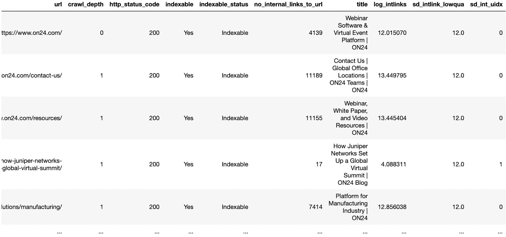

一张表格截图，数据位于列标题 `url`、`crawl_depth`、`http_status_code`、`indexable`、`indexable_status`、`no_internal_links_to_url`、`title` 以及其他 3 个列下。

数据框显示，该列已到位，将内部链接不足的 URL 标记为 `1`。标记好 URL 后，我们就可以概览 URL 的链接不足情况，这可以通过按爬取深度聚合，并求和链接不足的 URL 总数来实现：

```python
intlinks_agged = redir_live_urls_underidx.groupby('crawl_depth').agg({'sd_int_uidx': ['sum', 'count']}).reset_index()
```

下面一行代码通过列表推导式插入下划线来整理列名：

```python
intlinks_agged.columns = ['_'.join(col) for col in intlinks_agged.columns.values]
intlinks_agged = intlinks_agged.rename(columns = {'crawl_depth_': 'crawl_depth'})
```

为了得到比例（或百分比），我们将总和除以计数并乘以 100：

```python
intlinks_agged['sd_uidx_prop'] = (intlinks_agged.sd_int_uidx_sum) / intlinks_agged.sd_int_uidx_count * 100
print(intlinks_agged)
```

结果如下：

```python
crawl_depth  sd_int_uidx_sum  sd_int_uidx_count  sd_uidx_prop
0            0                0                  1      0.000000
1            1               38                 66     57.575758
2            2               67                169     39.644970
3            3               75                280     26.785714
4            4               57                253     22.529644
5            5               31                201     15.422886
6            6                9                122      7.377049
7            7                9                 64     14.062500
8            8                3                 17     17.647059
9            9                2                  6     33.333333
10          10                0                  1      0.000000
11     Not Set             2303               2303    100.000000
```

因此，尽管第 1 层和第 2 层的内容链接数量多于任何较低层级，但它们的链接不足 URL 比例高于任何其他站点层级（当然，除了“未设置”中的孤立页面）。例如，首页正下方的页面中有 57% 存在链接不足的情况。

让我们进行可视化：

```python
# plot the table
depth_uidx_plt = (ggplot(intlinks_agged, aes(x = 'crawl_depth', y = 'sd_int_uidx_sum')) +
geom_bar(stat = 'identity', fill = 'blue', alpha = 0.8) +
labs(y = '# Under Linked URLs', x = 'Site Level') +
scale_y_log10() +
theme_classic() +
theme(legend_position = 'none')
)
depth_uidx_plt.save(filename = 'images/1_depth_uidx_plt.png', height=5, width=5, units = 'in', dpi=1000)
depth_uidx_plt
```

使用 `depth_uidx_plt` 进行可视化是很好的，因为我们还可以看到（图 3-7）第 2、3 和 4 层在数量上拥有最多的链接不足 URL。

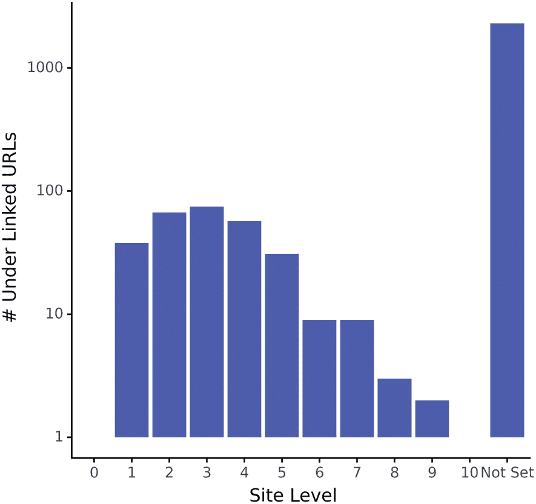

柱状图展示了从 0 到 10 以及“未设置”的站点层级中，链接不足 URL 的数量。 “未设置”范围包含超过 1000 个链接不足的 URL。 其他站点层级则少于 100 个链接不足的 URL。

**图 3-7** 按站点层级划分的内部链接不足 URL 数量的柱状图

让我们绘制 `intlinks_agged` 表格：

```python
depth_uidx_prop_plt = (ggplot(intlinks_agged, aes(x = 'crawl_depth', y = 'sd_uidx_prop')) +
geom_bar(stat = 'identity', fill = 'blue', alpha = 0.8) +
labs(y = '% URLs Under Linked', x = 'Site Level') +
theme_classic() +
theme(legend_position = 'none')
)
depth_uidx_prop_plt.save(filename = 'images/1_depth_uidx_prop_plt.png', height=5, width=5, units = 'in', dpi=1000)
depth_uidx_prop_plt
```

绘制 `depth_uidx_prop_plt`（图 3-8），我们看到尽管第 1 层的数量较低，但其比例却更高。 直观上，这表明有太多页面从首页链接，但链接分配不均。

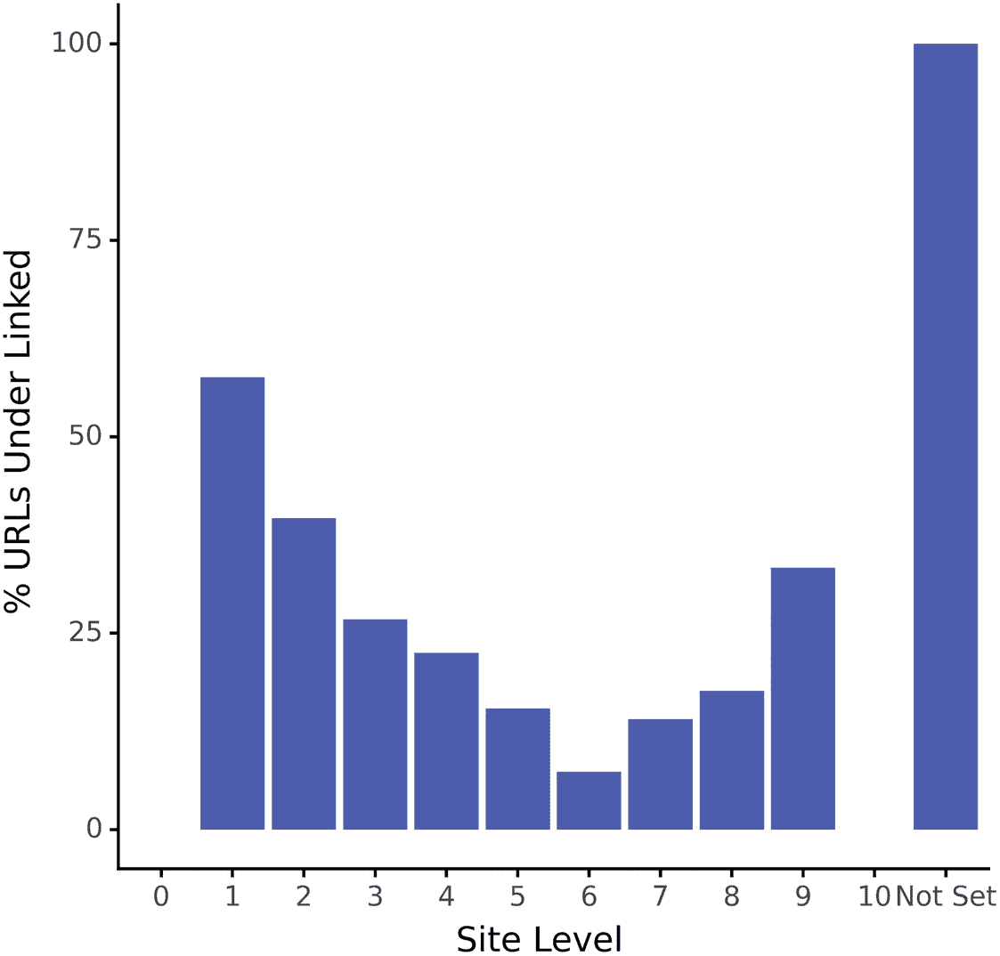

柱状图绘制了从 0 到 10 以及“未设置”的站点层级中，链接不足 URL 的百分比值。 在其他站点层级范围中，“未设置”范围的比例大约超过了 100%。

**图 3-8** 按站点层级划分的内部链接不足 URL 比例的柱状图

并非所有处于某个站点层级且链接不足的 URL 都一定是个问题，或者可能更多是设计使然。 然而，它们值得审查，因为也许它们本应处于该站点层级，或者毕竟它们确实应该获得更多的内部链接。

以下代码将链接不足的 URL 导出到一个 CSV 文件，该文件可以在 Microsoft Excel 中查看：

```python
underlinked_urls = redir_live_urls_underidx.loc[redir_live_urls_underidx.sd_int_uidx == 1]
underlinked_urls = underlinked_urls.sort_values(['crawl_depth', 'no_internal_links_to_url'])
underlinked_urls.to_csv('exports/underlinked_urls.csv')
```

### 按页面权威度划分

来自外部网站的入站链接是 PageRank（或者，如果我们保持搜索引擎中立的话，称为页面权威度）的来源。

鉴于并非所有页面都能获得入站链接，SEO 通常希望让没有反向链接的页面被更频繁地抓取。因此，分析并探索如何将这些 PageRank 重新分配给网站内其他页面是合理的。

我们首先将 AHREFs 数据附加到主数据框上，这样就能按页面权威度查看内部链接。

```python
intlinks_pageauth = redir_live_urls_underidx.merge(ahrefs_df, on = 'url', how = 'left')
intlinks_pageauth.head()
```

结果如下：

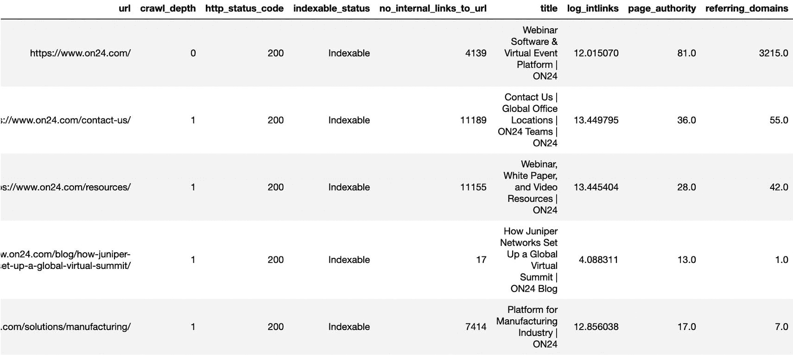

一张表格的截图，其列标题为：`url`、`crawl_depth`、`http_status_code`、`indexable_status`、`no_internal_links_to_url`、`title`、`log_internal_links`、`page_authority`和`referring_domains`。

现在我们在 URL 级别拥有了页面权威度和引荐域名。可以预见，首页拥有大量引荐域名（超过 3000 个），并且页面级权威度最高，达到 81。

像往常一样，我们将进行一些聚合操作，并探索 PageRank（可与页面权威度互换使用）的分布情况。

首先，我们清理数据，确保将空值替换为零：

```python
intlinks_pageauth['page_authority'] = np.where(intlinks_pageauth['page_authority'].isnull(),
0, intlinks_pageauth['page_authority'])
```

按页面权威度聚合：

```python
intlinks_pageauth.groupby('page_authority').agg({'no_internal_links_to_url': ['describe']})
```

结果如下：

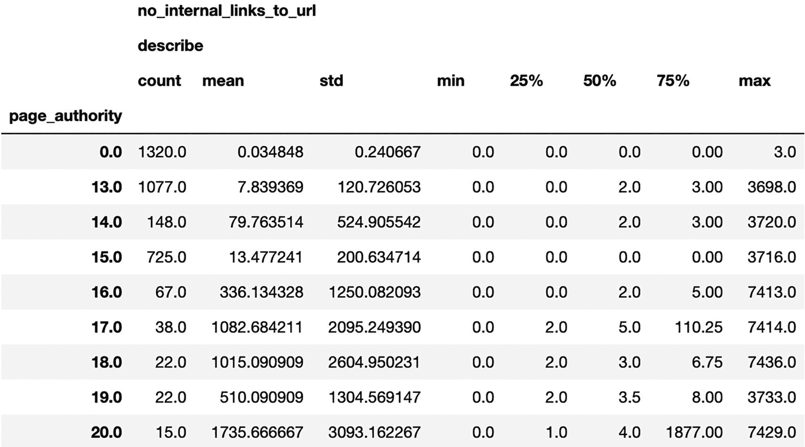

一张表格的截图，展示了页面权威度、计数、平均值、`std`、最小值、25%、50%、75%和最大值的数据列表。表格顶部的文字为`no_internal_links_to_url`和`describe`。

上表展示了不同页面权威度级别下内部链接的分布情况。

在较低级别，大多数 URL 大约有两个内部链接。

一张图表将为我们呈现全貌：

```python
# distribution of page_authority
page_authority_dist_plt = (ggplot(intlinks_pageauth, aes(x = 'page_authority')) +
geom_histogram(fill = 'blue', alpha = 0.6, bins = 30 ) +
labs(y = '# URLs', x = 'Page Authority') +
#scale_y_log10() +
theme_classic() +
theme(legend_position = 'none')
)
page_authority_dist_plt.save(filename = 'images/2_page_authority_dist_plt.png',
height=5, width=5, units = 'in', dpi=1000)
page_authority_dist_plt
```

`page_authority_dist_plt`（图 3-9）所示的分布，在绘制原始数据时呈现严重的负偏态。网站中大多数 URL 的 PageRank 为 15，而权威度更高的 URL 数量急剧减少。大量 URL 没有权威度，因为它们成为了孤页。

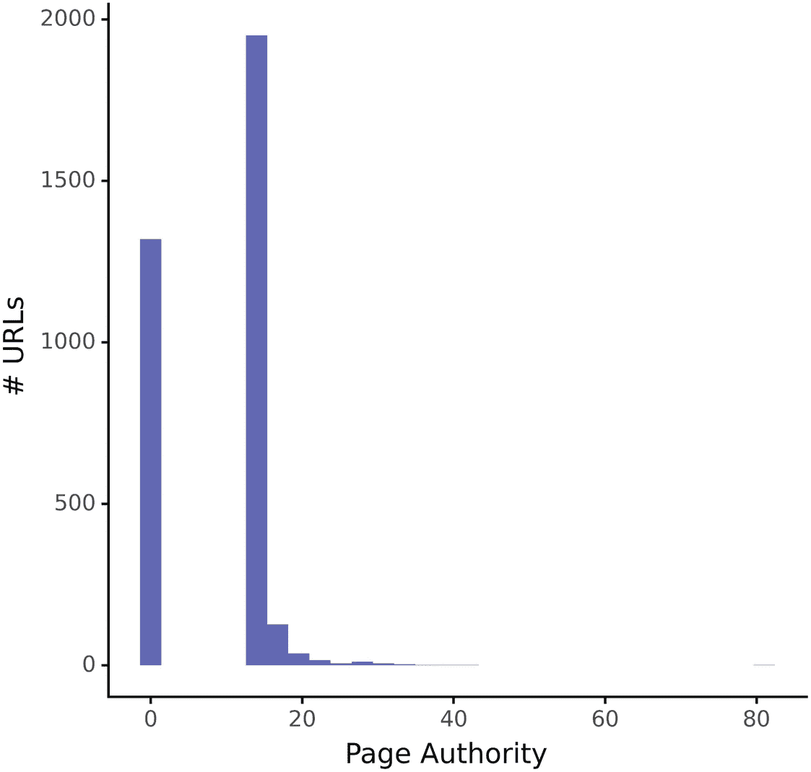

一张柱状图，绘制了 URL 数量（从 0 到 2000）与页面权威度（从 0 到 80）的关系。页面权威度为 0 时有 1300 个 URL，页面权威度在 12 左右时有 1900 个 URL。数值为近似值。

**图 3-9**  
按页面权威度划分的 URL 分布

使用对数刻度，我们可以比较更高权威度级别的情况：

```python
# distribution of page_authority
page_authority_dist_plt = (ggplot(intlinks_pageauth, aes(x = 'page_authority')) +
geom_histogram(fill = 'blue', alpha = 0.6, bins = 30 ) +
labs(y = '# URLs (Log)', x = 'Page Authority') +
scale_y_log10() +
theme_classic() +
theme(legend_position = 'none')
)
page_authority_dist_plt.save(filename = 'images/2_page_authority_dist_log_plt.png',
height=5, width=5, units = 'in', dpi=1000)
page_authority_dist_plt
```

突然间，`page_authority_dist_plt`（图 3-10）显示的视图变得更有趣了，因为权威度每增加一个单位，URL 数量就减少到之前的十分之一——这是一种相当严苛的 PageRank 分布。

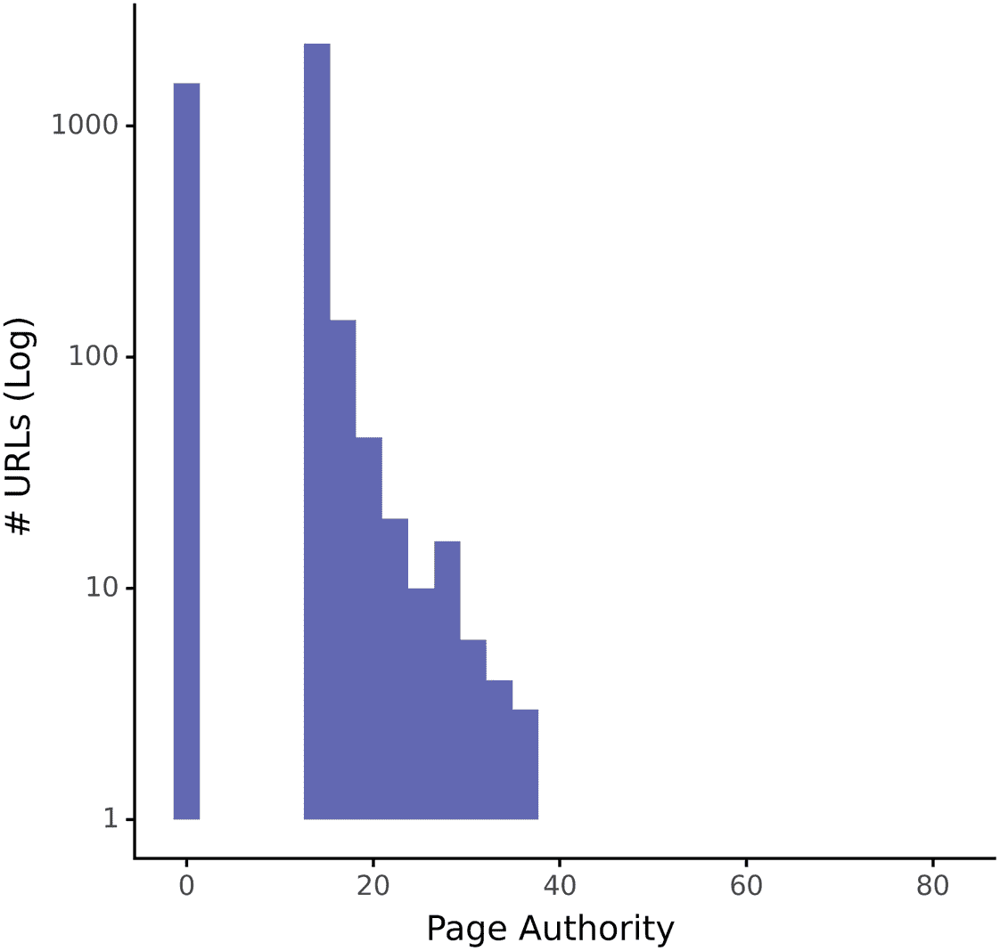

一张柱状图，以对数刻度绘制了 URL 数量与页面权威度的关系。图表趋势在页面权威度 0 到 40 之间是动态变化的。

**图 3-10**  
按对数刻度划分的 URL 分布图

鉴于这个更具洞察力的视图，对`page_authority`取对数以形成新的列变量`log_pa`是合理的：

```python
intlinks_pageauth['page_authority'] = np.where(intlinks_pageauth['page_authority'] == 0, .1, intlinks_pageauth['page_authority'])
intlinks_pageauth['log_pa'] = np.log2(intlinks_pageauth.page_authority)
intlinks_pageauth.head()
```

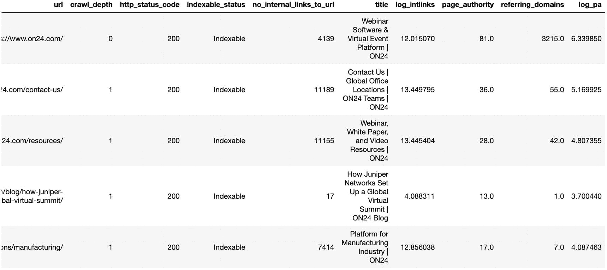

一张表格的截图，其列标题为：`url`、`crawl_depth`、`http_status_code`、`indexable_status`、`no_internal_links_to_url`、`title`、`log_internal_links`、`page_authority`、`referring_domains`和`log_pa`。

`log_pa`列已就位；让我们进行可视化：

```python
page_authority_trans_dist_plt = (ggplot(intlinks_pageauth, aes(x = 'log_pa')) +
geom_histogram(fill = 'blue', alpha = 0.6, bins = 30 ) +
labs(y = '# URLs (Log)', x = 'Log Page Authority') +
scale_y_log10() +
theme_classic() +
theme(legend_position = 'none')
)
page_authority_trans_dist_plt.save(filename = 'images/2_page_authority_trans_dist_plt.png',
height=5, width=5, units = 'in', dpi=1000)
page_authority_trans_dist_plt
```

如`page_authority_trans_dist_plt`（图 3-11）所示，取对数压缩了 PageRank 的范围，使其不那么极端，因为首页的`log_pa`值为 6，使其更接近网站的其他部分。

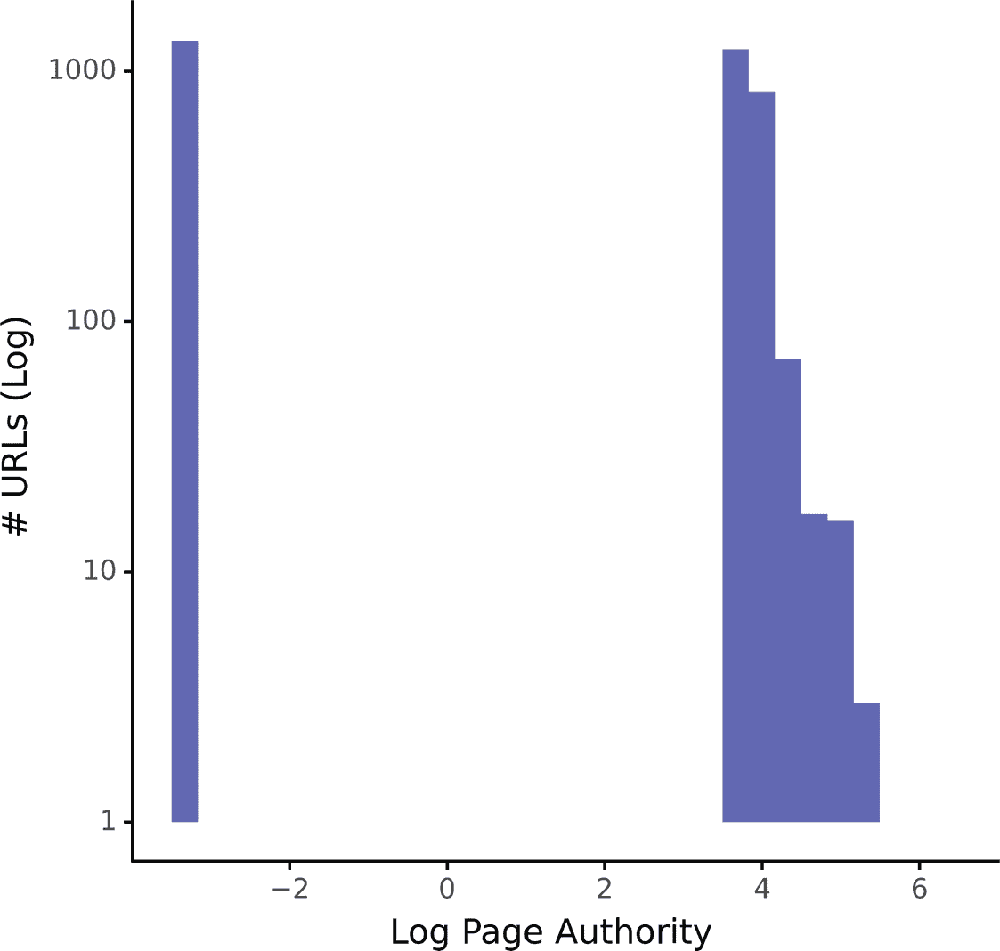

一张柱状图，以对数刻度（从 1 到 1000）绘制了 URL 数量与对数页面权威度（从-4 到 6）的关系。URL 数量最初很高，超过 1000，从 3.7 到 5.6 的范围内，URL 数量从 1100 减少到 5。数值为估计值。

**图 3-11**  
按对数页面权威度划分的 URL 分布

小数位将被四舍五入，以便更容易地对 3000 多个 URL 进行分类：

```python
intlinks_pageauth['pa_band'] = intlinks_pageauth['log_pa'].apply(np.floor)
# display updated DataFrame
intlinks_pageauth
```

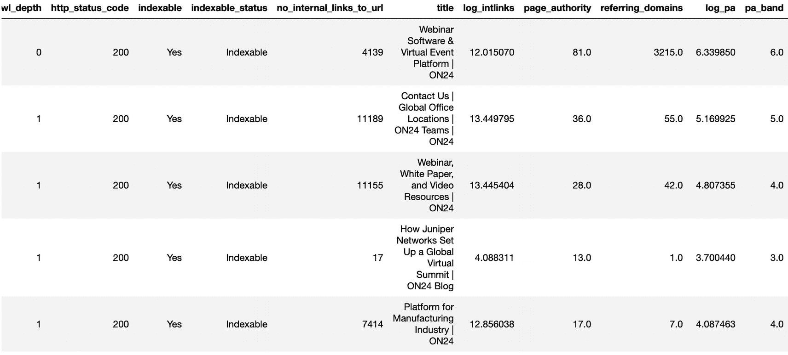

一张表格的截图，其列标题为：`crawl_depth`、`http_status_code`、`indexable`、`indexable_status`、`no_internal_links_to_url`、`title`、`log_internal_links`、`page_authority`、`referring_domains`、`log_pa`和`pa_band`。

### 内部链接不足的页面权威 URL

将 URL 按 PA（页面权威）等级分组后，我们需要检查它们的内链数量是否与其权威等级不匹配。我们将阈值设定为 40%，即任何 URL 在其 PA 等级下内链数量低于该阈值，即被视为“链接不足”。

在此阶段，选择 40%并非绝对重要，因为每个网站（甚至每个市场）情况各异。存在更科学的方法来确定最佳阈值，例如分析搜索空间中的顶级竞争对手；但现阶段，我们暂以 40%作为阈值。

```python
def quantile_lower(x):
return x.quantile(.4).round(0)
quantiled_pageau = intlinks_pageauth.groupby('pa_band').agg({'no_internal_links_to_url': [quantile_lower]}).reset_index()
quantiled_pageau.columns = ['_'.join(col) for col in quantiled_pageau.columns.values]
quantiled_pageau = quantiled_pageau.rename(columns = {'pa_band_': 'pa_band',
'no_internal_links_to_url_quantile_lower': 'pa_intlink_lowqua'})
quantiled_pageau
```

结果如下：

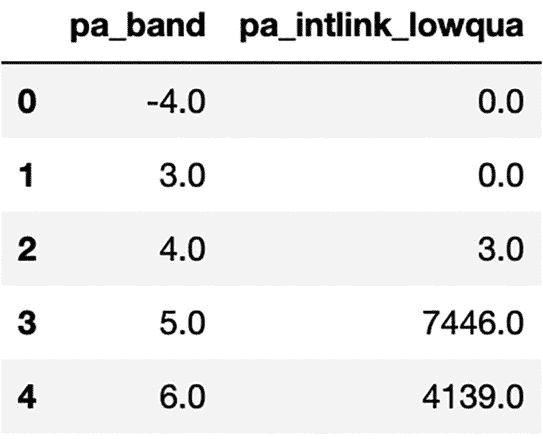

一张表格截图，列标题为`pa_band`和`pa_intlink_lowqua`，行条目为 0 到 4 的数字。

基于 PageRank，我们现在得到了预期的内链最低阈值。接下来合并数据，标记出那些在其权威等级下链接不足的 URL：

```python
intlinks_pageauth_underidx = intlinks_pageauth.merge(quantiled_pageau, on = 'pa_band', how = 'left')
def pa_intlinkscount_underover(row):
if row['pa_intlink_lowqua'] > row['no_internal_links_to_url']:
val = 1
else:
val = 0
return val
intlinks_pageauth_underidx['pa_int_uidx'] = intlinks_pageauth_underidx.apply(pa_intlinkscount_underover, axis=1)
```

此函数将允许我们进行聚合，以查看每个 PageRank 等级下有多少个 URL，以及其中有多少是链接不足的：

```python
pageauth_agged = intlinks_pageauth_underidx.groupby('pa_band').agg({'pa_int_uidx': ['sum', 'count']}).reset_index()
pageauth_agged.columns = ['_'.join(col) for col in pageauth_agged.columns.values]
pageauth_agged['uidx_prop'] = pageauth_agged.pa_int_uidx_sum / pageauth_agged.pa_int_uidx_count * 100
print(pageauth_agged)
```

结果如下：

```
pa_band_  pa_int_uidx_sum  pa_int_uidx_count  uidx_prop
0      -4.0                0               1320   0.000000
1       3.0                0               1950   0.000000
2       4.0               77                203  37.931034
3       5.0                4                  9  44.444444
4       6.0                0                  1   0.000000
```

大部分链接不足的内容似乎集中在页面权威最高的部分，这与网站层面的分析结论（即层级较低的页面链接不足）略有出入。这假设了大多数高权威页面更接近首页。

正确答案是什么？这取决于我们的目标。让我们继续深入分析，并将权威数据可视化：

```python
# distribution of page_authority
pageauth_agged_plt = (ggplot(intlinks_pageauth_underidx.loc[intlinks_pageauth_underidx['pa_int_uidx'] == 1],
aes(x = 'pa_band')) +
geom_histogram(fill = 'blue', alpha = 0.6, bins = 10) +
labs(y = '# URLs Under Linked', x = 'Page Authority Level') +
theme_classic() +
theme(legend_position = 'none')
)
pageauth_agged_plt.save(filename = 'images/2_pageauth_agged_hist.png',
height=5, width=5, units = 'in', dpi=1000)
pageauth_agged_plt
```

我们在`pageauth_agged_plt`（图 3-12）中看到，PageRank 等级 4 下有近 80 个 URL 链接不足，等级 5 下也有几个。不可否认，这是一个相当抽象的概念。

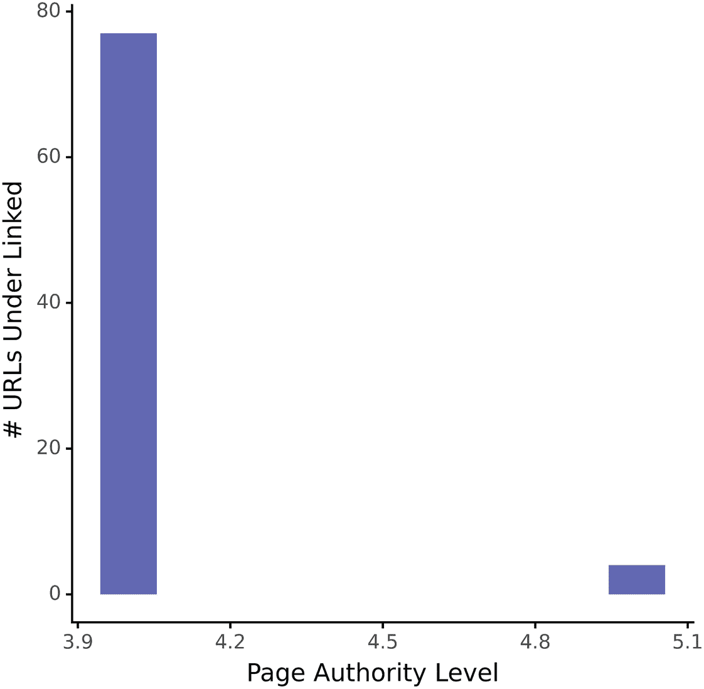

一张柱状图，横轴为页面权威等级（3.9 至 5.1），纵轴为链接不足的 URL 数量（0 至 80）。最大值位于(4.0, 78)，最小值位于(5.0, 5)。数值为近似值。

**图 3-12** 按页面权威等级划分的链接不足 URL 分布

### 内容类型

或许通过“快速粗略”的分析，利用第一级子目录按内容类型进行可视化会更有用：

```python
intlinks_content_underidx = intlinks_depthauth_underidx.copy()
```

为了获取第一级子文件夹，我们将定义一个函数，以便在失败时（例如首页 URL 没有子文件夹）继续执行操作。`k`参数指定 URL 中用于定位目标文件夹并解析子目录名称的斜杠数量：

```python
def get_folder(fp, k=3):
try:
return os.path.split(fp)[0].split(os.sep)[k]
except:
return 'home'
intlinks_content_underidx['content'] = intlinks_content_underidx['url'].apply(lambda x: get_folder(x))
```

检查按子文件夹划分的链接分布：

```python
intlinks_content_underidx.groupby('content').agg({'no_internal_links_to_url': ['describe']})
```

结果如下：

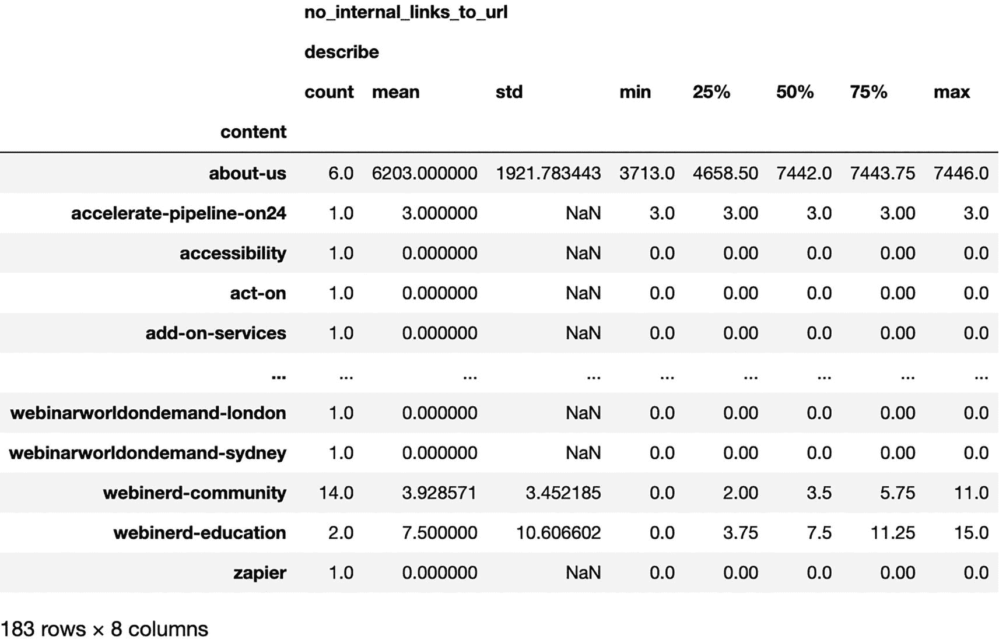

一张表格截图，列出了`content`、`count`、`mean`、`std`、`min`、`25%`、`50%`、`75%`和`max`下的数据。表格顶部文字为`no_internal_links_to_url`和`describe`。该数据框或表格共有 183 行和 8 列。

哇，183 个子文件夹！这对于分类分析来说太多了。我们可以使用第 9 章描述的 n-gram 技术将其分解并聚合为更少的类别；欢迎尝试。

无论如何，网站架构似乎过于扁平，可以更好地结构化，使其更具层次性，即更像金字塔结构。

此外，许多内容文件夹只有一个入站内链，因此即使没有数据科学的帮助，也明显需要 SEO 关注。

## 结合站点层级与页面权威性

将站点层级与页面权威性结合起来进行可视化，或许会更有用？

```python
intlinks_depthauth_underidx = intlinks_pageauth_underidx.copy()
intlinks_depthauth_underidx['depthauth_uidx'] = np.where((intlinks_depthauth_underidx['sd_int_uidx'] +
intlinks_depthauth_underidx['pa_int_uidx'] == 2), 1, 0)
'''intlinks_depthauth_underidx['depthauth_uidx'] = np.where((intlinks_depthauth_underidx['sd_int_uidx'] == 1) &
(intlinks_depthauth_underidx['pa_int_uidx'] == 1), 1, 0)'''
depthauth_uidx = intlinks_depthauth_underidx.groupby(['crawl_depth', 'pa_band']).agg({'depthauth_uidx': 'sum'}).reset_index()
depthauth_urls = intlinks_depthauth_underidx.groupby(['crawl_depth', 'pa_band']).agg({'url': 'count'}).reset_index()
depthauth_stats = depthauth_uidx.merge(depthauth_urls,
on = ['crawl_depth', 'pa_band'], how = 'left')
depthauth_stats['depthauth_uidx_prop'] = (depthauth_stats['depthauth_uidx'] / depthauth_stats['url']).round(2)
depthauth_stats.sort_values('depthauth_uidx', ascending = False)
```

结果如下：

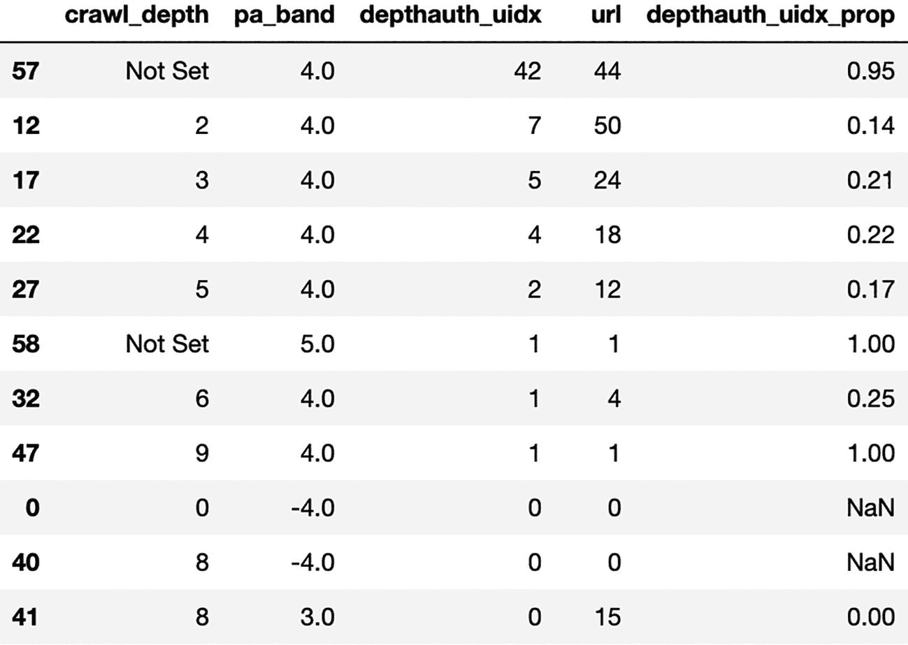

一张表格截图，其列标题分别为 `crawl_depth`、`pa_band`、`depthauth_uidx`、`url`、`depthauth_uidx_prop`。

大多数内链不足的 URL 都是孤立页面，并且具有页面权威性（可能来自反向链接）。

进行可视化以获取更全面的信息：

```python
depthauth_stats_plt = (
ggplot(depthauth_stats,
aes(x = 'pa_band', y = 'crawl_depth', fill = 'depthauth_uidx')) +
geom_tile(stat = 'identity', alpha = 0.6) +
labs(y = '', x = '') +
theme_classic() +
theme(legend_position = 'right')
)
depthauth_stats_plt.save(filename = 'images/3_depthauth_stats_plt.png',
height=5, width=10, units = 'in', dpi=1000)
depthauth_stats_plt
```

至此，我们得到了 `depthauth_stats_plt`（图 3-13），它显示大部分注意力应集中在孤立 URL 上（这本来就是应该做的），但更重要的是，我们知道了哪些孤立 URL 需要优先处理。

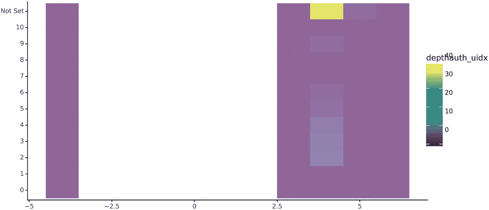

一张关于页面权威性级别、站点层级和内链不足 URL 的热力图，其数值大多较低。`depthauth_uidx` 的渐变标尺范围从 0 到 40。

**图 3-13** 页面权威性级别、站点层级与内链不足 URL 的热力图

我们还可以看到问题的严重程度。第二高优先级的索引不足 URL 组位于站点层级 2、3 和 4。

## 锚文本

如果说数量及其分布代表了内部链接的量化方面，那么锚文本则可以代表其质量。

锚文本向搜索引擎和用户提示，点击超链接后会看到什么内容。这使得锚文本成为一个重要的信号，值得优化。

我们首先汇总来自 Sitebulb 的爬取数据，以了解问题概况：

```python
anchor_issues_agg = crawl_data.agg({'no_anchors_with_empty_href': ['sum'],
'no_anchors_with_leading_or_trailing_whitespace_in_href': ['sum'],
'no_anchors_with_local_file': ['sum'],
'no_anchors_with_localhost': ['sum'],
'no_anchors_with_malformed_href': ['sum'],
'no_anchors_with_no_text': ['sum'],
'no_anchors_with_non_descriptive_text': ['sum'],
'no_anchors_with_non-http_protocol_in_href': ['sum'],
'no_anchors_with_url_in_onclick': ['sum'],
'no_anchors_with_username_and_password_in_href': ['sum'],
'no_image_anchors_with_no_alt_text': ['sum']
}).reset_index()
anchor_issues_agg = pd.melt(anchor_issues_agg, var_name=['issues'],
value_vars=['no_anchors_with_empty_href',
'no_anchors_with_leading_or_trailing_whitespace_in_href',
'no_anchors_with_local_file','no_anchors_with_localhost',
'no_anchors_with_malformed_href', 'no_anchors_with_no_text',
'no_anchors_with_non_descriptive_text',
'no_anchors_with_non-http_protocol_in_href',
'no_anchors_with_url_in_onclick',
'no_anchors_with_username_and_password_in_href',
'no_image_anchors_with_no_alt_text'],
value_name='instances'
)
anchor_issues_agg
```

结果如下：

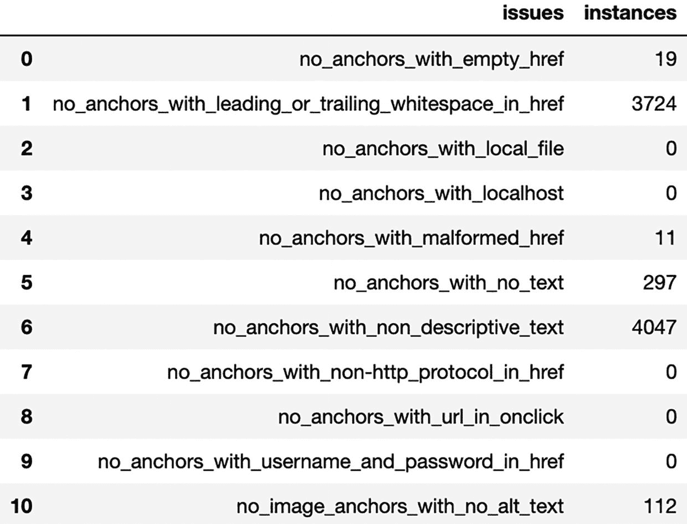

一张表格截图，其列标题分别为 `issues` 和 `instances`。行条目为 0 到 10 的数字。

超过 4000 个链接没有描述性锚文本，这是最常见的问题，更不用说还有 19 个锚点带有空的 `HREF`（尽管数量非常少）。

进行可视化：

```python
anchor_issues_count_plt = (ggplot(anchor_issues_agg, aes(x = 'reorder(issues, instances)', y = 'instances')) +
geom_bar(stat = 'identity', fill = 'blue', alpha = 0.6) +
labs(y = '# instances of Anchor Text Issues', x = '') +
theme_classic() +
coord_flip() +
theme(legend_position = 'none')
)
anchor_issues_count_plt.save(filename = 'images/4_anchor_issues_count_plt.png',
height=5, width=5, units = 'in', dpi=1000)
anchor_issues_count_plt
```

`anchor_issues_count_plt`（图 3-14）直观地确认了具有非描述性锚文本的内部链接数量。

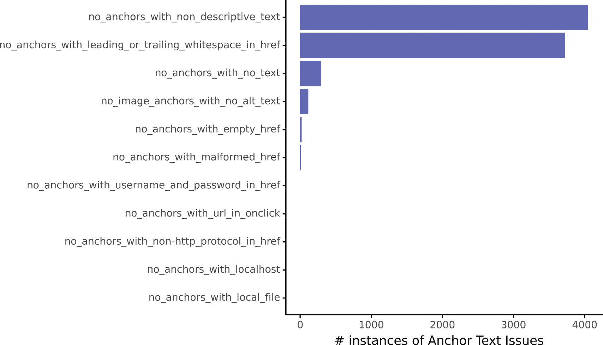

一张水平条形图，展示了锚文本问题的实例数量。`no_anchors_with_non_descriptive_text` 的范围为 4000，其次是 `no_anchors_with_leading_or_trailing_whitespace_in_href`，为 3700。数值为近似值。

**图 3-14** 锚文本问题条形图

### 按站点层级划分的锚点问题

我们将按站点层级深入分析前面的示例，以便更清晰地了解问题所在：

```python
anchor_issues_levels = crawl_data.groupby('crawl_depth').agg({'no_anchors_with_empty_href': ['sum'],
'no_anchors_with_leading_or_trailing_whitespace_in_href': ['sum'],
'no_anchors_with_local_file': ['sum'],
'no_anchors_with_localhost': ['sum'],
'no_anchors_with_malformed_href': ['sum'],
'no_anchors_with_no_text': ['sum'],
'no_anchors_with_non_descriptive_text': ['sum'],
'no_anchors_with_non-http_protocol_in_href': ['sum'],
'no_anchors_with_url_in_onclick': ['sum'],
'no_anchors_with_username_and_password_in_href': ['sum'],
'no_image_anchors_with_no_alt_text': ['sum']
}).reset_index()
anchor_issues_levels.columns = ['_'.join(col) for col in anchor_issues_levels.columns.values]
anchor_issues_levels.columns = [str.replace(col, '_sum', '') for col in anchor_issues_levels.columns.values]
anchor_issues_levels.columns = [str.replace(col, 'no_anchors_with_', '') for col in anchor_issues_levels.columns.values]
anchor_issues_levels = anchor_issues_levels.rename(columns = {'crawl_depth_': 'crawl_depth'})
anchor_issues_levels = pd.melt(anchor_issues_levels, id_vars=['crawl_depth'], var_name=['issues'],
value_vars=['empty_href',
'leading_or_trailing_whitespace_in_href',
'local_file','localhost',
'malformed_href', 'no_text',
'non_descriptive_text',
'non-http_protocol_in_href',
'url_in_onclick',
'username_and_password_in_href',
'no_image_anchors_with_no_alt_text'],
value_name='instances'
)
print(anchor_issues_levels)
```

结果如下：

```
crawl_depth                                  issues  instances
111     Not Set                    non_descriptive_text       2458
31      Not Set  leading_or_trailing_whitespace_in_href       2295
104           3                    non_descriptive_text        350
24            3  leading_or_trailing_whitespace_in_href        328
105           4                    non_descriptive_text        307
..          ...                                     ...        ...
85           13                                 no_text          0
84           12                                 no_text          0
83           11                                 no_text          0
82           10                                 no_text          0
0             0                              empty_href          0
[176 rows x 3 columns]
```

大多数问题出现在孤立页面上，其次是深度为三到四层的 URL。

可视化效果如下：

```python
anchor_levels_issues_count_plt = (ggplot(anchor_issues_levels, aes(x = 'crawl_depth',
y = 'issues', fill = 'instances')) +
geom_tile() +
labs(y = '# instances of Anchor Text Issues', x = '') +
scale_fill_cmap(cmap_name='viridis') +
theme_classic()
)
anchor_levels_issues_count_plt.save(filename = 'images/4_anchor_levels_issues_count_plt.png',
height=5, width=5, units = 'in', dpi=1000)
anchor_levels_issues_count_plt
```

`anchor_levels_issues_count_plt` 图表（图 3-15）使问题更加清晰：锚文本的技术问题主要出现在孤立页面上。

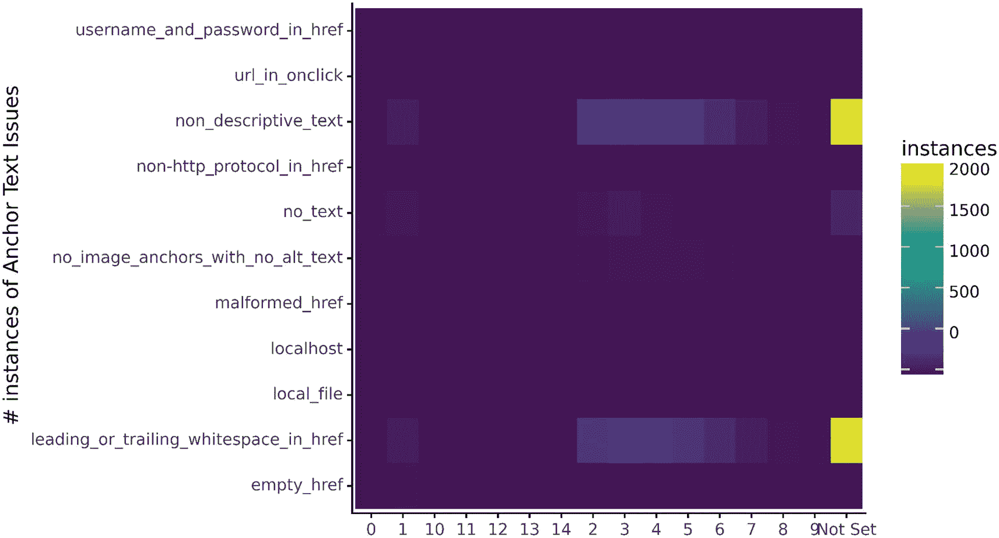

热力图绘制了锚文本问题实例数量与站点层级（从 0 到 9，以及未设置）的对应关系。实例数量的渐变标尺范围为 0 到 2000。未设置层级在非描述性文本和 `href` 中前导或尾随空格方面拥有最多的实例。

**图 3-15** 站点层级、锚文本问题及实例的热力图

## 锚文本相关性

当然，这并不是 SEO 人员对锚文本唯一感兴趣的方面。SEO 人员还想了解锚文本与目标 URL 之间的相关程度。

为此，我们将对 Sitebulb 链接报告使用字符串匹配技术来衡量这种相关性，然后进行汇总以查看整体情况：

```python
link_df = link_data[['target_url', 'referring_url', 'anchor_text', 'location']]
link_df = link_df.rename(columns = {'target_url':'url'})
```

使用 `url` 作为主键与爬取数据合并，然后仅筛选出可索引的 URL：

```python
anchor_merge = crawl_data.merge(link_df, on = 'url', how = 'left')
anchor_merge = anchor_merge.loc[anchor_merge['host'] == website]
anchor_merge = anchor_merge.loc[anchor_merge['indexable'] == 'Yes']
anchor_merge['crawl_depth'] = anchor_merge['crawl_depth'].astype('category')
anchor_merge['crawl_depth'] = anchor_merge['crawl_depth'].cat.reorder_categories(['0', '1', '2', '3', '4',
'5', '6', '7', '8', '9',
'10', 'Not Set'])
```

然后，我们比较锚文本与目标 URL 标题标签的字符串相似度：

```python
anchor_merge['anchor_relevance'] = anchor_merge.loc[:, ['title',
'anchor_text']].apply(lambda x: sorensen_dice(*x), axis=1)
```

任何相关性得分低于 70% 的 URL 将在新列 `irrel_anchors` 中被标记为不相关，值为 1。

为什么是 70%？这是基于经验得出的，您完全可以尝试不同的阈值。

使用 Sorensen-Dice 算法，它不仅速度快，而且能满足 SEO 衡量相关性的需求。70% 似乎是相关与不相关之间的合理界限，尤其是在考虑标题标签字符串中的站点标识时：

```python
anchor_merge['irrel_anchors'] = np.where(anchor_merge['anchor_relevance'] < .7, 1, 0)
```

使用单一因子可以更轻松地按列聚合整个数据框，尽管还有其他方法可以实现：

```python
anchor_merge['project'] = target_name
anchor_merge
```

结果如下：

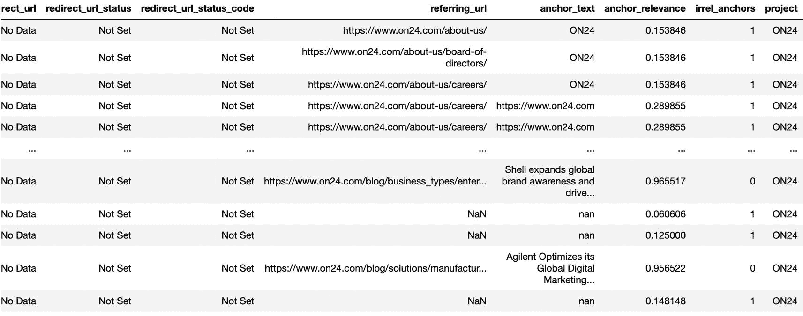

一张表格的截图显示了列标题 `rect_url`、`redirect_url_status`、`redirect_url_status_code`、`referring_url`、`anchor_text`、`anchor_relevance`、`irrelevant_anchors` 和 `project` 下的数据。

由于引用页面和目标 URL 之间存在多对多关系（即一个目标 URL 可以接收来自多个 URL 的链接，而前者也可以链接到多个 URL），数据框已从 8611 行扩展到超过 350,000 行。

让我们通过统计每个引用 URL 的 URL 数量来进行汇总：

```python
anchor_rel_stats_site_agg = anchor_merge.groupby('project').agg({'irrel_anchors': 'sum'}).reset_index()
anchor_rel_stats_site_agg['total_urls'] = anchor_merge.shape[0]
anchor_rel_stats_site_agg['irrel_anchors_prop'] = anchor_rel_stats_site_agg['irrel_anchors'] /anchor_rel_stats_site_agg['total_urls']
print(anchor_rel_stats_site_agg)
project  irrel_anchors  total_urls  irrel_anchors_prop
0    ON24         333946      350643            0.952382
```

该站点约 95% 的锚文本是不相关的。这与他们的竞争对手相比如何？这是留给您的作业。

让我们再深入一点，按站点深度分析这个问题：

```python
anchor_rel_depth_irrels = anchor_merge.groupby(['crawl_depth']).agg({'irrel_anchors': 'sum'}).reset_index()
anchor_rel_depth_urls = anchor_merge.groupby(['crawl_depth']).agg({'project': 'count'}).reset_index()
anchor_rel_depth_stats = anchor_rel_depth_irrels.merge(anchor_rel_depth_urls, on = 'crawl_depth', how = 'left')
anchor_rel_depth_stats['irrel_anchors_prop'] = anchor_rel_depth_stats['irrel_anchors'] / anchor_rel_depth_stats['project']
anchor_rel_depth_stats
```

结果如下：

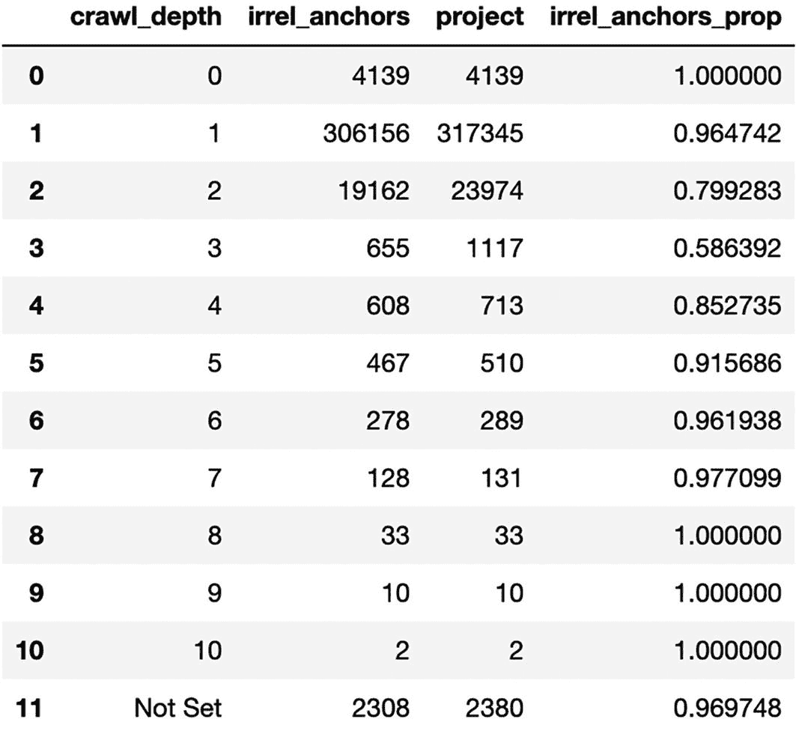

# 锚点文本分析

一张表格的截图显示了以下列标题下的数据：`crawl_underscore_depth`、`irrelevant_underscore_anchors`、`project` 和 `irrelevant_underscore_anchors_underscore_prop`。行条目是从 0 到 11 的数字。

实际上，除了距离主页三次点击以内的页面（可能是博客文章）之外，所有网站层级上的几乎所有内容都包含无关锚点。

让我们进行可视化：

```python
# anchor issues text
anchor_rel_stats_site_agg_plt = (ggplot(anchor_rel_depth_stats,
aes(x = 'crawl_depth', y = 'irrel_anchors_prop')) +
geom_bar(stat = 'identity', fill = 'blue', alpha = 0.6) +
labs(y = '# irrel_anchors', x = '') +
#scale_y_log10() +
theme_classic() +
coord_flip() +
theme(legend_position = 'none')
)
anchor_rel_stats_site_agg_plt.save(filename = 'images/3_anchor_rel_stats_site_agg_plt.png',
height=5, width=5, units = 'in', dpi=1000)
anchor_rel_stats_site_agg_plt
```

按网站层级划分的无关锚点显示在 `anchor_rel_stats_site_agg_plt` 图表中（图 3-16），从中我们可以看到，这种情况几乎是全站范围的，只是在第 3 层级的 URL 上实例较少。

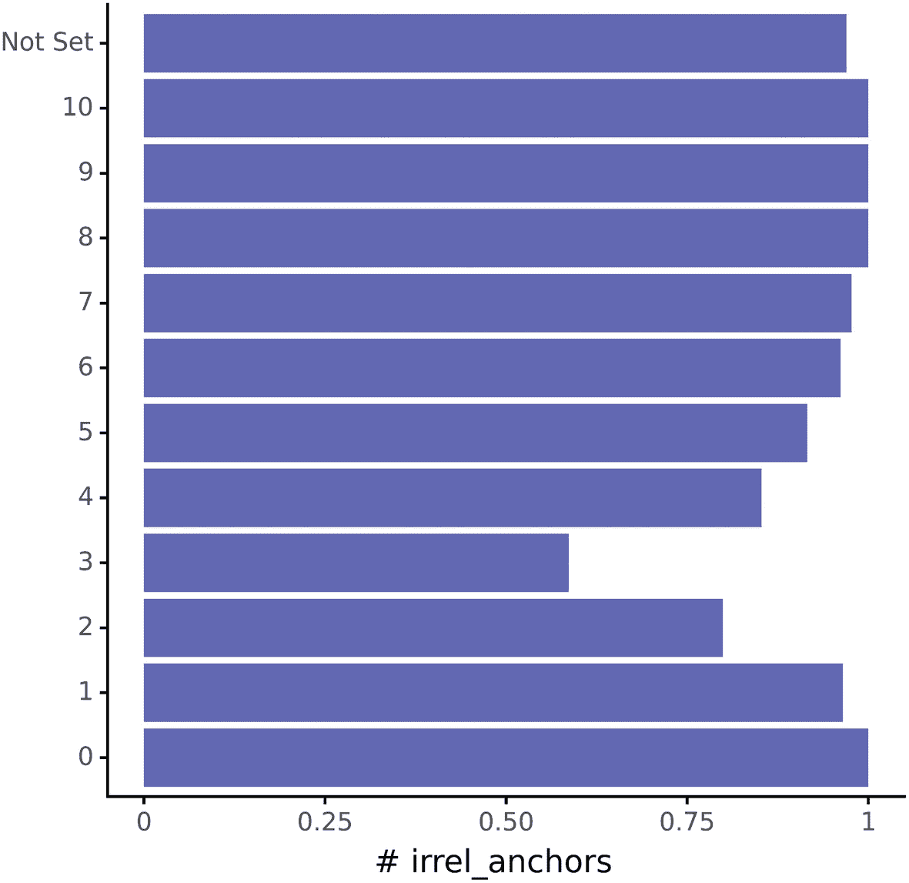

一张水平条形图绘制了从 0 到 10 的网站层级以及“未设置”项，与从 0 到 1 的无关锚点数量。几乎所有网站层级的值都很高，除了第 2、3 和 4 层级，其值分别为 0.80、0.55 和 0.85。这些值是估算值。

**图 3-16** 按网站层级划分的无关锚点文本条形图

## 位置

通过查看锚点的位置，可以获得更多见解：

```python
anchor_rel_locat_irrels = anchor_merge.groupby(['location']).agg({'irrel_anchors': 'sum'}).reset_index()
anchor_rel_locat_urls = anchor_merge.groupby(['location']).agg({'project': 'count'}).reset_index()
anchor_rel_locat_stats = anchor_rel_locat_irrels.merge(anchor_rel_locat_urls, on = 'location', how = 'left')
anchor_rel_locat_stats['irrel_anchors_prop'] = anchor_rel_locat_stats['irrel_anchors'] / anchor_rel_locat_stats['project']
anchor_rel_locat_stats
```

结果如下：

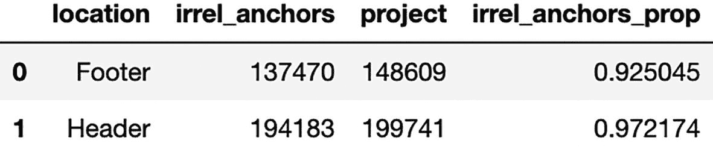

一张表格的截图显示了以下列标题下的数据：`location`、`irrelevant_underscore_anchors`、`project` 和 `irrelevant_underscores_anchors_underscore_prop`，共有 2 行条目（0 和 1）。

无关锚点位于页眉或页脚中，这使得它们相对容易解决。

## 锚点文本词汇

让我们看看锚点文本本身。锚点文本是构成 HTML 超链接的词语。搜索引擎使用这些词语来为被链接的页面赋予一定的含义。

自然地，搜索引擎会对那些准确描述其所链接页面内容的锚点文本给予更高的评分，因为如果用户确实点击了该链接，他们将获得良好的内容体验，从而符合锚点文本所创造的期望。

我们将从查看网站中最常用的锚点文本词汇开始：

```python
anchor_count = anchor_merge[['anchor_text']].copy()
anchor_count['count'] = 1
anchor_count_agg = anchor_count.groupby('anchor_text').agg({'count': 'sum'}).reset_index()
anchor_count_agg = anchor_count_agg.sort_values('count', ascending = False)
anchor_count_agg
```

结果如下：

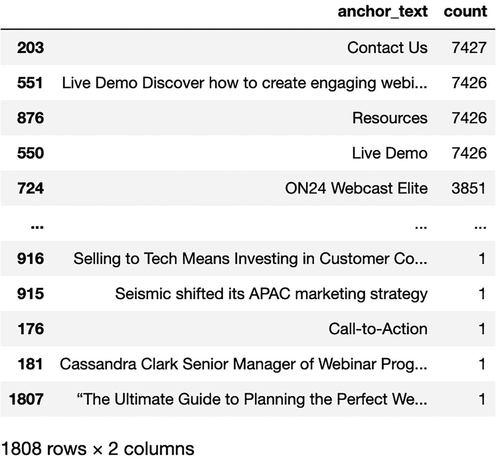

一张表格的截图显示了以下列标题下的数据：`anchor_text` 和 `count`。提到该数据框或表格有 1808 行和 2 列。

有超过 1,808 种不同的锚点文本，其中“Contact Us”是最受欢迎的，其次是“Live Demo”和“Resources”。

让我们使用词云进行可视化。我们需要导入 `WordCloud` 包并将数据框转换为字典：

```python
from wordcloud import WordCloud
data = anchor_count_agg.set_index('anchor_text').to_dict()['count']
data
{'Contact Us ': 7427,
'Live Demo Discover how to create engaging webinar experiences designed to cativate and convert your audience. ': 7426,
'Resources ': 7426,
'Live Demo ': 7426,
'ON24 Webcast Elite ': 3851,
'ON24 platform ': 3806,
'Press Releases ': 3799, …}
```

转换完成后，我们将数据输入到 `wordcloud` 函数中，并将数据限制为最受欢迎的 200 个锚点：

```python
wc = WordCloud(background_color='white',
width=800, height=400,
max_words=30).generate_from_frequencies(anchor_count_agg)
import matplotlib.pyplot as plt
plt.figure(figsize=(10, 10))
plt.imshow(wc, interpolation='bilinear')
plt.axis('off')
# Save image
wc.to_file("images/wordcloud.png")
plt.show()
```

该词云（图 3-17）可用于管理演示。其中有一些相当长的锚点文本！


一张常用锚点文本词云的截图。一些词语包括：`a live demo`、`contact us`、`press releases`、`blog`、`executive team`、`overview`、`virtual events` 和 `partner program`。

**图 3-17** 最常用锚点文本的词云

从这一点出发，接下来的行动是寻找半自动化的规则来提高锚点文本的相关性，由于这些锚点位于页眉或页脚中，这一任务会相对容易一些。

## 核心网页指标 (CWV)

核心网页指标 (CWV) 是 Google 的一项倡议，旨在帮助网站提供更好的用户体验。这包括速度、加载期间的页面稳定性，以及网页变得可供用户交互所需的时间。那么，如果 CWV 是关于用户的，为什么它会被放在技术部分呢？

那些较少被宣传的技术性 SEO 优势，有助于 Google（以及其他搜索引擎）主要节省计算资源来抓取和渲染网站。因此，这对于搜索引擎、用户和网站管理员来说是一个巨大的三赢局面。

所以，通过追求 CWV，你实际上是在增加你的抓取和渲染预算，这有利于你的技术性 SEO。

然而，技术性 SEO 对营销团队的吸引力不大，而如果你能暗示排名提升的好处来证明改进 CWV 的网站开发工作是合理的，那么向营销团队推销起来就容易得多。这正是我们在本节中要努力实现的目标。

我们将从整体概况开始，展示整体的竞争格局，然后再深入分析网站本身，以便利用数据来确定开发的优先级。

### 景观

```python
import re
import time
import random
import pandas as pd
import numpy as np
import requests
import json
import plotnine
import tldextract
from plotnine import *
from mizani.transforms import trans
from client import RestClient
target_bu = 'boundless'
target_site = 'https://boundlesshq.com/'
target_name = target_bu
```

我们首先使用 `pandas.read_csv` 函数获取目标关键词的搜索引擎结果页面（SERPs）。我们关注的是 URL，它将作为查询 Google PageSpeed API 的输入，从而获取核心网页指标（CWV）的度量值：

```python
desktop_serps_df = pd.read_csv('data/1_desktop' + client_name + '_serps.csv')
desktop_serps_df
```

结果如下：

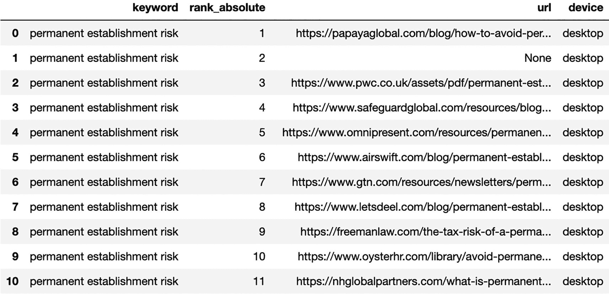

一张表格截图，列标题包括：关键词、排名 _ 绝对、URL 和设备。列出了 11 个 URL，设备均为桌面端。

SERPs 数据可能会有些杂乱，最终业务方只关心其直接竞争对手，因此我们将创建一个列表来筛选相应的 SERPs：

```python
selected_sites = [target_site, 'https://papayaglobal.com/', 'https://www.airswift.com/', 'https://shieldgeo.com/',
'https://remote.com/', 'https://www.letsdeel.com/', 'https://www.omnipresent.com/']
desktop_serps_select = desktop_serps_df[~desktop_serps_df['url'].isnull()].copy()
desktop_serps_select = desktop_serps_select[desktop_serps_select['url'].str.contains('|'.join(selected_sites))]
desktop_serps_select
```

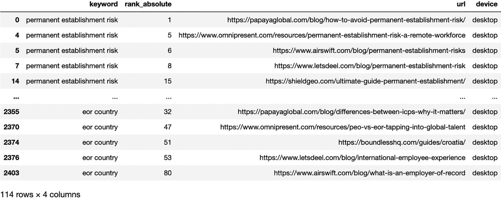

一张表格截图，列标题包括：关键词、排名 _ 绝对、URL 和设备。数据框（即表格）包含 114 行和 4 列。

结果行数大幅减少，这意味着 API 查询次数更少，获取数据所需时间也更短。

请注意，这些数据仅针对桌面端，因此移动端 SERPs 也需要重复此过程。

为了高效查询 PageSpeed API 并避免重复请求，我们需要一组唯一的 URL。我们通过将 URL 列导出为列表来实现这一点：

```python
desktop_serps_urls = desktop_serps_select['url'].to_list()
```

对列表进行去重：

```python
desktop_serps_urls = list(dict.fromkeys(desktop_serps_urls))
desktop_serps_urls
['https://papayaglobal.com/blog/how-to-avoid-permanent-establishment-risk/',
'https://www.omnipresent.com/resources/permanent-establishment-risk-a-remote-workforce',
'https://www.airswift.com/blog/permanent-establishment-risks',
'https://www.letsdeel.com/blog/permanent-establishment-risk',
'https://shieldgeo.com/ultimate-guide-permanent-establishment/',
'https://remote.com/blog/what-is-permanent-establishment',
'https://remote.com/lp/global-payroll',
'https://remote.com/services/global-payroll?nextInternalLocale=en-us', . . . ]
```

有了列表后，我们开始查询 API，首先设置 API 本身的参数、设备类型以及 API 密钥（通过免费注册 Google Cloud Platform 账户获取）：

```python
base_url = 'https://www.googleapis.com/pagespeedonline/v5/runPagespeed?url='
strategy = '&strategy=desktop'
api_key = '&key=[Your PageSpeed API key]'
```

初始化一个空字典，并将 `i` 设置为 0，用作计数器，帮助我们跟踪已发起的 API 调用次数以及剩余次数：

```python
desktop_cwv = {}
i = 1
for url in desktop_serps_urls:
    request_url = base_url + url + strategy + api_key
    response = json.loads(requests.get(request_url).text)
    i += 1
    print(i, " ", request_url)
    desktop_cwv[url] = response
```

结果是一个包含 API 响应的字典。为了将输出转换为可用格式，我们遍历字典以提取实际的 CWV 分数，因为 API 还包含许多其他微观测量数据，这些数据并非我们当前的主要目标。

初始化一个空列表，用于存储 API 响应数据：

```python
desktop_psi_lst = []
```

遍历 API 输出（一个 JSON 字典），我们需要提取相关的“键”并将其添加到之前初始化的列表中：

```python
for key, data in desktop_cwv.items():
    if 'lighthouseResult' in data:
        FCP = data['lighthouseResult']['audits']['first-contentful-paint']['numericValue']
        LCP = data['lighthouseResult']['audits']['largest-contentful-paint']['numericValue']
        CLS = data['lighthouseResult']['audits']['cumulative-layout-shift']['numericValue']
        FID = data['lighthouseResult']['audits']['max-potential-fid']['numericValue']
        SIS = data['lighthouseResult']['audits']['speed-index']['score'] * 100
        desktop_psi_lst.append([key, FCP, LCP, CLS, FID, SIS])
```

将列表转换为数据框：

```python
desktop_psi_df = pd.DataFrame(desktop_psi_lst, columns = ['url', 'FCP', 'LCP', 'CLS', 'FID', 'SIS'])
desktop_psi_df
```

结果如下：

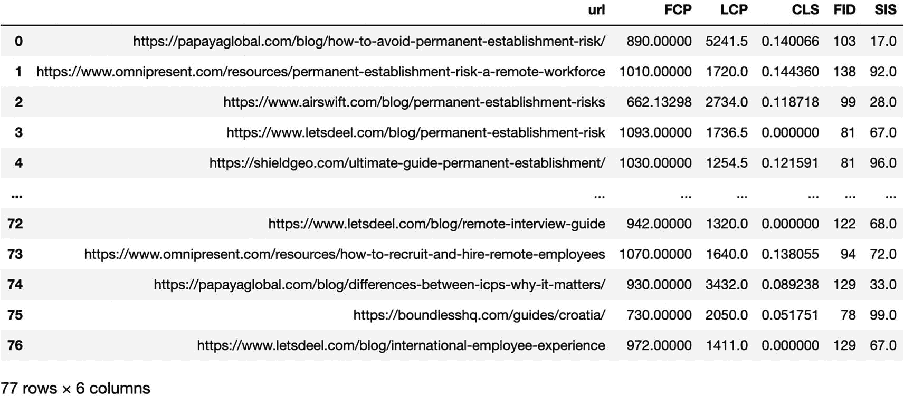

一张表格截图，列标题为：`url`、`FCP`、`LCP`、`CLS`、`FID`、`SIS`。该数据框（或表格）包含 77 行和 6 列。

所有排名 URL 的 PageSpeed 数据都存储在一个包含所有 CWV 指标的数据框中：

*   `FCP`：首次内容绘制（First Contentful Paint）
*   `LCP`：最大内容绘制（Largest Contentful Paint）
*   `CLS`：累计布局偏移（Cumulative Layout Shift）
*   `SIS`：速度指数得分（Speed Index Score）

为了展示排名（以及希望通过改善 CWV 来提升排名的益处）的相关性，我们需要将其与排名数据合并：

# 结果如下

```python
dtp_psi_serps = desktop_serps_select.merge(desktop_psi_df, on = 'url', how = 'left')
dtp_psi_serps_bu = dtp_psi_serps.merge(target_keywords_df, on = 'keyword', how = 'left')
dtp_psi_serps_bu.to_csv('data/'+ target_bu +'_dtp_psi_serps_bu.csv')
dtp_psi_serps_bu
```

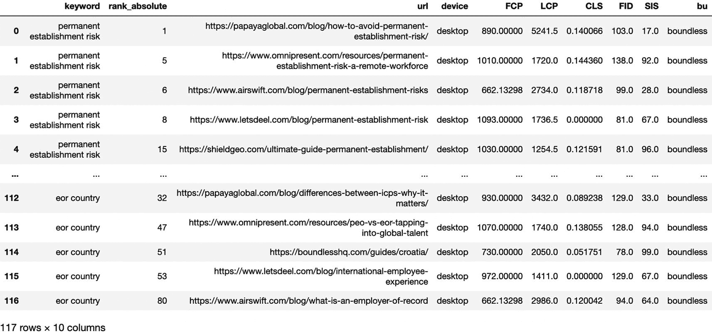

一张表格截图，列标题为：`keyword`、`rank_absolute`、`url`、`device used`、`FCP`、`LCP`、`CLS`、`FID`、`SIS`、`bu`。该数据框（或表格）包含 117 行和 10 列。该数据框包含了关键词、排名、URL、设备和 CWV 指标。

此时，为了避免为移动端重复几乎相同的代码，我们可以假设已经获取了移动端数据，并使用 `pandas` 的 `concat` 函数（列标题相同）将其合并到一个数据框中。

为了添加一些额外的特征，我们新增了一列 `is_target`，用于指示排名 URL 是否属于客户：

```python
overall_psi_serps_bu['is_target'] = np.where(overall_psi_serps_bu['url'].str.contains(target_site), '1', '0')
```

解析站点名称：

```python
overall_psi_serps_bu['site'] = overall_psi_serps_bu['url'].apply(lambda url: tldextract.extract(url).domain)
```

添加计数列以便于聚合：

```python
overall_psi_serps_bu['count'] = 1
```

最终得到的数据框 `overall_psi_serps_bu` 如下所示：


一张表格截图，列标题为：`keyword`、`rank_absolute`、`url`、`device used`、`FCP`、`LCP`、`CLS`、`FID`、`SIS`、`bu`、`is_target`、`site`。

聚合将在站点级别执行，以便我们比较每个站点在 CWV 指标上的平均得分，并将其与性能相关联：

```python
overall_psi_serps_agg = overall_psi_serps_bu.groupby('site').agg({'LCP': 'mean',
                                                                  'FCP': 'mean',
                                                                  'CLS': 'mean',
                                                                  'FID': 'mean',
                                                                  'SIS': 'mean',
                                                                  'rank_absolute': 'mean',
                                                                  'count': 'sum'}).reset_index()
overall_psi_serps_agg = overall_psi_serps_agg.rename(columns = {'count': 'reach'})
```

以下是一些操作，用于缩短站点名称以便后续绘图：

```python
overall_psi_serps_agg['site'] = np.where(overall_psi_serps_agg['site'] == 'papayaglobal', 'papaya',
                                         overall_psi_serps_agg['site'])
overall_psi_serps_agg['site'] = np.where(overall_psi_serps_agg['site'] == 'boundlesshq', 'boundless',
                                         overall_psi_serps_agg['site'])
overall_psi_serps_agg
```

结果如下：


一张表格截图，列标题为：`site`、`LCP`、`FCP`、`CLS`、`FID`、`SIS`、`rank_absolute`、`reach`。行条目为 0 到 6 的数字。

这是汇总数据，不太容易辨别趋势。现在我们可以开始绘制数据，首先从整体速度指数开始。速度指数得分（`SIS`）的范围是 0 到 100，100 表示最快，因此也是最佳。

请注意，在所有将 Google 排名与单个 CWV 指标进行比较的图表中，纵轴将被反转，以便位置越高，排名越高。这样做是为了让图表更直观、更容易理解。

```python
SIS_cwv_landscape_plt = (
    ggplot(overall_psi_serps_agg,
           aes(x = 'SIS', y = 'rank_absolute', fill = 'site', colour = 'site',
               size = 'reach')) +
    geom_point(alpha = 0.8) +
    geom_text(overall_psi_serps_agg, aes(label = 'site'), position=position_stack(vjust=-0.08)) +
    labs(y = 'Google Rank', x = 'Speed Score') +
    scale_y_reverse() +
    scale_size_continuous(range = [7, 17]) +
    theme(legend_position = 'none', axis_text_x=element_text(rotation=0, hjust=1, size = 12))
)
SIS_cwv_landscape_plt.save(filename = 'images/0_SIS_cwv_landscape.png',
                           height=5, width=8, units = 'in', dpi=1000)
SIS_cwv_landscape_plt
```

从 `SIS_cwv_landscape_plt`（图 3-18）中我们已经可以看到，速度得分越高，排名通常也越高。这对利益相关者来说是一个很好的说服点，可以作为投入资源改善 CWV 的动力。


散点图展示了 Google 排名与速度得分的范围。`papaya` 的排名为 42，其次是 `letsdeel`（35）、`omnipresent`（35）、`shield geo`（32）、`airswift`（30）、`boundless`（36）和 `remote`（20）。这些排名对应的速度得分在 0 到 100 之间。数值为近似值。

**图 3-18** 不同网站的速度得分与 Google 排名对比散点图

在这个例子中，`Boundless` 表现相对较好。尽管它们排名不是最高，但这可能表明 CWV 的某些方面没有得到关注，或者存在与 CWV 无关的因素，更可能是两者兼而有之。

```python
LCP_cwv_landscape_plt = (
    ggplot(overall_psi_serps_agg,
           aes(x = 'LCP', y = 'rank_absolute', fill = 'site', colour = 'site',
               size = 'reach')) +
    geom_point(alpha = 0.8) +
    geom_text(overall_psi_serps_agg, aes(label = 'site'), position=position_stack(vjust=-0.08)) +
    labs(y = 'Google Rank', x = 'Largest Contentful Paint') +
    scale_y_reverse() +
    scale_size_continuous(range = [7, 17]) +
    theme(legend_position = 'none', axis_text_x=element_text(rotation=0, hjust=1, size = 12))
)
LCP_cwv_landscape_plt.save(filename = 'images/0_LCP_cwv_landscape.png',
                           height=5, width=8, units = 'in', dpi=1000)
LCP_cwv_landscape_plt
```

`LCP_cwv_landscape_plt` 图（图 3-19）显示 `Papaya` 和 `Remote` 看起来像是异常值；无论如何，趋势确实表明，加载最大内容元素所需的时间越短，排名越高。


散点图展示了 Google 排名与最大内容绘制（LCP）的关系。`airswift` 的排名为 30，其次是 `omnipresent`（35）、`boundless`（37）、`letsdeel`（37）、`shieldgeo`（34）、`papaya`（43）和 `remote`（17）。这些排名对应的 LCP 值在 2000 到 6000 之间。`Papaya` 大约在 (7900, 42) 位置。数值为近似值。

**图 3-19** 不同网站的最大内容绘制（LCP）与 Google 排名对比散点图

```python
FID_cwv_landscape_plt = (
ggplot(overall_psi_serps_agg,
aes(x = 'FID', y = 'rank_absolute', fill = 'site', colour = 'site',
size = 'reach')) +
geom_point(alpha = 0.8) +
geom_text(overall_psi_serps_agg, aes(label = 'site'), position=position_stack(vjust=-0.08)) +
labs(y = 'Google Rank', x = 'First Input Delay') +
scale_y_reverse() +
scale_x_log10() +
scale_size_continuous(range = [7, 17]) +
theme(legend_position = 'none', axis_text_x=element_text(rotation=0, hjust=1, size = 12))
)
FID_cwv_landscape_plt.save(filename = 'images/0_FID_cwv_landscape.png',
height=5, width=8, units = 'in', dpi=1000)
FID_cwv_landscape_plt
```

在 `FID_cwv_landscape_plt`（图 3-20）中，Remote 看起来像一个异常值。是否应该移除这个异常值？本例中不需要，因为我们不会仅仅因为数据没有展示出我们想要的结果就移除异常值。


散点图展示了 Google 排名与首次输入延迟的关系。airswift 的 Google 排名为 30，其后依次是 boundless（36）、letsdeel（38）、omnipresent（35）、shieldgeo（32）、papaya（42）和 remote（19）。数值均为近似值。

**图 3-20** 各网站首次输入延迟（FID）与 Google 排名的散点图对比

趋势表明，页面实现用户可交互所需时间越短，排名越高。Boundless 在这方面表现良好。

```python
CLS_cwv_landscape_plt = (
ggplot(overall_psi_serps_agg,
aes(x = 'CLS', y = 'rank_absolute', fill = 'site', colour = 'site',
size = 'reach')) +
geom_point(alpha = 0.8) +
geom_text(overall_psi_serps_agg, aes(label = 'site'), position=position_stack(vjust=-0.08)) +
labs(y = 'Google Rank', x = 'Cumulative Layout Shift') +
scale_y_reverse() +
scale_size_continuous(range = [7, 17]) +
theme(legend_position = 'none', axis_text_x=element_text(rotation=0, hjust=1, size = 12))
)
CLS_cwv_landscape_plt.save(filename = 'images/0_CLS_cwv_landscape.png',
height=5, width=8, units = 'in', dpi=1000)
CLS_cwv_landscape_plt
```

好的，`CLS_cwv_landscape_plt`（图 3-21）展示了 Boundless 表现不佳的 CLS 指标。其对提升排名的影响也相当不明确。


散点图展示了 Google 排名与累积布局偏移的关系。排名如下：letsdeel（37）、papaya（43）、omnipresent（35）、shieldgeo（33）、airswift（30）和 remote（18）。数值均为近似值。

**图 3-21** 各网站累积布局偏移（CLS）与 Google 排名的散点图对比

```python
FCP_cwv_landscape_plt = (
ggplot(overall_psi_serps_agg,
aes(x = 'FCP', y = 'rank_absolute', fill = 'site', colour = 'site',
size = 'reach')) +
geom_point(alpha = 0.8) +
geom_text(overall_psi_serps_agg, aes(label = 'site'), position=position_stack(vjust=-0.08)) +
labs(y = 'Google Rank', x = 'First Contentful Paint') +
scale_y_reverse() +
scale_size_continuous(range = [7, 17]) +
theme(legend_position = 'none', axis_text_x=element_text(rotation=0, hjust=1, size = 12))
)
FCP_cwv_landscape_plt.save(filename = 'images/0_FCP_cwv_landscape.png',
height=5, width=8, units = 'in', dpi=1000)
FCP_cwv_landscape_plt
```

在 `FCP_cwv_landscape_plt`（图 3-22）中，Papaya 和 Remote 看起来像是异常值；但无论如何，趋势确实表明，加载最大内容元素所需时间越短，排名越高。


散点图展示了 Google 排名与首次内容绘制的关系。排名如下：airswift（30）、boundless（36）、omnipresent（35）、remote（18）、papaya（42）、shieldgeo（34）和 letsdeel（35）。数值均为近似值。

**图 3-22** 各网站首次内容绘制（FCP）与 Google 排名的散点图对比

## 总体分析结论
以上是对总体得分的深入分析。前面的示例可以针对桌面端和移动端得分重复进行，以深入探究，从而明确哪些具体的 CWV 指标应优先处理。总体而言，对于 `boundless` 来说，`CLS` 似乎是其最薄弱的环节。

## 数据透视与汇总
接下来，我们将通过数据透视，将分析结果汇总到单个图表中，该图表采用一种能够支撑单图展示的格式：

```python
overall_psi_serps_long = overall_psi_serps_agg.copy()
```

我们选择所需的列：

```python
overall_psi_serps_long = overall_psi_serps_long[['site', 'LCP', 'FCP', 'CLS', 'FID', 'SIS']]
```

并使用 `melt` 函数对表格进行透视：

```python
overall_psi_serps_long = overall_psi_serps_long.melt(id_vars=['site'],
value_vars=['LCP', 'FCP', 'CLS', 'FID', 'SIS'],
var_name='Metric', value_name='Index')
overall_psi_serps_long['x_axis'] = overall_psi_serps_long['Metric']
overall_psi_serps_long['site'] = np.where(overall_psi_serps_long['site'] == 'papayaglobal', 'papaya',
overall_psi_serps_long['site'])
overall_psi_serps_long['site'] = np.where(overall_psi_serps_long['site'] == 'boundlesshq', 'boundless',
overall_psi_serps_long['site'])
overall_psi_serps_long
```

结果如下：


一张表格截图，列标题为：`site`、`metric`、`index` 和 `x_axis`。文中提到该数据框或表格包含 70 行和 4 列。

这就是已就绪的长格式数据，可以用于绘图了。

## 可视化分析
```python
speed_ex_plt = (
ggplot(overall_psi_serps_long,
aes(x = 'site', y = 'Index', fill = 'site')) +
geom_bar(stat = 'identity', alpha = 0.8) +
labs(y = '', x = '') +
theme(legend_position = 'right',
axis_text_x =element_text(rotation=90, hjust=1, size = 12),
legend_title = element_blank()
) +
facet_grid('Metric ~ .', scales = 'free')
)
speed_ex_plt.save(filename = 'images/0_CWV_Metrics_plt.png',
height=5, width=8, units = 'in', dpi=1000)
speed_ex_plt
```

`speed_ex_plt` 图表（图 3-23）展示了各指标下竞争对手的对比情况。`Remote` 平均表现似乎最差，因此其突出的排名可能归因于非 CWV 因素。


5 个分面柱状图绘制了网站 Airswift、Boundless、Letsdeel、Omnipresent、Papaya、Remote 和 Shieldgeo 的 CWV 指标。这些图分别对应 `CLS`、`FCP`、`FID`、`LCP` 和 `SIS`。Boundless 在 `CLS` 和 `SIS` 指标上数值最高。Papaya 在 `SIS` 指标上数值较低。

**图 3-23** 不同网站按 CWV 指标划分的分面柱状图

### 现场 CWV

此处的目的是利用数据激励客户、同事和利益相关者，让他们了解 CWV 改进将带来的 SEO 收益。在本节中，我们将深入网站本身，看看哪些地方可以进行改进。

我们首先像往常一样导入数据并清理列：

```python
target_crawl_raw = pd.read_csv('data/boundlesshq_com_all_urls__excluding_uncrawled__filtered_20220427203402.csv')
target_crawl_raw.columns = [col.lower() for col in target_crawl_raw.columns]
target_crawl_raw.columns = [col.replace('(', '') for col in target_crawl_raw.columns]
target_crawl_raw.columns = [col.replace(')', '') for col in target_crawl_raw.columns]
target_crawl_raw.columns = [col.replace('@', '') for col in target_crawl_raw.columns]
target_crawl_raw.columns = [col.replace('/', '') for col in target_crawl_raw.columns]
target_crawl_raw.columns = [col.replace(' ', '_') for col in target_crawl_raw.columns]
print(target_crawl_raw.columns)
```

我们使用的是 Sitebulb 爬取数据，并且只想包含现场可索引的 URL，因为这些 URL 才会参与排名，我们将按如下方式进行筛选：

```python
target_crawl_raw = target_crawl_raw.loc[target_crawl_raw['host'] == target_host]
target_crawl_raw = target_crawl_raw.loc[target_crawl_raw['indexable_status'] == 'Indexable']
target_crawl_raw = target_crawl_raw.loc[target_crawl_raw['content_type'] == 'HTML']
target_crawl_raw
```

结果如下：


一张表格的截图，其列标题下包含数据：`u r l`、`crawl underscore depth`、`crawl underscore status`、`host`、`is underscore subdomain`、`scheme`、`crawl underscore source` 和 `first underscore parent underscore u r l`。文中提到该数据框或表格有 279 行和 71 列。

有 279 行，这是一个小型网站。下一步是选择所需的列，这些列将包含 CWV 度量以及任何可能解释它的因素：

```python
target_speedDist_df = target_crawl_raw[['url', 'cumulative_layout_shift', 'first_contentful_paint',
'largest_contentful_paint', 'performance_score', 'time_to_interactive',
'total_blocking_time', 'images_without_dimensions', 'perf_budget_fonts',
'font_transfer_size_kib', 'fonts_files', 'images_files',
'images_not_efficiently_encoded', 'images_size_kib',
'images_transfer_size_kib', 'images_without_dimensions', 'media_files',
'media_size_kib', 'media_transfer_size_kib',
'next-gen_format_savings_kib', 'offscreen_images_not_deferred',
'other_files', 'other_size_kib', 'other_transfer_size_kib',
'passed_font-face_display_urls', 'render_blocking_savings',
'resources_not_http2', 'scaled_images', 'perf_budget_total']]
target_speedDist_df
```

结果如下：


一张表格的截图，其列标题下包含数据：`u r l`、`cumulative underscore layout underscore shift`、`first underscore contentful underscore paint`、`largest underscore contentful underscore paint`、`performance underscore score` 和 `time underscore to underscore interactive`。文中提到该数据框或表格有 279 行和 29 列。

数据框的列数已从 71 列减少到 29 列，CWV 分数更加明显。

尝试在 URL 级别分析网站不会特别有用，因此为了更容易识别模式，我们将按文件夹位置对内容进行分类：

```python
section_conds = [
target_speedDist_df['url'] == 'https://boundlesshq.com/',
target_speedDist_df['url'].str.contains('/guides/'),
target_speedDist_df['url'].str.contains('/how-it-works/')
]
section_vals = ['home', 'guides', 'commercial']
target_speedDist_df['content'] = np.select(section_conds, section_vals, default = 'blog')
```

我们还将主要指标转换为数字：

```python
cols = ['cumulative_layout_shift', 'first_contentful_paint', 'largest_contentful_paint', 'performance_score',
'time_to_interactive', 'total_blocking_time']
target_speedDist_df[cols] = pd.to_numeric(target_speedDist_df[cols].stack(), errors='coerce').unstack()
target_speedDist_df
```

结果如下：


一张表格的截图，其列标题下包含数据：`other underscore files`、`other underscore size underscore k i b`、`other underscore transfer underscore size underscore k i b`、`passed underscore font face underscore display underscore u r ls` 以及另外 5 个。

已创建一个新列，其中每个可索引的 URL 都按其内容类别进行了标记。

是时候使用 `groupby` 对 `"content"` 进行一些聚合了：

```python
speed_dist_agg = target_speedDist_df.groupby('content').agg({'url': 'count', 'performance_score'}).reset_index()
speed_dist_agg
```

结果如下：


一张表格的截图，其列标题下包含数据：`content`、`u r l` 和 `performance underscore score`。行条目是从 0 到 3 的数字。

大部分内容是指南，其次是博客文章，还有三个报价页面。为了可视化，我们将使用直方图来显示整体性能分数的分布，并根据其分段对分数列中的 URL 进行颜色编码。

到目前为止，主页和指南是最快的。

```python
target_speedDist_plt = (
ggplot(target_speedDist_df,
aes(x = 'performance_score', fill = 'content')) +
geom_histogram(alpha = 0.8, bins = 20) +
labs(y = 'Page Count', x = '\nSpeed Score') +
#scale_x_continuous(breaks=range(0, 100, 20)) +
theme(legend_position = 'right',
axis_text_x = element_text(rotation=90, hjust=1, size = 7))
)
target_speedDist_plt.save(filename = 'images/3_target_speedDist_plt.png',
height=5, width=8, units = 'in', dpi=1000)
target_speedDist_plt
```

`target_speedDist_plt` 图（`图 3-24`）显示主页（紫色）表现相当不错，速度得分为 84。指南各不相同，但大多数速度都在 80 以上，而大多数博客文章的速度在 70 多分。


一个堆叠条形图，页面计数从 0 到 50，速度得分从 0 到 100。它针对内容、博客、商业、指南和主页进行绘制。指南呈上升趋势，最大页面计数为 46。总体而言，博客的页面计数最大。最高速度得分约为 84。

`图 3-24` 按内容类型划分的速度得分分布

让我们按 CWV 得分类别深入分析，从 CLS 开始：

```python
target_CLS_plt = (
ggplot(target_speedDist_df,
aes(x = 'cumulative_layout_shift', fill = 'content')) +
geom_histogram(alpha = 0.8, bins = 20) +
labs(y = 'Page Count', x = '\ncumulative_layout_shift') +
#scale_x_continuous(breaks=range(0, 100, 20)) +
theme(legend_position = 'right',
axis_text_x = element_text(rotation=90, hjust=1, size = 7))
)
target_CLS_plt.save(filename = 'images/3_target_CLS_plt.png',
height=5, width=8, units = 'in', dpi=1000)
target_CLS_plt
```

如 `target_CLS_plt`（`图 3-25`）所示，指南在浏览器渲染过程中发生的布局偏移最少，而博客和主页的偏移最多。


一个堆叠条形图，页面计数从 0 到 200，累积布局偏移从 0 到 1.0。它针对内容、博客、商业、指南和主页进行绘制。指南的偏移量最少，而博客和主页的偏移量最多。

`图 3-25` 按内容类型划分的 CLS 分布

因此，我们现在知道应该将 CLS 开发工作重点放在哪些内容模板上。

```python
target_FCP_plt = (
ggplot(target_speedDist_df,
aes(x = 'first_contentful_paint', fill = 'content')) +
geom_histogram(alpha = 0.8, bins = 30) +
labs(y = 'Page Count', x = '\nContentful paint') +
theme(legend_position = 'right',
axis_text_x = element_text(rotation=90, hjust=1, size = 7))
)
target_FCP_plt.save(filename = 'images/3_target_FCP_plt.png',
height=5, width=8, units = 'in', dpi=1000)
target_FCP_plt
```

在此区域中，`target_FCP_plt`（`图 3-26`）未显示出明显趋势，这表明这是一个全局性的网站问题。因此，下一步显然是深入 Chrome 开发者工具并查看网络日志。


一个堆叠柱状图，页面数量从 0 到 40，内容绘制时间从 1200 到 2800。它展示了博客、商业、指南和首页等内容的分布。趋势类似于钟形曲线。

`图 3-26` 按内容类型划分的 FCP 分布

```python
target_LCP_plt = (
ggplot(target_speedDist_df,
aes(x = 'largest_contentful_paint', fill = 'content')) +
geom_histogram(alpha = 0.8, bins = 20) +
labs(y = 'Page Count', x = '\nlargest_contentful_paint') +
theme(legend_position = 'right',
axis_text_x = element_text(rotation=90, hjust=1, size = 7))
)
target_LCP_plt.save(filename = 'images/3_target_LCP_plt.png',
height=5, width=8, units = 'in', dpi=1000)
target_LCP_plt
```

`target_LCP_plt`（`图 3-27`）显示，大多数指南和部分博客的 LCP 得分最快；无论如何，博客模板和异常的指南页面将是重点关注区域。


一个堆叠柱状图，页面数量与最大内容绘制时间的关系。它展示了博客、商业、指南和首页等内容的分布。大量指南和部分博客拥有最快的 LCP 得分。

`图 3-27` 按内容类型划分的 LCP 分布

```python
target_FID_plt = (
ggplot(target_speedDist_df,
aes(x = 'time_to_interactive', fill = 'content')) +
geom_histogram(alpha = 0.8, bins = 20) +
labs(y = 'Page Count', x = '\ntime_to_interactive') +
theme(legend_position = 'right',
axis_text_x = element_text(rotation=90, hjust=1, size = 7))
)
target_FID_plt.save(filename = 'images/3_target_FID_plt.png',
height=5, width=8, units = 'in', dpi=1000)
target_FID_plt
```

在 `target_FID_plt`（`图 3-28`）中，网站的大部分页面似乎都享有较快的 FID 时间，因此这将是 CWV 改进中优先级最低的部分。


一个堆叠柱状图，绘制了页面数量与可交互时间的关系。它展示了博客、商业、指南和首页等内容的分布。大部分网站的 FID 时间都很快。

`图 3-28` 按内容类型划分的 FID 分布

### 本章小结

在本章中，我们介绍了如何通过以下方式对技术 SEO 采取数据驱动的方法：

*   对页面权威性进行建模，以向同事和客户估算技术 SEO 建议的收益
*   通过不同方式分析内部链接优化，以通过锚文本提高内容的可发现性和标签化
*   分析核心网页指标，以确定哪些指标需要改进以及按内容类型进行改进

下一章将重点介绍如何使用数据来改进内容和用户体验。

