# 锚点文本分析

一张表格的截图显示了以下列标题下的数据：`crawl_underscore_depth`、`irrelevant_underscore_anchors`、`project` 和 `irrelevant_underscore_anchors_underscore_prop`。行条目是从 0 到 11 的数字。

实际上，除了距离主页三次点击以内的页面（可能是博客文章）之外，所有网站层级上的几乎所有内容都包含无关锚点。

让我们进行可视化：

```python
# anchor issues text
anchor_rel_stats_site_agg_plt = (ggplot(anchor_rel_depth_stats,
aes(x = 'crawl_depth', y = 'irrel_anchors_prop')) +
geom_bar(stat = 'identity', fill = 'blue', alpha = 0.6) +
labs(y = '# irrel_anchors', x = '') +
#scale_y_log10() +
theme_classic() +
coord_flip() +
theme(legend_position = 'none')
)
anchor_rel_stats_site_agg_plt.save(filename = 'images/3_anchor_rel_stats_site_agg_plt.png',
height=5, width=5, units = 'in', dpi=1000)
anchor_rel_stats_site_agg_plt
```

按网站层级划分的无关锚点显示在 `anchor_rel_stats_site_agg_plt` 图表中（图 3-16），从中我们可以看到，这种情况几乎是全站范围的，只是在第 3 层级的 URL 上实例较少。

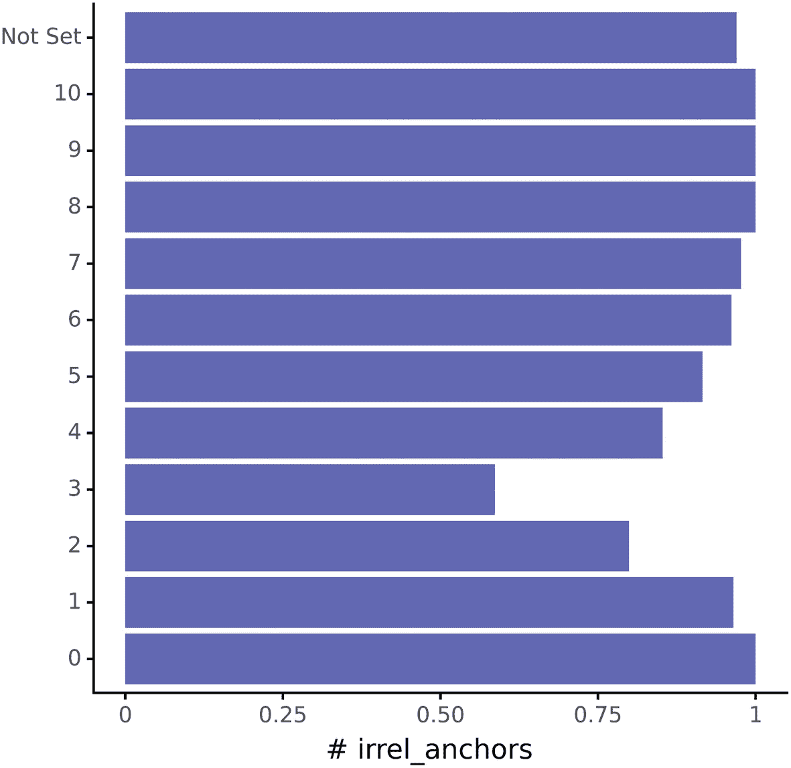

一张水平条形图绘制了从 0 到 10 的网站层级以及“未设置”项，与从 0 到 1 的无关锚点数量。几乎所有网站层级的值都很高，除了第 2、3 和 4 层级，其值分别为 0.80、0.55 和 0.85。这些值是估算值。

**图 3-16** 按网站层级划分的无关锚点文本条形图

## 位置

通过查看锚点的位置，可以获得更多见解：

```python
anchor_rel_locat_irrels = anchor_merge.groupby(['location']).agg({'irrel_anchors': 'sum'}).reset_index()
anchor_rel_locat_urls = anchor_merge.groupby(['location']).agg({'project': 'count'}).reset_index()
anchor_rel_locat_stats = anchor_rel_locat_irrels.merge(anchor_rel_locat_urls, on = 'location', how = 'left')
anchor_rel_locat_stats['irrel_anchors_prop'] = anchor_rel_locat_stats['irrel_anchors'] / anchor_rel_locat_stats['project']
anchor_rel_locat_stats
```

结果如下：

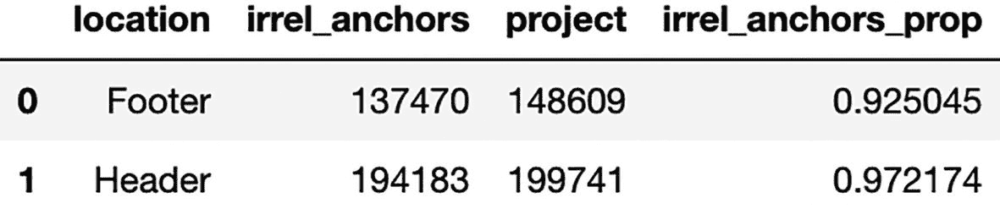

一张表格的截图显示了以下列标题下的数据：`location`、`irrelevant_underscore_anchors`、`project` 和 `irrelevant_underscores_anchors_underscore_prop`，共有 2 行条目（0 和 1）。

无关锚点位于页眉或页脚中，这使得它们相对容易解决。

## 锚点文本词汇

让我们看看锚点文本本身。锚点文本是构成 HTML 超链接的词语。搜索引擎使用这些词语来为被链接的页面赋予一定的含义。

自然地，搜索引擎会对那些准确描述其所链接页面内容的锚点文本给予更高的评分，因为如果用户确实点击了该链接，他们将获得良好的内容体验，从而符合锚点文本所创造的期望。

我们将从查看网站中最常用的锚点文本词汇开始：

```python
anchor_count = anchor_merge[['anchor_text']].copy()
anchor_count['count'] = 1
anchor_count_agg = anchor_count.groupby('anchor_text').agg({'count': 'sum'}).reset_index()
anchor_count_agg = anchor_count_agg.sort_values('count', ascending = False)
anchor_count_agg
```

结果如下：

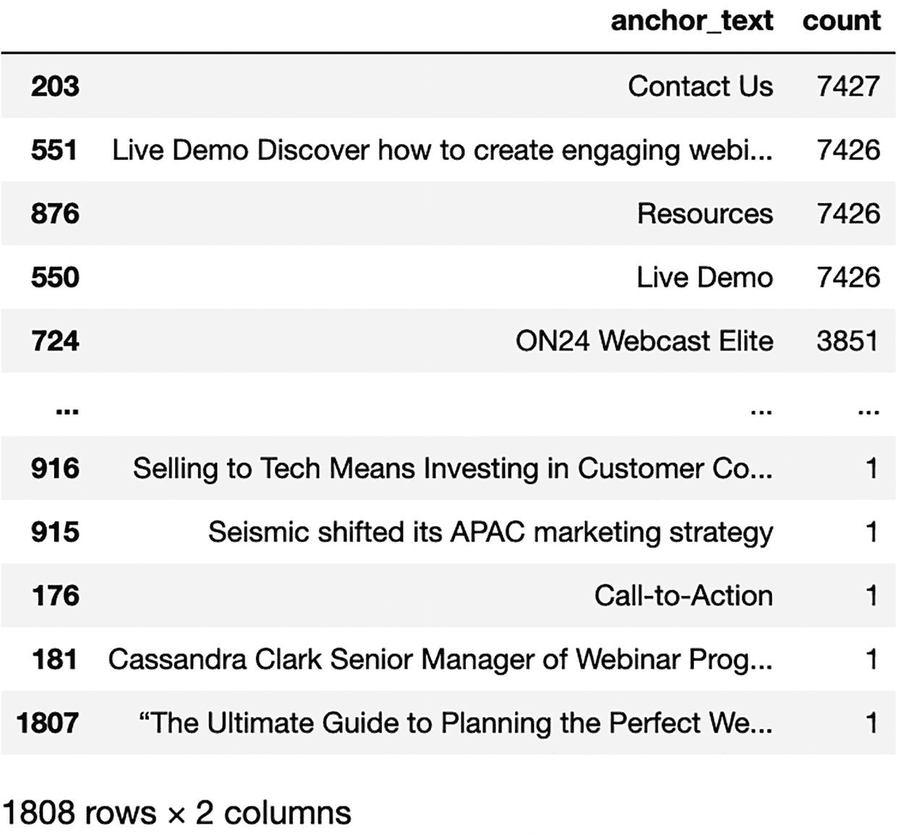

一张表格的截图显示了以下列标题下的数据：`anchor_text` 和 `count`。提到该数据框或表格有 1808 行和 2 列。

有超过 1,808 种不同的锚点文本，其中“Contact Us”是最受欢迎的，其次是“Live Demo”和“Resources”。

让我们使用词云进行可视化。我们需要导入 `WordCloud` 包并将数据框转换为字典：

```python
from wordcloud import WordCloud
data = anchor_count_agg.set_index('anchor_text').to_dict()['count']
data
{'Contact Us ': 7427,
'Live Demo Discover how to create engaging webinar experiences designed to cativate and convert your audience. ': 7426,
'Resources ': 7426,
'Live Demo ': 7426,
'ON24 Webcast Elite ': 3851,
'ON24 platform ': 3806,
'Press Releases ': 3799, …}
```

转换完成后，我们将数据输入到 `wordcloud` 函数中，并将数据限制为最受欢迎的 200 个锚点：

```python
wc = WordCloud(background_color='white',
width=800, height=400,
max_words=30).generate_from_frequencies(anchor_count_agg)
import matplotlib.pyplot as plt
plt.figure(figsize=(10, 10))
plt.imshow(wc, interpolation='bilinear')
plt.axis('off')
# Save image
wc.to_file("images/wordcloud.png")
plt.show()
```

该词云（图 3-17）可用于管理演示。其中有一些相当长的锚点文本！


一张常用锚点文本词云的截图。一些词语包括：`a live demo`、`contact us`、`press releases`、`blog`、`executive team`、`overview`、`virtual events` 和 `partner program`。

**图 3-17** 最常用锚点文本的词云

从这一点出发，接下来的行动是寻找半自动化的规则来提高锚点文本的相关性，由于这些锚点位于页眉或页脚中，这一任务会相对容易一些。

## 核心网页指标 (CWV)

核心网页指标 (CWV) 是 Google 的一项倡议，旨在帮助网站提供更好的用户体验。这包括速度、加载期间的页面稳定性，以及网页变得可供用户交互所需的时间。那么，如果 CWV 是关于用户的，为什么它会被放在技术部分呢？

那些较少被宣传的技术性 SEO 优势，有助于 Google（以及其他搜索引擎）主要节省计算资源来抓取和渲染网站。因此，这对于搜索引擎、用户和网站管理员来说是一个巨大的三赢局面。

所以，通过追求 CWV，你实际上是在增加你的抓取和渲染预算，这有利于你的技术性 SEO。

然而，技术性 SEO 对营销团队的吸引力不大，而如果你能暗示排名提升的好处来证明改进 CWV 的网站开发工作是合理的，那么向营销团队推销起来就容易得多。这正是我们在本节中要努力实现的目标。

我们将从整体概况开始，展示整体的竞争格局，然后再深入分析网站本身，以便利用数据来确定开发的优先级。

### 景观

```python
import re
import time
import random
import pandas as pd
import numpy as np
import requests
import json
import plotnine
import tldextract
from plotnine import *
from mizani.transforms import trans
from client import RestClient
target_bu = 'boundless'
target_site = 'https://boundlesshq.com/'
target_name = target_bu
```

我们首先使用 `pandas.read_csv` 函数获取目标关键词的搜索引擎结果页面（SERPs）。我们关注的是 URL，它将作为查询 Google PageSpeed API 的输入，从而获取核心网页指标（CWV）的度量值：

```python
desktop_serps_df = pd.read_csv('data/1_desktop' + client_name + '_serps.csv')
desktop_serps_df
```

结果如下：

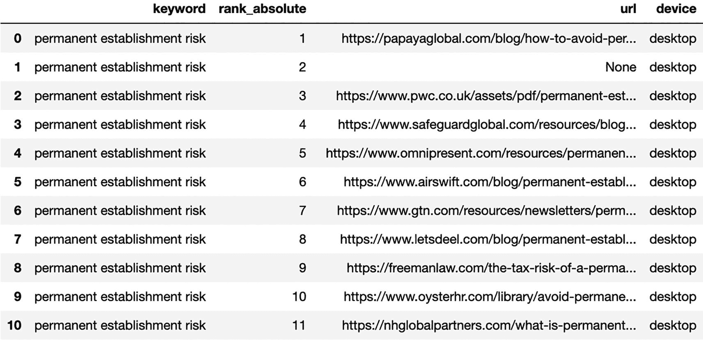

一张表格截图，列标题包括：关键词、排名 _ 绝对、URL 和设备。列出了 11 个 URL，设备均为桌面端。

SERPs 数据可能会有些杂乱，最终业务方只关心其直接竞争对手，因此我们将创建一个列表来筛选相应的 SERPs：

```python
selected_sites = [target_site, 'https://papayaglobal.com/', 'https://www.airswift.com/', 'https://shieldgeo.com/',
'https://remote.com/', 'https://www.letsdeel.com/', 'https://www.omnipresent.com/']
desktop_serps_select = desktop_serps_df[~desktop_serps_df['url'].isnull()].copy()
desktop_serps_select = desktop_serps_select[desktop_serps_select['url'].str.contains('|'.join(selected_sites))]
desktop_serps_select
```

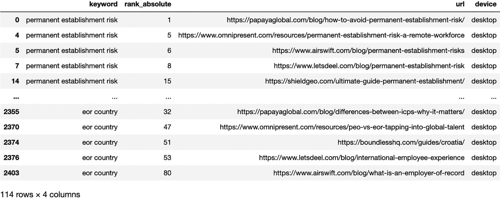

一张表格截图，列标题包括：关键词、排名 _ 绝对、URL 和设备。数据框（即表格）包含 114 行和 4 列。

结果行数大幅减少，这意味着 API 查询次数更少，获取数据所需时间也更短。

请注意，这些数据仅针对桌面端，因此移动端 SERPs 也需要重复此过程。

为了高效查询 PageSpeed API 并避免重复请求，我们需要一组唯一的 URL。我们通过将 URL 列导出为列表来实现这一点：

```python
desktop_serps_urls = desktop_serps_select['url'].to_list()
```

对列表进行去重：

```python
desktop_serps_urls = list(dict.fromkeys(desktop_serps_urls))
desktop_serps_urls
['https://papayaglobal.com/blog/how-to-avoid-permanent-establishment-risk/',
'https://www.omnipresent.com/resources/permanent-establishment-risk-a-remote-workforce',
'https://www.airswift.com/blog/permanent-establishment-risks',
'https://www.letsdeel.com/blog/permanent-establishment-risk',
'https://shieldgeo.com/ultimate-guide-permanent-establishment/',
'https://remote.com/blog/what-is-permanent-establishment',
'https://remote.com/lp/global-payroll',
'https://remote.com/services/global-payroll?nextInternalLocale=en-us', . . . ]
```

有了列表后，我们开始查询 API，首先设置 API 本身的参数、设备类型以及 API 密钥（通过免费注册 Google Cloud Platform 账户获取）：

```python
base_url = 'https://www.googleapis.com/pagespeedonline/v5/runPagespeed?url='
strategy = '&strategy=desktop'
api_key = '&key=[Your PageSpeed API key]'
```

初始化一个空字典，并将 `i` 设置为 0，用作计数器，帮助我们跟踪已发起的 API 调用次数以及剩余次数：

```python
desktop_cwv = {}
i = 1
for url in desktop_serps_urls:
    request_url = base_url + url + strategy + api_key
    response = json.loads(requests.get(request_url).text)
    i += 1
    print(i, " ", request_url)
    desktop_cwv[url] = response
```

结果是一个包含 API 响应的字典。为了将输出转换为可用格式，我们遍历字典以提取实际的 CWV 分数，因为 API 还包含许多其他微观测量数据，这些数据并非我们当前的主要目标。

初始化一个空列表，用于存储 API 响应数据：

```python
desktop_psi_lst = []
```

遍历 API 输出（一个 JSON 字典），我们需要提取相关的“键”并将其添加到之前初始化的列表中：

```python
for key, data in desktop_cwv.items():
    if 'lighthouseResult' in data:
        FCP = data['lighthouseResult']['audits']['first-contentful-paint']['numericValue']
        LCP = data['lighthouseResult']['audits']['largest-contentful-paint']['numericValue']
        CLS = data['lighthouseResult']['audits']['cumulative-layout-shift']['numericValue']
        FID = data['lighthouseResult']['audits']['max-potential-fid']['numericValue']
        SIS = data['lighthouseResult']['audits']['speed-index']['score'] * 100
        desktop_psi_lst.append([key, FCP, LCP, CLS, FID, SIS])
```

将列表转换为数据框：

```python
desktop_psi_df = pd.DataFrame(desktop_psi_lst, columns = ['url', 'FCP', 'LCP', 'CLS', 'FID', 'SIS'])
desktop_psi_df
```

结果如下：

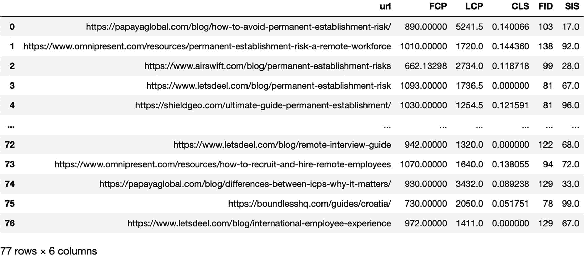

一张表格截图，列标题为：`url`、`FCP`、`LCP`、`CLS`、`FID`、`SIS`。该数据框（或表格）包含 77 行和 6 列。

所有排名 URL 的 PageSpeed 数据都存储在一个包含所有 CWV 指标的数据框中：

*   `FCP`：首次内容绘制（First Contentful Paint）
*   `LCP`：最大内容绘制（Largest Contentful Paint）
*   `CLS`：累计布局偏移（Cumulative Layout Shift）
*   `SIS`：速度指数得分（Speed Index Score）

为了展示排名（以及希望通过改善 CWV 来提升排名的益处）的相关性，我们需要将其与排名数据合并：

# 结果如下

```python
dtp_psi_serps = desktop_serps_select.merge(desktop_psi_df, on = 'url', how = 'left')
dtp_psi_serps_bu = dtp_psi_serps.merge(target_keywords_df, on = 'keyword', how = 'left')
dtp_psi_serps_bu.to_csv('data/'+ target_bu +'_dtp_psi_serps_bu.csv')
dtp_psi_serps_bu
```

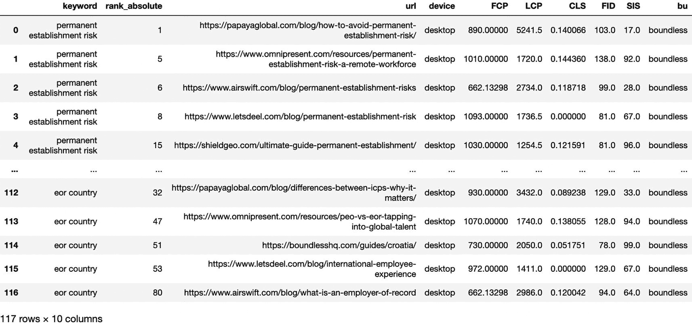

一张表格截图，列标题为：`keyword`、`rank_absolute`、`url`、`device used`、`FCP`、`LCP`、`CLS`、`FID`、`SIS`、`bu`。该数据框（或表格）包含 117 行和 10 列。该数据框包含了关键词、排名、URL、设备和 CWV 指标。

此时，为了避免为移动端重复几乎相同的代码，我们可以假设已经获取了移动端数据，并使用 `pandas` 的 `concat` 函数（列标题相同）将其合并到一个数据框中。

为了添加一些额外的特征，我们新增了一列 `is_target`，用于指示排名 URL 是否属于客户：

```python
overall_psi_serps_bu['is_target'] = np.where(overall_psi_serps_bu['url'].str.contains(target_site), '1', '0')
```

解析站点名称：

```python
overall_psi_serps_bu['site'] = overall_psi_serps_bu['url'].apply(lambda url: tldextract.extract(url).domain)
```

添加计数列以便于聚合：

```python
overall_psi_serps_bu['count'] = 1
```

最终得到的数据框 `overall_psi_serps_bu` 如下所示：

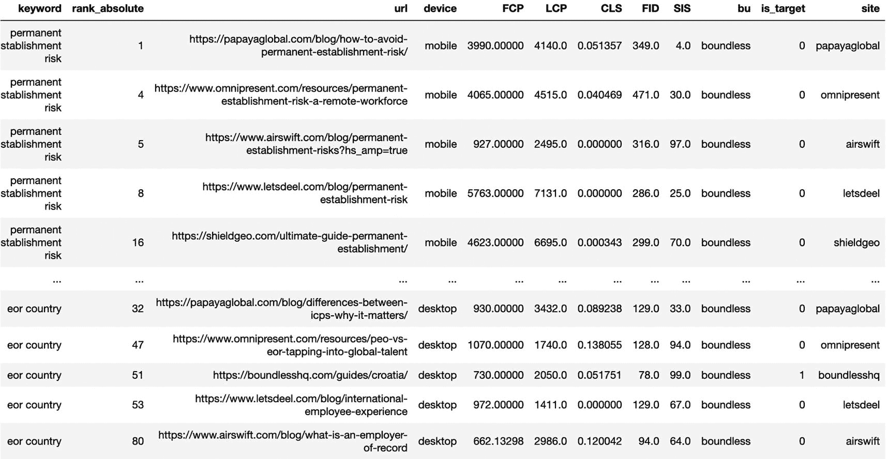

一张表格截图，列标题为：`keyword`、`rank_absolute`、`url`、`device used`、`FCP`、`LCP`、`CLS`、`FID`、`SIS`、`bu`、`is_target`、`site`。

聚合将在站点级别执行，以便我们比较每个站点在 CWV 指标上的平均得分，并将其与性能相关联：

```python
overall_psi_serps_agg = overall_psi_serps_bu.groupby('site').agg({'LCP': 'mean',
                                                                  'FCP': 'mean',
                                                                  'CLS': 'mean',
                                                                  'FID': 'mean',
                                                                  'SIS': 'mean',
                                                                  'rank_absolute': 'mean',
                                                                  'count': 'sum'}).reset_index()
overall_psi_serps_agg = overall_psi_serps_agg.rename(columns = {'count': 'reach'})
```

以下是一些操作，用于缩短站点名称以便后续绘图：

```python
overall_psi_serps_agg['site'] = np.where(overall_psi_serps_agg['site'] == 'papayaglobal', 'papaya',
                                         overall_psi_serps_agg['site'])
overall_psi_serps_agg['site'] = np.where(overall_psi_serps_agg['site'] == 'boundlesshq', 'boundless',
                                         overall_psi_serps_agg['site'])
overall_psi_serps_agg
```

结果如下：

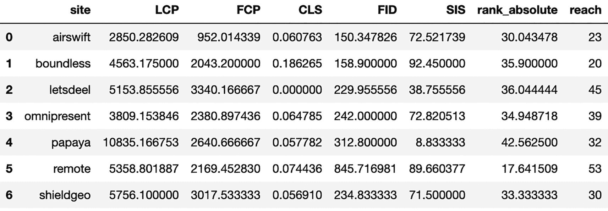

一张表格截图，列标题为：`site`、`LCP`、`FCP`、`CLS`、`FID`、`SIS`、`rank_absolute`、`reach`。行条目为 0 到 6 的数字。

这是汇总数据，不太容易辨别趋势。现在我们可以开始绘制数据，首先从整体速度指数开始。速度指数得分（`SIS`）的范围是 0 到 100，100 表示最快，因此也是最佳。

请注意，在所有将 Google 排名与单个 CWV 指标进行比较的图表中，纵轴将被反转，以便位置越高，排名越高。这样做是为了让图表更直观、更容易理解。

```python
SIS_cwv_landscape_plt = (
    ggplot(overall_psi_serps_agg,
           aes(x = 'SIS', y = 'rank_absolute', fill = 'site', colour = 'site',
               size = 'reach')) +
    geom_point(alpha = 0.8) +
    geom_text(overall_psi_serps_agg, aes(label = 'site'), position=position_stack(vjust=-0.08)) +
    labs(y = 'Google Rank', x = 'Speed Score') +
    scale_y_reverse() +
    scale_size_continuous(range = [7, 17]) +
    theme(legend_position = 'none', axis_text_x=element_text(rotation=0, hjust=1, size = 12))
)
SIS_cwv_landscape_plt.save(filename = 'images/0_SIS_cwv_landscape.png',
                           height=5, width=8, units = 'in', dpi=1000)
SIS_cwv_landscape_plt
```

从 `SIS_cwv_landscape_plt`（图 3-18）中我们已经可以看到，速度得分越高，排名通常也越高。这对利益相关者来说是一个很好的说服点，可以作为投入资源改善 CWV 的动力。

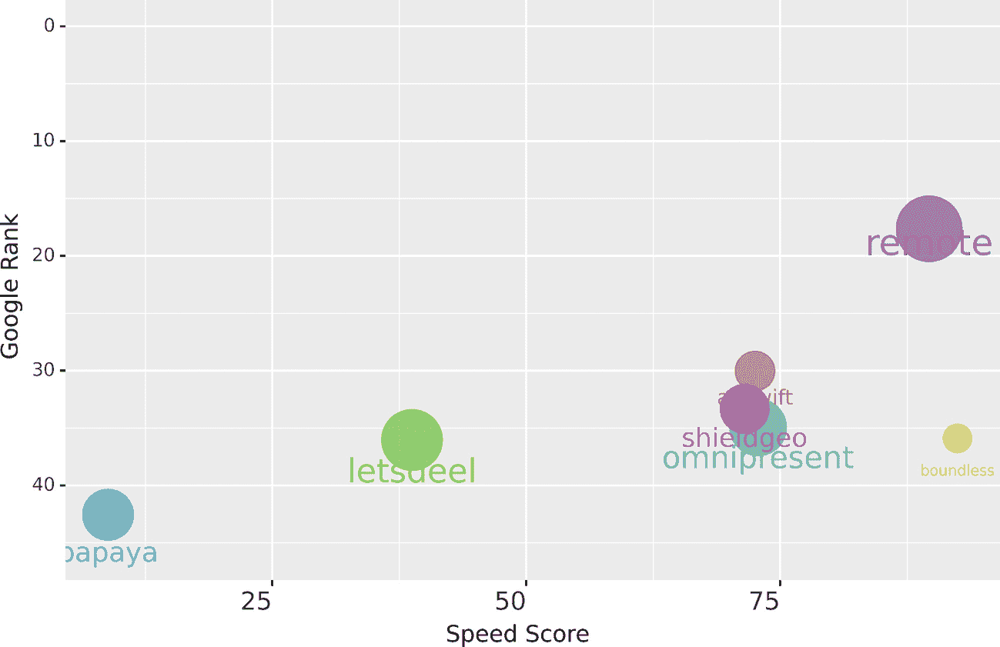

散点图展示了 Google 排名与速度得分的范围。`papaya` 的排名为 42，其次是 `letsdeel`（35）、`omnipresent`（35）、`shield geo`（32）、`airswift`（30）、`boundless`（36）和 `remote`（20）。这些排名对应的速度得分在 0 到 100 之间。数值为近似值。

**图 3-18** 不同网站的速度得分与 Google 排名对比散点图

在这个例子中，`Boundless` 表现相对较好。尽管它们排名不是最高，但这可能表明 CWV 的某些方面没有得到关注，或者存在与 CWV 无关的因素，更可能是两者兼而有之。

```python
LCP_cwv_landscape_plt = (
    ggplot(overall_psi_serps_agg,
           aes(x = 'LCP', y = 'rank_absolute', fill = 'site', colour = 'site',
               size = 'reach')) +
    geom_point(alpha = 0.8) +
    geom_text(overall_psi_serps_agg, aes(label = 'site'), position=position_stack(vjust=-0.08)) +
    labs(y = 'Google Rank', x = 'Largest Contentful Paint') +
    scale_y_reverse() +
    scale_size_continuous(range = [7, 17]) +
    theme(legend_position = 'none', axis_text_x=element_text(rotation=0, hjust=1, size = 12))
)
LCP_cwv_landscape_plt.save(filename = 'images/0_LCP_cwv_landscape.png',
                           height=5, width=8, units = 'in', dpi=1000)
LCP_cwv_landscape_plt
```

`LCP_cwv_landscape_plt` 图（图 3-19）显示 `Papaya` 和 `Remote` 看起来像是异常值；无论如何，趋势确实表明，加载最大内容元素所需的时间越短，排名越高。

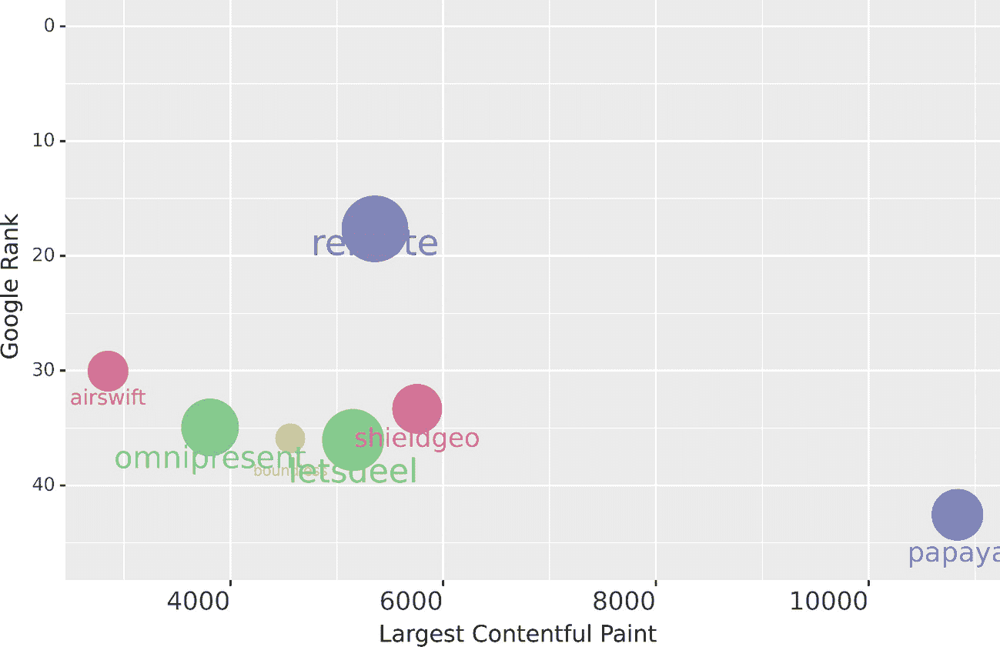

散点图展示了 Google 排名与最大内容绘制（LCP）的关系。`airswift` 的排名为 30，其次是 `omnipresent`（35）、`boundless`（37）、`letsdeel`（37）、`shieldgeo`（34）、`papaya`（43）和 `remote`（17）。这些排名对应的 LCP 值在 2000 到 6000 之间。`Papaya` 大约在 (7900, 42) 位置。数值为近似值。

**图 3-19** 不同网站的最大内容绘制（LCP）与 Google 排名对比散点图

```python
FID_cwv_landscape_plt = (
ggplot(overall_psi_serps_agg,
aes(x = 'FID', y = 'rank_absolute', fill = 'site', colour = 'site',
size = 'reach')) +
geom_point(alpha = 0.8) +
geom_text(overall_psi_serps_agg, aes(label = 'site'), position=position_stack(vjust=-0.08)) +
labs(y = 'Google Rank', x = 'First Input Delay') +
scale_y_reverse() +
scale_x_log10() +
scale_size_continuous(range = [7, 17]) +
theme(legend_position = 'none', axis_text_x=element_text(rotation=0, hjust=1, size = 12))
)
FID_cwv_landscape_plt.save(filename = 'images/0_FID_cwv_landscape.png',
height=5, width=8, units = 'in', dpi=1000)
FID_cwv_landscape_plt
```

在 `FID_cwv_landscape_plt`（图 3-20）中，Remote 看起来像一个异常值。是否应该移除这个异常值？本例中不需要，因为我们不会仅仅因为数据没有展示出我们想要的结果就移除异常值。

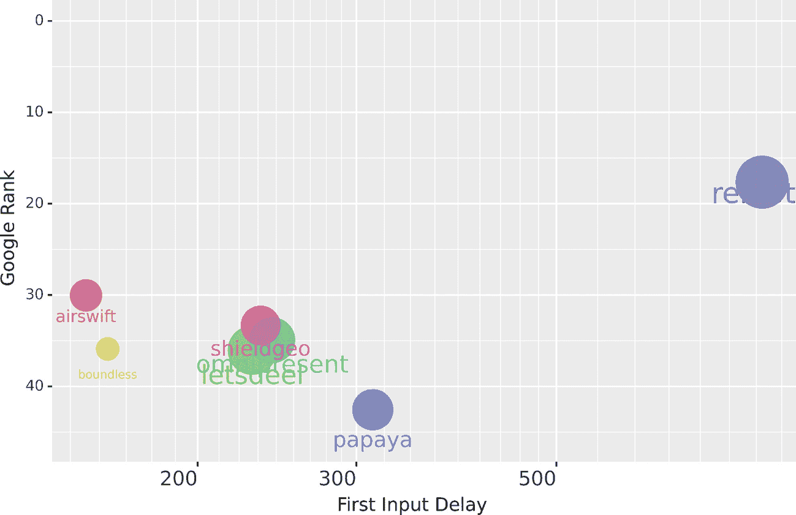

散点图展示了 Google 排名与首次输入延迟的关系。airswift 的 Google 排名为 30，其后依次是 boundless（36）、letsdeel（38）、omnipresent（35）、shieldgeo（32）、papaya（42）和 remote（19）。数值均为近似值。

**图 3-20** 各网站首次输入延迟（FID）与 Google 排名的散点图对比

趋势表明，页面实现用户可交互所需时间越短，排名越高。Boundless 在这方面表现良好。

```python
CLS_cwv_landscape_plt = (
ggplot(overall_psi_serps_agg,
aes(x = 'CLS', y = 'rank_absolute', fill = 'site', colour = 'site',
size = 'reach')) +
geom_point(alpha = 0.8) +
geom_text(overall_psi_serps_agg, aes(label = 'site'), position=position_stack(vjust=-0.08)) +
labs(y = 'Google Rank', x = 'Cumulative Layout Shift') +
scale_y_reverse() +
scale_size_continuous(range = [7, 17]) +
theme(legend_position = 'none', axis_text_x=element_text(rotation=0, hjust=1, size = 12))
)
CLS_cwv_landscape_plt.save(filename = 'images/0_CLS_cwv_landscape.png',
height=5, width=8, units = 'in', dpi=1000)
CLS_cwv_landscape_plt
```

好的，`CLS_cwv_landscape_plt`（图 3-21）展示了 Boundless 表现不佳的 CLS 指标。其对提升排名的影响也相当不明确。

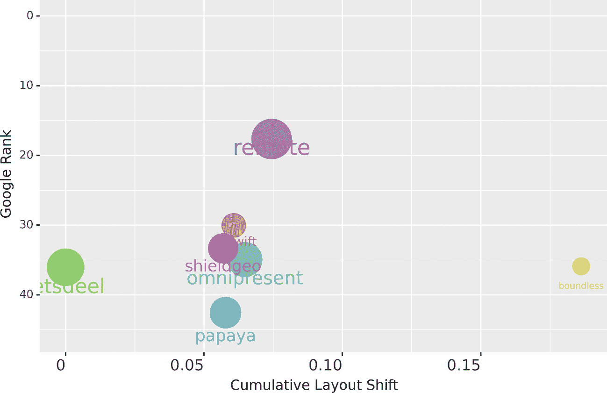

散点图展示了 Google 排名与累积布局偏移的关系。排名如下：letsdeel（37）、papaya（43）、omnipresent（35）、shieldgeo（33）、airswift（30）和 remote（18）。数值均为近似值。

**图 3-21** 各网站累积布局偏移（CLS）与 Google 排名的散点图对比

```python
FCP_cwv_landscape_plt = (
ggplot(overall_psi_serps_agg,
aes(x = 'FCP', y = 'rank_absolute', fill = 'site', colour = 'site',
size = 'reach')) +
geom_point(alpha = 0.8) +
geom_text(overall_psi_serps_agg, aes(label = 'site'), position=position_stack(vjust=-0.08)) +
labs(y = 'Google Rank', x = 'First Contentful Paint') +
scale_y_reverse() +
scale_size_continuous(range = [7, 17]) +
theme(legend_position = 'none', axis_text_x=element_text(rotation=0, hjust=1, size = 12))
)
FCP_cwv_landscape_plt.save(filename = 'images/0_FCP_cwv_landscape.png',
height=5, width=8, units = 'in', dpi=1000)
FCP_cwv_landscape_plt
```

在 `FCP_cwv_landscape_plt`（图 3-22）中，Papaya 和 Remote 看起来像是异常值；但无论如何，趋势确实表明，加载最大内容元素所需时间越短，排名越高。

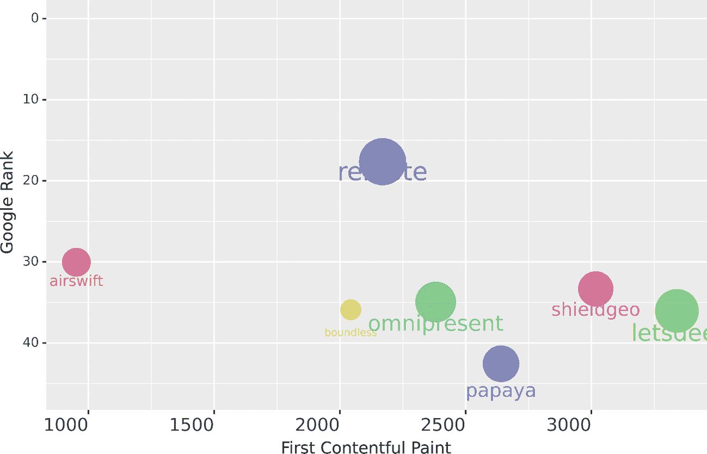

散点图展示了 Google 排名与首次内容绘制的关系。排名如下：airswift（30）、boundless（36）、omnipresent（35）、remote（18）、papaya（42）、shieldgeo（34）和 letsdeel（35）。数值均为近似值。

**图 3-22** 各网站首次内容绘制（FCP）与 Google 排名的散点图对比

## 总体分析结论
以上是对总体得分的深入分析。前面的示例可以针对桌面端和移动端得分重复进行，以深入探究，从而明确哪些具体的 CWV 指标应优先处理。总体而言，对于 `boundless` 来说，`CLS` 似乎是其最薄弱的环节。

## 数据透视与汇总
接下来，我们将通过数据透视，将分析结果汇总到单个图表中，该图表采用一种能够支撑单图展示的格式：

```python
overall_psi_serps_long = overall_psi_serps_agg.copy()
```

我们选择所需的列：

```python
overall_psi_serps_long = overall_psi_serps_long[['site', 'LCP', 'FCP', 'CLS', 'FID', 'SIS']]
```

并使用 `melt` 函数对表格进行透视：

```python
overall_psi_serps_long = overall_psi_serps_long.melt(id_vars=['site'],
value_vars=['LCP', 'FCP', 'CLS', 'FID', 'SIS'],
var_name='Metric', value_name='Index')
overall_psi_serps_long['x_axis'] = overall_psi_serps_long['Metric']
overall_psi_serps_long['site'] = np.where(overall_psi_serps_long['site'] == 'papayaglobal', 'papaya',
overall_psi_serps_long['site'])
overall_psi_serps_long['site'] = np.where(overall_psi_serps_long['site'] == 'boundlesshq', 'boundless',
overall_psi_serps_long['site'])
overall_psi_serps_long
```

结果如下：

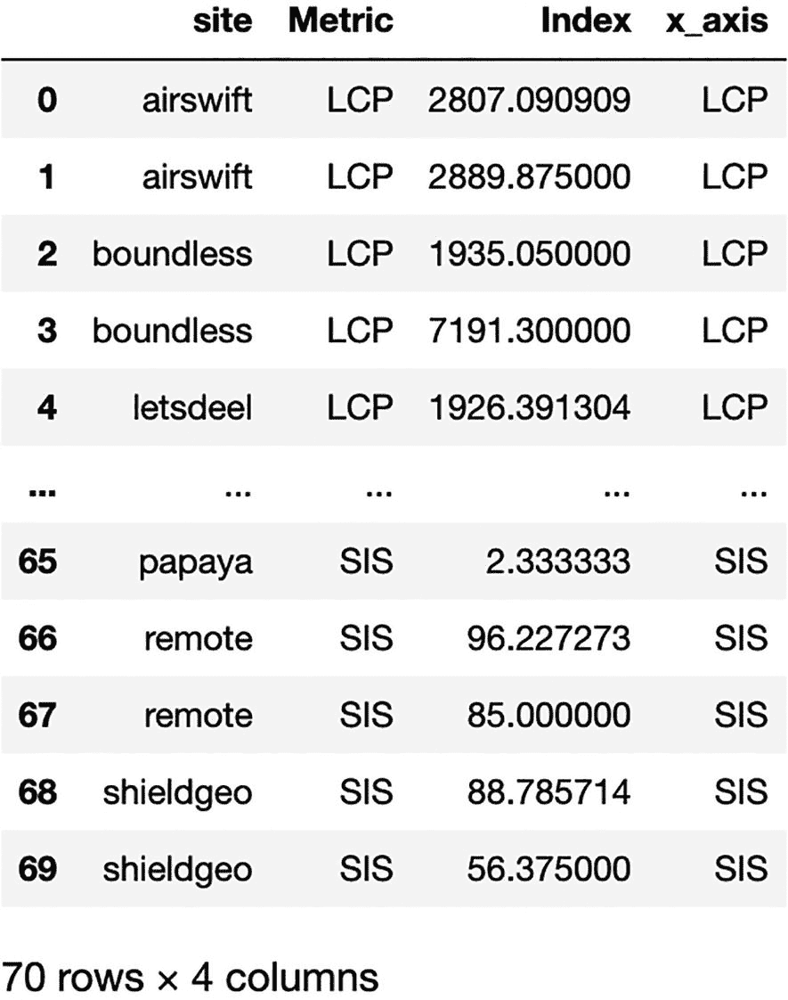

一张表格截图，列标题为：`site`、`metric`、`index` 和 `x_axis`。文中提到该数据框或表格包含 70 行和 4 列。

这就是已就绪的长格式数据，可以用于绘图了。

## 可视化分析
```python
speed_ex_plt = (
ggplot(overall_psi_serps_long,
aes(x = 'site', y = 'Index', fill = 'site')) +
geom_bar(stat = 'identity', alpha = 0.8) +
labs(y = '', x = '') +
theme(legend_position = 'right',
axis_text_x =element_text(rotation=90, hjust=1, size = 12),
legend_title = element_blank()
) +
facet_grid('Metric ~ .', scales = 'free')
)
speed_ex_plt.save(filename = 'images/0_CWV_Metrics_plt.png',
height=5, width=8, units = 'in', dpi=1000)
speed_ex_plt
```

`speed_ex_plt` 图表（图 3-23）展示了各指标下竞争对手的对比情况。`Remote` 平均表现似乎最差，因此其突出的排名可能归因于非 CWV 因素。

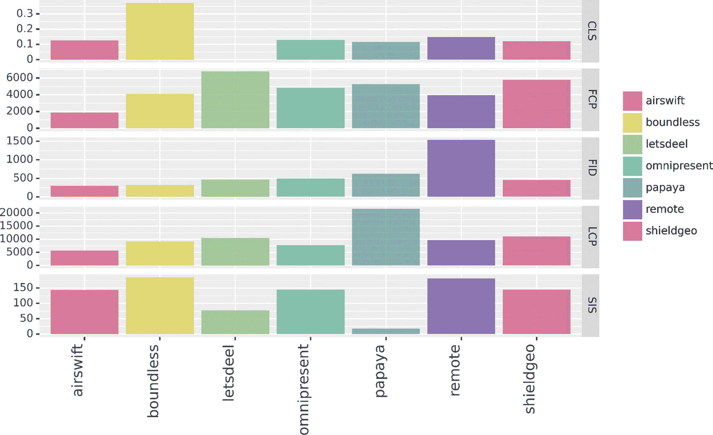

5 个分面柱状图绘制了网站 Airswift、Boundless、Letsdeel、Omnipresent、Papaya、Remote 和 Shieldgeo 的 CWV 指标。这些图分别对应 `CLS`、`FCP`、`FID`、`LCP` 和 `SIS`。Boundless 在 `CLS` 和 `SIS` 指标上数值最高。Papaya 在 `SIS` 指标上数值较低。

**图 3-23** 不同网站按 CWV 指标划分的分面柱状图

### 现场 CWV

此处的目的是利用数据激励客户、同事和利益相关者，让他们了解 CWV 改进将带来的 SEO 收益。在本节中，我们将深入网站本身，看看哪些地方可以进行改进。

我们首先像往常一样导入数据并清理列：

```python
target_crawl_raw = pd.read_csv('data/boundlesshq_com_all_urls__excluding_uncrawled__filtered_20220427203402.csv')
target_crawl_raw.columns = [col.lower() for col in target_crawl_raw.columns]
target_crawl_raw.columns = [col.replace('(', '') for col in target_crawl_raw.columns]
target_crawl_raw.columns = [col.replace(')', '') for col in target_crawl_raw.columns]
target_crawl_raw.columns = [col.replace('@', '') for col in target_crawl_raw.columns]
target_crawl_raw.columns = [col.replace('/', '') for col in target_crawl_raw.columns]
target_crawl_raw.columns = [col.replace(' ', '_') for col in target_crawl_raw.columns]
print(target_crawl_raw.columns)
```

我们使用的是 Sitebulb 爬取数据，并且只想包含现场可索引的 URL，因为这些 URL 才会参与排名，我们将按如下方式进行筛选：

```python
target_crawl_raw = target_crawl_raw.loc[target_crawl_raw['host'] == target_host]
target_crawl_raw = target_crawl_raw.loc[target_crawl_raw['indexable_status'] == 'Indexable']
target_crawl_raw = target_crawl_raw.loc[target_crawl_raw['content_type'] == 'HTML']
target_crawl_raw
```

结果如下：

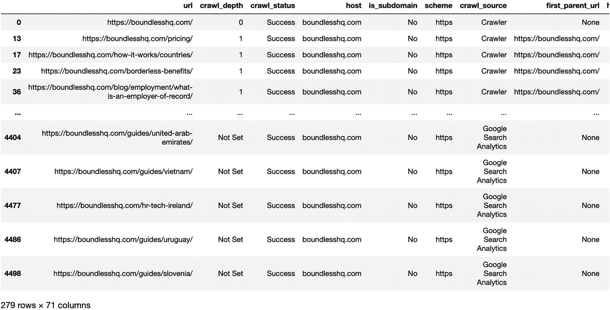

一张表格的截图，其列标题下包含数据：`u r l`、`crawl underscore depth`、`crawl underscore status`、`host`、`is underscore subdomain`、`scheme`、`crawl underscore source` 和 `first underscore parent underscore u r l`。文中提到该数据框或表格有 279 行和 71 列。

有 279 行，这是一个小型网站。下一步是选择所需的列，这些列将包含 CWV 度量以及任何可能解释它的因素：

```python
target_speedDist_df = target_crawl_raw[['url', 'cumulative_layout_shift', 'first_contentful_paint',
'largest_contentful_paint', 'performance_score', 'time_to_interactive',
'total_blocking_time', 'images_without_dimensions', 'perf_budget_fonts',
'font_transfer_size_kib', 'fonts_files', 'images_files',
'images_not_efficiently_encoded', 'images_size_kib',
'images_transfer_size_kib', 'images_without_dimensions', 'media_files',
'media_size_kib', 'media_transfer_size_kib',
'next-gen_format_savings_kib', 'offscreen_images_not_deferred',
'other_files', 'other_size_kib', 'other_transfer_size_kib',
'passed_font-face_display_urls', 'render_blocking_savings',
'resources_not_http2', 'scaled_images', 'perf_budget_total']]
target_speedDist_df
```

结果如下：

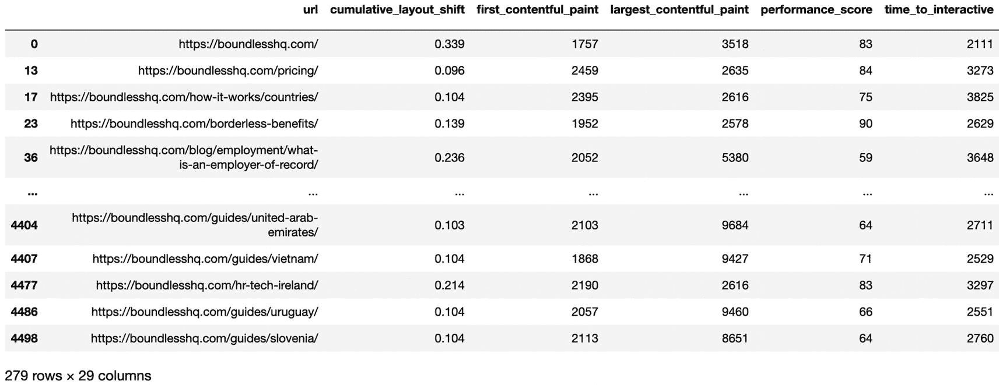

一张表格的截图，其列标题下包含数据：`u r l`、`cumulative underscore layout underscore shift`、`first underscore contentful underscore paint`、`largest underscore contentful underscore paint`、`performance underscore score` 和 `time underscore to underscore interactive`。文中提到该数据框或表格有 279 行和 29 列。

数据框的列数已从 71 列减少到 29 列，CWV 分数更加明显。

尝试在 URL 级别分析网站不会特别有用，因此为了更容易识别模式，我们将按文件夹位置对内容进行分类：

```python
section_conds = [
target_speedDist_df['url'] == 'https://boundlesshq.com/',
target_speedDist_df['url'].str.contains('/guides/'),
target_speedDist_df['url'].str.contains('/how-it-works/')
]
section_vals = ['home', 'guides', 'commercial']
target_speedDist_df['content'] = np.select(section_conds, section_vals, default = 'blog')
```

我们还将主要指标转换为数字：

```python
cols = ['cumulative_layout_shift', 'first_contentful_paint', 'largest_contentful_paint', 'performance_score',
'time_to_interactive', 'total_blocking_time']
target_speedDist_df[cols] = pd.to_numeric(target_speedDist_df[cols].stack(), errors='coerce').unstack()
target_speedDist_df
```

结果如下：

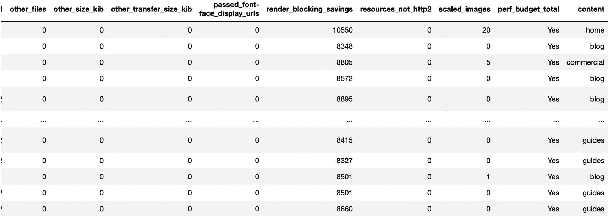

一张表格的截图，其列标题下包含数据：`other underscore files`、`other underscore size underscore k i b`、`other underscore transfer underscore size underscore k i b`、`passed underscore font face underscore display underscore u r ls` 以及另外 5 个。

已创建一个新列，其中每个可索引的 URL 都按其内容类别进行了标记。

是时候使用 `groupby` 对 `"content"` 进行一些聚合了：

```python
speed_dist_agg = target_speedDist_df.groupby('content').agg({'url': 'count', 'performance_score'}).reset_index()
speed_dist_agg
```

结果如下：

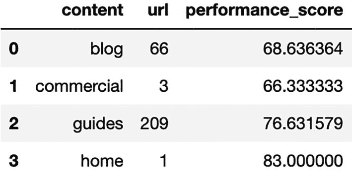

一张表格的截图，其列标题下包含数据：`content`、`u r l` 和 `performance underscore score`。行条目是从 0 到 3 的数字。

大部分内容是指南，其次是博客文章，还有三个报价页面。为了可视化，我们将使用直方图来显示整体性能分数的分布，并根据其分段对分数列中的 URL 进行颜色编码。

到目前为止，主页和指南是最快的。

```python
target_speedDist_plt = (
ggplot(target_speedDist_df,
aes(x = 'performance_score', fill = 'content')) +
geom_histogram(alpha = 0.8, bins = 20) +
labs(y = 'Page Count', x = '\nSpeed Score') +
#scale_x_continuous(breaks=range(0, 100, 20)) +
theme(legend_position = 'right',
axis_text_x = element_text(rotation=90, hjust=1, size = 7))
)
target_speedDist_plt.save(filename = 'images/3_target_speedDist_plt.png',
height=5, width=8, units = 'in', dpi=1000)
target_speedDist_plt
```

`target_speedDist_plt` 图（`图 3-24`）显示主页（紫色）表现相当不错，速度得分为 84。指南各不相同，但大多数速度都在 80 以上，而大多数博客文章的速度在 70 多分。

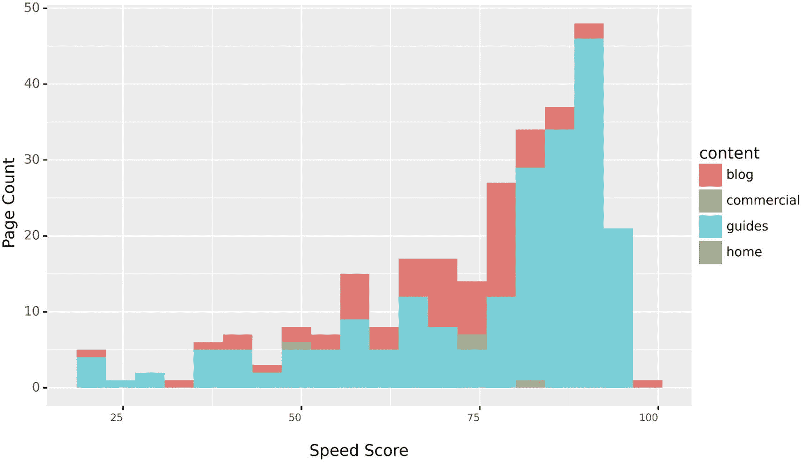

一个堆叠条形图，页面计数从 0 到 50，速度得分从 0 到 100。它针对内容、博客、商业、指南和主页进行绘制。指南呈上升趋势，最大页面计数为 46。总体而言，博客的页面计数最大。最高速度得分约为 84。

`图 3-24` 按内容类型划分的速度得分分布

让我们按 CWV 得分类别深入分析，从 CLS 开始：

```python
target_CLS_plt = (
ggplot(target_speedDist_df,
aes(x = 'cumulative_layout_shift', fill = 'content')) +
geom_histogram(alpha = 0.8, bins = 20) +
labs(y = 'Page Count', x = '\ncumulative_layout_shift') +
#scale_x_continuous(breaks=range(0, 100, 20)) +
theme(legend_position = 'right',
axis_text_x = element_text(rotation=90, hjust=1, size = 7))
)
target_CLS_plt.save(filename = 'images/3_target_CLS_plt.png',
height=5, width=8, units = 'in', dpi=1000)
target_CLS_plt
```

如 `target_CLS_plt`（`图 3-25`）所示，指南在浏览器渲染过程中发生的布局偏移最少，而博客和主页的偏移最多。

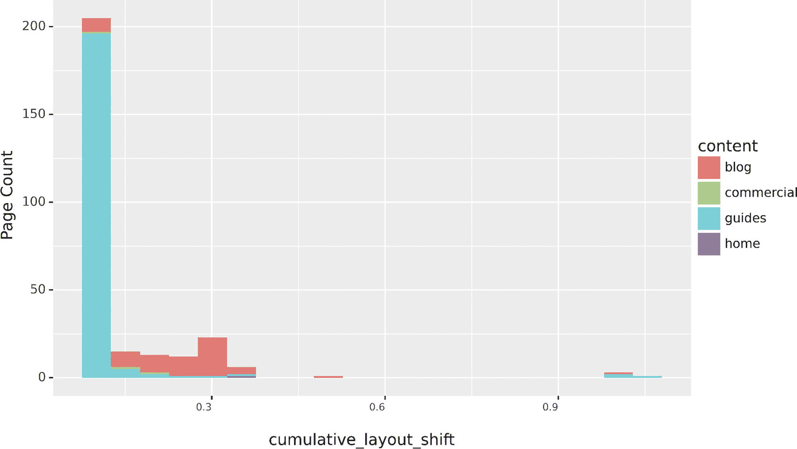

一个堆叠条形图，页面计数从 0 到 200，累积布局偏移从 0 到 1.0。它针对内容、博客、商业、指南和主页进行绘制。指南的偏移量最少，而博客和主页的偏移量最多。

`图 3-25` 按内容类型划分的 CLS 分布

因此，我们现在知道应该将 CLS 开发工作重点放在哪些内容模板上。

```python
target_FCP_plt = (
ggplot(target_speedDist_df,
aes(x = 'first_contentful_paint', fill = 'content')) +
geom_histogram(alpha = 0.8, bins = 30) +
labs(y = 'Page Count', x = '\nContentful paint') +
theme(legend_position = 'right',
axis_text_x = element_text(rotation=90, hjust=1, size = 7))
)
target_FCP_plt.save(filename = 'images/3_target_FCP_plt.png',
height=5, width=8, units = 'in', dpi=1000)
target_FCP_plt
```

在此区域中，`target_FCP_plt`（`图 3-26`）未显示出明显趋势，这表明这是一个全局性的网站问题。因此，下一步显然是深入 Chrome 开发者工具并查看网络日志。

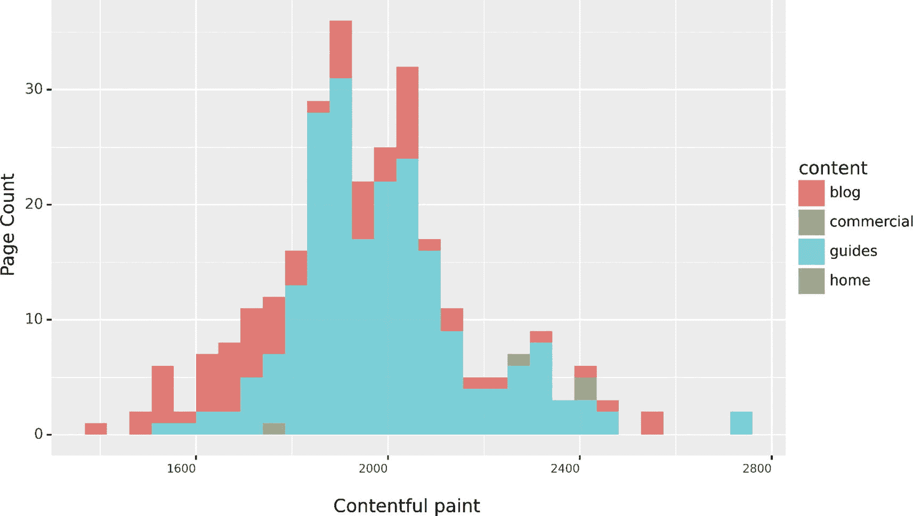

一个堆叠柱状图，页面数量从 0 到 40，内容绘制时间从 1200 到 2800。它展示了博客、商业、指南和首页等内容的分布。趋势类似于钟形曲线。

`图 3-26` 按内容类型划分的 FCP 分布

```python
target_LCP_plt = (
ggplot(target_speedDist_df,
aes(x = 'largest_contentful_paint', fill = 'content')) +
geom_histogram(alpha = 0.8, bins = 20) +
labs(y = 'Page Count', x = '\nlargest_contentful_paint') +
theme(legend_position = 'right',
axis_text_x = element_text(rotation=90, hjust=1, size = 7))
)
target_LCP_plt.save(filename = 'images/3_target_LCP_plt.png',
height=5, width=8, units = 'in', dpi=1000)
target_LCP_plt
```

`target_LCP_plt`（`图 3-27`）显示，大多数指南和部分博客的 LCP 得分最快；无论如何，博客模板和异常的指南页面将是重点关注区域。

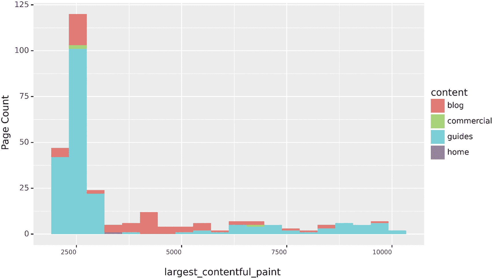

一个堆叠柱状图，页面数量与最大内容绘制时间的关系。它展示了博客、商业、指南和首页等内容的分布。大量指南和部分博客拥有最快的 LCP 得分。

`图 3-27` 按内容类型划分的 LCP 分布

```python
target_FID_plt = (
ggplot(target_speedDist_df,
aes(x = 'time_to_interactive', fill = 'content')) +
geom_histogram(alpha = 0.8, bins = 20) +
labs(y = 'Page Count', x = '\ntime_to_interactive') +
theme(legend_position = 'right',
axis_text_x = element_text(rotation=90, hjust=1, size = 7))
)
target_FID_plt.save(filename = 'images/3_target_FID_plt.png',
height=5, width=8, units = 'in', dpi=1000)
target_FID_plt
```

在 `target_FID_plt`（`图 3-28`）中，网站的大部分页面似乎都享有较快的 FID 时间，因此这将是 CWV 改进中优先级最低的部分。

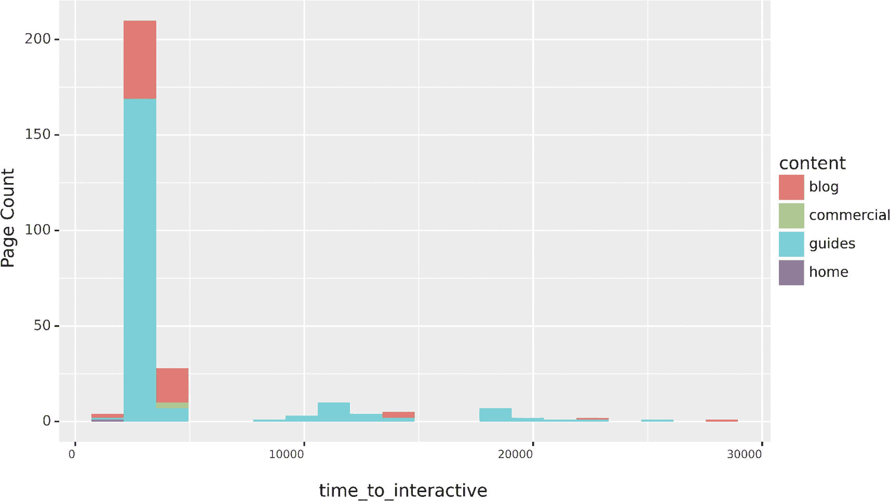

一个堆叠柱状图，绘制了页面数量与可交互时间的关系。它展示了博客、商业、指南和首页等内容的分布。大部分网站的 FID 时间都很快。

`图 3-28` 按内容类型划分的 FID 分布

### 本章小结

在本章中，我们介绍了如何通过以下方式对技术 SEO 采取数据驱动的方法：

*   对页面权威性进行建模，以向同事和客户估算技术 SEO 建议的收益
*   通过不同方式分析内部链接优化，以通过锚文本提高内容的可发现性和标签化
*   分析核心网页指标，以确定哪些指标需要改进以及按内容类型进行改进

下一章将重点介绍如何使用数据来改进内容和用户体验。