# 5. 权威性

可以说，权威性占据了谷歌算法的 50%。你可以倾尽全力优化你的网站，创建完美的内容，并以完美的用户体验呈现，这些内容托管在拥有最完美信息架构的网站上，但最终却发现，当按页面标题搜索时（假设这不是一个独特的搜索短语），它在谷歌搜索结果中毫无踪影。这是为什么呢？

你将在本章中了解这一点以及以下内容：

*   什么是网站权威性，以及它如何影响 SEO
*   品牌搜索如何影响搜索可见性
*   回顾单站点和多站点分析

## 一些 SEO 历史

要回答这个问题，我们必须了解搜索引擎的演变过程，以及 1998 年谷歌出现之前的情况有多么混乱。即使谷歌出现后，情况依然混乱且发展迅速。

在谷歌之前，大多数搜索引擎，如 `AltaVista`、`雅虎`和`Ask（Jeeves）`，主要关注页面内容中嵌入的关键词。这使得搜索引擎相对容易被各种技巧所操纵，包括在白色背景上使用白色文字隐藏关键词，或者大量重复关键词。

当谷歌出现时，他们做了几件与众不同的事情，这基本上颠覆了其他竞争搜索引擎。

第一件事是，他们的算法根据页面的权威性（换句话说，就是文档或网站的可信度）对页面进行排名，而不仅仅是根据关键词相关性匹配文档。当时的权威性由谷歌通过指向你网站的其他网站链接数量来衡量。这与博士论文中的引用方式非常相似。链接（或引用）越多，网络上的随机用户找到你内容的可能性就越高。这使得 SEO 更难被操纵，并且结果（暂时但显著地）相对于竞争对手更可靠。

他们做的第二件事是与雅虎合作，雅虎公开承认其搜索结果由谷歌提供支持。那么接下来发生了什么？人们不再使用雅虎，而是直接使用谷歌，绕过了作为中间人的雅虎搜索引擎，剩下的就是历史了——或者说，并非如此。

### 一点历史背景

尽管谷歌占据了搜索市场的绝大部分份额，但 SEO 行业还是摸清了谷歌算法的大致原理，并开始策划链接流行度方案，例如交换链接（即互惠链接）以及从私密网络创建/租用链接（不幸的是，这种做法至今依然存在）。谷歌则用`熊猫`和`企鹅`等反垃圾算法予以回应，这些算法或多或少地摧毁了这些方案，以至于品牌领域的大多数企业不得不转向广告和数字公关。而且，这确实有效。

## 权威、链接及其他

尽管存在普遍的误解，认为反向链接就是权威。但我们有大量证据表明，权威是链接和广告共同作用的结果，也就是说，权威并不仅仅通过链接来衡量。请参考图 5-1。

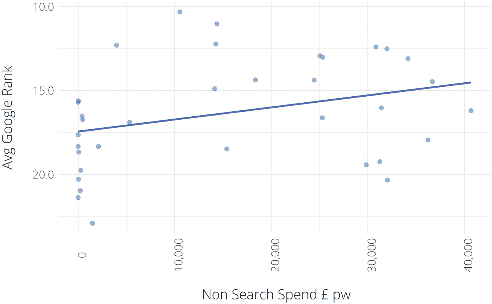

一张散点图估算了平均谷歌排名与每周非搜索支出之间的关系。平均谷歌排名随着非搜索支出的增加而提高。图中绘制了一条回归线，位于平均谷歌排名 15 到 20 之间，该线逐渐上升，最终在非搜索支出约为 40000 时达到排名 15。

图 5-1 只是众多展示排名与权威之间正相关关系的例子之一。在这个案例中，权威是非搜索广告的产物。为什么会这样呢？因为优质的链接和有效的广告能够提升品牌印象，而品牌印象本身也与排名呈正相关。

我们接下来要做的是展示数据科学如何帮助你：

*   检查你自己的链接
*   分析你竞争对手的链接
*   寻找权力网络
*   确定优质链接的关键要素

## 检查你自己的链接

如果你曾经想分析自己网站的反向链接，你很可能会使用像 `AHREFs` 和 `SEMRush` 这样比较流行的工具。这些服务会遍历网络，获取一份链接到你网站的域名列表，并附带域名评级和其他描述你反向链接质量的信息，它们将这些数据存储在庞大的索引中，以供查询。

反向链接在谷歌算法中扮演着重要角色，这已不是什么秘密。因此，在与竞争对手进行比较之前，至少先了解自己的网站是很有意义的，而前者正是我们今天要做的事情。

虽然大部分分析可以在电子表格中完成，但 `Python` 具有某些优势。除了能处理海量行数之外，它还能更轻松地查看统计方面的情况，例如数据分布。

### 导入并清理目标链接数据

我们将从英国家具行业挑选一个小型网站（没有特殊原因），并使用 `Python` 进行一些基础分析。

那么，一个网站的反向链接对 SEO 的价值是什么？简单来说，我认为是质量和数量。质量对于专家来说是主观的，但对于谷歌来说，通过权威性和内容相关性等指标，质量是确定的。

我们将首先利用现有数据评估链接质量，然后再评估数量。开始编码。

```python
import re
import time
import random
import pandas as pd
import numpy as np
import datetime
from datetime import timedelta
from plotnine import *
import matplotlib.pyplot as plt
from pandas.api.types import is_string_dtype
from pandas.api.types import is_numeric_dtype
import uritools
pd.set_option('display.max_colwidth', None)
%matplotlib inline
root_domain = 'johnsankey.co.uk'
hostdomain = 'www.johnsankey.co.uk'
hostname = 'johnsankey'
full_domain = 'https://www.johnsankey.co.uk'
target_name = 'John Sankey'
```

我们首先导入数据，并清理列名，使其在后续阶段更易于处理和输入。

```python
target_ahrefs_raw = pd.read_csv('data/johnsankey.co.uk-refdomains-subdomains__2022-03-18_15-15-47.csv')
```

列表推导式是一种强大且资源占用较少的方法，用于清理列名。

```python
target_ahrefs_raw.columns = [col.lower() for col in target_ahrefs_raw.columns]
```

这个列表推导式指示 `Python` 将数据框列中的每个列名（`col`）转换为小写。

```python
target_ahrefs_raw.columns = [col.replace(' ','_') for col in target_ahrefs_raw.columns]
target_ahrefs_raw.columns = [col.replace('.','_') for col in target_ahrefs_raw.columns]
target_ahrefs_raw.columns = [col.replace('__','_') for col in target_ahrefs_raw.columns]
target_ahrefs_raw.columns = [col.replace('(','') for col in target_ahrefs_raw.columns]
target_ahrefs_raw.columns = [col.replace(')','') for col in target_ahrefs_raw.columns]
target_ahrefs_raw.columns = [col.replace('%','') for col in target_ahrefs_raw.columns]
```

重复上述几行代码的另一种方法是，将函数调用链式连接起来，在一行代码中处理所有列：

```python
target_ahrefs_raw.columns = [col.lower().replace(' ','_').replace('.','_').replace('__','_').replace('(','').replace(')','').replace('%','') for col in target_ahrefs_raw.columns]
```

虽然不是严格必需的，但我喜欢有一个标准的计数列用于聚合，以及一个单一的值列 `project`，以便在需要时对整个表进行分组：

```python
target_ahrefs_raw['rd_count'] = 1
target_ahrefs_raw['project'] = target_name
Target_ahrefs_raw
```

结果如下：

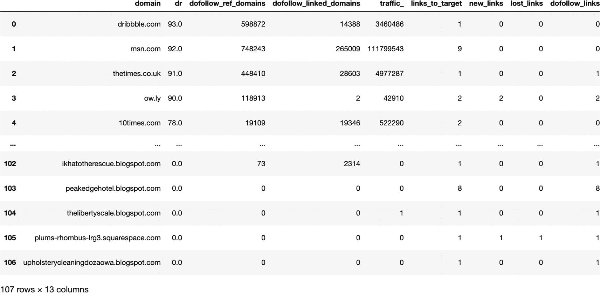

一个表格展示了一组域名的详细信息，包括它们的域名评级、可追踪的引用域名、可追踪的链接域名、流量、指向目标的链接、新增链接、丢失链接以及可追踪链接。

现在我们有了一个列名清晰的数据框。下一步是清理实际的表格值，使其对分析更有用。

复制上一个数据框并赋予新名称：

```python
target_ahrefs_clean_dtypes = target_ahrefs_raw.copy()
```

清理 `dofollow_ref_domains` 列，该列告诉我们网站链接拥有的引用域名数量。在这里，我们将把破折号转换为零，然后将整个列转换为整数类型。

从引用域名开始：

```python
target_ahrefs_clean_dtypes['dofollow_ref_domains'] = np.where(target_ahrefs_clean_dtypes['dofollow_ref_domains'] == '-', 0, target_ahrefs_clean_dtypes['dofollow_ref_domains'])
target_ahrefs_clean_dtypes['dofollow_ref_domains'] = target_ahrefs_clean_dtypes['dofollow_ref_domains'].astype(int)
```

然后是链接域名：

```python
target_ahrefs_clean_dtypes['dofollow_linked_domains'] = np.where(target_ahrefs_clean_dtypes['dofollow_linked_domains'] == '-', 0, target_ahrefs_clean_dtypes['dofollow_linked_domains'])
target_ahrefs_clean_dtypes['dofollow_linked_domains'] = target_ahrefs_clean_dtypes['dofollow_linked_domains'].astype(int)
```

“首次发现”告诉我们链接首次被找到的日期（即被发现并添加到 `Ahrefs` 索引中的日期）。我们将把字符串转换为 `Python` 可以处理的日期格式，然后利用它来推导链接的年龄：

```python
target_ahrefs_clean_dtypes['first_seen'] = pd.to_datetime(target_ahrefs_clean_dtypes['first_seen'], format='%d/%m/%Y %H:%M')
```

将 `first_seen` 转换为日期也意味着我们可以按年月进行时间聚合，因为网站的链接并非总是每天都会获取：

```python
target_ahrefs_clean_dtypes['month_year'] = target_ahrefs_clean_dtypes['first_seen'].dt.to_period('M')
```

链接年龄的计算方法是：用今天的日期减去首次发现的日期。然后将其转换为数字格式，并除以一个巨大的数字，以得到天数：

```python
target_ahrefs_clean_dtypes['link_age'] = dt.datetime.now() - target_ahrefs_clean_dtypes['first_seen']
target_ahrefs_clean_dtypes['link_age'] = target_ahrefs_clean_dtypes['link_age']
target_ahrefs_clean_dtypes['link_age'] = target_ahrefs_clean_dtypes['link_age'].astype(int)
target_ahrefs_clean_dtypes['link_age'] = (target_ahrefs_clean_dtypes['link_age']/(3600 * 24 * 1000000000)).round(0)
target_ahrefs_clean_dtypes
```

结果如下：

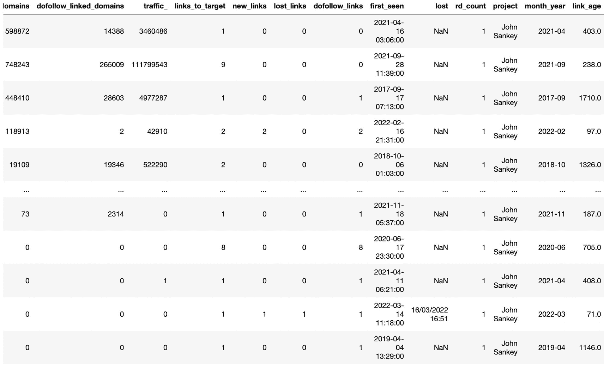

一个表格展示了 `dofollow` 链接域名、流量、指向目标的链接、新链接、丢失链接、`dofollow` 链接、首次发现日期、`RD` 数量、项目、年月以及链接年龄的详细信息。

数据类型清理完毕，并创建了一些新的数据特征（注意之前添加的列），有趣的部分可以开始了。

## 针对域名权威度

我们分析的第一部分评估链接质量，首先使用 `describe()` 函数汇总整个数据框，以获取所有列的描述性统计信息：

```python
target_ahrefs_analysis = target_ahrefs_clean_dtypes
target_ahrefs_analysis.describe()
```

结果如下：

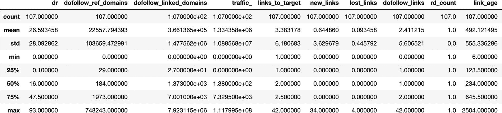

一个表格展示了计数、均值、标准差、最小值、最大值，以及 25%、50%、75% 分位数的域名评分、`dofollow` 引用域名、`dofollow` 链接域名、流量、指向目标的链接、新链接、丢失链接、`dofollow` 链接、`RD` 数量和链接年龄的值。

因此，从上表中，我们可以看到平均值（均值）、引用域名的数量（107）以及变异情况（第 25 百分位数等）。

引用域名的平均域名评分（相当于 `Moz` 的域名权威度）是 27。这是好事吗？在缺乏该市场领域竞争对手数据进行比较的情况下，很难判断，这正是你作为 SEO 从业者经验发挥作用的地方。然而，我确信我们都同意它可以更高——因为它的评分范围在 0 到 100 之间。要提高多少才能带来改变则是另一个问题。

上表可能有点枯燥且难以直观理解，因此我们将绘制一个直方图，以便更直观地理解引用域名的权威度：

```python
dr_dist_plt = (
    ggplot(target_ahrefs_analysis, aes(x = 'dr')) +
    geom_histogram(alpha = 0.6, fill = 'blue', bins = 100) +
    scale_y_continuous() +
    theme(legend_position = 'right'))
dr_dist_plt
```

该分布严重偏斜，显示大多数引用域名的权威度评分为零（图 5-2）。在零分之外，分布看起来相当均匀，在不同权威度水平上的域名数量大致相等。

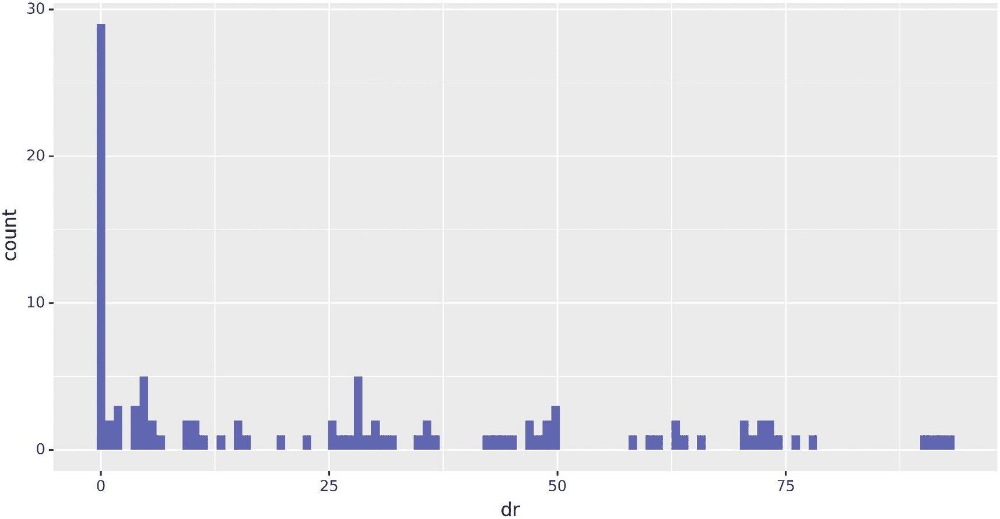

一个条形图展示了不同域名评分的计数。它显示域名评分为 0 时的最大计数约为 30。域名评分高于 75 的数量非常少。

# 域名权威度与链接数量的分析

## 域名权威度随时间的变化

现在，我们将域名权威度作为链接质量的代理指标，以时间序列的形式进行分析。如果按日期绘制链接数量，时间序列会显得相当杂乱且实用性较低，如下所示：

```
dr_firstseen_plt = (
ggplot(target_ahrefs_analysis, aes(x = 'first_seen', y = 'dr', group = 1)) +
geom_line(alpha = 0.6, colour = 'blue', size = 2) +
labs(y = '域名评级', x = '年月') +
scale_y_continuous() +
scale_x_date() +
theme(legend_position = 'right',
axis_text_x=element_text(rotation=90, hjust=1)
)
)
dr_firstseen_plt.save(filename = 'images/1_dr_firstseen_plt.png',
height=5, width=10, units = 'in', dpi=1000)
dr_firstseen_plt
```

正如你所料，该图看起来非常杂乱，它实际上只展示了某个引用域名的 `DR`（域名评级）在特定时间点的数值（图 5-3）。此图表的价值在于，如果你有一个负责获取链接的团队，你可以大致监控链接质量随时间的变化。

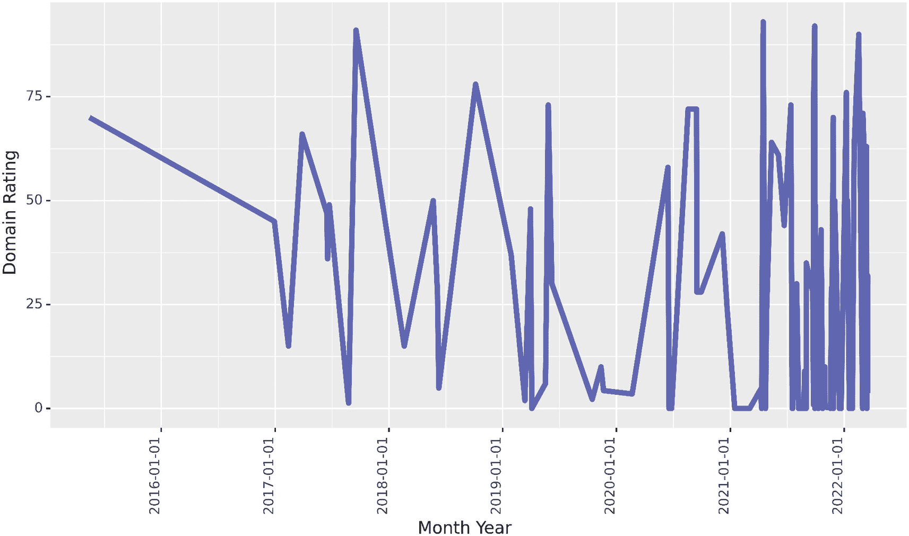

折线图展示了 2016 年 1 月至 2022 年 1 月期间域名评级的波动情况。评级在 2017 年至 2018 年以及 2021 年至 2022 年期间达到 75 以上。

**图 5-3** – 随时间获取的反向链接域名评级

为了获得更平滑的视图：

```
dr_firstseen_smooth_plt = (
ggplot(target_ahrefs_analysis, aes(x = 'first_seen', y = 'dr', group = 1)) +
geom_smooth(alpha = 0.6, colour = 'blue', size = 3, se = False) +
labs(y = '域名评级', x = '年月') +
scale_y_continuous() +
scale_x_date() +
theme(legend_position = 'right',
axis_text_x=element_text(rotation=90, hjust=1)
))
dr_firstseen_smooth_plt.save(filename = 'images/1_dr_firstseen_smooth_plt.png',
height=5, width=10, units = 'in', dpi=1000)
dr_firstseen_smooth_plt
```

使用 `geom_smooth()` 可以得到一个噪声较少的视图，并展示域名评级随时间的变化情况，从而体现质量的稳定性（图 5-4）。同样，这也与所获取链接的质量相关。

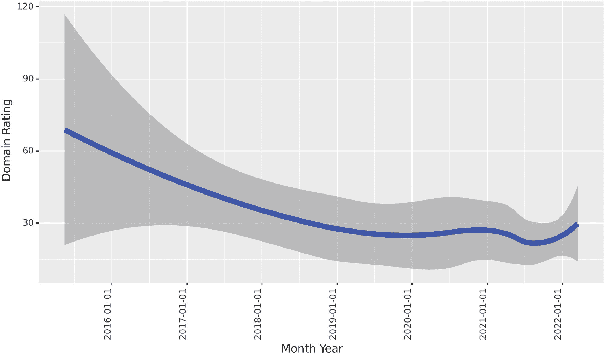

面积图展示了 2016 年 1 月至 2022 年 1 月期间域名评级的变化趋势。它表明域名评级最初达到最大值，随后逐年逐渐下降。

**图 5-4** – 随时间获取的反向链接域名评级（平滑处理）

这并不能完全描述网站整体权威度随时间的变化，因为所获取链接的价值会随时间累积保留；因此，需要采用不同的数学方法。

为了查看网站权威度随时间的变化，我们将按月计算域名评级的滚动平均值。请注意 `expanding()` 函数的使用，它指示 `Pandas` 在每一新行中包含所有之前的行：

```
target_rd_cummean_df = target_ahrefs_analysis
target_rd_mean_df = target_rd_cummean_df.groupby(['month_year'])['dr'].sum().reset_index()
target_rd_mean_df['dr_runavg'] = target_rd_mean_df['dr'].expanding().mean()
target_rd_mean_df.head(10)
```

结果如下：

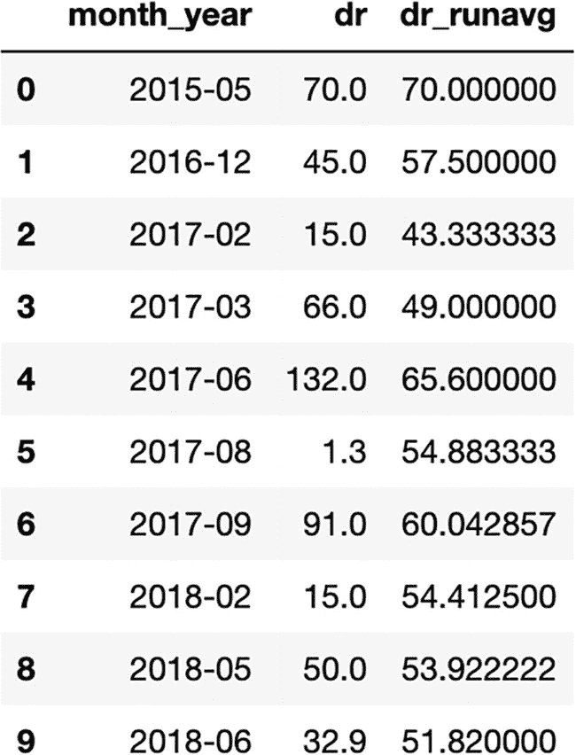

表格展示了 2015 年至 2018 年期间 9 个实例的域名评级及域名评级滚动平均值的详细信息。

现在我们有了一个表格，可以用来生成图表并进行可视化。

```
dr_cummean_smooth_plt = (
ggplot(target_rd_mean_df, aes(x = 'month_year', y = 'dr_runavg', group = 1)) +
geom_line(alpha = 0.6, colour = 'blue', size = 2) +
#labs(y = 'GA 会话数', x = '日期') +
scale_y_continuous() +
scale_x_date() +
theme(legend_position = 'right',
axis_text_x=element_text(rotation=90, hjust=1)
))
dr_cummean_smooth_plt
```

因此，目标网站最初拥有高权威度的链接（可能是宣布商业品牌的公关活动），但随后四年内权威度逐渐下降，之后通过获取新的高权威度链接再次回升（图 5-5）。

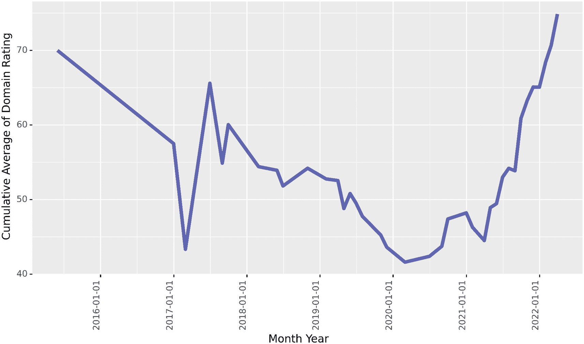

折线图展示了 2016 年 1 月至 2022 年 1 月期间域名评级累积平均值的变化趋势。它表明在 2021 年 1 月之后评级急剧上升。

**图 5-5** – 反向链接的累积平均域名评级随时间的变化

最重要的是，我们可以看到网站整体权威度随时间的变化，这或许也是像谷歌这样的搜索引擎看待它的方式。

对此分析的一个很好的扩展是重新生成数据框，以便我们能够绘制基于累积的随时间分布图。这样我们不仅能观察到中位数质量，还能看到随时间的变化情况。

以上就是关于链接质量的分析，那么链接数量呢？

## 定位链接数量

质量是一回事；高质量链接的数量则完全是另一回事，这正是我们接下来要分析的。

我们将像之前的操作一样，使用扩展函数来计算截至当前所获链接的累计总和：

```
target_count_cumsum_df = target_ahrefs_analysis
print(target_count_cumsum_df.columns)
target_count_cumsum_df = target_count_cumsum_df.groupby(['month_year'])['rd_count'].sum().reset_index()
target_count_cumsum_df['count_runsum'] = target_count_cumsum_df['rd_count'].expanding().sum()
target_count_cumsum_df['link_velocity'] = target_count_cumsum_df['rd_count'].diff()
target_count_cumsum_df
```

结果如下：

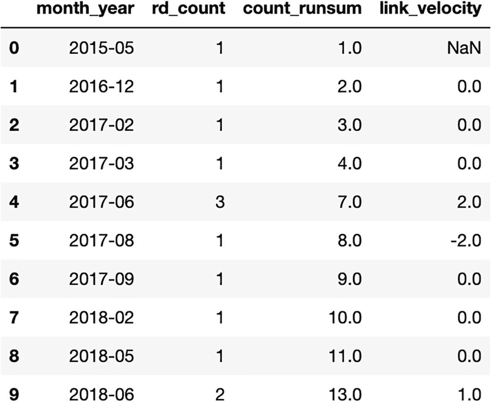

该表格展示了 2015 年至 2018 年期间，10 个实例的引荐域名数量、累计总和以及链接速度值的详细信息。

以上是数据，接下来是图表。

```
target_count_plt = (
ggplot(target_count_cumsum_df, aes(x = 'month_year', y = 'rd_count', group = 1)) +
geom_line(alpha = 0.6, colour = 'blue', size = 2) +
labs(y = 'Count of Referring Domains', x = 'Month Year') +
scale_y_continuous() +
scale_x_date() +
theme(legend_position = 'right',
axis_text_x=element_text(rotation=90, hjust=1)
))
target_count_plt.save(filename = 'images/3_target_count_plt.png',
height=5, width=10, units = 'in', dpi=1000)
target_count_plt
```

这是引荐域名数量的非累计视图。同样，这对于评估团队获取链接的效率非常有用（图 5-6）。

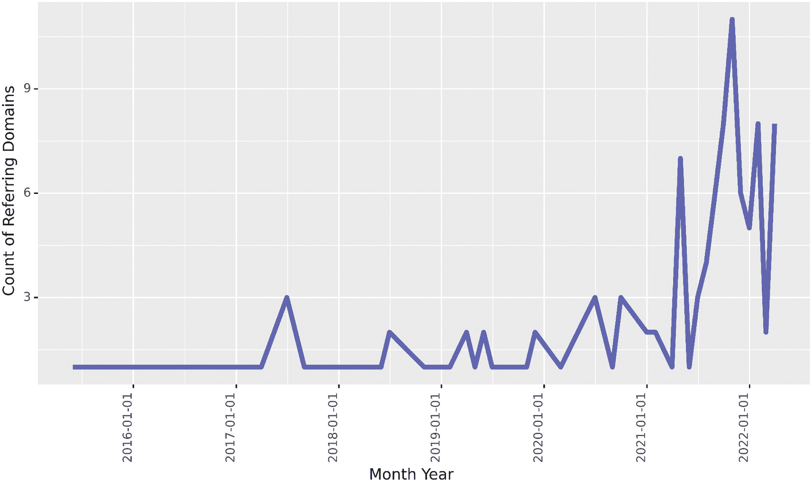

折线图展示了 2016 年 1 月至 2022 年 1 月期间引荐域名的数量。它显示出自 2021 年 1 月后，数量呈上升趋势，并伴有多个波峰和波谷。

**图 5-6** 引荐域名数量随时间变化

但或许这对于搜索引擎如何看待一个网站拥有的引荐域名总数来说，用处不大。

```
target_count_cumsum_plt = (
ggplot(target_count_cumsum_df, aes(x = 'month_year', y = 'count_runsum', group = 1)) +
geom_line(alpha = 0.6, colour = 'blue', size = 2) +
scale_y_continuous() +
scale_x_date() +
theme(legend_position = 'right',
axis_text_x=element_text(rotation=90, hjust=1)
))
target_count_cumsum_plt
```

累计视图向我们展示了引荐域名的总数（图 5-7）。当然，这并非完全准确的图景，因为一些引荐域名可能已经丢失，但足以让我们了解网站的大致状况。

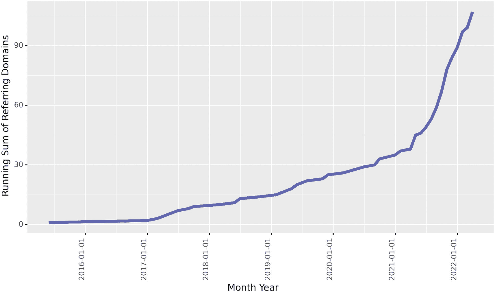

折线图展示了 2016 年 1 月至 2022 年 1 月期间引荐域名累计总和的趋势。它显示出自始至终的逐步增长。

**图 5-7** 引荐域名累计总和随时间变化

我们看到，从 2017 年开始的接下来四年里，链接稳步增加，然后在 2021 年 3 月左右再次加速。这与我们之前看到的域名评分随时间变化的趋势一致。

一个有用的扩展，用于将其与性能关联起来，可能是加入以下因素：

- 引荐域名网站流量
- 随时间变化的平均排名

# 分析竞争对手的链接

和上次一样，我们将一个网站的反向链接对 SEO 的价值定义为质量和数量的乘积——质量指域名权威（或 AHREFs 的等效域名评分），数量指引荐域名的数量。

同样，我们将先利用现有数据评估链接质量，然后再评估数量。开始编码。

```
import re
import time
import random
import pandas as pd
import numpy as np
import datetime
from datetime import timedelta
from plotnine import *
import matplotlib.pyplot as plt
from pandas.api.types import is_string_dtype
from pandas.api.types import is_numeric_dtype
import uritools
pd.set_option('display.max_colwidth', None)
%matplotlib inline
root_domain = 'johnsankey.co.uk'
hostdomain = 'www.johnsankey.co.uk'
hostname = 'johnsankey'
full_domain = 'https://www.johnsankey.co.uk'
target_name = 'John Sankey'
```

### 数据导入与清洗

我们设置好文件目录，以便能够读取一个文件夹中的多个 AHREFs 导出数据文件。这比逐个读取每个文件要快得多、枯燥少得多且效率更高，尤其是当你有超过十个文件时：

```
ahrefs_path = 'data/'
```

来自 OS 模块的 `listdir()` 函数允许我们列出子目录中的所有文件：

```
ahrefs_filenames = os.listdir(ahrefs_path)
ahrefs_filenames
```

结果如下：

```
['www.davidsonlondon.com--refdomains-subdomain__2022-03-13_23-37-29.csv',
'www.stephenclasper.co.uk--refdomains-subdoma__2022-03-13_23-47-28.csv',
'www.touchedinteriors.co.uk--refdomains-subdo__2022-03-13_23-42-05.csv',
'www.lushinteriors.co--refdomains-subdomains__2022-03-13_23-44-34.csv',
'www.kassavello.com--refdomains-subdomains__2022-03-13_23-43-19.csv',
'www.tulipinterior.co.uk--refdomains-subdomai__2022-03-13_23-41-04.csv',
'www.tgosling.com--refdomains-subdomains__2022-03-13_23-38-44.csv',
'www.onlybespoke.com--refdomains-subdomains__2022-03-13_23-45-28.csv',
'www.williamgarvey.co.uk--refdomains-subdomai__2022-03-13_23-43-45.csv',
'www.hadleyrose.co.uk--refdomains-subdomains__2022-03-13_23-39-31.csv',
'www.davidlinley.com--refdomains-subdomains__2022-03-13_23-40-25.csv',
'johnsankey.co.uk-refdomains-subdomains__2022-03-18_15-15-47.csv']
```

列出文件后，我们现在使用 `for` 循环逐个读取它们，并将它们添加到一个数据框中。在读取文件时，我们将使用一些字符串操作来创建一个新列，其中包含我们正在导入的数据的站点名称：

```
ahrefs_df_lst = list()
ahrefs_colnames = list()
for filename in ahrefs_filenames:
    df = pd.read_csv(ahrefs_path + filename)
    df['site'] = filename
    df['site'] = df['site'].str.replace('www.', '', regex = False)
    df['site'] = df['site'].str.replace('.csv', '', regex = False)
    df['site'] = df['site'].str.replace('-.+', '', regex = True)
    ahrefs_colnames.append(df.columns)
    ahrefs_df_lst.append(df)
comp_ahrefs_df_raw = pd.concat(ahrefs_df_lst)
comp_ahrefs_df_raw
```

结果如下：

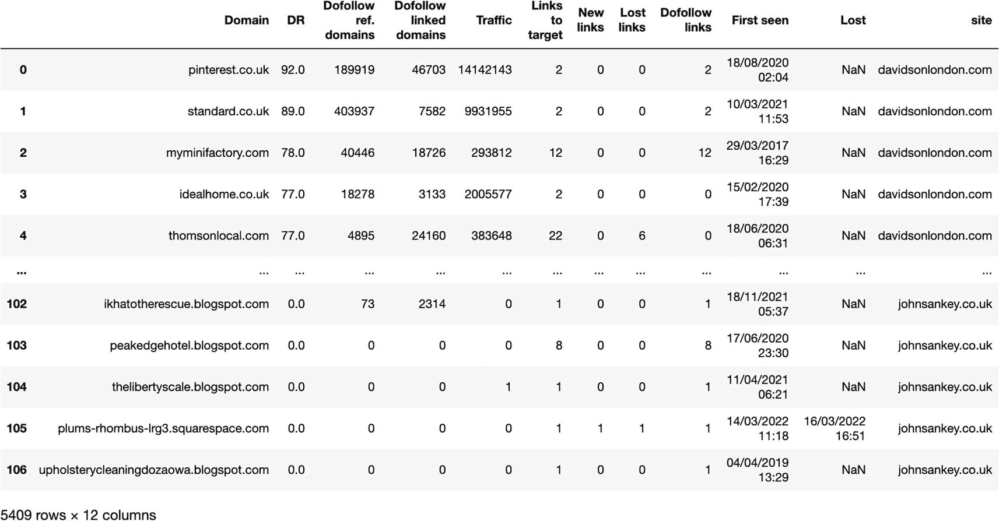

该表格展示了一组域名的详细信息，包括它们的域名评分、dofollow 引荐域名、dofollow 链接域名、流量、指向目标的链接、新链接、丢失链接、dofollow 链接、首次发现日期以及站点名称。

现在我们已经将每个站点的原始数据整合到一个数据框中，下一步是整理列名，使其更易于使用。可以使用自定义函数，但我们只需使用列表推导式来链式调用函数：

```
competitor_ahrefs_cleancols = comp_ahrefs_df_raw.copy()
competitor_ahrefs_cleancols.columns = [col.lower().replace(' ','_').replace('.','_').replace('__','_').replace('(','')
                                        .replace(')','').replace('%','')
                                        for col in competitor_ahrefs_cleancols.columns]
```

拥有一个计数列和一个单值列（`project`）对于 `groupby` 和聚合操作非常有用：

```
competitor_ahrefs_cleancols['rd_count'] = 1
competitor_ahrefs_cleancols['project'] = target_name
competitor_ahrefs_cleancols
```

结果如下：

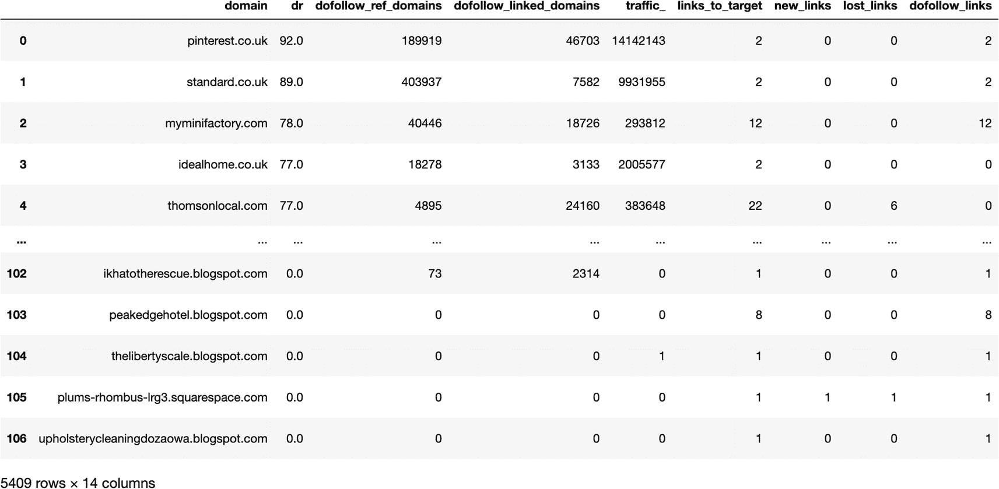

该表格展示了一组域名的详细信息，包括它们的域名评分、dofollow 引荐域名、dofollow 链接域名、流量、指向目标的链接、新链接、丢失链接和 dofollow 链接。

列现在已清理干净，接下来我们将清理行数据：

```
competitor_ahrefs_clean_dtypes = competitor_ahrefs_cleancols
```

对于引荐域名，我们将连字符替换为零，并将数据类型设置为整数（即整数）。对于链接域名，也将重复此操作：

```python
competitor_ahrefs_clean_dtypes['dofollow_ref_domains'] = np.where(competitor_ahrefs_clean_dtypes['dofollow_ref_domains'] == '-',
    0, competitor_ahrefs_clean_dtypes['dofollow_ref_domains'])
competitor_ahrefs_clean_dtypes['dofollow_ref_domains'] = competitor_ahrefs_clean_dtypes['dofollow_ref_domains'].astype(int)
# linked_domains
competitor_ahrefs_clean_dtypes['dofollow_linked_domains'] = np.where(competitor_ahrefs_clean_dtypes['dofollow_linked_domains'] == '-',
    0, competitor_ahrefs_clean_dtypes['dofollow_linked_domains'])
competitor_ahrefs_clean_dtypes['dofollow_linked_domains'] = competitor_ahrefs_clean_dtypes['dofollow_linked_domains'].astype(int)
```

`First seen` 为我们提供了一个发现链接的时间点，我们可以用它来进行时间序列绘图和推导链接年龄。我们将使用 `to_datetime` 函数将其转换为日期格式：

```python
competitor_ahrefs_clean_dtypes['first_seen'] = pd.to_datetime(competitor_ahrefs_clean_dtypes['first_seen'],
    format='%d/%m/%Y %H:%M')
competitor_ahrefs_clean_dtypes['first_seen'] = competitor_ahrefs_clean_dtypes['first_seen'].dt.normalize()
competitor_ahrefs_clean_dtypes['month_year'] = competitor_ahrefs_clean_dtypes['first_seen'].dt.to_period('M')
```

要计算 `link_age`，我们只需从今天的日期中减去 `first seen` 日期，并将差值转换为数字：

```python
competitor_ahrefs_clean_dtypes['link_age'] = dt.datetime.now() - competitor_ahrefs_clean_dtypes['first_seen']
competitor_ahrefs_clean_dtypes['link_age'] = competitor_ahrefs_clean_dtypes['link_age']
competitor_ahrefs_clean_dtypes['link_age'] = competitor_ahrefs_clean_dtypes['link_age'].astype(int)
competitor_ahrefs_clean_dtypes['link_age'] = (competitor_ahrefs_clean_dtypes['link_age']/(3600 * 24 * 1000000000)).round(0)
```

`target` 列帮助我们区分“客户”网站和竞争对手，这对于后续的可视化很有用：

```python
competitor_ahrefs_clean_dtypes['target'] = np.where(competitor_ahrefs_clean_dtypes['site'].str.contains('johns'),
    1, 0)
competitor_ahrefs_clean_dtypes['target'] = competitor_ahrefs_clean_dtypes['target'].astype('category')
competitor_ahrefs_clean_dtypes
```

结果如下：

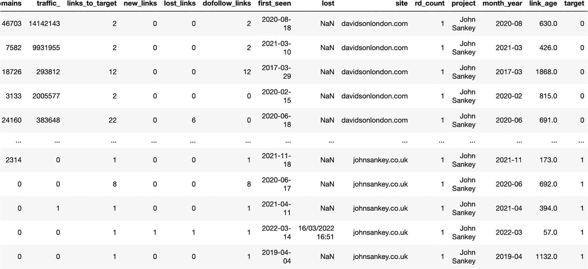

一个表格展示了流量、目标链接、新链接、丢失链接、dofollow 链接、首次发现日期、丢失次数、网站名称、RD 数量、项目名称、年月、链接年龄和目标的详细信息。

现在，数据在列标题和行值方面都已清理干净，我们准备开始进行分析。

## 优质链接的剖析

当我们之前分析一个目标网站（“John Sankey”）时，我们（和全球 SEO 行业的其他人一样）假设域名评级（`DR`）是衡量链接质量的最佳、最可靠的指标。

但我们应该这样认为吗？让我们做一个快速粗略的分析，看看情况是否确实如此，或者我们是否能找到更好的指标。我们将从在网站层面聚合链接特征开始：

```python
competitor_ahrefs_aggs = competitor_ahrefs_analysis.groupby('site').agg({'link_age': 'mean',
    'dofollow_links': 'mean',    'domain': 'count', 'dr': 'mean', 'dofollow_ref_domains': 'mean',  'traffic_': 'mean', 'dofollow_linked_domains': 'mean',    'links_to_target': 'mean',  'new_links': 'mean',     'lost_links': 'mean'}).reset_index()
competitor_ahrefs_aggs
```

结果如下：

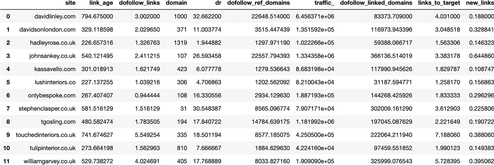

一个表格展示了 11 个网站的详细信息，包括它们的链接年龄、dofollow 链接、域名评级、dofollow 引用域、dofollow 链接域、流量、目标链接和新链接。

生成的表格向我们展示了每个链接特征的聚合统计数据。接下来，读取 SEMRush 域名级别数据的列表（由于只有 11 个网站，这些数据是通过手动数据录入逐字输入的）：

```python
semrush_viz = [10100, 2300, 931, 2400, 911, 2100, 1800, 136, 838, 428, 1100, 1700]
competitor_ahrefs_aggs['semrush_viz'] = semrush_viz
competitor_ahrefs_aggs
```

结果如下：

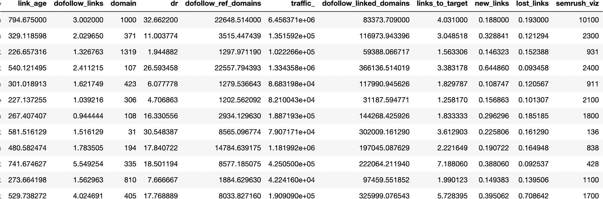

一个表格展示了链接年龄、dofollow 链接、域名评级、dofollow 引用域、流量、dofollow 链接域、目标链接、新链接、丢失链接和 SEMRush 可见度的详细信息。

SEMRush 可见度数据现已附加，因此我们可以准备计算 R 平方（即决定系数），它将告诉我们哪个链接特征最能解释 SEMRush 可见度的变化：

```python
competitor_ahrefs_r2 = competitor_ahrefs_aggs.corr() ** 2
competitor_ahrefs_r2 = competitor_ahrefs_r2[['semrush_viz']].reset_index()
competitor_ahrefs_r2 = competitor_ahrefs_r2.sort_values('semrush_viz', ascending = False)
competitor_ahrefs_r2
```

结果如下：

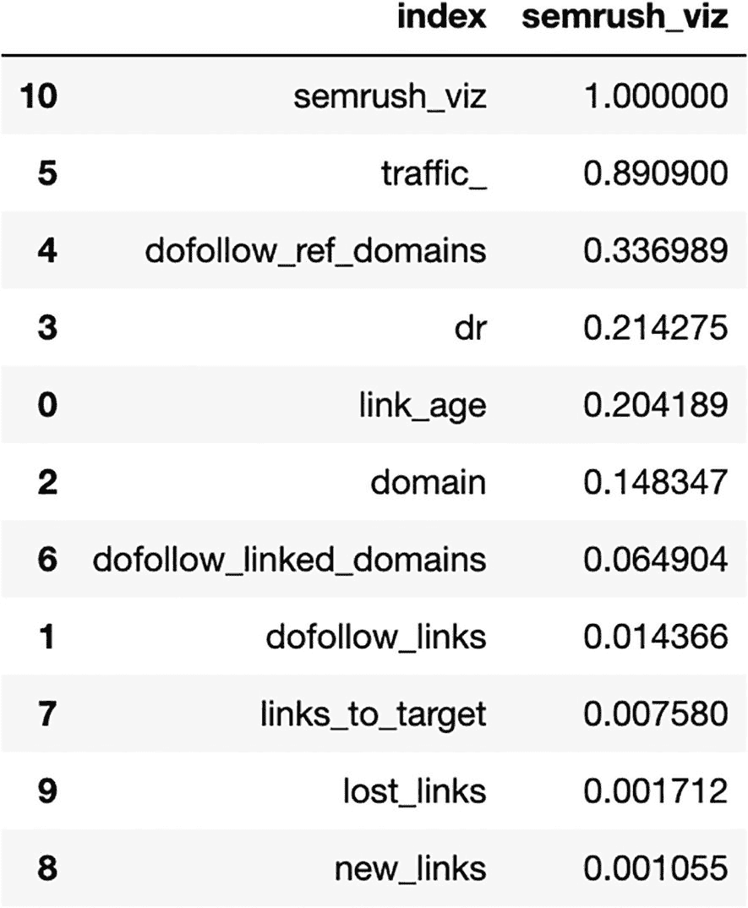

一个表格展示了 11 个索引的详细信息及其 SEMRush 可见度。它根据 SEMRush 可见度数据按降序显示数值。

自然，我们期望 `semrush_viz` 与自身完美相关。令人惊讶的是，`DR`（域名评级）并不能很好地解释 SEMRush 的差异，其 R 平方仅为 21%。

另一方面，`traffic_`（即引用域的流量值）相关性更好。仅凭这一点，我们就准备忽略 `dr`。让我们通过可视化来检查这一点：

```python
comp_correl_trafficviz_plt = (
    ggplot(competitor_ahrefs_aggs,
           aes(x = 'traffic_', y = 'semrush_viz')) +
    geom_point(alpha = 0.4, colour = 'blue', size = 2) +
    geom_smooth(method = 'lm', se = False, colour = 'red', size = 3, alpha = 0.4)
)
comp_correl_trafficviz_plt.save(filename = 'images/2_comp_correl_trafficviz_plt.png',
                                height=5, width=10, units = 'in', dpi=1000)
comp_correl_trafficviz_plt
```

这并不十分令人信服（图 5-8），因为缺少超过 2,000,000 的引用域。这是否意味着我们应该放弃使用 `traffic_` 作为衡量标准？

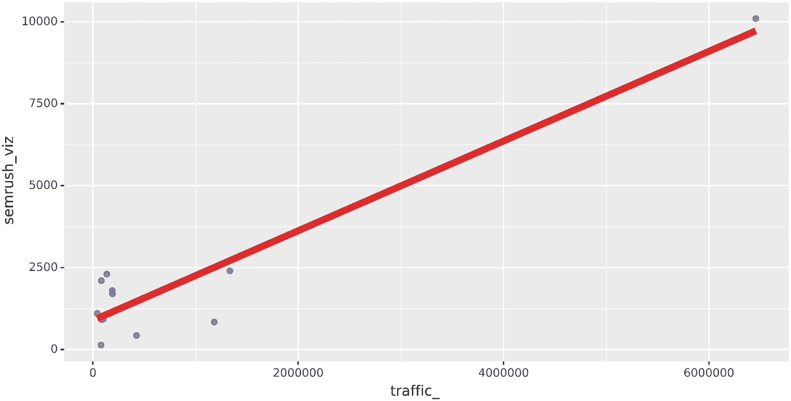

一个带有 SEMRush 可见度与流量回归线的散点图，显示了该线的上升趋势。它表明，当流量计数超过 600 万时，SEMRush 可见度数据达到约 10000。

**图 5-8** SEMRush 可见度（`semrush_viz`）与网站反向链接的 AHREFs 总流量（`traffic_`）的散点图

不一定。可见度为 10,000 的异常数据点不一定是错误的。该网站在现实世界中确实具有卓越的可见度和更多的引荐流量，因此这并不意味着该网站的数据应该被移除。

如果有的话，应该收集更多来自同一领域更多域名的数据。或者，采用更彻底的处理方法将涉及获取页面级别的 SEMRush 可见度数据，并将其与页面级别的链接特征指标相关联。

展望未来，我们将使用 `traffic_` 作为我们的质量衡量标准。

### 链接质量

我们从链接质量开始，我们最近发现，应该用 `traffic_` 来衡量链接质量，而非行业公认的标准。

首先，我们使用 `describe()` 函数来检查每个链接特征的分布属性：

```
competitor_ahrefs_analysis = competitor_ahrefs_clean_dtypes
competitor_ahrefs_analysis[['traffic_']].describe()
```

生成的表格显示了一些基本统计量，包括均值、标准差（`std`）以及四分位数指标（第 25、50 和 75 百分位数），这能让您很好地了解大多数引荐域名的流量分布情况。

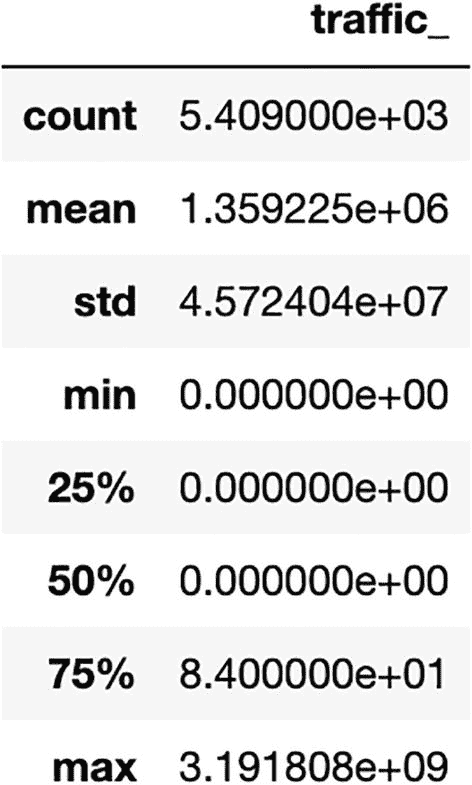

该表格展示了流量值的计数、标准差、最小值、25%、50%、75% 和最大值。

因此，毫不意外的是，如果我们看中位数，那么大多数竞争对手的引荐域名的流量（估计值）为零。只有处于第 75 百分位数或以上的域名才有流量。

我们还可以使用 `geom_boxplot` 函数绘制（并通过可视化确认）它们的分布，以便并排比较各个网站：

```
comp_dr_dist_box_plt = (
ggplot(competitor_ahrefs_analysis, #.loc[competitor_ahrefs_analysis['dr'] > 0],
aes(x = 'reorder(site, traffic_)', y = 'traffic_', colour = 'target')) +
geom_boxplot(alpha = 0.6) +
scale_y_log10() +
theme(legend_position = 'none',
axis_text_x=element_text(rotation=90, hjust=1)
))
comp_dr_dist_box_plt.save(filename = 'images/4_comp_traffic_dist_box_plt.png',
height=5, width=10, units = 'in', dpi=1000)
comp_dr_dist_box_plt
```

`comp_dr_dist_box_plt` 并排比较了各网站引荐域名的流量分布（图 5-9），其中最值得注意的是四分位距（IQR）。竞争对手用红色表示，客户用蓝色表示。

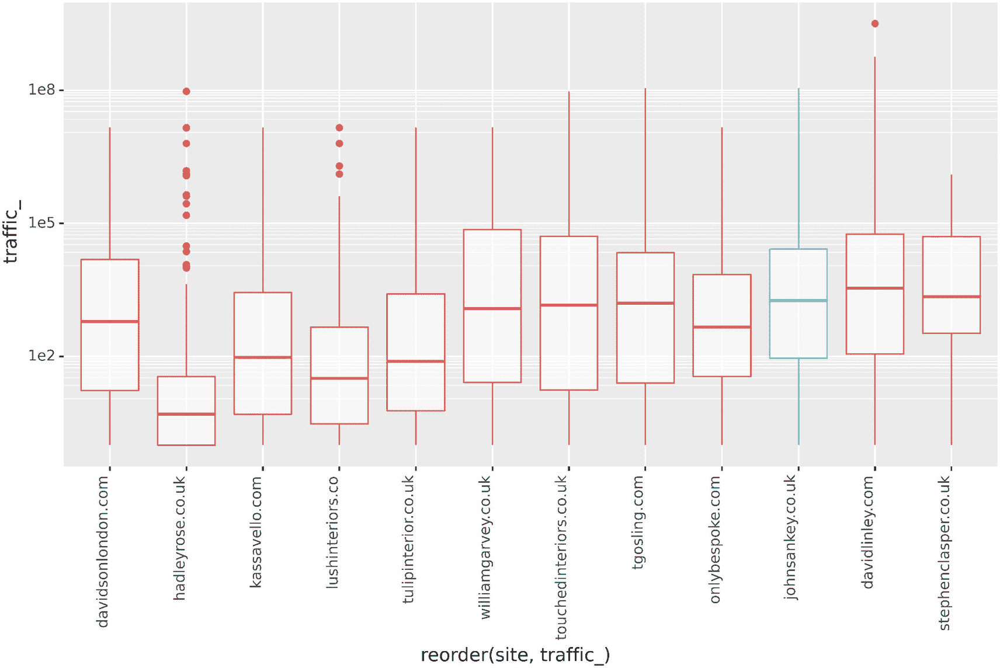

箱线图展示了 12 个域名的流量计数。其中，域名 William garvey dot co dot u k 的上四分位数接近流量值 1e5，而域名 David Linley dot com 的上须线则跨越了流量值 1e8。

**图 5-9** 每个网站的反向链接流量（`traffic_`）箱线图

四分位距是指数据在第 25 百分位数和第 75 百分位数之间的范围。其目的在于告诉我们：

-   大部分数据位于何处
-   有多少数据偏离中位数（中心点）

在这个案例中，IQR 量化了每个网站引荐域名获得的流量及其变异性。

我们还可以看到，“John Sankey”的引荐域名流量中位数排名第三，这在链接质量方面与竞争对手相比表现不错。箱体的大小（其 IQR）并非最长（围绕其中位数相当一致），但也不像 Stephen Clasper 那样短（更一致，中位数更高，并且来自高于中位数的引荐域名的反向链接更多）。

与其他域名相比，“Touched Interiors”的 DR 范围最为多样化，这可能表明其在链接获取方面的标准略微宽松。或者，是否因为随着品牌在网络上知名度和可见度的提高，该品牌自然地从零流量的引荐域名中吸引了更多链接？也许两者兼而有之。

接下来，我们绘制每个竞争对手的域名质量随时间变化的图表：

```
comp_traf_timeseries_plt = (
ggplot(competitor_ahrefs_analysis,
aes(x = 'first_seen', y = 'traffic_',
group = 'site', colour = 'site')) +
geom_smooth(alpha = 0.4, size = 2, se = False,
method='loess'
) +
scale_x_date() +
theme(legend_position = 'right',
axis_text_x=element_text(rotation=90, hjust=1)
)
)
comp_traf_timeseries_plt.save(filename = 'images/4_comp_traffic_timeseries_plt.png',
height=5, width=10, units = 'in', dpi=1000)
comp_traf_timeseries_plt
```

我们特意避免使用 `scale_y_log10()`，因为它会使用对数刻度转换垂直轴。为什么？因为那样看起来会非常杂乱，难以识别出任何突出的竞争对手。

图 5-10 展示了随时间推移获取的链接质量，其中表现突出的网站是 David Linley、T Gosling 和 John Sankey。

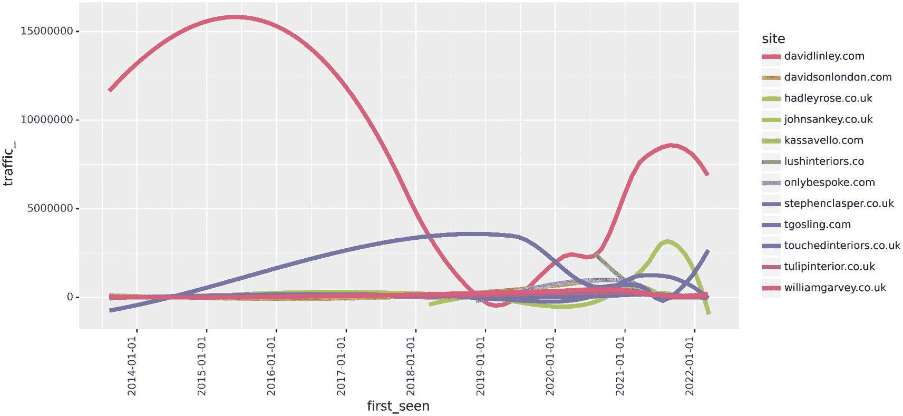

时间序列图展示了 2014 年 1 月至 2022 年 1 月期间 12 个网站的流量计数。其中，网站 David Linley dot com 的流量最高。

**图 5-10** 时间序列图，展示了每个网站各引荐域名随时间变化的流量

其余网站在链接获取表现方面基本持平。David Linley 起步很高，随后链接质量急剧下降，直到 2020 年和 2021 年才再次提升。

现在，我们对不同网站的表现有了一些概念，我们真正想要的是按 `month_year` 计算的累积链接质量，因为这很可能符合搜索引擎评估网站权威性的累加方式。

我们将使用我们信赖的 `groupby()` 和 `expanding().mean()` 函数来计算我们想要的累积统计量：

```
competitor_traffic_cummean_df = competitor_ahrefs_analysis.copy()
competitor_traffic_cummean_df = competitor_traffic_cummean_df.groupby(['site', 'month_year'])['traffic_'].sum().reset_index()
competitor_traffic_cummean_df['traffic_runavg'] = competitor_traffic_cummean_df['traffic_'].expanding().mean()
competitor_traffic_cummean_df
```

结果如下：

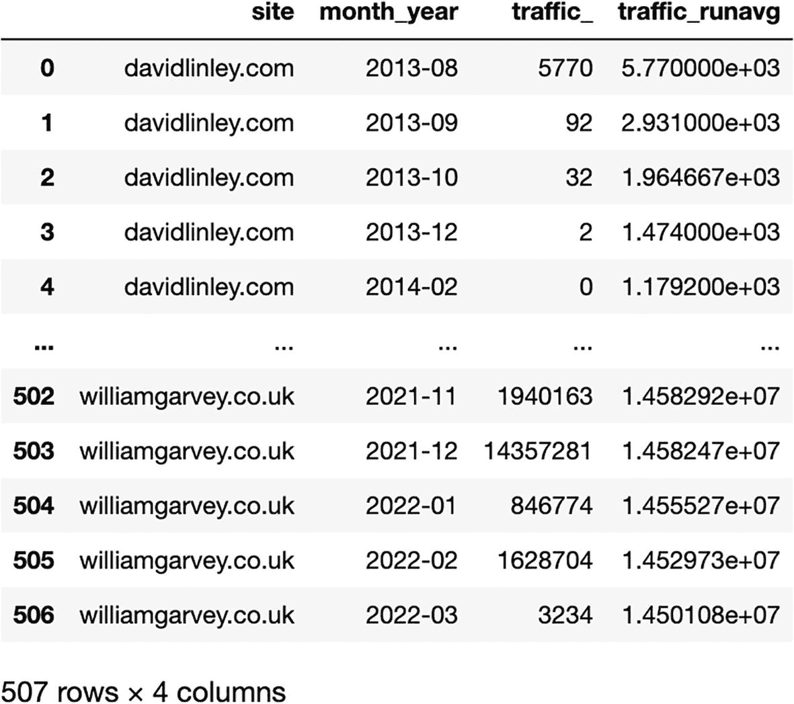

表格展示了流量和流量运行平均值的详细信息。顶部显示了网站 David Linley dot com 在 2013 年至 2014 年间的 5 个实例。底部显示了网站 William garvey dot co dot u k 在 2021 年至 2022 年间的 5 个实例。

科学计数法格式的数字用处不大，表格本身也是如此，但至少数据框已准备好为以下图表提供数据：

```
competitor_traffic_cummean_plt = (
ggplot(competitor_traffic_cummean_df, aes(x = 'month_year', y = 'traffic_runavg', group = 'site', colour = 'site')) +
geom_line(alpha = 0.6, size = 2) +
labs(y = 'Cumu Avg of traffic_', x = 'Month Year') +
scale_y_continuous() +
scale_x_date() +
theme(legend_position = 'right',
axis_text_x=element_text(rotation=90, hjust=1)
))
competitor_traffic_cummean_plt.save(filename = 'images/4_competitor_traffic_cummean_plt.png',
height=5, width=10, units = 'in', dpi=1000)
competitor_traffic_cummean_plt
```

代码对网站进行了颜色编码，以便更容易区分各个网站。

因此，正如我们所料，David Linley 的链接获取团队表现出色，因为随着时间的推移，他们的权威性在所有竞争对手中取得了突飞猛进的增长（图 5-11）。

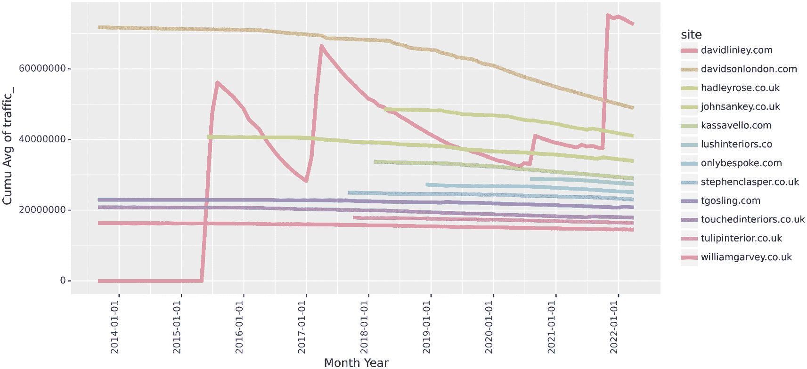

时间序列图展示了 2014 年 1 月至 2022 年 1 月期间 12 个网站的平均流量计数。其中，网站 Davids on London dot com 初始流量最高，而 David Linley dot com 在 2022 年左右流量更高。

**图 5-11** 每个网站累积平均反向链接流量的时间序列图

所有其他竞争对手基本都趋于平稳。这反映在 David Linley 卓越的 SEMRush 可见度上（图 5-12）。

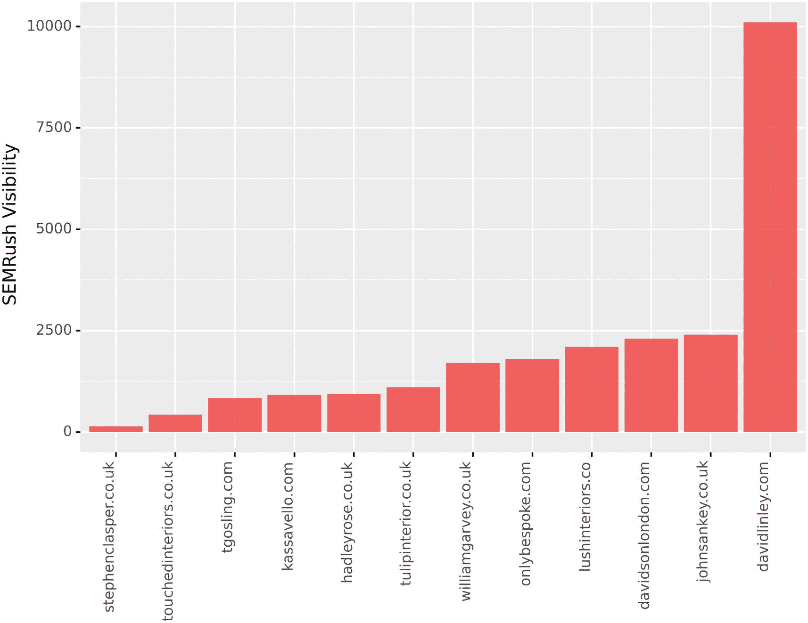

柱状图展示了 12 个网站的 SEMRush 可见度。其中，网站 David Linley dot com 的可见度最高，约为 10000。

**图 5-12** 柱状图，展示了每个网站的 SEMRush 可见度

我们能学到什么？在我们有限的数据研究中，到目前为止，我们可以看到“稳扎稳打”并不能赢得胜利。相反，网站需要大力争取来自高流量网站的链接。

### 链接数量

以上分析了质量；那么来自引用域名的链接数量又如何呢？

我们的方法是使用 `groupby()` 函数计算引用域名的累积总和：

```
competitor_count_cumsum_df = competitor_ahrefs_analysis
competitor_count_cumsum_df = competitor_count_cumsum_df.groupby(['site', 'month_year'])['rd_count'].sum().reset_index()
```

`expanding()` 函数允许计算窗口随行数增长，这正是我们实现累积总和的方式：

```
competitor_count_cumsum_df['count_runsum'] = competitor_count_cumsum_df['rd_count'].expanding().sum()
competitor_count_cumsum_df
```

结果如下：

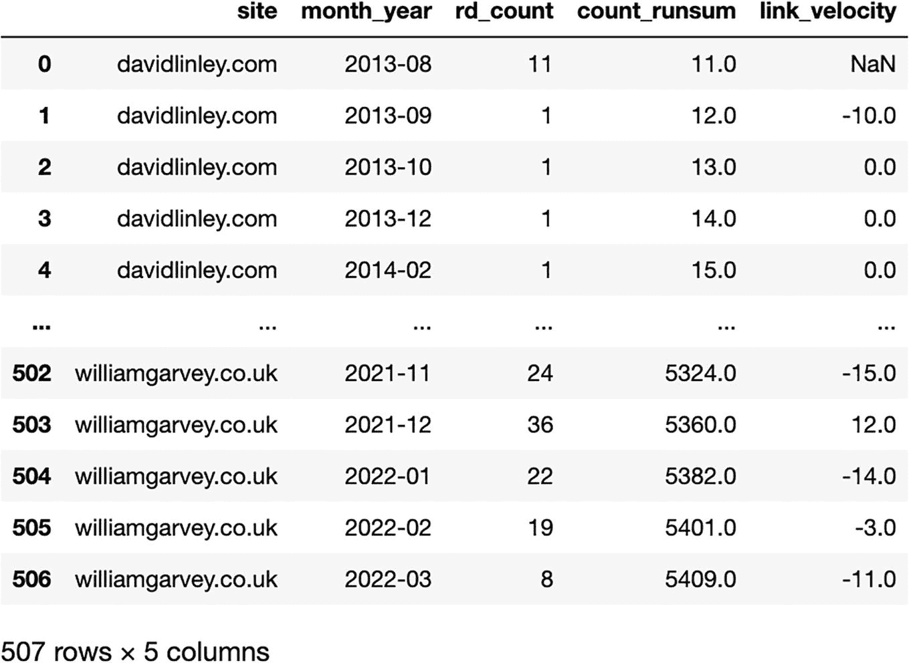

该表格展示了两个网站（各 5 个实例）的引用域名数量、累计总和计数以及链接速度的详细信息。表格上半部分显示了 David Linley dot com 在 2013 年至 2014 年间的详细信息。下半部分显示了 William garvey dot co dot u k 在 2021 年至 2022 年间的详细信息。

结果是一个包含 `site`、`month_year` 和 `count_runsum`（累计总和）的数据框，其格式非常适合输入图表——我们现在将按如下方式运行：

```
competitor_count_cumsum_plt = (
ggplot(competitor_count_cumsum_df, aes(x = 'month_year', y = 'count_runsum',
group = 'site', colour = 'site')) +
geom_line(alpha = 0.6, size = 2) +
labs(y = '引用域名累计总和', x = '年月') +
scale_y_continuous() +
scale_x_date() +
theme(legend_position = 'right',
axis_text_x=element_text(rotation=90, hjust=1)
))
competitor_count_cumsum_plt.save(filename = 'images/5_count_cumsum_smooth_plt.png',
height=5, width=10, units = 'in', dpi=1000)
competitor_count_cumsum_plt
```

`competitor_count_cumsum_plt` 图（图 5-13）显示了自 2014 年以来每个网站的引用域名数量。非常有趣的是，每个网站开始获取链接时的起始位置各不相同。

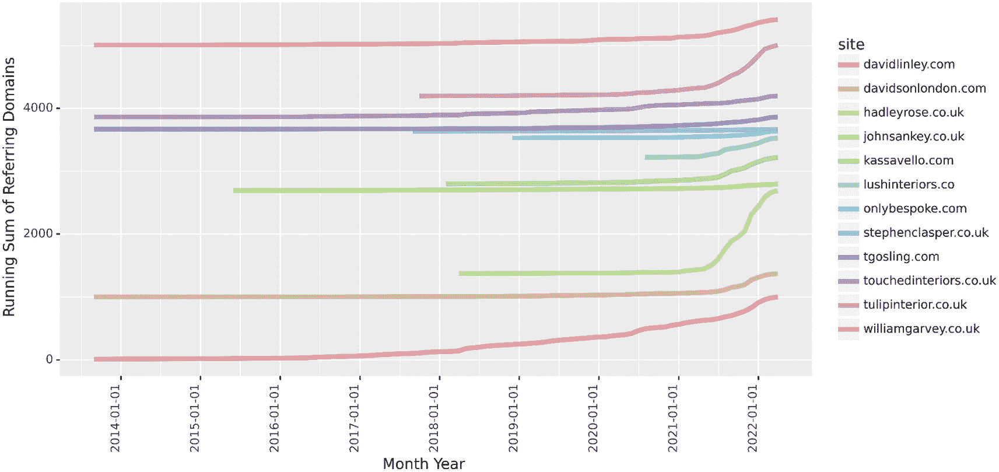

该时间序列图展示了 12 个网站在 2014 年 1 月至 2022 年 1 月期间引用域名的累计总和。它表明 David Linley dot com 网站多年来一直拥有最高值。

**图 5-13** 每个网站引用域名累计总和的时间序列图

例如，William Garvey 起步时就有超过 5000 个域名。我很想知道他们的数字公关团队是谁。

我们还可以看到增长速度，例如，尽管 Hadley Rose 在 2018 年才开始获取链接，但真正起飞是在 2021 年中左右。

### 链接速度

让我们来看看链接速度：

```
competitor_velocity_cumsum_plt = (
ggplot(competitor_count_cumsum_df, aes(x = 'month_year', y = 'link_velocity',
group = 'site', colour = 'site')) +
geom_line(alpha = 0.6, size = 2) +
labs(y = '引用域名累计总和', x = '年月') +
scale_y_log10() +
scale_x_date() +
theme(legend_position = 'right',
axis_text_x=element_text(rotation=90, hjust=1)
))
competitor_velocity_cumsum_plt.save(filename = 'images/5_competitor_velocity_cumsum_plt.png',
height=5, width=10, units = 'in', dpi=1000)
competitor_velocity_cumsum_plt
```

该视图显示了各网站获取链接的相对速度（图 5-14）。这是一个不常见但很有用的视图，因为对于任何给定的月份，你可以通过线条的高度看出哪个网站获取的链接最多。

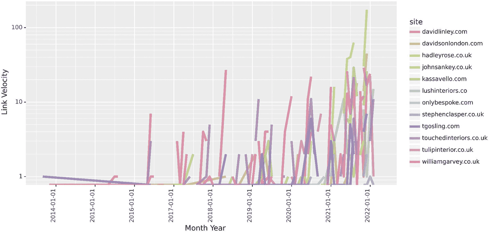

该时间序列图展示了 12 个网站在 2014 年 1 月至 2022 年 1 月期间的链接速度。2018 年之后，各网站的链接速度均有所提升。

**图 5-14** 显示每个网站链接速度的时间序列图

多年来，David Linley 一直在这场竞赛中领先，直到 Hadley Rose 出现。

### 链接资本

如同生活中衡量的大多数事物一样，最终价值由速率和数量的乘积决定。因此，我们将应用相同的原则来确定网站权威性的整体价值，并将其称为“链接资本”。

我们首先合并链接数量和平均流量（作为权威性的衡量标准）的累计平均统计数据：

```python
competitor_capital_cumu_df = competitor_count_cumsum_df.merge(competitor_traffic_cummean_df,
on = ['site', 'month_year'], how = 'left'
)
competitor_capital_cumu_df['auth_cap'] = (competitor_capital_cumu_df['count_runsum'] * competitor_capital_cumu_df['traffic_runavg']).round(1)*0.001
competitor_capital_cumu_df['auth_velocity'] = competitor_capital_cumu_df['auth_cap'].diff()
competitor_capital_cumu_df
```

结果如下：

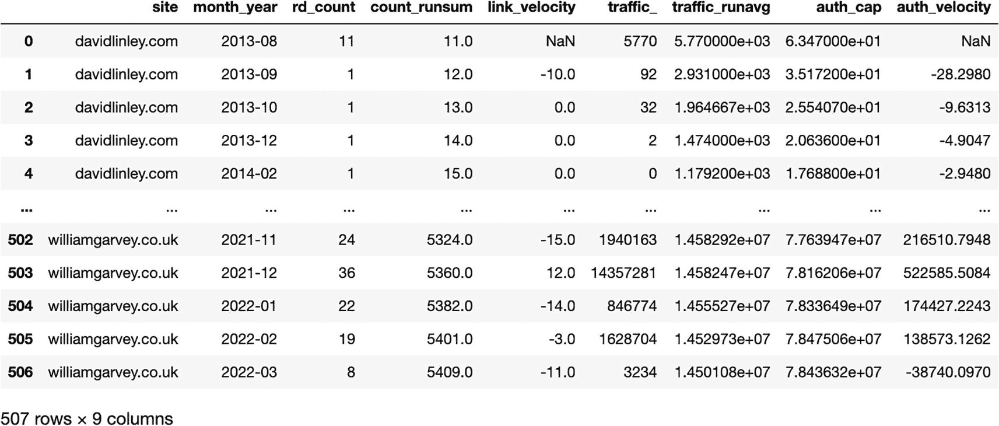

该表格展示了网站名称、年月、引用域名数量、累计总和、链接速度、流量、流量运行平均值、权威资本和权威速度的详细信息。

合并后的表格生成了新列 `auth_cap`（衡量整体权威性）和 `auth_velocity`（权威性增加的速度）。

让我们在图 5-15 中看看竞争对手在总权威性方面随时间的变化情况。

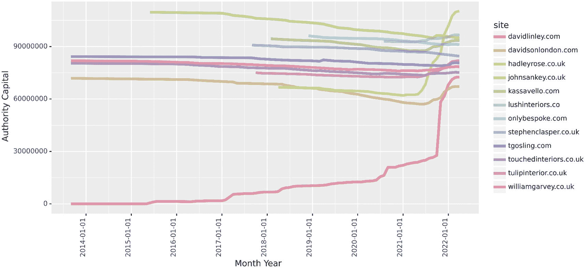

该时间序列图展示了 12 个网站在 2014 年 1 月至 2022 年 1 月期间的权威资本。它表明 John Sankey dot co dot u k 网站拥有最高值。

**图 5-15** 各网站权威资本随时间变化的时间序列图

该图显示了几个网站随时间变化的链接资本。非常有趣的是，Hadley Rose 如何凭借第三高且最稳定的高流量反向链接网站，在不到一年的时间内迅速增加数量，从而成为最具权威性的网站。这使得他们在同一时间段内超越了所有竞争对手（基于数量同时保持质量）。

那么权威性增加的速度又如何呢？接下来，我们将绘制每个网站权威速度随时间变化的图表：

```python
competitor_capital_veloc_plt = (
ggplot(competitor_capital_cumu_df, aes(x = 'month_year', y = 'auth_velocity',
group = 'site', colour = 'site')) +
geom_line(alpha = 0.6, size = 2) +
labs(y = '权威资本', x = '年月') +
scale_y_continuous() +
scale_x_date() +
theme(legend_position = 'right',
axis_text_x=element_text(rotation=90, hjust=1)
))
competitor_capital_veloc_plt.save(filename = 'images/6_auth_veloc_smooth_plt.png',
height=5, width=10, units = 'in', dpi=1000)
competitor_capital_veloc_plt
```

唯一突出的只有 David Linley 和 Hadley Rose（图 5-16）。David Linley 是否应该保持其链接获取计划的质量和速度？

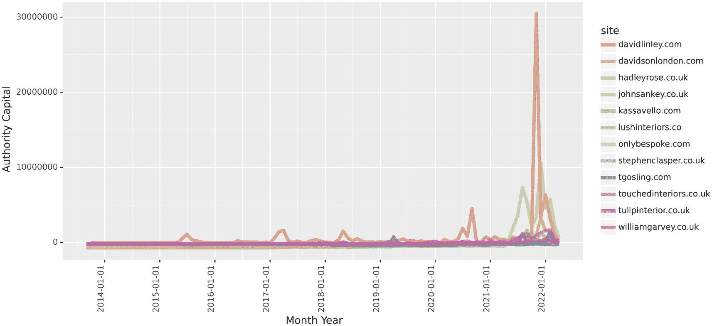

该折线图展示了 12 个网站在 2014 年 1 月至 2022 年 1 月期间的权威资本。它表明 David Linley dot com 网站在 2022 年出现了一个急剧的峰值。

**图 5-16** 各网站链接资本速度随时间变化图

我们毫不怀疑，在其他条件相同的情况下，它将迎头赶上甚至超越 Hadley Rose。

## 寻找权力网络

在 SEO 术语中，权力网络是指一组指向目标关键词排名靠前网站的网站群。因此，从这些网站获取反向链接到你的网站，将提升你的权威性，从而提高网站的排名潜力。

这有效吗？根据我们的经验，答案是肯定的。

在进入代码之前，我们先讨论一下理论。1996 年，网络搜索质量尚处于起步阶段，高度依赖于页面上的关键词。

为此，计算机科学家乔恩·克莱因伯格发明了超链接诱导主题搜索（HITS）算法，该算法后来成为 Ask 搜索引擎的核心算法。

正如他在论文《[超链接环境中的权威来源](http://www.cs.cornell.edu/home/kleinber/auth.pdf)》（1999 年）中所描述的，其核心思想是一种链接分析算法，用于评估网页的权威值和中心值。权威值衡量页面的内容价值，而中心值则衡量其指向其他页面的链接价值。

从数据驱动的 SEO 角度来看，我们不仅对获取这些链接感兴趣，还希望以数据驱动的方式找出这些中心网站是什么。

为了实现这一目标，我们将对引荐域名及其流量水平进行分组，以计算网站数量：

```python
power_doms_strata = competitor_ahrefs_analysis.groupby(['domain', 'traffic_']).agg({'rd_count': 'count'})
power_doms_strata = power_doms_strata.reset_index().sort_values('traffic_', ascending = False)
```

一个引荐域名只有在链接到超过两个域名时，才能被视为中心域名或权力域名，因此我们将过滤掉不符合条件的域名。为什么是三个或更多？因为一个可能是偶然，两个是巧合，三个才是有意为之。

```python
power_doms_strata = power_doms_strata.loc[power_doms_strata['rd_count'] > 2]
power_doms_strata
```

结果如下：

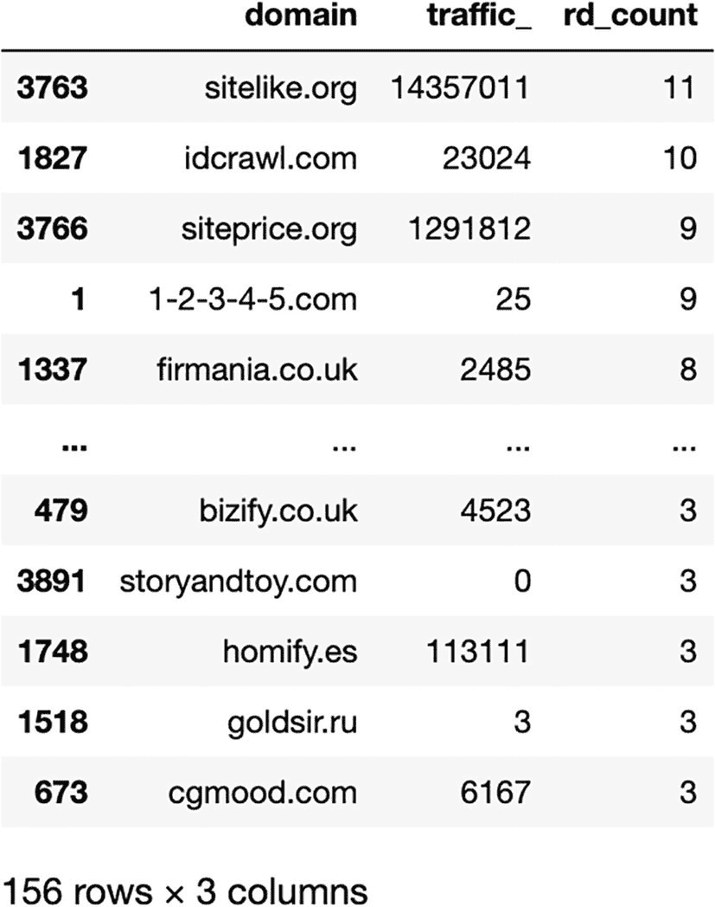

一个表格显示了 10 个域名的域名名称、流量和引荐域名数量的详细信息。底部文字显示：156 行，3 列。

该表格展示了引荐域名、它们的流量，以及这些提供反向链接的域名所链接到的（我们家具类）网站数量。

由于我们以数据为驱动，不满足于一个列表，因此我们将使用统计方法来帮助理解权力分布，然后再进一步过滤列表：

```python
pd.set_option('display.float_format', str)
power_doms_stats = power_doms_strata.describe()
power_doms_stats
```

结果如下：

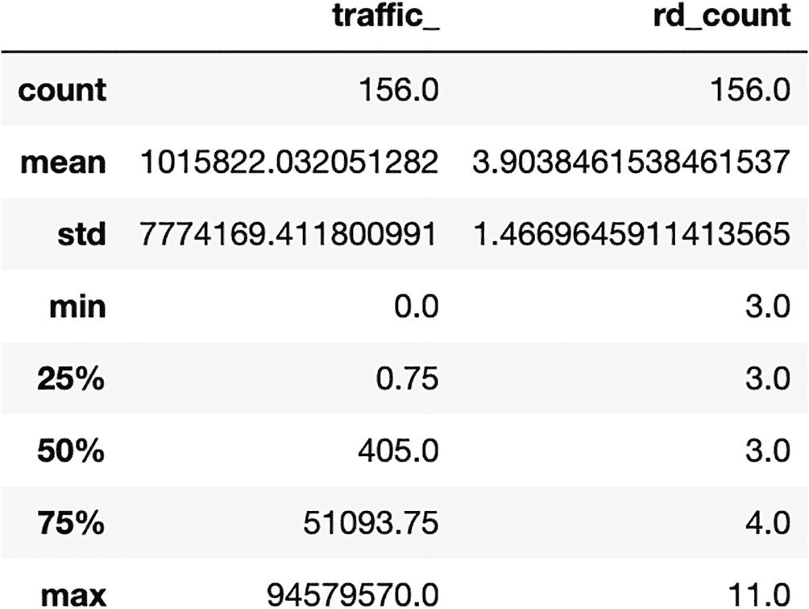

一个表格展示了流量和引荐域名数量的统计信息，包括计数、均值、标准差、最小值、25%、50%、75%和最大值。

我们看到分布严重正偏态，大多数高流量的引荐域名位于第 75 百分位或更高。这些正是我们想要的。让我们进行可视化：

```python
power_doms_stats_plt = (
ggplot(power_doms_strata, aes(x = 'traffic_')) +
geom_histogram(alpha = 0.6, binwidth = 10) +
labs(y = '权力域名数量', x = 'traffic_') +
scale_y_continuous() +
theme(legend_position = 'right',
axis_text_x=element_text(rotation = 90, hjust=1)
))
power_doms_stats_plt.save(filename = 'images/7_power_doms_stats_plt.png',
height=5, width=10, units = 'in', dpi=1000)
power_doms_stats_plt
```

如前所述，分布严重偏斜，这在直方图中更为明显。最后，我们将过滤出最强大的域名列表：

```python
power_doms = power_doms_strata.loc[power_doms_strata['traffic_'] > power_doms_stats['traffic_'][-2]]
```

尽管我们对中心网站感兴趣，但我们还是按流量对数据框进行排序，因为这些网站拥有最高的权威性：

```python
power_doms = power_doms.sort_values('traffic_', ascending = False)
power_doms
```

结果如下：

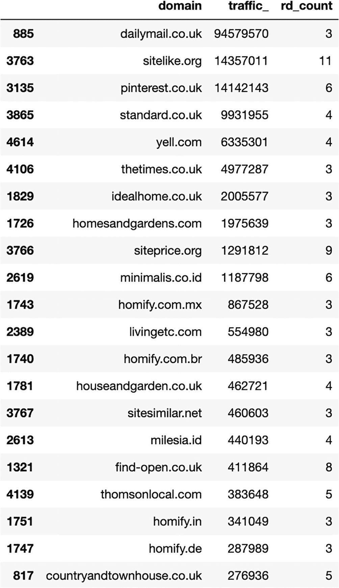

一个表格显示了 21 个域名的流量和引荐域名数量的详细信息。

到目前为止，最强大的是《每日邮报》，因此在这种情况下，开始为聘请一位优秀的数字公关顾问或全职员工做预算。还有其他出版商网站，如《旗帜晚报》（`standard.co.uk`）和《泰晤士报》。

有些链接更容易、更快获得，例如 `yell.com` 和 Thomson 本地目录。

然后还有更多针对特定市场的出版商，例如《理想家居》、《家居与花园》、《Livingetc》和《住宅与花园》。

这可能是你的首选切入点。

这项分析可以通过多种方式进一步改进，例如：

- 更细化地寻找权力页面（为你的竞争对手提供动力的单个反向链接 URL）
- 检查反向链接页面（或首页）的相关性，看它是否影响可见性，并据此过滤相关性
- 将相关性与流量结合，为中心网站过滤生成综合评分

## 更进一步

当然，前面的讨论只是冰山一角，因为它只是对一个网站的简单探索，因此很难推断出任何有助于在竞争激烈的搜索空间中提升排名的有用信息。

以下是进一步数据探索和分析的一些领域：

- 将社交媒体分享数据添加到目标 URL、引荐域名和引荐页面
- 将整体网站可见性与引荐域名的滚动平均流量随时间变化进行关联
- 绘制引荐域名流量随时间变化的分布图
- 在主机名上添加搜索量数据，以查看引荐域名获得的品牌搜索次数，作为权威性的替代衡量指标
- 将爬取数据与目标 URL 关联，以测试：
  - 内容相关性
  - 通过确认 HTTP 响应（即 200）来判断页面是否可被索引

当然，上述想法并非详尽无遗。一些建模扩展需要应用第 6 章中概述的机器学习技术。

## 总结

反向链接，作为搜索引擎衡量网站权威性的表现，对任何网站的搜索结果排名都具有难以置信的影响力。在本章中，你学习了：

- 什么是网站权威性以及它如何影响 SEO
- 品牌搜索如何影响搜索可见性
- 单一网站分析
- 竞争对手权威性分析
  - *链接剖析*：`R²` 如何显示引荐域名流量比域名评级更能预测可见性
  - 分析多个网站如何为权威性洞察增加丰富性和背景信息
- 在单一和多个网站分析中
  - 权威性 – 分布及随时间变化
  - 链接数量和速度

在下一章中，我们将使用数据科学来分析关键词搜索结果中的竞争对手。

