# 4. 内容与用户体验

从 SEO 角度谈内容与用户体验，关乎你为网站用户（尤其是来自搜索引擎的用户）所提供体验的质量。这包括但不限于以下几个方面：
*   拥有目标受众正在搜索的内容
*   最能满足用户查询需求的内容
    *   *内容创作*：规划着陆页内容
    *   *内容整合*：（I）拆分内容（当内容“过多”可能影响用户满意度或阻碍搜索引擎理解内容所针对的搜索意图时）和（II）合并内容（当多个页面竞争同一搜索意图时）
*   快速加载——确保提供良好的用户体验（UX）
*   在不同设备类型上良好呈现

我们绝不敢声称这是从内容和用户体验角度进行数据驱动 SEO 的最终定论。我们将要做的是，展示使用数据科学技术解决最重要 SEO 挑战的数据驱动方法，但并非所有方法都需要数据科学。

例如，要获得“快速页面速度与更高排名页面相关”的科学证据，可以使用与第 6 章类似的代码。我们的重点将放在最能满足用户查询需求的各种内容形式上：关键词映射、内容差距分析和内容创作。

## 最能满足用户查询需求的内容

SEO 的一个明显挑战是决定哪些内容应该放在哪些页面上。可以说，做好这一点意味着你在为谷歌的 RankBrain（谷歌核心算法的一个组成部分，它使用机器学习来帮助理解和处理用户搜索查询）进行优化。

虽然许多爬取工具提供了按站点深度或细分市场划分的页面分布可视化图表，但数据科学使您能够受益于更丰富的细节层次。为了帮助您找出最能满足用户查询需求的内容，您需要：
*   将关键词映射到内容
*   为这些着陆页规划内容板块
*   决定为目标关键词创建哪些内容，以满足搜索这些关键词的用户

## 数据来源

您最可能的数据来源将是以下组合：
*   站点审计工具的 URL 导出
*   SERP 跟踪工具

## 关键词映射

虽然创建增值内容可以带来很多收益，但淘汰或整合内容同样可以带来很多收益。这可以通过将内容与另一个共享相同搜索意图的内容合并来实现。假设关键词已按搜索意图分组，下一步就是将它们进行映射。

关键词映射是将目标关键词映射到页面，然后针对这些关键词优化页面的过程——从而最大化网站在搜索结果中的排名潜力。有多种方法可以实现这一点：
*   TF-IDF
*   字符串匹配
*   第三方神经网络模型（BERT、GPT-3）
*   构建你自己的 AI

我们推荐使用字符串匹配，因为它速度快、准确性合理，并且最容易部署。

### 字符串匹配

字符串匹配用于计算字符串的重叠程度，并应用于 DNA 测序。字符串匹配有两种方式：将字符串视为一个整体对象，或将其视为由标记（即字符串中的单词）组成的序列。我们选择后者，因为单词对人类具有实际意义，而非序列号。因此，我们将采用**索伦森-戴斯系数**，该算法在我们测试过的同类方法中兼具快速与准确的优势。

以下代码片段展示了我们如何通过字符串距离，为关键词寻找最相似的 URL 标题，从而实现关键词与内容的映射。开始导入库：

```python
import requests
from requests.exceptions import ReadTimeout
from json.decoder import JSONDecodeError
import re
import time
import random
import pandas as pd
import numpy as np
import datetime
from client import RestClient
import json
import py_stringmatching as sm
from textdistance import sorensen_dice
from plotnine import *
import matplotlib.pyplot as plt
target = 'wella'
```

首先导入爬取数据，这是网站审计软件（本例中为“Sitebulb”）导出的 CSV 文件：

```python
crawl_raw = pd.read_csv('data/www_wella_com_internal_html_urls_by_indexable_status_filtered_20220629220833.csv')
```

使用列表推导式清理列标题文本：

```python
crawl_raw.columns = [col.lower().replace('(','').replace(')','').replace('%','').replace(' ', '_')
for col in crawl_raw.columns]
crawl_df = crawl_raw.copy()
```

我们只关注可索引页面，因为这些 URL 可用于映射：

```python
crawl_df = crawl_df.loc[crawl_df['indexable'] == 'Yes']
crawl_df
```

结果如下：

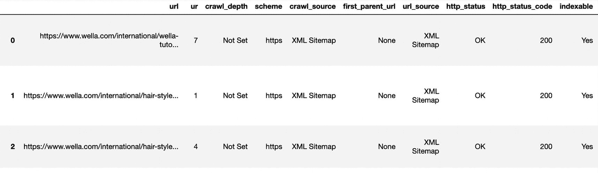

一个包含 3 行 10 列的表格截图，展示了爬取数据的导入结果。包含 URL 链接、URL、深度、协议、来源、父级 URL、来源 URL、状态、状态码和可索引性。

爬取数据导入完成。不过我们只关心 URL 和标题，因为映射关键词到 URL 只需要这些信息。但完整导入文件以便直观检查，有助于更熟悉数据。

```python
urls_titles = crawl_df[['url', 'title']].copy()
urls_titles
```

结果如下：

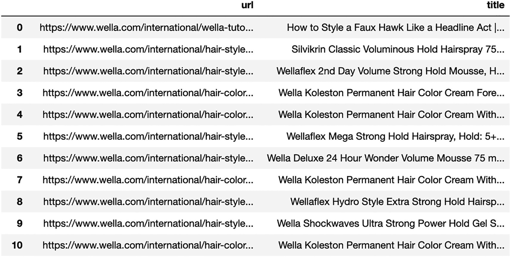

一个包含 11 行 2 列的表格截图，展示了 URL 和标题的数据框。包含 11 个 URL 链接及其对应标题。

数据框显示了 URL 和标题。现在加载需要映射的关键词，这些关键词已使用第 2 章的技术进行了聚类：

```python
keyword_discovery = pd.read_csv('data/keyword_discovery.csv')
```

结果如下：

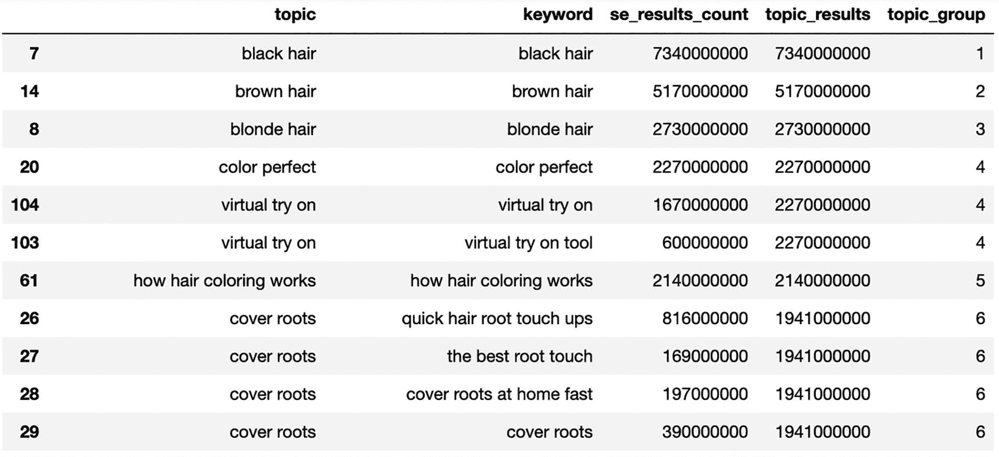

一个包含 11 行 5 列的表格截图，展示了用于构建关键词的数据框，并与对应主题进行了映射。包含主题、关键词、关键词的搜索引擎结果数量、主题结果和主题组。

数据框显示了主题、关键词、关键词的搜索引擎结果数量、主题网络搜索结果和主题组。注意，这些数据已使用第 2 章披露的方法进行了聚类。

我们将映射主题，因为它是核心关键词，也能为其主题组关键词带来排名。这意味着我们只需要主题列。

```python
total_mapping_simi = keyword_discovery[['topic']].copy().drop_duplicates()
```

在测试每个组合的字符串相似度之前，我们需要获取主题和 URL 标题的所有组合。通过交叉乘积合并实现：

```python
total_mapping_simi = total_mapping_simi.merge(urls_titles, how = 'cross')
```

创建一个新列`test`，将其格式化以去除样板品牌字符串并强制转换为小写。这将使字符串匹配值更准确。

```python
total_mapping_simi['test'] = total_mapping_simi['title']
total_mapping_simi['test'] = total_mapping_simi['test'].str.lower()
total_mapping_simi['test'] = total_mapping_simi['test'].str.replace(' \| wella', '')
total_mapping_simi
```

结果如下：

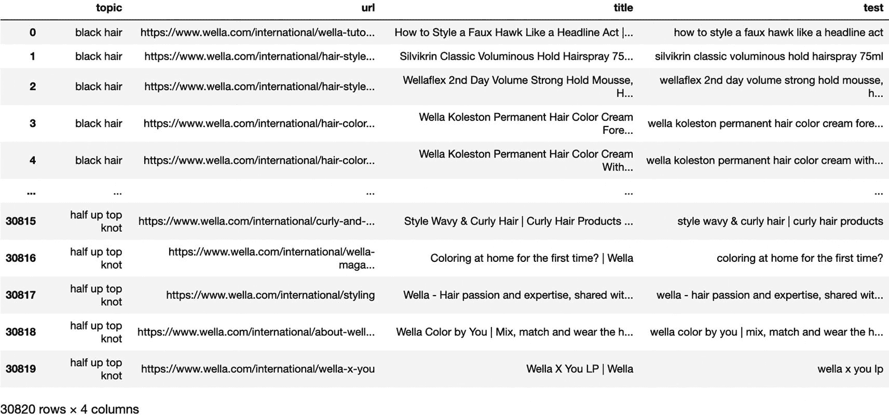

一个包含 30820 行 4 列的表格截图，展示了主题、URL、标题和测试列的数据框。

现在，我们通过创建新列`simi`（表示字符串相似度）来比较字符串。得分将主题和测试列作为输入，并传入之前导入的`sorensen_dice`函数：

```python
total_mapping_simi['simi'] = total_mapping_simi.loc[:, ['topic',
'test']].apply(lambda x: sorensen_dice(*x), axis=1)
total_mapping_simi
```

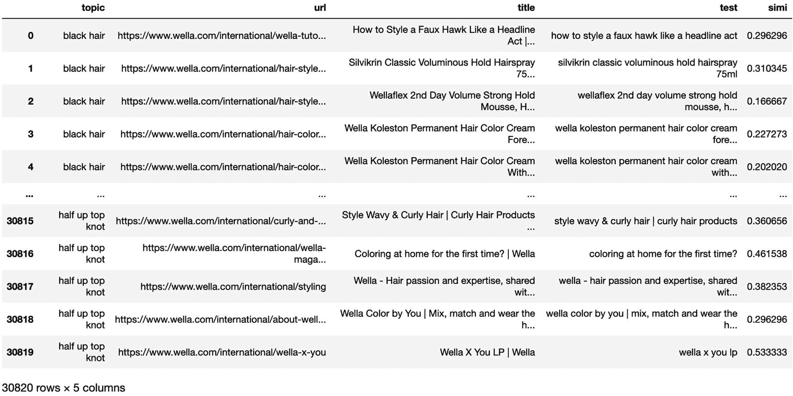

一个包含 30820 行 5 列的表格截图，展示了主题、URL、标题、测试和相似度列的数据框。

`simi`列已添加完毕并包含得分。得分为 1 表示完全相同，0 表示完全不同。下一步是选择与主题关键词最匹配的 URL：

```python
keyword_mapping_grp = total_mapping_simi.copy()
```

首先按相似度得分和主题降序排序数据框，使每个主题的第一行是最佳匹配：

```python
keyword_mapping_grp = keyword_mapping_grp.sort_values(['simi', 'topic'], ascending = False)
```

排序后，使用`first()`函数结合`groupby()`函数为每个主题选择最佳匹配的 URL：

```python
keyword_mapping_grp = keyword_mapping_grp.groupby('topic').first().reset_index()
keyword_mapping_grp
```

结果如下：

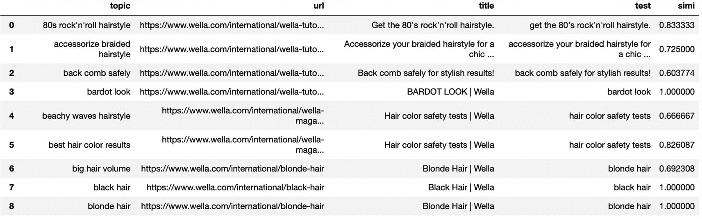

一个包含 9 行 5 列的表格截图，展示了每个主题及其最佳匹配 URL 的数据框。包含主题、URL、标题、测试和相似度列。

现在每个主题都有了最佳匹配的 URL。下一步是判断这些匹配是否足够好：

```python
keyword_mapping = keyword_mapping_grp[['topic', 'url', 'title', 'simi']].copy()
```

此时，我们通过目视检查数据来确定合适的阈值。我选择了 0.7（即 70%），因为它似乎能基本正确地完成任务，可作为匹配测试内容与 URL 的自然阈值。

使用`np.where()`（相当于 Excel 的 IF 公式），我们将超过 0.7 的行标记为“已映射”，其余标记为“未匹配”：

```python
keyword_mapping['url'] = np.where(keyword_mapping['simi'] < 0.7, 'unmatched', keyword_mapping['url'])
keyword_mapping['mapped'] = np.where(keyword_mapping['simi'] <= 0.7, 'No', 'Yes')
keyword_mapping
```

结果如下：

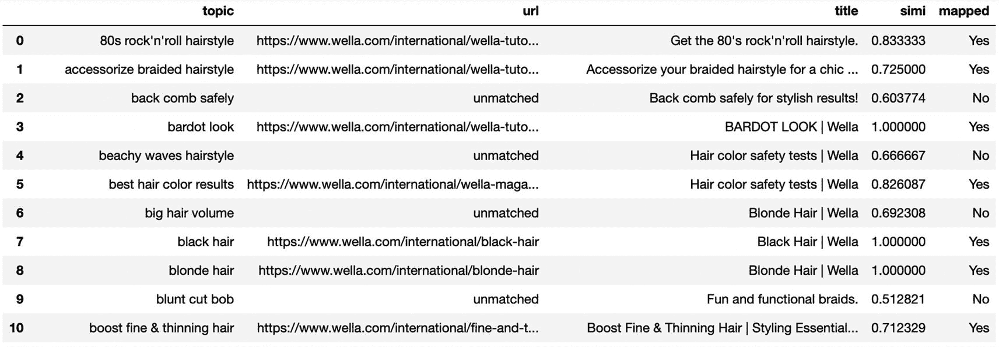

一个包含 11 行 5 列的表格截图，展示了关键词与 URL 链接映射的数据框。包含主题、URL、标题、相似度和映射列。

最终，我们完成了关键词到 URL 的映射，并获得了整体工作的统计数据。

```python
keyword_mapping_aggs = keyword_mapping.copy()
keyword_mapping_aggs = keyword_mapping_aggs.groupby('mapped').count().reset_index()
keyword_mapping_aggs
```

结果如下：

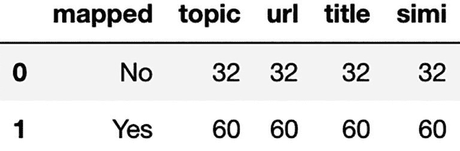

一个包含 2 行 5 列的表格截图，展示了已映射、主题、URL、标题和相似度的计数。

#### 字符串距离映射关键词评估

92 个 URL 中有 65%成功映射——考虑到代码量极少，这个结果不错。未映射的 URL 需要手动处理，原因可能包括：
- 现有未映射 URL 的标题未优化。
- 需要创建新内容。

## 内容差距分析

搜索引擎需要内容才能根据用户的关键词搜索进行排名。内容差距分析通过识别你的直接竞争对手可见、而你的网站不可见的关键词（和主题），帮助你的网站扩大对目标受众的覆盖范围。

该分析通过使用搜索分析数据源（如 `SEMRush`）来实现，将你的网站数据与竞争对手的数据叠加，以发现：
- **核心内容集**：哪些关键词是多个竞争对手共有的
- **内容差距**：品牌在构成内容集的关键词上不可见的程度

如果没有这种分析，你的网站在受众覆盖范围方面可能会落后，并且由于你的网站对现有内容所涵盖的主题显得知识不足，从而显得权威性较低。这在考虑购买周期时尤为重要。假设你正在预订假期，现在想象一下你在进行搜索时可能使用的各种搜索查询，也许按目的地搜索（“西班牙海滩度假”），也许按特定需求细化（“西班牙家庭海滩度假”），然后更具体地包括目的地（马略卡岛），甚至可能是（“马略卡岛带泳池的家庭度假”）。精明的 SEO 专家会深入思考如何将客户需求（贯穿整个搜索旅程）映射到能够满足这些需求的、引人入胜的着陆页（和网站）体验。数据科学使你能够大规模地管理这一机遇。

警告和动机说完了，让我们从通常的包加载开始：

```python
import re
import time
import random
import pandas as pd
import numpy as np
```

`OS` 和 `Glob` 允许环境从文件夹中读取 `SEMRush` 文件：

```python
import os
import glob
from pandas.api.types import is_string_dtype
from pandas.api.types import is_numeric_dtype
import uritools
```

`Combinations` 对于生成列表元素的组合特别有用，这些组合将用于确定哪些数据集需要以特定顺序进行交集运算：

```python
from itertools import combinations
```

为了查看数据框的所有列且不被截断：

```python
pd.set_option('display.max_colwidth', None)
```

这些变量是预先设置的，以便在将此脚本复制到另一个站点时，只需对代码进行最少的更改即可运行：

```python
root_domain = 'wella.com'
hostdomain = 'www.wella.com'
hostname = 'wella'
full_domain = 'https://www.wella.com'
target_name = 'Wella'
```

设置好变量后，我们现在可以开始导入数据了。

### 获取数据

我们设置存储所有 `SEMRush` 文件的目录路径：
```
data_dir = os.path.join('data/semrush/')
```

`Glob` 读取文件夹中的所有文件，并将输出存储到变量 `semrush_csvs` 中：
```
semrush_csvs = glob.glob(data_dir + "/*.csv")
Semrush_csvs
```

打印出文件夹中的文件：
```
['data/hair.com-organic.Positions-uk-20220704-2022-07-05T14_04_59Z.csv',
'data/johnfrieda.com-organic.Positions-uk-20220704-2022-07-05T13_29_57Z.csv',
'data/madison-reed.com-organic.Positions-uk-20220704-2022-07-05T13_38_32Z.csv',
'data/sebastianprofessional.com-organic.Positions-uk-20220704-2022-07-05T13_39_13Z.csv',
'data/matrix.com-organic.Positions-uk-20220704-2022-07-05T14_04_12Z.csv',
'data/wella.com-organic.Positions-uk-20220704-2022-07-05T13_30_29Z.csv',
'data/redken.com-organic.Positions-uk-20220704-2022-07-05T13_37_31Z.csv',
'data/schwarzkopf.com-organic.Positions-uk-20220704-2022-07-05T13_29_03Z.csv',
'data/garnier.co.uk-organic.Positions-uk-20220704-2022-07-05T14_07_16Z.csv']
```

初始化最终的数据框，我们将在此存储导入的 `SEMRush` 数据：
```
semrush_raw_df = pd.DataFrame()
```

初始化一个列表，我们将在此存储导入的 `SEMRush` 数据：
```
semrush_li = []
```

`for` 循环使用 pandas 的 `read_csv()` 函数读取 `SEMRush` CSV 文件，并提取文件名，将其放入一个新列 `filename` 中。这有点多余，但有助于我们知道数据来自哪里。

数据读取后，会添加到我们之前初始化的 `semrush_li` 列表中：
```
for cf in semrush_csvs:
    df = pd.read_csv(cf, index_col=None, header=0)
    df['filename'] = os.path.basename(cf)
    df['filename'] = df['filename'].str.replace('.csv', '')
    df['filename'] = df['filename'].str.replace('_', '.')
    semrush_li.append(df)
    semrush_raw_df = pd.concat(semrush_li, axis=0, ignore_index=True)
```

清理列名，使其变为小写且对数据友好。也可以使用列表推导式，但我们使用了不同的方法来展示另一种方式。
```
semrush_raw_df.columns = semrush_raw_df.columns.str.strip().str.lower().str.replace(' ', '_').str.replace('(', '').str.replace(')', '')
```

创建一个站点列，以便我们知道内容属于哪个站点。这里，我们在 `filename` 列上使用了正则表达式，但我们也可以很容易地从 URL 中推导出来：
```
semrush_raw_df['site'] = semrush_raw_df['filename'].str.extract('(.*?)\-')
semrush_raw_df.head()
```

结果如下：
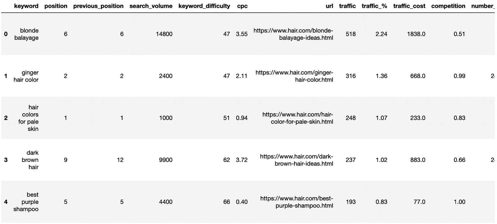
一张包含 5 行 12 列数据的表格截图，提供了根据关键词创建站点的数据框。它包括关键词、排名、先前排名、搜索量、关键词难度、每次点击费用、URL、流量、流量百分比、流量成本、竞争度以及站点内容的编号列。

这就是数据框，尽管我们更关心关键词及其所属的站点。
```
semrush_raw_presect = semrush_raw_sited.copy()
semrush_raw_presect = semrush_raw_presect[['keyword', 'site']]
semrush_raw_presect
```

结果如下：
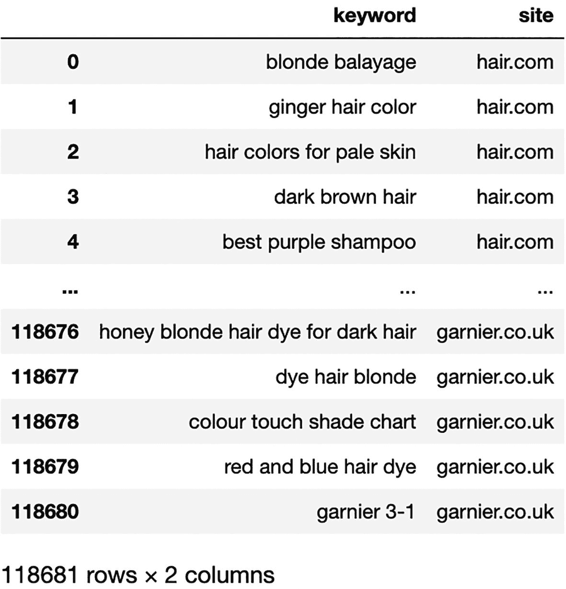
一张包含 118681 行 2 列数据的表格截图，提供了关键词及其对应站点的数据条目。

此练习的目的是找到两个或更多竞争对手共有的关键词，这些关键词将定义核心内容集。

为了实现这一点，我们将使用列表推导式将 `semrush_raw_presect` 数据框按站点拆分为未命名的数据框：
```
df1, df2, df3, df4, df5, df6, df7, df8, df9 = [x for _, x in semrush_raw_presect.groupby(semrush_raw_presect['site'])]
```

现在每个数据框都包含了站点和关键词，我们可以去掉站点列，因为我们只关心关键词，而不关心它们来自哪里。

我们首先定义一个数据框列表 `df_list`：
```
df_list = [df1, df2, df3, df4, df5, df6, df7, df8, df9]
```

这是一个例子；`df1` 是 Garnier：
```
df1
```

结果如下：
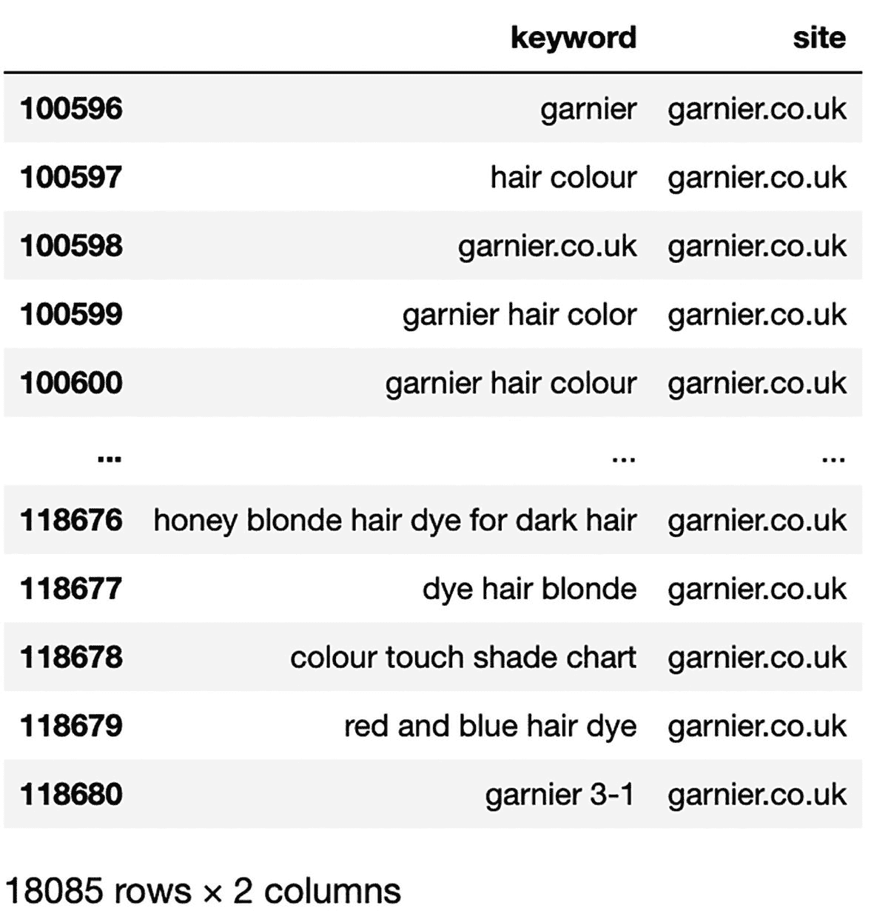
一张包含 18085 行和 2 列数据的表格截图，提供了关键词及其对应网站地址的数据条目。

定义函数 `drop_col`，顾名思义，该函数：
1.  删除数据框（`df`）中的列（`col`）
2.  获取目标列（`list_col`）
3.  将目标列转换为列表
4.  将该列添加到一个大列表（`master_list`）中
```
def drop_col(df, col, listcol, master_list):
    df.drop(col, axis = 1, inplace = True)
    df_tolist = df[listcol].tolist()
    master_list.append(df_tolist)
```

我们的主列表初始化如下：
```
keywords_lists = []
```

列表推导式将遍历 `df_list` 中的所有关键词集合，并将这些集合作为列表，从而得到一个关键词列表的列表。
```
_ = [drop_col(x, 'site', 'keyword', keywords_lists) for x in df_list]
```

列表的列表中的各个列表太长，无法在此处打印；不过，开头的双重方括号表明这确实是一个列表的列表。
```
keywords_lists
```

结果如下：
```
[['garnier',
'hair colour',
'garnier.co.uk',
'garnier hair color',
'garnier hair colour',
'garnier micellar water',
'garnier hair food',
'garnier bb cream',
'garnier face mask',
'bb cream from garnier',
'garnier hair mask',
'garnier shampoo',
'hair dye',
```

关键词列表的列表被导出为独立的列表：
```
lst_1, lst_2, lst_3, lst_4, lst_5, lst_6, lst_7, lst_8, lst_9 = keywords_lists
```

列表 1 如下所示：
```
lst_1
```

结果如下：
```
['garnier',
'hair colour',
'garnier.co.uk',
'garnier hair color',
'garnier hair colour',
'garnier micellar water',
'garnier hair food',
'garnier bb cream',
'garnier face mask',
'bb cream from garnier',
'garnier hair mask',
'garnier shampoo',
'hair dye',
'garnier hair dye',
'garnier shampoo bar',
'garnier vitamin c serum',
```

现在我们想要生成列表的组合，以便控制每个网站的关键词如何相交：
```
values_list = [lst_1, lst_2, lst_3, lst_4, lst_5, lst_6, lst_7, lst_8, lst_9]
```

字典推导式会将每个列表追加到我们创建的名为 `keywords_dict` 的字典中，其中键（索引）是列表的编号：
```
keywords_dict = {listo: values_list[listo]  for listo in range(len(values_list))}
```

当我们打印 `keywords_dict` 的键时
```
keywords_dict.keys()
```

我们得到列表的编号。之所以是从 0 到 8 而不是从 1 到 9，是因为 Python 使用零基索引，这意味着它从零开始计数：
```
dict_keys([0, 1, 2, 3, 4, 5, 6, 7, 8])
```

现在，为了便于稍后操作，我们将键转换为列表：
```
keys_list = list(keywords_dict.keys())
keys_list
```

结果如下：
```
[0, 1, 2, 3, 4, 5, 6, 7, 8]
```

有了这个列表，我们就可以构建网站关键词的组合来进行交集运算。网站关键词列表的交集将是这些网站共有的词语。

### 创建组合

初始化 `list_combos`，它将是一个由生成的组合组成的列表：
```
list_combos = []
```

使用 `combinations` 函数进行列表推导式，随机选取四个网站关键词，并通过 `append()` 函数将其存储在 `list_combos` 中：
```
_ = [list_combos.append(comb) for comb in combinations(keys_list, 4)]
```

这行代码将组合转换为列表，以便 `list_combos` 成为一个列表的列表：
```
list_combos = [list(combo) for combo in list_combos]
list_combos
```

结果如下：
```
[[0, 1, 2, 3],
[0, 1, 2, 4],
[0, 1, 2, 5],
[0, 1, 2, 6],
[0, 1, 2, 7],
[0, 1, 2, 8],
[0, 1, 3, 4],
[0, 1, 3, 5],
[0, 1, 3, 6], ...
```

有了这个列表的列表，我们就可以开始对关键词列表进行交集运算，以构建核心内容（关键词）集合。

### 寻找内容交集

初始化一个空列表 `keywords_intersected`：
```
keywords_intersected = []
```

定义 `multi_intersect` 函数，该函数接收一个字典列表及其键，然后找出共同的关键词（即交集），并将其添加到 `keywords_intersected` 列表中。

该函数可以调整为仅比较两个网站、三个网站等。只需确保使用所需列表数量重新运行 `combinations` 函数，并按如下方式编辑函数即可：
```
def multi_intersect(list_dict, combo):
    a = list_dict[combo[0]]
    b = list_dict[combo[1]]
    c = list_dict[combo[2]]
    d = list_dict[combo[3]]
    intersection = list(set(a) & set(b) & set(c) & set(d))
    keywords_intersected.append(intersection)
```

使用列表推导式，我们遍历组合列表 `list_combos` 来运行 `multi_intersect` 函数，该函数接收包含所有网站关键词的字典（`keywords_dict`），提取相应的关键词，找出共同的关键词，然后将其添加到 `keywords_intersected` 中：
```
_ = [multi_intersect(keywords_dict, combo) for combo in list_combos]
```

我们得到了一个列表的列表，因为每个列表都是该函数针对每个组合的一次迭代结果：
```
keywords_intersected
```

结果如下：
```
[['best way to cover grey hair',
'rich red hair colour',
'hair dye colors chart',
'different shades of blonde hair',
'adding colour to grey hair',
'cool hair colors',
'dark red hair',
'light brown toner',
'medium light brown hair',
'hair color on brown skin',
'highlights to cover grey in dark brown hair',
'auburn color swatch', ..
```

让我们将这个列表的列表转换为一个单一的列表：
```
flat_keywords_intersected = [elem for sublist in keywords_intersected for elem in sublist]
```

然后对其进行去重。`list(set(the_list_you_want_to_de-duplicate))` 是一个非常实用的列表去重技巧。
```
unique_keywords_intersected = list(set(flat_keywords_intersected))
print(len(flat_keywords_intersected), len(unique_keywords_intersected))
```

结果如下：
```
87031 8380
```

最初有 87K 个关键词，去重后剩下 8380 个关键词。
```
unique_keywords_intersected
```

结果如下：
```
['hairspray for holding curls',
'burgundy colour hair',
'cool hair colors',
'dark red hair',
'color stripes hair',
'for frizzy hair products',
'blue purple hair',
'autumn balayage 2021',
'ash brown hair color',
'blonde highlights in black hair',
'what hair colour will suit me',
'hair gloss treatment at home',
'dark roots with red hair',
'silver shoulder length hair',
'mens curly hair',
'ash brunette hair',
'toners for grey hair',
```

这就是列表，但还没结束，因为我们还需要找出差距，而这正是我们都想知道的。

## 建立差距

问题在于，“Wella”未定位哪些关键词，以及有多少个？

我们首先在 SEMRush 站点中筛选目标站点 `Wella.com`：

```
target_semrush = semrush_raw_sited.loc[semrush_raw_sited['site'] == root_domain]
```

然后，我们只保留核心内容集中的关键词：

```
target_on = target_semrush.loc[target_semrush['keyword'].isin(unique_keywords_intersected)]
target_on
```

结果如下：

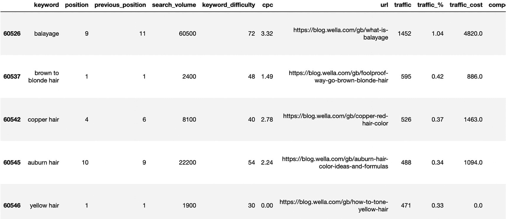

一张包含 5 行 10 列的表格截图，展示了目标站点中与关键词 `Wella` 相关的条目数据框。其中包含 `keyword`、`position`、`volume`、`difficulty`、`cpc`、`url`、`traffic`、`traffic percent` 和 `traffic cost`。

我们先获取一些统计数据，从上述数据框中的关键词数量和核心内容集中的关键词数量开始：

```
print(target_on[['keyword'].drop_duplicates().shape[0], len(unique_keywords_intersected))
```

结果如下：

```
6936 8380
```

因此，Wella 的关键词内容中只有不到 70% 位于核心内容集中，大约缺少 1.4K 个关键词。

要找出这 6.9K 个交集关键词，我们可以使用列表和集合函数：

```
target_on_list = list(set(target_semrush['keyword'].tolist()) & set(unique_keywords_intersected))
target_on_list[:10]
```

结果如下：

```
['hairspray for holding curls',
'burgundy colour hair',
'cool hair colors',
'dark red hair',
'blue purple hair',
'autumn balayage 2021',
'ash brown hair color',
'blonde highlights in black hair',
'what hair colour will suit me',
'hair gloss treatment at home']
```

要找出不在核心内容集中的关键词，即内容差距，我们将从核心内容集中移除目标 SEMRush 关键词：

```
target_gap = list(set(unique_keywords_intersected) - set(target_semrush['keyword'].tolist()))
print(len(target_gap), len(unique_keywords_intersected))
target_gap[:10]
```

结果如下：

```
['bleaching hair with toner',
'color stripes hair',
'for frizzy hair products',
'air dry beach waves short hair',
'does semi permanent black dye wash out',
'balayage for dark skin',
'matte hairspray',
'mens curly hair',
'how to change hair color',
'ginger and pink hair']
```

现在我们知道这些差距关键词是什么了，可以通过列出关键词来筛选数据框：

```
cga_semrush = semrush_raw_sited.loc[semrush_raw_sited['keyword'].isin(target_gap)]
cga_semrush
```

结果如下：

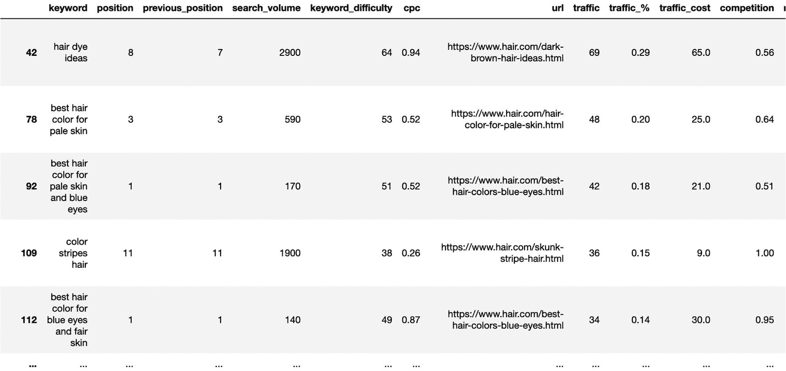

一张包含 5 行 11 列的表格截图，展示了通过列出关键词筛选后的条目数据框。其中包含 `keyword`、`position`、`volume`、`difficulty`、`cpc`、`url`、`traffic`、`traffic percent`、`traffic cost` 和 `competition`。

我们只需要每个关键词排名最高的目标 URL，这可以通过结合使用 `sort_values()`、`groupby()` 和 `first()` 来实现：

```
cga_unique = cga_semrush.sort_values('position').groupby('keyword').first().reset_index()
cga_unique['project'] = target_name
```

为了使数据框更易于使用，我们按以下方式对关键词进行优先级排序：

```
cga_unique = cga_unique.sort_values('search_volume', ascending = False)
```

准备导出：

```
cga_unique.to_csv('exports/cga_unique.csv')
cga_unique
```

现在是时候决定这些页面上应该包含什么内容了。

## 内容创作：规划着陆页内容

当然，既然你已经知道哪些关键词属于同一组、哪些不属于，以及通过内容差距分析确定了要追求哪些关键词，那么问题就变成了：这些页面上应该包含什么内容？

我们正在采用的一种策略是：
1.  查看每个关键词排名前 10 的 URL
2.  从每个排名 URL 中提取标题（`<h1>`、`<h2>`）
3.  检查每个标题的搜索结果，因为作者可能以不同的方式表述意图
4.  对标题进行聚类并打上标签
5.  统计给定关键词的聚类标题出现频率，以查看哪些标题最受欢迎并受到 Google 的青睐（就排名而言）
6.  导出每个搜索短语的结果

这种策略并非适用于所有垂直领域，因为某些市场领域相比其他领域存在大量噪音。例如，在发型设计文章中，许多标题（及其章节）都是名人姓名，这些姓名不会像另一位名人那样具有可检测的相同搜索意图。

相比之下，在其他垂直领域，这种方法效果很好，因为不存在与相关文章标题共享相同 HTML 标题标签的无穷列表（例如，“Drew Barrymore”和“54 ways to wear the modern Marilyn”）。

相反，标题数量较少且具有共同含义，例如，“What is account-based marketing?”和“Defining ABM”，这是 Google 很可能理解的内容。

考虑到这些注意事项，我们开始吧。

```
import requests
from requests.exceptions import ReadTimeout
from json.decoder import JSONDecodeError
import re
import time
import random
import pandas as pd
import numpy as np
import datetime
import requests
import json
from datetime import timedelta
from glob import glob
import os
from client import RestClient
from textdistance import sorensen_dice
from plotnine import *
import matplotlib.pyplot as plt
from mizani.transforms import trans
from pandas.api.types import is_string_dtype
from pandas.api.types import is_numeric_dtype
import uritools
```

这是我们正在为其创建内容的网站：

```
target = 'on24'
```

这些是目标网站希望排名的关键词。虽然只有八个关键词，但正如你将看到的，这个过程会产生大量需要清理的噪音数据：

```
queries = ['webinar best practices',
'webinar marketing guide',
'webinar guide',
'funnel marketing guide',
'scrappy marketing guide',
'b2b marketing guide',
'how to run virtual events',
'webinar benchmarks']
```

### 获取 SERP 数据

导入 SERP 数据，这些数据将构成发现 Google 对排名前十的网站所奖励内容的基础：

```
serps_input = pd.read_csv('data/serps_input_' + target + '.csv')
serps_input
```

结果如下：

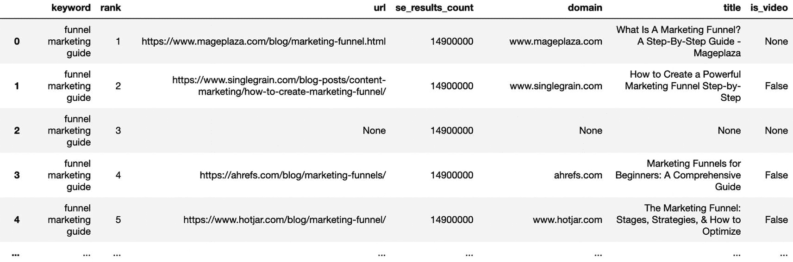

一张包含 5 行 7 列表格的截图，展示了 SERP 数据条目的数据框。列名分别为 `keyword`、`rank`、`url`、`serps_results_count`、`domain`、`title` 和 `is_video`。

`tldextract` 包中的 `extract` 函数可用于从 URL 中提取主机名和域名：

```
from tldextract import extract
serps_input_clean = serps_input.copy()
```

将 URL 列设置为字符串类型：

```
serps_input_clean['url'] = serps_input_clean['url'].astype(str)
```

使用 `lambda` 将 `extract` 函数应用于 URL 列：

```
serps_input_clean['host'] = serps_input_clean['url'].apply(lambda x: extract(x))
```

将函数输出（一个元组）转换为列表：

```
serps_input_clean['host'] = [list(lst) for lst in serps_input_clean['host']]
```

通过使用字符串的 `get` 方法获取列表中的倒数第二个元素来提取主机名：

```
serps_input_clean['host'] = serps_input_clean['host'].str.get(-2)
```

该站点使用与之前类似的逻辑：

```
serps_input_clean['site'] = serps_input_clean['url'].apply(lambda x: extract(x))
serps_input_clean['site'] = [list(lst) for lst in serps_input_clean['site']]
```

但这次，我们需要同时获取主机名和顶级域名，并将它们连接起来形成站点或域名：

```
serps_input_clean['site'] = serps_input_clean['site'].str.get(-2) + '.' + serps_input_clean['site'].str.get(-1)
serps_input_clean
```

结果如下：

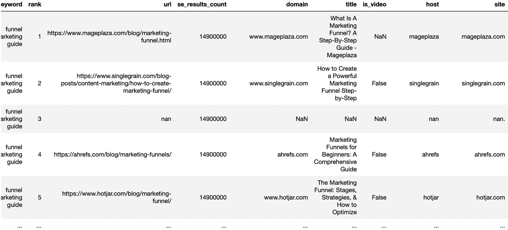

一张包含 5 行 9 列表格的截图，展示了增强后的数据框。列标题为 `keyword`、`rank`、`url`、`serps_results_count`、`domain`、`title`、`is_video`、`host` 和 `site`。

增强后的数据框显示了新增的 `host` 和 `site` 列。

此行代码通过将列宽设置为最大值来允许读取列值：

```
pd.set_option('display.max_colwidth', None)
```

# 爬取内容

下一步是获取我们将要爬取其内容部分的排名靠前的 URL 列表：
```python
serps_to_crawl_df = serps_input_clean.copy()
```

有些网站不值得爬取，因为它们不允许你这样做，这些网站定义在以下列表中：
```python
dont_crawl = ['wikipedia', 'google', 'youtube', 'linkedin', 'foursquare', 'amazon',
'twitter', 'facebook', 'pinterest', 'tiktok', 'quora', 'reddit', 'None']
```

对数据框进行过滤，排除`dont_crawl`列表中的站点：
```python
serps_to_crawl_df = serps_to_crawl_df.loc[~serps_to_crawl_df['host'].isin(dont_crawl)]
```

我们还将移除空值以及排名不在前十的站点：
```python
serps_to_crawl_df = serps_to_crawl_df.loc[~serps_to_crawl_df['domain'].isnull()]
serps_to_crawl_df = serps_to_crawl_df.loc[serps_to_crawl_df['rank'] < 10]
serps_to_crawl_df.head(10)
```

结果如下：
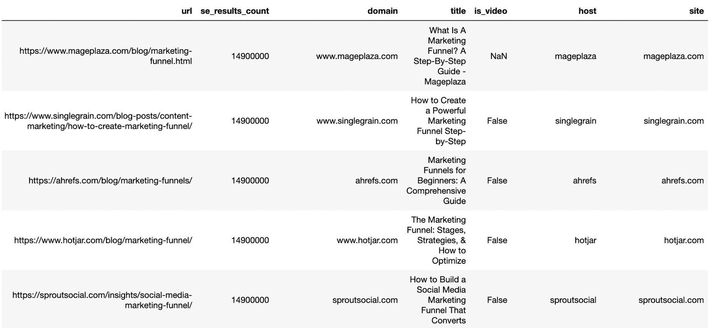
一张包含 5 行 7 列表格的截图，展示了用于内容爬取的数据框。列标题为`url`、`result_count`、`domain`、`title`、`is_video`、`host`和`site`。

数据框过滤后，我们只需要 URL 来导出到我们的桌面爬虫。

某些 URL 可能为多个搜索短语排名。为避免多次爬取同一个 URL，我们将使用`drop_duplicates()`来使 URL 列表唯一：
```python
serps_to_crawl_upload = serps_to_crawl_df[['url']].drop_duplicates()
serps_to_crawl_upload.to_csv('data/serps_to_crawl_upload.csv', index=False)
serps_to_crawl_upload
```

结果如下：
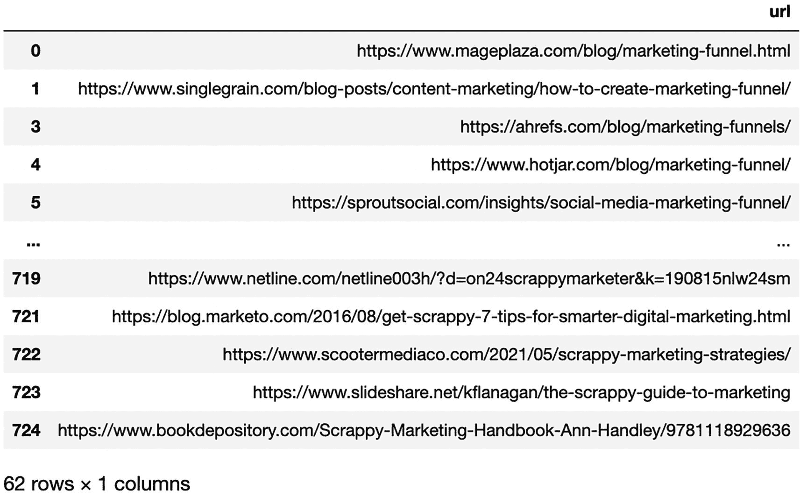
一张包含 62 行 1 列表格的截图，展示了要发送到桌面爬虫进行爬取的 URL 条目的数据框。

现在我们有了一个包含 62 个 URL 的列表用于爬取，这些 URL 涵盖了八个目标关键词。

让我们导入爬取结果：
```python
crawl_raw = pd.read_csv('data/all_inlinks.csv')
pd.set_option('display.max_columns', None)
```

使用列表推导式，我们将清理列名以便于操作：
```python
crawl_raw.columns = [col.lower().replace(' ', '_') for col in crawl_raw.columns]
```

打印出列名以查看提取了多少个提取器字段：
```python
print(crawl_raw.columns)
```

结果如下：
```
Index(['type', 'source', 'destination', 'form_action_link', 'indexability',
'indexability_status', 'hreflang', 'size_(bytes)', 'alt_text', 'length',
'anchor', 'status_code', 'status', 'follow', 'target', 'rel',
'path_type', 'unlinked', 'link_path', 'link_position', 'link_origin',
'extractor_1_1', 'extractor_1_2', 'extractor_1_3', 'extractor_1_4',
'extractor_1_5', 'extractor_1_6', 'extractor_1_7', 'extractor_2_1',
'extractor_2_2', 'extractor_2_3', 'extractor_2_4', 'extractor_2_5',
'extractor_2_6', 'extractor_2_7', 'extractor_2_8', 'extractor_2_9',
'extractor_2_10', 'extractor_2_11', 'extractor_2_12', 'extractor_2_13',
'extractor_2_14', 'extractor_2_15', 'extractor_2_16', 'extractor_2_17',
'extractor_2_18', 'extractor_2_19', 'extractor_2_20', 'extractor_2_21',
'extractor_2_22', 'extractor_2_23', 'extractor_2_24', 'extractor_2_25',
'extractor_2_26', 'extractor_2_27', 'extractor_2_28', 'extractor_2_29',
'extractor_2_30', 'extractor_2_31', 'extractor_2_32', 'extractor_2_33',
'extractor_2_34', 'extractor_2_35', 'extractor_2_36', 'extractor_2_37',
'extractor_2_38', 'extractor_2_39', 'extractor_2_40', 'extractor_2_41',
'extractor_2_42', 'extractor_2_43', 'extractor_2_44', 'extractor_2_45',
'extractor_2_46', 'extractor_2_47', 'extractor_2_48', 'extractor_2_49',
'extractor_2_50', 'extractor_2_51', 'extractor_2_52', 'extractor_2_53',
'extractor_2_54', 'extractor_2_55', 'extractor_2_56', 'extractor_2_57',
'extractor_2_58', 'extractor_2_59', 'extractor_2_60', 'extractor_2_61',
'extractor_2_62', 'extractor_2_63', 'extractor_2_64', 'extractor_2_65'],
dtype='object')
```

总共有 6 个一级标题（HTML 中的 H1）和 65 个二级标题（H2）。这些将构成我们内容部分的基础，告诉我们这些页面上应该包含哪些内容。
```python
crawl_raw
```

结果如下：
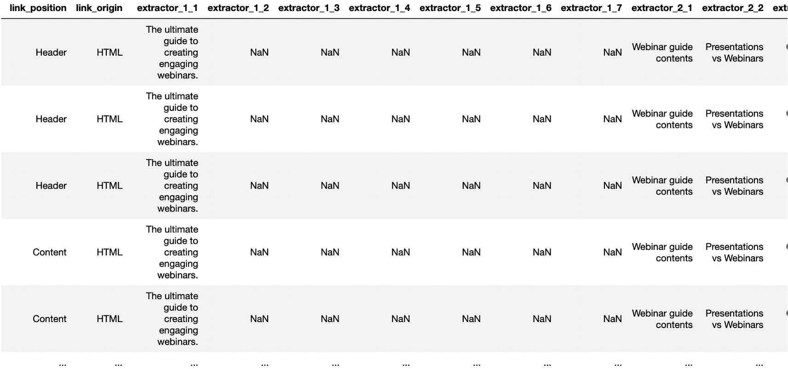
一张包含 5 行 11 列表格的截图，展示了提取器字段中条目的数据框。它包括`link_position`、`link_origin`和提取器。

## 提取标题

由于我们只对内容感兴趣，因此将对其进行筛选：
```python
crawl_headings = crawl_raw.loc[crawl_raw['link_position'] == 'Content'].copy()
```

数据框中还包含一些我们不需要的列，例如`link_position`和`link_origin`。我们可以通过按位置列出列来删除它们（这样可以节省空间，也无需逐一输入众多列名！）。
```python
drop_cols = [0, 2, 3, 4, 5, 6, 7, 8, 9, 10, 11, 12, 13, 14, 15, 16, 17, 18, 19, 20]
```

使用`.drop()`方法，我们可以就地删除多列（即无需将结果复制到自身）：
```python
crawl_headings.drop(crawl_headings.columns[drop_cols], axis = 1, inplace = True)
```

将列名从`source`重命名为`URL`，这将有助于后续的合并操作：
```python
crawl_headings = crawl_headings.rename(columns = {'source': 'url'})
crawl_headings
```

结果如下：
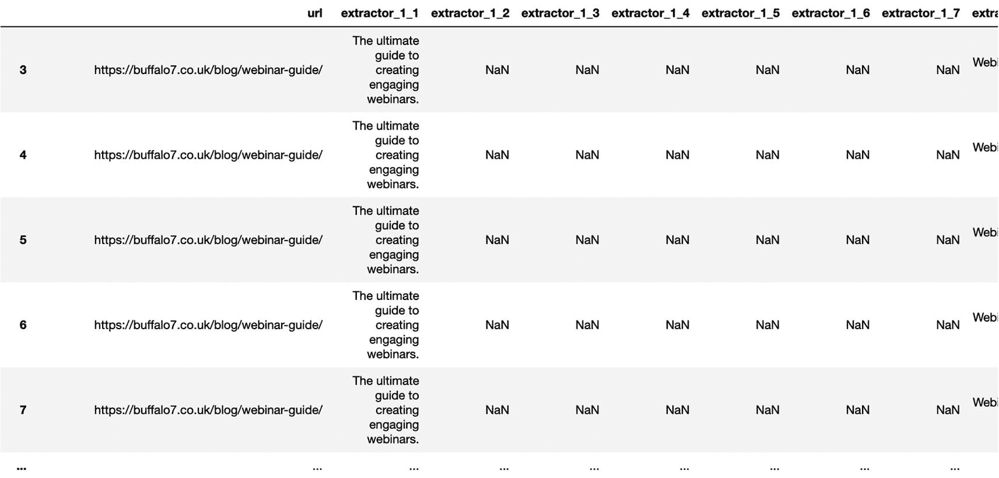
一张包含 5 行 9 列表格的截图，展示了在数据条目上执行 drop 函数后的数据框。其中包含`url`和提取器列。

有了所需的 URL 列及其内容章节列后，需要将这些数据转换为长格式，将所有章节合并到一个名为`heading`的列中：
```python
crawl_headings_long = crawl_headings.copy()
```

我们希望获取提取器列名的列表（同样是为了节省输入），方法是通过`.iloc`选取从第二列开始的数据框子集，并提取列名（`.columns.values`）：
```python
heading_cols = crawl_headings_long.iloc[:, 1:].columns.values.tolist()
```

使用`.melt()`函数，我们将数据框进行透视，利用上述列表将内容章节重塑为一个单独的`heading`列：
```python
crawl_headings_long = pd.melt(crawl_headings_long, id_vars='url', value_name = 'heading', var_name = 'position',
value_vars= heading_cols)
```

移除空值：
```python
crawl_headings_long = crawl_headings_long.loc[~crawl_headings_long['heading'].isnull()]
```

移除重复项：
```python
crawl_headings_long = crawl_headings_long.drop_duplicates()
crawl_headings_long
```

结果如下：
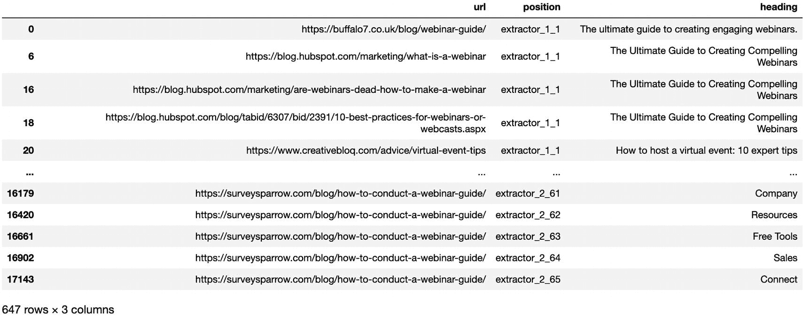
一张包含 647 行 3 列表格的截图，展示了`url`、`position`和`heading`条目的数据框。

最终的数据框显示了 URL、标题以及位置信息，其中第一个数字表示它是`h1`还是`h2`，第二个数字表示该标题在页面上的顺序。标题即为文本值。

你可能会注意到，标题中包含一些并非严格意义上的内容，而是全站通用的样板内容，例如“公司”、“资源”等。这些内容后续需要移除。
```python
serps_headings = serps_to_crawl_df.copy()
```

让我们将标题与 SERP 数据进行合并：
```python
serps_headings = serps_headings.merge(crawl_headings_long, on = 'url', how = 'left')
```

将空标题替换为`''`，以便后续进行聚合操作：
```python
serps_headings['heading'] = np.where(serps_headings['heading'].isnull(), '', serps_headings['heading'])
serps_headings['project'] = 'target'
serps_headings
```

结果如下：
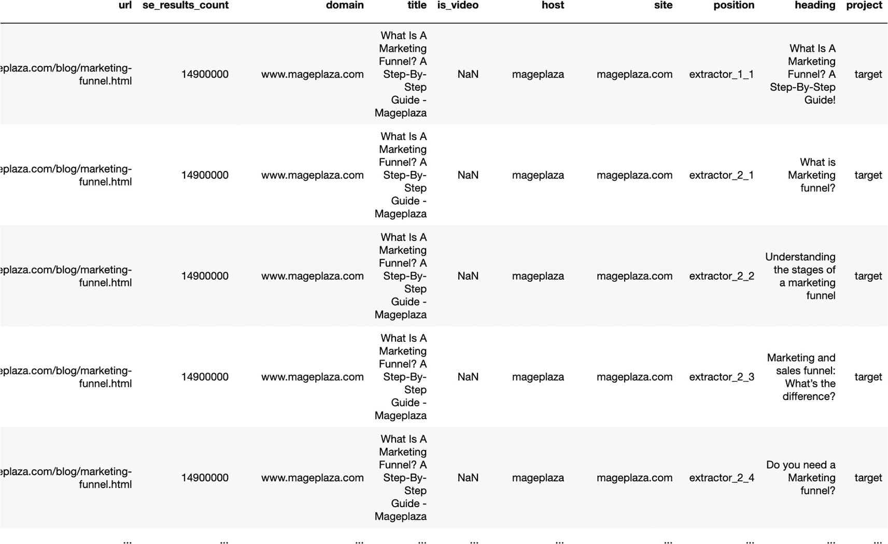
一张包含 5 行 10 列表格的截图，展示了将标题条目与 SERP 数据合并后的数据框。列标题分别为`url`、`result count`、`domain`、`title`、`video`、`host`、`site`、`position`、`heading`和`project`。

数据合并完成后，我们将提取域名、标题和位置信息：
```python
headings_tosum = serps_headings[['domain', 'heading', 'position']].copy()
```

按下划线分割位置字符串，并提取列表中的最后一个数字（使用`-1`），以获取标题在页面上的顺序：
```python
headings_tosum['pos_n'] = headings_tosum['position'].str.split('_').str[-1]
```

将数据类型转换为数字：
```python
headings_tosum['pos_n'] = headings_tosum['pos_n'].astype(float)
```

添加一个计数列，以便于聚合：
```python
headings_tosum['count'] = 1
headings_tosum
```

结果如下：
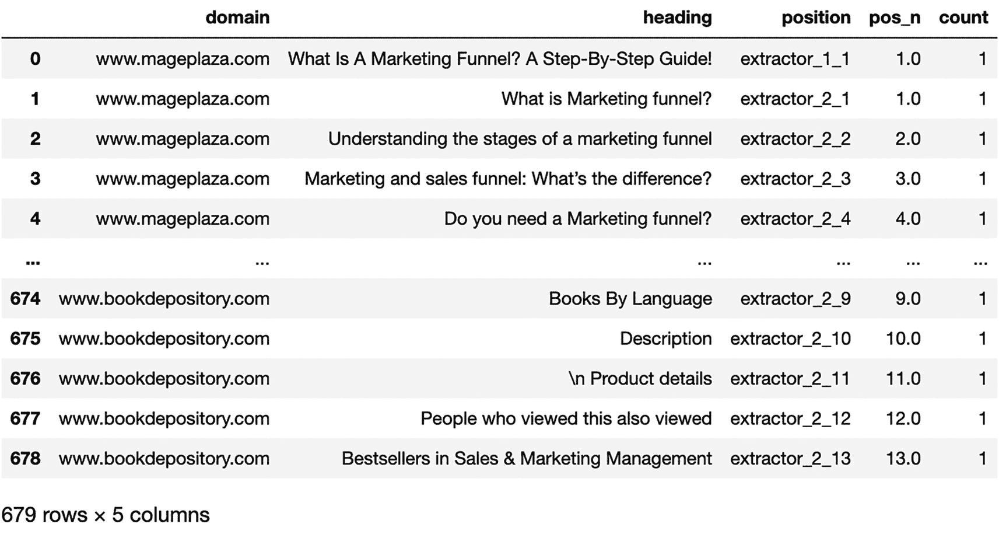
一张包含 679 行 5 列表格的截图，展示了将标题条目与 SERP 数据合并并添加额外计数后的数据框。列标题分别为`domain`、`heading`、`position`、`n`和`count`。

## 清理与筛选标题

现在我们可以开始汇总并剔除无意义的标题了。

首先，我们会移除每个网站特有的样板标题。具体做法是按域名统计每个标题出现的次数，并移除出现次数超过一次的标题，因为理论上这意味着该标题并非唯一。

```python
domsheadings_tosum_agg = headings_tosum.groupby(['domain', 'heading']).agg({'count': sum,
'pos_n': 'mean'
}).reset_index().sort_values(['domain', 'count'],
ascending = False)
domsheadings_tosum_agg['heading'] = domsheadings_tosum_agg['heading'].str.lower()
domsheadings_tosum_agg.head(50)
```

`stop_headings` 是一个包含我们想要移除的标题的列表。

包括那些出现次数超过一次的标题：

```python
stop_headings = domsheadings_tosum_agg.loc[domsheadings_tosum_agg['count'] > 1]
```

以及包含换行符（如 `"\n"`）的标题：

```python
stop_headings = stop_headings.loc[stop_headings['heading'].str.contains('\n')]
stop_headings = stop_headings['heading'].tolist()
stop_headings
```

结果如下：

```python
['\n  \n    the scrappy guide to marketing\n  \n',
'\n                \n                    danny goodwin                \n            ',
'\n         \n             how to forecast seo with better precision & transparency         \n     ',
'\n         \n             should you switch to ga4 now? what you need to know         \n     ',
'\n            the ultimate guide to webinars: 41 tips for successful webinars        ',
'\n        \n        \n            \n            \n                \n            \n            \n            \n            \n                \n get timely updates and fresh ideas delivered to your inbox. \n                \n                \n                \n                \n            \n            \n            \n        \n    ',
'4 best webinar practices for marketing and promotion in 2020\n',
'\n    company\n  ',
'\n    customers\n  ',
'\n    free tools\n  ',
'\n    partners\n  ',
'\n    popular features\n  ']
```

在域名层面，样板标题的清理工作已取得一定成效，但仍有更多工作要做。

接下来，我们将分析标题本身，首先统计标题的数量：

```python
headings_tosum_agg = headings_tosum.groupby(['heading']).agg({'count': sum,
'pos_n': 'mean'
}).reset_index().sort_values('count',
ascending = False)
headings_tosum_agg['heading'] = headings_tosum_agg['heading'].str.lower()
```

移除包含样板项的标题：

```python
headings_tosum_agg = headings_tosum_agg.loc[~headings_tosum_agg['heading'].isin(stop_headings)]
```

剔除内容为空的标题（`''`）：

```python
headings_tosum_agg = headings_tosum_agg.loc[headings_tosum_agg['heading'] != '']
headings_tosum_agg.head(10)
```

结果如下：


该数据框看起来包含了更合理的内容标题，但 `"company"` 除外，它在页面中的排序位置也靠后得多（第 25 位）。

让我们进一步筛选：

```python
headings_tosum_filtered = headings_tosum_agg.copy()
```

移除位置在 10 或以上的标题，因为这些标题不太可能包含实际的内容章节。注意，10 是一个任意数字，根据内容性质可以调整。

```python
headings_tosum_filtered = headings_tosum_filtered.loc[headings_tosum_filtered['count'] < 10 ]
```

统计标题中的单词数量：

```python
headings_tosum_filtered['tokens'] = headings_tosum_filtered['heading'].str.count(' ') + 1
```

通过移除文本两侧的空格来清理标题：

```python
headings_tosum_filtered['heading'] = headings_tosum_filtered['heading'].str.strip()
```

使用冒号作为标点符号分割标题，并提取冒号右侧的部分：

```python
headings_tosum_filtered['heading'] =  headings_tosum_filtered['heading'].str.split(':').str[-1]
```

对句点应用相同原则：

```python
headings_tosum_filtered['heading'] =  headings_tosum_filtered['heading'].str.split('.').str[-1]
```

移除包含分页信息的标题，例如 `1 of 9`：

```python
headings_tosum_filtered = headings_tosum_filtered.loc[~headings_tosum_filtered['heading'].str.contains('[0-9] of [0-9]', regex = True)]
```

移除单词数少于 5 个或超过 12 个的标题：

```python
headings_tosum_filtered = headings_tosum_filtered.loc[headings_tosum_filtered['tokens'].between(5, 12)]
headings_tosum_filtered = headings_tosum_filtered.sort_values('count', ascending = False)
headings_tosum_filtered = headings_tosum_filtered.loc[headings_tosum_filtered['heading'] != '' ]
headings_tosum_filtered.head(10)
```

结果如下：


现在我们得到的标题看起来更像是实际的内容章节。这些标题已准备好用于聚类分析。

## 标题聚类

之所以要进行聚类，是因为作者们会使用不同的词语来描述同一个章节标题，并刻意为之，以避免侵犯版权和抄袭。然而，谷歌足够智能，能够识别出“网络研讨会最佳实践”和“网络研讨会的最佳实践”是同一回事。

为了利用谷歌的知识，我们将借助搜索引擎结果页面（SERP）来查看每个标题的搜索结果是否足够相似，从而判断它们是否表达相同的意思（即，其底层含义或意图是否相同）。

我们将创建一个列表，并使用搜索意图聚类代码（参见第 2 章）将标题归类到不同的主题中：

```python
headings_to_cluster = headings_tosum_filtered[['heading']].drop_duplicates()
headings_to_cluster = headings_to_cluster.loc[~headings_to_cluster['heading'].isnull()]
headings_to_cluster = headings_to_cluster.rename(columns = {'heading': 'keyword'})
headings_to_cluster
```

结果如下：

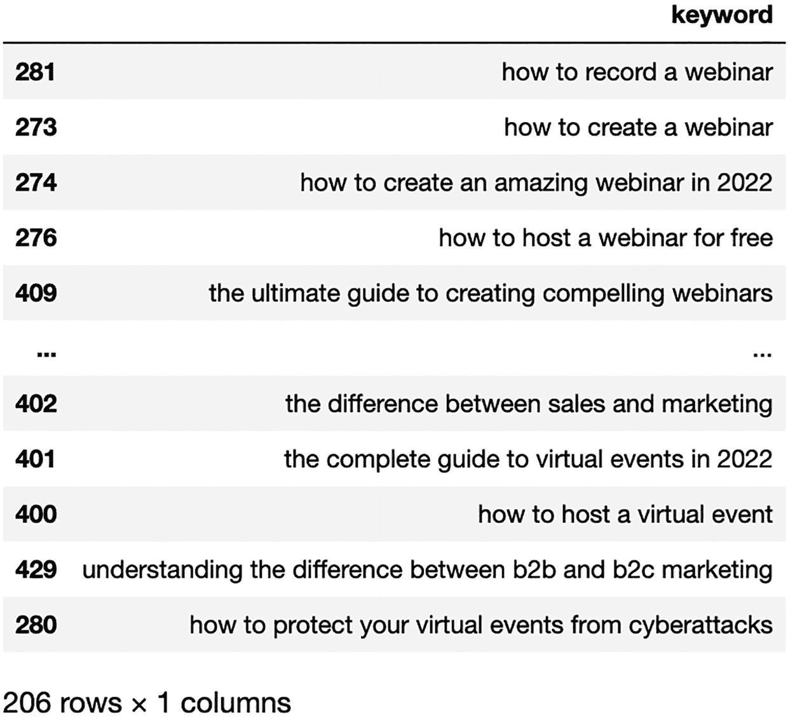

将标题按搜索意图聚类后，我们导入结果：

```python
topic_keyw_map = pd.read_csv('data/topic_keyw_map.csv')
```

让我们将关键词列重命名为标题，以便稍后用于与 SERP 数据框进行连接：

```python
topic_keyw_map = topic_keyw_map.rename(columns = {'keyword': 'heading'})
topic_keyw_map
```

结果如下：

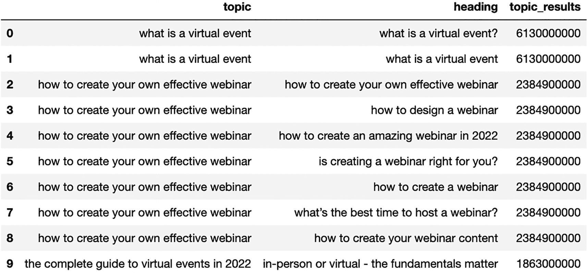

该数据框显示了标题及其作为“主题”的含义。下一步是获取一些统计数据，看看一个主题由多少个标题构成。由于主题是标题的核心含义，这将构成每个目标关键词的核心内容部分。

```python
topic_keyw_map_agg = topic_keyw_map.copy()
topic_keyw_map_agg['count'] = 1
topic_keyw_map_agg = topic_keyw_map_agg.groupby('topic').agg({'count': 'sum'}).reset_index()
topic_keyw_map_agg = topic_keyw_map_agg.sort_values('count', ascending = False)
topic_keyw_map_agg
```

结果如下：

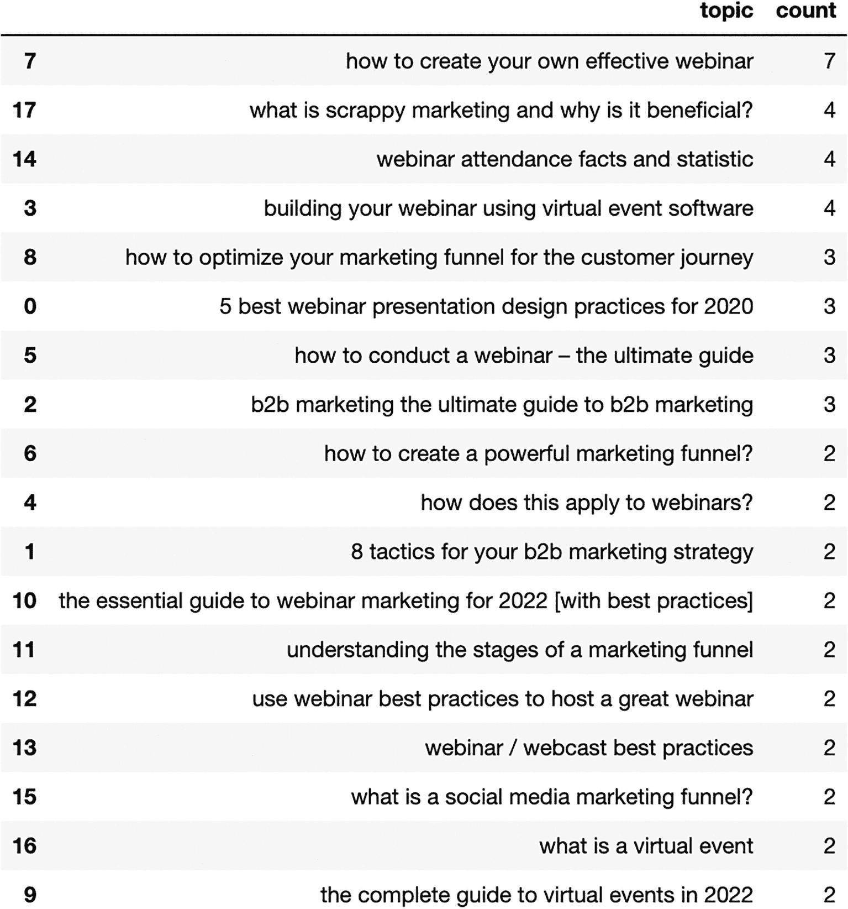

“创建有效的网络研讨会”是最受欢迎的内容部分。

现在，这些数据将与 SERP 合并，以便我们将建议的内容映射到目标关键词：

```python
serps_topics_merge = serps_headings.copy()
```

为了成功合并，我们需要将标题转换为小写：

```python
serps_topics_merge['heading'] = serps_topics_merge['heading'].str.lower()
serps_topics_merge = serps_topics_merge.merge(topic_keyw_map, on = 'heading', how = 'left')
serps_topics_merge
```

结果如下：

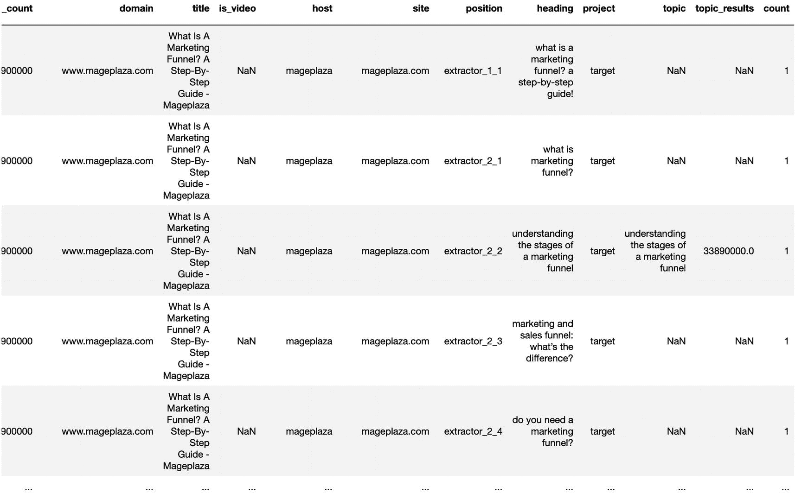

```python
keyword_topics_summary = serps_topics_merge.groupby(['keyword', 'topic']).agg({'count': 'sum'}).reset_index().sort_values(['keyword', 'count'], ascending = False)
```

计数将被重置为 1，这样我们就可以计算每个目标关键词的建议内容部分数量：

```python
keyword_topics_summary['count'] = 1
keyword_topics_summary
```

结果如下：

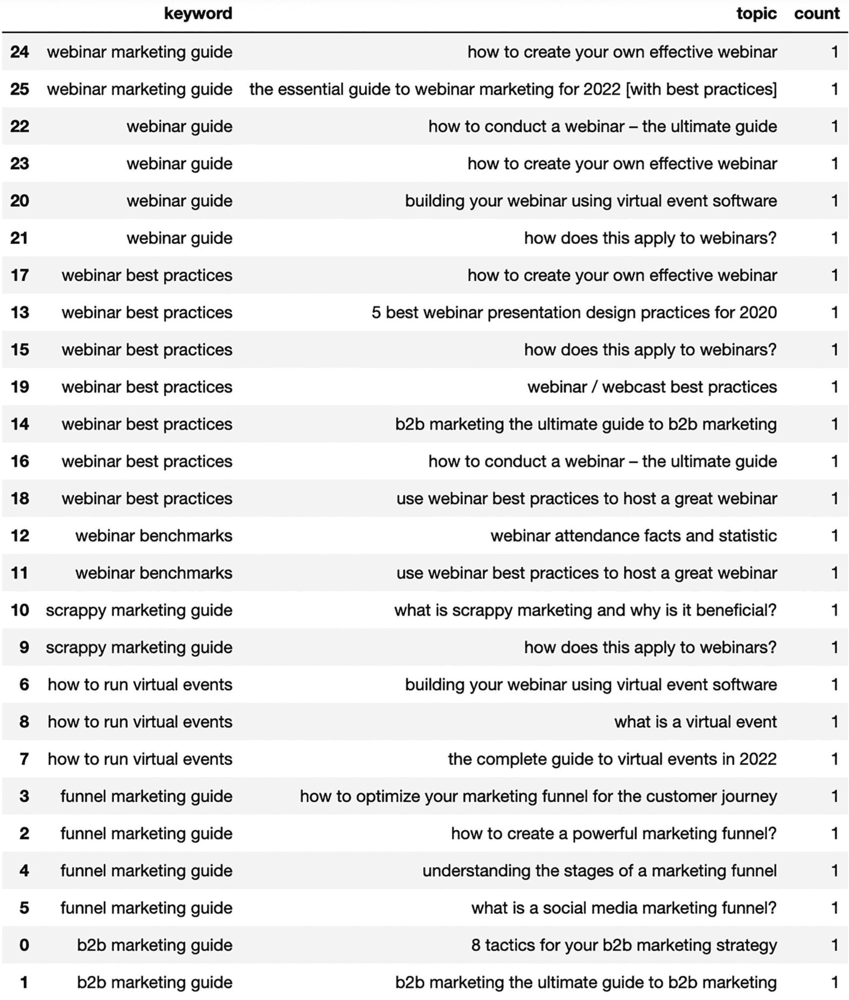

上述数据框显示了应为每个目标关键词编写的内容部分（主题）。

```python
keyword_topics_summary.groupby(['keyword']).agg({'count': 'sum'}).reset_index()
```

结果如下：

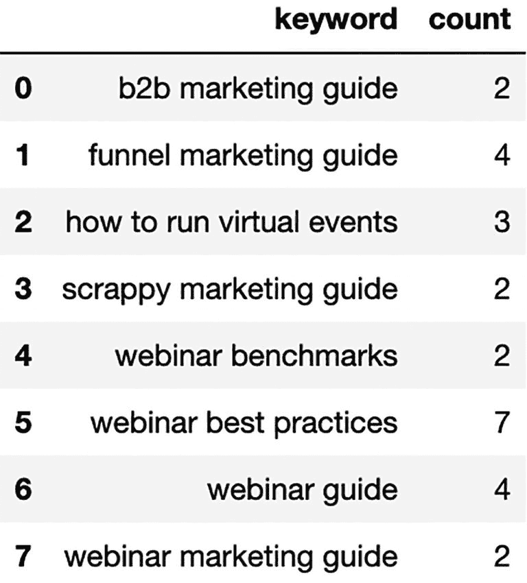

“网络研讨会最佳实践”将拥有最多的内容，而其他目标关键词平均会有大约两个核心内容部分。

## 反思

对于 B2B 营销来说，这种方法效果非常好，因为它是一种很好的方式，可以自动化大多数 SEO 专业人员都会经历的手动流程（即，查看排名前 10 的页面覆盖了哪些内容），尤其是在你需要为大量关键词创建内容时。

我们使用了 `H1` 和 `H2` 标签，因为如果使用正文中更多的文本（例如 `H3` 或 `<p>` 段落，即使在过滤掉停用词之后），会给字符串距离计算引入更多噪音。

有时，你会得到一些相当不错的可靠建议；然而，在向你的创意团队或代理机构提出内容需求之前，应该先对输出结果进行审查。

## 总结

SEO 的许多方面都旨在提供比竞争对手更好的内容和用户体验。本章重点介绍了：

*   **关键词映射**：将关键词分配给现有内容，并识别创建新内容的机会。

*   **内容差距分析**：识别关键内容以及你网站中的内容缺口。

*   **内容创作**：为你的目标搜索短语，找到排名靠前的文章所共有的核心内容。

下一章将讨论 SEO 的第三大支柱：权威性。