# 6. 竞争对手

哪个有自尊的 SEO 不做竞争对手分析来找出自己遗漏了什么？早在 2007 年，Andreas 回忆说，他使用电子表格收集 SERP 数据，列代表竞争的各个方面，例如指向首页的链接数量、页面数量、字数等。事后看来，这个想法是对的，但由于 Excel 难以在短时间内进行统计上稳健的分析，执行起来几乎无望——而你现在将很快学会使用机器学习来完成这项工作。

## 还有算法恢复！

这些应用不仅对一般的竞争对手 SEO 分析有用，对于从谷歌更新中恢复也很有用，尤其是当你没有更新前的 SERP 数据副本来对比之前有效的方法和现在有效的方法时。

如果你确实拥有更新前的 SERP 数据，那么你只需对更新前的 SERP 重复分析，并将分析结果与更新后的 SERP 进行比较即可。

## 定义问题

在急于行动之前，我们先来思考一下挑战。面对超过 10,000 个排名因素，既没有足够的时间，也没有足够的预算来学习和优化所有高优先级的 SEO 项目。

我们建议通过排除干扰，并利用机器学习分析竞争对手数据，来发现那些能对你的 SEO 活动产生决定性影响的排名因素，从而找到：

- 哪些排名因素最能解释网站间排名的差异
- 获胜的基准是什么
- 该因素每变化一个单位，对排名的影响价值有多大

### 结果指标

需要明确的是，结果变量应为在谷歌搜索引擎中的排名。只要你能从可靠的排名检测工具中获取数据，这种方法也适用于任何其他搜索引擎（例如必应、Yandex、百度等）。

#### 为什么选择排名？

因为与用户会话不同，排名不会随天气、一年中的时间等因素而变化——查询时效性除外。它可能是最干净的指标。无论如何，排名代表了排名 URL 的内容最能满足搜索查询的顺序——想想看，这正是 RankBrain 的核心。因此，实际上，我们正在研究如何针对任何由 RankBrain 驱动的谷歌更新进行优化。

从数据角度来看，排名位置必须是一种浮点数值数据类型，在 Python 中称为`float`（在 R 中称为`double`）。

### 特征

既然我们已经确定了结果指标，现在必须确定自变量，也就是模型输入，也称为特征。特征的数据类型会有所不同，例如：

- `first_paint_ms` 将是数值型。
- `flesch_kincaid_reading_ease` 将是字符型。

自然地，为了进行最全面的竞争对手研究，你希望涵盖尽可能多有意义的特征，包括技术、内容/用户体验和站外因素。

## 数据策略

现在我们知道了结果和特征，该做什么呢？鉴于排名是数值型的，并且我们想要解释排名之间的差异，这是一个连续变量（即，排名从第一到第二，再到第三，等等），那么此处的竞争对手分析就是一个回归问题。用数学术语表示就是：

```
rank ~ w_1*feature_1 + w_2*feature_2 + … + w_n*feature_n
```

`~` 表示“由……解释”。
`n` 是第 n 个特征。
`w` 是该特征的权重。

需要明确的是，这并不总是一个线性回归练习。线性回归假设所有特征都以线性方式表现——数据点都将沿着一条直线拟合。虽然对于某些特征（如页面加载速度）在大多数情况下可能如此，但对于其他特征则不然。

例如，许多排名因素在某些行业表现出非线性特征。例如，标题标签的字符数通常是非线性的，存在一个最佳点。

如图 6-1 所示，我们可以看到最佳拟合线呈 n 形，表明当标题中网站名称字符占比接近 28%时，排名会上升，而网站偏离该标题标签品牌占比的获胜基准越远，排名则越低。

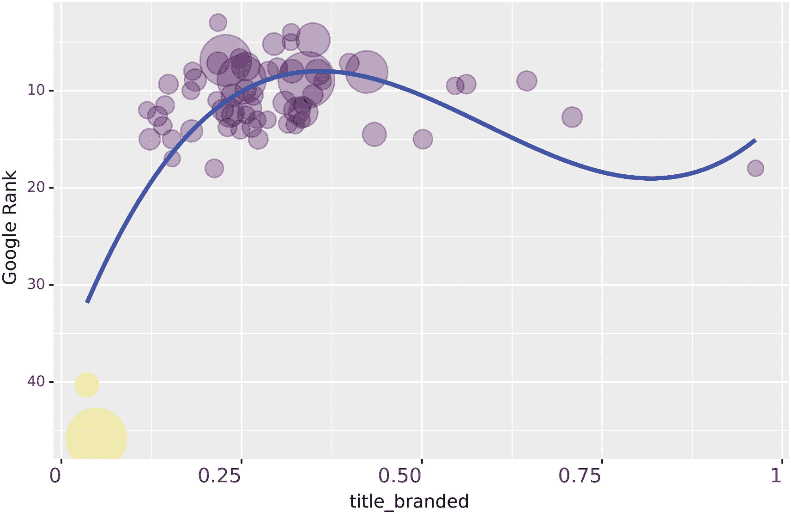

一张散点图，带有谷歌排名与标题品牌占比的最佳拟合线。最大散点位于 0.25，10 处，纵轴标记为 0、40、30、20 和 10。该线绘制了一条正弦曲线。

**图 6-1** 标题标签品牌化（占总字符数的比例）与平均谷歌排名位置的散点图

关于收集哪些特征，搜索引擎是对 URL 进行排名，而不是域名，因此我们将重点关注前者。这将为你节省数据收集的成本和时间，以及整合实际数据的工作。然而，缺点是你将无法包含全域名特征，例如排名 URL 与首页的距离。

为此，我们将使用一种基于决策树的算法，称为`随机森林`。还有其他算法，如决策树，以及更好的算法如 AdaBoost 和 XGBoost。数据科学家通常会试验多种模型，然后根据模型稳定性和预测准确性选择最佳的一个。

然而，我们的目的是让你入门；这些模型可能会产生相似的结果，因此我们为你节省时间，同时最重要的是，为你提供分析 SERP 竞争对手以进行 SEO 的机器学习技术背后的直觉。

## 数据来源

虽然我们无法获知谷歌的内部数据（除非你为谷歌工作），但我们严重依赖第三方工具来提供数据。这些工具是第三方而非第一方的原因是，研究中所有网站的数据必须具有可比性——除非你极不可能拥有竞争对手的数据。没有？那我们继续。

你的数据来源将取决于你希望测试哪些类型的特征来对 SERP 竞争对手进行建模。

**排名：** 这将来自你的排名检测工具，而非 Google Search Console。所以，这些工具包括 getSTAT、SEO Monitor、Rank Ranger 或 DataForSEO SERPs API。还有其他工具，但我们没有或没有直接测试其 API 的经验，因此无法提及。为什么是这三个？因为它们都允许你导出研究中包含的每个关键词的前 100 个 URL。这一点很重要，因为从一开始我们就不想假设你的 SERP 竞争对手是谁。我们只想提取数据并对其进行探究。

对于特征：

**站内：** 要测试站内因素是否能解释你的关键词集的排名差异，可以使用标题标签长度、页面速度、字数、阅读易读性等特征，以及你的排名检测工具能告诉你的关于 URL 的任何信息。你也可以推导出自己的特征，例如通过计算标题标签与目标关键词之间的字符串距离来得出标题相关性。请放心，我们稍后会向你展示如何操作。

对于竞争不那么激烈的行业和小型数据集（每个网站少于 250,000 个 URL），像 Screaming Frog 或 Sitebulb 这样的工具就足够了。对于大型数据集和竞争激烈的行业，你的竞争对手很可能会屏蔽桌面版网站审计工具，因此你将不得不求助于企业级工具，这些工具从云端爬取并拥有 API。根据我们的个人经验，我们发现 Botify 不仅两者兼备，而且运行良好，因为大多数企业品牌都在使用它，所以在爬取时不会被屏蔽！

**站外：** 要测试站外因素的影响，请选择一个拥有良好 API 的可靠来源。根据我们的经验，AHREFs 和 BuzzSumo 效果很好，能提供诸如域名评级、各平台社交分享次数以及反向链接 URL 上的内部链接数量等指标。两者都有 API，允许你将站外数据的收集自动化到你的 R 工作空间中。

## 探索、清洗与转换

拿到数据后，数据科学实践要求你探索数据，以便：

- **理解分布**：数据是否存在偏态或多峰（即分布中有多个峰值）？
- **检查数据质量**：是否存在过多的缺失值？是否存在单水平因子？
- **发现可用于衍生新特征的信息**

其核心思想是通过剔除无信息或无用的特征和行，来提升输入模型的数据质量。探索数据还能帮助你理解模型在解释搜索查询空间中的排名因素时的局限性。

在合并到 SERP 数据之前，我们先进行探索。

总结整体流程如下：

1. 导入数据——包括排名数据和特征数据
2. 聚焦竞争对手
3. 合并数据
4. 衍生新特征
5. 处理单水平因子（SLF）
6. 数据重缩放
7. 处理近零方差（NZV）
8. 中位数填充
9. 独热编码（OHE）
10. 剔除缺失值
11. 对 SERP 进行建模
12. 评估 SERP 机器学习模型
13. 排名的最强预测驱动因素
14. 每个排名因素的价值
15. 排名因素的优胜基准

当然，内容很多，我们会逐一简要说明，并在机器学习能揭示的关于竞争对手的更有趣秘密上深入展开。

### 导入数据——包括 SERP 数据和特征数据

可以通过从相关 SEO 工具导入 CSV 下载文件来完成，或者为了更自动化的体验，使用工具提供商的 API 将数据导入数据框（Python 中的电子表格版本）。以下是一些导入 CSV 数据的入门代码：

对于正则表达式（regex），尽管字符串方法默认包含正则表达式功能：

```python
import re
import time
import random
import pandas as pd
import numpy as np
import datetime
import re
import time
import requests
import json
from datetime import timedelta
```

用于导入多个文件：

```python
from glob import glob
import os
```

用于计算两个文本字符串之间重叠部分的字符串方法：

```python
from textdistance import sorensen_dice
```

用于提取 URL 的各个部分：

```python
import uritools
from tldextract import extract
```

用于数据可视化：

```python
from plotnine import *
import matplotlib.pyplot as plt
pd.set_option('display.max_colwidth', None)
%matplotlib inline
```

一些变量在开始时初始化，这样当你将脚本复用于其他客户或网站时，只需覆盖以下变量值：

```python
root_url = 'https://www.johnsankey.co.uk'
target_site = 'www.johnsankey.co.uk'
root_domain = 'johnsankey.co.uk'
hostname = 'johnsankey'
target_name = 'sankey'
geo_market = 'uk'
```

用于数据子集划分或过滤的社交网站列表：

```python
social_sites = ['facebook.com', 'instagram.com', 'linkedin.com', 'twitter.com', 'pinterest.com', 'tiktok.com', 'foursquare.com', 'reddit.com']
```

### 从关键词入手

与 SEO 中几乎所有事情一样，要始终以终为始。这通常意味着要明确你希望网站排名的目标关键词，以及它们对应的 SERP 数据，我们将把这些数据加载到 Pandas 数据框中：

```python
serps_raw = pd.read_csv('data/keywords_serps.csv')
```

为了让数据框更易于处理，我们将使用列表推导式将列名转换为小写，并将标点符号和空格替换为下划线：

```python
serps_raw.columns = [x.lower().replace(' ', '_').replace(',', '_').replace('__', '_') for x in serps_raw.columns]
```

`rank_absolute`列被替换为更简洁、更熟悉的`rank`：

```python
serps_raw = serps_raw.rename(columns = {'rank_absolute': 'rank'})
serps_raw
```

结果如下：

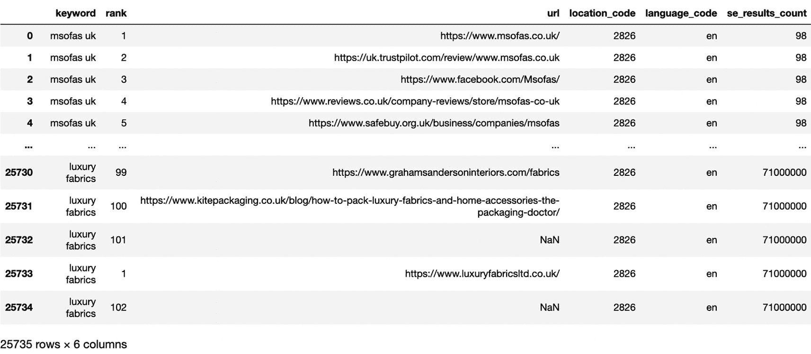

一个包含 25735 行和 6 列的表。列标题为`keyword`、`rank`、`url`、`location code`、`language code`、`se results count`，行中填充了所有关键词数据。

`serps_raw`数据框包含超过 25000 行 SERP 数据，共 6 列，覆盖所有关键词：

```python
serps_df = serps_raw.copy()
```

将 URL 列设置为字符串类型，以便于数据操作：

```python
serps_df['url'] = serps_df['url'].astype(str)
```

第一个操作是提取`site`列的域名。`site`列将应用`uritools` API 函数去除路径部分，然后使用列表推导式将 URL 拆分为其组成部分的列表：

```python
serps_df['site'] = [uritools.urisplit(x).authority if uritools.isuri(x) else x for x in serps_df['url']]
```

拆分后，我们将提取列表中的内容，取最后三个组成部分：

```python
serps_df['site'] = ['.'.join(s.split('.')[-3:]) for s in serps_df['site']]
```

接下来，我们希望将排名分层，以便获得排名类别。虽然在本练习中可能不会用到，但这是处理 SERP 数据时的标准做法。

```python
serps_df['rank_profile'] = np.where(serps_df['rank'] < 11, 'page_1', 'page_2')
serps_df['rank_profile'] = np.where(serps_df['rank'] < 3, 'top_3',
serps_df['rank_profile'])
```

为了避免`search_volumes`为零的情况，我们将使用`np.where()`将其设置为 1，以防止除零错误：

```python
serps_df['se_results_count'] = np.where(serps_df['se_results_count'] == 0, 1, serps_df['se_results_count'])
```

我们将设置一个`count`列，以便更快速地进行聚合：

```python
serps_df['count'] = 1
```

我们还会计算搜索字符串中的关键词数量，在数据科学领域称为词元：

```python
serps_df['token_count'] = serps_df['keyword'].str.count(' ') + 1
```

然后，根据词元长度将这些关键词分为头部、中部和尾部：

```python
before_length_conds = [
serps_df['token_count'] == 1,
serps_df['token_count'] == 2,
serps_df['token_count'] > 2]
length_vals = ['head', 'middle', 'long']
serps_df['token_size'] = np.select(before_length_conds, length_vals)
serps_df
```

结果如下：

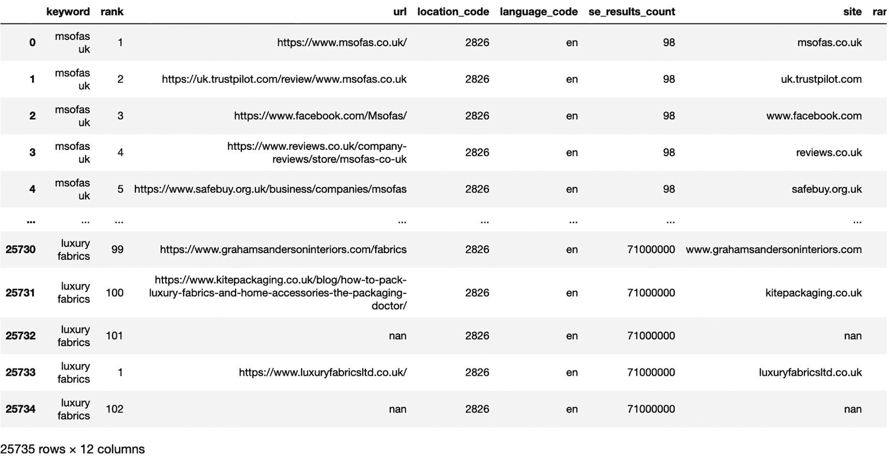

一个包含 25735 行和 12 列的表。列标题为`keyword`、`rank`、`url`、`location code`、`language code`、`se results count`和`site`，行中按关键词分类填充了数据。

## 聚焦竞争对手

SERP 数据能有效告诉我们，在排名作为结果指标的情况下，谷歌奖励了哪些内容。然而，这些数据中很多可能包含噪声，并且其中一些列很可能包含能够解释内容间排名差异的排名因素。

内容之所以存在噪声，是因为 SERP 中可能包含来自某些网站（如评论和参考类网站）的内容，商业网站很难从中学习。最终，在进行这项分析时，SEO 主要关注的是在考虑其他网站之前，如何超越竞争对手的网站。

因此，你需要筛选出竞争对手，以使你的研究更有意义。例如，如果你的客户或品牌处于网络研讨会技术领域，那么将 `Wikipedia.com` 或 `Amazon.com` 纳入数据集就没有意义，因为它们并不直接与你的品牌竞争。

你真正需要的是近乎直接或直接的竞争对手，即“撞脸”网站，这样你才能比较它们做了或没做什么，从而使其排名比你高或低。

这种方法的缺点在于，通过剔除非竞争对手，你无法全面了解谷歌希望从 SERP 中获得什么。这是因为 SERP 需要作为一个整体来分析，这在第 10 章中有所涉及。然而，本章是关于竞争对手分析的，所以我们继续往下进行。

为了找到竞争对手，我们需要进行一些聚合操作，首先从计算“触达量”（即排名在前 10 位的内容数量）开始：

```
major_players_reach = serps_df.loc[serps_df['rank'] < 10]
```

将 SERP 过滤或限制在前 10 名后，我们将按网站聚合前 10 名的总数，使用 `groupby` 按网站分组并求和 `count` 列：

```
major_players_reach = major_players_reach.groupby('site').agg({'count': sum}).reset_index()
```

然后，我们将按触达量的降序对网站进行排序：

```
major_players_reach = major_players_reach.sort_values('count', ascending = False)
```

触达量指标通过提供数量，基本能说明问题，但我们还需要通过计算中位数来获取排名。这将有助于对触达量水平相当的网站进行排序。

```
major_players_rank = serps_df.groupby('site').agg({'rank': 'median'}).reset_index()
major_players_rank = major_players_rank.sort_values('rank')
```

按搜索引擎结果数量进行聚合，有助于衡量关键词的整体竞争度，该指标通过平均值进行聚合。这些数据由 DataForSEO 的 SERP API 独家提供。不过，你也可以轻松地用其他 SERP 跟踪工具（如 SEO Monitor）提供的更常见的搜索量指标来替代。

```
major_players_searches = serps_df.groupby('site').agg({'se_results_count': 'mean'}).reset_index()
major_players_searches = major_players_searches.sort_values('se_results_count')
```

排名和搜索结果聚合数据通过 `merge()` 函数连接到触达数据上，形成一张表。这相当于以 `site` 列作为合并依据进行 `vlookup` 操作：

```
major_players_stats = major_players_reach.merge(major_players_rank, on = 'site', how = 'left')
major_players_stats = major_players_stats.merge(major_players_searches, on = 'site', how = 'left')
```

利用所有数据，我们将计算一个整体可见性指标，该指标将触达量的平方除以排名。对触达量进行平方是为了避免那些只有少数前 10 名但排名非常高的网站出现在列表顶部。

排名作为除数，是因为排名数字越小越好；因此，除以一个较小的数字会提高网站的可见性值，前提是其排名更高：

```
major_players_stats['visibility'] = ((major_players_stats['reach'] ** 2) / major_players_stats['rank']).round()
```

排除社交媒体网站，以聚焦于商业竞争对手：

```
major_players_stats = major_players_stats.loc[~major_players_stats['site'].str.contains('|'.join(social_sites))]
```

将 `count` 重命名为 `reach`：

```
major_players_stats = major_players_stats.rename(columns = {'count': 'reach'})
```

移除包含 `nan` 值的网站：

```
major_players_stats = major_players_stats.loc[major_players_stats['site'] != 'nan']
major_players_stats.head(10)
```

结果如下：

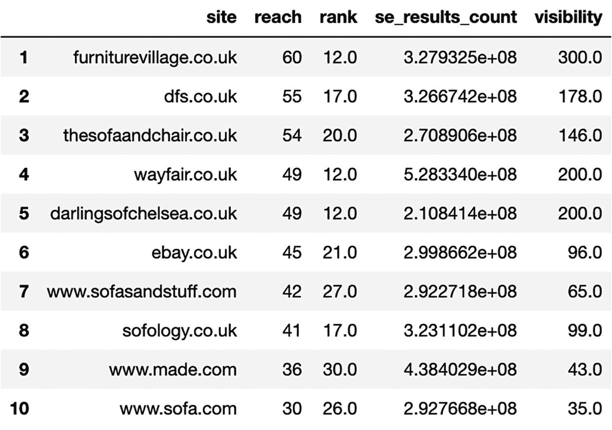

一个包含 11 行 5 列的表格，列标题为网站、触达量、排名、搜索结果数量和可见性。网站 `furniturevillage.co.uk` 的数据显示为：触达量 60，排名 12，可见性等于 60 乘以 60 再除以 12，即 300。

该数据框显示了预计会主导 SERP 的前 20 个特色网站。其中一些排名靠前的网站并非直接竞争对手（可能无法爬取！），因此这些网站将被移除，因为我们希望从最直接的竞争对手那里学习，了解他们最高效的 SEO 策略。

因此，我们将选择最直接的竞争对手，并将其存储在一个列表 `player_sites_lst` 中：

```
player_sites_lst = ['sofology.co.uk', 'www.designersofas4u.co.uk', 'www.heals.com', 'darlingsofchelsea.co.uk', 'www.made.com', 'www.sofasandstuff.com', 'www.arloandjacob.com', 'loaf.com', 'www.made.com', 'theenglishsofacompany.co.uk', 'willowandhall.co.uk', root_domain]
```

该列表将用于过滤 SERP，使其仅包含来自这些直接竞争对手的内容：

```
direct_players_stats = major_players_stats.loc[major_players_stats['site'].isin(player_sites_lst)]
direct_players_stats
```

结果如下：

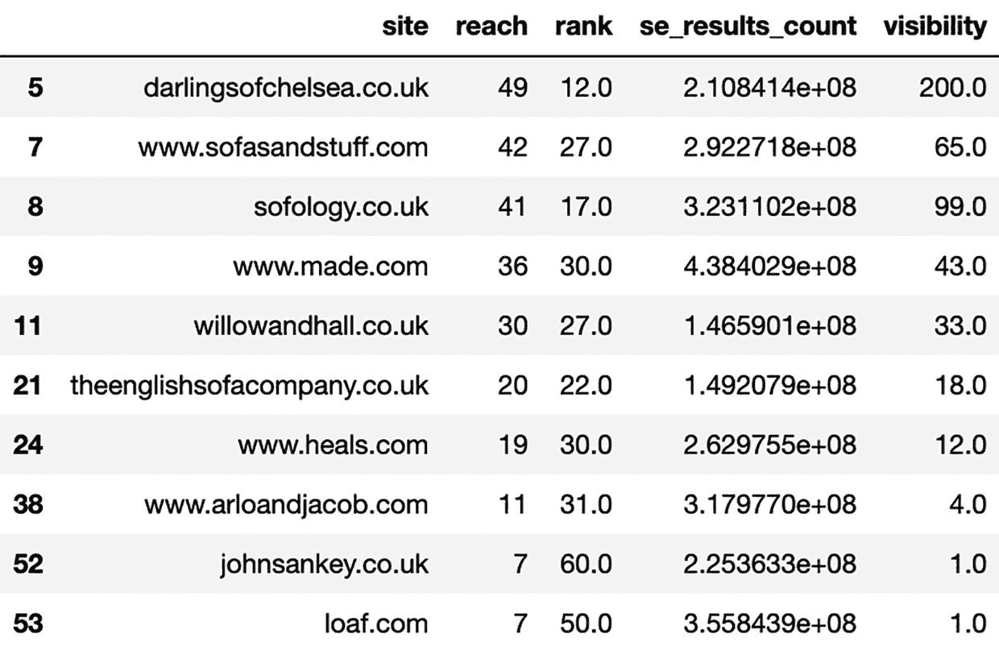

一个包含 11 行 5 列的表格，列标题为网站、触达量、排名、搜索结果数量和可见性，数据针对直接竞争对手。网站 `darlingsofchelsea.co.uk` 的数据显示为：触达量 49，排名 12，可见性 200，排名最高；而 `loaf.com` 的可见性最低，为 1.0。

数据框显示，Darlings of Chelsea 是触达量最大、平均排名最高的领先网站，是需要“击败”的目标。

让我们将其可视化：

```
major_players_stats_plt = (
ggplot(direct_players_stats,
aes(x = 'reach', y = 'rank', fill = 'site', colour = 'site',
size = 'se_results_count')) +
geom_point(alpha = 0.8) +
geom_text(direct_players_stats, aes(label = 'site'), position=position_stack(vjust=-0.08)) +
labs(y = '谷歌排名', x = '谷歌触达量') +
scale_y_reverse() +
scale_size_continuous(range = [5, 20]) +
theme(legend_position = 'none', axis_text_x=element_text(rotation=0, hjust=1, size = 12))
)
major_players_stats_plt.save(filename = 'images/1_major_players_stats_plt.png',
height=5, width=8, units = 'in', dpi=1000)
major_players_stats_plt
```

尽管 Darlings of Chelsea 在奢侈品领域处于领先地位，但 `Made.com` 在竞争更激烈的关键词上拥有最高的存在感，这从其数据点的大小（`se_results_count`）可以看出（图 6-2）。

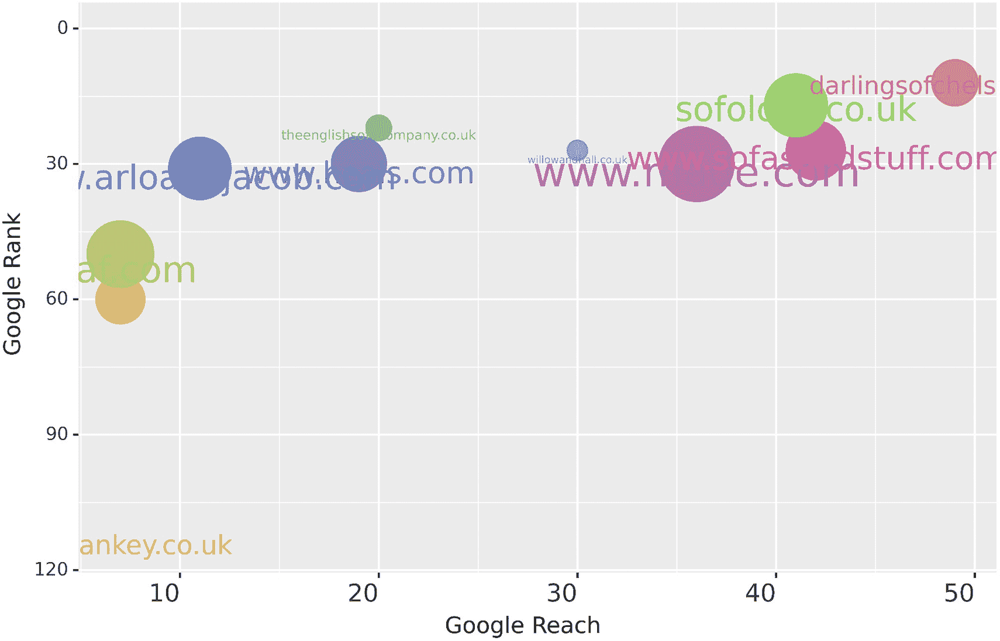

一个气泡图，展示了前十名网站在谷歌排名与谷歌触达量方面的对比。`www.made.com`的气泡最大，触达量为 36，排名为 30。`johnsankey.co.uk`的气泡最小，触达量为 7，排名为 60。

### 图 6-2 气泡图比较了每个网站在谷歌前 10 名（触达量）中的表现及其平均谷歌排名位置。圆圈大小代表每个网站出现查询的搜索结果数量

另一方面，John Sankey 的排名最低，触达量也最少。

仅针对直接竞争对手过滤 SERP 数据，将使数据中的噪声减少：

```python
player_serps = serps_df[serps_df['site'].isin(player_sites_lst)]
player_serps
```

结果如下：


一个包含 1294 行和 175 列的表，表头为`keyword`、`rank`、`url`、`se results count`、`site`、`count`、`token count`、`token size`、`compression`和`connectivity`。数据针对直接竞争对手进行了过滤，`se results count`按升序排列，导致行数从 25000 减少到 1294。

我们最终得到一个行数大幅减少的数据框，从 25000 行减少到 1294 行。尽管机器学习算法通常在 10000 行或更多数据时表现最佳，但这些方法在洞察速度和一致性方面仍然优于在电子表格中手动操作。

我们正在分析最相关的网站，并可以继续收集这些网站的数据。这些将构成我们的假设，进而形成可能的排名因素，用以解释网站之间排名的差异。

网站爬取提供了丰富的数据源，因为它们包含了排名页面的内容和技术 SEO 特征信息，这将是我们的起点。

### 定义导出函数

我们将首先定义一个函数，将用于网站爬取的 URL 导出到 CSV 文件：

```python
def export_crawl(df):
    dom_name = df.domain.iloc[0]
    df = df[['url']]
    df = df[['url']].drop_duplicates()
    df.to_csv('data/1_to_crawl/' + dom_name + '_crawl_urls.csv', index=False)
```

该函数通过`groupby()`函数应用于过滤后的 SERP 数据框：

```python
direct_players_stats.groupby(site).apply(export_crawl)
```

结果如下：

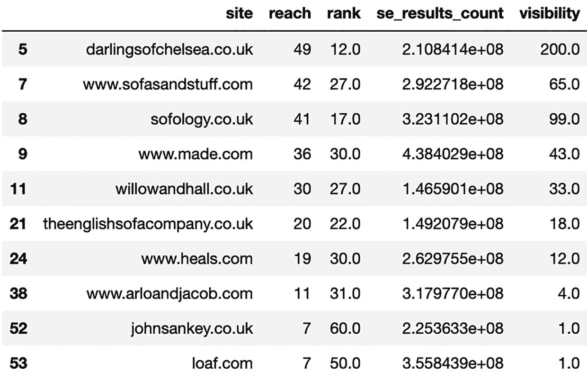

一个包含 11 行和 5 列的表，表头为`site`、`reach`、`rank`、`se results count`和`visibility`，用于网站爬取和去除重复 URL。数据包含每个竞争对手的单个网站，并按`visibility`顺序排列。

### 读取与合并爬取数据

数据爬取完成后，我们可以将导出文件存储在一个文件夹中，然后逐个读取。

在此示例中，我们将文件路径设置为名为`crawl_path`的变量：

```python
crawl_path = 'data/2_crawled/'
crawl_filenames = os.listdir(crawl_path)
crawl_filenames
['www_johnsankey_co_uk.csv',
 'www_sofasandstuff_com.csv',
 'loaf_com.csv',
 'www_designersofas4u_co_uk.csv',
 'www_theenglishsofacompany_co_uk.csv',
 'www_willowandhall_co_uk.csv',
 'www_darlingsofchelsea_co_uk.csv',
 'www_sofology_co_uk.csv',
 'www_arloandjacob_com.csv']
crawl_df_lst = list()
crawl_colnames = list()
```

使用`for`循环遍历网站审计器 CSV 导出文件列表，并将数据读入一个列表：

```python
for filename in crawl_filenames:
    df = pd.read_csv(crawl_path + filename)
    df['sitefile'] = filename
    df['sitefile'] = df['sitefile'].str.replace('_', '.', regex = False)
    df['sitefile'] = df['sitefile'].str.replace('.csv', '', regex = False)
    crawl_colnames.append(df.columns)
    crawl_df_lst.append(df)
```

然后将这个列表`crawl_df_lst`合并成一个数据框：

```python
crawl_raw = pd.concat(crawl_df_lst)
```

通过移除格式并将列名转换为小写，使列名更便于数据处理：

```python
crawl_raw.columns = [col.lower().replace(' ', '_').replace(')', '_').replace('(', '_').replace(',', '_').replace(':', '_').replace('.', '_').replace('__', '_') for col in crawl_raw.columns]
crawl_raw
```

结果如下：

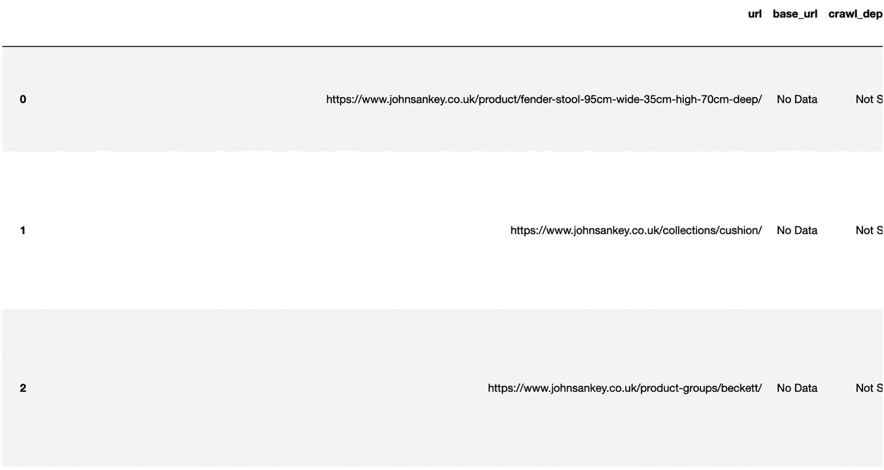

一个包含 4 行和 3 列的表，表头为`url`、`base url`和`crawl depth`，以及选定单个网站的数据。不同产品的 Johnsankey 网站具有不同的`base url`，未显示数据。

### 清理与转换数据

```python
crawl_df = crawl_raw.copy()
```

获取网站名称有助于我们按网站聚合数据。使用列表推导式，我们将遍历数据框的 URL 列，并应用`urisplit()`函数：

```python
crawl_df['site'] = [uritools.urisplit(uri).authority if uritools.isuri(uri) else uri for uri in crawl_df['url']]
```

仅过滤 HTML URL：

```python
crawl_df = crawl_df.loc[crawl_df['content_type'] == 'HTML']
crawl_df
```

结果如下：

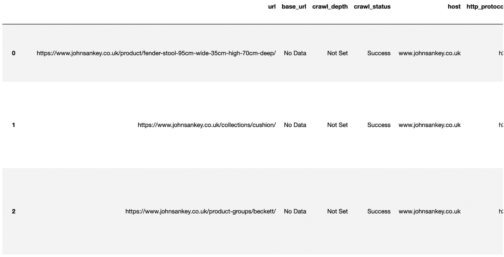

一个包含 4 行和 6 列的表，表头为`URL`、`base url`、`crawl depth`、`crawl status`和`host`。提供的数据之一是`https://www.johnsankey.co.uk/collections/cushion/`，无数据，未设置，成功，以及`www.johnsankey.co.uk`。

使用`.dtypes`属性打印数据类型有助于我们查看哪些列可能需要转换为更可用的数据类型：

```python
print(crawl_df.dtypes)
```

从下面以蓝色高亮显示的打印列表中，我们可以看到存在一些数值变量，它们当前是对象格式，但应为`float64`，因此需要进行转换。

结果如下：

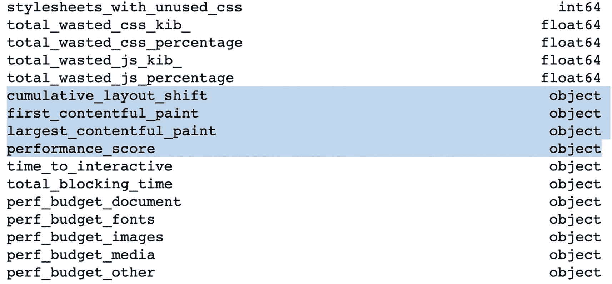

使用`dtypes`函数将计算机数据从一种格式转换为另一种格式的示意图。数据显示`performance_score`和`cumulative_layout_shift`需要从对象格式转换为`float64`格式。

我们将创建数据框的一个副本，以生成一个包含转换后列的新数据框：

```python
cleaner_crawl = crawl_df.copy()
```

从阅读时间开始，我们将使用`np.where()`将"No Data"替换为当前时间格式：

```python
cleaner_crawl['reading_time_mm_ss_'] = np.where(cleaner_crawl['reading_time_mm_ss_'] == 'No Data', '00:00', cleaner_crawl['reading_time_mm_ss_'])
cleaner_crawl['reading_time_mm_ss_'] = '00:' + cleaner_crawl['reading_time_mm_ss_']
```

并将其转换为时间格式：

```python
cleaner_crawl['reading_time_mm_ss_'] = pd.to_timedelta(cleaner_crawl['reading_time_mm_ss_']).dt.total_seconds()
```

我们将其他字符串格式的列转换为浮点数，首先定义要转换的列列表：

```python
float_cols = ['cumulative_layout_shift', 'first_contentful_paint', 'largest_contentful_paint', 'performance_score',
              'time_to_interactive', 'total_blocking_time']
```

使用该列表，我们将应用`apply`列和`to_numeric()`函数来转换这些列：

```python
cleaner_crawl[float_cols] = cleaner_crawl[float_cols].apply(pd.to_numeric, errors='coerce')
```

现在查看最近转换的列：

```python
cleaner_crawl[['url', 'reading_time_mm_ss_'] + float_cols]
```

结果如下：

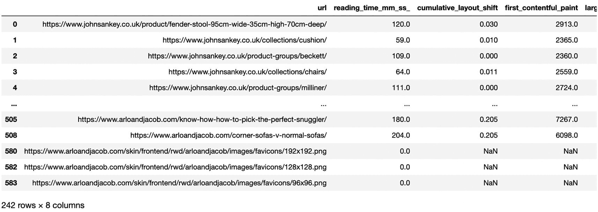

一个包含 242 行和 8 列的表，表头为`URL`、`reading time mm ss`、`cumulative layout shift`和`first contentful paint`。数据显示了 johnsankey 的不同 URL，其中一个网站的阅读时间为 120.0，累积布局偏移为 0.030，首次内容绘制为 2913.0。

列格式已正确。对于更高级的功能，您可能希望尝试根据格式（如博客、指南、类别、子类别、项目等）对不同的内容类型进行分段。

### 导入反向链接权威数据

为了进一步提取特征，我们将导入反向链接权威数据。首先，我们通过读取文件夹中的所有 AHREFs 数据来导入数据：

```python
# read loop files in folder
authority_path = 'data/4_ahrefs/'
authority_filenames = os.listdir(authority_path)
authority_filenames
```

AHREFs 文件列表已准备好，可以迭代处理：

```python
['darlingsofchelsea.co.uk-best-pages-by-links-subdomains-12-Sep-2022_19-17-56.csv',
 'sofology.co.uk-best-pages-by-links-subdomains-12-Sep-2022_19-24-00.csv',
 'sofasandstuff.com-best-pages-by-links-subdomains-12-Sep-2022_19-23-42.csv',
 'willowandhall.co.uk-best-pages-by-links-subdomains-12-Sep-2022_19-17-03.csv',
 'theenglishsofacompany.co.uk-best-pages-by-links-subdomains-12-Sep-2022_19-24-53.csv',
 'arloandjacob.com-best-pages-by-links-subdomains-12-Sep-2022_19-23-19.csv',
 'designersofas4u.co.uk-best-pages-by-links-subdomains-12-Sep-2022_19-16-38.csv',
 'johnsankey.co.uk-best-pages-by-links-subdomains-12-Sep-2022_19-16-04.csv',
 'heals.com-best-pages-by-links-subdomains-12-Sep-2022_19-17-32.csv',
 'loaf.com-best-pages-by-links-subdomains-12-Sep-2022_19-25-17.csv']
```

初始化列表以包含`for`循环的输出：

```python
auth_df_lst = list()
auth_colnames = list()
```

# for 循环使用`read_csv`函数读取数据，将文件名存储为一列（以便我们知道数据来自哪个文件），清理列名，并将数据添加到之前创建的列表中：

```
for filename in authority_filenames:
    df = pd.read_csv(authority_path + filename, encoding = 'UTF-16', sep = '\t')
    df['sitefile'] = filename
    df['sitefile'] = df['sitefile'].str.replace('.csv', '', regex = False)
    df.columns = [x.lower().replace(' ', '_').replace('(', '_').replace(')', '_').replace(' ', '_').
                  replace('__', '_') for x in df.columns]
    df['sitefile'] = df['sitefile'].str.extract('(.*?)\-')
    auth_colnames.append(df.columns)
    print(df['sitefile'][0])
    auth_df_lst.append(df)
```

循环运行完毕后，使用`concat()`函数将这些列表合并成一个数据框：

```
auth_df_raw = pd.concat(auth_df_lst)
auth_df_raw = auth_df_raw.rename(columns = {'page_url': 'url'})
auth_df_raw.drop(['#', 'size', 'code', 'crawl_date', 'language', 'page_title',
                  'first_seen'], axis = 1, inplace = True)
auth_df_raw
```

生成的`auth_df_raw`数据框如下所示，包含网站页面及其反向链接指标。

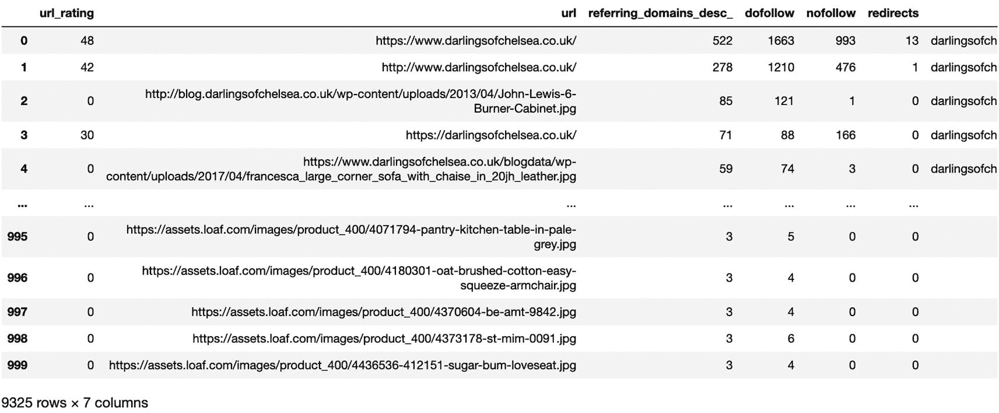

一个包含 9325 行 7 列的数据表，表头为：url 评级、url、引用域名描述、dofollow、nofollow 和按 url 分类的重定向。前 5 条数据显示了 `darlingsofchelsea` 的 url，其中一条 url 的评级为 48，引用域名描述为 522，`dofollow` 为 1663，`nofollow` 为 993，重定向为 13。

## 合并数据

现在，来自各自工具源的数据已导入，可以准备进行合并。通常，数据集之间的公共列（称为“主键”）是 URL，因为这是搜索引擎排名的依据。

我们将从将 SERP 数据与爬取数据合并开始。在此之前，我们只需要包含竞争对手网站的 SERP 数据。

```
player_serps = serps_df[serps_df['site'].isin(player_sites_lst)]
```

通过使用`.merge()`函数实现类似 `VLOOKUP` 的操作，将竞争对手 SERP 数据与排名 URL 的爬取数据合并：

```
player_serps_crawl = player_serps.merge(cleaner_crawl, on = ['url'], how = 'left')
player_serps_crawl = player_serps_crawl.rename(columns = {'site_x': 'site'})
```

使用`.drop()`函数删除不必要的列：

```
player_serps_crawl.drop(['site_y', 'sitefile'], axis = 1, inplace = True)
player_serps_crawl
```

结果如下：

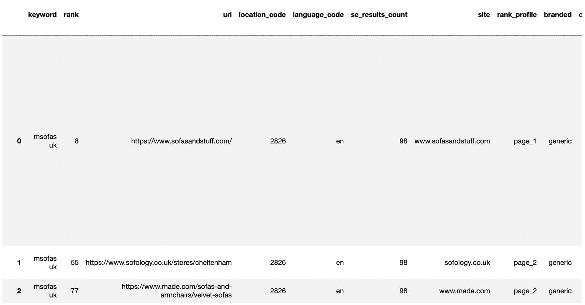

一个包含 4 行 9 列的数据表，表头为：关键词、排名、url、位置代码、语言代码、搜索引擎结果数量、网站、排名概况和品牌化（针对关键词 `msofas uk`）。数据显示了在同一位置和同一语言下的 3 个不同 url 和网站，排名分别为 8、55 和 77。

下一步是使用`merge()`函数将反向链接权威数据与包含 SERP 和爬取指标的数据集合并：

```
player_serps_crawl_auth = player_serps_crawl.copy()
player_serps_crawl_auth = player_serps_crawl_auth.merge(auth_df_raw, on = ['url'], how = 'left')
player_serps_crawl_auth.drop(['sitefile'], axis = 1, inplace = True)
player_serps_crawl_auth
```

数据现已合并，每个 SERP URL 的站内和站外 SEO 数据都存储在一个数据框中：

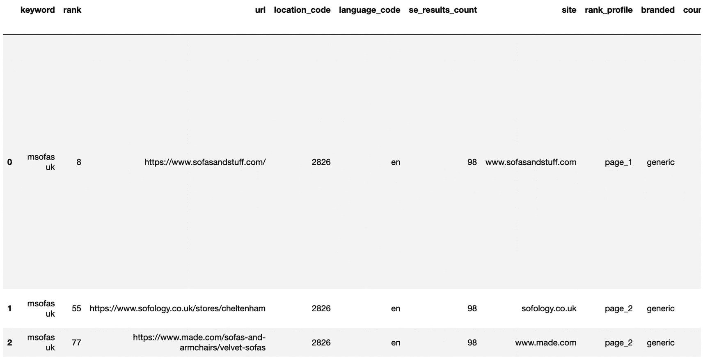

一个包含 4 行 9 列的数据表，表头为：关键词、排名、url、位置代码、语言代码、搜索引擎结果数量、网站、排名概况和品牌化（针对关键词 `msofas uk`）。数据显示了在同一位置和同一语言下的 3 个不同 url 和网站，排名分别为 8、55 和 77。

## 衍生新特征

合并数据的一大好处是，你可以衍生出可能无法从单个数据集中获得的新特征。例如，一个非常有用的特征是，比较标题标签与目标搜索短语的相似度（或差异度）。这使用了爬取数据中排名 URL 的标题标签和 SERP 关键词。这些新特征为我们提供了额外的假设，以便后续使用机器学习过程进行测试。

我们将从创建一个新的数据框开始，并衍生多个新数据特征，这些特征将作为额外的列存储：

```
hypo_serps_features = player_serps_crawl_auth.copy()
```

添加`regional_tld`，用于指示排名 URL 是否进行了区域化：

```
regional_tlds = ['.uk']
hypo_serps_features['regional_tld'] = np.where(hypo_serps_features['site'].str.contains('|'.join(regional_tlds)), 1, 0)
```

使用`sorensen_dice()`函数添加一个指标，用于衡量目标关键词在标题标签中的使用程度：

```
hypo_serps_features['title'] = hypo_serps_features['title'].astype(str)
hypo_serps_features['title_relevance'] = hypo_serps_features.loc[:, ['title', 'keyword']].apply(
    lambda x: sorensen_dice(*x), axis=1)
```

我们还对衡量标题标签与 H1 标题一致性的影响程度感兴趣：

```
hypo_serps_features['h1'] = hypo_serps_features['h1'].astype(str)
hypo_serps_features['title_h1'] = hypo_serps_features.loc[:, ['title', 'h1']].apply(
    lambda x: sorensen_dice(*x), axis=1)
```

标题标签中是否包含品牌名称重要吗？让我们来一探究竟：

```
hypo_serps_features['site'] = hypo_serps_features['site'].astype(str)
hypo_serps_features['hostname'] = hypo_serps_features['site'].apply(lambda x: extract(x))
hypo_serps_features['hostname'] = hypo_serps_features['hostname'].str.get(1)
hypo_serps_features['title'] = hypo_serps_features['title'].str.lower()
hypo_serps_features['title_branded'] = hypo_serps_features.loc[:,
                                        ['title', 'hostname']].apply(
    lambda x: sorensen_dice(*x), axis=1)
```

另一个有用的特征是 URL 参数，即排名 URL 中的问号：

```
hypo_serps_features['url_params'] = np.where(hypo_serps_features['url'].str.contains('\?'), '1', '0')
hypo_serps_features['url_params'] = hypo_serps_features['url_params'].astype('category')
```

# 数据特征工程与预处理

另一个测试是排名 URL 是否包含 Google Analytics 代码。这不太可能产生什么影响，但如果数据可用，何乐而不为呢？

```python
hypo_serps_features['google_analytics_code'] = np.where(hypo_serps_features[
'google_analytics_code'].str.contains('UA'), '1', '0')
hypo_serps_features['google_analytics_code'] = hypo_serps_features['google_analytics_code'].astype('category')
```

Google Tag Manager 代码也是如此：

```python
hypo_serps_features['google_tag_manager_code'] = np.where(
hypo_serps_features['google_tag_manager_code'].str.contains('GTM'), '1', '0')
hypo_serps_features['google_tag_manager_code'] = hypo_serps_features['google_tag_manager_code'].astype('category')
```

虽然跟踪代码本身不太可能解释排名差异，但同一跟踪代码的重复实例可能具有解释力：

```python
hypo_serps_features['google_tag_manager_code_second_'] = np.where(
hypo_serps_features['google_tag_manager_code_second_'].str.contains('GTM'), '1', '0')
hypo_serps_features['google_tag_manager_code_second_'] = hypo_serps_features[
'google_tag_manager_code_second_'].astype('category')
```

添加了一个缓存控制测试，用于检查其是私有、公共还是其他类型，并将其转换为类别。

```python
hypo_serps_features['cache_privacy'] = np.where(
hypo_serps_features['cache-control'].str.contains('private'), 'private', '0')
hypo_serps_features['cache_privacy'] = np.where(
hypo_serps_features['cache-control'].str.contains('public'), 'public', hypo_serps_features['cache_privacy'])
hypo_serps_features['cache_privacy'] = np.where(
hypo_serps_features['cache-control'].str.contains('0'), 'other', hypo_serps_features['cache_privacy'])
hypo_serps_features['cache_privacy'] = hypo_serps_features['cache_privacy'].astype('category')
```

此外，还通过提取 `cache-control` 字符串中的数值部分添加了缓存年龄。这是通过按 `=` 号分割字符串，然后使用 `.get()` 函数，再转换为数值浮点数据类型来实现的：

```python
hypo_serps_features['cache_age'] = hypo_serps_features['cache-control'].str.split('\=')
hypo_serps_features['cache_age'] = hypo_serps_features['cache_age'].str.get(-1)
hypo_serps_features['cache_age'] = np.where(hypo_serps_features['cache_age'].isnull(), 0,
hypo_serps_features['cache_age'])
hypo_serps_features['cache_age'] = np.where(hypo_serps_features['cache_age'].str.contains('[a-z]'),
0, hypo_serps_features['cache_age'])
hypo_serps_features['cache_age'] = hypo_serps_features['cache_age'].astype(float)
```

以下是一个测试排名 URL 是否为规范 URL 的代码：

```python
hypo_serps_features['self_canonicalised'] = np.where(hypo_serps_features[
'canonical_url'] == hypo_serps_features['url'], 1, 0)
```

我们删除了诸如 `canonical_url` 之类的标识符，因为这些是标识单行的个体记录，对分析没有任何帮助。我们只对这个独特数据值本身的特征或趋势感兴趣。

我们还删除了可能冗余或不感兴趣的假设，例如 HTTP 协议。这取决于你自己的 SEO 经验和判断。

```python
hypo_serps_features.drop(['cache-control', 'canonical_url', 'base_url', 'crawl_status', 'host', 'encoding', 'indexable_status', 'meta_robots_response_', 'title', 'title_response_', 'title_second_', 'title_render_status', 'meta_description', 'meta_description_response_',  'h1', 'h1_second_', 'h2', 'h2_second_', 'open_graph_audio', 'twitter_card_site', 'twitter_card_creator', 'twitter_card_description', 'twitter_card_image_url', 'twitter_card_title', 'content-security-policy', 'referrer-policy', 'hostname', 'open_graph_description', 'open_graph_image_url', 'open_graph_locale', 'open_graph_site_name', 'open_graph_title' , 'open_graph_url', 'meta_robots_rendered_', 'twitter_card_description', 'twitter_card_title', 'http_protocol', 'http_status_code' ], axis = 1, inplace = True)
```

完成后，我们将创建另一个数据框副本并导出为 CSV，为机器学习做准备，从单层因子开始：

```python
hypo_serps_pre_slf = hypo_serps_features.copy()
hypo_serps_pre_slf.to_csv('data/'+ geo_market +'_hypo_serps_pre_slf.csv', index = False)
hypo_serps_pre_slf
```

结果如下：

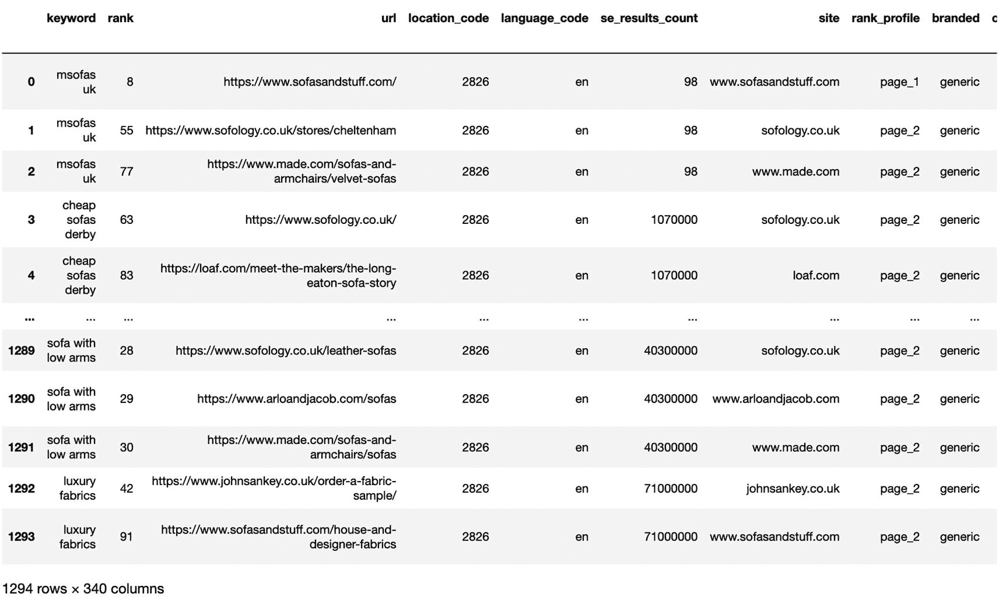

一个包含 1294 行和 340 列的表，表头为关键词、排名、URL、位置代码、语言代码、搜索结果数量、网站、排名概况，以及按关键词分类的品牌化。数据中展示了同一位置、语言和品牌下的不同 URL 和网站。

### 单层因子 (SLFs)

单层因子是指任何列中所有值都相同的情况，这不仅冗余，还会导致机器学习代码失败。例如，所有排名 URL 的标题可能都是品牌化的，在这种情况下，这些列应该被移除。

为了移除 SLF，我们将逐列遍历数据框，识别出包含 70% 或更多相同值的列，并将这些列名存储在一个列表中。70% 是一个任意阈值；你可以选择 80% 或 90%；然而，这可能会带来移除一些有洞察力的排名因子的风险——即使这些因子只适用于少数 URL，而这些 URL 可能恰恰是排名最高的 URL。

```python
slf_cols = []
slf_limit = .7
for col in hypo_serps_pre_slf.columns:
if hypo_serps_pre_slf[col].value_counts().iat[0] >= (hypo_serps_pre_slf.shape[0] * slf_limit):
slf_cols.append(col)
slf_cols
```

包含 70% 相同数据的列打印如下，并将从数据集中移除：

```python
['location_code',
'language_code',
'rank_profile',
'branded',
'count',
'crawl_depth',
'is_subdomain',
'no_query_string_keys',
'query_string_contains_filtered_parameters',
'query_string_contains_more_than_three_keys',
'query_string_contains_paginated_parameters',
'query_string_contains_repetitive_parameters',
'query_string_contains_sorted_parameters',
'scheme',...
```

让我们使用 `groupby()` 函数检查其中几个 SLF 排名因子。从 `branded` 开始，我们可以看到所有排名 URL 的标题都是品牌化的，因此这些可以移除：

```python
hypo_serps_pre_slf.groupby('branded')['count'].sum().sort_values()
branded
generic    1294
Name: count, dtype: int64
hypo_serps_pre_slf.groupby('url_params')['count'].sum().sort_values
```

参数化 URL 似乎也是冗余的，只有 17 个 URL 是参数化的。然而，这些可能仍会以意想不到的方式提供洞察。

识别出 SLF 后，我们将在新的数据框中处理它们，使用列表推导式将其移除：

```python
hypo_serps_pre_mlfs = hypo_serps_pre_slf.copy()
```

要移除的列列表需要进一步细化，因为我们希望保留前面提到的 `url_params` 列以及 `count` 列，以便在后续过程中进行进一步聚合：

```python
slf_cols = [elem for elem in slf_cols if not elem in ['count', 'url_params']]
```

删除 SLF 列：

```python
hypo_serps_pre_mlfs.drop(slf_cols, axis = 1, inplace = True)
hypo_serps_pre_mlfs
```

生成的 `hypo_serps_pre_mlfs` 数据框已移除 SLF 列：

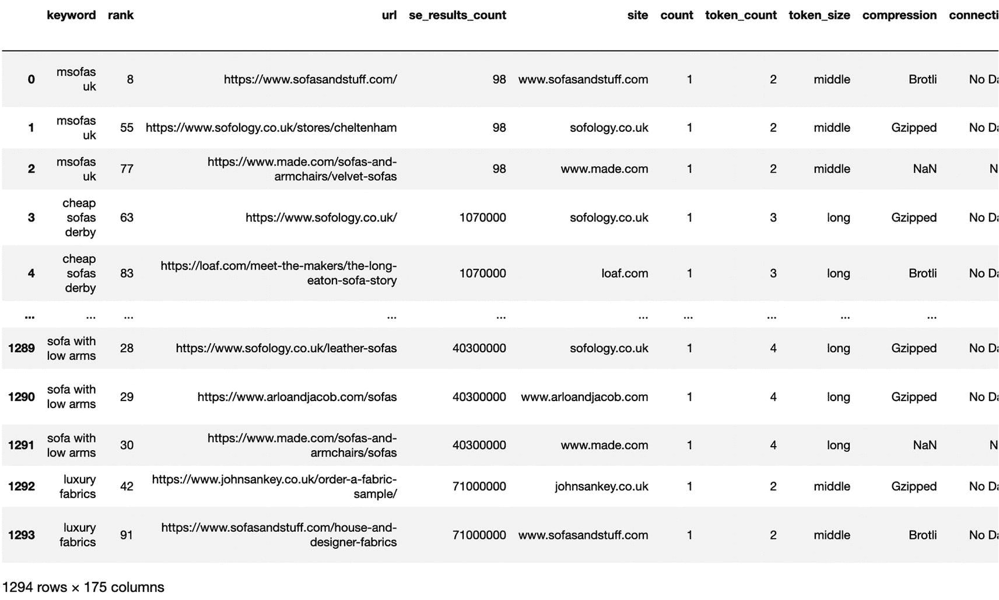

一个包含 1294 行和 175 列的表，表头为关键词、排名、URL、搜索结果数量、网站、计数、令牌计数、令牌大小，以及用于关键词分类的压缩。数据展示了不同的排名网站和 URL，令牌计数范围为 2 到 4，令牌大小为中等和长，压缩方式为 brotli、gzipped 和 nan。

### 重新缩放数据

无论你使用的是线性回归等线性模型还是决策树，两者都能从数据重新缩放中受益，因为数据变得“标准化”，使得机器学习在比较排名与页面速度等因素时更容易检测到变化：

```python
hypo_serps_preml_prescale = hypo_serps_pre_mlfs.copy()
```

使用 `.dtypes` 将列分为数值列和非数值列，以便重新缩放数值列：

```python
hypo_serps_preml_num = hypo_serps_preml_prescale.select_dtypes(include=np.number)
hypo_serps_preml_num_colnames = hypo_serps_preml_num.columns
```

非数值列保存到另一个数据框中，用于后续合并：

```python
hypo_serps_preml_nonnum = hypo_serps_preml_prescale.select_dtypes(exclude=np.number)
hypo_serps_preml_num
```

生成的 `hypo_serps_preml_num` 如下所示，仅包含数值列，已准备好进行重新缩放：

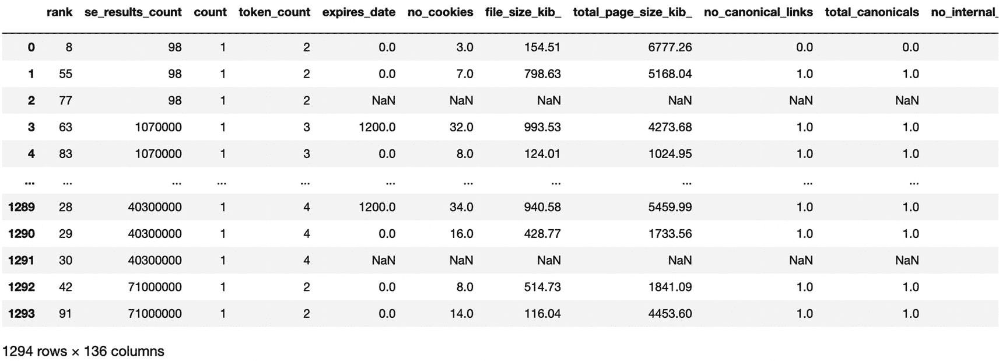

一个包含 1294 行和 136 列的表，表头为`rank`、`se_results_count`、`count`、`token_count`、`expires_date`、`no_cookies`、`file_size_kib`、`total_page_size_kib`、`no_canonical_links`、`total_canonicals`和`no_internal`。所有字段的数据均为数值型。

我们将使用`sklearn` API 预处理函数中的`MinMaxScaler()`：

```python
from sklearn import preprocessing
```

将列值转换为`numpy`数组，然后使用`MinMaxScaler()`函数重新缩放数据：

```python
x = hypo_serps_preml_num.values
min_max_scaler = preprocessing.MinMaxScaler()
x_scaled = min_max_scaler.fit_transform(x)
hypo_serps_preml_num_scaled = pd.DataFrame(x_scaled, index=hypo_serps_preml_num.index, columns = hypo_serps_preml_num_colnames)
hypo_serps_preml_num_scaled
```

结果如下：

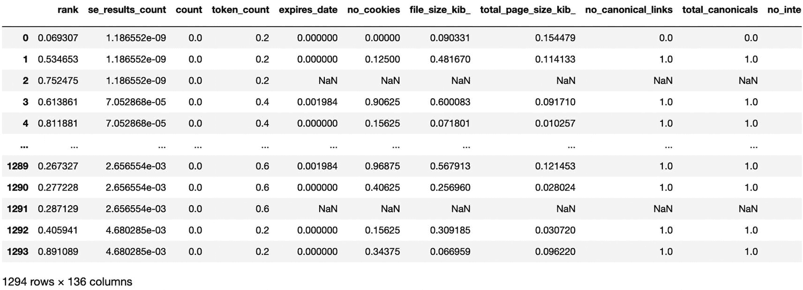

一个包含 1294 行和 136 列的表，表头为`rank`、`se_results_count`、`count`、`token_count`、`expires_date`、`no_cookies`、`file_size_kib`、`total_page_size_kib`、`no_canonical_links`和`total_canonicals`。列中的数据以`numpy`数组形式呈现，例如`rank`为`0.069307`、`count`为`0.0`、`token_count`为`0.2`、`no_cookies`为`0.12500`、`file_size`为`0.481670`。

### 近零方差（NZVs）

下一步是消除与SLFs相似的冗余数值数据列，这些列被称为近零方差（NZVs）。虽然数值不同，但可能没有足够的变异来可靠地解释排名位置的差异，因此我们希望移除这些列。

为了识别NZVs，我们将使用`sklearn` API中的`VarianceThreshold`函数：
```python
from sklearn.feature_selection import VarianceThreshold
variance = hypo_serps_preml_num_scaled.var()
columns = hypo_serps_preml_num_scaled.columns
```

保存方差大于阈值的变量名称：
```python
highvar_variables = [ ]
nz_variables = [ ]
```

我们将遍历数值列，将阈值设置为7%，即数据中必须至少有7%的变异才能保留在数据集中。同样，7%是一个任意选择。高变异列存储在我们之前创建的`highvar_variables`列表中：
```python
for i in range(0,len(variance)):
if variance[i]>=0.07:
highvar_variables.append(columns[i])
else:
nz_variables.append(columns[i])
highvar_variables
```

`highvar_variables`如下所示：
```python
['rank',
'no_canonical_links',
'total_canonicals',
'no_internal_followed_linking_urls',
'no_internal_followed_links',
'no_internal_linking_urls',
'no_internal_links_to_url',
'url_rank', ...]
nz_variables
```

结果如下：
```python
['se_results_count',
'count',
'token_count',
'expires_date',
'no_cookies',
'file_size_kib_',
'total_page_size_kib_', ...]
```

识别并存储在`nz_variables`中的NZVs如上所示。我们可以看到，例如，更多的网页在搜索查询中的关键词数量（`token_count`）和HTML页面大小（`total_page_size_kib_`）上具有高度相似的值，因此我们很乐意移除这些列。

这是一个快速的合理性检查，以确保没有列同时被列为高变异和NZV：
```python
[x for x in highvar_variables if x in nz_variables]
```
返回一个空列表，因此幸运的是没有交叉：
```python
[]
```

让我们检查一下识别出的几个NZV列。尽管被识别为NZV，但`title_relevance`仍有一些变异，如下所示使用`describe()`函数。我们可以看到数据范围从0到1，四分位距为0.32到0.62，当然这是在重新缩放之后。根据SEO经验，我们将保留`title_relevance`，因为它是一个重要的排名因素：
```python
hypo_serps_preml_num_scaled['title_relevance'].describe()
```

结果如下：
```python
count    1294.000000
mean        0.478477
std         0.199106
min         0.000000
25%         0.323529
50%         0.512712
75%         0.622487
max         1.000000
Name: title_relevance, dtype: float64
```

另一方面，`scaled_images`列是NZV，如下所示，大多数值为零，直到第75百分位数的0.17，显示出非常小的变异，因此应排除：
```python
hypo_serps_preml_num_scaled['scaled_images'].describe()
```

结果如下：
```python
count    977.000000
mean       0.114348
std        0.163530
min        0.000000
25%        0.000000
50%        0.000000
75%        0.179487
max        1.000000
Name: scaled_images, dtype: float64
```

我们将重新定义`highvar_variables`列表，以包含我们认为应保留在数据集中的一些NZVs：
```python
highvar_variables = highvar_variables + ['title_relevance', 'title_branded', 'no_content_words', 'first_contentful_paint', 'scaled_images', 'no_outgoing_links']
```

保存一个新的数据框，仅包含`highvar_variables`中列出的列：
```python
hypo_serps_preml_num_highvar = hypo_serps_preml_num_scaled[highvar_variables]
hypo_serps_preml_num_highvar
```

`hypo_serps_preml_num_highvar`数据框如下所示，已从136列减少到38列，移除了98列。

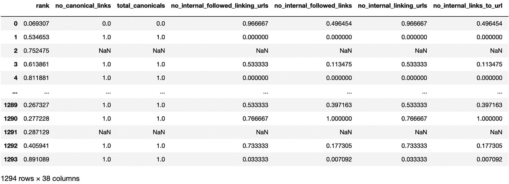

一个包含1294行和38列的表，表头为`rank`、`no_canonical_links`、`total_canonicals`、`no_internal_followed_linking_urls`、`no_internal_followed_links`、`no_internal_linking_urls`和`no_internal_links_to_url`。一行中显示的数据分别为`0.069307`、`0.0`、`0.0`、`0.966667`、`0.496454`、`0.966667`和`0.496454`。

接下来，我们还将使用`statsmodels` API中的`variance_inflation_factor()`函数来检测较大的方差膨胀因子（VIF），从而移除彼此高度相关的排名因素（称为多重共线性）。多重共线性是一个问题，因为它会降低用于建模搜索结果排名的排名特征的统计显著性。

排名特征或任何建模变量上的较大方差膨胀因子（VIF）暗示着与其他排名因素的高度相关关系。移除这些变量将提高模型的预测一致性，即在做出预测时更稳定且误差更小。
```python
from statsmodels.stats.outliers_influence import variance_inflation_factor
```

移除包含缺失值（`np.nan`）和无穷值（`np.inf`、`-np.inf`）的行：
```python
vif_input = hypo_serps_preml_num_highvar[~hypo_serps_preml_num_highvar.isin([np.nan, np.inf, -np.inf]).any(1)]
```
存储在`X_variables`中。
```python
X_variables = vif_input
```

通过应用`variance_inflation_factor()`函数确定高度相关的列：
```python
vif_data = pd.DataFrame()
vif_data["feature"] = X_variables.columns
vif_data["vif"] = [variance_inflation_factor(X_variables.values, i) for i in range(len(X_variables.columns))]
vif_data.sort_values('vif')
```

使用`describe()`函数打印VIF数据分布，以了解列间相关性的水平，并将其作为我们拒绝列的标准：
```python
vif_data['vif'].describe()
```

结果如下：
```python
count      38.000000
mean             inf
std              NaN
min         3.254763
25%        26.605281
50%        76.669063
75%      3504.833113
max              inf
Name: vif, dtype: float64
```

在确定了VIF范围后，我们将丢弃任何VIF高于中位数的排名因素。从技术上讲，最佳实践是VIF为5或以上即为高度相关；然而，在这种情况下，我们只是希望移除过度相关的排名因素，这仍然是一种改进：
```python
hypo_serps_preml_lowvif = hypo_serps_preml_num_highvar.copy()
vif_exclude_df = vif_data.loc[vif_data['vif'] > vif_data['vif'].median()]
vif_exclude_cols = vif_exclude_df['feature'].tolist()
hypo_serps_preml_lowvif.drop(vif_exclude_cols, inplace = True, axis = 1)
hypo_serps_preml_lowvif
```

我们现在已经从38列减少到了19列。正如你可能已经逐渐意识到的那样，机器学习并非简单地将数字代入就能得到结果，因为必须做大量工作才能将数据整理成可用的格式。

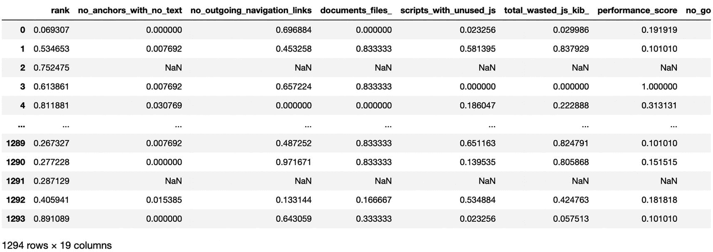

一个包含1294行和19列的数据表，表头为`rank`，无锚点文本，无出站导航链接，包含文档文件、脚本（含未使用的JS）、总计浪费的JS资源（KB）以及性能评分。`rank`为0.69307时显示的数据依次为0.000000、0.696884、0.000000、0.023256、0.029986、0.191919；`rank`为0.752475时，各列数据均为`NaN`。

### 中位数填充

我们希望尽可能多地保留数据行，因为任何列中存在缺失值的行都将被移除。一种技术是使用中位数填充，即估算给定数据列的中位数来替换缺失值。当然，由于我们是在不同站点之间进行比较，在领域级别而非整个列上计算中位数可能更有意义。因此，在可能的情况下，我们将在领域级别使用中位数填充，否则在列级别使用。

导入库以检测`for`循环中使用的数据类型，从而识别非数值列以进行中位数填充：
```
from pandas.api.types import is_string_dtype
from pandas.api.types import is_numeric_dtype
hypo_serps_preml_median = hypo_serps_preml_lowvif.copy()
```

设置变量，以便`for`循环可以对整个列以及在领域级别（`"site"`）执行`groupby()`操作：
```
hypo_serps_preml_median['site'] = hypo_serps_preml_prescale['site']
hypo_serps_preml_median['project'] = 'competitors'
for col, col_val in hypo_serps_preml_median.iteritems():
if col in ['http_status_code'] or not is_numeric_dtype(hypo_serps_preml_median[col]):
continue
hypo_serps_preml_median[col].fillna(hypo_serps_preml_median.groupby('site')[col].transform('median'), inplace=True)
hypo_serps_preml_median[col].fillna(hypo_serps_preml_median.groupby('project')[col].transform('median'), inplace=True)
hypo_serps_preml_median.drop(['site', 'project'], axis = 1, inplace = True)
hypo_serps_preml_median
```

结果是一个缺失值更少的数据框，提高了数据保留率。

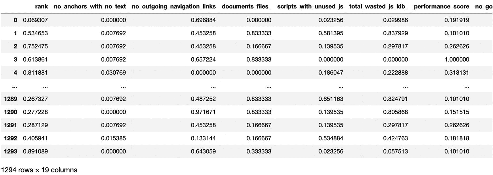

一个包含1294行和19列的数据表，表头为`rank`，无锚点文本，无出站导航链接，包含文档文件、脚本（含未使用的JS）、总计浪费的JS资源（KB）以及性能评分。`rank`为0.752475时显示的数据不再是`NaN`，而是依次为0.007692、0.453258、0.166667、0.139535、0.297817和0.262626。

### 独热编码

独热编码是一种帮助统计模型将分类数据转换为它们更容易解释的二进制格式（0和1）的技术。它通过为给定分类数据列的每个值创建额外的列来实现这一点。然后根据数据点，在相应的列中分配值为1或0。这里不举例说明，我们将直接运行代码，结果在生成的数据框中应该显而易见。

我们不想为关键词和URL等列创建独热编码，因为它们不是排名因素，因此我们将从数据框中删除这些列：
```
stop_cols = ['keyword', 'url', 'site']
hypo_serps_preml_cat = hypo_serps_preml_nonnum.drop(stop_cols, axis = 1)
```

将分类数据列存储在一个列表中：
```
categorical_cols = hypo_serps_preml_cat.columns.tolist()
```

使用列表推导式更新`categorical_cols`列表，确保排除停止列：
```
categorical_cols = [feat for feat in categorical_cols if feat not in stop_cols]
categorical_cols
```

以下是即将进行独热编码的分类列：
```
['token_size',
'compression',
'connection',
'charset',
'canonical_status',
'canonical_url_render_status',
'flesch_kincaid_reading_ease',
'sentiment',
'contains_paginated_html', ... ]
hypo_serps_preml_cat
```

以下是仅选择了独热编码列的数据框。

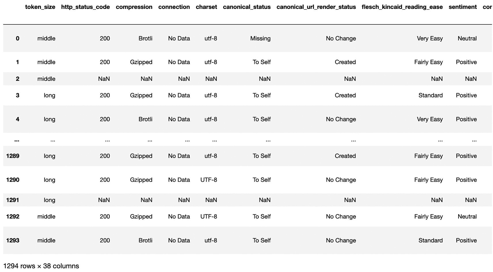

一个包含1294行和38列的数据表，表头为`token size`、`http status code`、`compression`、`connection`、`charset`、`canonical status`、`canonical url render status`、`flesch kincaid reading ease`和`sentiment`。数据读取为：middle或long、200或`NaN`、brotli、gzipped或`NaN`、no data或`NaN`、utf-B或`NaN`、missing、to self或`NaN`、no change、created或`NaN`、very easy、fairly easy、standard或`NaN`，以及neutral、positive或`NaN`。

将使用`get_dummies()`为每个分类排名因素创建独热编码列：
```
hypo_serps_preml_ohe = pd.get_dummies(hypo_serps_preml_cat, columns = categorical_cols)
hypo_serps_preml_ohe
```

结果如下：

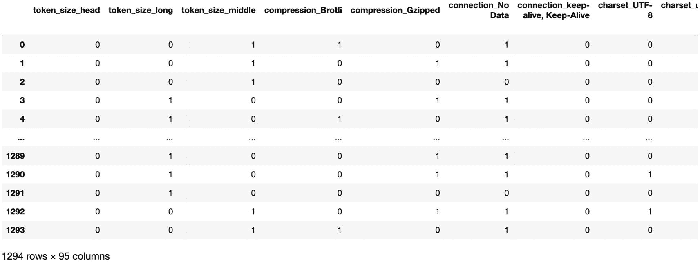

一个包含1294行和95列的数据表，表头为`token size head`、`token size long`、`token size middle`、`compression brotli`、`compression gzipped`、`connection nodata`、`connection keep alive`、`keep alive`和`charset UTF`。列中的数据填充为0或1。

通过独热编码，分类列已从38列扩展到95列。例如，`compression`列已被两个新列`compression_Brotli`和`compression_Gzipped`替代，因为该排名因素只有两个值。

## 消除缺失值

在清理和转换了数值和分类数据列之后，我们现在准备合并数据并消除缺失值。

使用 `concat()` 合并数据框：

```
hypo_serps_preml_ready = pd.concat([hypo_serps_preml_ohe, hypo_serps_preml_median], axis = 1)
hypo_serps_preml_ready
```

数据框现在合并为一个名为 `"hypo_serps_preml_ready"` 的单一数据框。

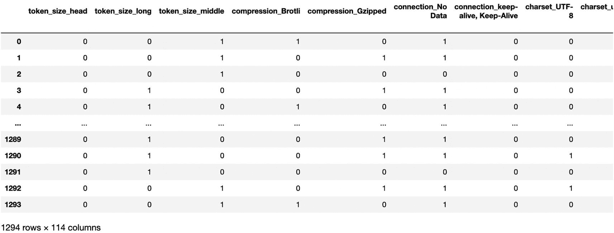

一个包含 1294 行和 114 列的数据表，表头为 `token size head`、`token size long`、`token size middle`、`compression brotli`、`compression gzipped`、`connection nodata`、`connection keep alive`、`keep alive` 和 `charset UTF`。列中的数据填充为 0 或 1。

下一个准备步骤是消除 `"NA"` 值，因为机器学习算法不太能处理单元格值为“不可用”的情况。

首先，通过计算每列空值的总和并除以总行数，检查哪些列包含一定比例的缺失值：

```
percent_missing = hypo_serps_preml_ready.isnull().sum() * 100 / len(hypo_serps_preml_ready)
```

我们将缺失数据的计算结果放入一个单独的数据框，然后对值进行排序：

```
missing_value_df = pd.DataFrame({'column_name': hypo_serps_preml_ready.columns,
'percent_missing': percent_missing})
missing_value_df.sort_values('percent_missing')
```

我们可以看到没有列包含缺失值，这是个好消息，可以进入下一阶段。如果存在缺失值，这些列将被移除，因为我们已经尽力改进了数据以达到目前的状态。

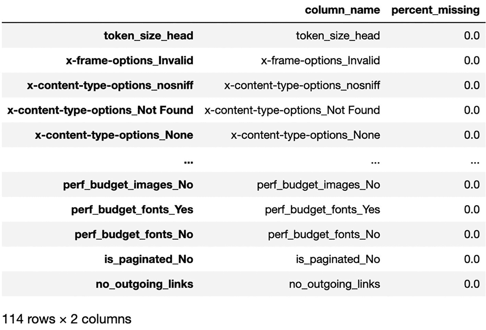

一个包含 114 行和 2 列的数据表，表头为 `column name` 和 `percent missing`。数据中没有包含缺失值的列。所有列的缺失百分比均为 0.0。

## 对 SERP 进行建模

快速提醒一下，对 SERP 进行建模是一个公式，它将根据 SEO 特征预测排名，即：

```
rank ~ w_1*feature_1 + w_2*feature_2 + … + w_n*feature_n
```

`~` 表示“由……解释”。`n` 是第 n 个特征。`w` 是特征的权重。

以下是一些值得提及的要点：

*   将数据集拆分为测试集（20%）和训练集（80%）。模型将从大部分数据集（训练集）中学习，并应用于测试集（模型之前未见过的数据）。我们这样做是为了了解模型在真实场景中的实际表现。

我们将使用基于决策树的模型，即随机森林。随机森林使用多个决策树并取所有决策树的平均值，以得到最终最能泛化数据集的模型，因此很可能在未见数据上表现良好。随机森林还可以处理线性模型无法处理的非线性关系。

设置随机种子是为了控制模型的随机性，使结果可重现，以便其他 SEO/数据科学家可以使用相同的数据评估研究并得到相同的结果。

将使用交叉验证来使模型尽可能稳健，且不进行超参数调优。

通常，随机森林模型（或任何机器学习模型）在拥有 10,000 行或更多数据时表现最佳，但数据量少得多时仍能提供有价值的见解。

导入相关的 API 和库，这些主要来自 `scikit-learn`，一个用于 Python 的免费机器学习软件库：

```
from sklearn.model_selection import cross_val_score
from sklearn.model_selection import RepeatedKFold
from sklearn.ensemble import RandomForestRegressor
from sklearn.model_selection import train_test_split
from sklearn.preprocessing import StandardScaler
import category_encoders as ce
from sklearn import metrics
hypo_serps_ml = hypo_serps_preml_ready.copy()
```

对数据进行编码：

```
encoder = ce.HashingEncoder()
serps_features_ml_encoded = encoder.fit_transform(hypo_serps_ml)
serps_features_ml_encoded
```

结果如下：

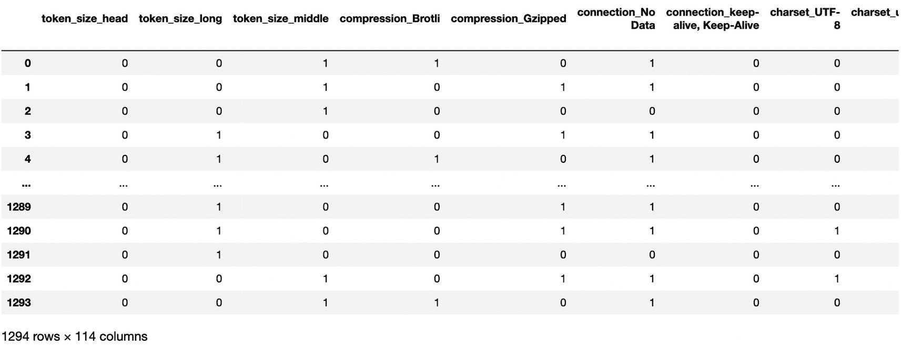

一个包含 1294 行和 114 列的表，表头为 `token size head`、`token size long`、`token size middle`、`compression brotli`、`compression gzipped`、`connection nodata`、`connection keep alive`、`keep alive` 和 `charset UTF`。数据在列中重复相同的值，值为 0 或 1。

将目标变量设置为 `rank`，这是我们希望解释并指导 SEO 建议的结果：

```
target_var = 'rank'
```

将排名因子数据分配给 `X`，将 `rank` 分配给 `y`：

```
X, y = serps_features_ml_encoded.drop(target_var, axis=1), serps_features_ml_encoded[target_var]
```

为了训练模型，我们使用 `RandomForestRegressor`，因为它往往比线性回归模型提供更好的结果。您可以并行尝试的替代方案包括 `XGBoost`、`LightGBM`（尤其适用于更大的数据集）和 `AdaBoost`。

实例化模型：

```
regressor = RandomForestRegressor(n_estimators=20, random_state=1231)
```

对模型进行交叉验证。当模型进行交叉验证时，实际上是通过进一步划分训练数据集来评估模型，以查看模型在所有训练数据上的泛化能力，并希望也能泛化到真实世界。

在我们的案例中，我们将模型分割五次，并将结果存储在 `n_scores` 中：

```
n_scores = cross_val_score(regressor, X, y, scoring='neg_mean_absolute_error', cv=5, n_jobs=-1)
n_scores
```

将数据随机分割为训练集和测试集：

```
X_train, X_test, y_train, y_test = train_test_split(X, y, test_size=0.2, random_state=1231)
```

基于训练集拟合机器学习模型：

```
regressor.fit(X_train, y_train)
```

在测试数据集上测试模型，并将预测结果存储到 `y_pred` 中：

```
y_pred = regressor.predict(X_test)
```

## 评估 SERPs ML 模型

现在我们有了模型，可以测试其有效性。一般原则是：

*   向 `predict` 命令提供测试数据集和模型
*   计算均方根误差（RMSE）和 `r-squared`

由于排名建模和预测是一个回归问题，我们使用 `RMSE` 和 `r-squared` 作为评估指标。那么它们告诉我们什么？
`RMSE` 告诉我们预测排名的平均误差范围。例如，`RMSE` 为 5 意味着模型预测的排名位置平均会与真实值相差±5。
`r-squared` 的正式名称为“决定系数”。这意味着什么？实际上，`r-squared` 表示数据集中可以被模型解释的数据点比例。它通过取相关系数（`r`）的平方来计算，因此得名 `r-squared`。`r-squared` 为 0.4 意味着 40%的数据可以被模型解释。
要警惕 `r-squared` 为 1 或任何接近 1 的模型，尤其是在 SEO 中。很可能代码中存在错误，或者模型过拟合，或者您为 Google 工作。无论如何，您都需要调试。

`r-squared` 远不如 `RMSE` 有用，因此我们在此不详细讨论。但是，如果您仍然想了解 `r-squared`，可以通过运行以下命令查看训练模型（即基于训练数据）的 `r-squared`：

```
print('MAE: %.3f (%.3f)' % (np.mean(n_scores), np.std(n_scores)))
print('Mean Absolute Error:', metrics.mean_absolute_error(y_test, y_pred))
print('Mean Squared Error:', metrics.mean_squared_error(y_test, y_pred))
print('Root Mean Squared Error:', np.sqrt(metrics.mean_squared_error(y_test, y_pred)))
MAE: -0.222 (0.010)
Mean Absolute Error: 0.23340777636881724
Mean Squared Error: 0.0861631648297419
Root Mean Squared Error: 0.2935356278712039
```

您可能想知道这些指标的良好或合理值是多少。事实是，这取决于您需要模型有多好以及您打算如何使用它。
如果您打算将模型用作自动化 SEO 系统的一部分，该系统将直接对您的内容管理系统（CMS）进行更改，那么 `RMSE` 需要非常准确，因此可能不超过五个排名位置。即便如此，这也取决于您排名的起始位置，因为对于已经在第一页排名的页面来说，五个位置的差异与在第三页排名的页面相比，意义完全不同！
如果模型的预期用例仅仅是深入了解驱动排名的因素，以及您应该优先进行 A/B 测试或优化的内容，那么 `RMSE` 为 20 或更小是可以接受的。

## 排名的最具预测性驱动因素

那么机器学习模型能告诉我们什么秘密？我们将提取排名因子和模型重要性数据到一个数据框中：

```
df_imp = pd.DataFrame({"feature": X.columns.values,
"importance": regressor.feature_importances_,
})
df_imp = df_imp.sort_values('importance', ascending = False)
df_imp = df_imp
df_imp
```

以下数据框结果显示了按重要性降序排列的最具影响力的 SERP 特征或排名因子。

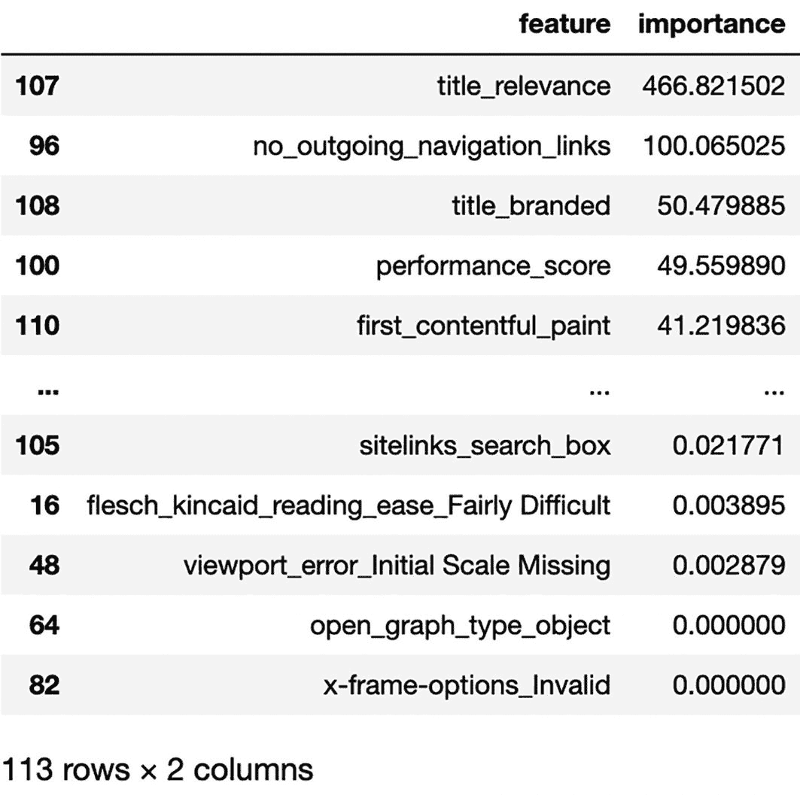

一个包含 113 行和 2 列的表，列名为 `feature` 和 `importance`，显示了影响数据的 SERP 特征。数据读取 `title relevance` 具有高重要性 `466.821502`，而 `viewport error initial scale missing` 具有最小重要性 `0.002879`。

使用 `plotnine` 库将重要性数据绘制成条形图：

```
RankFactor_plt = (ggplot(df_imp.head(7), aes(x = 'reorder(feature, importance)', y = 'importance')) +
geom_bar(stat = 'identity', fill = 'blue', alpha = 0.6) +
labs(y = 'Google Influence', x = '') +
theme_classic() +
coord_flip() +
theme(legend_position = 'none')
)
RankFactor_plt.save(filename = 'images/1_RankFactor_plt.png', height=5, width=5, units = 'in', dpi=1000)
RankFactor_plt
```

# 本章小结

在此特定案例中，图 6-3 显示，最重要的因素是 `title_relevance`，它衡量的是标题标签与目标关键词之间的字符串距离。这是通过字符串重叠度来衡量的，即目标关键词在标题标签字符串中所占的比例。

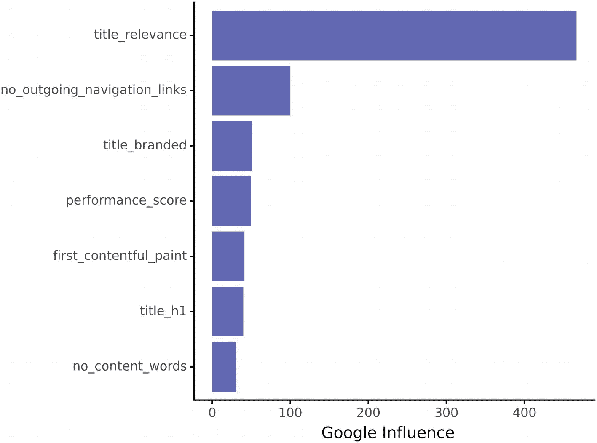

一幅展示各因素与谷歌影响力关系的水平条形图。标题相关性（`title_relevance`）的条形是最具影响力的因素，数值为 450，而内容词数量（`no_content_words`）的条形数值为 30。

图 6-3
变量重要性图，展示了由机器学习算法识别出的最具影响力的排名因素

对于 SEO 从业者来说，这并不意外；然而，其价值在于为那些不理解优化标题标签必要性的非专业商业受众提供了经验证据。这类数据也可用于争取非 SEO 同事（如开发人员）的支持，以便优先处理 SEO 变更请求。

该行业中其他值得注意的因素如下：

- `no_cookies`：Cookie 的数量
- `dom_ready_time_ms`：页面速度的衡量指标
- `no_template_words`：主体内容区域之外的单词数量
- `link_root_domains_links`：指向根域名的链接数量
- `no_scaled_images`：需要浏览器缩放才能渲染的缩放图片数量

每个市场或行业都各不相同，因此上述内容并非适用于整个 SEO 领域的通用结论！

### 排名因素的价值几何

现在你已经有了模型，你可能希望将你的发现传达给同事和客户。我们将研究其中一个排名因素，以此为例说明如何传达机器学习模型的发现。

将最具影响力的排名因素存储在一个列表中：

```
influencers = ['title_relevance', 'no_outgoing_navigation_links', 'title_branded', 'performance_score', 'first_contentful_paint', 'title_h1', 'no_content_words']
```

选择 `performance_score` 作为我们想要研究的排名因素。根据 Python 的零索引，这将是列表中的第四个元素，索引为 3：

```
i = 3
```

计算统计数据，以平均网站 CWV 性能和谷歌排名：

```
num_factor_agg = hypo_serps_features.groupby(['site']).agg({str(influencers[i]): 'mean', 'rank': 'mean', 'se_results_count': 'sum', 'count': 'sum'}).reset_index()
num_factor_agg = num_factor_agg.sort_values(str(influencers[i]))
```

为了在图表中向客户展示与竞争对手不同的颜色，我们将创建一个新列 `target`，如果该网站是客户网站，则值为 1，否则为 0：

```
num_factor_agg['target'] = np.where(num_factor_agg['site'].str.contains(hostname), 1, 0)
num_factor_agg
```

以下是用于生成图 6-4 中图表的数据框。

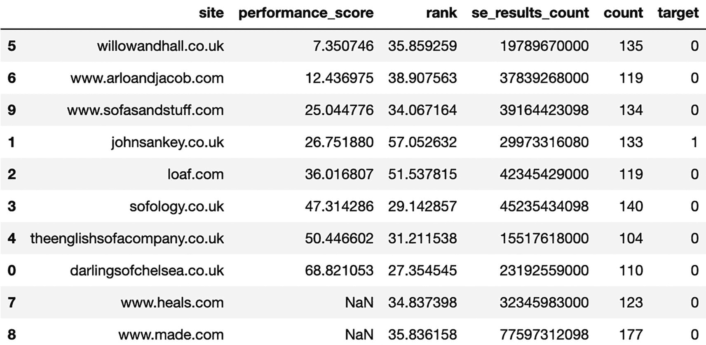

一个包含 11 行 6 列的表格，表头为：网站（`site`）、性能得分（`performance_score`）、排名（`rank`）、搜索结果数量（`se_results_count`）、计数（`count`）和目标（`target`）。网站 `johnsankey.co.uk` 的目标值为 1，其他网站的目标值为 0。

此函数根据你希望拟合的直线（1 次）或曲线（2 次或更高次）返回多项式最佳拟合线：

```
def poly(x, degree=1):
    """
    拟合多项式
    这些是非正交因子，但如果仅用于平滑处理而非外推预测，则可能无关紧要。
    """
    d = {}
    for i in range(degree+1):
        if i == 1:
            d['x'] = x
        else:
            d[f'x**{i}'] = np.power(x, i)
    return pd.DataFrame(d)
```

绘制图表：

```
num_factor_viz_plt = (
    ggplot(num_factor_agg,
           aes(x = str(influencers[i]), y = 'rank', fill = 'target', colour = 'target', #shape = 'cat_item',
               size = 'se_results_count')) +
    geom_point(alpha = 0.3) +
    geom_smooth(method = 'lm', se = False, formula = 'y ~ poly(x, degree=1)', colour = 'blue', size = 1.5) +
    labs(y = '谷歌排名', x = str(influencers[i])) +
    scale_y_reverse() +
    scale_size_continuous(range = [5, 20]) +
    theme(legend_position = 'none', axis_text_x=element_text(rotation=0, hjust=1, size = 12))
)
num_factor_viz_plt
```

通过绘制各网站的平均核心网页指标（CWV）与平均谷歌排名的关系图（图 6-4），并包含一条最佳拟合线，我们可以估算出 CWV 每单位改进对排名的影响。在此案例中，CWV 每提升 1 个单位，排名大约提升 0.5 个位置。

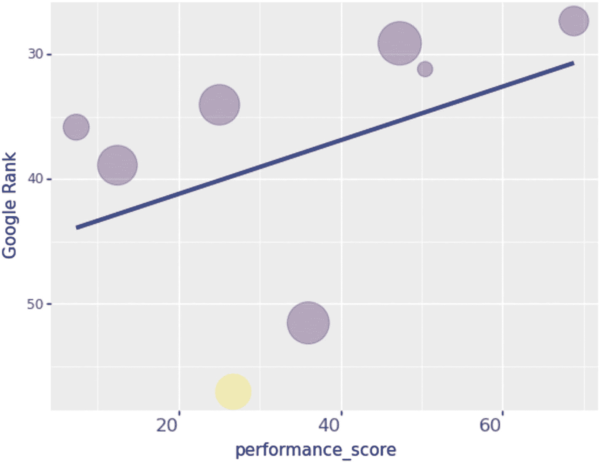

一个气泡图，展示了谷歌排名与性能得分的最佳拟合线。该图呈现正斜率。

图 6-4
比较谷歌排名与 CWV 性能得分的网站气泡图

### 排名因素的获胜基准

获胜基准似乎也是 70，这对开发人员来说可能是个安慰，因为要达到 90 分或以上的分数可能需要耗费大量资源。多亏了机器学习，我们不仅能够发现最重要的因素，在进行深入分析时，还能看到获胜基准。

### 让你的模型更稳健的技巧

当然，没有模型是完美的，也永远不会完美。模型的实用性取决于：

-   你的想象力、创造力、SEO 知识以及提出对模型构建有信息价值的假设的能力
-   你将这些假设转化为可在你网站和竞争对手网站上收集为数据的可衡量指标的能力
-   你构建对模型识别模式有意义的数据结构的方式

### 付诸行动

有了模型输出，你现在可以就你的 SEO 策略做出一些决策，包括：

-   你希望在全站范围内进行的“无需动脑”的更改，例如网站速度或增加品牌搜索量（通过程序化广告、内容营销或两者结合）
-   对你模型中包含的因素进行拆分 A/B 测试
-   对排名因素本身进行进一步研究，以指导你的建议

### 自动化此分析

上述机器学习应用非常适合获得一些想法，用于进行拆分 A/B 测试，并通过基于证据的变更请求来改进 SEO 计划。同样重要的是要认识到，当这种分析持续进行时，其效果会更加强大。为什么？因为机器学习分析只是对某个时间点搜索引擎结果页面（SERP）的快照。持续的数据收集和分析流意味着你可以更真实地了解你的行业在 SERP 中实际发生的情况。

这就是专为 SEO 构建的数据仓库和仪表盘系统发挥作用的地方，这些产品如今已经可用。这些系统的作用是：

-   每天从你喜欢的 SEO 工具中摄取数据
-   整合数据
-   使用机器学习在你选择的前端（如 Google Data Studio）中像之前一样呈现洞察

要构建你自己的自动化系统，你需要在云基础设施（如亚马逊云服务（AWS）或谷歌云平台（GCP））中部署所谓的 ETL，即提取、转换和加载，以便你的数据收集、分析和可视化在一个地方实现自动化。这在第 8 章中有更详细的说明。

### 总结

在本章中，你学到了：

-   理解用于竞争对手分析的排名因素背后的数据科学原理
-   如何整合数据源
-   如何为机器学习准备数据
-   如何训练机器学习模型
-   如何使用模型输出来生成 SEO 建议

# SEO 中的竞争对手研究与分析

SEO 中的竞争对手研究与分析之所以困难，是因为存在大量可用的排名因素，且需要控制的变量众多。由于涉及的数据量庞大，电子表格工具难以胜任，更不用说像 `Python` 这样的数据科学语言所提供的统计能力了。

在使用机器学习（ML）进行 SEO 竞争对手分析时，重要的是要理解这是一个回归问题，目标变量是谷歌排名，而假设则是排名因素。

在第 7 章中，我们将介绍实验，这些实验自然是在竞争对手统计分析结果之后进行的。

