# 7. 实验

从数据或你自己的思维实验中发掘出可以应用到你的网站上、并带来真正、显著的自然流量提升的见解，是相当令人兴奋的。随着诸如 Distilled ODN 和 RankScience 等拆分测试平台的兴起，实验在 SEO 中扮演着越来越重要的角色，这并不令人意外。

如果你运营的是一个小型网站，那么导致负面影响的改动可能无关紧要，或者该改动看似是显而易见的 SEO 最佳实践，那么你可以放弃正式的实验，而专注于实施你认为必要的改动。

另一方面，如果你是在一个大型企业网站上工作，无论是内部团队还是作为代理机构的一部分，那么任何改动都将产生重大影响，你需要确保测试这些改动，以便了解其影响（包括正面和负面），同时也有助于塑造你的理解，为形成新的待测试假设提供信息。

### 实验如何融入 SEO 流程

要成功进行实验和 A/B 拆分测试，你需要一个从想法产生（也称为假设）到实施的完整流程。我们概述了以下步骤：

1.  假设生成
2.  实验设计
3.  运行实验
4.  评估
5.  实施

我们将在以下章节中介绍这些步骤。

### 生成假设

在任何实验开始之前，你需要围绕你的假设来构建它，即你相信什么会显著改变你的目标变量或结果指标，例如，自然展示次数或已爬取的 URL。

这一步至关重要，因为如果没有清晰的假设，你就无法知道要测试什么来影响你的结果指标。所以，思考一下你想从哪些方面学习，以帮助你提升 SEO 表现。

假设的来源有多个方面：

-   竞争对手分析
-   网站文章和社交媒体
-   你/你团队的想法
-   最近的网站更新
-   会议活动和行业同行
-   过去的实验失败案例

我通常喜欢使用这样的格式：“我们相信谷歌会给予那些被网站其他重要页面链接的 URL 更高的权重。”然后，这个陈述会被扩展，以考虑你提议测试的内容以及你将如何衡量（例如，“当……时，我们将知道该假设是否有效”）。

### 竞争对手分析

你进行的竞争对手分析（在第 6 章中解释过）将是测试想法的自然来源，因为它们具有一定的统计基础，能够揭示你的竞争对手正在做或没有做哪些事情来获得更优的自然流量表现。这些假设还有一个额外的好处，即从一开始就知道你将测试的指标是什么。毕竟，你首先需要将数据纳入你的分析中。

### 网站文章和社交媒体

我们经常读到一些研究、文章和社交媒体梗，声称它们驱动或降低了自然流量表现。这并不是说这些说法不真实或没有根据。然而，这些说法并不适用于你的具体情况，如果它们成为了新闻，那么很可能值得测试。顺便提一下，在数据科学真正兴起之前的 SEO 职业生涯早期，真正了解你的数据的最佳方式就是测试我们在网上读到的所有关于 SEO 的内容，例如 Webmaster World、BlackHatWorld 论坛等，看看哪些有效，哪些无效。如果你的网站没有被谷歌从索引中移除，你就不会被视为一个受人尊敬的 SEO，或者也许你只是没有大胆地进行实验。其本质就是为搜索引擎进行“优化”。

当然，情况已经发生了变化，我们大多数从事 SEO 的人现在是为品牌和成熟企业工作。因此，一些创造性的、狂野的实验可能不合适，或者会限制职业发展，我们并不提倡这样做。

### 你/你团队的想法

测试假设并不局限于你直接的 SEO 团队（内部或代理机构），甚至不限于你的数字营销团队。这可以是对网站有任何接触并有任何想法的同事。他们的大部分想法可能不值得投入资源进行实验。然而，他们的想法，因为他们（应该）关心业务，所以值得考虑。当然，从 SEO 的角度来看，你直接的 SEO 团队可能对需要测试的事情有更好的想法。

### 最近的网站更新

通常，在大型网站更新影响你的自然流量之前进行测试是更好的。然而，由于其他相互竞争的优先级或紧迫的时间表，你可能没有这样的奢侈条件。尽管如此，如果一个产品更新预计会影响你的自然流量，无论好坏，例如推出一个精简的顶级导航，你最好能知道原因并抢在全面发布之前，这样你就可以测试它，以了解其对 SEO 的影响。

### 会议活动和行业同行

为什么要把你的想法局限于线上和你的公司呢？参加行业活动不仅是寻找新的 SEO 测试内容的好方法，而且还可以在活动中遇到可能正在解决相同问题的人。思想的多样性受到高度重视，并可能带来突破性的实验想法。

### 过去的实验失败案例

如果失败了，那就尝试、再尝试、再尝试。通常，如果一个实验失败了，往往是因为实验没有达到所需的样本量，或者实验设计或运行不正确。从中学习并重复迭代。无论是设计、正确运行，还是重新制定你的假设，都要去做，并持续迭代，直到获得期望的结果。你可能会走向与最初失败的实验不同的方向，但在这个过程中你会学到很多东西。

# 实验设计

在决定了要测试哪些假设之后，你现在就可以设计你的实验了。在下面的代码示例中，我们将设计一个实验，以查看一个测试项（可以是任何东西，比如主标题下方的一段文字）在 URL 层面对自然展示次数的影响。

让我们从导入 API 开始：

```python
import re
import time
import random
import pandas as pd
import numpy as np
import datetime
import requests
import json
from datetime import timedelta
from glob import glob
import os
from plotnine import *
import matplotlib.pyplot as plt
from pandas.api.types import is_string_dtype
from pandas.api.types import is_numeric_dtype
from datetime import datetime, timedelta
```

这些是执行实际拆分测试所需的：

```python
from statsmodels.discrete.discrete_model import NegativeBinomial
from statsmodels.tools.tools import add_constant
from collections import Counter
import uritools
pd.set_option('display.max_colwidth', None)
%matplotlib inline
```

因为我们使用的是网站分析数据（常见品牌包括 `Google`、`Looker`、`Adobe`），这些数据可以轻松地从按日期划分的落地页报告中导出。如果网站规模较大，则可能需要使用 API（`Google Analytics` 相关 API 请参见第 8 章）。

根据你使用的网站分析工具，列名可能有所不同；但是，如果你想测试不同 URL 组在时间维度上的展示次数差异，你需要以下字段：

- `Date`
- `Landing page URL`
- `Sessions`

除了`Sessions`，也可以测试其他指标，例如展示次数、点击率、排名等。

假设你有一个 `CSV` 导出文件，使用`pd.read_csv`从网站分析工具中读取数据：

```python
analytics_raw = pd.read_csv("data/expandable-content.csv")
```

打印各列的数据类型，检查是否有数值数据被导入为字符串类型（需要转换）：

```python
print(analytics_raw.dtypes)
landing_page     object
date             object
sessions        float64
dtype: object
```

会话数据是数值型浮点数，这没问题；但日期数据被归类为“`object`”，这意味着需要将其转换为日期格式。

我们将使用`.copy()`方法创建数据框的副本。这样，我们做的任何修改都不会影响原始导入的表。这样一来，如果对修改不满意，我们无需从头重新导入。

```python
analytics_clean = analytics_raw.copy()
```

日期列使用`to_datetime()`函数，该函数接收列和日期格式，然后进行归一化处理，将字符串转换为日期格式。

这对于后续填充缺失日期和绘制时间序列数据非常重要：

```python
analytics_clean['date'] = pd.to_datetime(analytics_clean['date'], format='%d/%m/%Y').dt.normalize()
analytics_clean
```

下面的 `Pandas` 数据框展示了`analytics_clean`，现在数据已转换为可用格式，便于进一步操作，例如绘制会话随时间变化的图表。

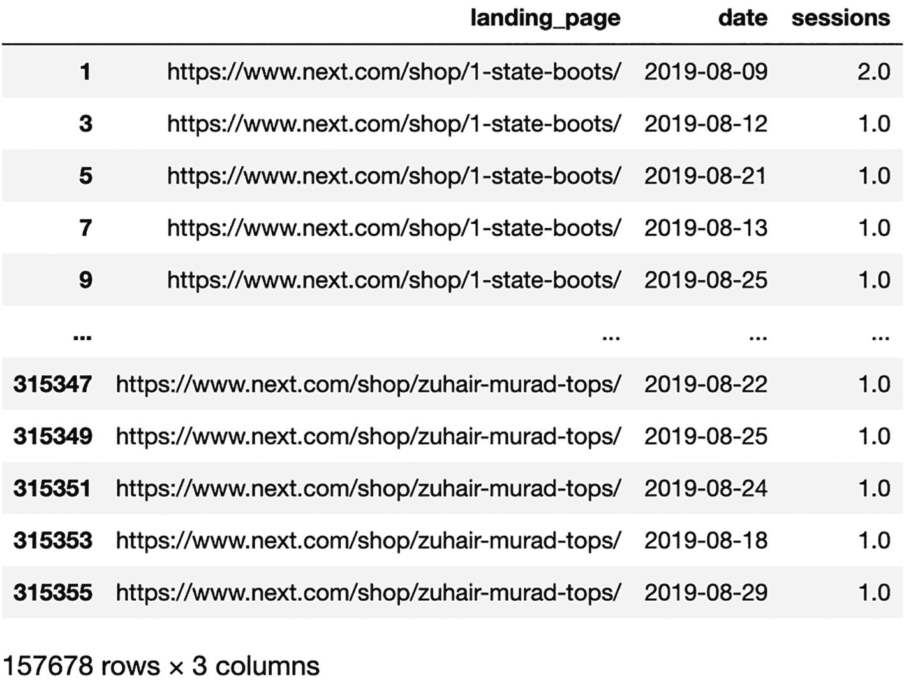

一个包含 157678 行和 3 列的表，展示了 `www.next.com/shop` 落地页的详细信息、日期和会话数。

让我们使用`.describe()`探索会话的分布情况：

```python
analytics_raw.describe()
```

以下截图展示了会话的分布情况，包括计数（数据点数量）、平均值（均值）等。

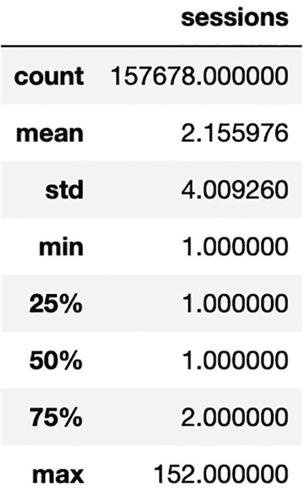

一个表格展示了会话的详细信息：计数、均值、标准差、最小值、25%、50%、75% 和最大值。

我们可以看到，每个 URL 在任意给定日期的平均会话数约为 2，但标准差为 4，表明波动很大。鉴于均值为 2，而一个落地页的会话数不可能为 –2（均值 2 减去标准差 4），这意味着某些异常页面获得了极高的会话数，这解释了波动的原因。

现在查看日期：

```python
analytics_clean['date'].describe()
```

结果如下：

```
count                  157678
unique                     28
top       2019-08-18 00:00:00
freq                     6351
first     2019-08-06 00:00:00
last      2019-09-02 00:00:00
Name: date, dtype: object
```

除了数据日期范围大约在八月份之外，没有太多其他信息。

## 零膨胀

网站分析通常只在网页有展示时才会记录数据。那么，当页面没有展示时，该怎么办呢？

零膨胀是指为那些在特定日期没有记录到自然展示的页面添加空记录。如果我们不进行零膨胀，那么对于某个网页，甚至对于一组页面（例如 A 和 B），数据的均值都会产生偏差。

例如，`URL X` 在分析工具记录的某段时间内的 10 天里获得了 90 次会话，这可能会让你认为日均展示次数是 9 次。然而，由于这些会话只发生在 10 天内，你的计算会误导你认为该 `URL` 的表现比实际更好。通过零膨胀数据，即为 30 天期间内 `URL X` 没有自然展示的天数添加空行，计算出的平均值将恢复到预期的每天 3 次。

零膨胀还为我们提供了另一个有用的特性，那就是泊松分布。解释泊松分布超出了本书的范围。但你需要知道的是，当我们测试 A 组和 B 组之间的差异时，泊松分布常用于罕见事件。两组之间任何统计上显著的差异，都有望表明测试组 B 的零值显著少于 A 组。科学原理讲够了，我们开始实践吧。

有一种更简单（但不太容易理解）的方法来填充缺失日期。本章将介绍两种方法，先从较长但更易读的方法开始。

这里，我们使用`date_range()`函数，根据分析数据框中的最小和最大日期设置日期范围，间隔为一天。这被保存到一个名为`datelist`的变量对象中：

```python
datelist = pd.date_range(start=analytics_clean['date'].min(),
end=analytics_clean['date'].max(), freq='1d')
```

`nd`是日期范围内的天数，`nu`是我们需要日期的唯一落地页列表的长度：

```python
nd = len(datelist)
nu = len(analytics_clean['landing_page'].unique())
```

这里，我们通过落地页和日期的交叉乘积，创建一个包含所有可能的落地页和日期组合的数据框：

```python
analytics_expanded = pd.DataFrame({'landing_page': analytics_clean['landing_page'].unique().tolist() * nd,
'date':np.repeat(datelist, nu)})
```

然后，我们查找哪些日期和落地页有对应的会话记录：

```python
analytics_expanded = analytics_expanded.merge(analytics_clean, how='left')
```

任何不匹配（因此为空）的记录都用零填充：

```python
analytics_expanded[['date','sessions']] = analytics_expanded.groupby('landing_page')[
['date', 'sessions']].fillna(0)
```

将会话数据转换为数值型浮点数，以便于数据处理：

```python
analytics_expanded['sessions'] = analytics_expanded['sessions'].astype('int64')
analytics_expanded
```

得到的数据框`analytics_expanded`如下所示，是我们准备好进行拆分测试的零膨胀数据框。请注意，原始分析数据有 157,678 行，经过零膨胀后，现在有 807,212 行。

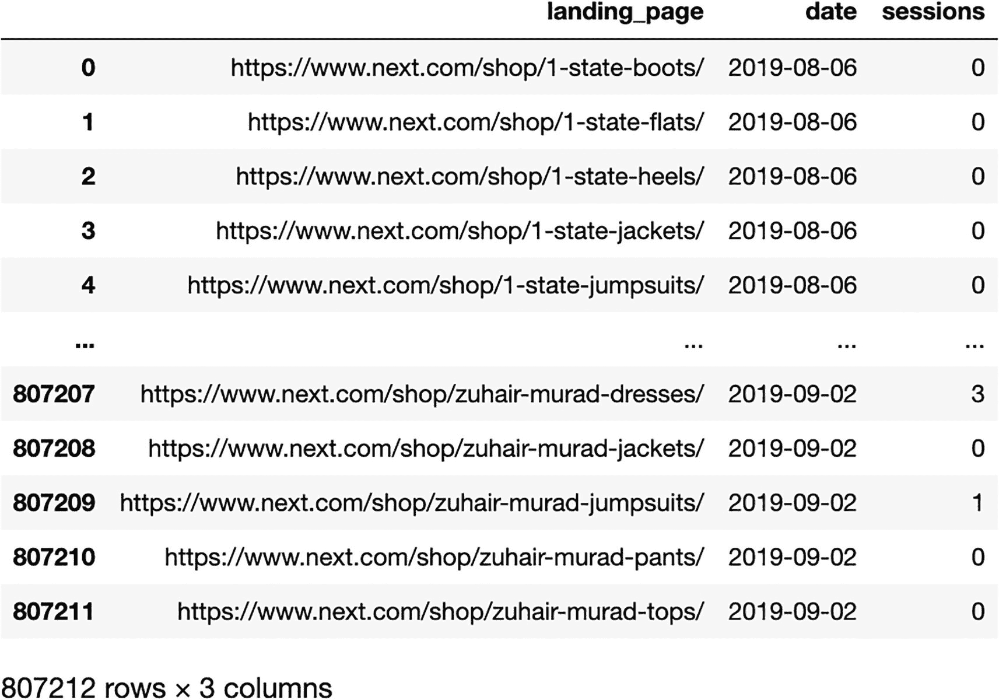

一个包含 807212 行和 3 列的表，展示了 `www.next.com/shop` 落地页的详细信息、日期和会话数。

让我们使用`.describe()`探索数据，它将告诉我们经过零膨胀后会话分布的变化：

```python
analytics_expanded.describe()
```

以下截图展示了零膨胀后的会话分布情况。

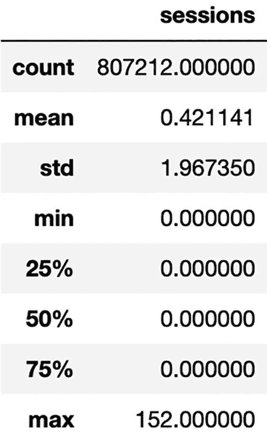

一个表格展示了会话的详细信息：计数、均值、标准差、最小值、25%、50%、75% 和最大值。

差异巨大！均值从 2.16 下降了超过 75%，降至 0.42，并且几乎没有任何页面在不到一个月的时间内获得超过一次会话。

## 拆分 A/A 分析

A/A 测试是这样一个过程：我们在一个时间段内对相同的项目进行自我测试。这是由 `SearchPilot`（前身为 `Distilled ODN`）推广的一种拆分测试类型，如图 7-1 所示。

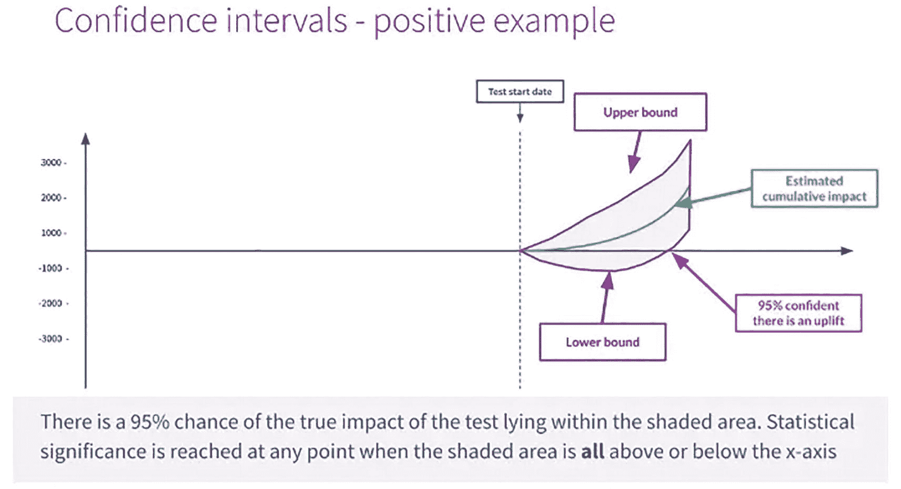

该图表展示了置信区间的正面示例。它标明了上限、下限、估计的累积影响，以及测试开始日期后 95% 确信存在提升的时间点。底部的文本框说明，测试的真实影响有 95% 的可能性。

图 7-1 `SearchPilot` 的拆分 A/B 分析**来源**：[`www.searchpilot.com/features/seo-a-b-testing/`](http://www.searchpilot.com/features/seo-a-b-testing/)

例如，我们选取一个 `URL` 样本，并在对该样本实施测试之前对其性能进行基准测试，以观察是否会产生显著影响。

我们进行 A/A 测试的主要动机是确定 A/B 测试设计是否足够可靠，可以继续进行。我们期望看到的是 A 之前和 A 之后之间没有差异。

我们将测试 13 天，假设在此期间没有进行任何更改，尽管在实际环境中，你会在测试前检查是否一切未变。

为什么是 13 天？这是一个任意数字；然而，后续会给出确定稳健 A/B 测试样本量的方法，以确保检测到的任何差异都是显著的。同样的方法也可以在这里应用。

这个 A/A 测试仅仅是为了说明如何创建数据结构并进行测试。因此，如果你想进行“`SearchPilot`”风格的拆分测试，那么除了样本量和测试周期的确定之外，以下代码将帮助你运行它：

```python
aa_test_period = 13
```

将截止日期设置为最新日期减去测试周期：

```python
cutoff = analytics_expanded['date'].max() -  timedelta(days = aa_test_period)
```

为 A/A 测试创建一个名为 `analytics_phased` 的数据框副本：

```python
analytics_phased = analytics_expanded.copy()
```

根据日期在截止日期之前还是之后设置 A/A 分组：

```python
analytics_phased['aa_group'] = np.where(analytics_expanded['date'] < cutoff, "pre_test", "test_period")
analytics_phased
```

这应该会产生以下输出：

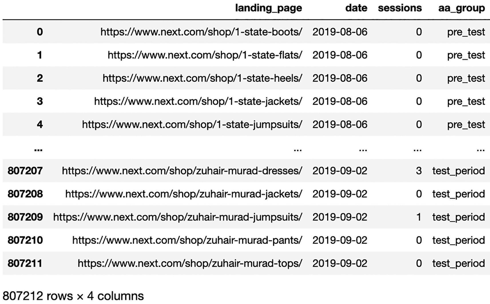

一个包含 807212 行和 4 列的表格，列出了着陆页、日期、会话以及分组（如 `pre_test` 和 `test_period`）的详细信息。

在测试之前，让我们通过分析来确定两个 A/A 组的统计属性，这可以预示实际拆分 A/A 测试的结果可能是什么。

第一个函数是 `day_range()`，它返回日期范围内的天数，即最新日期减去最早日期：

```python
def day_range(date):
return (max(date) - min(date)).days
```

首先，我们通过过滤非零会话的数据，然后按 A/A 组聚合日期范围和平均值来计算均值：

```python
aa_means = (
analytics_phased.loc[analytics_phased["sessions"] != 0]
.groupby(["aa_group"])
.agg({"date": ["min", "max", day_range], "sessions": "mean"})
)
aa_means
```

生成的 `aa_means` 数据框显示以下输出：

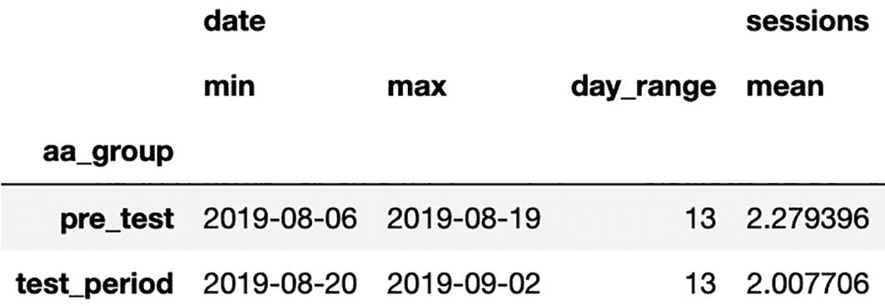

一个表格显示了名为 `pre-test` 和 `test-period` 的两个 A/A 组的最小和最大日期、日期范围以及平均会话数的详细信息。

我们可以看到日期范围和日期范围是正确的，并且每组的平均值在四舍五入为整数时大致相同。

```
aa_means = analytics_phased.loc[analytics_phased['sessions'] != 0]
```

让我们确定组间的变异：

```
aa_zeros = analytics_phased.copy()
```

创建一个零值列，以便我们统计零值及其比率：

```python
aa_zeros['zeros'] = np.where(aa_zeros['sessions'] == 0, 1, 0)
aa_zeros['rows'] = 1
```

按 A/A 组聚合零值数量和总数据点数：

```python
aa_means_sigmas = aa_zeros.groupby('aa_group').agg({'zeros': sum, 'rows': sum}).reset_index()
```

计算变异“sigma”，即零值占总可能会话数的 99.5%：

```python
aa_means_sigmas['sigma'] = aa_means_sigmas['zeros']/aa_means_sigmas['rows'] * 0.995
aa_means_sigmas
```

这将产生以下输出：

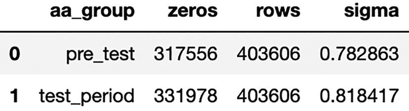

该表格显示了名为“pre-test”和“test-period”的两个 A/A 组的零值、行数和 sigma 的详细信息。

我们可以看到，在截断点前后变异非常相似，这让我们对 URL 足够稳定以进行 A/B 测试有了一定的信心。

使用`.merge()`函数（Python 中 Excel 的`vlookup`的等效函数）将它们合并：

```python
aa_means_stats.merge(aa_means_sigmas, on = 'aa_group', how = 'left')
```

这将产生以下输出：

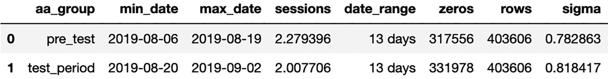

该表格显示了名为“pre-test”和“test-period”的两个 A/A 组的最小日期、最大日期、会话数、日期范围、零值、行数和 sigma 的详细信息。

如果你正在进行 A/A 测试以查看优化的效果，那么你会希望看到`test_period`组报告更高的会话率，同时 sigma 相同或更低。这将表明你的优化成功增加了 SEO 流量。

让我们使用`plotnine`的直方图绘制功能来可视化分布：

```python
aa_test_plt = (
ggplot(analytics_phased,
aes(x = 'sessions', fill = 'aa_group')) +
geom_histogram(alpha = 0.8, bins = 30) +
labs(y = 'Count', x = '') +
theme(legend_position = 'none',
axis_text_y =element_text(rotation=0, hjust=1, size = 12),
legend_title = element_blank()
) +
facet_wrap('aa_group')
)
aa_test_plt.save(filename = 'images/2_aa_test_plt.png',
height=5, width=8, units = 'in', dpi=1000)
aa_test_plt
```

图 7-2 所示的图表直观地确认了两组之间没有差异。

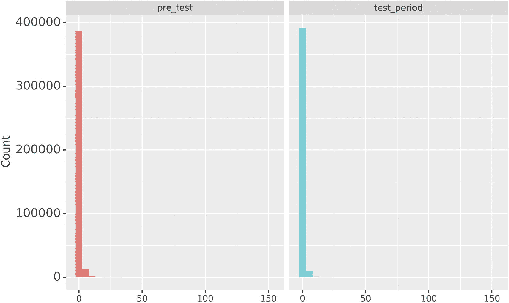

一组 2 个直方图表示预测试和测试期间的计数。两个图表都呈现出几乎相似的递减趋势。

图 7-2 预测试和测试期间 A/A 组数据的直方图

箱线图将提供两组分布的更多视觉细节，现在将使用它：

```python
aa_test_box_plt = (
ggplot(analytics_phased,
aes(x = 'aa_group', y = 'sessions',
fill = 'aa_group', colour = 'aa_group')) +
geom_boxplot(alpha = 0.8) +
labs(y = 'Count', x = '') +
theme(legend_position = 'none',
axis_text_y =element_text(rotation=0, hjust=1, size = 12),
legend_title = element_blank()
)
)
aa_test_box_plt.save(filename = 'images/2_aa_test_box_plt.png',
height=5, width=8, units = 'in', dpi=1000)
aa_test_box_plt
```

图 7-3 再次在`aa_test_box_plt`中显示，除了预测试组有更多的高值异常值外，两组之间没有差异。

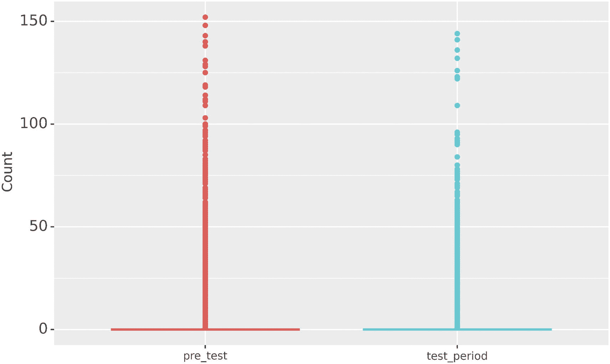

一组 2 个箱线图表示预测试和测试期间的计数。它表示预测试的图接近 150 个计数，测试期间接近 140 个计数。

图 7-3 预测试和测试期间组的箱线图

让我们使用统计模型执行实际的 A/A 测试。我们将创建一个数组，它是一个数字列表，将数据点标记为 0（预测试）或 1（test_period），然后将其分配给`X`：

```python
X = np.where(analytics_phased['aa_group'] == 'pre_test', 0.0, 1.0)
X = add_constant(X)
X = np.asarray(X)
X
```

结果如下：

```
array([[1., 0.],
[1., 0.],
[1., 0.],
...,
[1., 1.],
[1., 1.],
[1., 1.]])
```

`X`用于输入`NegativeBinomial()`模型，该模型将用于测试两个 A/A 组之间会话数的差异。

参数是结果指标（`sessions`）和自变量（`aa_group`）：

```python
aa_model = NegativeBinomial(analytics_phased['sessions'], X).fit()
```

然后，我们将使用`.summary()`属性查看模型结果：

```python
aa_model.summary()
```

得到的`aa_model.summary()`如下所示：

```
Optimization terminated successfully.
Current function value: 0.762045
Iterations: 3
Function evaluations: 8
Gradient evaluations: 8
```

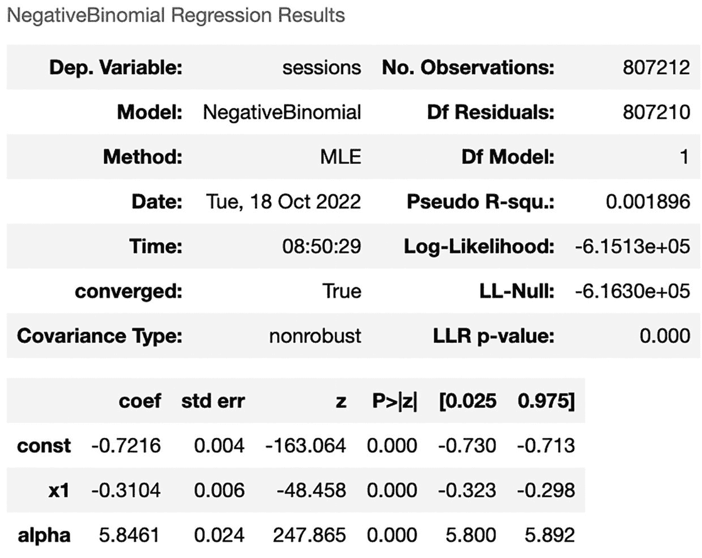

一个表格显示了负二项回归结果，其中包含因变量、模型、日期、时间、协方差类型、观测数、残差自由度、模型自由度以及其他变量的详细信息。在底部，它指示了常数、x1 和 alpha 的不同值。

打印输出显示 p 值（LLR p-value）为零，这意味着具有显著性。然而，x1 为 –0.31，表明组之间存在微小差异。这种差异是否足以停止 A/B 测试？这是一个业务问题。在这种情况下，答案是否定的；然而，这是主观的；图表和分析表格将支持没有真正差异的说法——继续前进。

## 确定样本量

正确确定样本量绝对关键，因为它确实可以决定测试结果的可信度。一些基本原则是确保有足够的样本量在合理的时间段内获得结论性结果，并确保不要像许多软件在实验完成之前观察到显著变化时那样提前终止测试。

我们不会深入探讨确定 SEO 实验适当样本量的因素，例如统计功效，因为这不是一本统计学教科书（而且有很多非常好的统计学教科书，例如 *OpenIntro Statistics*）。

决定所需样本量的主要因素是测试组和对照组之间所需的统计显著性差异水平。最典型和最传统的截断水平是 95%。也就是说，测试结果与对照组结果相同是由于随机噪声造成的概率为 5%（或更小），因此你可以拒绝测试组（B）和对照组（A）之间没有差异的原假设。

现实情况是，95% 规则虽然是惯例，但并非一成不变。你可以决定什么足够好。例如，你可能希望达到 89%，这完全没问题，因为 100 次中有 89 次，你的测试会击败对照组。这就是思考方式。

以下是一些用于实现此目的的代码。我们将估计一些参数，这些参数将用于帮助我们根据最小会话数确定所需的样本量：

```python
num_rows = analytics_phased["sessions"].count()
mu = analytics_phased[analytics_phased["sessions"] != 0].agg({"sessions": "mean"})
sigma = get_sigma(analytics_phased["sessions"])
print(num_rows, mu, sigma)
807212 sessions    2.155976
dtype: float64 0.8006401416232662
```

设置好参数后，这些参数将输入以下函数。`python_rzip`将根据参数生成并返回一个随机泊松分布：

```python
def python_rzip(n, mu, sigma):
rng = np.random.default_rng()
P = rng.poisson(mu, n)
return [p if random.random() > sigma else 0 for p in P]
```

`simulate_sample`使用`python_rzip`函数返回两组数据之间的拆分测试，假设差异为 20% 或更多：

```python
def simulate_sample(n, difference=0.2):
control = python_rzip(n, mu, sigma)
test = python_rzip(n, mu + difference, sigma)
test = stats.ttest_ind(control, test)
return test[1]
```

最后，`run_simulations`使用`simulate_sample`来估计给定流量水平的样本量的显著性：

```python
def run_simulations(n, difference=0.2, n_simulations=100):
p_values = [simulate_sample(n, difference) for i in range(n_simulations)]
significant = sum(map(lambda x: x <= 0.05, p_values))
return significant / n_simulations
```

定义了这三个函数后，我们就可以在不同流量水平下检验显著性。如果你想挑战一下自己，避免重复代码并提升 Python 技能，可以尝试将 `run_simulations` 函数作为列表推导式的一部分来实现：

```
print(run_simulations(n=100), ": 100")
print(run_simulations(n=1000), ": 1000")
print(run_simulations(n=10000), ": 10000")
print(run_simulations(n=15000), ": 15000")
print(run_simulations(n=18000), ": 16000")
print(run_simulations(n=18000), ": 18000")
print(run_simulations(n=20000), ": 20000")
print(run_simulations(n=25000), ": 25000")
print(run_simulations(n=30000), ": 30000")
print(run_simulations(n=50000), ": 50000")
```

运行结果如下：

```
0.04 : 100
0.08 : 1000
0.74 : 10000
0.85 : 15000
0.86 : 16000
0.9 : 18000
0.96 : 20000
0.97 : 25000
1.0 : 30000
1.0 : 50000
```

上述输出展示了在不同样本量（即我们所需的会话次数）下达到的显著性水平（p 值）。如果我们希望有 90%（或更高）的概率观察到 20% 的差异，那么每组需要 18,000 次或更多的会话。

因此，我们将实验样本量设定为合适的值：

```
exp_sample_size = 18000
```

## 测试组与对照组分配

一旦将样本量设定到所需的统计显著性水平，就可以开始随机分配测试组和对照组的 URL 了。

我们按着陆页汇总平均会话次数和天数，并将其存储为数据框 `urls_agg`：

```
urls_agg = analytics_clean.groupby('landing_page').agg({'sessions': 'mean', 'date': 'count'}).reset_index()
```

`testing_days`（即运行测试的最大天数）将设为 30，这是由业务方设定的一个任意数值。当然，这个值也可以更低。

```
testing_days = 30
```

设定了最大测试天数后，我们需要确定测试组所需的最少 URL 数量，以便在该时间段内达到所需的用户会话次数。将样本会话量 18,000 除以测试天数，即可得到这个近似值。

请记住，Google 可能需要长达两周（有时甚至更久）的时间来注册网站更改并将其反映在搜索结果中（即，它们需要抓取、索引并重新排序结果）。因此，为了降低提前结束实验的风险，我们将测试所需的最少 URL 数量翻倍，以增加 Google 在首次抓取时能够抓取到测试 URL（即包含更改的 URL）的可能性：

```
url_sample_size = int(exp_sample_size / testing_days) * 2
print(url_sample_size)
```

测试组需要 1200 个 URL。请注意，这里隐含假设测试 URL 的数量远少于对照组，因此对照组中有足够的 URL 可以在测试期间达到最少的会话次数。

```
urls_agg
```

我们得到的数据框显示了每个着陆页及其平均会话次数和产生会话的天数。如 `date` 列所示，某些 URL 会获得多天的会话数据。

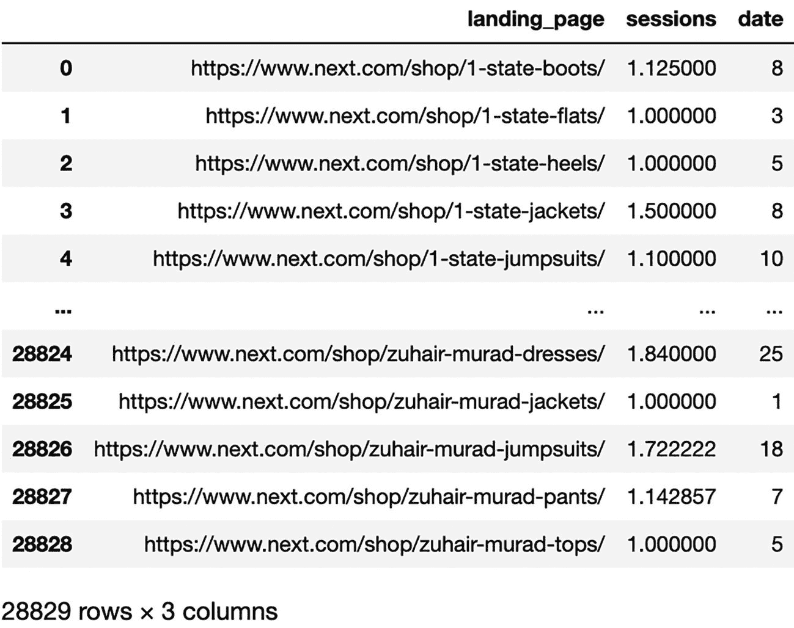

一个包含 28829 行和 3 列的表。显示了着陆页、日期和会话次数的详细信息。

现在，我们将根据所需的 1200 个 URL 对数据框进行抽样，并将其分配到 `test` 组：

```
urls_test = urls_agg.sample(url_sample_size).assign(ab_group="test")
```

删除 `sessions` 和 `date` 列，因为我们只需要将 URL 发送给 Web 开发团队进行分配：

```
urls_test.drop(['sessions', 'date'], axis = 1, inplace = True)
urls_test
```

`urls_test` 如下所示：

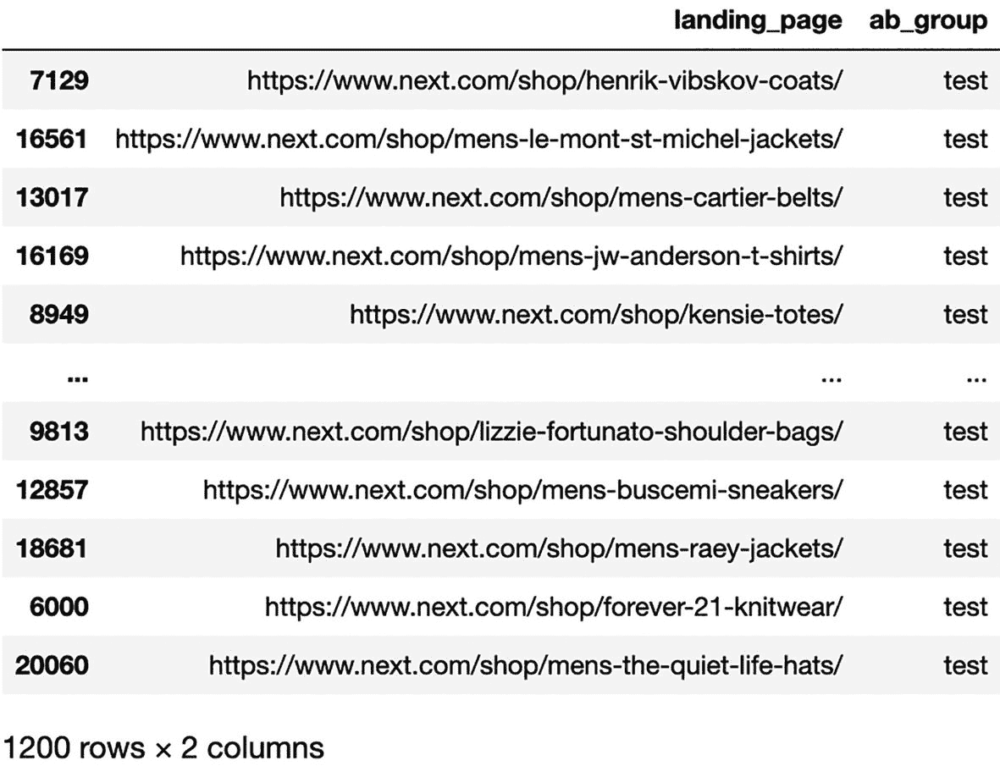

一个表示着陆页和 A/B 组详细信息的表。底部文字显示：1200 行，2 列。

我们的数据框显示了测试着陆页：

```
urls_test_list = urls_test["landing_page"]
urls_test_list
```

结果如下：

```
7129               https://www.next.com/shop/henrik-vibskov-coats/
16561    https://www.next.com/shop/mens-le-mont-saint-michel-jackets/
13017                https://www.next.com/shop/mens-cartier-belts/
16169         https://www.next.com/shop/mens-jw-anderson-t-shirts/
8949                       https://www.next.com/shop/kensie-totes/
...
9813     https://www.next.com/shop/lizzie-fortunato-shoulder-bags/
12857             https://www.next.com/shop/mens-buscemi-sneakers/
18681                 https://www.next.com/shop/mens-raey-jackets/
6000                https://www.next.com/shop/forever-21-knitwear/
20060          https://www.next.com/shop/mens-the-quiet-life-hats/
Name: landing_page, Length: 1200, dtype: object
```

测试着陆页被转换为一个列表，用于将其他（未分配到测试组的）URL 标记为对照组：

```
urls_control = urls_agg[~urls_agg["landing_page"].isin(urls_test_list.values)].assign(
ab_group="control"
)
urls_control.drop(['sessions', 'date'], axis = 1, inplace = True)
urls_control
```

`urls_control` 数据框显示了对照组：

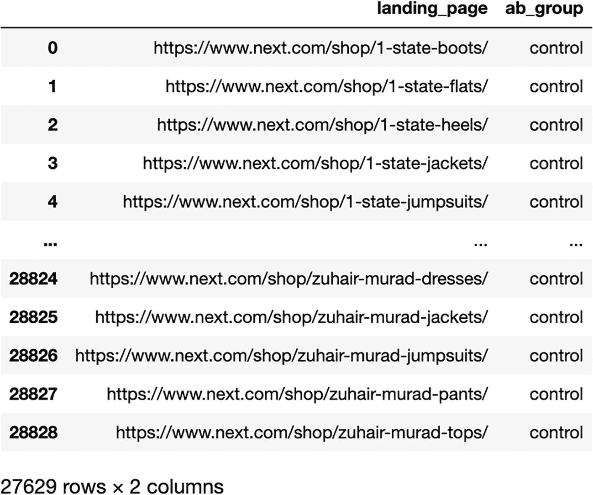

一个表示着陆页和 A/B 组详细信息的表。底部文字显示：27629 行，2 列。

现在，测试组和对照组将被合并到一个数据框中，显示哪些 URL 属于测试组，哪些属于对照组：

```
split_ab_dev = pd.concat([urls_control, urls_test], axis=0).sort_index()
split_ab_dev
```

以下显示了 `split_ab_dev` 数据框：

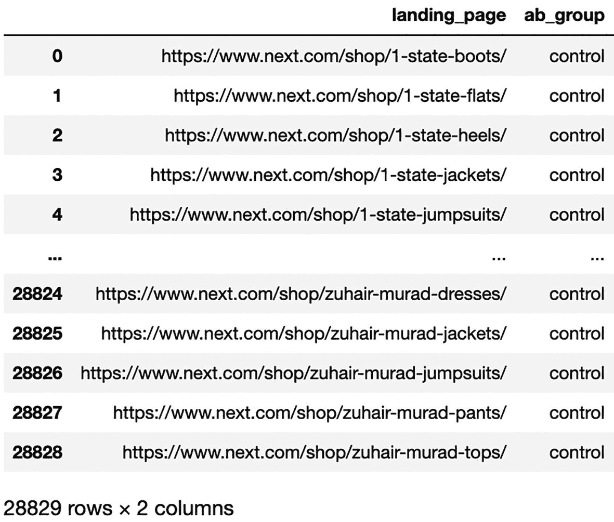

一个表示着陆页和 A/B 组详细信息的表。底部文字显示：28829 行，2 列。

```
split_ab_dev.to_csv("data/split_ab_developers.csv")
```

最终的数据框被合并并导出为 CSV 文件，供软件开发团队参考。

## 运行实验

到目前为止，我们假设了近乎完美的实验室条件，但实际上有很多陷阱可能会破坏你的实验。我们将逐一处理这些问题。

### 过早结束 A/B 测试

无论你做什么，都要确保实验运行到完整的样本量。仅仅因为你的测试组在达到所需样本量之前就出现了统计上的显著差异，并不意味着测试结果是结论性的。可能发生且确实会发生的情况是，测试组在表现优于对照组之后，其表现可能会回归到与对照组相似的水平。然而，如果你过早结束实验，你将无法得知这一点，从而浪费时间和公司资源在一个无效的实验上。因此，如果你的实验需要 20,000 次页面浏览量，请确保两个组都达到 20,000 次页面浏览量。

### 测试未基于假设

如果你已经进行到这一步，但实验并非基于某个假设，那么请重新开始并形成一个假设。拥有假设有助于框定实验的结果，这样你就能确定从实验中学到了什么。例如，如果你正在测试 H1 下方 100 字的正文是否会增加 SEO 展示次数，那么就直接这样陈述。确保从一开始就做到这一点。这将帮助你更精确地确定测试内容、测试方法以及你从中学到了什么。

### 测试组与对照组同时变更

这种情况发生的频率比你想象的要高。曾有几位首席技术官问我们，在实验运行期间同时对测试组和对照组进行更改是否可行。我们建议不要这样做，因为即使更改对两组同等适用，其中一组或两组都可能与同时发生的更改产生交互作用，且方向未必相同。当然，这听起来不太可能，所以如果你曾动过这个念头，或者被问及同时更改是否可行，请避免或拒绝这样做。

你可以做的一件事是，让你的实验的对照组成为其他实验的对照组。只需确保测试组保持原样、不受干扰即可。因此，如果你想运行另一个实验，假设你有足够的控制组网址来满足第一个实验的最低会话数，那么其中一些网址可以分配给第二个测试。

### 测试实施与实验评估未进行质量检查

这一点可能显而易见，但我们还是要说明：请务必在所有浏览器、操作系统和设备类型上检查并对测试的实施进行质量保证，以避免实验结果出现任何偏差。

实验运行完毕后，你就可以评估实验了。你怎么知道它已经运行完毕？当两组都达到了之前设定的所需数量时，在本例中，即 18,000 次页面浏览量。重复一遍，爬取测试组页面的更改可能需要长达两周的时间，然后再花两周时间重新计算这些更改的效果，之后才能在搜索引擎结果页面中反映出来，无论结果是更好、更差还是没有变化。

实验运行后，我们将从网站分析工具中导入数据。和之前一样，数据是从网站分析软件中导出的 CSV 文件：

```
test_analytics = pd.read_csv('data/sim_split_ab_data.csv')
```

将日期转换为日期格式：

```
test_analytics["date"] = pd.to_datetime(test_analytics["date"], format="%Y/%m/%d")
test_analytics
```

你会看到现在有了一个数据框，其中包含所有网址及其对应的日期和标记为测试组与对照组的结果。由于分析数据的特性，某些日期会缺失：

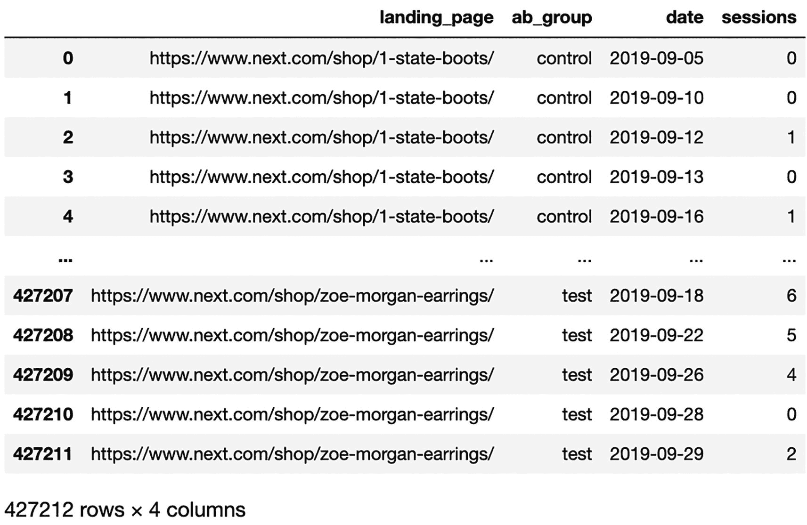

一个包含 427212 行和 4 列的表，表示着陆页、A/B 组、日期和会话数的详细信息。

添加缺失的日期，因为任一组的某些网址可能没有记录页面浏览量。我们将使用列表推导式技术来填充缺失的日期，即对于每个唯一的着陆页，在不存在日期的地方创建一个新的日期行：

```
test_analytics_expand = pd.DataFrame(
[(x, y)
for x in test_analytics['landing_page'].unique()
for y in test_analytics['date'].unique()], columns=("landing_page", "date"),)
test_analytics_expand
```

以下是 `test_analytics_expand` 的截图：

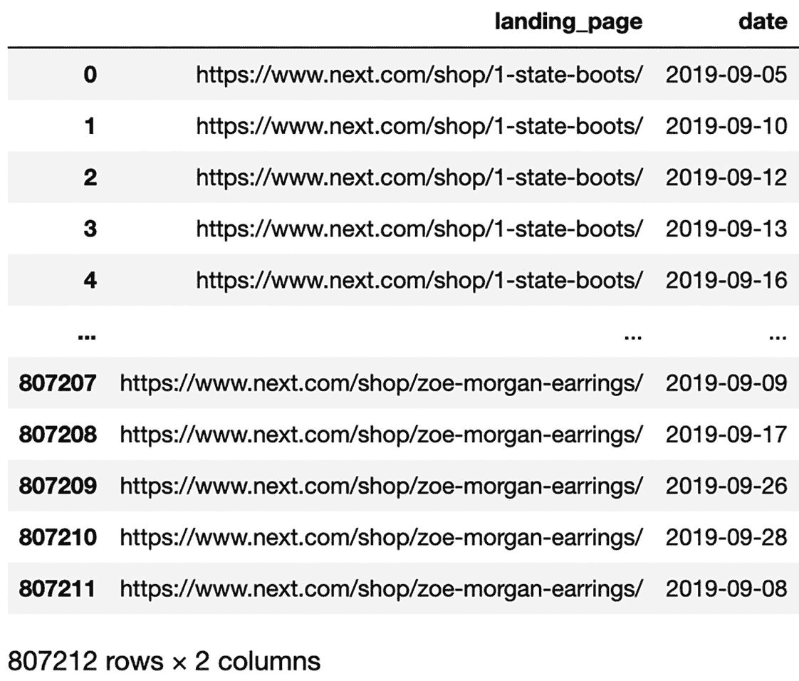

一个包含 807212 行和 2 列的表，表示着陆页和日期的详细信息。

请注意，由于添加了缺失的日期，行数比以前更多了。这些行需要添加会话数据，这可以通过合并原始分析数据来实现：

```
test_analytics_expanded = test_analytics_expand.merge(
split_ab_dev, how="left", on=['landing_page'])
test_analytics_expanded = test_analytics_expanded.merge(
test_analytics, how="left", on=["date", "landing_page", 'ab_group'])
```

合并后，任何日期缺失的着陆页都会出现“NaN”（非数字），通过将这些值填充为零并将数据类型转换为整数来处理：

```
test_analytics_expanded['sessions'] = test_analytics_expanded['sessions'].fillna(0).astype(int)
test_analytics_expanded
```

以下是 `test_analytics_expanded` 的截图，其中着陆页按其 `ab_group` 进行了标记：

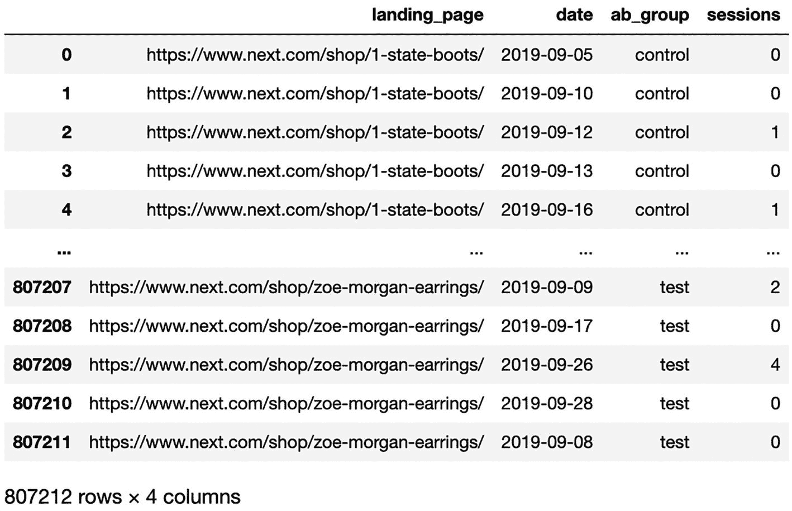

一个包含 807212 行和 4 列的表，表示着陆页、日期、A/B 组和会话数的详细信息。

我们的数据集已准备好，可以在最终测试之前进行一些数据探索。我们探索数据以观察会话数的分布，这有助于我们选择模型。

## 拆分 A/B 探索性分析

我们将估算参数，包括平均会话数及其按 A/B 组的变异：

```
ab_means = (
test_analytics_expand[test_analytics_expand["sessions"] != 0]
.groupby(["ab_group"])
.agg({"date": ["min", "max", day_range], "sessions": "mean"})
)
ab_sigmas = test_analytics_expand.groupby(["ab_group"]).agg({"sessions": [get_sigma]})
pd.concat([ab_means, ab_sigmas], axis=1)
```

`pd.concat([ab_means, ab_sigmas], axis=1)` 数据框如下所示：

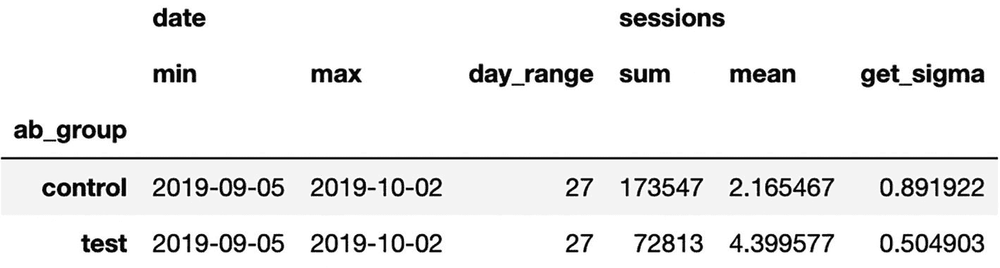

一个表格，显示了名为对照组和测试组的两个 A/B 组的最小日期、最大日期、日期范围、会话数的总和与平均值，以及 get_sigma 值的详细信息。

数据框显示，最小样本会话数已轻松达到，并且测试组似乎产生了显著差异，即统计上显著的更高会话数。

让我们按测试组和对照组绘制数据以进一步探索，首先从整体时间趋势开始。数据将按日期和 `ab_group` 聚合，并计算会话数的平均值：

```
simul_abgroup_trend = sim_split_ab_data.groupby(["date", 'ab_group']).agg({"sessions": "mean"}).reset_index()
simul_abgroup_trend.head()
```

`simul_abgroup_trend.head()` 如下所示：

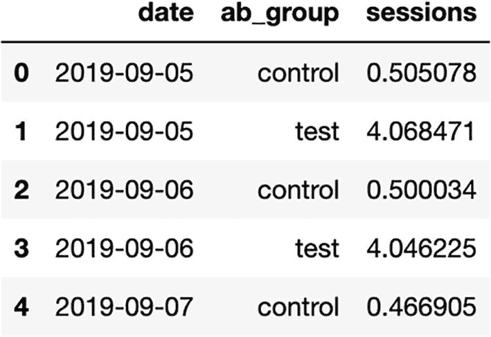

一个包含 5 行和 3 列的表，表示日期、A/B 组和会话数的详细信息。

聚合后，我们可以进行绘图：

