# 6. 竞争对手

哪个有自尊的 SEO 不做竞争对手分析来找出自己遗漏了什么？早在 2007 年，Andreas 回忆说，他使用电子表格收集 SERP 数据，列代表竞争的各个方面，例如指向首页的链接数量、页面数量、字数等。事后看来，这个想法是对的，但由于 Excel 难以在短时间内进行统计上稳健的分析，执行起来几乎无望——而你现在将很快学会使用机器学习来完成这项工作。

## 还有算法恢复！

这些应用不仅对一般的竞争对手 SEO 分析有用，对于从谷歌更新中恢复也很有用，尤其是当你没有更新前的 SERP 数据副本来对比之前有效的方法和现在有效的方法时。

如果你确实拥有更新前的 SERP 数据，那么你只需对更新前的 SERP 重复分析，并将分析结果与更新后的 SERP 进行比较即可。

## 定义问题

在急于行动之前，我们先来思考一下挑战。面对超过 10,000 个排名因素，既没有足够的时间，也没有足够的预算来学习和优化所有高优先级的 SEO 项目。

我们建议通过排除干扰，并利用机器学习分析竞争对手数据，来发现那些能对你的 SEO 活动产生决定性影响的排名因素，从而找到：

- 哪些排名因素最能解释网站间排名的差异
- 获胜的基准是什么
- 该因素每变化一个单位，对排名的影响价值有多大

### 结果指标

需要明确的是，结果变量应为在谷歌搜索引擎中的排名。只要你能从可靠的排名检测工具中获取数据，这种方法也适用于任何其他搜索引擎（例如必应、Yandex、百度等）。

#### 为什么选择排名？

因为与用户会话不同，排名不会随天气、一年中的时间等因素而变化——查询时效性除外。它可能是最干净的指标。无论如何，排名代表了排名 URL 的内容最能满足搜索查询的顺序——想想看，这正是 RankBrain 的核心。因此，实际上，我们正在研究如何针对任何由 RankBrain 驱动的谷歌更新进行优化。

从数据角度来看，排名位置必须是一种浮点数值数据类型，在 Python 中称为`float`（在 R 中称为`double`）。

### 特征

既然我们已经确定了结果指标，现在必须确定自变量，也就是模型输入，也称为特征。特征的数据类型会有所不同，例如：

- `first_paint_ms` 将是数值型。
- `flesch_kincaid_reading_ease` 将是字符型。

自然地，为了进行最全面的竞争对手研究，你希望涵盖尽可能多有意义的特征，包括技术、内容/用户体验和站外因素。

## 数据策略

现在我们知道了结果和特征，该做什么呢？鉴于排名是数值型的，并且我们想要解释排名之间的差异，这是一个连续变量（即，排名从第一到第二，再到第三，等等），那么此处的竞争对手分析就是一个回归问题。用数学术语表示就是：

```
rank ~ w_1*feature_1 + w_2*feature_2 + … + w_n*feature_n
```

`~` 表示“由……解释”。
`n` 是第 n 个特征。
`w` 是该特征的权重。

需要明确的是，这并不总是一个线性回归练习。线性回归假设所有特征都以线性方式表现——数据点都将沿着一条直线拟合。虽然对于某些特征（如页面加载速度）在大多数情况下可能如此，但对于其他特征则不然。

例如，许多排名因素在某些行业表现出非线性特征。例如，标题标签的字符数通常是非线性的，存在一个最佳点。

如图 6-1 所示，我们可以看到最佳拟合线呈 n 形，表明当标题中网站名称字符占比接近 28%时，排名会上升，而网站偏离该标题标签品牌占比的获胜基准越远，排名则越低。

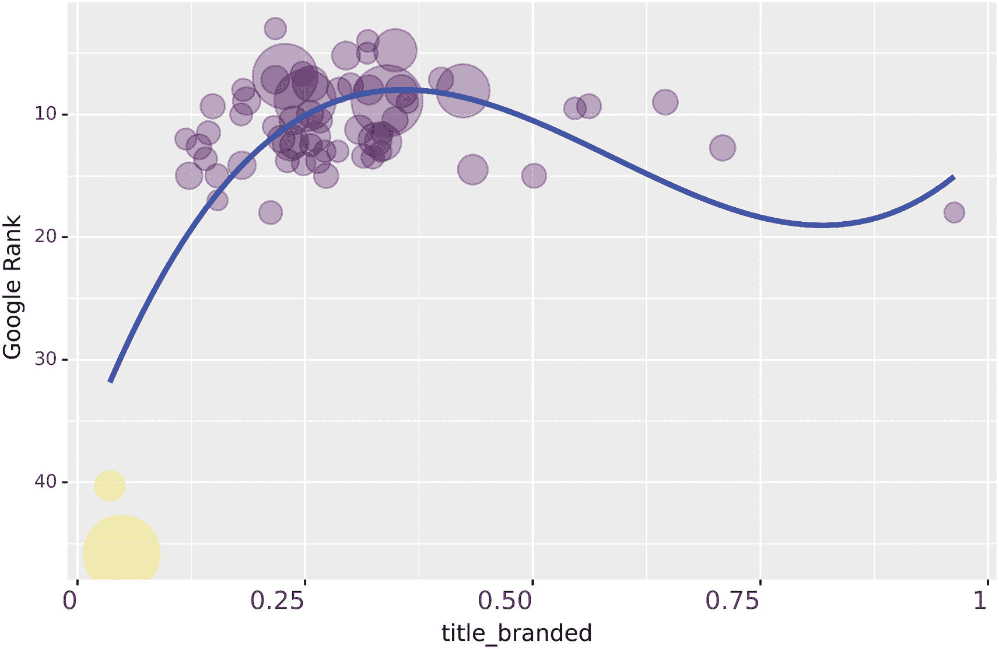

一张散点图，带有谷歌排名与标题品牌占比的最佳拟合线。最大散点位于 0.25，10 处，纵轴标记为 0、40、30、20 和 10。该线绘制了一条正弦曲线。

**图 6-1** 标题标签品牌化（占总字符数的比例）与平均谷歌排名位置的散点图

关于收集哪些特征，搜索引擎是对 URL 进行排名，而不是域名，因此我们将重点关注前者。这将为你节省数据收集的成本和时间，以及整合实际数据的工作。然而，缺点是你将无法包含全域名特征，例如排名 URL 与首页的距离。

为此，我们将使用一种基于决策树的算法，称为`随机森林`。还有其他算法，如决策树，以及更好的算法如 AdaBoost 和 XGBoost。数据科学家通常会试验多种模型，然后根据模型稳定性和预测准确性选择最佳的一个。

然而，我们的目的是让你入门；这些模型可能会产生相似的结果，因此我们为你节省时间，同时最重要的是，为你提供分析 SERP 竞争对手以进行 SEO 的机器学习技术背后的直觉。

## 数据来源

虽然我们无法获知谷歌的内部数据（除非你为谷歌工作），但我们严重依赖第三方工具来提供数据。这些工具是第三方而非第一方的原因是，研究中所有网站的数据必须具有可比性——除非你极不可能拥有竞争对手的数据。没有？那我们继续。

你的数据来源将取决于你希望测试哪些类型的特征来对 SERP 竞争对手进行建模。

**排名：** 这将来自你的排名检测工具，而非 Google Search Console。所以，这些工具包括 getSTAT、SEO Monitor、Rank Ranger 或 DataForSEO SERPs API。还有其他工具，但我们没有或没有直接测试其 API 的经验，因此无法提及。为什么是这三个？因为它们都允许你导出研究中包含的每个关键词的前 100 个 URL。这一点很重要，因为从一开始我们就不想假设你的 SERP 竞争对手是谁。我们只想提取数据并对其进行探究。

对于特征：

**站内：** 要测试站内因素是否能解释你的关键词集的排名差异，可以使用标题标签长度、页面速度、字数、阅读易读性等特征，以及你的排名检测工具能告诉你的关于 URL 的任何信息。你也可以推导出自己的特征，例如通过计算标题标签与目标关键词之间的字符串距离来得出标题相关性。请放心，我们稍后会向你展示如何操作。

对于竞争不那么激烈的行业和小型数据集（每个网站少于 250,000 个 URL），像 Screaming Frog 或 Sitebulb 这样的工具就足够了。对于大型数据集和竞争激烈的行业，你的竞争对手很可能会屏蔽桌面版网站审计工具，因此你将不得不求助于企业级工具，这些工具从云端爬取并拥有 API。根据我们的个人经验，我们发现 Botify 不仅两者兼备，而且运行良好，因为大多数企业品牌都在使用它，所以在爬取时不会被屏蔽！

**站外：** 要测试站外因素的影响，请选择一个拥有良好 API 的可靠来源。根据我们的经验，AHREFs 和 BuzzSumo 效果很好，能提供诸如域名评级、各平台社交分享次数以及反向链接 URL 上的内部链接数量等指标。两者都有 API，允许你将站外数据的收集自动化到你的 R 工作空间中。

## 探索、清洗与转换

拿到数据后，数据科学实践要求你探索数据，以便：

- **理解分布**：数据是否存在偏态或多峰（即分布中有多个峰值）？
- **检查数据质量**：是否存在过多的缺失值？是否存在单水平因子？
- **发现可用于衍生新特征的信息**

其核心思想是通过剔除无信息或无用的特征和行，来提升输入模型的数据质量。探索数据还能帮助你理解模型在解释搜索查询空间中的排名因素时的局限性。

在合并到 SERP 数据之前，我们先进行探索。

总结整体流程如下：

1. 导入数据——包括排名数据和特征数据
2. 聚焦竞争对手
3. 合并数据
4. 衍生新特征
5. 处理单水平因子（SLF）
6. 数据重缩放
7. 处理近零方差（NZV）
8. 中位数填充
9. 独热编码（OHE）
10. 剔除缺失值
11. 对 SERP 进行建模
12. 评估 SERP 机器学习模型
13. 排名的最强预测驱动因素
14. 每个排名因素的价值
15. 排名因素的优胜基准

当然，内容很多，我们会逐一简要说明，并在机器学习能揭示的关于竞争对手的更有趣秘密上深入展开。

### 导入数据——包括 SERP 数据和特征数据

可以通过从相关 SEO 工具导入 CSV 下载文件来完成，或者为了更自动化的体验，使用工具提供商的 API 将数据导入数据框（Python 中的电子表格版本）。以下是一些导入 CSV 数据的入门代码：

对于正则表达式（regex），尽管字符串方法默认包含正则表达式功能：

```python
import re
import time
import random
import pandas as pd
import numpy as np
import datetime
import re
import time
import requests
import json
from datetime import timedelta
```

用于导入多个文件：

```python
from glob import glob
import os
```

用于计算两个文本字符串之间重叠部分的字符串方法：

```python
from textdistance import sorensen_dice
```

用于提取 URL 的各个部分：

```python
import uritools
from tldextract import extract
```

用于数据可视化：

```python
from plotnine import *
import matplotlib.pyplot as plt
pd.set_option('display.max_colwidth', None)
%matplotlib inline
```

一些变量在开始时初始化，这样当你将脚本复用于其他客户或网站时，只需覆盖以下变量值：

```python
root_url = 'https://www.johnsankey.co.uk'
target_site = 'www.johnsankey.co.uk'
root_domain = 'johnsankey.co.uk'
hostname = 'johnsankey'
target_name = 'sankey'
geo_market = 'uk'
```

用于数据子集划分或过滤的社交网站列表：

```python
social_sites = ['facebook.com', 'instagram.com', 'linkedin.com', 'twitter.com', 'pinterest.com', 'tiktok.com', 'foursquare.com', 'reddit.com']
```

### 从关键词入手

与 SEO 中几乎所有事情一样，要始终以终为始。这通常意味着要明确你希望网站排名的目标关键词，以及它们对应的 SERP 数据，我们将把这些数据加载到 Pandas 数据框中：

```python
serps_raw = pd.read_csv('data/keywords_serps.csv')
```

为了让数据框更易于处理，我们将使用列表推导式将列名转换为小写，并将标点符号和空格替换为下划线：

```python
serps_raw.columns = [x.lower().replace(' ', '_').replace(',', '_').replace('__', '_') for x in serps_raw.columns]
```

`rank_absolute`列被替换为更简洁、更熟悉的`rank`：

```python
serps_raw = serps_raw.rename(columns = {'rank_absolute': 'rank'})
serps_raw
```

结果如下：

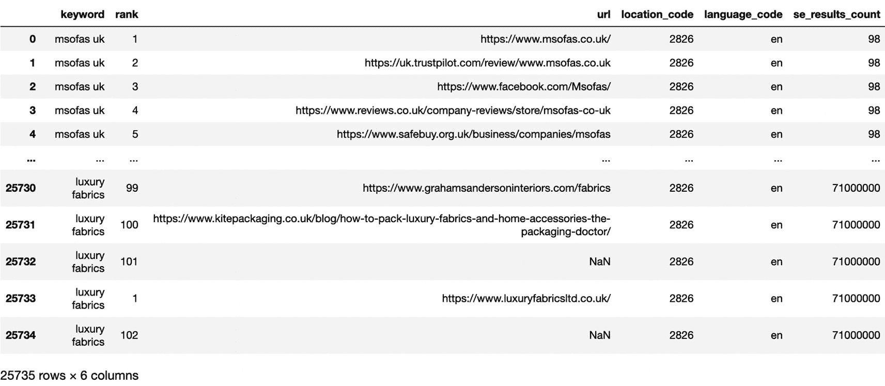

一个包含 25735 行和 6 列的表。列标题为`keyword`、`rank`、`url`、`location code`、`language code`、`se results count`，行中填充了所有关键词数据。

`serps_raw`数据框包含超过 25000 行 SERP 数据，共 6 列，覆盖所有关键词：

```python
serps_df = serps_raw.copy()
```

将 URL 列设置为字符串类型，以便于数据操作：

```python
serps_df['url'] = serps_df['url'].astype(str)
```

第一个操作是提取`site`列的域名。`site`列将应用`uritools` API 函数去除路径部分，然后使用列表推导式将 URL 拆分为其组成部分的列表：

```python
serps_df['site'] = [uritools.urisplit(x).authority if uritools.isuri(x) else x for x in serps_df['url']]
```

拆分后，我们将提取列表中的内容，取最后三个组成部分：

```python
serps_df['site'] = ['.'.join(s.split('.')[-3:]) for s in serps_df['site']]
```

接下来，我们希望将排名分层，以便获得排名类别。虽然在本练习中可能不会用到，但这是处理 SERP 数据时的标准做法。

```python
serps_df['rank_profile'] = np.where(serps_df['rank'] < 11, 'page_1', 'page_2')
serps_df['rank_profile'] = np.where(serps_df['rank'] < 3, 'top_3',
serps_df['rank_profile'])
```

为了避免`search_volumes`为零的情况，我们将使用`np.where()`将其设置为 1，以防止除零错误：

```python
serps_df['se_results_count'] = np.where(serps_df['se_results_count'] == 0, 1, serps_df['se_results_count'])
```

我们将设置一个`count`列，以便更快速地进行聚合：

```python
serps_df['count'] = 1
```

我们还会计算搜索字符串中的关键词数量，在数据科学领域称为词元：

```python
serps_df['token_count'] = serps_df['keyword'].str.count(' ') + 1
```

然后，根据词元长度将这些关键词分为头部、中部和尾部：

```python
before_length_conds = [
serps_df['token_count'] == 1,
serps_df['token_count'] == 2,
serps_df['token_count'] > 2]
length_vals = ['head', 'middle', 'long']
serps_df['token_size'] = np.select(before_length_conds, length_vals)
serps_df
```

结果如下：

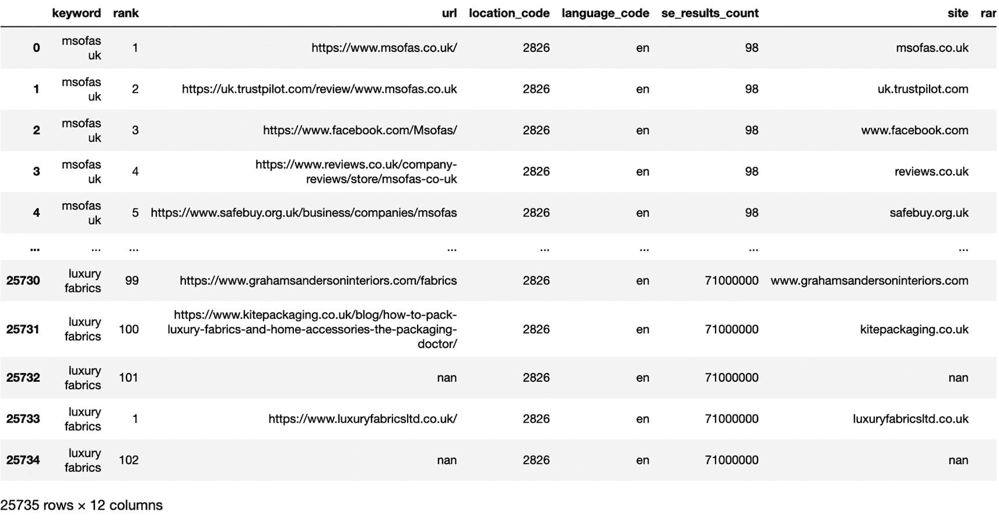

一个包含 25735 行和 12 列的表。列标题为`keyword`、`rank`、`url`、`location code`、`language code`、`se results count`和`site`，行中按关键词分类填充了数据。

## 聚焦竞争对手

SERP 数据能有效告诉我们，在排名作为结果指标的情况下，谷歌奖励了哪些内容。然而，这些数据中很多可能包含噪声，并且其中一些列很可能包含能够解释内容间排名差异的排名因素。

内容之所以存在噪声，是因为 SERP 中可能包含来自某些网站（如评论和参考类网站）的内容，商业网站很难从中学习。最终，在进行这项分析时，SEO 主要关注的是在考虑其他网站之前，如何超越竞争对手的网站。

因此，你需要筛选出竞争对手，以使你的研究更有意义。例如，如果你的客户或品牌处于网络研讨会技术领域，那么将 `Wikipedia.com` 或 `Amazon.com` 纳入数据集就没有意义，因为它们并不直接与你的品牌竞争。

你真正需要的是近乎直接或直接的竞争对手，即“撞脸”网站，这样你才能比较它们做了或没做什么，从而使其排名比你高或低。

这种方法的缺点在于，通过剔除非竞争对手，你无法全面了解谷歌希望从 SERP 中获得什么。这是因为 SERP 需要作为一个整体来分析，这在第 10 章中有所涉及。然而，本章是关于竞争对手分析的，所以我们继续往下进行。

为了找到竞争对手，我们需要进行一些聚合操作，首先从计算“触达量”（即排名在前 10 位的内容数量）开始：

```
major_players_reach = serps_df.loc[serps_df['rank'] < 10]
```

将 SERP 过滤或限制在前 10 名后，我们将按网站聚合前 10 名的总数，使用 `groupby` 按网站分组并求和 `count` 列：

```
major_players_reach = major_players_reach.groupby('site').agg({'count': sum}).reset_index()
```

然后，我们将按触达量的降序对网站进行排序：

```
major_players_reach = major_players_reach.sort_values('count', ascending = False)
```

触达量指标通过提供数量，基本能说明问题，但我们还需要通过计算中位数来获取排名。这将有助于对触达量水平相当的网站进行排序。

```
major_players_rank = serps_df.groupby('site').agg({'rank': 'median'}).reset_index()
major_players_rank = major_players_rank.sort_values('rank')
```

按搜索引擎结果数量进行聚合，有助于衡量关键词的整体竞争度，该指标通过平均值进行聚合。这些数据由 DataForSEO 的 SERP API 独家提供。不过，你也可以轻松地用其他 SERP 跟踪工具（如 SEO Monitor）提供的更常见的搜索量指标来替代。

```
major_players_searches = serps_df.groupby('site').agg({'se_results_count': 'mean'}).reset_index()
major_players_searches = major_players_searches.sort_values('se_results_count')
```

排名和搜索结果聚合数据通过 `merge()` 函数连接到触达数据上，形成一张表。这相当于以 `site` 列作为合并依据进行 `vlookup` 操作：

```
major_players_stats = major_players_reach.merge(major_players_rank, on = 'site', how = 'left')
major_players_stats = major_players_stats.merge(major_players_searches, on = 'site', how = 'left')
```

利用所有数据，我们将计算一个整体可见性指标，该指标将触达量的平方除以排名。对触达量进行平方是为了避免那些只有少数前 10 名但排名非常高的网站出现在列表顶部。

排名作为除数，是因为排名数字越小越好；因此，除以一个较小的数字会提高网站的可见性值，前提是其排名更高：

```
major_players_stats['visibility'] = ((major_players_stats['reach'] ** 2) / major_players_stats['rank']).round()
```

排除社交媒体网站，以聚焦于商业竞争对手：

```
major_players_stats = major_players_stats.loc[~major_players_stats['site'].str.contains('|'.join(social_sites))]
```

将 `count` 重命名为 `reach`：

```
major_players_stats = major_players_stats.rename(columns = {'count': 'reach'})
```

移除包含 `nan` 值的网站：

```
major_players_stats = major_players_stats.loc[major_players_stats['site'] != 'nan']
major_players_stats.head(10)
```

结果如下：

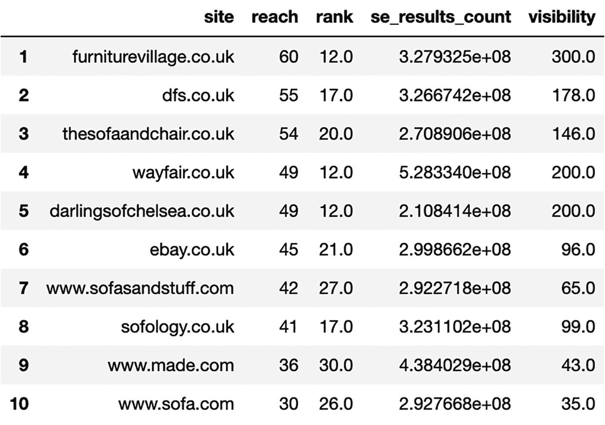

一个包含 11 行 5 列的表格，列标题为网站、触达量、排名、搜索结果数量和可见性。网站 `furniturevillage.co.uk` 的数据显示为：触达量 60，排名 12，可见性等于 60 乘以 60 再除以 12，即 300。

该数据框显示了预计会主导 SERP 的前 20 个特色网站。其中一些排名靠前的网站并非直接竞争对手（可能无法爬取！），因此这些网站将被移除，因为我们希望从最直接的竞争对手那里学习，了解他们最高效的 SEO 策略。

因此，我们将选择最直接的竞争对手，并将其存储在一个列表 `player_sites_lst` 中：

```
player_sites_lst = ['sofology.co.uk', 'www.designersofas4u.co.uk', 'www.heals.com', 'darlingsofchelsea.co.uk', 'www.made.com', 'www.sofasandstuff.com', 'www.arloandjacob.com', 'loaf.com', 'www.made.com', 'theenglishsofacompany.co.uk', 'willowandhall.co.uk', root_domain]
```

该列表将用于过滤 SERP，使其仅包含来自这些直接竞争对手的内容：

```
direct_players_stats = major_players_stats.loc[major_players_stats['site'].isin(player_sites_lst)]
direct_players_stats
```

结果如下：

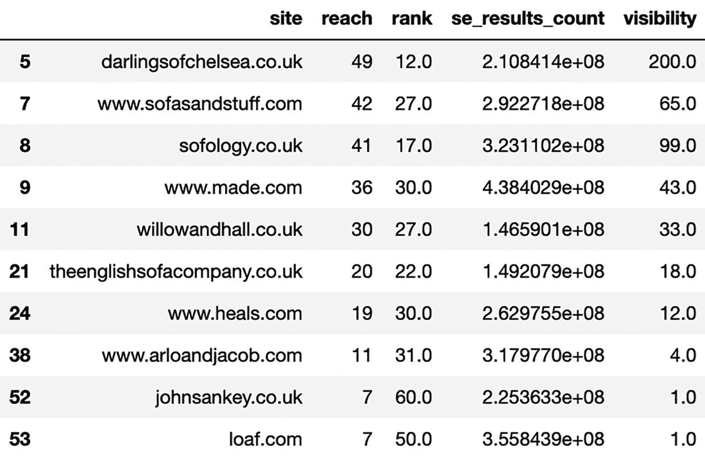

一个包含 11 行 5 列的表格，列标题为网站、触达量、排名、搜索结果数量和可见性，数据针对直接竞争对手。网站 `darlingsofchelsea.co.uk` 的数据显示为：触达量 49，排名 12，可见性 200，排名最高；而 `loaf.com` 的可见性最低，为 1.0。

数据框显示，Darlings of Chelsea 是触达量最大、平均排名最高的领先网站，是需要“击败”的目标。

让我们将其可视化：

```
major_players_stats_plt = (
ggplot(direct_players_stats,
aes(x = 'reach', y = 'rank', fill = 'site', colour = 'site',
size = 'se_results_count')) +
geom_point(alpha = 0.8) +
geom_text(direct_players_stats, aes(label = 'site'), position=position_stack(vjust=-0.08)) +
labs(y = '谷歌排名', x = '谷歌触达量') +
scale_y_reverse() +
scale_size_continuous(range = [5, 20]) +
theme(legend_position = 'none', axis_text_x=element_text(rotation=0, hjust=1, size = 12))
)
major_players_stats_plt.save(filename = 'images/1_major_players_stats_plt.png',
height=5, width=8, units = 'in', dpi=1000)
major_players_stats_plt
```

尽管 Darlings of Chelsea 在奢侈品领域处于领先地位，但 `Made.com` 在竞争更激烈的关键词上拥有最高的存在感，这从其数据点的大小（`se_results_count`）可以看出（图 6-2）。

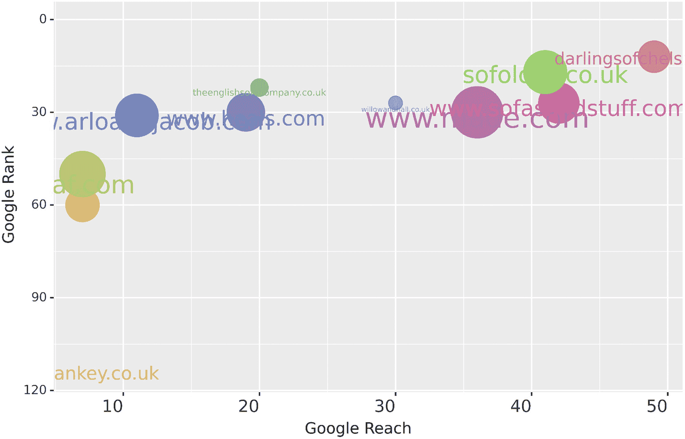

一个气泡图，展示了前十名网站在谷歌排名与谷歌触达量方面的对比。`www.made.com`的气泡最大，触达量为 36，排名为 30。`johnsankey.co.uk`的气泡最小，触达量为 7，排名为 60。

### 图 6-2 气泡图比较了每个网站在谷歌前 10 名（触达量）中的表现及其平均谷歌排名位置。圆圈大小代表每个网站出现查询的搜索结果数量

另一方面，John Sankey 的排名最低，触达量也最少。

仅针对直接竞争对手过滤 SERP 数据，将使数据中的噪声减少：

```python
player_serps = serps_df[serps_df['site'].isin(player_sites_lst)]
player_serps
```

结果如下：

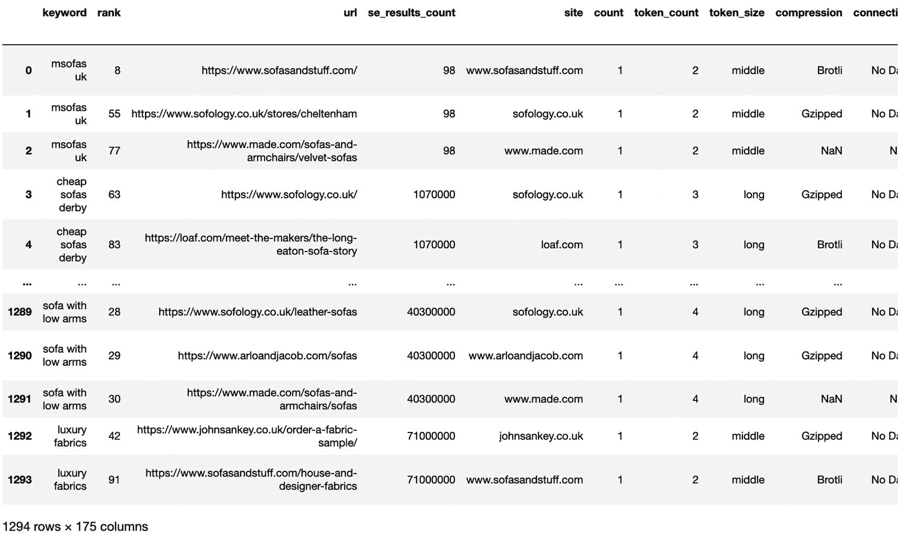

一个包含 1294 行和 175 列的表，表头为`keyword`、`rank`、`url`、`se results count`、`site`、`count`、`token count`、`token size`、`compression`和`connectivity`。数据针对直接竞争对手进行了过滤，`se results count`按升序排列，导致行数从 25000 减少到 1294。

我们最终得到一个行数大幅减少的数据框，从 25000 行减少到 1294 行。尽管机器学习算法通常在 10000 行或更多数据时表现最佳，但这些方法在洞察速度和一致性方面仍然优于在电子表格中手动操作。

我们正在分析最相关的网站，并可以继续收集这些网站的数据。这些将构成我们的假设，进而形成可能的排名因素，用以解释网站之间排名的差异。

网站爬取提供了丰富的数据源，因为它们包含了排名页面的内容和技术 SEO 特征信息，这将是我们的起点。

### 定义导出函数

我们将首先定义一个函数，将用于网站爬取的 URL 导出到 CSV 文件：

```python
def export_crawl(df):
    dom_name = df.domain.iloc[0]
    df = df[['url']]
    df = df[['url']].drop_duplicates()
    df.to_csv('data/1_to_crawl/' + dom_name + '_crawl_urls.csv', index=False)
```

该函数通过`groupby()`函数应用于过滤后的 SERP 数据框：

```python
direct_players_stats.groupby(site).apply(export_crawl)
```

结果如下：

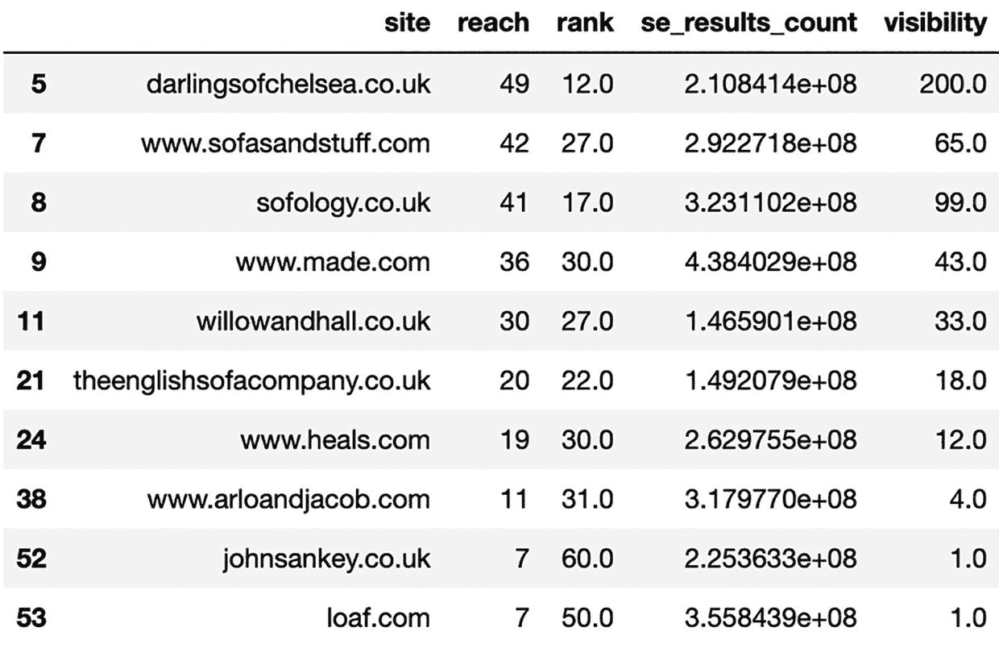

一个包含 11 行和 5 列的表，表头为`site`、`reach`、`rank`、`se results count`和`visibility`，用于网站爬取和去除重复 URL。数据包含每个竞争对手的单个网站，并按`visibility`顺序排列。

### 读取与合并爬取数据

数据爬取完成后，我们可以将导出文件存储在一个文件夹中，然后逐个读取。

在此示例中，我们将文件路径设置为名为`crawl_path`的变量：

```python
crawl_path = 'data/2_crawled/'
crawl_filenames = os.listdir(crawl_path)
crawl_filenames
['www_johnsankey_co_uk.csv',
 'www_sofasandstuff_com.csv',
 'loaf_com.csv',
 'www_designersofas4u_co_uk.csv',
 'www_theenglishsofacompany_co_uk.csv',
 'www_willowandhall_co_uk.csv',
 'www_darlingsofchelsea_co_uk.csv',
 'www_sofology_co_uk.csv',
 'www_arloandjacob_com.csv']
crawl_df_lst = list()
crawl_colnames = list()
```

使用`for`循环遍历网站审计器 CSV 导出文件列表，并将数据读入一个列表：

```python
for filename in crawl_filenames:
    df = pd.read_csv(crawl_path + filename)
    df['sitefile'] = filename
    df['sitefile'] = df['sitefile'].str.replace('_', '.', regex = False)
    df['sitefile'] = df['sitefile'].str.replace('.csv', '', regex = False)
    crawl_colnames.append(df.columns)
    crawl_df_lst.append(df)
```

然后将这个列表`crawl_df_lst`合并成一个数据框：

```python
crawl_raw = pd.concat(crawl_df_lst)
```

通过移除格式并将列名转换为小写，使列名更便于数据处理：

```python
crawl_raw.columns = [col.lower().replace(' ', '_').replace(')', '_').replace('(', '_').replace(',', '_').replace(':', '_').replace('.', '_').replace('__', '_') for col in crawl_raw.columns]
crawl_raw
```

结果如下：

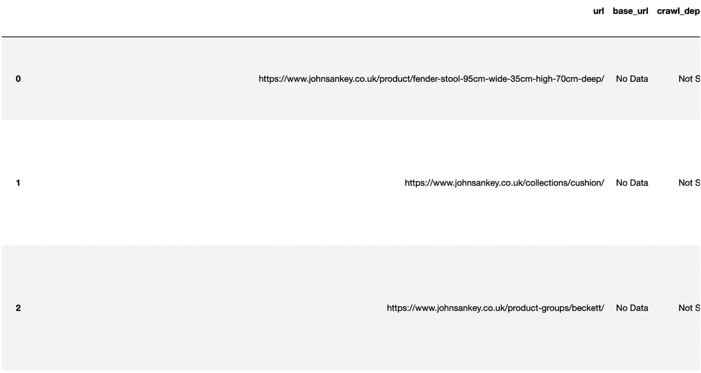

一个包含 4 行和 3 列的表，表头为`url`、`base url`和`crawl depth`，以及选定单个网站的数据。不同产品的 Johnsankey 网站具有不同的`base url`，未显示数据。

### 清理与转换数据

```python
crawl_df = crawl_raw.copy()
```

获取网站名称有助于我们按网站聚合数据。使用列表推导式，我们将遍历数据框的 URL 列，并应用`urisplit()`函数：

```python
crawl_df['site'] = [uritools.urisplit(uri).authority if uritools.isuri(uri) else uri for uri in crawl_df['url']]
```

仅过滤 HTML URL：

```python
crawl_df = crawl_df.loc[crawl_df['content_type'] == 'HTML']
crawl_df
```

结果如下：

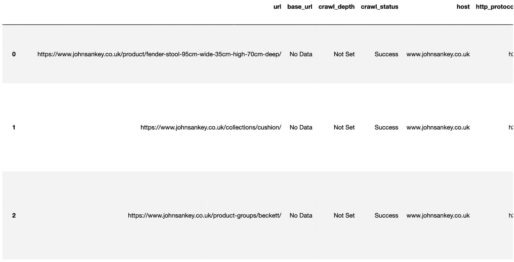

一个包含 4 行和 6 列的表，表头为`URL`、`base url`、`crawl depth`、`crawl status`和`host`。提供的数据之一是`https://www.johnsankey.co.uk/collections/cushion/`，无数据，未设置，成功，以及`www.johnsankey.co.uk`。

使用`.dtypes`属性打印数据类型有助于我们查看哪些列可能需要转换为更可用的数据类型：

```python
print(crawl_df.dtypes)
```

从下面以蓝色高亮显示的打印列表中，我们可以看到存在一些数值变量，它们当前是对象格式，但应为`float64`，因此需要进行转换。

结果如下：

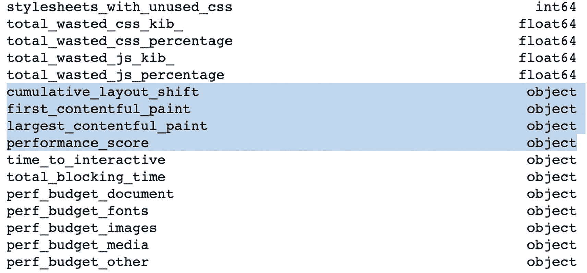

使用`dtypes`函数将计算机数据从一种格式转换为另一种格式的示意图。数据显示`performance_score`和`cumulative_layout_shift`需要从对象格式转换为`float64`格式。

我们将创建数据框的一个副本，以生成一个包含转换后列的新数据框：

```python
cleaner_crawl = crawl_df.copy()
```

从阅读时间开始，我们将使用`np.where()`将"No Data"替换为当前时间格式：

```python
cleaner_crawl['reading_time_mm_ss_'] = np.where(cleaner_crawl['reading_time_mm_ss_'] == 'No Data', '00:00', cleaner_crawl['reading_time_mm_ss_'])
cleaner_crawl['reading_time_mm_ss_'] = '00:' + cleaner_crawl['reading_time_mm_ss_']
```

并将其转换为时间格式：

```python
cleaner_crawl['reading_time_mm_ss_'] = pd.to_timedelta(cleaner_crawl['reading_time_mm_ss_']).dt.total_seconds()
```

我们将其他字符串格式的列转换为浮点数，首先定义要转换的列列表：

```python
float_cols = ['cumulative_layout_shift', 'first_contentful_paint', 'largest_contentful_paint', 'performance_score',
              'time_to_interactive', 'total_blocking_time']
```

使用该列表，我们将应用`apply`列和`to_numeric()`函数来转换这些列：

```python
cleaner_crawl[float_cols] = cleaner_crawl[float_cols].apply(pd.to_numeric, errors='coerce')
```

现在查看最近转换的列：

```python
cleaner_crawl[['url', 'reading_time_mm_ss_'] + float_cols]
```

结果如下：

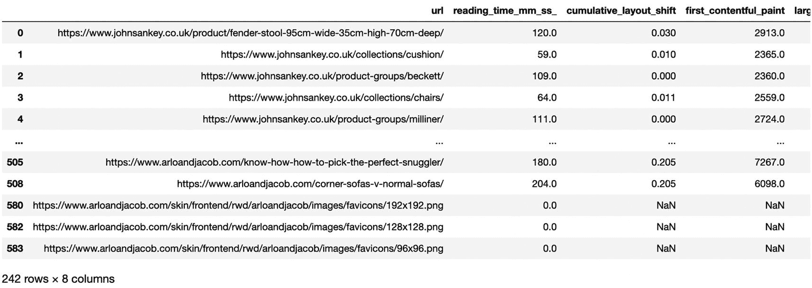

一个包含 242 行和 8 列的表，表头为`URL`、`reading time mm ss`、`cumulative layout shift`和`first contentful paint`。数据显示了 johnsankey 的不同 URL，其中一个网站的阅读时间为 120.0，累积布局偏移为 0.030，首次内容绘制为 2913.0。

列格式已正确。对于更高级的功能，您可能希望尝试根据格式（如博客、指南、类别、子类别、项目等）对不同的内容类型进行分段。

### 导入反向链接权威数据

为了进一步提取特征，我们将导入反向链接权威数据。首先，我们通过读取文件夹中的所有 AHREFs 数据来导入数据：

```python
# read loop files in folder
authority_path = 'data/4_ahrefs/'
authority_filenames = os.listdir(authority_path)
authority_filenames
```

AHREFs 文件列表已准备好，可以迭代处理：

```python
['darlingsofchelsea.co.uk-best-pages-by-links-subdomains-12-Sep-2022_19-17-56.csv',
 'sofology.co.uk-best-pages-by-links-subdomains-12-Sep-2022_19-24-00.csv',
 'sofasandstuff.com-best-pages-by-links-subdomains-12-Sep-2022_19-23-42.csv',
 'willowandhall.co.uk-best-pages-by-links-subdomains-12-Sep-2022_19-17-03.csv',
 'theenglishsofacompany.co.uk-best-pages-by-links-subdomains-12-Sep-2022_19-24-53.csv',
 'arloandjacob.com-best-pages-by-links-subdomains-12-Sep-2022_19-23-19.csv',
 'designersofas4u.co.uk-best-pages-by-links-subdomains-12-Sep-2022_19-16-38.csv',
 'johnsankey.co.uk-best-pages-by-links-subdomains-12-Sep-2022_19-16-04.csv',
 'heals.com-best-pages-by-links-subdomains-12-Sep-2022_19-17-32.csv',
 'loaf.com-best-pages-by-links-subdomains-12-Sep-2022_19-25-17.csv']
```

初始化列表以包含`for`循环的输出：

```python
auth_df_lst = list()
auth_colnames = list()
```