# 8. 仪表板

虽然性能仪表板系统本身并不能直接解决 SEO 问题，但拥有这样的基础设施可以成为一个非常有用的数据存储库，用于支持 SEO 科学，并创建可视化图表来传达有用的趋势、变化、威胁和机遇。更重要的是，SEO 数据丰富，有大量的数据源和许多你可以衡量的东西，因此整体情况可能看起来非常嘈杂，最糟糕的情况下，如果你无法清晰地看到并获取信号，这些数据可能毫无用处。拥有一个使用精心设计和深思熟虑的仪表板的性能报告系统，将有助于从嘈杂的数据中突出最重要的趋势。这也将更容易识别因果关系。我们将提供一些用 SQL 编写的代码，以帮助你理解如何实现一些最有价值的可视化。

## 数据源

你希望为仪表板使用的数据源类型是那些 (a) 提供 API 并且 (b) 显然能增加信息以更有效地理解你的 SEO 性能的数据源。这些可能包括（并且这绝非详尽无遗）：

*   *网站分析*：Google Analytics (GA)、Adobe Analytics、Looker、Segment
*   *站长工具*：Google Search Console (GSC)、Bing Webmaster
*   *云端网络爬虫*：DeepCrawl、OnCrawl 和 Botify
*   *SERP*：getSTAT、SEO Monitor、DataForSEO、AWR、AccuRanker
*   *链接检查器*：AHREFs、Majestic、DataForSEO
*   *社交媒体*：BuzzSumo
*   *关键词*：SEMRush、Keywords.io
*   *广告平台*：Google Ads、DV360

## 不要直接接入 Google Data Studio

谷歌提供了便捷的连接器来接入数据源，例如 Google Analytics (GA) 和 Google Search Console (GSC)。这允许将数据直接导入 Google Data Studio (GDS)，从而使 SEO 仪表板变得简单。然而，这是一个错失的机会，因为在 GDS 中无法叠加这两个数据源之间的数据。GDS 是一个用于可视化数据的前端。如果没有一个在数据源和前端之间进行处理的流程，数据就是原始的、未经提炼的，并且对于发现趋势和揭示洞察来说用处不大。

## 使用数据仓库

这时就需要像 Google BigQuery 或 Amazon Redshift 这样的数据仓库登场了。你将数据存储在这些数据仓库中，而前端（无论是 GDS、Tableau、DOMO 还是其他工具）都会使用自定义的结构化查询语言（SQL）来查询数据仓库，并以适合驱动你所需图表的格式获取数据。我们将与你分享 SQL 代码和一些图表，帮助你构建自己的 SEO 仪表板。不过，在开始构建之前，你需要先将数据导入数据仓库。那么，我们该如何实现呢？

## 提取、转换和加载（ETL）

提取、转换和加载（ETL）是一种方法，字面意思如下：

*   *提取*：从你的数据源 API 中提取数据。
*   *转换*：根据提取的数据运行计算并创建新的计算字段。
*   *加载*：将转换后的数据加载到数据仓库中。

根据你选择的云平台、团队云工程技能以及预算，你可以采用多种配置方案。

## 提取数据

提取过程通常是自动化的，通过运行脚本的虚拟机每天查询你的 API（称为“轮询”）。数据会存储在存储空间或数据仓库中。即使你没有云工程技能，也可以通过 CSV 格式将数据上传到数据仓库。

以下是从多个 API 提取数据的代码，这些 API 主要包括 Google 产品以及一些（并非全部）较为知名的 SEO 流程：

*   Google Analytics
*   Google Search Console
*   DataForSEO SERPs API
*   Google PageSpeed API

现在，我们将提供 Python 代码，让你连接到这些 API。这些代码不仅可用于报告目的，还可以进行调整，以支持其他章节中涵盖的其他 SEO 科学活动。

### Google Analytics

流量仍然是增长的关键杠杆，而 Google Analytics 作为网站分析工具被广泛使用。然而，更多的自然搜索流量并不总是直接与更多收入相关，但它可能通过其他方式表明用户参与度。以下将详细介绍从最知名且最常用的网站分析 API（即 Google Analytics 版本 4）中提取数据的代码。

#### 导入 API 库

```python
import pandas as pd
from pathlib import Path
import os
from datetime import date, timedelta
```

#### 设置凭证密钥的文件路径

设置凭证密钥的文件路径，该文件是一个 JSON 文件，可从你的 Google Cloud Platform 账户的 API 库 ➤ 凭据中获取：

```python
credentials_path = Path("keys/xxxxx.json")
credentials_path_str = str(credentials_path.absolute())
os.environ["GOOGLE_APPLICATION_CREDENTIALS"] = credentials_path_str
```

#### 从 Google 库中导入其他 API

```python
from google.analytics.data_v1beta import BetaAnalyticsDataClient
from google.analytics.data_v1beta.types import DateRange
from google.analytics.data_v1beta.types import Dimension
from google.analytics.data_v1beta.types import Metric
from google.analytics.data_v1beta.types import RunReportRequest
client = BetaAnalyticsDataClient()
```

#### 定义一个函数来运行聚合报告

定义一个函数来运行聚合报告，该函数需要日期范围和 GA4 账户的属性 ID。在此函数中，我们使用输入参数查询 API 以构建请求，其中包含我们想要的指标，并存储 API 响应。

我们将维度设置为 `landingPage`，因为我们希望按此维度细分流量数据。也可以使用其他维度，这些维度列在此处（[`https://developers.google.com/analytics/devguides/reporting/data/v1/api-schema`](https://developers.google.com/analytics/devguides/reporting/data/v1/api-schema)）。

```python
# (此处省略了后续函数的代码，根据用户提供的文本，这部分内容在“提取数据”这一节中)
```

---

接下来，继续处理文本的其余部分：

```r
simul_abgroup_trend_plt = (
ggplot(simul_abgroup_trend,
aes(x = 'date', y = 'sessions', colour = 'ab_group', group = 'ab_group')) +
geom_line(alpha = 0.6, size = 3) +
labs(y = 'Count', x = '') +
theme(legend_position = 'right',
axis_text_y =element_text(rotation=0, hjust=1, size = 12),
legend_title = element_blank()
)
)
simul_abgroup_trend_plt.save(filename = 'images/3_simul_abgroup_trend_plt.png',
height=5, width=8, units = 'in', dpi=1000)
simul_abgroup_trend_plt
```

图 7-4 显示了 `simul_abgroup_trend_plt` 生成的时间序列图。两组在此期间都经历了下降；然而，测试组的表现优于对照组。

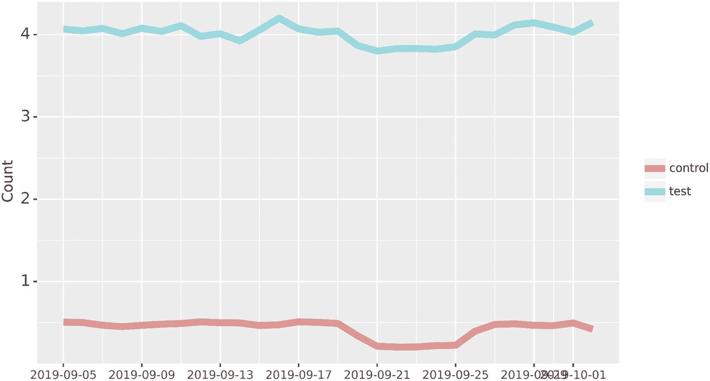

一个折线图，显示了 2019 年 9 月 5 日至 2019 年 10 月 1 日期间对照组和测试组的计数趋势。测试组的计数从 4 开始，而对照组的计数从 0.5 开始。两者在整个过程中都遵循稳定的趋势。

**图 7-4** 测试组和对照组会话数随时间变化的时间序列图

接下来，我们将检查会话数的整体分布，首先从直方图开始：

```r
ab_assign_plt = (
ggplot(test_analytics_expanded,
aes(x = 'sessions', fill = 'ab_group')) +
geom_histogram(alpha = 0.6, bins = 30) +
labs(y = 'Count', x = '') +
#scale_y_log10() +
#coord_flip() +
theme(legend_position = 'none',
axis_text_y =element_text(rotation=0, hjust=1, size = 12),
legend_title = element_blank()
) +
facet_wrap('ab_group', scales = 'free')
)
ab_assign_plt.save(filename = 'images/4_ab_test_plt.png',
height=5, width=8, units = 'in', dpi=1000)
ab_assign_plt
```

图 7-5 显示了 `ab_assign_plt`，这是对照组和测试组会话数分布的并排比较。图表显示，测试组的分布在零以上有更多的数据点，这看起来很有希望。

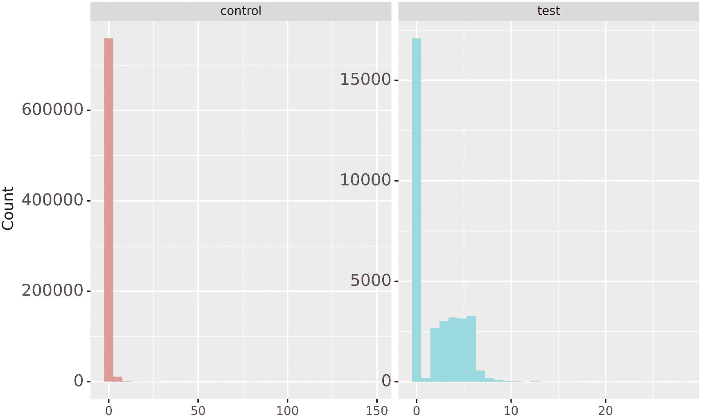

一组 2 个直方图，表示对照组和测试组的计数。它表明在测试组的图中，计数大于 0 的数据点更多。

**图 7-5** 对照组和测试组的直方图分布图

箱线图方法将用于进一步对比分布：

```python
ab_assign_box_plt = (
    ggplot(test_analytics_expand,
           aes(x = 'ab_group', y = 'sessions',
               fill = 'ab_group', colour = 'ab_group')) +
    geom_boxplot(alpha = 0.8) +
    labs(y = 'Count', x = '') +
    theme(legend_position = 'none',
          axis_text_y = element_text(rotation=0, hjust=1, size = 12),
          legend_title = element_blank()
    )
)
ab_assign_box_plt.save(filename = 'images/4_ab_test_box_plt.png',
                       height=5, width=8, units = 'in', dpi=1000)
ab_assign_box_plt
```

图 7-6 展示了 `ab_assign_box_plt`，这是一个对照组和测试组的箱线图对比。

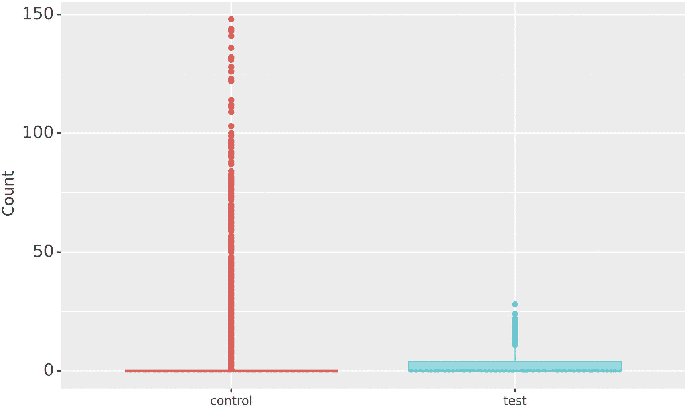

箱线图展示了对照组和测试组的计数。它表明对照组的计数高于测试组。

**图 7-6** 测试组和对照组的会话箱线图

对照组有更多的异常值，但测试组的零值远少于对照组。

由于刻度比例导致难以区分，因此我们将对会话刻度取对数以便进一步可视化：

```python
ab_assign_log_box_plt = (
    ggplot(test_analytics_expanded,
           aes(x = 'ab_group', y = 'sessions',
               fill = 'ab_group', colour = 'ab_group')) +
    geom_boxplot(alpha = 0.6) +
    labs(y = 'Count', x = '') +
    scale_y_log10() +
    theme(legend_position = 'none',
          axis_text_y = element_text(rotation=0, hjust=1, size = 12),
          legend_title = element_blank()
    )
)
ab_assign_log_box_plt.save(filename = 'images/4_ab_assign_log_box_plt.png',
                           height=5, width=8, units = 'in', dpi=1000)
ab_assign_log_box_plt
```

图 7-7 展示了 `ab_assign_log_box_plt`，这是一个对照组和测试组的箱线图对比，只是这次对纵轴进行了对数化处理，以便于可视化比较。

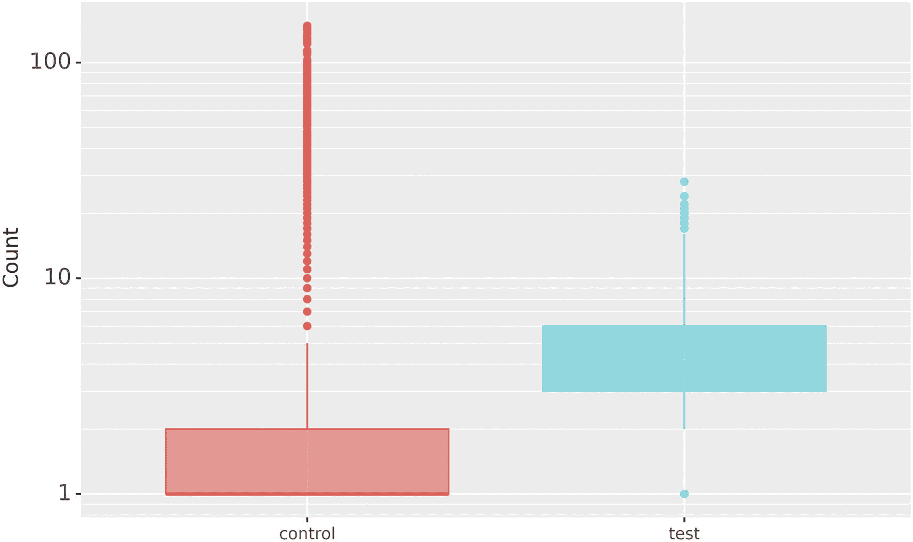

箱线图展示了对照组和测试组的计数。它表明测试组的中位数更高，而对照组的上须值远高于测试组。

**图 7-7** 测试组和对照组的箱线图

在所有情况下，我们都可以看到平均会话数接近于零，并且任何一天都有许多着陆页的会话数为零，这表明会话是一个罕见事件。这种分布类型被称为“泊松分布”。因此，我们将使用负二项分布来检验测试组和对照组之间的差异是否显著。

首先，我们将数据标记为测试组（1.0）或对照组（0.0），然后将其转换为数组：

```python
X = np.where(test_analytics_expand['ab_group'] == 'control', 0.0, 1.0)
X = add_constant(X)
X = np.asarray(X)
X
array([[1., 0.],
       [1., 0.],
       [1., 0.],
       ...,
       [1., 1.],
       [1., 1.],
       [1., 1.]])
```

使用负二项分布拟合按 `ab_group` 分组的会话模型：

```python
ab_model = NegativeBinomial(test_analytics_expand['sessions'],
                            X).fit()
```

打印模型摘要：

```python
ab_model.summary()
```

以下是 `ab_model.summary()` 的截图：

```
Optimization terminated successfully.
Current function value: 1.155104
Iterations: 9
Function evaluations: 10
Gradient evaluations: 10
```

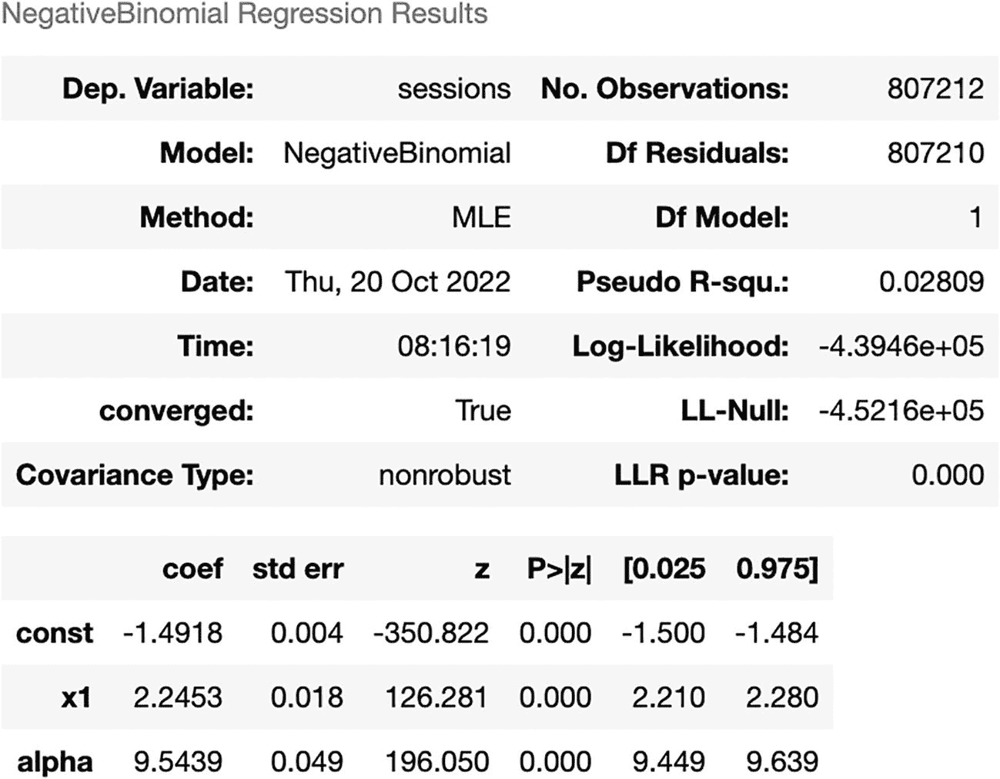

一个表格展示了因变量、模型、方法、日期、时间、协方差类型、观测数、`df residual` 和 `df model` 以及其他变量的详细信息。在底部，它显示了常数、`x1` 和 alpha 的不同值。

从上述结果中，我们可以得出结论，这种变化确实是显著的。与对照组相比，测试组（由 `x1` 表示）平均多展示了 2.24 次页面浏览量。就显著性而言，LLR p 值为零，因此差异由随机噪声引起的可能性极低。有趣的是，用于衡量 `ab_group` 对会话本身解释程度的伪 R 方非常低，仅为 0.029，这意味着该模型噪声很大，需要更多其他因素来预测流量水平，而不仅仅是 `ab_group`。

## 非结论性实验的结果

实验可能因多种原因未能达到预期效果：

*   预期差异过高——因此考虑修改并重新运行实验。
*   假设需要以不同方式检验——或许使用不同的衡量指标或不同的检验方法。
*   需要不同的时间段——即使满足了样本量要求，也可能是由于季节性效应，例如一年中的特定时间，或者数据在完整一周运行之前就满足了样本要求，或者谷歌没有机会处理这些变化（参见之前的讨论）。
*   其他外部因素。

通过从一开始就设定你的假设，无论结果如何，你都会学到一些东西，并且能够制定一个合理的计划向前推进，无论是进行下一次测试，还是在全站范围内实施你的测试。

## 总结

实验一直是 SEO 专家技能的一部分，用于确定哪些策略可能有效，即使有时缺乏科学严谨性。在企业环境中，由于对收入的影响以及需要在全站推广更改之前证明建议是有益的，严谨的实验设计至关重要。虽然有工具可以在这方面提供帮助，但了解 SEO 拆分测试背后的数据科学以及必须牢记的注意事项也很有用。在本章中，我们涵盖了：

*   实验在 SEO 中的重要性
*   生成假设
*   实验设计
*   运行你的实验
*   评估你的实验
*   以及如果你的实验“失败”了该怎么办

在下一章中，我们将介绍以仪表板形式呈现的 SEO 报告。

```
def aggregated_run_report(client, property_id="[your-GA-property-id]", date_ranges=[DateRange(start_date="2020-03-31", end_date="today")]):
    request = RunReportRequest(
        property=f"properties/{property_id}",
        dimensions=[Dimension(name="landingPage")],
        metrics=[
            Metric(name="activeUsers"),
            Metric(name="screenPageViewsPerSession"),
            Metric(name="bounceRate"),
            Metric(name="averageSessionDuration"),
            Metric(name="userConversionRate"),
            Metric(name="ecommercePurchases"),
        ],
        date_ranges=date_ranges,
    )
    response = client.run_report(request)
    return response

response = aggregated_run_report(client)
print("Report result:")
for row in response.rows:
    print(row.dimension_values[0].value, row.metric_values[0].value)

Report result:
/ 11347
/blog/sell-airtime-over-charged-your-line-dont-panic 8423
/faq 4870
/blog/sell-airtime-over-charged-your-line-dont-panic 2355
/privacy 1338
```

## 将 API 响应转换为数据框

下一个函数使用 API 响应结果行，并将其打包成一个数据框：

```
def ga4_response_to_df(response):
    dim_len = len(response.dimension_headers)
    metric_len = len(response.metric_headers)
    all_data = []
    for row in response.rows:
        row_data = {}
        for i in range(dim_len):
            row_data.update({response.dimension_headers[i].name: row.dimension_values[i].value})
        for i in range(metric_len):
            row_data.update({response.metric_headers[i].name: row.metric_values[i].value})
        all_data.append(row_data)
    df = pd.DataFrame(all_data)
    return df

df = ga4_response_to_df(response)
df.info()
```

结果如下：

```
RangeIndex: 418 entries, 0 to 417
Data columns (total 8 columns):
```

```
#   Column      Non-Null Count  Dtype
---  ------      ------------  -----
0   landingPage 418 non-null    object
1   dateRange   418 non-null    object
2   activeUsers 418 non-null    object
3   screenPageViewsPerSession  418 non-null    object
4   bounceRate  418 non-null    object
5   averageSessionDuration     418 non-null    object
6   userConversionRate         418 non-null    object
7   ecommercePurchases         418 non-null    object
dtypes: object(8)
memory usage: 26.2+ KB
```

通过 `df.info()` 打印数据框的属性，可以告诉我们数据类型，它们看起来都是字符串。对于着陆页来说这没问题，但对于指标（例如 `activeUsers`）则不然，在进一步处理数据之前，应将其转换为数值类型。

```
df.head()
```

以下生成的数据框显示了维度 `landingPage` 以及各个指标。数据是在整个日期范围内聚合的。

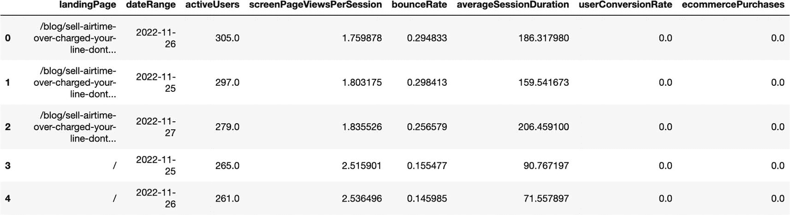

一个数据框的截图，展示了维度条目及其对应的指标。列标题分别为：着陆页、数据范围、活跃用户、每次会话的屏幕页面浏览量、跳出率、平均会话时长、用户转化率和电子商务购买量。

但假设你还希望数据按日期细分。

以下函数将实现这一点，默认天数参数设置为两年：

```
def dated_run_report_to_df(client, property_id="xxxxxxxxx", n_days=365*2):
date_ranges = []
count = 0
df_output = pd.DataFrame()
for i in range(n_days):
count += 1
current = date.today() - timedelta(days=i)
before = date.today() - timedelta(days=i+1)
date_ranges.append(DateRange(start_date=before.strftime("%Y-%m-%d"),
end_date=current.strftime("%Y-%m-%d"),
name=current.strftime("%Y-%m-%d")))
if count == 4:
response = aggregated_run_report(client, property_id=property_id, date_ranges=date_ranges)
df = ga4_response_to_df(response)
df_output = pd.concat([df_output, df], ignore_index=True)
```

# 重新初始化

```
count = 0
date_ranges = []
return df_output
```

运行该函数；在此示例中，我们将提取最近 90 天的数据：

```
df = dated_run_report_to_df(client, n_days=90)
```

以下函数将列数据格式从 `str` 转换为合适的格式（主要为数值型）：

```
def format_df(df):
    df["dateRange"] = pd.to_datetime(df["dateRange"])
    df["activeUsers"] = df["activeUsers"].astype("float")
    df["screenPageViewsPerSession"] = df["screenPageViewsPerSession"].astype("float")
    df["bounceRate"] = df["bounceRate"].astype("float")
    df["averageSessionDuration"] = df["averageSessionDuration"].astype("float")
    df["userConversionRate"] = df["userConversionRate"].astype("float")
    df["ecommercePurchases"] = df["ecommercePurchases"].astype("float")
    return df

df = format_df(df)
df.info()
```

运行结果如下：

```
RangeIndex: 376 entries, 0 to 375
Data columns (total 8 columns):
```

# 数据框介绍与API数据获取

## 数据框结构
数据框的列信息如下：
```
#   Column                      Non-Null Count  Dtype
---  ------                      --------------  -----
0   landingPage                  376 non-null    object
1   dateRange                    376 non-null    datetime64[ns]
2   activeUsers                  376 non-null    float64
3   screenPageViewsPerSession    376 non-null    float64
4   bounceRate                   376 non-null    float64
5   averageSessionDuration       376 non-null    float64
6   userConversionRate           376 non-null    float64
7   ecommercePurchases           376 non-null    float64
dtypes: datetime64[ns], float64(6), object(1)
memory usage: 23.6+ KB
```

运行 `df` 的结果如下：

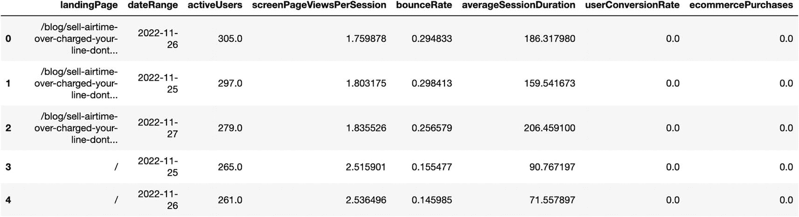

各维度条目及其指标的数据框截图。列标题分别为：着陆页、数据范围、活跃用户、每次会话的屏幕页面浏览量、跳出率、平均会话时长、用户转化率和电子商务购买量。结果是一个可供转换的数据框。

## DataForSEO SERPs API
`DataForSEO SERPs API` 专为返回指定关键词的 Google 搜索结果而设计。这对于检查排名、理解关键词的搜索意图以及其他 SEO 研究非常有用。

我们首先定义目标关键词列表：
```python
keywords_lst
```

运行结果如下：
```python
['airtime app',
 'airtime to cash app',
 'airtime transfer',
 'app to sell airtime',
 'app to transfer airtime from one network to another',
 'bet with airtime and win cash',
 'buy airtime online',
 'buy airtime with discount',
 'buy recharge card online',
 'buy recharge card online with debit card',
 'can i subscribe dstv with airtime?',
 'can i use my airtime to buy electricity?',
 'can you convert airtime to cash?', ...]
```

使用此 API，你需要将 [DataForSEO 客户端文件](https://docs.dataforseo.com/v3/) 放置在与运行此代码的 Jupyter notebook 脚本文件相同的文件夹中：
```python
from client import RestClient
client = RestClient("[your-username]", "xxxxxxxxxxxxxxx")
```

API 需要知道你想要查看哪个国家的搜索结果、设备类型以及语言，定义如下。国家/地区列表可在此处找到（[`https://docs.dataforseo.com/v3/serp/google/locations/?bash`](https://docs.dataforseo.com/v3/serp/google/locations/?bash)）。
```python
location = 2826
language = "en"
device_input = 'mobile'
```

以下是用于查询 API 的函数。`set_post_data` 将设置搜索参数：
```python
def set_post_data(search_query):
    post_data = dict()
    post_data[len(post_data)] = dict(
        language_code = language,
        location_code = location,
        device = device_input,
        keyword = search_query,
        calculate_rectangles = True)
    return post_data
```

函数 `get_api_result` 使用上述函数来构建输入，该输入将用于请求搜索结果。API 结果存储在一个名为 `response` 的变量中。其中包含一个 `try` 循环，以便在 API 调用出现问题时，函数能够继续执行并处理下一个关键词，从而避免阻塞整个操作或导致停滞：
```python
def get_api_result(search_query):
    post_data = set_post_data(search_query)
    response = client.post("/v3/serp/google/organic/live/advanced", post_data)
    try:
        return response
    except Exception as e:
        print(response)
        print(e)
        return None
```

由于需要查询多个关键词，我们将使用 `for` 循环多次调用该函数。

初始化一个空字典来存储各个 API 结果：
```python
desktop_serps_returned = {}
```

添加一个 `for` 循环，为列表中的每个关键词查询 API：
```python
i = 0
for search_query in set(keywords_lst):
    print(search_query, i + 1, len(keywords_lst) - i - 1)
    i += 1
    serp_dict = get_api_result(search_query)
    desktop_serps_returned[search_query] = serp_dict
```

在本书和 Jupyter notebook 中打印全部输出不太现实。因此，我们将打印存储数据的字典的键，这些键显示了拥有 API 数据的关键词。
```python
desktop_serps_returned.keys()
dict_keys(['buy recharge card online with debit card', 'can i use my airtime to buy electricity?', 'buy recharge card online', 'can you convert airtime to cash?', 'airtime to cash app', 'app to sell airtime', 'bet with airtime and win cash', 'airtime sell', 'buy airtime online', 'airtime sharing', 'can i subscribe dstv with airtime?', 'buy mtn', 'airtime buy', 'airtime transfer', 'buy airtime with discount', 'airtime app', 'airtime application', 'airtime bills', 'airtime funding', 'app to transfer airtime from one network to another'])
```

数据存储后，需要将字典解包为数据框格式，具体操作如下。

初始化一个空列表：
```python
desktop_serps_flat_df = []
```

使用 `for` 循环遍历字典的键，这些键将用于按关键词选取字典的对应部分。然后，我们遍历该关键词对应的字典数据内容，并将其添加到之前初始化的空列表中：
```python
for serp in desktop_serps_returned.keys():
    single_serp = desktop_serps_returned[serp]
    keyword = serp
    for task in single_serp['tasks']:
        cost = task['cost']
        task_id = task['id']
        se = task['data']['se']
        device = task['data']['device']
        os = task['data']['os']
        for res in task['result']:
            for idx, item in enumerate(res['items']):
                desktop_serps_flat_df.append(
                    (
                        cost, task_id, se, device, os, res['keyword'],
                        res['location_code'], res['language_code'],
                        res['se_results_count'], res['type'], res['se_domain'],
                        res['check_url'], item['rank_group'], item['rank_absolute'],
                        item.get('url', None), item.get('domain'), item.get('is_image'), item.get('is_featured_snippet'),
                        item.get('is_video'), item.get('is_malicious'), item.get('is_web_story'),
                        item.get('description'), item.get('pre_snippet'), item.get('amp_version'),
                        item.get('rating'), item.get('price'), item.get('highlighted'),
                        item.get('links'), item.get('faq'), item.get('extended_people_also_search'),
                        item.get('timestamp'), item.get('rectangle'),
                        res['datetime'], item.get('title'), item.get('cache_url')
                    )
                )
```

当列表包含了所有添加的关键词 SERP 数据后，将其转换为数据框：
```python
desktop_full_df = pd.DataFrame(
    desktop_serps_flat_df,
    columns=[
        'cost', 'task_id', 'se', 'device', 'os', 'keyword',
        'location_code', 'language_code', 'se_results_count',
        'type', 'se_domain', 'check_url', 'rank_group',
        'rank_absolute', 'url', 'domain', 'is_image', 'is_featured_snippet',
        'is_video', 'is_malicious', 'is_web_story',
        'description', 'pre_snippet', 'amp_version',
        'rating', 'price', 'highlighted', 'links',
        'faq', 'extended_people_also_search', 'timestamp', 'breadcrumb',
        'datetime', 'title', 'cache_url'
    ]
)
desktop_full_df.head(2)
```

结果如下：

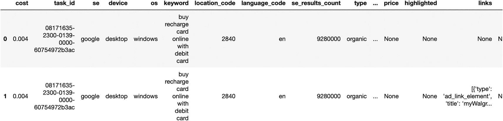

API 数据结果的截图。列标题包括 `cost`、`task_id`、`se`、`device`、`os`、`keyword`、`location_code`、`language_code`、`se_results_count`、`type`、`price` 和 `highlighted`。结果是以数据框形式呈现的 API 数据，可直接用于报告或报告前的转换处理。

## Google Search Console (GSC)
`Google Search Console (GSC)` 是第一方数据，也是大多数 SEO 从业者的数据权威来源。在此，我们将展示如何从 API 中提取数据，该 API 能提供比界面中标准的 1000 行更多的数据行。使用该 API 需要一个 `Google Cloud Platform (GCP)` 账户，您需要在该账户中创建一个 `GCP` 项目，并在该项目中创建带有 `JSON` 密钥的凭据。

首先，导入一些库：
```python
from apiclient import errors
from apiclient.discovery import build
import datetime
import httplib2
import re
import pandas as pd
import numpy as np
from collections import defaultdict
from oauth2client.client import OAuth2WebServerFlow
from datetime import datetime, timedelta, date
from dateutil.relativedelta import relativedelta
import calendar
import time
```

该脚本设计用于查询多个域名，这对于需要管理多个客户的代理机构报告系统，或者如果您是客户方需要管理多个站点，都非常有用：
```python
site_list = ['https://www.babywishiest.com']
site = 'https://www.babywishiest.com'
client_name = 'babywishiest'
```

维度将提供数据的细分，而不指定维度则返回指定日期范围内的汇总数据：
```python
dimensions = ['query', 'page']
```

要按设备筛选，请输入 `MOBILE`、`DESKTOP` 或 `TABLET`，留空则包含所有设备：
```python
device_filter = ''
```

要按搜索类型筛选，请输入 `WEB`、`IMAGE`、`VIDEO` 或 `discover`。留空则默认为 `WEB`：
```python
search_filter = ''
```

要按特定的三位字母国家代码（例如 `FRA`）进行筛选。国家代码列表可在此处获取（[`https://en.wikipedia.org/wiki/ISO_3166-1_alpha-3`](https://en.wikipedia.org/wiki/ISO_3166-1_alpha-3)）。如果留空，API 将默认为所有国家：
```python
country_filter = ''
```

要筛选包含特定字符串的页面，可以使用 `"equals"`、`"contains"`、`"notContains"` 或 `"notEquals"` 等运算符：
```python
page_filter_string = ''
page_filter_operator = 'equals'
```

同样的方法也适用于查询：
```python
query_filter_string = ''
query_filter_operator = ''
```

指定查询的日期范围，该范围将被转换为日期时间格式：

### Google Search Console API

```python
start_date = '2022-08-01'
end_date = '2022-11-30'
start_date_datetime = datetime.strptime(start_date, '%Y-%m-%d').date()
end_date_datetime = datetime.strptime(end_date, '%Y-%m-%d').date()
print(start_date_datetime, end_date_datetime)
```

输入日期分组以细分数据。使用 `D`（天）、`W`（周）、`M`（月）或 `A`（全部）：

```python
date_grouping = 'A'
```

输入可从 GCP 项目的 API 部分获取的 API 凭据：

```python
CLIENT_ID = 'xxxxxxx'
CLIENT_SECRET = 'xxxxxx'
```

在请求之间添加休眠时间。如果遇到限制或错误，请增加此值：

```python
sleep_time = 10
```

指定参数后，下一个代码块处理使用 OAuth 方法的身份验证：

```python
OAUTH_SCOPE = 'https://www.googleapis.com/auth/webmasters.readonly'
REDIRECT_URI = 'urn:ietf:wg:oauth:2.0:oob'
```

执行 OAuth 流程并获取凭据：

```python
flow = OAuth2WebServerFlow(CLIENT_ID, CLIENT_SECRET, OAUTH_SCOPE, redirect_uri=REDIRECT_URI)
authorize_url = flow.step1_get_authorize_url()
print('在浏览器中访问以下链接：' + authorize_url)
code = input('输入验证码：').strip()
credentials = flow.step2_exchange(code)
```

创建一个 `httplib2.Http` 对象，并使用您的凭据对其进行授权：

```python
http = httplib2.Http()
http = credentials.authorize(http)
webmasters_service = build('searchconsole', 'v1', http=http)
```

身份验证完成后，设置每次 API 请求要检索的自定义行数：

```python
row_limit = 25000
```

创建一个数据框来存储完整的输出结果：

```python
output = pd.DataFrame()
request = {
    'rowLimit': row_limit,
    'startRow': 0
}
if dimensions:
    request['dimensions'] = dimensions
if search_filter:
    request['searchFilterGroups'] = [{'filters':[{'dimension':'search','expression':search_filter}]}]
```

根据设置构建维度过滤器。

```python
dimension_filters = []
if device_filter:
    dimension_filters.append({'dimension':'device', 'expression':device_filter})
if country_filter:
    dimension_filters.append({'dimension':'country', 'expression':country_filter})
if page_filter_string:
    dimension_filters.append({'dimension':'page','expression':page_filter_string, 'operator': page_filter_operator})
if query_filter_string:
    dimension_filters.append({'dimension':'query','expression':query_filter_string, 'operator': query_filter_operator,})
request['dimensionFilterGroups'] = [{'filters':dimension_filters}]
print(f'Filter: {dimension_filters}')
```

遍历从起始日期到结束日期的所有日期（含首尾），并用循环中的日期填充请求的起始和结束日期：

```python
for site in site_list:
    for single_date in daterange(start_date_datetime, end_date_datetime, date_grouping):
        request['startDate'] = f"{single_date[0].strftime('%Y')}-{single_date[0].strftime('%m')}-{single_date[0].strftime('%d')}"
        request['endDate'] = f"{single_date[1].strftime('%Y')}-{single_date[1].strftime('%m')}-{single_date[1].strftime('%d')}"
        print(site + ' - ' + request['startDate'] + ' to ' + request['endDate'])
        run = True
        rowstart = 0
        request['startRow'] = rowstart
        while run:
            try:
                response_page = execute_request(webmasters_service, site, request)
                scDict_results = defaultdict(list)
                try:
                    for row in response_page['rows']:
                        if dimensions:
                            for i,dimension in enumerate(dimensions):
                                scDict_results[dimension].append(row['keys'][i] or 0)
                        scDict_results['clicks'].append(row['clicks'] or 0)
                        scDict_results['ctr'].append(row['ctr'] or 0)
                        scDict_results['impressions'].append(row['impressions'] or 0)
                        scDict_results['position'].append(row['position'] or 0)
                    df = pd.DataFrame(data = scDict_results)
                    df['start_date'] = request['startDate']
                    df['end_date'] = request['endDate']
                    df['site'] = site
                    frames = [output, df]
                    output = pd.concat(frames)
                    print(str(len(df)) + ' results')
                    time.sleep(sleep_time)
                    if len(df) == row_limit:
                        rowstart += row_limit
                        request['startRow'] = rowstart
                    else:
                        run=False
                except:
                    print('No results found for this date range')
                    run=False
            except HttpError:
                print('Got an error. Retrying in 1m.')
                time.sleep(60)
```

筛选条件：`[]`
`https://www.babywishiest.com - 2022-08-01 to 2022-11-30`
`1672 results`
`output`

结果如下：

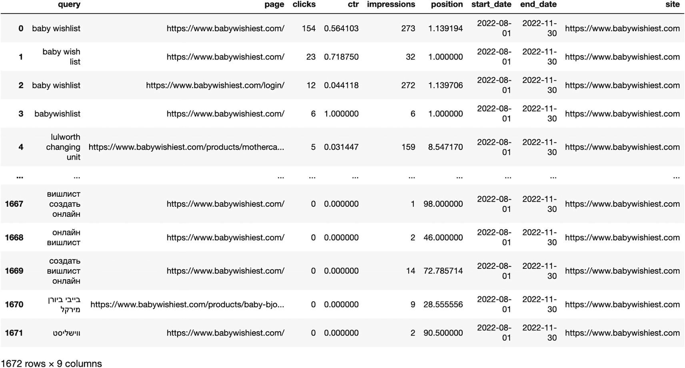

一大块 API 数据结果的截图。列标题为 `query`、`page`、`clicks`、`ctr`、`impressions`、`positions`、`start date`、`end date` 和 `site`。

虽然这是一大段代码，但该 API 可用于提取多达 10 万行数据，甚至更多。

### Google PageSpeed API

PageSpeed API 是 SEO 人员的另一个核心指标，尤其是考虑到 Google 在 2020 年 4 月推出的核心网页指标（CWV）计划。该 API 不仅可用于检查自己网站的 CWV 得分，还可用于检查 SERP 竞争对手的得分。要使用此 API，需要从 Google Cloud Platform (GCP) 的 API 部分获取一个密钥。

首先，定义要检查 CWV 得分的 URL 列表：

```python
desktop_serps_urls = ['https://pay.jumia.com.ng/services/airtime',
'https://pay.jumia.com.ng/',
'https://vtpass.com/',
'https://www.gloverapp.co/products/airtime-to-cash',
'https://www.zoranga.com/',
'https://airtimeflip.com/',
'https://www.tingtel.com/blog/sell-airtime-over-charged-your-line-dont-panic',
'https://vtpass.com/payment',
'https://pay.jumia.com.ng/services/mobile-data/mtn-mobile-data', ...]
```

`"https://www.googleapis.com/pagespeedonline/v5/runPagespeed?url=[test-url]&key=xxxxxxxxxxxxxxxxxxxxxxxxxxxxxxxxxxxxxxxxxxxxx"`

设置 API 的参数：

```python
base_url = 'https://www.googleapis.com/pagespeedonline/v5/runPagespeed?url='
strategy = '&strategy=desktop'
api_url = '&key=xxxxxxxxxxxxxxxxxxxxxxxxxxxxxxxxxxxxxxxxxxxxxx'
```

初始化一个空字典来存储数据，以及一个计数器来跟踪正在查询的 URL 数量：

```python
desktop_cwv = {}
i = 0
```

遍历 URL 列表以查询 API：

```python
for url in desktop_serps_urls:
    request_url = base_url + url + strategy + api_url
    response = json.loads(requests.get(request_url).text)
    i += 1
    print(i, " ", request_url)
    desktop_cwv[url] = response
```

打印键以列出成功查询的 URL：

# 提取与处理数据

## 从 PageSpeed API 提取 CWV 指标

从空列表开始，遍历 PageSpeed API JSON 响应字典：

```python
desktop_psi_lst = []
```

通过键循环遍历字典，提取不同的 CWV 指标并将其存储在列表中：

```python
for key, data in desktop_cwv.items():
    if 'lighthouseResult' in data:
        FCP = data['lighthouseResult']['audits']['first-contentful-paint']['numericValue']
        LCP = data['lighthouseResult']['audits']['largest-contentful-paint']['numericValue']
        CLS = data['lighthouseResult']['audits']['cumulative-layout-shift']['numericValue']
        FID = data['lighthouseResult']['audits']['max-potential-fid']['numericValue']
        SIS = data['lighthouseResult']['audits']['speed-index']['score'] * 100
        desktop_psi_lst.append([key, FCP, LCP, CLS, FID, SIS])
desktop_psi_df = pd.DataFrame(desktop_psi_lst, columns = ['url', 'FCP', 'LCP', 'CLS', 'FID', 'SIS'])
desktop_psi_df
```

结果如下：


结果是一个数据框，显示了每个 URL 的所有 CWV 得分。

## 数据转换

转换通过 API 或其他方式从数据源提取的数据，其目的是：

*   清理数据，以便进一步计算指标
*   推导有意义的统计数据，例如月环比（`MoM`）差异
*   将数据插入（即加载）到数据仓库中

代码将继续处理之前提取的 Google Analytics (`GA`) 数据，我们将涵盖上述几点。

### 清理与格式化数据

我们首先复制 `GA` 数据框：

```python
df_clean = df.copy()
```

将 `averageSessionDuration` 重新配置为秒数：

```python
df_clean['averageSessionDuration'] = (df_clean['averageSessionDuration'] / 60).round(1)
```

基于时间和日历日期单位创建新列，以便于转换：

```python
df_clean['month'] = df_clean['dateRange'].dt.strftime('%m')
df_clean['year'] = df_clean['dateRange'].dt.strftime('%Y')
df_clean['month_year'] = df_clean['dateRange'].dt.strftime('%Y-%m')
df_clean
```

结果如下：


数据格式化后，我们可以开始转换以推导趋势数据的新列，例如：

*   平均值
*   标准差（用于衡量变异）
*   周期性变化（例如月环比）

### 计算基础汇总统计量

让我们复制一份并重命名，以反映我们正在按着陆页和月份进行聚合：

```python
ga4_lp_agg_month = df_clean.copy()
```

我们将创建一些基本的汇总统计量，即使用 `groupby()` 和 `agg()` 函数计算各种 `GA` 指标的平均值（`"mean"`）和总和（`"sum"`）：

```python
ga4_lp_agg_month_basic = ga4_lp_agg_month.groupby(['landingPage', 'month_year']).agg({'activeUsers':'sum',
'screenPageViewsPerSession':'mean',
'bounceRate':'mean',
'averageSessionDuration':'mean',
'userConversionRate':'mean',
'ecommercePurchases':'sum'
}).reset_index()
ga4_lp_agg_month_basic
```

结果如下：

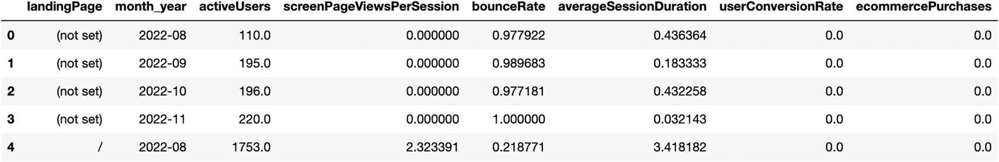

如上所示的指标按着陆页和 `month_year` 汇总，可用于为基础 `SEO` 仪表盘报告系统提供数据。通常在所有情况下，我们都会追踪平均值和标准差。平均值能为我们提供一个有用的指标，表明某个渠道在性能方面处于什么水平，因为它会指出在给定时间点，对于给定数据类别，大多数数据点位于或将要位于何处。正如每一位统计学家（以及许多具备统计意识的人）会告诉你的那样，平均值在单独用于推断甚至决策时可能很危险。这就是为什么我们还要追踪标准差，因为这个指标能告诉我们某个指标的变异情况，即其一致性如何。

实际上，标准差告诉我们数据点与平均值的接近程度。我们能从中推断出什么？我们可以推断出哪些平均值更值得信赖或依赖，以便在月份之间进行比较。因此，标准差可以在一定程度上告诉我们平均值的质量，以便我们对数据建立信心、进行比较，并了解我们追踪的指标随时间的变化情况。

例如，你可能会发现标准差在增加或减少，因此应该尝试理解其背后的原因。可能是：

*   谷歌通过算法更新带来的变化？
*   用户行为、查询搜索意图、品牌定位或市场的变化？
*   网站的用户体验、内容或架构的变化？

追踪标准差可以帮助你发现某些事情是在变好还是变坏。

### 计算平均值与标准差

执行聚合以得出各种平均值和标准差统计量：

```python
ga4_lp_agg_month = df_clean.copy()
ga4_lp_agg_month_mean = ga4_lp_agg_month.groupby(['landingPage',
'month_year']).agg({'activeUsers':'mean',
}).reset_index()
ga4_lp_agg_month_mean = ga4_lp_agg_month_mean.rename(columns = {'activeUsers':'activeUsers_avg'})
```

`"mean"` 计算平均值，而 `"std"` 计算标准差：

```python
ga4_lp_agg_month_std = ga4_lp_agg_month.groupby(['landingPage',
'month_year']).agg({'activeUsers':'std',
'bounceRate':'std',
}).reset_index()
```

重命名列：

```python
ga4_lp_agg_month_std = ga4_lp_agg_month_std.rename(columns = {'activeUsers':'activeUsers_std',
'bounceRate':'bounceRate_std'
})
```

将数据连接到之前创建的基础数据框：

```python
ga4_lp_agg_month_stats = ga4_lp_agg_month_basic.merge(ga4_lp_agg_month_mean,
on = ['landingPage', 'month_year'], how = 'left')
ga4_lp_agg_month_stats = ga4_lp_agg_month_stats.merge(ga4_lp_agg_month_std,
on = ['landingPage', 'month_year'], how = 'left')
ga4_lp_agg_month_stats.head()
```

结果如下：

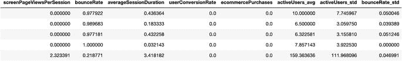

我们现在可以看到之前创建的额外列。

### 计算环比变化

下一段代码计算各种性能数据的环比。

首先，我们对值进行排序，使每个着陆页的行按月份顺序排列，因为环比计算将依赖于行的位置：

```python
ga4_lp_agg_month_moms = ga4_lp_agg_month_stats.sort_values(['landingPage', 'month_year'])
```

我们只计算 `activeUsers` 和 `bounceRate` 的月度统计量；但是，你可以对所有其他指标列使用相同的方法。首先，我们使用 `shift()` 函数计算当前行与上一行（上个月）的绝对变化。

请注意，`shift()` 函数传入的参数是 `"1"`，表示 1 行。如果你想计算同比差异，那么可以传入 `"12"`（即 `.shift(12)`），它会查看前 12 行的值。

```python
ga4_lp_agg_month_moms['activeUsers_delta'] = ga4_lp_agg_month_moms['activeUsers'] - ga4_lp_agg_month_moms['activeUsers'].shift(1)
```

然后，通过将绝对变化除以当前月份的值并乘以 100 来计算环比：

```python
ga4_lp_agg_month_moms['activeUsers_mom'] = ((ga4_lp_agg_month_moms['activeUsers_delta'] / ga4_lp_agg_month_moms['activeUsers'].shift(1) * 100)).round(1)
```

对跳出率重复此过程：

```python
ga4_lp_agg_month_moms['bounceRate_delta'] = ga4_lp_agg_month_moms['bounceRate'] - ga4_lp_agg_month_moms['bounceRate'].shift(1)
ga4_lp_agg_month_moms['bounceRate_mom'] = ((ga4_lp_agg_month_moms['bounceRate_delta'] / ga4_lp_agg_month_moms['bounceRate'].shift(1) * 100)).round(1)
ga4_lp_agg_month_moms
```

结果如下：

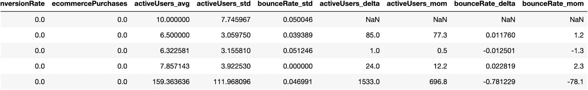

新增了差值（`delta`）和环比（`month-on-month`）列。注意第一行的 `NaN`，这是因为没有前一行供 `shift()` 函数使用。要覆盖 `NaN`，你可以使用 `np.where()` 函数将 `.isnull()` 替换为零。另一种方法是使用特殊函数来避免对行进行排序。但是，如果你计划将其自动化成一个包罗万象的 `SEO` 数据仓库仪表盘报告系统，那么在云端运行时，这种方法可能在计算上更昂贵。

完成后，你就可以上传到你选择的数据仓库了。

## 加载数据

正如本章前面提到的，加载涉及将转换后的数据移入数据仓库。上传后，最好检查你的数据模式并预览你上传的内容。

以下 `SQL` 将按月份和渠道生成用户趋势：

```sql
select yearMonth, channel, sum(users) as users from (
select yearMonth, 'organic' as channel, users_sum  as users from
google_analytics.multichannel_ga_monthly
where channel in ('Organic Traffic')
and
DATE_DIFF(CURRENT_DATE(), PARSE_DATE('%Y-%m-%d', CONCAT(SUBSTR(CAST(yearMonth AS STRING), 1, 4),"-",
SUBSTR(CAST(yearMonth AS STRING), 5, 2),"-",'01')), MONTH) <= 12
union all
select yearMonth, 'non_seo' as channel, all_users - organic as users
from (
SELECT yearMonth
, MAX(IF(channel = 'Organic Traffic', users_sum, 0)) organic
, MAX(IF(channel = 'All Users', users_sum, 0)) all_users
from google_analytics.multichannel_ga_monthly
where channel in ('Organic Traffic', 'All Users')
group by yearMonth
)
)
where
DATE_DIFF(CURRENT_DATE(), PARSE_DATE('%Y-%m-%d', CONCAT(SUBSTR(CAST(yearMonth AS STRING), 1, 4),"-",
SUBSTR(CAST(yearMonth AS STRING), 5, 2),"-",'01')), MONTH) <= 12
group by yearMonth, channel
order by yearMonth LIMIT 100;
```

以下 `SQL` 将按月生成用户流量统计，并包含同比数据：

```sql
select
yearMonth,
CASE
WHEN channel = 'All Users' THEN "non_seo"
ELSE channel
END as channel,
users_yoy
from google_analytics.multichannel_ga_monthly
where
channel in ("All Users", "Organic Traffic")
and
DATE_DIFF(CURRENT_DATE(), PARSE_DATE('%Y-%m-%d', CONCAT(SUBSTR(CAST(yearMonth AS STRING), 1, 4),"-", SUBSTR(CAST(yearMonth AS STRING), 5, 2),"-",'01')), MONTH) <= 12
order by yearMonth desc LIMIT 100;
```

以下 `SQL` 将按月生成今年与去年截至当前月份的同比用户流量统计。

```sql
SELECT yearMonth
, year
, SUBSTR(CAST(yearMonth AS STRING), 5, 6) as mon_x
, users_sum
from google_analytics.multichannel_ga_monthly
where
channel in ("Organic Traffic")
order by mon_x, year desc;
```

结果如下：

运行后，结果会由 Google BigQuery 在“结果”选项卡中生成（图 8-1）。

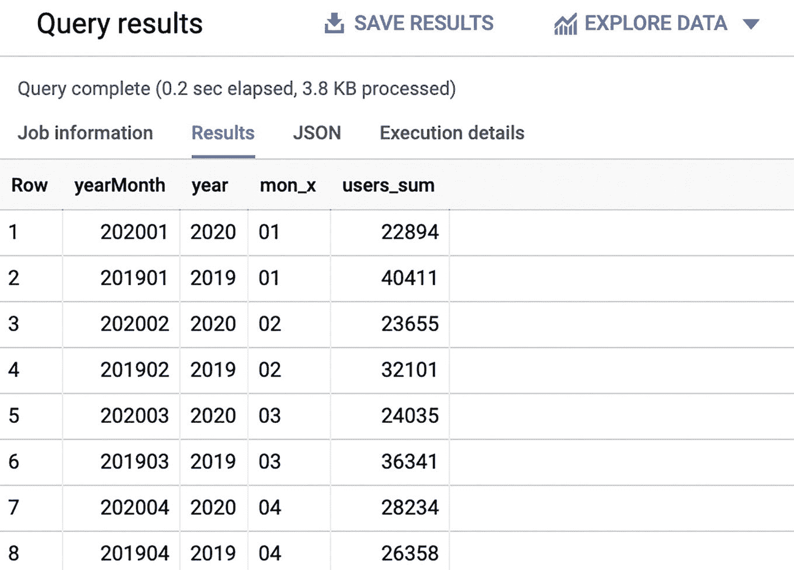

`SQL` 执行后的 Google BigQuery 结果截图。结果选项卡的列名包括 `row`、`year month`、`year`、`mon underscore x` 和 `users underscore sum`。

`图 8-1` SQL 执行后的 Google BigQuery 结果预览

## 可视化

如果你对 `SQL` 结果满意，可以使用相同的查询并在前端（如 `Looker Studio`、`Tableau` 等）中进行可视化，如下所示。自然搜索与其他渠道相比如何？按数量（顶部）和同比（底部）随时间变化，如 `Looker Studio` 图表所示（图 8-2）。

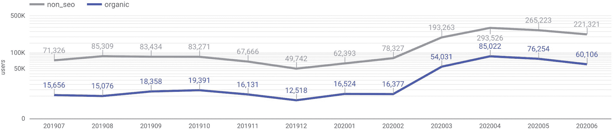

`Looker Studio` 的折线图。它绘制了非 `SEO` 和自然流量，分别从 2019 年 7 月的 71326 和 15656 用户开始，到 2020 年 6 月的 221321 和 60106 用户结束。两者均呈波动趋势。

`图 8-2` `Looker Studio` 图表显示过去 12 个月自然流量与非 `SEO` 渠道的对比

自然搜索与其他渠道的同比表现如何？图 8-3 中的 `Looker Studio` 图表可视化了计算自然流量和非 `SEO` 渠道同比流量数据的 `SQL` 语句。这有助于了解 `SEO` 在一年中特定时段的表现（即不受季节性影响）。它还能衡量 `SEO` 在同一时期相对于非 `SEO` 渠道的表现。

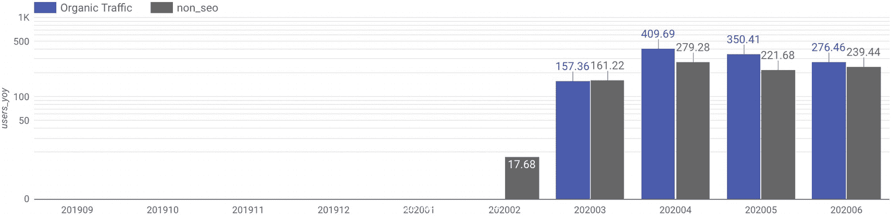

`Looker Studio` 的双柱状图绘制了用户数与年份的关系。自然流量和非 `SEO` 在 2020 年 4 月达到最高，分别为 409.69 和 279.28 用户。

`图 8-3` `Looker Studio` 柱状图显示自然流量和非 `SEO` 渠道按月的同比流量数据

自然搜索用户与去年相比如何？图 8-4 中的 `Looker Studio` 图表仅显示了自然流量的今年和去年流量数据。这有助于单独比较今年与去年的 `SEO` 表现。

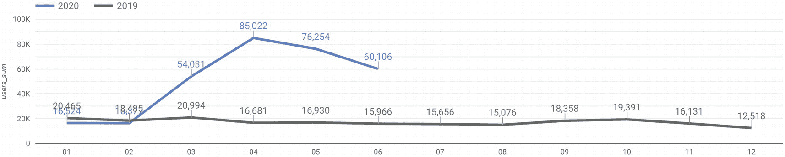

`Looker Studio` 折线图绘制了 2020 年和 2019 年的两条线。它从 1 月的 16524 和 20465 用户开始，分别到 6 月和 12 月的 60106 和 12518 用户结束。2020 年在 4 月达到峰值 85022 用户，而 2019 年保持平稳趋势。

`图 8-4` `Looker Studio` 图表显示仅自然流量的今年和去年流量数据

## 自动化

当然，这一切都可以自动化；你只需要一个称职的云软件工程师团队来实现自动化：

*   通过 `API` 轮询数据（提取）
*   清洗、重构并创建新的计算字段（转换）
*   加载（到 `BigQuery`、`Amazon Redshift` 或其他系统）

结果很简单，尽管实际执行要复杂得多，这依赖于云工程技能。

## 总结

在构建仪表板时，重要的是要始终以终为始，思考仪表板的目的是什么以及为谁而建（即你的受众）。一旦确定了输出，再反向推导。仪表板由数据驱动，因此你需要考虑需要哪些数据源。原始数据很少适合直接接入 `Looker Studio` 等前端，因为它可能会使前端过载，导致加载缓慢或崩溃。相反，你应该将数据汇总成有意义的趋势。

提取、转换和加载（`ETL`）是自动化数据收集、汇总数据并将其加载到系统中的过程。我们提供了代码来帮助你：

*   从常见 `SEO` 数据源（包括 `Google Analytics`）提取 `SEO` 数据
*   按渠道汇总进行转换
*   查看数据加载到 `Looker Studio` 后的样子

