# for 循环使用`read_csv`函数读取数据，将文件名存储为一列（以便我们知道数据来自哪个文件），清理列名，并将数据添加到之前创建的列表中：

```
for filename in authority_filenames:
    df = pd.read_csv(authority_path + filename, encoding = 'UTF-16', sep = '\t')
    df['sitefile'] = filename
    df['sitefile'] = df['sitefile'].str.replace('.csv', '', regex = False)
    df.columns = [x.lower().replace(' ', '_').replace('(', '_').replace(')', '_').replace(' ', '_').
                  replace('__', '_') for x in df.columns]
    df['sitefile'] = df['sitefile'].str.extract('(.*?)\-')
    auth_colnames.append(df.columns)
    print(df['sitefile'][0])
    auth_df_lst.append(df)
```

循环运行完毕后，使用`concat()`函数将这些列表合并成一个数据框：

```
auth_df_raw = pd.concat(auth_df_lst)
auth_df_raw = auth_df_raw.rename(columns = {'page_url': 'url'})
auth_df_raw.drop(['#', 'size', 'code', 'crawl_date', 'language', 'page_title',
                  'first_seen'], axis = 1, inplace = True)
auth_df_raw
```

生成的`auth_df_raw`数据框如下所示，包含网站页面及其反向链接指标。

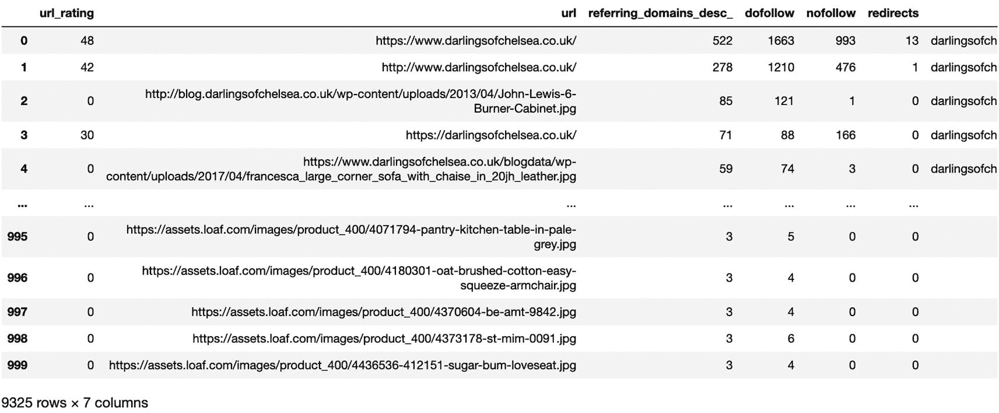

一个包含 9325 行 7 列的数据表，表头为：url 评级、url、引用域名描述、dofollow、nofollow 和按 url 分类的重定向。前 5 条数据显示了 `darlingsofchelsea` 的 url，其中一条 url 的评级为 48，引用域名描述为 522，`dofollow` 为 1663，`nofollow` 为 993，重定向为 13。

## 合并数据

现在，来自各自工具源的数据已导入，可以准备进行合并。通常，数据集之间的公共列（称为“主键”）是 URL，因为这是搜索引擎排名的依据。

我们将从将 SERP 数据与爬取数据合并开始。在此之前，我们只需要包含竞争对手网站的 SERP 数据。

```
player_serps = serps_df[serps_df['site'].isin(player_sites_lst)]
```

通过使用`.merge()`函数实现类似 `VLOOKUP` 的操作，将竞争对手 SERP 数据与排名 URL 的爬取数据合并：

```
player_serps_crawl = player_serps.merge(cleaner_crawl, on = ['url'], how = 'left')
player_serps_crawl = player_serps_crawl.rename(columns = {'site_x': 'site'})
```

使用`.drop()`函数删除不必要的列：

```
player_serps_crawl.drop(['site_y', 'sitefile'], axis = 1, inplace = True)
player_serps_crawl
```

结果如下：

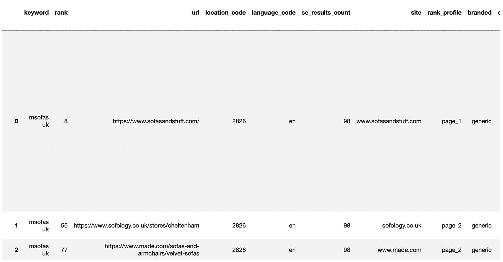

一个包含 4 行 9 列的数据表，表头为：关键词、排名、url、位置代码、语言代码、搜索引擎结果数量、网站、排名概况和品牌化（针对关键词 `msofas uk`）。数据显示了在同一位置和同一语言下的 3 个不同 url 和网站，排名分别为 8、55 和 77。

下一步是使用`merge()`函数将反向链接权威数据与包含 SERP 和爬取指标的数据集合并：

```
player_serps_crawl_auth = player_serps_crawl.copy()
player_serps_crawl_auth = player_serps_crawl_auth.merge(auth_df_raw, on = ['url'], how = 'left')
player_serps_crawl_auth.drop(['sitefile'], axis = 1, inplace = True)
player_serps_crawl_auth
```

数据现已合并，每个 SERP URL 的站内和站外 SEO 数据都存储在一个数据框中：

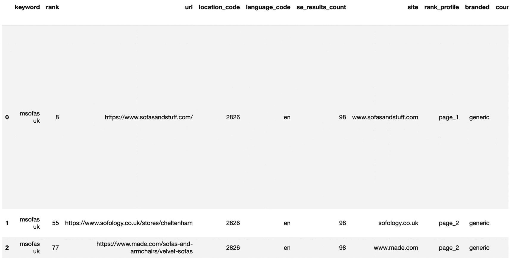

一个包含 4 行 9 列的数据表，表头为：关键词、排名、url、位置代码、语言代码、搜索引擎结果数量、网站、排名概况和品牌化（针对关键词 `msofas uk`）。数据显示了在同一位置和同一语言下的 3 个不同 url 和网站，排名分别为 8、55 和 77。

## 衍生新特征

合并数据的一大好处是，你可以衍生出可能无法从单个数据集中获得的新特征。例如，一个非常有用的特征是，比较标题标签与目标搜索短语的相似度（或差异度）。这使用了爬取数据中排名 URL 的标题标签和 SERP 关键词。这些新特征为我们提供了额外的假设，以便后续使用机器学习过程进行测试。

我们将从创建一个新的数据框开始，并衍生多个新数据特征，这些特征将作为额外的列存储：

```
hypo_serps_features = player_serps_crawl_auth.copy()
```

添加`regional_tld`，用于指示排名 URL 是否进行了区域化：

```
regional_tlds = ['.uk']
hypo_serps_features['regional_tld'] = np.where(hypo_serps_features['site'].str.contains('|'.join(regional_tlds)), 1, 0)
```

使用`sorensen_dice()`函数添加一个指标，用于衡量目标关键词在标题标签中的使用程度：

```
hypo_serps_features['title'] = hypo_serps_features['title'].astype(str)
hypo_serps_features['title_relevance'] = hypo_serps_features.loc[:, ['title', 'keyword']].apply(
    lambda x: sorensen_dice(*x), axis=1)
```

我们还对衡量标题标签与 H1 标题一致性的影响程度感兴趣：

```
hypo_serps_features['h1'] = hypo_serps_features['h1'].astype(str)
hypo_serps_features['title_h1'] = hypo_serps_features.loc[:, ['title', 'h1']].apply(
    lambda x: sorensen_dice(*x), axis=1)
```

标题标签中是否包含品牌名称重要吗？让我们来一探究竟：

```
hypo_serps_features['site'] = hypo_serps_features['site'].astype(str)
hypo_serps_features['hostname'] = hypo_serps_features['site'].apply(lambda x: extract(x))
hypo_serps_features['hostname'] = hypo_serps_features['hostname'].str.get(1)
hypo_serps_features['title'] = hypo_serps_features['title'].str.lower()
hypo_serps_features['title_branded'] = hypo_serps_features.loc[:,
                                        ['title', 'hostname']].apply(
    lambda x: sorensen_dice(*x), axis=1)
```

另一个有用的特征是 URL 参数，即排名 URL 中的问号：

```
hypo_serps_features['url_params'] = np.where(hypo_serps_features['url'].str.contains('\?'), '1', '0')
hypo_serps_features['url_params'] = hypo_serps_features['url_params'].astype('category')
```

# 数据特征工程与预处理

另一个测试是排名 URL 是否包含 Google Analytics 代码。这不太可能产生什么影响，但如果数据可用，何乐而不为呢？

```python
hypo_serps_features['google_analytics_code'] = np.where(hypo_serps_features[
'google_analytics_code'].str.contains('UA'), '1', '0')
hypo_serps_features['google_analytics_code'] = hypo_serps_features['google_analytics_code'].astype('category')
```

Google Tag Manager 代码也是如此：

```python
hypo_serps_features['google_tag_manager_code'] = np.where(
hypo_serps_features['google_tag_manager_code'].str.contains('GTM'), '1', '0')
hypo_serps_features['google_tag_manager_code'] = hypo_serps_features['google_tag_manager_code'].astype('category')
```

虽然跟踪代码本身不太可能解释排名差异，但同一跟踪代码的重复实例可能具有解释力：

```python
hypo_serps_features['google_tag_manager_code_second_'] = np.where(
hypo_serps_features['google_tag_manager_code_second_'].str.contains('GTM'), '1', '0')
hypo_serps_features['google_tag_manager_code_second_'] = hypo_serps_features[
'google_tag_manager_code_second_'].astype('category')
```

添加了一个缓存控制测试，用于检查其是私有、公共还是其他类型，并将其转换为类别。

```python
hypo_serps_features['cache_privacy'] = np.where(
hypo_serps_features['cache-control'].str.contains('private'), 'private', '0')
hypo_serps_features['cache_privacy'] = np.where(
hypo_serps_features['cache-control'].str.contains('public'), 'public', hypo_serps_features['cache_privacy'])
hypo_serps_features['cache_privacy'] = np.where(
hypo_serps_features['cache-control'].str.contains('0'), 'other', hypo_serps_features['cache_privacy'])
hypo_serps_features['cache_privacy'] = hypo_serps_features['cache_privacy'].astype('category')
```

此外，还通过提取 `cache-control` 字符串中的数值部分添加了缓存年龄。这是通过按 `=` 号分割字符串，然后使用 `.get()` 函数，再转换为数值浮点数据类型来实现的：

```python
hypo_serps_features['cache_age'] = hypo_serps_features['cache-control'].str.split('\=')
hypo_serps_features['cache_age'] = hypo_serps_features['cache_age'].str.get(-1)
hypo_serps_features['cache_age'] = np.where(hypo_serps_features['cache_age'].isnull(), 0,
hypo_serps_features['cache_age'])
hypo_serps_features['cache_age'] = np.where(hypo_serps_features['cache_age'].str.contains('[a-z]'),
0, hypo_serps_features['cache_age'])
hypo_serps_features['cache_age'] = hypo_serps_features['cache_age'].astype(float)
```

以下是一个测试排名 URL 是否为规范 URL 的代码：

```python
hypo_serps_features['self_canonicalised'] = np.where(hypo_serps_features[
'canonical_url'] == hypo_serps_features['url'], 1, 0)
```

我们删除了诸如 `canonical_url` 之类的标识符，因为这些是标识单行的个体记录，对分析没有任何帮助。我们只对这个独特数据值本身的特征或趋势感兴趣。

我们还删除了可能冗余或不感兴趣的假设，例如 HTTP 协议。这取决于你自己的 SEO 经验和判断。

```python
hypo_serps_features.drop(['cache-control', 'canonical_url', 'base_url', 'crawl_status', 'host', 'encoding', 'indexable_status', 'meta_robots_response_', 'title', 'title_response_', 'title_second_', 'title_render_status', 'meta_description', 'meta_description_response_',  'h1', 'h1_second_', 'h2', 'h2_second_', 'open_graph_audio', 'twitter_card_site', 'twitter_card_creator', 'twitter_card_description', 'twitter_card_image_url', 'twitter_card_title', 'content-security-policy', 'referrer-policy', 'hostname', 'open_graph_description', 'open_graph_image_url', 'open_graph_locale', 'open_graph_site_name', 'open_graph_title' , 'open_graph_url', 'meta_robots_rendered_', 'twitter_card_description', 'twitter_card_title', 'http_protocol', 'http_status_code' ], axis = 1, inplace = True)
```

完成后，我们将创建另一个数据框副本并导出为 CSV，为机器学习做准备，从单层因子开始：

```python
hypo_serps_pre_slf = hypo_serps_features.copy()
hypo_serps_pre_slf.to_csv('data/'+ geo_market +'_hypo_serps_pre_slf.csv', index = False)
hypo_serps_pre_slf
```

结果如下：

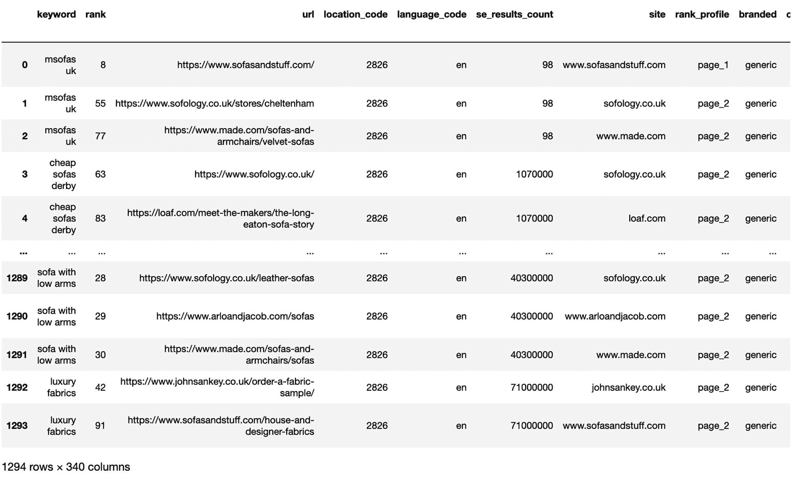

一个包含 1294 行和 340 列的表，表头为关键词、排名、URL、位置代码、语言代码、搜索结果数量、网站、排名概况，以及按关键词分类的品牌化。数据中展示了同一位置、语言和品牌下的不同 URL 和网站。

### 单层因子 (SLFs)

单层因子是指任何列中所有值都相同的情况，这不仅冗余，还会导致机器学习代码失败。例如，所有排名 URL 的标题可能都是品牌化的，在这种情况下，这些列应该被移除。

为了移除 SLF，我们将逐列遍历数据框，识别出包含 70% 或更多相同值的列，并将这些列名存储在一个列表中。70% 是一个任意阈值；你可以选择 80% 或 90%；然而，这可能会带来移除一些有洞察力的排名因子的风险——即使这些因子只适用于少数 URL，而这些 URL 可能恰恰是排名最高的 URL。

```python
slf_cols = []
slf_limit = .7
for col in hypo_serps_pre_slf.columns:
if hypo_serps_pre_slf[col].value_counts().iat[0] >= (hypo_serps_pre_slf.shape[0] * slf_limit):
slf_cols.append(col)
slf_cols
```

包含 70% 相同数据的列打印如下，并将从数据集中移除：

```python
['location_code',
'language_code',
'rank_profile',
'branded',
'count',
'crawl_depth',
'is_subdomain',
'no_query_string_keys',
'query_string_contains_filtered_parameters',
'query_string_contains_more_than_three_keys',
'query_string_contains_paginated_parameters',
'query_string_contains_repetitive_parameters',
'query_string_contains_sorted_parameters',
'scheme',...
```

让我们使用 `groupby()` 函数检查其中几个 SLF 排名因子。从 `branded` 开始，我们可以看到所有排名 URL 的标题都是品牌化的，因此这些可以移除：

```python
hypo_serps_pre_slf.groupby('branded')['count'].sum().sort_values()
branded
generic    1294
Name: count, dtype: int64
hypo_serps_pre_slf.groupby('url_params')['count'].sum().sort_values
```

参数化 URL 似乎也是冗余的，只有 17 个 URL 是参数化的。然而，这些可能仍会以意想不到的方式提供洞察。

识别出 SLF 后，我们将在新的数据框中处理它们，使用列表推导式将其移除：

```python
hypo_serps_pre_mlfs = hypo_serps_pre_slf.copy()
```

要移除的列列表需要进一步细化，因为我们希望保留前面提到的 `url_params` 列以及 `count` 列，以便在后续过程中进行进一步聚合：

```python
slf_cols = [elem for elem in slf_cols if not elem in ['count', 'url_params']]
```

删除 SLF 列：

```python
hypo_serps_pre_mlfs.drop(slf_cols, axis = 1, inplace = True)
hypo_serps_pre_mlfs
```

生成的 `hypo_serps_pre_mlfs` 数据框已移除 SLF 列：

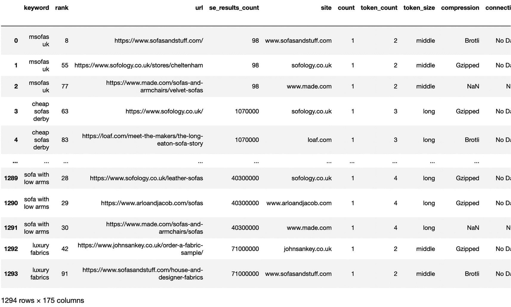

一个包含 1294 行和 175 列的表，表头为关键词、排名、URL、搜索结果数量、网站、计数、令牌计数、令牌大小，以及用于关键词分类的压缩。数据展示了不同的排名网站和 URL，令牌计数范围为 2 到 4，令牌大小为中等和长，压缩方式为 brotli、gzipped 和 nan。

### 重新缩放数据

无论你使用的是线性回归等线性模型还是决策树，两者都能从数据重新缩放中受益，因为数据变得“标准化”，使得机器学习在比较排名与页面速度等因素时更容易检测到变化：

```python
hypo_serps_preml_prescale = hypo_serps_pre_mlfs.copy()
```

使用 `.dtypes` 将列分为数值列和非数值列，以便重新缩放数值列：

```python
hypo_serps_preml_num = hypo_serps_preml_prescale.select_dtypes(include=np.number)
hypo_serps_preml_num_colnames = hypo_serps_preml_num.columns
```

非数值列保存到另一个数据框中，用于后续合并：

```python
hypo_serps_preml_nonnum = hypo_serps_preml_prescale.select_dtypes(exclude=np.number)
hypo_serps_preml_num
```

生成的 `hypo_serps_preml_num` 如下所示，仅包含数值列，已准备好进行重新缩放：

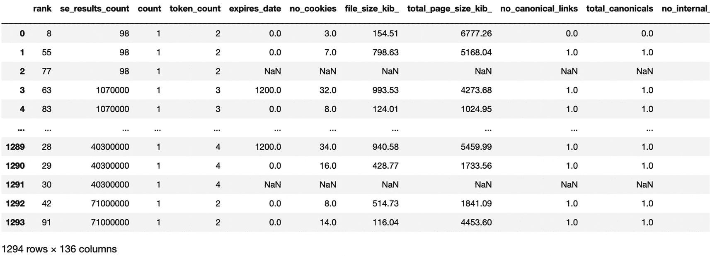

一个包含 1294 行和 136 列的表，表头为`rank`、`se_results_count`、`count`、`token_count`、`expires_date`、`no_cookies`、`file_size_kib`、`total_page_size_kib`、`no_canonical_links`、`total_canonicals`和`no_internal`。所有字段的数据均为数值型。

我们将使用`sklearn` API 预处理函数中的`MinMaxScaler()`：

```python
from sklearn import preprocessing
```

将列值转换为`numpy`数组，然后使用`MinMaxScaler()`函数重新缩放数据：

```python
x = hypo_serps_preml_num.values
min_max_scaler = preprocessing.MinMaxScaler()
x_scaled = min_max_scaler.fit_transform(x)
hypo_serps_preml_num_scaled = pd.DataFrame(x_scaled, index=hypo_serps_preml_num.index, columns = hypo_serps_preml_num_colnames)
hypo_serps_preml_num_scaled
```

结果如下：

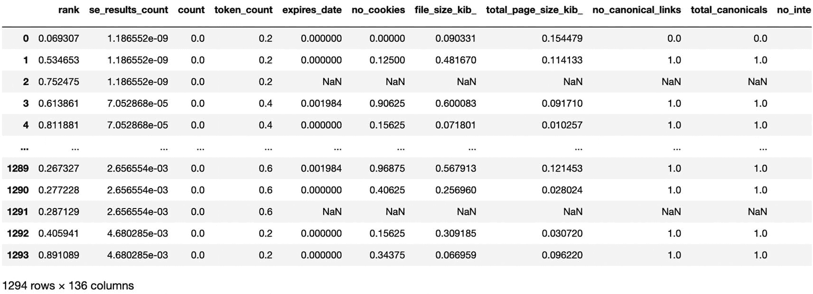

一个包含 1294 行和 136 列的表，表头为`rank`、`se_results_count`、`count`、`token_count`、`expires_date`、`no_cookies`、`file_size_kib`、`total_page_size_kib`、`no_canonical_links`和`total_canonicals`。列中的数据以`numpy`数组形式呈现，例如`rank`为`0.069307`、`count`为`0.0`、`token_count`为`0.2`、`no_cookies`为`0.12500`、`file_size`为`0.481670`。

### 近零方差（NZVs）

下一步是消除与SLFs相似的冗余数值数据列，这些列被称为近零方差（NZVs）。虽然数值不同，但可能没有足够的变异来可靠地解释排名位置的差异，因此我们希望移除这些列。

为了识别NZVs，我们将使用`sklearn` API中的`VarianceThreshold`函数：
```python
from sklearn.feature_selection import VarianceThreshold
variance = hypo_serps_preml_num_scaled.var()
columns = hypo_serps_preml_num_scaled.columns
```

保存方差大于阈值的变量名称：
```python
highvar_variables = [ ]
nz_variables = [ ]
```

我们将遍历数值列，将阈值设置为7%，即数据中必须至少有7%的变异才能保留在数据集中。同样，7%是一个任意选择。高变异列存储在我们之前创建的`highvar_variables`列表中：
```python
for i in range(0,len(variance)):
if variance[i]>=0.07:
highvar_variables.append(columns[i])
else:
nz_variables.append(columns[i])
highvar_variables
```

`highvar_variables`如下所示：
```python
['rank',
'no_canonical_links',
'total_canonicals',
'no_internal_followed_linking_urls',
'no_internal_followed_links',
'no_internal_linking_urls',
'no_internal_links_to_url',
'url_rank', ...]
nz_variables
```

结果如下：
```python
['se_results_count',
'count',
'token_count',
'expires_date',
'no_cookies',
'file_size_kib_',
'total_page_size_kib_', ...]
```

识别并存储在`nz_variables`中的NZVs如上所示。我们可以看到，例如，更多的网页在搜索查询中的关键词数量（`token_count`）和HTML页面大小（`total_page_size_kib_`）上具有高度相似的值，因此我们很乐意移除这些列。

这是一个快速的合理性检查，以确保没有列同时被列为高变异和NZV：
```python
[x for x in highvar_variables if x in nz_variables]
```
返回一个空列表，因此幸运的是没有交叉：
```python
[]
```

让我们检查一下识别出的几个NZV列。尽管被识别为NZV，但`title_relevance`仍有一些变异，如下所示使用`describe()`函数。我们可以看到数据范围从0到1，四分位距为0.32到0.62，当然这是在重新缩放之后。根据SEO经验，我们将保留`title_relevance`，因为它是一个重要的排名因素：
```python
hypo_serps_preml_num_scaled['title_relevance'].describe()
```

结果如下：
```python
count    1294.000000
mean        0.478477
std         0.199106
min         0.000000
25%         0.323529
50%         0.512712
75%         0.622487
max         1.000000
Name: title_relevance, dtype: float64
```

另一方面，`scaled_images`列是NZV，如下所示，大多数值为零，直到第75百分位数的0.17，显示出非常小的变异，因此应排除：
```python
hypo_serps_preml_num_scaled['scaled_images'].describe()
```

结果如下：
```python
count    977.000000
mean       0.114348
std        0.163530
min        0.000000
25%        0.000000
50%        0.000000
75%        0.179487
max        1.000000
Name: scaled_images, dtype: float64
```

我们将重新定义`highvar_variables`列表，以包含我们认为应保留在数据集中的一些NZVs：
```python
highvar_variables = highvar_variables + ['title_relevance', 'title_branded', 'no_content_words', 'first_contentful_paint', 'scaled_images', 'no_outgoing_links']
```

保存一个新的数据框，仅包含`highvar_variables`中列出的列：
```python
hypo_serps_preml_num_highvar = hypo_serps_preml_num_scaled[highvar_variables]
hypo_serps_preml_num_highvar
```

`hypo_serps_preml_num_highvar`数据框如下所示，已从136列减少到38列，移除了98列。

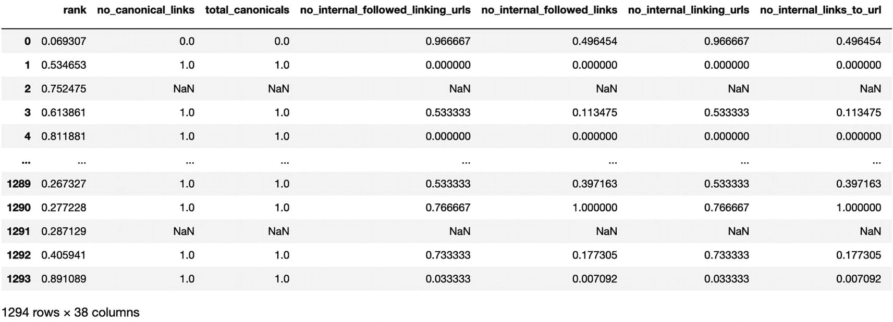

一个包含1294行和38列的表，表头为`rank`、`no_canonical_links`、`total_canonicals`、`no_internal_followed_linking_urls`、`no_internal_followed_links`、`no_internal_linking_urls`和`no_internal_links_to_url`。一行中显示的数据分别为`0.069307`、`0.0`、`0.0`、`0.966667`、`0.496454`、`0.966667`和`0.496454`。

接下来，我们还将使用`statsmodels` API中的`variance_inflation_factor()`函数来检测较大的方差膨胀因子（VIF），从而移除彼此高度相关的排名因素（称为多重共线性）。多重共线性是一个问题，因为它会降低用于建模搜索结果排名的排名特征的统计显著性。

排名特征或任何建模变量上的较大方差膨胀因子（VIF）暗示着与其他排名因素的高度相关关系。移除这些变量将提高模型的预测一致性，即在做出预测时更稳定且误差更小。
```python
from statsmodels.stats.outliers_influence import variance_inflation_factor
```

移除包含缺失值（`np.nan`）和无穷值（`np.inf`、`-np.inf`）的行：
```python
vif_input = hypo_serps_preml_num_highvar[~hypo_serps_preml_num_highvar.isin([np.nan, np.inf, -np.inf]).any(1)]
```
存储在`X_variables`中。
```python
X_variables = vif_input
```

通过应用`variance_inflation_factor()`函数确定高度相关的列：
```python
vif_data = pd.DataFrame()
vif_data["feature"] = X_variables.columns
vif_data["vif"] = [variance_inflation_factor(X_variables.values, i) for i in range(len(X_variables.columns))]
vif_data.sort_values('vif')
```

使用`describe()`函数打印VIF数据分布，以了解列间相关性的水平，并将其作为我们拒绝列的标准：
```python
vif_data['vif'].describe()
```

结果如下：
```python
count      38.000000
mean             inf
std              NaN
min         3.254763
25%        26.605281
50%        76.669063
75%      3504.833113
max              inf
Name: vif, dtype: float64
```

在确定了VIF范围后，我们将丢弃任何VIF高于中位数的排名因素。从技术上讲，最佳实践是VIF为5或以上即为高度相关；然而，在这种情况下，我们只是希望移除过度相关的排名因素，这仍然是一种改进：
```python
hypo_serps_preml_lowvif = hypo_serps_preml_num_highvar.copy()
vif_exclude_df = vif_data.loc[vif_data['vif'] > vif_data['vif'].median()]
vif_exclude_cols = vif_exclude_df['feature'].tolist()
hypo_serps_preml_lowvif.drop(vif_exclude_cols, inplace = True, axis = 1)
hypo_serps_preml_lowvif
```

我们现在已经从38列减少到了19列。正如你可能已经逐渐意识到的那样，机器学习并非简单地将数字代入就能得到结果，因为必须做大量工作才能将数据整理成可用的格式。

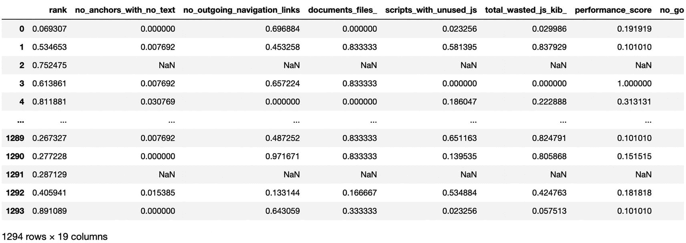

一个包含1294行和19列的数据表，表头为`rank`，无锚点文本，无出站导航链接，包含文档文件、脚本（含未使用的JS）、总计浪费的JS资源（KB）以及性能评分。`rank`为0.69307时显示的数据依次为0.000000、0.696884、0.000000、0.023256、0.029986、0.191919；`rank`为0.752475时，各列数据均为`NaN`。

### 中位数填充

我们希望尽可能多地保留数据行，因为任何列中存在缺失值的行都将被移除。一种技术是使用中位数填充，即估算给定数据列的中位数来替换缺失值。当然，由于我们是在不同站点之间进行比较，在领域级别而非整个列上计算中位数可能更有意义。因此，在可能的情况下，我们将在领域级别使用中位数填充，否则在列级别使用。

导入库以检测`for`循环中使用的数据类型，从而识别非数值列以进行中位数填充：
```
from pandas.api.types import is_string_dtype
from pandas.api.types import is_numeric_dtype
hypo_serps_preml_median = hypo_serps_preml_lowvif.copy()
```

设置变量，以便`for`循环可以对整个列以及在领域级别（`"site"`）执行`groupby()`操作：
```
hypo_serps_preml_median['site'] = hypo_serps_preml_prescale['site']
hypo_serps_preml_median['project'] = 'competitors'
for col, col_val in hypo_serps_preml_median.iteritems():
if col in ['http_status_code'] or not is_numeric_dtype(hypo_serps_preml_median[col]):
continue
hypo_serps_preml_median[col].fillna(hypo_serps_preml_median.groupby('site')[col].transform('median'), inplace=True)
hypo_serps_preml_median[col].fillna(hypo_serps_preml_median.groupby('project')[col].transform('median'), inplace=True)
hypo_serps_preml_median.drop(['site', 'project'], axis = 1, inplace = True)
hypo_serps_preml_median
```

结果是一个缺失值更少的数据框，提高了数据保留率。

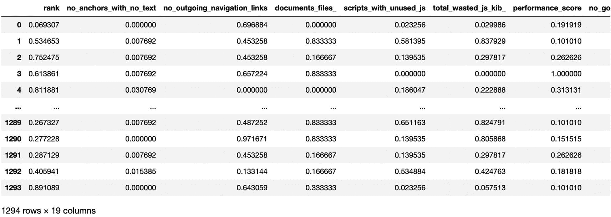

一个包含1294行和19列的数据表，表头为`rank`，无锚点文本，无出站导航链接，包含文档文件、脚本（含未使用的JS）、总计浪费的JS资源（KB）以及性能评分。`rank`为0.752475时显示的数据不再是`NaN`，而是依次为0.007692、0.453258、0.166667、0.139535、0.297817和0.262626。

### 独热编码

独热编码是一种帮助统计模型将分类数据转换为它们更容易解释的二进制格式（0和1）的技术。它通过为给定分类数据列的每个值创建额外的列来实现这一点。然后根据数据点，在相应的列中分配值为1或0。这里不举例说明，我们将直接运行代码，结果在生成的数据框中应该显而易见。

我们不想为关键词和URL等列创建独热编码，因为它们不是排名因素，因此我们将从数据框中删除这些列：
```
stop_cols = ['keyword', 'url', 'site']
hypo_serps_preml_cat = hypo_serps_preml_nonnum.drop(stop_cols, axis = 1)
```

将分类数据列存储在一个列表中：
```
categorical_cols = hypo_serps_preml_cat.columns.tolist()
```

使用列表推导式更新`categorical_cols`列表，确保排除停止列：
```
categorical_cols = [feat for feat in categorical_cols if feat not in stop_cols]
categorical_cols
```

以下是即将进行独热编码的分类列：
```
['token_size',
'compression',
'connection',
'charset',
'canonical_status',
'canonical_url_render_status',
'flesch_kincaid_reading_ease',
'sentiment',
'contains_paginated_html', ... ]
hypo_serps_preml_cat
```

以下是仅选择了独热编码列的数据框。

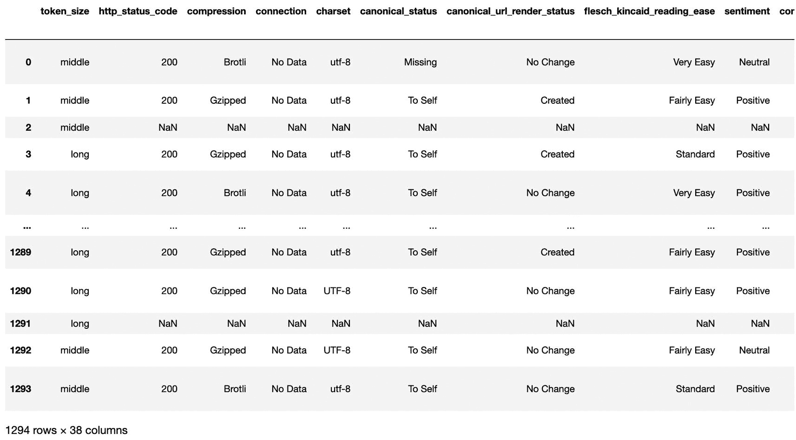

一个包含1294行和38列的数据表，表头为`token size`、`http status code`、`compression`、`connection`、`charset`、`canonical status`、`canonical url render status`、`flesch kincaid reading ease`和`sentiment`。数据读取为：middle或long、200或`NaN`、brotli、gzipped或`NaN`、no data或`NaN`、utf-B或`NaN`、missing、to self或`NaN`、no change、created或`NaN`、very easy、fairly easy、standard或`NaN`，以及neutral、positive或`NaN`。

将使用`get_dummies()`为每个分类排名因素创建独热编码列：
```
hypo_serps_preml_ohe = pd.get_dummies(hypo_serps_preml_cat, columns = categorical_cols)
hypo_serps_preml_ohe
```

结果如下：

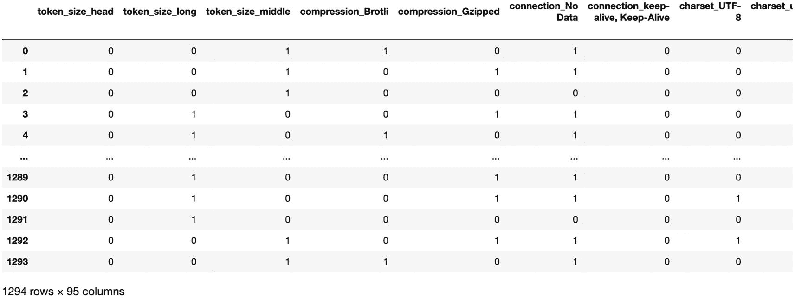

一个包含1294行和95列的数据表，表头为`token size head`、`token size long`、`token size middle`、`compression brotli`、`compression gzipped`、`connection nodata`、`connection keep alive`、`keep alive`和`charset UTF`。列中的数据填充为0或1。

通过独热编码，分类列已从38列扩展到95列。例如，`compression`列已被两个新列`compression_Brotli`和`compression_Gzipped`替代，因为该排名因素只有两个值。

## 消除缺失值

在清理和转换了数值和分类数据列之后，我们现在准备合并数据并消除缺失值。

使用 `concat()` 合并数据框：

```
hypo_serps_preml_ready = pd.concat([hypo_serps_preml_ohe, hypo_serps_preml_median], axis = 1)
hypo_serps_preml_ready
```

数据框现在合并为一个名为 `"hypo_serps_preml_ready"` 的单一数据框。

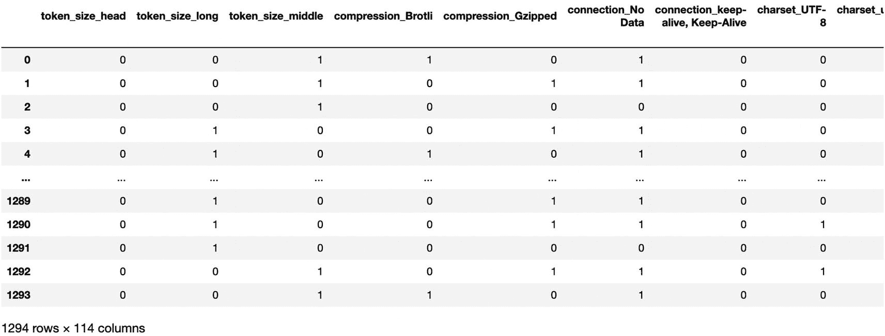

一个包含 1294 行和 114 列的数据表，表头为 `token size head`、`token size long`、`token size middle`、`compression brotli`、`compression gzipped`、`connection nodata`、`connection keep alive`、`keep alive` 和 `charset UTF`。列中的数据填充为 0 或 1。

下一个准备步骤是消除 `"NA"` 值，因为机器学习算法不太能处理单元格值为“不可用”的情况。

首先，通过计算每列空值的总和并除以总行数，检查哪些列包含一定比例的缺失值：

```
percent_missing = hypo_serps_preml_ready.isnull().sum() * 100 / len(hypo_serps_preml_ready)
```

我们将缺失数据的计算结果放入一个单独的数据框，然后对值进行排序：

```
missing_value_df = pd.DataFrame({'column_name': hypo_serps_preml_ready.columns,
'percent_missing': percent_missing})
missing_value_df.sort_values('percent_missing')
```

我们可以看到没有列包含缺失值，这是个好消息，可以进入下一阶段。如果存在缺失值，这些列将被移除，因为我们已经尽力改进了数据以达到目前的状态。

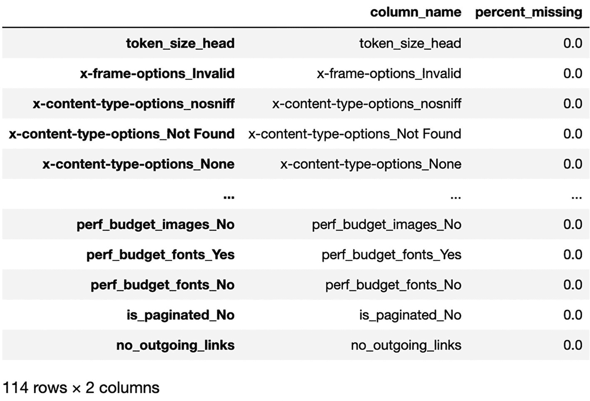

一个包含 114 行和 2 列的数据表，表头为 `column name` 和 `percent missing`。数据中没有包含缺失值的列。所有列的缺失百分比均为 0.0。

## 对 SERP 进行建模

快速提醒一下，对 SERP 进行建模是一个公式，它将根据 SEO 特征预测排名，即：

```
rank ~ w_1*feature_1 + w_2*feature_2 + … + w_n*feature_n
```

`~` 表示“由……解释”。`n` 是第 n 个特征。`w` 是特征的权重。

以下是一些值得提及的要点：

*   将数据集拆分为测试集（20%）和训练集（80%）。模型将从大部分数据集（训练集）中学习，并应用于测试集（模型之前未见过的数据）。我们这样做是为了了解模型在真实场景中的实际表现。

我们将使用基于决策树的模型，即随机森林。随机森林使用多个决策树并取所有决策树的平均值，以得到最终最能泛化数据集的模型，因此很可能在未见数据上表现良好。随机森林还可以处理线性模型无法处理的非线性关系。

设置随机种子是为了控制模型的随机性，使结果可重现，以便其他 SEO/数据科学家可以使用相同的数据评估研究并得到相同的结果。

将使用交叉验证来使模型尽可能稳健，且不进行超参数调优。

通常，随机森林模型（或任何机器学习模型）在拥有 10,000 行或更多数据时表现最佳，但数据量少得多时仍能提供有价值的见解。

导入相关的 API 和库，这些主要来自 `scikit-learn`，一个用于 Python 的免费机器学习软件库：

```
from sklearn.model_selection import cross_val_score
from sklearn.model_selection import RepeatedKFold
from sklearn.ensemble import RandomForestRegressor
from sklearn.model_selection import train_test_split
from sklearn.preprocessing import StandardScaler
import category_encoders as ce
from sklearn import metrics
hypo_serps_ml = hypo_serps_preml_ready.copy()
```

对数据进行编码：

```
encoder = ce.HashingEncoder()
serps_features_ml_encoded = encoder.fit_transform(hypo_serps_ml)
serps_features_ml_encoded
```

结果如下：

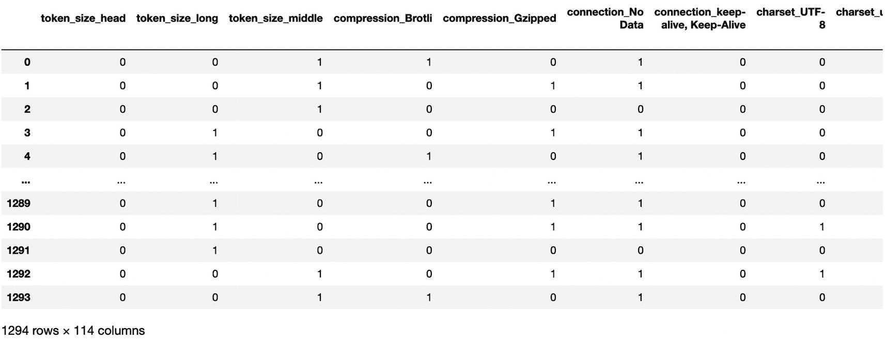

一个包含 1294 行和 114 列的表，表头为 `token size head`、`token size long`、`token size middle`、`compression brotli`、`compression gzipped`、`connection nodata`、`connection keep alive`、`keep alive` 和 `charset UTF`。数据在列中重复相同的值，值为 0 或 1。

将目标变量设置为 `rank`，这是我们希望解释并指导 SEO 建议的结果：

```
target_var = 'rank'
```

将排名因子数据分配给 `X`，将 `rank` 分配给 `y`：

```
X, y = serps_features_ml_encoded.drop(target_var, axis=1), serps_features_ml_encoded[target_var]
```

为了训练模型，我们使用 `RandomForestRegressor`，因为它往往比线性回归模型提供更好的结果。您可以并行尝试的替代方案包括 `XGBoost`、`LightGBM`（尤其适用于更大的数据集）和 `AdaBoost`。

实例化模型：

```
regressor = RandomForestRegressor(n_estimators=20, random_state=1231)
```

对模型进行交叉验证。当模型进行交叉验证时，实际上是通过进一步划分训练数据集来评估模型，以查看模型在所有训练数据上的泛化能力，并希望也能泛化到真实世界。

在我们的案例中，我们将模型分割五次，并将结果存储在 `n_scores` 中：

```
n_scores = cross_val_score(regressor, X, y, scoring='neg_mean_absolute_error', cv=5, n_jobs=-1)
n_scores
```

将数据随机分割为训练集和测试集：

```
X_train, X_test, y_train, y_test = train_test_split(X, y, test_size=0.2, random_state=1231)
```

基于训练集拟合机器学习模型：

```
regressor.fit(X_train, y_train)
```

在测试数据集上测试模型，并将预测结果存储到 `y_pred` 中：

```
y_pred = regressor.predict(X_test)
```

## 评估 SERPs ML 模型

现在我们有了模型，可以测试其有效性。一般原则是：

*   向 `predict` 命令提供测试数据集和模型
*   计算均方根误差（RMSE）和 `r-squared`

由于排名建模和预测是一个回归问题，我们使用 `RMSE` 和 `r-squared` 作为评估指标。那么它们告诉我们什么？
`RMSE` 告诉我们预测排名的平均误差范围。例如，`RMSE` 为 5 意味着模型预测的排名位置平均会与真实值相差±5。
`r-squared` 的正式名称为“决定系数”。这意味着什么？实际上，`r-squared` 表示数据集中可以被模型解释的数据点比例。它通过取相关系数（`r`）的平方来计算，因此得名 `r-squared`。`r-squared` 为 0.4 意味着 40%的数据可以被模型解释。
要警惕 `r-squared` 为 1 或任何接近 1 的模型，尤其是在 SEO 中。很可能代码中存在错误，或者模型过拟合，或者您为 Google 工作。无论如何，您都需要调试。

`r-squared` 远不如 `RMSE` 有用，因此我们在此不详细讨论。但是，如果您仍然想了解 `r-squared`，可以通过运行以下命令查看训练模型（即基于训练数据）的 `r-squared`：

```
print('MAE: %.3f (%.3f)' % (np.mean(n_scores), np.std(n_scores)))
print('Mean Absolute Error:', metrics.mean_absolute_error(y_test, y_pred))
print('Mean Squared Error:', metrics.mean_squared_error(y_test, y_pred))
print('Root Mean Squared Error:', np.sqrt(metrics.mean_squared_error(y_test, y_pred)))
MAE: -0.222 (0.010)
Mean Absolute Error: 0.23340777636881724
Mean Squared Error: 0.0861631648297419
Root Mean Squared Error: 0.2935356278712039
```

您可能想知道这些指标的良好或合理值是多少。事实是，这取决于您需要模型有多好以及您打算如何使用它。
如果您打算将模型用作自动化 SEO 系统的一部分，该系统将直接对您的内容管理系统（CMS）进行更改，那么 `RMSE` 需要非常准确，因此可能不超过五个排名位置。即便如此，这也取决于您排名的起始位置，因为对于已经在第一页排名的页面来说，五个位置的差异与在第三页排名的页面相比，意义完全不同！
如果模型的预期用例仅仅是深入了解驱动排名的因素，以及您应该优先进行 A/B 测试或优化的内容，那么 `RMSE` 为 20 或更小是可以接受的。

## 排名的最具预测性驱动因素

那么机器学习模型能告诉我们什么秘密？我们将提取排名因子和模型重要性数据到一个数据框中：

```
df_imp = pd.DataFrame({"feature": X.columns.values,
"importance": regressor.feature_importances_,
})
df_imp = df_imp.sort_values('importance', ascending = False)
df_imp = df_imp
df_imp
```

以下数据框结果显示了按重要性降序排列的最具影响力的 SERP 特征或排名因子。

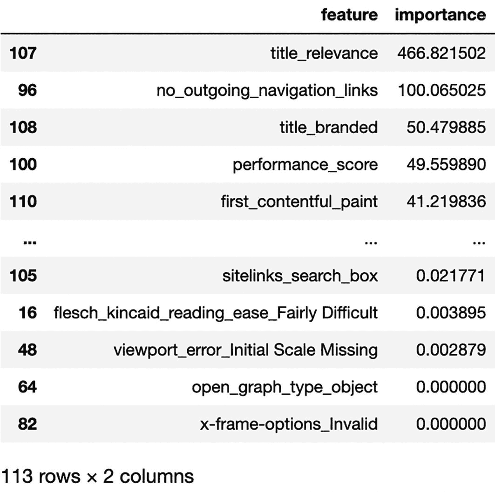

一个包含 113 行和 2 列的表，列名为 `feature` 和 `importance`，显示了影响数据的 SERP 特征。数据读取 `title relevance` 具有高重要性 `466.821502`，而 `viewport error initial scale missing` 具有最小重要性 `0.002879`。

使用 `plotnine` 库将重要性数据绘制成条形图：

```
RankFactor_plt = (ggplot(df_imp.head(7), aes(x = 'reorder(feature, importance)', y = 'importance')) +
geom_bar(stat = 'identity', fill = 'blue', alpha = 0.6) +
labs(y = 'Google Influence', x = '') +
theme_classic() +
coord_flip() +
theme(legend_position = 'none')
)
RankFactor_plt.save(filename = 'images/1_RankFactor_plt.png', height=5, width=5, units = 'in', dpi=1000)
RankFactor_plt
```

# 本章小结

在此特定案例中，图 6-3 显示，最重要的因素是 `title_relevance`，它衡量的是标题标签与目标关键词之间的字符串距离。这是通过字符串重叠度来衡量的，即目标关键词在标题标签字符串中所占的比例。

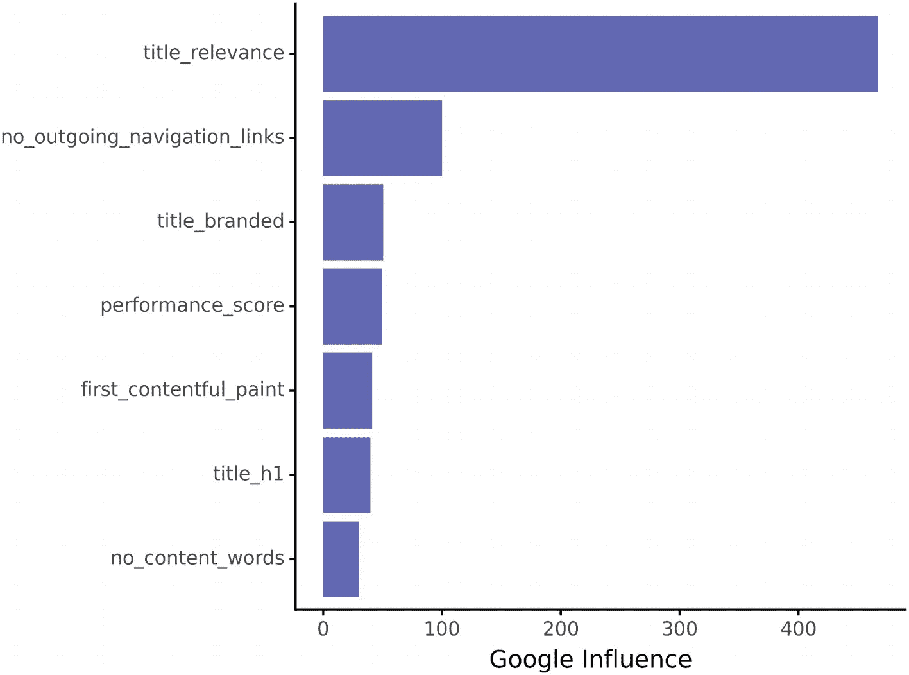

一幅展示各因素与谷歌影响力关系的水平条形图。标题相关性（`title_relevance`）的条形是最具影响力的因素，数值为 450，而内容词数量（`no_content_words`）的条形数值为 30。

图 6-3
变量重要性图，展示了由机器学习算法识别出的最具影响力的排名因素

对于 SEO 从业者来说，这并不意外；然而，其价值在于为那些不理解优化标题标签必要性的非专业商业受众提供了经验证据。这类数据也可用于争取非 SEO 同事（如开发人员）的支持，以便优先处理 SEO 变更请求。

该行业中其他值得注意的因素如下：

- `no_cookies`：Cookie 的数量
- `dom_ready_time_ms`：页面速度的衡量指标
- `no_template_words`：主体内容区域之外的单词数量
- `link_root_domains_links`：指向根域名的链接数量
- `no_scaled_images`：需要浏览器缩放才能渲染的缩放图片数量

每个市场或行业都各不相同，因此上述内容并非适用于整个 SEO 领域的通用结论！

### 排名因素的价值几何

现在你已经有了模型，你可能希望将你的发现传达给同事和客户。我们将研究其中一个排名因素，以此为例说明如何传达机器学习模型的发现。

将最具影响力的排名因素存储在一个列表中：

```
influencers = ['title_relevance', 'no_outgoing_navigation_links', 'title_branded', 'performance_score', 'first_contentful_paint', 'title_h1', 'no_content_words']
```

选择 `performance_score` 作为我们想要研究的排名因素。根据 Python 的零索引，这将是列表中的第四个元素，索引为 3：

```
i = 3
```

计算统计数据，以平均网站 CWV 性能和谷歌排名：

```
num_factor_agg = hypo_serps_features.groupby(['site']).agg({str(influencers[i]): 'mean', 'rank': 'mean', 'se_results_count': 'sum', 'count': 'sum'}).reset_index()
num_factor_agg = num_factor_agg.sort_values(str(influencers[i]))
```

为了在图表中向客户展示与竞争对手不同的颜色，我们将创建一个新列 `target`，如果该网站是客户网站，则值为 1，否则为 0：

```
num_factor_agg['target'] = np.where(num_factor_agg['site'].str.contains(hostname), 1, 0)
num_factor_agg
```

以下是用于生成图 6-4 中图表的数据框。

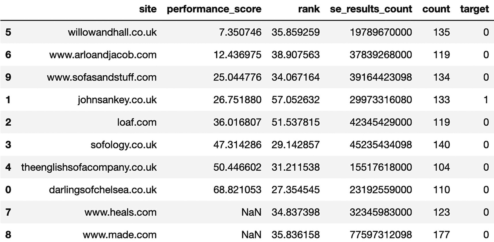

一个包含 11 行 6 列的表格，表头为：网站（`site`）、性能得分（`performance_score`）、排名（`rank`）、搜索结果数量（`se_results_count`）、计数（`count`）和目标（`target`）。网站 `johnsankey.co.uk` 的目标值为 1，其他网站的目标值为 0。

此函数根据你希望拟合的直线（1 次）或曲线（2 次或更高次）返回多项式最佳拟合线：

```
def poly(x, degree=1):
    """
    拟合多项式
    这些是非正交因子，但如果仅用于平滑处理而非外推预测，则可能无关紧要。
    """
    d = {}
    for i in range(degree+1):
        if i == 1:
            d['x'] = x
        else:
            d[f'x**{i}'] = np.power(x, i)
    return pd.DataFrame(d)
```

绘制图表：

```
num_factor_viz_plt = (
    ggplot(num_factor_agg,
           aes(x = str(influencers[i]), y = 'rank', fill = 'target', colour = 'target', #shape = 'cat_item',
               size = 'se_results_count')) +
    geom_point(alpha = 0.3) +
    geom_smooth(method = 'lm', se = False, formula = 'y ~ poly(x, degree=1)', colour = 'blue', size = 1.5) +
    labs(y = '谷歌排名', x = str(influencers[i])) +
    scale_y_reverse() +
    scale_size_continuous(range = [5, 20]) +
    theme(legend_position = 'none', axis_text_x=element_text(rotation=0, hjust=1, size = 12))
)
num_factor_viz_plt
```

通过绘制各网站的平均核心网页指标（CWV）与平均谷歌排名的关系图（图 6-4），并包含一条最佳拟合线，我们可以估算出 CWV 每单位改进对排名的影响。在此案例中，CWV 每提升 1 个单位，排名大约提升 0.5 个位置。

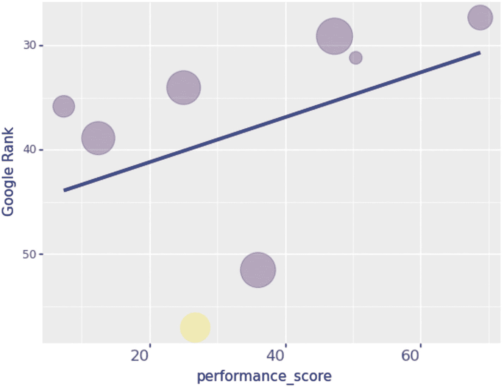

一个气泡图，展示了谷歌排名与性能得分的最佳拟合线。该图呈现正斜率。

图 6-4
比较谷歌排名与 CWV 性能得分的网站气泡图

### 排名因素的获胜基准

获胜基准似乎也是 70，这对开发人员来说可能是个安慰，因为要达到 90 分或以上的分数可能需要耗费大量资源。多亏了机器学习，我们不仅能够发现最重要的因素，在进行深入分析时，还能看到获胜基准。

### 让你的模型更稳健的技巧

当然，没有模型是完美的，也永远不会完美。模型的实用性取决于：

-   你的想象力、创造力、SEO 知识以及提出对模型构建有信息价值的假设的能力
-   你将这些假设转化为可在你网站和竞争对手网站上收集为数据的可衡量指标的能力
-   你构建对模型识别模式有意义的数据结构的方式

### 付诸行动

有了模型输出，你现在可以就你的 SEO 策略做出一些决策，包括：

-   你希望在全站范围内进行的“无需动脑”的更改，例如网站速度或增加品牌搜索量（通过程序化广告、内容营销或两者结合）
-   对你模型中包含的因素进行拆分 A/B 测试
-   对排名因素本身进行进一步研究，以指导你的建议

### 自动化此分析

上述机器学习应用非常适合获得一些想法，用于进行拆分 A/B 测试，并通过基于证据的变更请求来改进 SEO 计划。同样重要的是要认识到，当这种分析持续进行时，其效果会更加强大。为什么？因为机器学习分析只是对某个时间点搜索引擎结果页面（SERP）的快照。持续的数据收集和分析流意味着你可以更真实地了解你的行业在 SERP 中实际发生的情况。

这就是专为 SEO 构建的数据仓库和仪表盘系统发挥作用的地方，这些产品如今已经可用。这些系统的作用是：

-   每天从你喜欢的 SEO 工具中摄取数据
-   整合数据
-   使用机器学习在你选择的前端（如 Google Data Studio）中像之前一样呈现洞察

要构建你自己的自动化系统，你需要在云基础设施（如亚马逊云服务（AWS）或谷歌云平台（GCP））中部署所谓的 ETL，即提取、转换和加载，以便你的数据收集、分析和可视化在一个地方实现自动化。这在第 8 章中有更详细的说明。

### 总结

在本章中，你学到了：

-   理解用于竞争对手分析的排名因素背后的数据科学原理
-   如何整合数据源
-   如何为机器学习准备数据
-   如何训练机器学习模型
-   如何使用模型输出来生成 SEO 建议

# SEO 中的竞争对手研究与分析

SEO 中的竞争对手研究与分析之所以困难，是因为存在大量可用的排名因素，且需要控制的变量众多。由于涉及的数据量庞大，电子表格工具难以胜任，更不用说像 `Python` 这样的数据科学语言所提供的统计能力了。

在使用机器学习（ML）进行 SEO 竞争对手分析时，重要的是要理解这是一个回归问题，目标变量是谷歌排名，而假设则是排名因素。

在第 7 章中，我们将介绍实验，这些实验自然是在竞争对手统计分析结果之后进行的。

# 7. 实验

从数据或你自己的思维实验中发掘出可以应用到你的网站上、并带来真正、显著的自然流量提升的见解，是相当令人兴奋的。随着诸如 Distilled ODN 和 RankScience 等拆分测试平台的兴起，实验在 SEO 中扮演着越来越重要的角色，这并不令人意外。

如果你运营的是一个小型网站，那么导致负面影响的改动可能无关紧要，或者该改动看似是显而易见的 SEO 最佳实践，那么你可以放弃正式的实验，而专注于实施你认为必要的改动。

另一方面，如果你是在一个大型企业网站上工作，无论是内部团队还是作为代理机构的一部分，那么任何改动都将产生重大影响，你需要确保测试这些改动，以便了解其影响（包括正面和负面），同时也有助于塑造你的理解，为形成新的待测试假设提供信息。

### 实验如何融入 SEO 流程

要成功进行实验和 A/B 拆分测试，你需要一个从想法产生（也称为假设）到实施的完整流程。我们概述了以下步骤：

1.  假设生成
2.  实验设计
3.  运行实验
4.  评估
5.  实施

我们将在以下章节中介绍这些步骤。

### 生成假设

在任何实验开始之前，你需要围绕你的假设来构建它，即你相信什么会显著改变你的目标变量或结果指标，例如，自然展示次数或已爬取的 URL。

这一步至关重要，因为如果没有清晰的假设，你就无法知道要测试什么来影响你的结果指标。所以，思考一下你想从哪些方面学习，以帮助你提升 SEO 表现。

假设的来源有多个方面：

-   竞争对手分析
-   网站文章和社交媒体
-   你/你团队的想法
-   最近的网站更新
-   会议活动和行业同行
-   过去的实验失败案例

我通常喜欢使用这样的格式：“我们相信谷歌会给予那些被网站其他重要页面链接的 URL 更高的权重。”然后，这个陈述会被扩展，以考虑你提议测试的内容以及你将如何衡量（例如，“当……时，我们将知道该假设是否有效”）。

### 竞争对手分析

你进行的竞争对手分析（在第 6 章中解释过）将是测试想法的自然来源，因为它们具有一定的统计基础，能够揭示你的竞争对手正在做或没有做哪些事情来获得更优的自然流量表现。这些假设还有一个额外的好处，即从一开始就知道你将测试的指标是什么。毕竟，你首先需要将数据纳入你的分析中。

### 网站文章和社交媒体

我们经常读到一些研究、文章和社交媒体梗，声称它们驱动或降低了自然流量表现。这并不是说这些说法不真实或没有根据。然而，这些说法并不适用于你的具体情况，如果它们成为了新闻，那么很可能值得测试。顺便提一下，在数据科学真正兴起之前的 SEO 职业生涯早期，真正了解你的数据的最佳方式就是测试我们在网上读到的所有关于 SEO 的内容，例如 Webmaster World、BlackHatWorld 论坛等，看看哪些有效，哪些无效。如果你的网站没有被谷歌从索引中移除，你就不会被视为一个受人尊敬的 SEO，或者也许你只是没有大胆地进行实验。其本质就是为搜索引擎进行“优化”。

当然，情况已经发生了变化，我们大多数从事 SEO 的人现在是为品牌和成熟企业工作。因此，一些创造性的、狂野的实验可能不合适，或者会限制职业发展，我们并不提倡这样做。

### 你/你团队的想法

测试假设并不局限于你直接的 SEO 团队（内部或代理机构），甚至不限于你的数字营销团队。这可以是对网站有任何接触并有任何想法的同事。他们的大部分想法可能不值得投入资源进行实验。然而，他们的想法，因为他们（应该）关心业务，所以值得考虑。当然，从 SEO 的角度来看，你直接的 SEO 团队可能对需要测试的事情有更好的想法。

### 最近的网站更新

通常，在大型网站更新影响你的自然流量之前进行测试是更好的。然而，由于其他相互竞争的优先级或紧迫的时间表，你可能没有这样的奢侈条件。尽管如此，如果一个产品更新预计会影响你的自然流量，无论好坏，例如推出一个精简的顶级导航，你最好能知道原因并抢在全面发布之前，这样你就可以测试它，以了解其对 SEO 的影响。

### 会议活动和行业同行

为什么要把你的想法局限于线上和你的公司呢？参加行业活动不仅是寻找新的 SEO 测试内容的好方法，而且还可以在活动中遇到可能正在解决相同问题的人。思想的多样性受到高度重视，并可能带来突破性的实验想法。

### 过去的实验失败案例

如果失败了，那就尝试、再尝试、再尝试。通常，如果一个实验失败了，往往是因为实验没有达到所需的样本量，或者实验设计或运行不正确。从中学习并重复迭代。无论是设计、正确运行，还是重新制定你的假设，都要去做，并持续迭代，直到获得期望的结果。你可能会走向与最初失败的实验不同的方向，但在这个过程中你会学到很多东西。

# 实验设计

在决定了要测试哪些假设之后，你现在就可以设计你的实验了。在下面的代码示例中，我们将设计一个实验，以查看一个测试项（可以是任何东西，比如主标题下方的一段文字）在 URL 层面对自然展示次数的影响。

让我们从导入 API 开始：

```python
import re
import time
import random
import pandas as pd
import numpy as np
import datetime
import requests
import json
from datetime import timedelta
from glob import glob
import os
from plotnine import *
import matplotlib.pyplot as plt
from pandas.api.types import is_string_dtype
from pandas.api.types import is_numeric_dtype
from datetime import datetime, timedelta
```

这些是执行实际拆分测试所需的：

```python
from statsmodels.discrete.discrete_model import NegativeBinomial
from statsmodels.tools.tools import add_constant
from collections import Counter
import uritools
pd.set_option('display.max_colwidth', None)
%matplotlib inline
```

因为我们使用的是网站分析数据（常见品牌包括 `Google`、`Looker`、`Adobe`），这些数据可以轻松地从按日期划分的落地页报告中导出。如果网站规模较大，则可能需要使用 API（`Google Analytics` 相关 API 请参见第 8 章）。

根据你使用的网站分析工具，列名可能有所不同；但是，如果你想测试不同 URL 组在时间维度上的展示次数差异，你需要以下字段：

- `Date`
- `Landing page URL`
- `Sessions`

除了`Sessions`，也可以测试其他指标，例如展示次数、点击率、排名等。

假设你有一个 `CSV` 导出文件，使用`pd.read_csv`从网站分析工具中读取数据：

```python
analytics_raw = pd.read_csv("data/expandable-content.csv")
```

打印各列的数据类型，检查是否有数值数据被导入为字符串类型（需要转换）：

```python
print(analytics_raw.dtypes)
landing_page     object
date             object
sessions        float64
dtype: object
```

会话数据是数值型浮点数，这没问题；但日期数据被归类为“`object`”，这意味着需要将其转换为日期格式。

我们将使用`.copy()`方法创建数据框的副本。这样，我们做的任何修改都不会影响原始导入的表。这样一来，如果对修改不满意，我们无需从头重新导入。

```python
analytics_clean = analytics_raw.copy()
```

日期列使用`to_datetime()`函数，该函数接收列和日期格式，然后进行归一化处理，将字符串转换为日期格式。

这对于后续填充缺失日期和绘制时间序列数据非常重要：

```python
analytics_clean['date'] = pd.to_datetime(analytics_clean['date'], format='%d/%m/%Y').dt.normalize()
analytics_clean
```

下面的 `Pandas` 数据框展示了`analytics_clean`，现在数据已转换为可用格式，便于进一步操作，例如绘制会话随时间变化的图表。

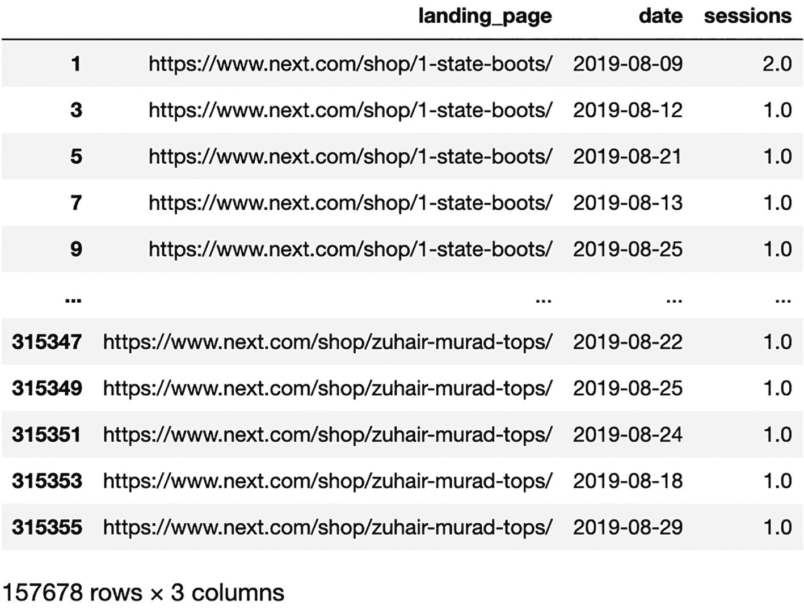

一个包含 157678 行和 3 列的表，展示了 `www.next.com/shop` 落地页的详细信息、日期和会话数。

让我们使用`.describe()`探索会话的分布情况：

```python
analytics_raw.describe()
```

以下截图展示了会话的分布情况，包括计数（数据点数量）、平均值（均值）等。

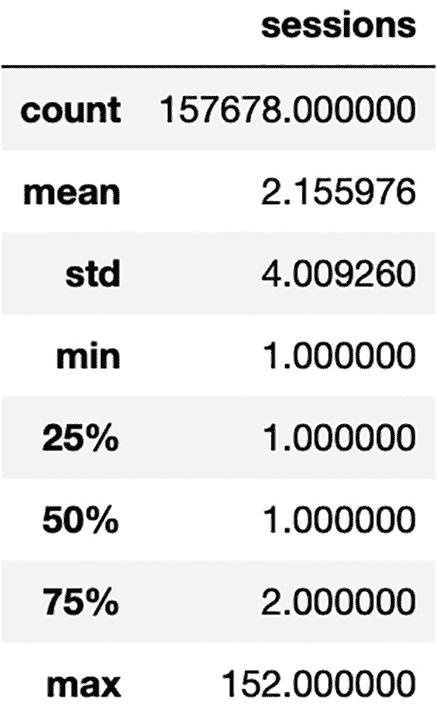

一个表格展示了会话的详细信息：计数、均值、标准差、最小值、25%、50%、75% 和最大值。

我们可以看到，每个 URL 在任意给定日期的平均会话数约为 2，但标准差为 4，表明波动很大。鉴于均值为 2，而一个落地页的会话数不可能为 –2（均值 2 减去标准差 4），这意味着某些异常页面获得了极高的会话数，这解释了波动的原因。

现在查看日期：

```python
analytics_clean['date'].describe()
```

结果如下：

```
count                  157678
unique                     28
top       2019-08-18 00:00:00
freq                     6351
first     2019-08-06 00:00:00
last      2019-09-02 00:00:00
Name: date, dtype: object
```

除了数据日期范围大约在八月份之外，没有太多其他信息。

## 零膨胀

网站分析通常只在网页有展示时才会记录数据。那么，当页面没有展示时，该怎么办呢？

零膨胀是指为那些在特定日期没有记录到自然展示的页面添加空记录。如果我们不进行零膨胀，那么对于某个网页，甚至对于一组页面（例如 A 和 B），数据的均值都会产生偏差。

例如，`URL X` 在分析工具记录的某段时间内的 10 天里获得了 90 次会话，这可能会让你认为日均展示次数是 9 次。然而，由于这些会话只发生在 10 天内，你的计算会误导你认为该 `URL` 的表现比实际更好。通过零膨胀数据，即为 30 天期间内 `URL X` 没有自然展示的天数添加空行，计算出的平均值将恢复到预期的每天 3 次。

零膨胀还为我们提供了另一个有用的特性，那就是泊松分布。解释泊松分布超出了本书的范围。但你需要知道的是，当我们测试 A 组和 B 组之间的差异时，泊松分布常用于罕见事件。两组之间任何统计上显著的差异，都有望表明测试组 B 的零值显著少于 A 组。科学原理讲够了，我们开始实践吧。

有一种更简单（但不太容易理解）的方法来填充缺失日期。本章将介绍两种方法，先从较长但更易读的方法开始。

这里，我们使用`date_range()`函数，根据分析数据框中的最小和最大日期设置日期范围，间隔为一天。这被保存到一个名为`datelist`的变量对象中：

```python
datelist = pd.date_range(start=analytics_clean['date'].min(),
end=analytics_clean['date'].max(), freq='1d')
```

`nd`是日期范围内的天数，`nu`是我们需要日期的唯一落地页列表的长度：

```python
nd = len(datelist)
nu = len(analytics_clean['landing_page'].unique())
```

这里，我们通过落地页和日期的交叉乘积，创建一个包含所有可能的落地页和日期组合的数据框：

```python
analytics_expanded = pd.DataFrame({'landing_page': analytics_clean['landing_page'].unique().tolist() * nd,
'date':np.repeat(datelist, nu)})
```

然后，我们查找哪些日期和落地页有对应的会话记录：

```python
analytics_expanded = analytics_expanded.merge(analytics_clean, how='left')
```

任何不匹配（因此为空）的记录都用零填充：

```python
analytics_expanded[['date','sessions']] = analytics_expanded.groupby('landing_page')[
['date', 'sessions']].fillna(0)
```

将会话数据转换为数值型浮点数，以便于数据处理：

```python
analytics_expanded['sessions'] = analytics_expanded['sessions'].astype('int64')
analytics_expanded
```

得到的数据框`analytics_expanded`如下所示，是我们准备好进行拆分测试的零膨胀数据框。请注意，原始分析数据有 157,678 行，经过零膨胀后，现在有 807,212 行。

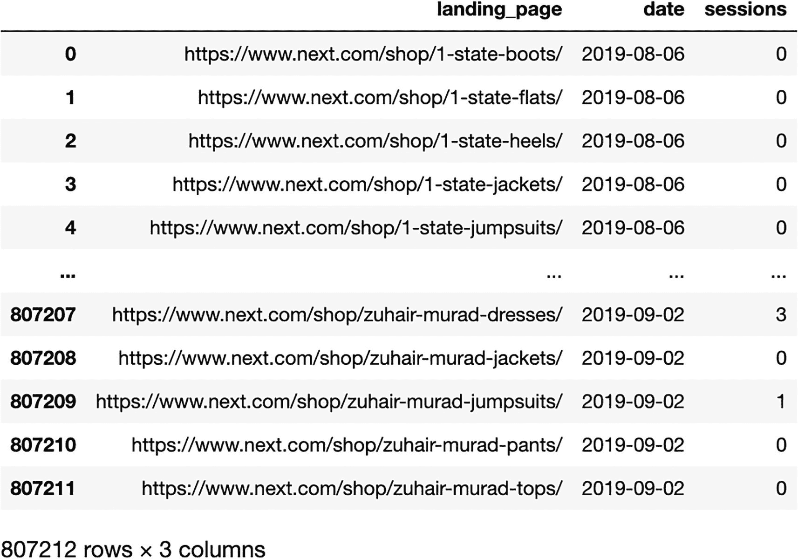

一个包含 807212 行和 3 列的表，展示了 `www.next.com/shop` 落地页的详细信息、日期和会话数。

让我们使用`.describe()`探索数据，它将告诉我们经过零膨胀后会话分布的变化：

```python
analytics_expanded.describe()
```

以下截图展示了零膨胀后的会话分布情况。

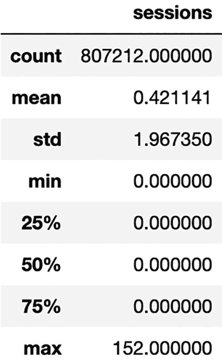

一个表格展示了会话的详细信息：计数、均值、标准差、最小值、25%、50%、75% 和最大值。

差异巨大！均值从 2.16 下降了超过 75%，降至 0.42，并且几乎没有任何页面在不到一个月的时间内获得超过一次会话。

## 拆分 A/A 分析

A/A 测试是这样一个过程：我们在一个时间段内对相同的项目进行自我测试。这是由 `SearchPilot`（前身为 `Distilled ODN`）推广的一种拆分测试类型，如图 7-1 所示。

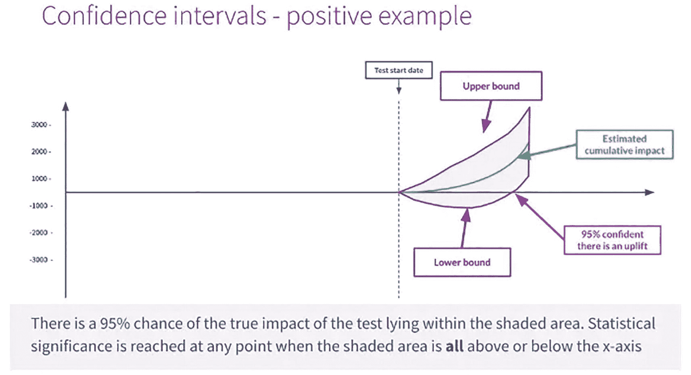

该图表展示了置信区间的正面示例。它标明了上限、下限、估计的累积影响，以及测试开始日期后 95% 确信存在提升的时间点。底部的文本框说明，测试的真实影响有 95% 的可能性。

图 7-1 `SearchPilot` 的拆分 A/B 分析**来源**：[`www.searchpilot.com/features/seo-a-b-testing/`](http://www.searchpilot.com/features/seo-a-b-testing/)

例如，我们选取一个 `URL` 样本，并在对该样本实施测试之前对其性能进行基准测试，以观察是否会产生显著影响。

我们进行 A/A 测试的主要动机是确定 A/B 测试设计是否足够可靠，可以继续进行。我们期望看到的是 A 之前和 A 之后之间没有差异。

我们将测试 13 天，假设在此期间没有进行任何更改，尽管在实际环境中，你会在测试前检查是否一切未变。

为什么是 13 天？这是一个任意数字；然而，后续会给出确定稳健 A/B 测试样本量的方法，以确保检测到的任何差异都是显著的。同样的方法也可以在这里应用。

这个 A/A 测试仅仅是为了说明如何创建数据结构并进行测试。因此，如果你想进行“`SearchPilot`”风格的拆分测试，那么除了样本量和测试周期的确定之外，以下代码将帮助你运行它：

```python
aa_test_period = 13
```

将截止日期设置为最新日期减去测试周期：

```python
cutoff = analytics_expanded['date'].max() -  timedelta(days = aa_test_period)
```

为 A/A 测试创建一个名为 `analytics_phased` 的数据框副本：

```python
analytics_phased = analytics_expanded.copy()
```

根据日期在截止日期之前还是之后设置 A/A 分组：

```python
analytics_phased['aa_group'] = np.where(analytics_expanded['date'] < cutoff, "pre_test", "test_period")
analytics_phased
```

这应该会产生以下输出：

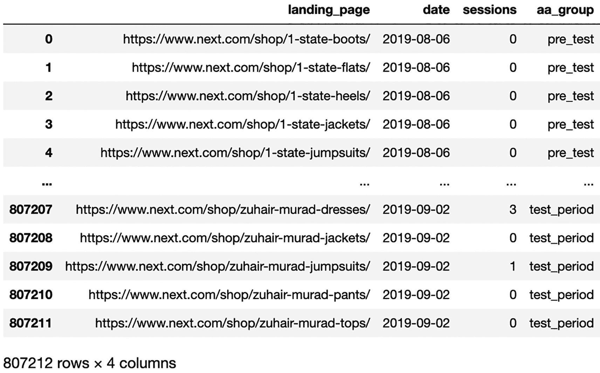

一个包含 807212 行和 4 列的表格，列出了着陆页、日期、会话以及分组（如 `pre_test` 和 `test_period`）的详细信息。

在测试之前，让我们通过分析来确定两个 A/A 组的统计属性，这可以预示实际拆分 A/A 测试的结果可能是什么。

第一个函数是 `day_range()`，它返回日期范围内的天数，即最新日期减去最早日期：

```python
def day_range(date):
return (max(date) - min(date)).days
```

首先，我们通过过滤非零会话的数据，然后按 A/A 组聚合日期范围和平均值来计算均值：

```python
aa_means = (
analytics_phased.loc[analytics_phased["sessions"] != 0]
.groupby(["aa_group"])
.agg({"date": ["min", "max", day_range], "sessions": "mean"})
)
aa_means
```

生成的 `aa_means` 数据框显示以下输出：

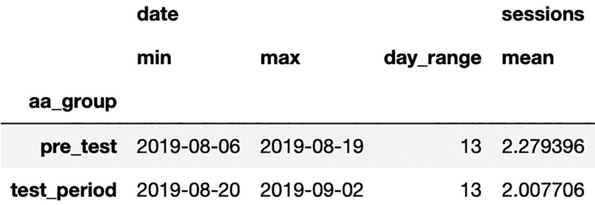

一个表格显示了名为 `pre-test` 和 `test-period` 的两个 A/A 组的最小和最大日期、日期范围以及平均会话数的详细信息。

我们可以看到日期范围和日期范围是正确的，并且每组的平均值在四舍五入为整数时大致相同。

```
aa_means = analytics_phased.loc[analytics_phased['sessions'] != 0]
```

让我们确定组间的变异：

```
aa_zeros = analytics_phased.copy()
```

创建一个零值列，以便我们统计零值及其比率：

```python
aa_zeros['zeros'] = np.where(aa_zeros['sessions'] == 0, 1, 0)
aa_zeros['rows'] = 1
```

按 A/A 组聚合零值数量和总数据点数：

```python
aa_means_sigmas = aa_zeros.groupby('aa_group').agg({'zeros': sum, 'rows': sum}).reset_index()
```

计算变异“sigma”，即零值占总可能会话数的 99.5%：

```python
aa_means_sigmas['sigma'] = aa_means_sigmas['zeros']/aa_means_sigmas['rows'] * 0.995
aa_means_sigmas
```

这将产生以下输出：

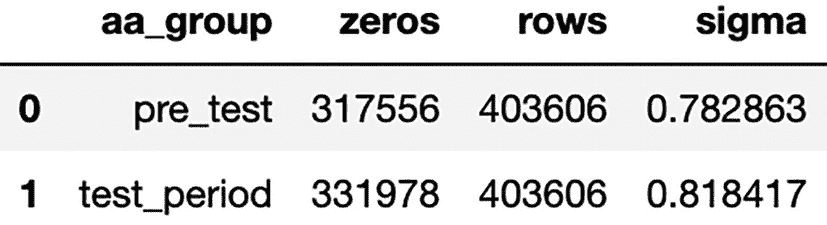

该表格显示了名为“pre-test”和“test-period”的两个 A/A 组的零值、行数和 sigma 的详细信息。

我们可以看到，在截断点前后变异非常相似，这让我们对 URL 足够稳定以进行 A/B 测试有了一定的信心。

使用`.merge()`函数（Python 中 Excel 的`vlookup`的等效函数）将它们合并：

```python
aa_means_stats.merge(aa_means_sigmas, on = 'aa_group', how = 'left')
```

这将产生以下输出：

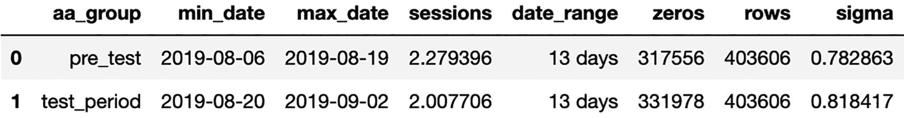

该表格显示了名为“pre-test”和“test-period”的两个 A/A 组的最小日期、最大日期、会话数、日期范围、零值、行数和 sigma 的详细信息。

如果你正在进行 A/A 测试以查看优化的效果，那么你会希望看到`test_period`组报告更高的会话率，同时 sigma 相同或更低。这将表明你的优化成功增加了 SEO 流量。

让我们使用`plotnine`的直方图绘制功能来可视化分布：

```python
aa_test_plt = (
ggplot(analytics_phased,
aes(x = 'sessions', fill = 'aa_group')) +
geom_histogram(alpha = 0.8, bins = 30) +
labs(y = 'Count', x = '') +
theme(legend_position = 'none',
axis_text_y =element_text(rotation=0, hjust=1, size = 12),
legend_title = element_blank()
) +
facet_wrap('aa_group')
)
aa_test_plt.save(filename = 'images/2_aa_test_plt.png',
height=5, width=8, units = 'in', dpi=1000)
aa_test_plt
```

图 7-2 所示的图表直观地确认了两组之间没有差异。

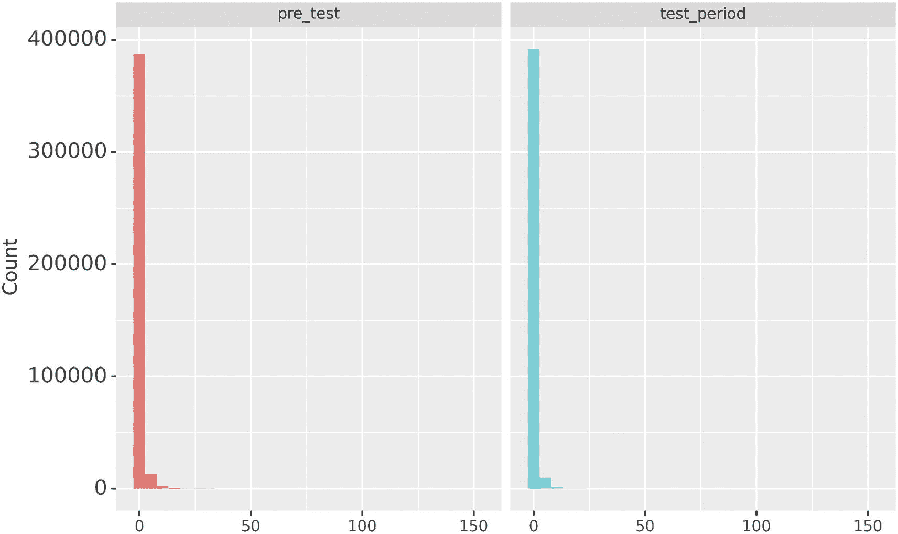

一组 2 个直方图表示预测试和测试期间的计数。两个图表都呈现出几乎相似的递减趋势。

图 7-2 预测试和测试期间 A/A 组数据的直方图

箱线图将提供两组分布的更多视觉细节，现在将使用它：

```python
aa_test_box_plt = (
ggplot(analytics_phased,
aes(x = 'aa_group', y = 'sessions',
fill = 'aa_group', colour = 'aa_group')) +
geom_boxplot(alpha = 0.8) +
labs(y = 'Count', x = '') +
theme(legend_position = 'none',
axis_text_y =element_text(rotation=0, hjust=1, size = 12),
legend_title = element_blank()
)
)
aa_test_box_plt.save(filename = 'images/2_aa_test_box_plt.png',
height=5, width=8, units = 'in', dpi=1000)
aa_test_box_plt
```

图 7-3 再次在`aa_test_box_plt`中显示，除了预测试组有更多的高值异常值外，两组之间没有差异。

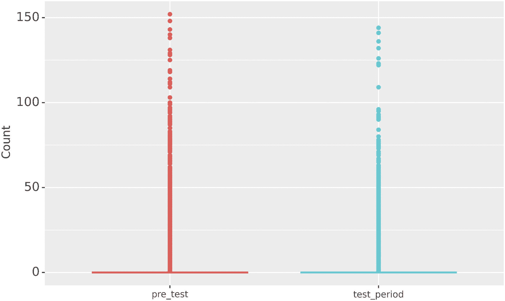

一组 2 个箱线图表示预测试和测试期间的计数。它表示预测试的图接近 150 个计数，测试期间接近 140 个计数。

图 7-3 预测试和测试期间组的箱线图

让我们使用统计模型执行实际的 A/A 测试。我们将创建一个数组，它是一个数字列表，将数据点标记为 0（预测试）或 1（test_period），然后将其分配给`X`：

```python
X = np.where(analytics_phased['aa_group'] == 'pre_test', 0.0, 1.0)
X = add_constant(X)
X = np.asarray(X)
X
```

结果如下：

```
array([[1., 0.],
[1., 0.],
[1., 0.],
...,
[1., 1.],
[1., 1.],
[1., 1.]])
```

`X`用于输入`NegativeBinomial()`模型，该模型将用于测试两个 A/A 组之间会话数的差异。

参数是结果指标（`sessions`）和自变量（`aa_group`）：

```python
aa_model = NegativeBinomial(analytics_phased['sessions'], X).fit()
```

然后，我们将使用`.summary()`属性查看模型结果：

```python
aa_model.summary()
```

得到的`aa_model.summary()`如下所示：

```
Optimization terminated successfully.
Current function value: 0.762045
Iterations: 3
Function evaluations: 8
Gradient evaluations: 8
```

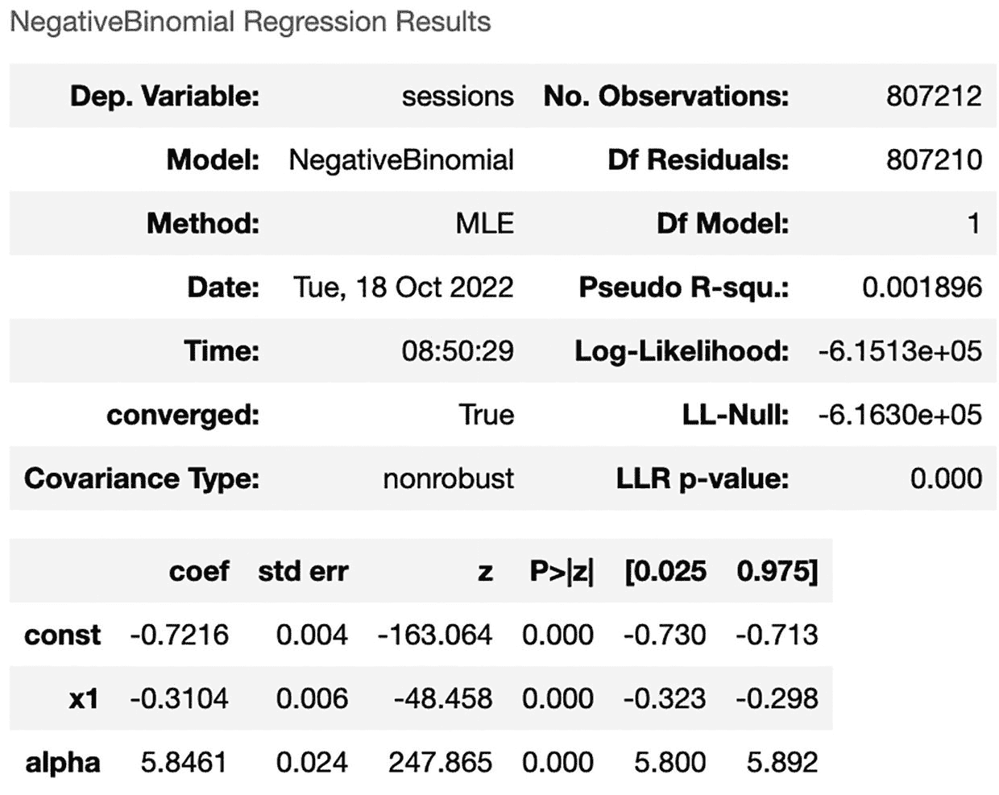

一个表格显示了负二项回归结果，其中包含因变量、模型、日期、时间、协方差类型、观测数、残差自由度、模型自由度以及其他变量的详细信息。在底部，它指示了常数、x1 和 alpha 的不同值。

打印输出显示 p 值（LLR p-value）为零，这意味着具有显著性。然而，x1 为 –0.31，表明组之间存在微小差异。这种差异是否足以停止 A/B 测试？这是一个业务问题。在这种情况下，答案是否定的；然而，这是主观的；图表和分析表格将支持没有真正差异的说法——继续前进。

## 确定样本量

正确确定样本量绝对关键，因为它确实可以决定测试结果的可信度。一些基本原则是确保有足够的样本量在合理的时间段内获得结论性结果，并确保不要像许多软件在实验完成之前观察到显著变化时那样提前终止测试。

我们不会深入探讨确定 SEO 实验适当样本量的因素，例如统计功效，因为这不是一本统计学教科书（而且有很多非常好的统计学教科书，例如 *OpenIntro Statistics*）。

决定所需样本量的主要因素是测试组和对照组之间所需的统计显著性差异水平。最典型和最传统的截断水平是 95%。也就是说，测试结果与对照组结果相同是由于随机噪声造成的概率为 5%（或更小），因此你可以拒绝测试组（B）和对照组（A）之间没有差异的原假设。

现实情况是，95% 规则虽然是惯例，但并非一成不变。你可以决定什么足够好。例如，你可能希望达到 89%，这完全没问题，因为 100 次中有 89 次，你的测试会击败对照组。这就是思考方式。

以下是一些用于实现此目的的代码。我们将估计一些参数，这些参数将用于帮助我们根据最小会话数确定所需的样本量：

```python
num_rows = analytics_phased["sessions"].count()
mu = analytics_phased[analytics_phased["sessions"] != 0].agg({"sessions": "mean"})
sigma = get_sigma(analytics_phased["sessions"])
print(num_rows, mu, sigma)
807212 sessions    2.155976
dtype: float64 0.8006401416232662
```

设置好参数后，这些参数将输入以下函数。`python_rzip`将根据参数生成并返回一个随机泊松分布：

```python
def python_rzip(n, mu, sigma):
rng = np.random.default_rng()
P = rng.poisson(mu, n)
return [p if random.random() > sigma else 0 for p in P]
```

`simulate_sample`使用`python_rzip`函数返回两组数据之间的拆分测试，假设差异为 20% 或更多：

```python
def simulate_sample(n, difference=0.2):
control = python_rzip(n, mu, sigma)
test = python_rzip(n, mu + difference, sigma)
test = stats.ttest_ind(control, test)
return test[1]
```

最后，`run_simulations`使用`simulate_sample`来估计给定流量水平的样本量的显著性：

```python
def run_simulations(n, difference=0.2, n_simulations=100):
p_values = [simulate_sample(n, difference) for i in range(n_simulations)]
significant = sum(map(lambda x: x <= 0.05, p_values))
return significant / n_simulations
```

定义了这三个函数后，我们就可以在不同流量水平下检验显著性。如果你想挑战一下自己，避免重复代码并提升 Python 技能，可以尝试将 `run_simulations` 函数作为列表推导式的一部分来实现：

```
print(run_simulations(n=100), ": 100")
print(run_simulations(n=1000), ": 1000")
print(run_simulations(n=10000), ": 10000")
print(run_simulations(n=15000), ": 15000")
print(run_simulations(n=18000), ": 16000")
print(run_simulations(n=18000), ": 18000")
print(run_simulations(n=20000), ": 20000")
print(run_simulations(n=25000), ": 25000")
print(run_simulations(n=30000), ": 30000")
print(run_simulations(n=50000), ": 50000")
```

运行结果如下：

```
0.04 : 100
0.08 : 1000
0.74 : 10000
0.85 : 15000
0.86 : 16000
0.9 : 18000
0.96 : 20000
0.97 : 25000
1.0 : 30000
1.0 : 50000
```

上述输出展示了在不同样本量（即我们所需的会话次数）下达到的显著性水平（p 值）。如果我们希望有 90%（或更高）的概率观察到 20% 的差异，那么每组需要 18,000 次或更多的会话。

因此，我们将实验样本量设定为合适的值：

```
exp_sample_size = 18000
```

## 测试组与对照组分配

一旦将样本量设定到所需的统计显著性水平，就可以开始随机分配测试组和对照组的 URL 了。

我们按着陆页汇总平均会话次数和天数，并将其存储为数据框 `urls_agg`：

```
urls_agg = analytics_clean.groupby('landing_page').agg({'sessions': 'mean', 'date': 'count'}).reset_index()
```

`testing_days`（即运行测试的最大天数）将设为 30，这是由业务方设定的一个任意数值。当然，这个值也可以更低。

```
testing_days = 30
```

设定了最大测试天数后，我们需要确定测试组所需的最少 URL 数量，以便在该时间段内达到所需的用户会话次数。将样本会话量 18,000 除以测试天数，即可得到这个近似值。

请记住，Google 可能需要长达两周（有时甚至更久）的时间来注册网站更改并将其反映在搜索结果中（即，它们需要抓取、索引并重新排序结果）。因此，为了降低提前结束实验的风险，我们将测试所需的最少 URL 数量翻倍，以增加 Google 在首次抓取时能够抓取到测试 URL（即包含更改的 URL）的可能性：

```
url_sample_size = int(exp_sample_size / testing_days) * 2
print(url_sample_size)
```

测试组需要 1200 个 URL。请注意，这里隐含假设测试 URL 的数量远少于对照组，因此对照组中有足够的 URL 可以在测试期间达到最少的会话次数。

```
urls_agg
```

我们得到的数据框显示了每个着陆页及其平均会话次数和产生会话的天数。如 `date` 列所示，某些 URL 会获得多天的会话数据。

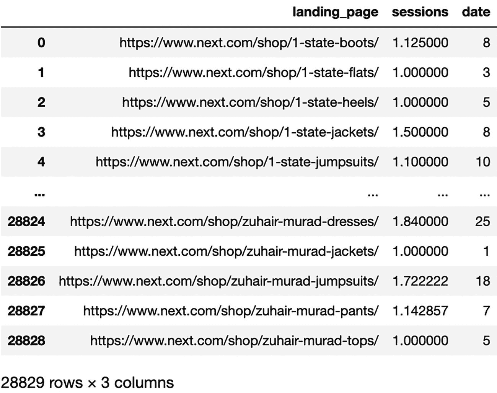

一个包含 28829 行和 3 列的表。显示了着陆页、日期和会话次数的详细信息。

现在，我们将根据所需的 1200 个 URL 对数据框进行抽样，并将其分配到 `test` 组：

```
urls_test = urls_agg.sample(url_sample_size).assign(ab_group="test")
```

删除 `sessions` 和 `date` 列，因为我们只需要将 URL 发送给 Web 开发团队进行分配：

```
urls_test.drop(['sessions', 'date'], axis = 1, inplace = True)
urls_test
```

`urls_test` 如下所示：

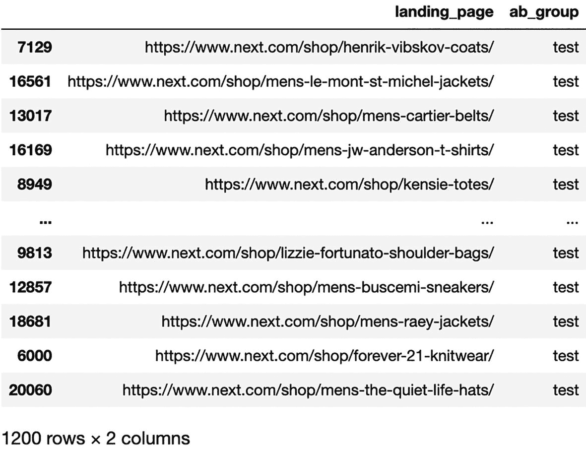

一个表示着陆页和 A/B 组详细信息的表。底部文字显示：1200 行，2 列。

我们的数据框显示了测试着陆页：

```
urls_test_list = urls_test["landing_page"]
urls_test_list
```

结果如下：

```
7129               https://www.next.com/shop/henrik-vibskov-coats/
16561    https://www.next.com/shop/mens-le-mont-saint-michel-jackets/
13017                https://www.next.com/shop/mens-cartier-belts/
16169         https://www.next.com/shop/mens-jw-anderson-t-shirts/
8949                       https://www.next.com/shop/kensie-totes/
...
9813     https://www.next.com/shop/lizzie-fortunato-shoulder-bags/
12857             https://www.next.com/shop/mens-buscemi-sneakers/
18681                 https://www.next.com/shop/mens-raey-jackets/
6000                https://www.next.com/shop/forever-21-knitwear/
20060          https://www.next.com/shop/mens-the-quiet-life-hats/
Name: landing_page, Length: 1200, dtype: object
```

测试着陆页被转换为一个列表，用于将其他（未分配到测试组的）URL 标记为对照组：

```
urls_control = urls_agg[~urls_agg["landing_page"].isin(urls_test_list.values)].assign(
ab_group="control"
)
urls_control.drop(['sessions', 'date'], axis = 1, inplace = True)
urls_control
```

`urls_control` 数据框显示了对照组：

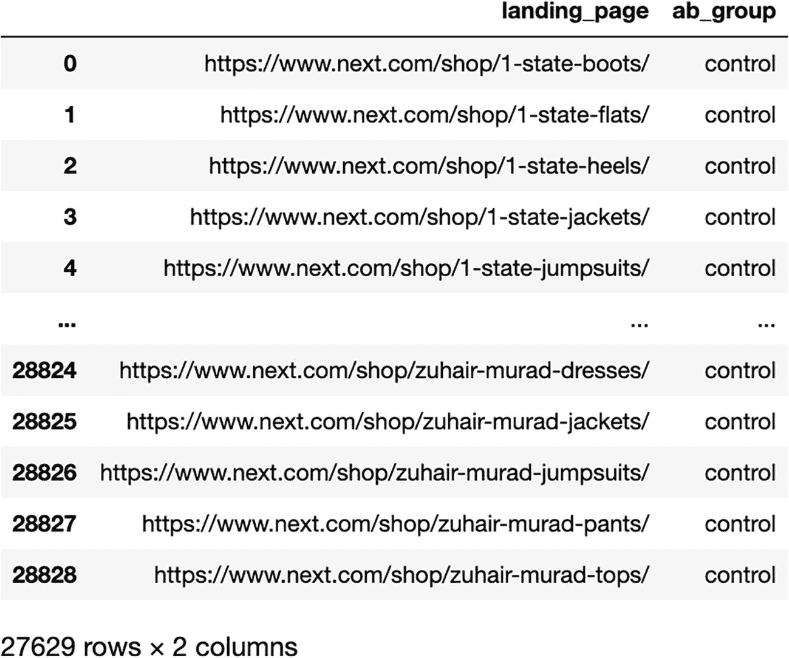

一个表示着陆页和 A/B 组详细信息的表。底部文字显示：27629 行，2 列。

现在，测试组和对照组将被合并到一个数据框中，显示哪些 URL 属于测试组，哪些属于对照组：

```
split_ab_dev = pd.concat([urls_control, urls_test], axis=0).sort_index()
split_ab_dev
```

以下显示了 `split_ab_dev` 数据框：

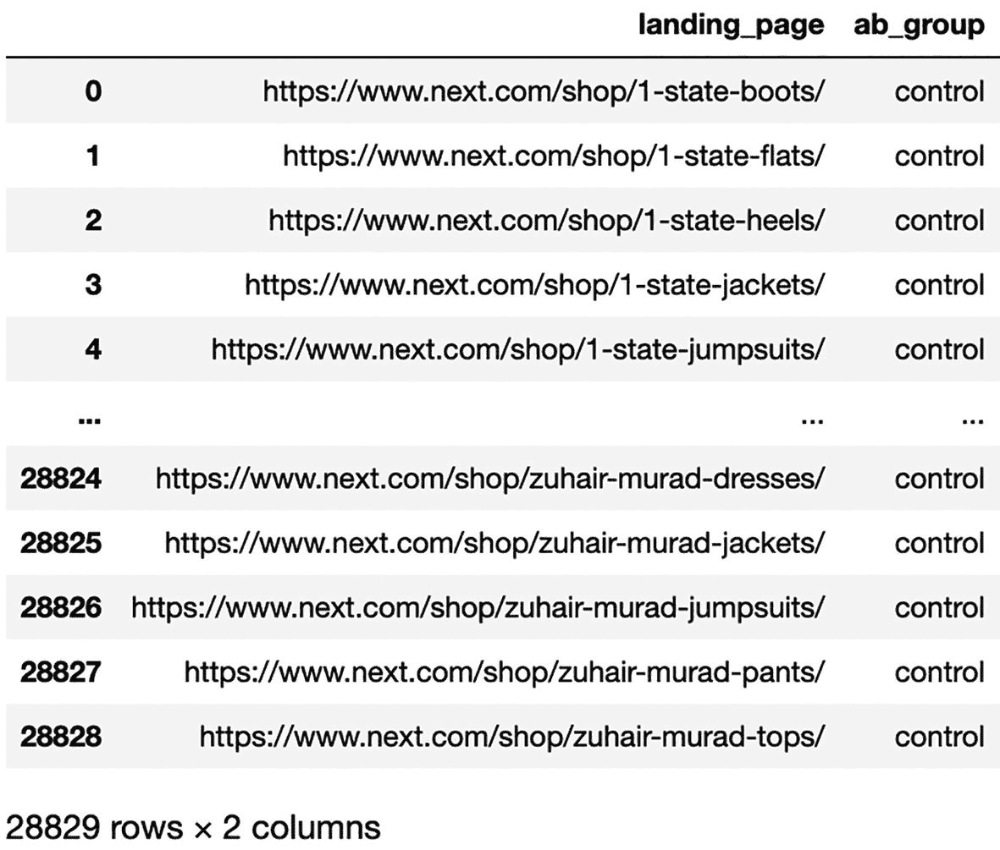

一个表示着陆页和 A/B 组详细信息的表。底部文字显示：28829 行，2 列。

```
split_ab_dev.to_csv("data/split_ab_developers.csv")
```

最终的数据框被合并并导出为 CSV 文件，供软件开发团队参考。

## 运行实验

到目前为止，我们假设了近乎完美的实验室条件，但实际上有很多陷阱可能会破坏你的实验。我们将逐一处理这些问题。

### 过早结束 A/B 测试

无论你做什么，都要确保实验运行到完整的样本量。仅仅因为你的测试组在达到所需样本量之前就出现了统计上的显著差异，并不意味着测试结果是结论性的。可能发生且确实会发生的情况是，测试组在表现优于对照组之后，其表现可能会回归到与对照组相似的水平。然而，如果你过早结束实验，你将无法得知这一点，从而浪费时间和公司资源在一个无效的实验上。因此，如果你的实验需要 20,000 次页面浏览量，请确保两个组都达到 20,000 次页面浏览量。

### 测试未基于假设

如果你已经进行到这一步，但实验并非基于某个假设，那么请重新开始并形成一个假设。拥有假设有助于框定实验的结果，这样你就能确定从实验中学到了什么。例如，如果你正在测试 H1 下方 100 字的正文是否会增加 SEO 展示次数，那么就直接这样陈述。确保从一开始就做到这一点。这将帮助你更精确地确定测试内容、测试方法以及你从中学到了什么。

### 测试组与对照组同时变更

这种情况发生的频率比你想象的要高。曾有几位首席技术官问我们，在实验运行期间同时对测试组和对照组进行更改是否可行。我们建议不要这样做，因为即使更改对两组同等适用，其中一组或两组都可能与同时发生的更改产生交互作用，且方向未必相同。当然，这听起来不太可能，所以如果你曾动过这个念头，或者被问及同时更改是否可行，请避免或拒绝这样做。

你可以做的一件事是，让你的实验的对照组成为其他实验的对照组。只需确保测试组保持原样、不受干扰即可。因此，如果你想运行另一个实验，假设你有足够的控制组网址来满足第一个实验的最低会话数，那么其中一些网址可以分配给第二个测试。

### 测试实施与实验评估未进行质量检查

这一点可能显而易见，但我们还是要说明：请务必在所有浏览器、操作系统和设备类型上检查并对测试的实施进行质量保证，以避免实验结果出现任何偏差。

实验运行完毕后，你就可以评估实验了。你怎么知道它已经运行完毕？当两组都达到了之前设定的所需数量时，在本例中，即 18,000 次页面浏览量。重复一遍，爬取测试组页面的更改可能需要长达两周的时间，然后再花两周时间重新计算这些更改的效果，之后才能在搜索引擎结果页面中反映出来，无论结果是更好、更差还是没有变化。

实验运行后，我们将从网站分析工具中导入数据。和之前一样，数据是从网站分析软件中导出的 CSV 文件：

```
test_analytics = pd.read_csv('data/sim_split_ab_data.csv')
```

将日期转换为日期格式：

```
test_analytics["date"] = pd.to_datetime(test_analytics["date"], format="%Y/%m/%d")
test_analytics
```

你会看到现在有了一个数据框，其中包含所有网址及其对应的日期和标记为测试组与对照组的结果。由于分析数据的特性，某些日期会缺失：

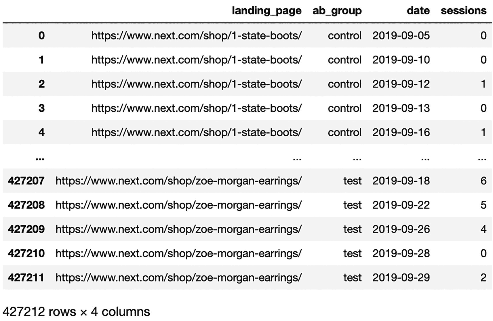

一个包含 427212 行和 4 列的表，表示着陆页、A/B 组、日期和会话数的详细信息。

添加缺失的日期，因为任一组的某些网址可能没有记录页面浏览量。我们将使用列表推导式技术来填充缺失的日期，即对于每个唯一的着陆页，在不存在日期的地方创建一个新的日期行：

```
test_analytics_expand = pd.DataFrame(
[(x, y)
for x in test_analytics['landing_page'].unique()
for y in test_analytics['date'].unique()], columns=("landing_page", "date"),)
test_analytics_expand
```

以下是 `test_analytics_expand` 的截图：

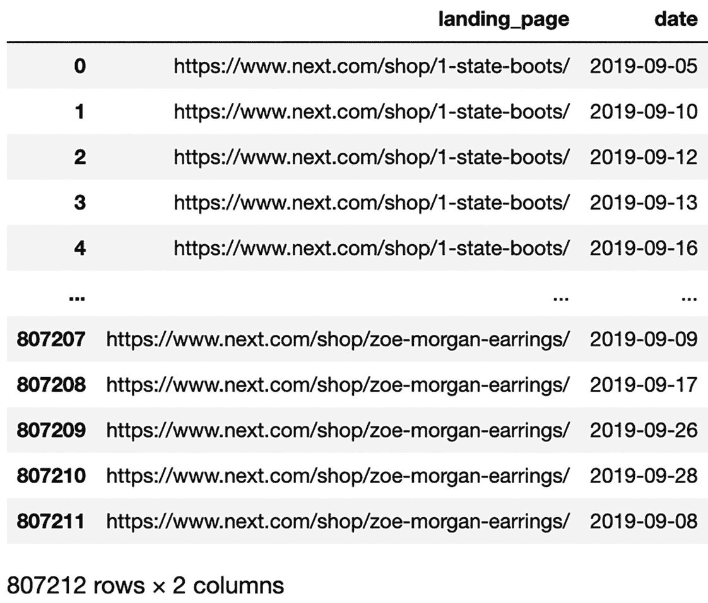

一个包含 807212 行和 2 列的表，表示着陆页和日期的详细信息。

请注意，由于添加了缺失的日期，行数比以前更多了。这些行需要添加会话数据，这可以通过合并原始分析数据来实现：

```
test_analytics_expanded = test_analytics_expand.merge(
split_ab_dev, how="left", on=['landing_page'])
test_analytics_expanded = test_analytics_expanded.merge(
test_analytics, how="left", on=["date", "landing_page", 'ab_group'])
```

合并后，任何日期缺失的着陆页都会出现“NaN”（非数字），通过将这些值填充为零并将数据类型转换为整数来处理：

```
test_analytics_expanded['sessions'] = test_analytics_expanded['sessions'].fillna(0).astype(int)
test_analytics_expanded
```

以下是 `test_analytics_expanded` 的截图，其中着陆页按其 `ab_group` 进行了标记：

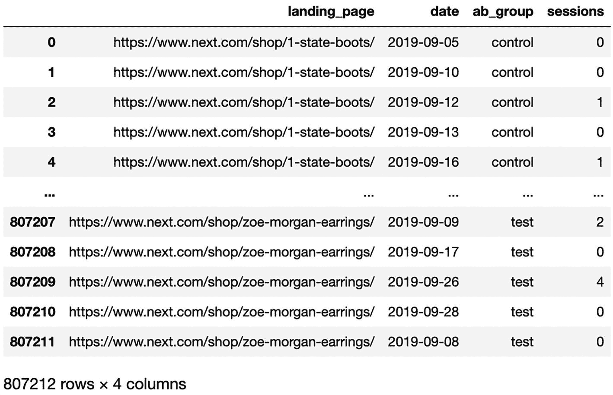

一个包含 807212 行和 4 列的表，表示着陆页、日期、A/B 组和会话数的详细信息。

我们的数据集已准备好，可以在最终测试之前进行一些数据探索。我们探索数据以观察会话数的分布，这有助于我们选择模型。

## 拆分 A/B 探索性分析

我们将估算参数，包括平均会话数及其按 A/B 组的变异：

```
ab_means = (
test_analytics_expand[test_analytics_expand["sessions"] != 0]
.groupby(["ab_group"])
.agg({"date": ["min", "max", day_range], "sessions": "mean"})
)
ab_sigmas = test_analytics_expand.groupby(["ab_group"]).agg({"sessions": [get_sigma]})
pd.concat([ab_means, ab_sigmas], axis=1)
```

`pd.concat([ab_means, ab_sigmas], axis=1)` 数据框如下所示：

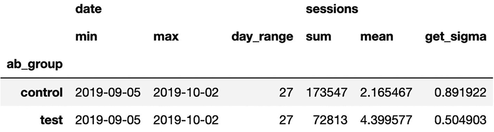

一个表格，显示了名为对照组和测试组的两个 A/B 组的最小日期、最大日期、日期范围、会话数的总和与平均值，以及 get_sigma 值的详细信息。

数据框显示，最小样本会话数已轻松达到，并且测试组似乎产生了显著差异，即统计上显著的更高会话数。

让我们按测试组和对照组绘制数据以进一步探索，首先从整体时间趋势开始。数据将按日期和 `ab_group` 聚合，并计算会话数的平均值：

```
simul_abgroup_trend = sim_split_ab_data.groupby(["date", 'ab_group']).agg({"sessions": "mean"}).reset_index()
simul_abgroup_trend.head()
```

`simul_abgroup_trend.head()` 如下所示：

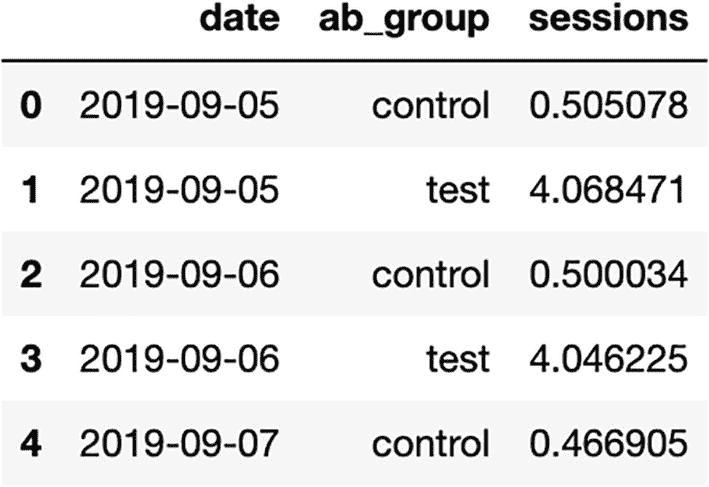

一个包含 5 行和 3 列的表，表示日期、A/B 组和会话数的详细信息。

聚合后，我们可以进行绘图：

# 8. 仪表板

虽然性能仪表板系统本身并不能直接解决 SEO 问题，但拥有这样的基础设施可以成为一个非常有用的数据存储库，用于支持 SEO 科学，并创建可视化图表来传达有用的趋势、变化、威胁和机遇。更重要的是，SEO 数据丰富，有大量的数据源和许多你可以衡量的东西，因此整体情况可能看起来非常嘈杂，最糟糕的情况下，如果你无法清晰地看到并获取信号，这些数据可能毫无用处。拥有一个使用精心设计和深思熟虑的仪表板的性能报告系统，将有助于从嘈杂的数据中突出最重要的趋势。这也将更容易识别因果关系。我们将提供一些用 SQL 编写的代码，以帮助你理解如何实现一些最有价值的可视化。

## 数据源

你希望为仪表板使用的数据源类型是那些 (a) 提供 API 并且 (b) 显然能增加信息以更有效地理解你的 SEO 性能的数据源。这些可能包括（并且这绝非详尽无遗）：

*   *网站分析*：Google Analytics (GA)、Adobe Analytics、Looker、Segment
*   *站长工具*：Google Search Console (GSC)、Bing Webmaster
*   *云端网络爬虫*：DeepCrawl、OnCrawl 和 Botify
*   *SERP*：getSTAT、SEO Monitor、DataForSEO、AWR、AccuRanker
*   *链接检查器*：AHREFs、Majestic、DataForSEO
*   *社交媒体*：BuzzSumo
*   *关键词*：SEMRush、Keywords.io
*   *广告平台*：Google Ads、DV360

## 不要直接接入 Google Data Studio

谷歌提供了便捷的连接器来接入数据源，例如 Google Analytics (GA) 和 Google Search Console (GSC)。这允许将数据直接导入 Google Data Studio (GDS)，从而使 SEO 仪表板变得简单。然而，这是一个错失的机会，因为在 GDS 中无法叠加这两个数据源之间的数据。GDS 是一个用于可视化数据的前端。如果没有一个在数据源和前端之间进行处理的流程，数据就是原始的、未经提炼的，并且对于发现趋势和揭示洞察来说用处不大。

## 使用数据仓库

这时就需要像 Google BigQuery 或 Amazon Redshift 这样的数据仓库登场了。你将数据存储在这些数据仓库中，而前端（无论是 GDS、Tableau、DOMO 还是其他工具）都会使用自定义的结构化查询语言（SQL）来查询数据仓库，并以适合驱动你所需图表的格式获取数据。我们将与你分享 SQL 代码和一些图表，帮助你构建自己的 SEO 仪表板。不过，在开始构建之前，你需要先将数据导入数据仓库。那么，我们该如何实现呢？

## 提取、转换和加载（ETL）

提取、转换和加载（ETL）是一种方法，字面意思如下：

*   *提取*：从你的数据源 API 中提取数据。
*   *转换*：根据提取的数据运行计算并创建新的计算字段。
*   *加载*：将转换后的数据加载到数据仓库中。

根据你选择的云平台、团队云工程技能以及预算，你可以采用多种配置方案。

## 提取数据

提取过程通常是自动化的，通过运行脚本的虚拟机每天查询你的 API（称为“轮询”）。数据会存储在存储空间或数据仓库中。即使你没有云工程技能，也可以通过 CSV 格式将数据上传到数据仓库。

以下是从多个 API 提取数据的代码，这些 API 主要包括 Google 产品以及一些（并非全部）较为知名的 SEO 流程：

*   Google Analytics
*   Google Search Console
*   DataForSEO SERPs API
*   Google PageSpeed API

现在，我们将提供 Python 代码，让你连接到这些 API。这些代码不仅可用于报告目的，还可以进行调整，以支持其他章节中涵盖的其他 SEO 科学活动。

### Google Analytics

流量仍然是增长的关键杠杆，而 Google Analytics 作为网站分析工具被广泛使用。然而，更多的自然搜索流量并不总是直接与更多收入相关，但它可能通过其他方式表明用户参与度。以下将详细介绍从最知名且最常用的网站分析 API（即 Google Analytics 版本 4）中提取数据的代码。

#### 导入 API 库

```python
import pandas as pd
from pathlib import Path
import os
from datetime import date, timedelta
```

#### 设置凭证密钥的文件路径

设置凭证密钥的文件路径，该文件是一个 JSON 文件，可从你的 Google Cloud Platform 账户的 API 库 ➤ 凭据中获取：

```python
credentials_path = Path("keys/xxxxx.json")
credentials_path_str = str(credentials_path.absolute())
os.environ["GOOGLE_APPLICATION_CREDENTIALS"] = credentials_path_str
```

#### 从 Google 库中导入其他 API

```python
from google.analytics.data_v1beta import BetaAnalyticsDataClient
from google.analytics.data_v1beta.types import DateRange
from google.analytics.data_v1beta.types import Dimension
from google.analytics.data_v1beta.types import Metric
from google.analytics.data_v1beta.types import RunReportRequest
client = BetaAnalyticsDataClient()
```

#### 定义一个函数来运行聚合报告

定义一个函数来运行聚合报告，该函数需要日期范围和 GA4 账户的属性 ID。在此函数中，我们使用输入参数查询 API 以构建请求，其中包含我们想要的指标，并存储 API 响应。

我们将维度设置为 `landingPage`，因为我们希望按此维度细分流量数据。也可以使用其他维度，这些维度列在此处（[`https://developers.google.com/analytics/devguides/reporting/data/v1/api-schema`](https://developers.google.com/analytics/devguides/reporting/data/v1/api-schema)）。

```python
# (此处省略了后续函数的代码，根据用户提供的文本，这部分内容在“提取数据”这一节中)
```

---

接下来，继续处理文本的其余部分：

```r
simul_abgroup_trend_plt = (
ggplot(simul_abgroup_trend,
aes(x = 'date', y = 'sessions', colour = 'ab_group', group = 'ab_group')) +
geom_line(alpha = 0.6, size = 3) +
labs(y = 'Count', x = '') +
theme(legend_position = 'right',
axis_text_y =element_text(rotation=0, hjust=1, size = 12),
legend_title = element_blank()
)
)
simul_abgroup_trend_plt.save(filename = 'images/3_simul_abgroup_trend_plt.png',
height=5, width=8, units = 'in', dpi=1000)
simul_abgroup_trend_plt
```

图 7-4 显示了 `simul_abgroup_trend_plt` 生成的时间序列图。两组在此期间都经历了下降；然而，测试组的表现优于对照组。

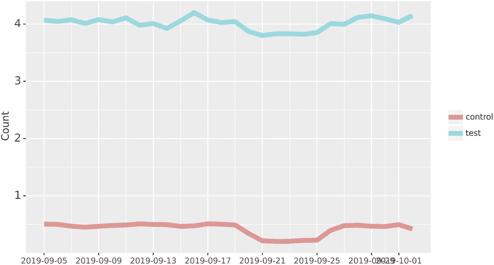

一个折线图，显示了 2019 年 9 月 5 日至 2019 年 10 月 1 日期间对照组和测试组的计数趋势。测试组的计数从 4 开始，而对照组的计数从 0.5 开始。两者在整个过程中都遵循稳定的趋势。

**图 7-4** 测试组和对照组会话数随时间变化的时间序列图

接下来，我们将检查会话数的整体分布，首先从直方图开始：

```r
ab_assign_plt = (
ggplot(test_analytics_expanded,
aes(x = 'sessions', fill = 'ab_group')) +
geom_histogram(alpha = 0.6, bins = 30) +
labs(y = 'Count', x = '') +
#scale_y_log10() +
#coord_flip() +
theme(legend_position = 'none',
axis_text_y =element_text(rotation=0, hjust=1, size = 12),
legend_title = element_blank()
) +
facet_wrap('ab_group', scales = 'free')
)
ab_assign_plt.save(filename = 'images/4_ab_test_plt.png',
height=5, width=8, units = 'in', dpi=1000)
ab_assign_plt
```

图 7-5 显示了 `ab_assign_plt`，这是对照组和测试组会话数分布的并排比较。图表显示，测试组的分布在零以上有更多的数据点，这看起来很有希望。

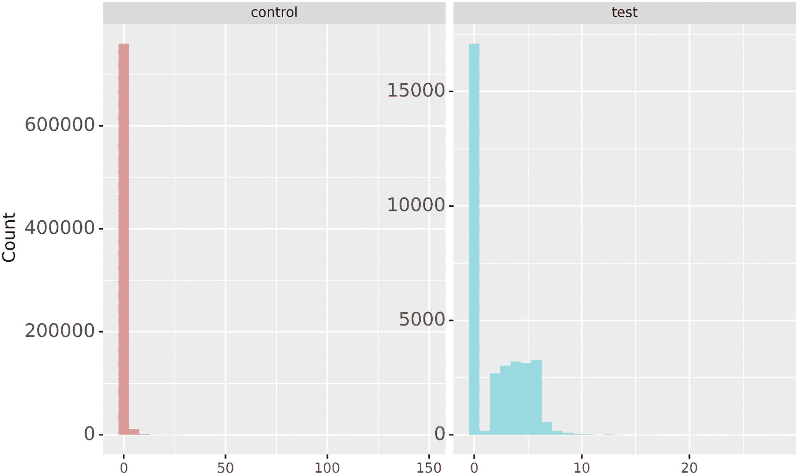

一组 2 个直方图，表示对照组和测试组的计数。它表明在测试组的图中，计数大于 0 的数据点更多。

**图 7-5** 对照组和测试组的直方图分布图

箱线图方法将用于进一步对比分布：

```python
ab_assign_box_plt = (
    ggplot(test_analytics_expand,
           aes(x = 'ab_group', y = 'sessions',
               fill = 'ab_group', colour = 'ab_group')) +
    geom_boxplot(alpha = 0.8) +
    labs(y = 'Count', x = '') +
    theme(legend_position = 'none',
          axis_text_y = element_text(rotation=0, hjust=1, size = 12),
          legend_title = element_blank()
    )
)
ab_assign_box_plt.save(filename = 'images/4_ab_test_box_plt.png',
                       height=5, width=8, units = 'in', dpi=1000)
ab_assign_box_plt
```

图 7-6 展示了 `ab_assign_box_plt`，这是一个对照组和测试组的箱线图对比。

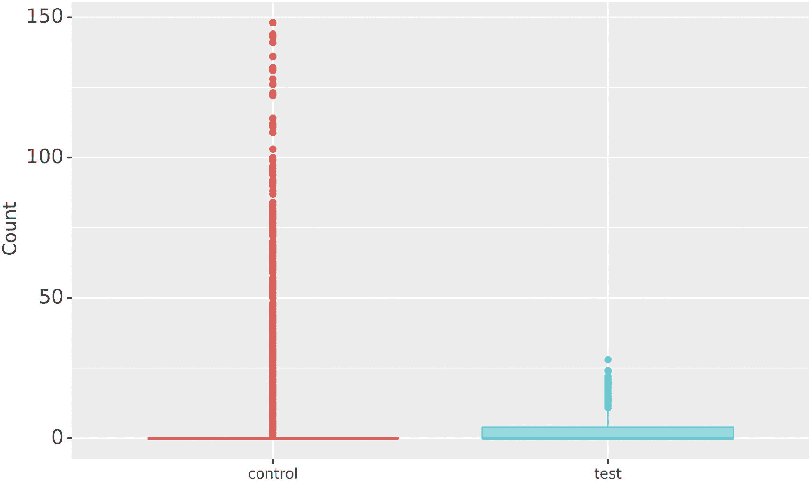

箱线图展示了对照组和测试组的计数。它表明对照组的计数高于测试组。

**图 7-6** 测试组和对照组的会话箱线图

对照组有更多的异常值，但测试组的零值远少于对照组。

由于刻度比例导致难以区分，因此我们将对会话刻度取对数以便进一步可视化：

```python
ab_assign_log_box_plt = (
    ggplot(test_analytics_expanded,
           aes(x = 'ab_group', y = 'sessions',
               fill = 'ab_group', colour = 'ab_group')) +
    geom_boxplot(alpha = 0.6) +
    labs(y = 'Count', x = '') +
    scale_y_log10() +
    theme(legend_position = 'none',
          axis_text_y = element_text(rotation=0, hjust=1, size = 12),
          legend_title = element_blank()
    )
)
ab_assign_log_box_plt.save(filename = 'images/4_ab_assign_log_box_plt.png',
                           height=5, width=8, units = 'in', dpi=1000)
ab_assign_log_box_plt
```

图 7-7 展示了 `ab_assign_log_box_plt`，这是一个对照组和测试组的箱线图对比，只是这次对纵轴进行了对数化处理，以便于可视化比较。

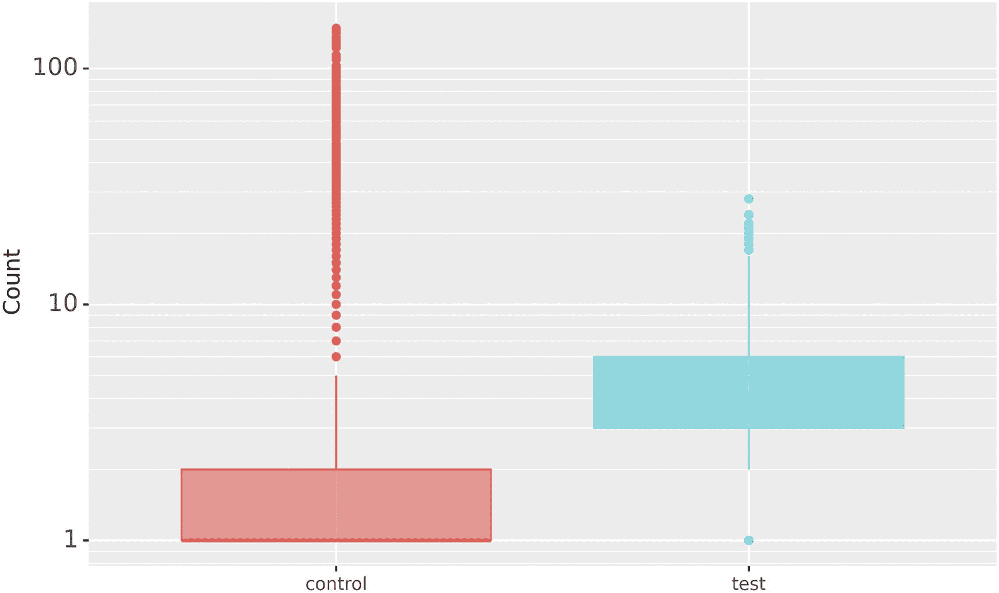

箱线图展示了对照组和测试组的计数。它表明测试组的中位数更高，而对照组的上须值远高于测试组。

**图 7-7** 测试组和对照组的箱线图

在所有情况下，我们都可以看到平均会话数接近于零，并且任何一天都有许多着陆页的会话数为零，这表明会话是一个罕见事件。这种分布类型被称为“泊松分布”。因此，我们将使用负二项分布来检验测试组和对照组之间的差异是否显著。

首先，我们将数据标记为测试组（1.0）或对照组（0.0），然后将其转换为数组：

```python
X = np.where(test_analytics_expand['ab_group'] == 'control', 0.0, 1.0)
X = add_constant(X)
X = np.asarray(X)
X
array([[1., 0.],
       [1., 0.],
       [1., 0.],
       ...,
       [1., 1.],
       [1., 1.],
       [1., 1.]])
```

使用负二项分布拟合按 `ab_group` 分组的会话模型：

```python
ab_model = NegativeBinomial(test_analytics_expand['sessions'],
                            X).fit()
```

打印模型摘要：

```python
ab_model.summary()
```

以下是 `ab_model.summary()` 的截图：

```
Optimization terminated successfully.
Current function value: 1.155104
Iterations: 9
Function evaluations: 10
Gradient evaluations: 10
```

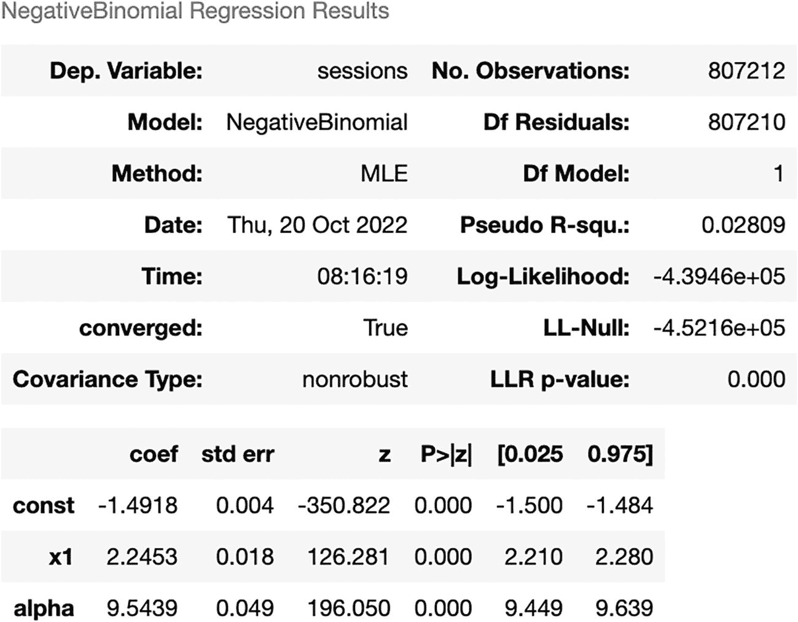

一个表格展示了因变量、模型、方法、日期、时间、协方差类型、观测数、`df residual` 和 `df model` 以及其他变量的详细信息。在底部，它显示了常数、`x1` 和 alpha 的不同值。

从上述结果中，我们可以得出结论，这种变化确实是显著的。与对照组相比，测试组（由 `x1` 表示）平均多展示了 2.24 次页面浏览量。就显著性而言，LLR p 值为零，因此差异由随机噪声引起的可能性极低。有趣的是，用于衡量 `ab_group` 对会话本身解释程度的伪 R 方非常低，仅为 0.029，这意味着该模型噪声很大，需要更多其他因素来预测流量水平，而不仅仅是 `ab_group`。

## 非结论性实验的结果

实验可能因多种原因未能达到预期效果：

*   预期差异过高——因此考虑修改并重新运行实验。
*   假设需要以不同方式检验——或许使用不同的衡量指标或不同的检验方法。
*   需要不同的时间段——即使满足了样本量要求，也可能是由于季节性效应，例如一年中的特定时间，或者数据在完整一周运行之前就满足了样本要求，或者谷歌没有机会处理这些变化（参见之前的讨论）。
*   其他外部因素。

通过从一开始就设定你的假设，无论结果如何，你都会学到一些东西，并且能够制定一个合理的计划向前推进，无论是进行下一次测试，还是在全站范围内实施你的测试。

## 总结

实验一直是 SEO 专家技能的一部分，用于确定哪些策略可能有效，即使有时缺乏科学严谨性。在企业环境中，由于对收入的影响以及需要在全站推广更改之前证明建议是有益的，严谨的实验设计至关重要。虽然有工具可以在这方面提供帮助，但了解 SEO 拆分测试背后的数据科学以及必须牢记的注意事项也很有用。在本章中，我们涵盖了：

*   实验在 SEO 中的重要性
*   生成假设
*   实验设计
*   运行你的实验
*   评估你的实验
*   以及如果你的实验“失败”了该怎么办

在下一章中，我们将介绍以仪表板形式呈现的 SEO 报告。

```
def aggregated_run_report(client, property_id="[your-GA-property-id]", date_ranges=[DateRange(start_date="2020-03-31", end_date="today")]):
    request = RunReportRequest(
        property=f"properties/{property_id}",
        dimensions=[Dimension(name="landingPage")],
        metrics=[
            Metric(name="activeUsers"),
            Metric(name="screenPageViewsPerSession"),
            Metric(name="bounceRate"),
            Metric(name="averageSessionDuration"),
            Metric(name="userConversionRate"),
            Metric(name="ecommercePurchases"),
        ],
        date_ranges=date_ranges,
    )
    response = client.run_report(request)
    return response

response = aggregated_run_report(client)
print("Report result:")
for row in response.rows:
    print(row.dimension_values[0].value, row.metric_values[0].value)

Report result:
/ 11347
/blog/sell-airtime-over-charged-your-line-dont-panic 8423
/faq 4870
/blog/sell-airtime-over-charged-your-line-dont-panic 2355
/privacy 1338
```

## 将 API 响应转换为数据框

下一个函数使用 API 响应结果行，并将其打包成一个数据框：

```
def ga4_response_to_df(response):
    dim_len = len(response.dimension_headers)
    metric_len = len(response.metric_headers)
    all_data = []
    for row in response.rows:
        row_data = {}
        for i in range(dim_len):
            row_data.update({response.dimension_headers[i].name: row.dimension_values[i].value})
        for i in range(metric_len):
            row_data.update({response.metric_headers[i].name: row.metric_values[i].value})
        all_data.append(row_data)
    df = pd.DataFrame(all_data)
    return df

df = ga4_response_to_df(response)
df.info()
```

结果如下：

```
RangeIndex: 418 entries, 0 to 417
Data columns (total 8 columns):
```