# 9. 网站迁移规划

本章涵盖网站迁移映射，以便你可以设置新网站的结构，并半自动化地形成迁移 `URL`。我们将使用以下一些技术：

*   字符串操作
*   通过将数据框行转换为列表来迭代
*   使用自然语言处理（`NLP`）比较 `URL` 字符串

虽然这些技术会加快网站迁移的数据处理速度，但它们也可以轻松应用于其他用例。

## 验证流量和排名变化

虽然验证重新上线后的流量和/或排名变化并非严格必要，但如果任何同事怀疑流量或排名的变化是否归因于你声称的日期，那么进行验证是好的。不过，如果时间紧迫，你可以跳过此步骤。

```python
import re
import time
import random
import pandas as pd
import numpy as np
import datetime
from textdistance import sorensen_dice
from textdistance import jaccard
pd.set_option('display.max_colwidth', None)
target_site_search = 'Saga travel'
first_gen = ['Holidays', 'Cruises', 'Travel Updates', 'Accessibility and Support', 'Brochure Request', 'My Travel', 'Trade']
target_roots = first_gen
source_root_url = 'https://travel.saga.co.uk/'
target_root_url = 'https://www.saga.co.uk/'
```

数据来自一个电子表格，该表格代表了网站的分类或层级结构，即文件夹和子文件夹，站点级别按列组织：

```python
hierarchy_raw = pd.read_csv('data/saga_hierarchy.csv')
hierarchy_raw
```

结果如下：

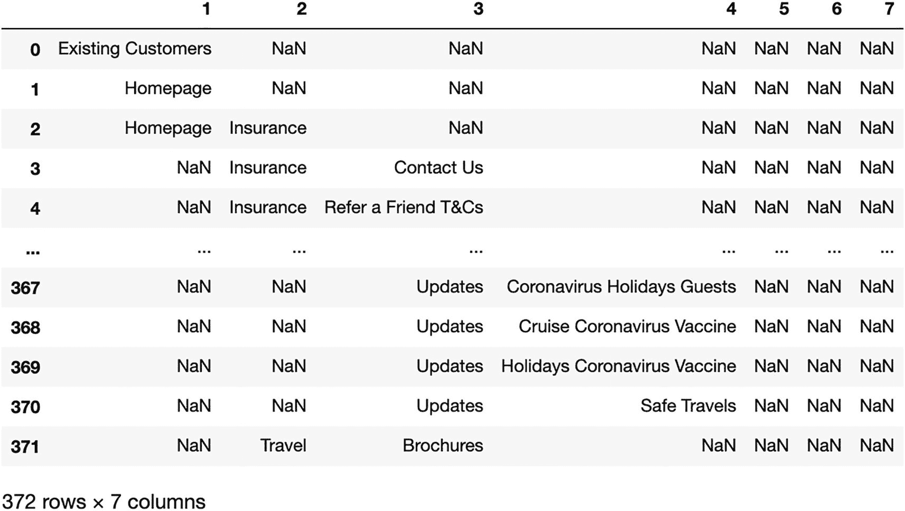

一个包含 372 行和 7 列的表格，提供了数据层级结构的结果。它包含了现有客户、主页、保险、联系我们、更新、新冠假期客人、邮轮新冠疫苗、假期新冠疫苗以及旅行销售。

在上表中，我们可以看到电子表格的样式：顶部数字表示站点层级，每行中的页面（我们称之为节点）及其直接父节点名称。

让我们获取每个父节点的站点层级：

```python
site_levels = pd.DataFrame(hierarchy_raw.unstack())
site_levels = site_levels.dropna().drop_duplicates()
site_levels = site_levels.rename(columns = {0 : 'node'})
site_levels = site_levels.reset_index()
site_levels = site_levels[['level_0', 'node']]
site_levels = site_levels.rename(columns = {'level_0': 'level'})
site_levels
```

结果如下：

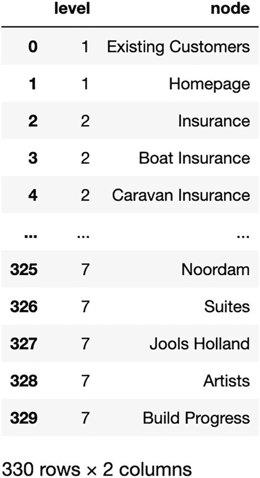

一个包含 330 行和 2 列的表格，提供了数据层级结构的结果，用于查找父节点和子节点。它包含了现有客户、主页、保险、船险、房车保险、`Noordam`、套房、`Jools Holland`、艺术家以及构建进度。

定义了站点节点（稍后会派上用场）后，我们将查找父节点和子节点的配对。

### 识别父节点和子节点

子节点是距离父节点仅一次点击的直属页面。为此，我们需要几个函数。`apply_pcn` 函数将数据帧视为行集合，并应用第二个函数。这种方法比使用 `.iterrows()` 逐行遍历数据帧更快，后者以速度极慢而闻名。
`parent_child_nodes` 函数将获取行，将其转换为列表，然后使用列表推导式忽略空白单元格（`NaN`，即“非数字”的缩写），并将内容追加到列表 `pairs` 中。
完成后，`pairs` 列表将被放入一个新的数据帧 `parent_child_map` 中。

让我们逐行迭代以选取配对：

```python
pairs = []
def parent_child_nodes(row):
    data = row.values.tolist()
    data = [e for e in data if str(e) not in ('nan')]
    print(data)
    pairs.append(data)
def apply_pcn(df):
    return df.apply(
        lambda row:
        parent_child_nodes(
            row),
        axis=1
    )
apply_pcn(hierarchy_raw)
parent_child_map = pd.DataFrame(pairs,columns=['parent', 'child'])
parent_child_map
```

我们现在有了一个显示父节点和子节点的表格：

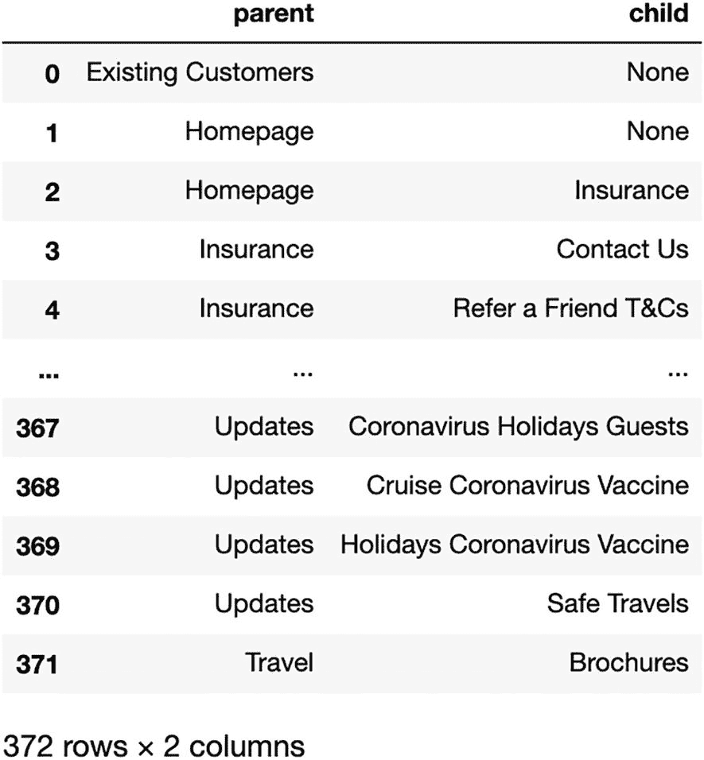

一个包含 372 行和 2 列的表格，提供了父节点和子节点的数据层级结构结果。它包含了现有客户、主页、保险、联系我们、更新、新冠假期客人、邮轮新冠疫苗、假期新冠疫苗以及旅行销售。

当然，如果我们想要完整的 `URL` 路径，我们需要使用 `hierarchy_raw` 的副本进一步处理数据。首先向下填充主页的第一列，然后如果右侧相邻单元格不为空（使用函数 `has_data_right` 检查），则填充该单元格：

```python
hierarchy_fp = hierarchy_raw
```

# Forward Fill HOMEPAGE

```python
hierarchy_fp['1'] = hierarchy_fp['1'].ffill()
```

以下是检查右侧单元格是否填充了数据或 `NaN` 的函数：

```python
def has_data_right(idx):
    return hierarchy_fp[hierarchy_fp.columns[idx:]].notnull().apply(any, axis=1)

for c in hierarchy_fp.columns[1:]:
    hierarchy_fp.loc[has_data_right(int(c)), c] = hierarchy_fp.loc[has_data_right(int(c)), c].ffill()

hierarchy_fp
```

以下显示了生成的 `hierarchy_fp` 数据帧，其中包含构建 URL 完整路径所需的所有文件夹名称：

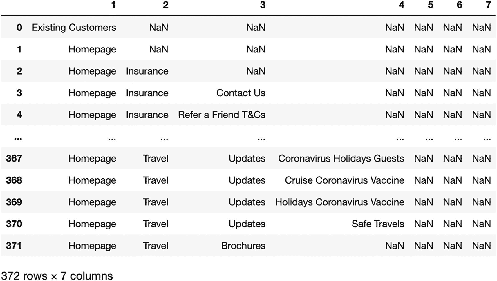

这是一个包含 372 行和 7 列的表格，提供了层级结构数据框架的结果。它包含了现有客户、主页、保险、联系我们、推荐朋友条款与细则、更新、新冠假期客人、邮轮新冠疫苗、假期新冠疫苗以及旅行销售。

有了这个，我们现在可以逐行迭代数据帧，移除空白（`NaN`）并用正斜杠（`/`）连接它们：

```python
min_fp_nonnan = hierarchy_fp
full_paths = []

def find_full_paths(row):
    data = row.values.tolist()
    data = [e for e in data if str(e) not in ('nan')]
    data = '/'.join(data)
    print(data)
    full_paths.append(data)

def apply_ffp(df):
    return df.apply(
        lambda row: find_full_paths(row),
        axis=1
    )

apply_ffp(min_fp_nonnan)
full_paths
```

结果如下：

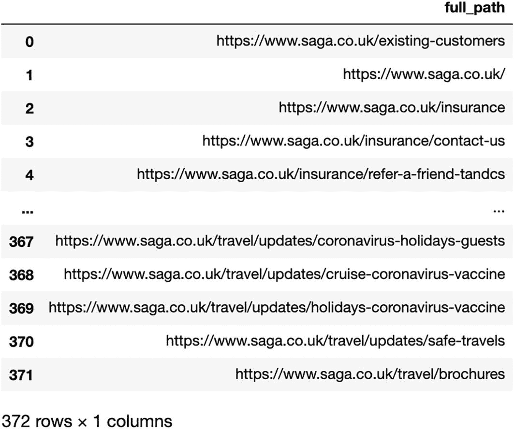

这是一个包含 372 行和 1 列的表格，提供了 Saga 网站（如现有客户、联系人、保险、安全旅行等）的完整路径 URL。例如，`https://www.saga.co.uk/insurance`。

完整的 URL 路径现已构建并推入数据帧，因此我们可以将其添加到之前创建的 `parent_child_map` 数据帧中。

## 合并父节点到完整路径

```python
full_node_map = pd.concat([parent_child_map, full_path_df], axis=1)
full_node_map
```

现在我们有了一个包含节点和完整路径的表格：

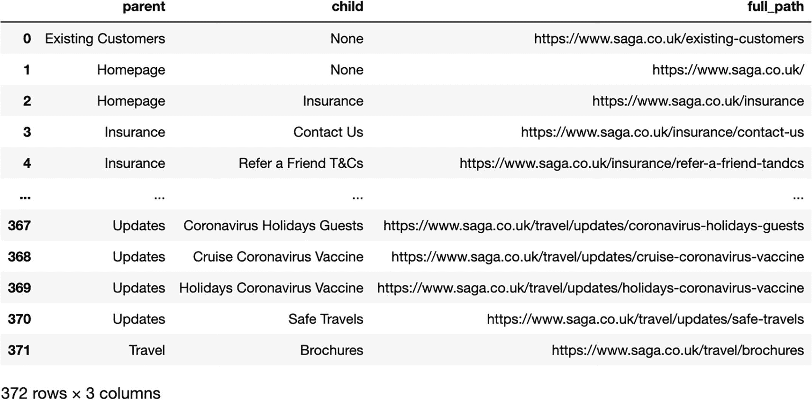

一个包含 372 行和 3 列的表格，提供了父节点和子节点的完整路径 URL。它包含了现有客户、主页、保险、联系我们、推荐朋友条款与细则、更新、新冠假期客人、邮轮新冠疫苗、假期新冠疫苗以及旅行销售。

### 分离迁移文档

通常，在大型组织中，不同的业务部门希望为其特定网站提供单独的迁移文档，这是很常见的。接下来，我们将逐行迭代，查找“Travel”部门的所有子节点，并将它们追加到列表 `target_roots` 中：

### 筛选目标业务单元

`target_node_map = full_node_map`

```python
def append_target_pairs(row):
    data = row.values.tolist()
    [target_roots.append(data[1]) for e in data if str(e) in target_roots]

def apply_atp(df):
    return df.apply(
        lambda row:
        append_target_pairs(
            row),
        axis=1
    )

apply_atp(target_node_map)
target_roots = list(set(target_roots))
target_roots
```

结果如下：


一组用于提取旅行节点的 18 行代码。其中包括毛里求斯、多洛米蒂指南、认识团队、大型邮轮巡游、圣诞假期、套房、新冠病毒邮轮乘客、常见问题解答、脱欧旅行服务、全包式旅行、在机场、我的旅行、不列颠尼亚之旅、冒险精神博客以及主持人。

在`target_roots`中提取出旅行节点后，我们现在可以仅筛选旅行 URL，从子节点开始：

```python
#目标子节点
stop_strings = ['insurance', 'breakdown-cover']
target_parent_nodes = target_node_map[~target_node_map.full_path.str.contains('|'.join(stop_strings))]
target_parent_nodes
```

结果如下：

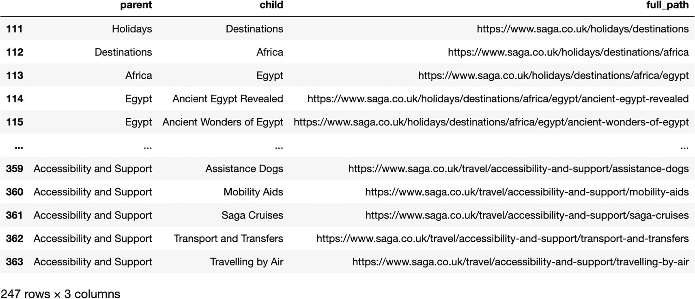

一个包含 247 行和 3 列的表格，提供了父节点和子节点的完整路径 URL 链接。其中包括假期、目的地、非洲、埃及、无障碍与支持、辅助犬、行动辅助设备、Saga 邮轮、交通与接送、乘飞机旅行。

现在来看父节点：

```python
target_parent_nodes = target_node_map[target_node_map.child.isin(first_gen)]
target_parent_nodes
```

结果如下：

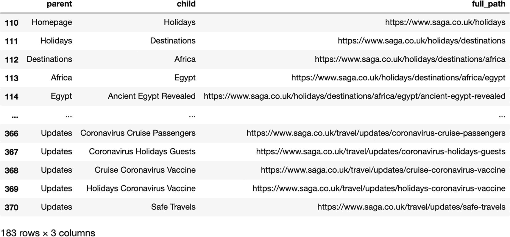

一个包含 183 行和 3 列的表格，提供了父节点和子节点的完整路径 URL 链接。其中包括假期、目的地、非洲、埃及、更新、新冠病毒邮轮乘客、新冠病毒假期客人、邮轮新冠病毒疫苗、假期新冠病毒疫苗以及安全旅行。

下一步是将这两者合并到一个表格中：

```python
target_node_map = pd.concat([target_parent_nodes, target_kid_nodes])
target_node_map
```

结果如下：

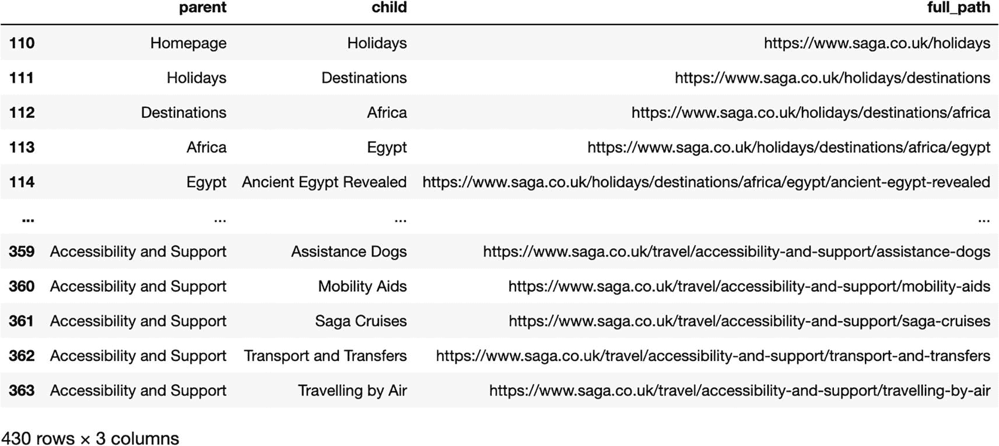

一个包含 430 行和 3 列的表格截图，提供了目标节点的数据框。列标题为父节点、子节点和完整路径。

成功筛选出旅行网站 URL 后，我们现在将加入站点层级：

```python
nodes_levelled = pd.merge(target_node_map, site_levels, how='left', left_on='child', right_on='node')
del nodes_levelled['node']
nodes_levelled['child'] = np.where(nodes_levelled.child.isnull().values, '', nodes_levelled.child)
nodes_levelled['level'] = np.where(nodes_levelled.level.isnull().values, 0, nodes_levelled.level)
nodes_levelled
```

结果如下：

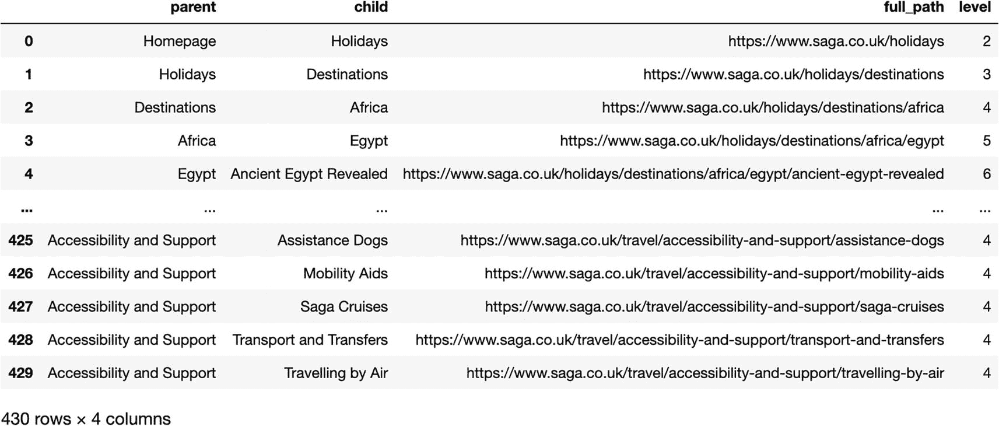

一个包含 430 行和 4 列的表格截图，提供了站点层级的数据框。列标题为父节点、子节点、完整路径和层级。

站点层级是使用 `pd.merge` 连接的，该功能相当于 `Microsoft Excel` 中的`vlookup`函数。由于两个表中的列名不同，因此必须像前面所示的那样在`left_on`和`right_on`下指定。

## 寻找最匹配的分类 URL

现在我们有了旅行部门的新分类层级 URL 结构，可以开始寻找最匹配的现有网站 URL。你可以尝试在此处使用自然语言处理（NLP）技术，但这将收效甚微。这是因为现有的 URL 字符串可能无法反映提议的 URL 结构，特别是当你希望“清理门户”并为网站重新上线提出更合理的新想法时。

我们在这里采用的方法是让 Google 来完成这项工作，即针对父节点和子节点站点名称的组合，获取搜索结果中排名最高的 URL（如 Google 搜索结果所示）。毕竟，Google 拥有更强大的工具，因此使用它们才是明智之举。

```python
nodes_levelled['search_query'] = target_site_search + ' ' + nodes_levelled.parent + ' ' + nodes_levelled.child
nodes_levelled['search_query'] = target_site_search + ' "' + nodes_levelled.parent + ' ' + nodes_levelled.child + '"'
nodes_levelled
```

结果如下：

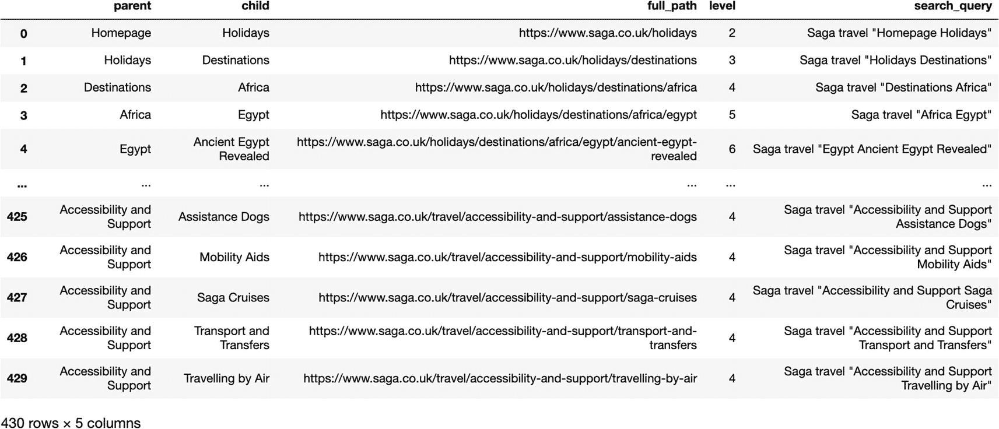

一个包含 430 行和 5 列的表格截图，提供了 SERP 查询的数据框。列标题为父节点、子节点、完整路径、层级和搜索查询。

通过组合站点名称以及父节点和子节点，我们形成了将用于获取 SERP 数据的搜索字符串：

```python
serptool_queries = nodes_levelled['search_query'].to_list()
serptool_queries
```

结果如下：

```
'Saga travel homepage holidays',
'Saga travel homepage cruises',
'Saga travel homepage travel updates',
'Saga travel homepage accessibility and support',
'Saga travel homepage brochure request',
'Saga travel homepage trade',
'Saga travel holidays destinations',
'Saga travel destinations africa',
'Saga travel africa egypt',
'Saga travel egypt ancient egypt revealed',
'Saga travel egypt ancient wonders of egypt',
'Saga travel egypt el quseir',
'Saga travel el quseir radisson blu resort',
'Saga travel africa ethiopia', ...
```

使用上述数据，可以通过你最喜欢的 SEO 排名检查工具 API 进行检查，然后加载到笔记本中：

```python
saga_serps = pd.read_csv('client_serps.csv')
saga_serps
```

结果如下：

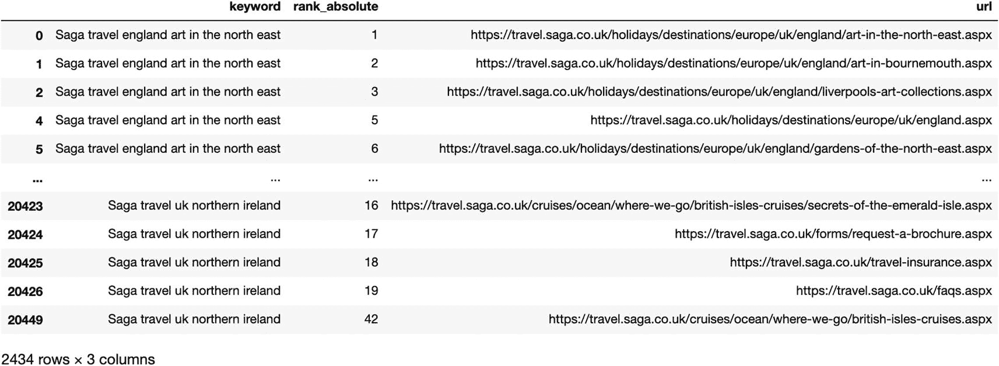

一个包含 2434 行和 3 列的表格截图，提供了 SERP 笔记本的数据框，其中包含相应的 URL 链接。列标题为关键词、绝对排名和 URL。

之前，我们已经将 SERP 数据加载到笔记本中，显示了关键词、排名位置和 URL。

现在是提取排名最高的 URL 的时候了，方法是按关键词对 SERP 数据框进行分组，然后选择排名最高的 URL（如果尚未被选择）。原因是一个 URL 不能同时重定向到两个不同的 URL；因此，Python 代码中使用的“while”子句正在检查该 URL 是否尚未被用于之前的关键词：

```python
serps_grp = saga_serps.groupby('keyword')
current_allocated = []

def filter_top_serp(df):
    del df['keyword']
    i = 0
    while not df.iloc[i]['url'] in current_allocated:
        if not df.iloc[i]['url'] in current_allocated:
            current_allocated.append(df.iloc[i]['url'])
            return df.iloc[i]
        else:
            i += 1

current_map = serps_grp.apply(filter_top_serp)
```

与初始数据框连接：

```python
current_map_df = pd.concat([current_map], axis=0).reset_index()
del current_map_df['rank_absolute']
current_map_df = current_map_df.rename(columns={'keyword': 'search_query', 'url': 'current_url'})
current_map_df['current_alloc'] = pd.DataFrame({'current_alloc': current_allocated})
current_map_df['current_url'] = np.where(current_map_df.current_url.isnull(),
                                         current_map_df.current_alloc, current_map_df.current_url)
del current_map_df['current_alloc']
current_map_df['search_query'] = current_map_df.search_query.str.lower()
current_map_df
```

结果是一个包含当前 URL 的数据框，我们现在可以将其连接到主表：

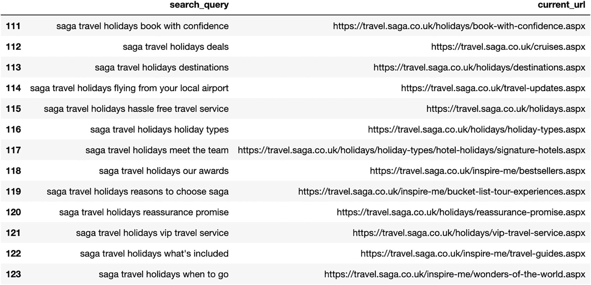

一个包含 13 行和 2 列的表格截图，提供了搜索查询及其当前 URL 链接的数据框。

## 将当前 URL 映射到新的分类 URL

以下代码将当前的现有分类层级 URL 连接到提议的新网站 URL：

```python
nodes_levelled['search_query'] = nodes_levelled.search_query.str.lower()
ia_current_mapping = pd.merge(nodes_levelled, current_map_df, on = 'search_query', how = 'left')
ia_current_mapping = ia_current_mapping[['parent', 'child', 'level', 'current_url', 'full_path']]
ia_current_mapping
```

在这里，我们可以看到，无论是这种方法还是谷歌都不是完美的。尽管如此，这是一个良好的开端，并且节省了大量的人工工作。

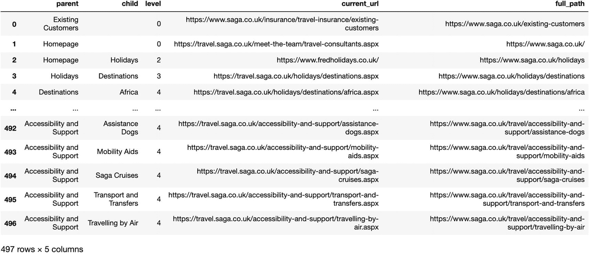

一张包含 497 行 5 列的表格截图，展示了当前 URL 与建议的新 URL 映射后的数据框。列标题分别为`parent`、`child`、`level`、`current_url`和`full_path`。

让我们通过重命名几个列并将 `NaN` 替换为空白来整理表格：

```python
```

# 重新排列列

```python
ia_current_mapping = ia_current_mapping[['parent', 'child', 'level','search_query', 'current_url', 'full_path']]
ia_current_mapping = ia_current_mapping.rename(columns = {'full_path': 'migration_url'})
ia_current_mapping['current_url'] = np.where(ia_current_mapping.current_url.isnull(), '', ia_current_mapping.current_url)
ia_current_mapping
```

在下表中，你可以看到前五行的`simi`值为零，因为当前 URL 是空白的，所以建议的迁移 URL 与当前 URL 之间的字符串相似度自然为零。

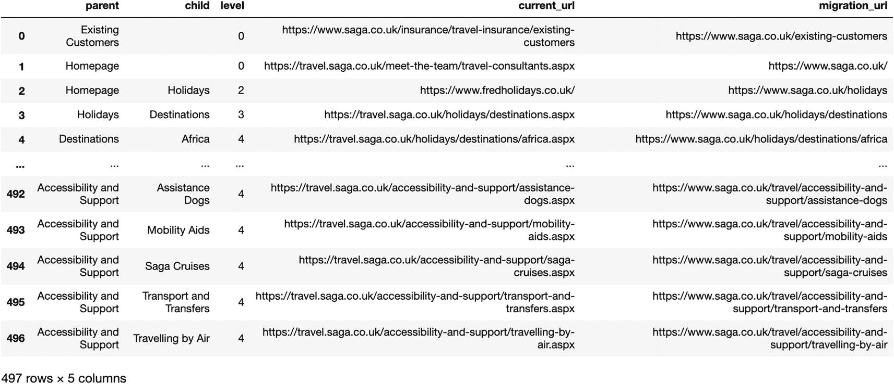

一张包含 497 行 5 列的表格截图，展示了当前 URL 与迁移 URL 映射后的数据框。列标题分别为`parent`、`child`、`level`、`current_url`和`migrated_url`。

表格整理完毕后，我们将使用 NLP 方法来比较当前 URL 的字符串相似度：

```python
ia_current_simi = ia_current_mapping
ia_current_simi = ia_current_simi.drop_duplicates()
ia_current_simi['simi'] = ia_current_simi.loc[
    :, ['current_url', 'migration_url']].apply(
    lambda x: sorensen_dice(*x), axis=1)
ia_current_simi
```

字符串相似度非常有用，因为当我们在 Microsoft Excel 等电子表格应用中审查迁移 URL 时，可以过滤出相似度不高的 URL（例如低于 0.9），这能向我们展示那些可能与迁移 URL 匹配不佳的当前 URL。缺少当前 URL 的行需要手动修复，而从 SERP 中推导出的 URL 则需要审查。

```python
ia_current_mapping.to_csv('exports/' + target_site_search + '_ia_current_mapping.csv')
```

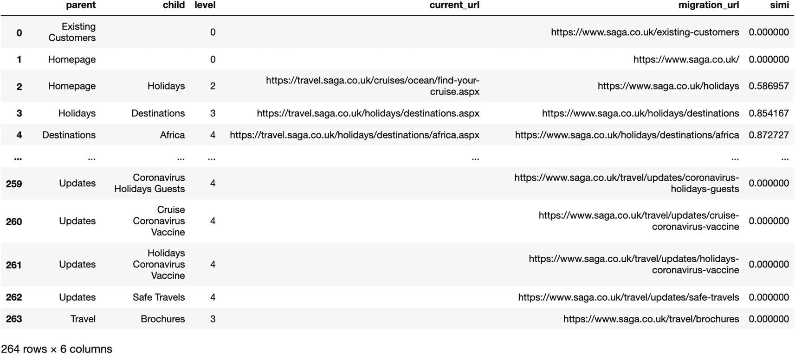

一张包含 264 行 6 列的表格截图，展示了当前 URL 及其字符串相似度的数据框。列标题分别为`parent`、`child`、`level`、`current_url`、`migrated_url`和`simi`。

## 将剩余 URL 映射到迁移 URL

现在，类别 URL 和子类别 URL 的 URL 结构已经设置好，我们可以为网站的其余部分设置迁移 URL 了。我们假设你已经编辑了之前生成的`ia_current_mapping` CSV 导出文件（在 Excel 中），纠正了所有未处理的错误（例如缺失的当前 URL，现在已不再缺失），因此可以准备导入：

```python
import re
import time
import random
import pandas as pd
import numpy as np
import datetime
from textdistance import sorensen_dice
pd.set_option('display.max_colwidth', None)
import os.path
target_site_search = 'saga'
target_bu = 'travel'
target_roots = ['Holidays', 'Cruises', 'Travel Updates', 'Accessibility and Support', 'Brochure Request', 'My Travel', 'Trade']
source_root_url = 'https://travel.saga.co.uk/'
migration_root_url = 'https://www.saga.co.uk/'
source_hostname = 'travel.saga.co.uk'
file_path = 'cases/'+ target_site_search + '/'
latest_mapping_raw = pd.read_csv('data/Saga travel_ia_edited_mapping_dd.csv')
latest_mapping_raw
```

导入的映射是一个经过编辑的 Excel 文件，用于反映在上一节中无法调整的业务和运营需求。

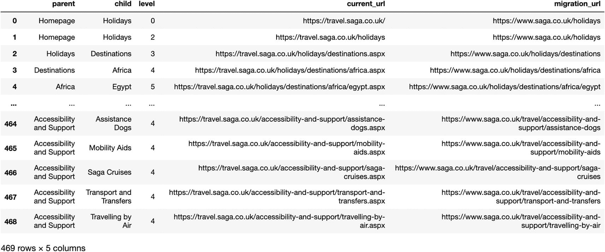

一张包含 469 行 5 列的表格截图，展示了当前 URL 与导入的迁移 URL 映射后的数据框。列标题分别为`parent`、`child`、`level`、`current_url`和`migrated_url`。

在设置了类别和子类别 URL 的 URL 结构后，我们现在将分解当前 URL 和迁移 URL，以便创建一个映射公式。

当我们导入网站其余部分的 URL 时，脚本将使用它们的文件夹结构将其转换为新的迁移 URL 结构：

```python
latest_mapping_full_branch = latest_mapping_raw[['parent', 'child', 'level', 'current_url','migration_url']]
latest_mapping_full_branch['current_url'] = np.where(latest_mapping_full_branch.current_url.isnull(), '', latest_mapping_full_branch.current_url)
```

为了创建新的 URL 结构，创建一个名为`new_branch`的模板变量；我们只需获取迁移 URL，并提取根域名与网页 URL 字符串之间的文件夹。例如，`https://travel.saga.co.uk/holidays/destinations.aspx`的`new_branch`值变为`/holidays/`。为了提取中间的文件夹，我们移除根域名，用正斜杠（`/`）分割字符串，然后提取除最后一个元素之外的所有内容。

设置新的 URL 结构：

```python
latest_mapping_full_branch['new_branch'] = latest_mapping_full_branch['migration_url'].str.replace(migration_root_url, '', regex = False)
latest_mapping_full_branch['new_branch'] = latest_mapping_full_branch['new_branch'].str.split('/').str[:-1]
latest_mapping_full_branch['new_branch'] = ['/'.join(map(str, l)) for l in latest_mapping_full_branch['new_branch']]
```

类似的原则应用于下面的`old_branch`，即当前 URL 的 URL 结构：

```python
latest_mapping_full_branch['old_branch'] = latest_mapping_full_branch['current_url'].str.replace(migration_root_url, '', regex = False)
```

为了使新 URL 更具持久性（即不含日期），我们将所有不需要的字符串放入一个列表中，并告诉 Python 从列表中移除所有内容：

```python
remove_strs = ['2018/', '2019/', '2020/','2021/', 'jan/', 'feb/', 'mar/', 'apr/', 'may/','jun/', 'jul/', 'aug/','sep/','oct/', 'nov/', 'dec/']
latest_mapping_full_branch['old_branch'] = latest_mapping_full_branch['old_branch'].str.replace('|'.join(remove_strs), '')
```

移除节点：

```python
```


`latest_mapping_full_branch['old_branch'] = latest_mapping_full_branch['old_branch'].str.split('/').str[:-1]`

`latest_mapping_full_branch['old_branch'] = latest_mapping_full_branch['old_branch'].apply(lambda x: '/'.join(map(str, x)))`

# 节点是页面本身特有的 URL 字符串，我们按如下方式提取：设置 `NODE`

```
latest_mapping_full_branch['node'] = latest_mapping_full_branch['current_url'].str.split('/').str[-1]
latest_mapping_full_branch['node'] = latest_mapping_full_branch['node'].str.replace('.aspx', '', regex = False)
latest_mapping_full_branch['node'] = latest_mapping_full_branch['node'].str.replace(' ', '-', regex = False)
```

如果任何 `old_branch` 值为空，则直接替换为 `node`。`np.where` 是 Pandas 中与 Excel 的 `if` 语句等效的函数：

```
latest_mapping_full_branch['old_branch'] = np.where(latest_mapping_full_branch['old_branch'] == '', latest_mapping_full_branch.node, latest_mapping_full_branch['old_branch'])
```

`latest_mapping_full_branch`

结果如下：

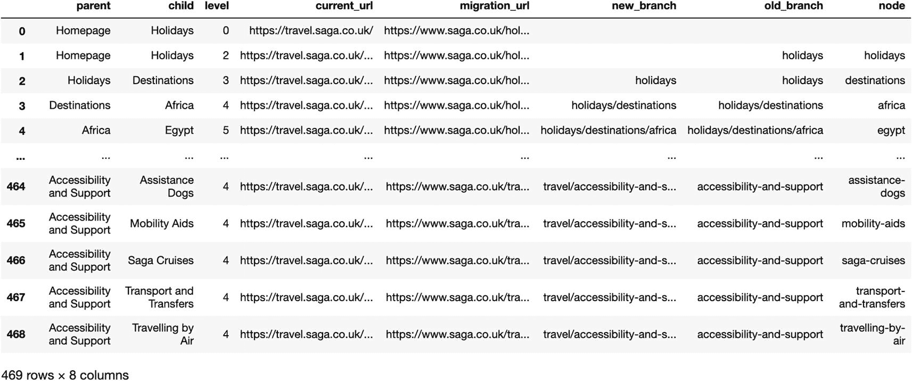

一张包含 469 行和 8 列的数据表截图，展示了最新映射节点的数据框。列标题分别为 `parent`、`child`、`level`、`current URL`、`migrated URL`、`new branch`、`old branch` 和 `node`。

在分解并重构 URL 结构后，我们就可以开始构建映射关系了。接下来进行一些清理工作，包括删除重复行以及移除 `current_url` 值为空的行。虽然我们预计此阶段不会出现异常，但以防万一。

```
branch_map = latest_mapping_full_branch
branch_map = branch_map.sort_values('old_branch')
branch_map = branch_map.drop_duplicates(subset = 'old_branch')
branch_map = branch_map[~branch_map['current_url'].isnull()]
branch_map = branch_map[['old_branch', 'new_branch']]
branch_map['new_branch'] = np.where(branch_map['new_branch'] == '', 'holidays', branch_map['new_branch'])
```

`branch_map`

结果如下：

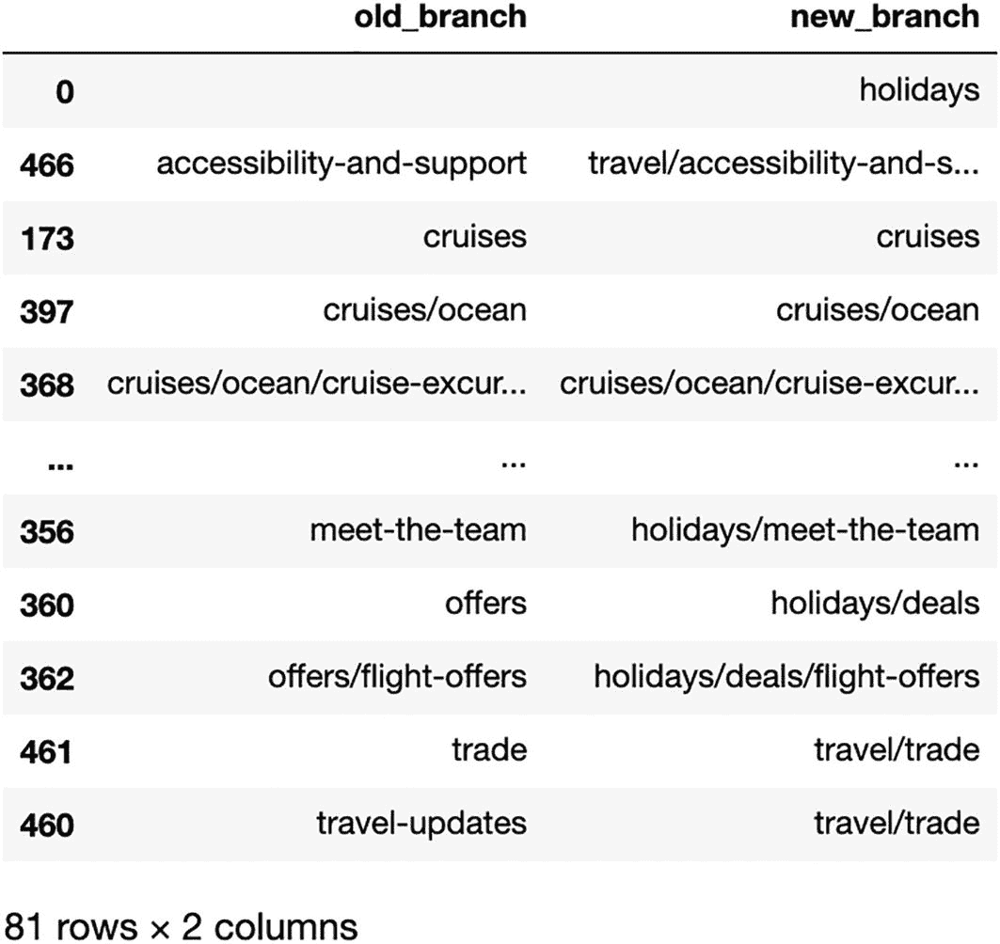

一张包含 81 行和 2 列的数据表截图，展示了 `new branch` 和 `old branch` 节点的数据框。

## 导入 URL

映射关系准备就绪后，我们就可以导入 URL 并将其适配到新的迁移结构中：

```
# DETERMINE the unallocated URLs
target_crawl_raw = pd.read_csv('data/crawl_urls.csv')
```

`target_crawl_raw`

我们将移除那些不会随网站重新上线而迁移的 URL 和子文件夹：

```
target_crawl_urls = target_crawl_raw
stop_folders = ['/membership/', '/magazine/', '/saga-charities/', '/legal/',
                '/money/', '/my/', '/care/', '/magazine-subscriptions/',
                '/membership', '/magazine', '/saga-charities', '/legal',
                '/money', '/my', '/care', '/magazine-subscriptions', 'boardbasis',
                '/antiquity', '/pharaoh', '/orca', '/italy-splendour', '/walking', '/archaeology',
                '/gardens', '/music', '/MyS', '/404', '/contentli']
target_crawl_urls = target_crawl_urls[~target_crawl_urls['URL'].str.contains('|'.join(stop_folders))]
target_crawl_urls = target_crawl_urls[target_crawl_urls['Host'].str.contains('www.saga.co.uk')]
```

`target_crawl_urls`

结果如下：

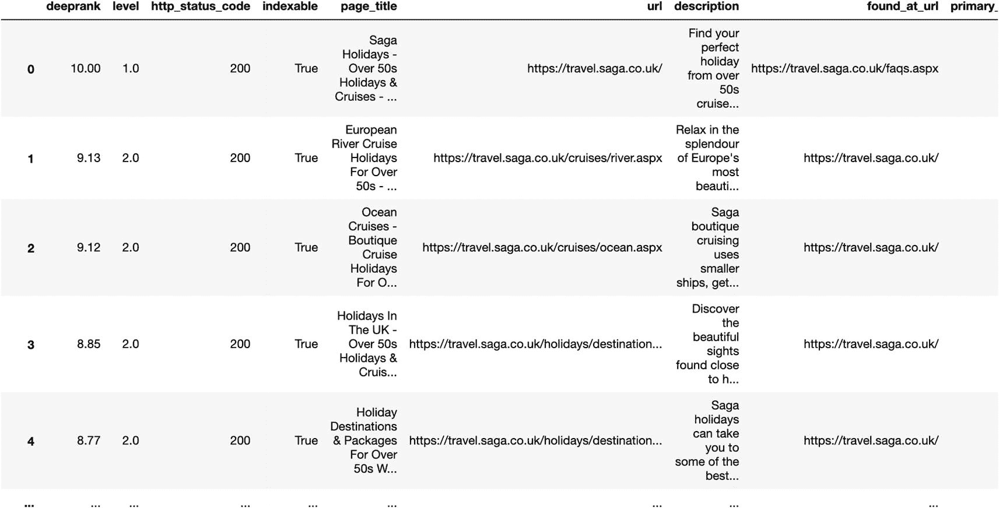

一张包含 5 行和 8 列的数据表截图，展示了目标爬取 URL 的数据框。列标题分别为 `deep rank`、`level`、`status code`、`indexable`、`page title`、`URL`、`description` 和 `found URL`。

爬取数据已就绪，现在已将其子集化为我们想要迁移的 URL。接下来，我们将这些 URL 放入一个列表中，以确保其唯一性：

```
current_url_lst = latest_mapping_full_branch.current_url.to_list()
mapped_url_lst = list(set(current_url_lst))
print(len(mapped_url_lst))
```

然后，我们创建一个新的数据框 `target_crawl_unmigrated`，用于排除已映射的 URL（即类别和子类别 URL）：

```
target_crawl_unmigrated = target_crawl_urls[~target_crawl_urls['URL'].isin(mapped_url_lst)]
```

`target_crawl_unmigrated`

在此阶段，检查是否存在任何重定向（300 响应）以及其他非 `200` 服务器状态的 URL 是明智之举：

```
target_crawl_unmigrated.groupby('HTTP Status Code').agg({'HTTP Status Code': 'count'})
```

结果如下：

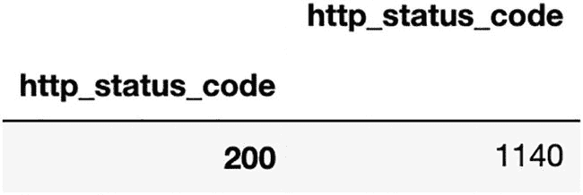

最终 HTTP 状态码为 200 和 1140 的截图。

我们可以看到，所有尚未迁移的过滤 URL 均提供实时页面（返回 200 响应）。如果存在 301 状态码，我们可以使用以下代码检查这些 301 URL：

```
target_crawl_unmigrated[target_crawl_unmigrated['HTTP Status Code'] == '301'][[url]]
```

要处理重定向 URL，我们需要确保它们被包含在映射中，以便在迁移网站 URL 时避免重定向链。重定向链是指从初始请求 URL 到最终目标 URL 之间存在多次重定向。我们将通过确保这些 URL 被列为当前 URL 来实现这一点。

修改 `old_branch` 列：

```
target_crawl_mutate = target_crawl_unmigrated
target_crawl_mutate = target_crawl_mutate.rename(columns = {'url': 'current_url'})
```

创建条件列表：

```
redirect_conds = [
    target_crawl_mutate['http_status_code'].isin(['200', '204', '404', '410', '500']),
```


## 处理重定向问题

`target_crawl_mutate['http_status_code'].isin(['301', '302', '307', '308'])`

]

创建每个条件对应的赋值列表：

```
desturl_values = [target_crawl_mutate['current_url'],
                  target_crawl_mutate['redirected_to_url'],
                 ]
```

创建新列并使用 `np.select` 根据条件列表赋值：

```
target_crawl_mutate['dest_url'] = np.select(redirect_conds, desturl_values)
target_crawl_mutate = target_crawl_mutate[['dest_url']]
target_crawl_mutate = target_crawl_mutate.rename(columns = {'dest_url': 'current_url'})
```

至此，重定向问题已处理完毕。

## 分解URL为映射结构

以下代码将使用之前步骤创建的表格，将 URL 分解为可用于映射的结构：

```
target_crawl_mutate['old_branch'] = target_crawl_mutate['current_url'].str.replace(source_root_url, '', regex = False)
remove_strs = ['2018/', '2019/', '2020/','2021/', 'jan/', 'feb/', 'mar/', 'apr/', 'may/','jun/',
               'jul/', 'aug/','sep/','oct/', 'nov/', 'dec/']
target_crawl_mutate['old_branch'] = target_crawl_mutate['old_branch'].str.replace('|'.join(remove_strs), '')
target_crawl_mutate['old_branch'] = target_crawl_mutate['old_branch'].str.split('/').str[:-1]
target_crawl_mutate['node'] = target_crawl_mutate['current_url'].str.split('/').str[-1]  # 仅节点部分
target_crawl_mutate['node'] = target_crawl_mutate['node'].str.replace('.aspx', '', regex = False)
target_crawl_mutate['node'] = target_crawl_mutate['node'].str.replace(' ', '-', regex = False)
target_crawl_mutate['old_branch'] = target_crawl_mutate.old_branch.apply(lambda x: '/'.join(map(str, x)))
target_crawl_mutate
```

以下爬取数据 `target_crawl_mutate` 现在包含旧分支信息，这意味着经过少量清理（删除不必要的列名）后，我们可以将这些数据与之前创建的分支映射表合并，以帮助制定迁移 URL。

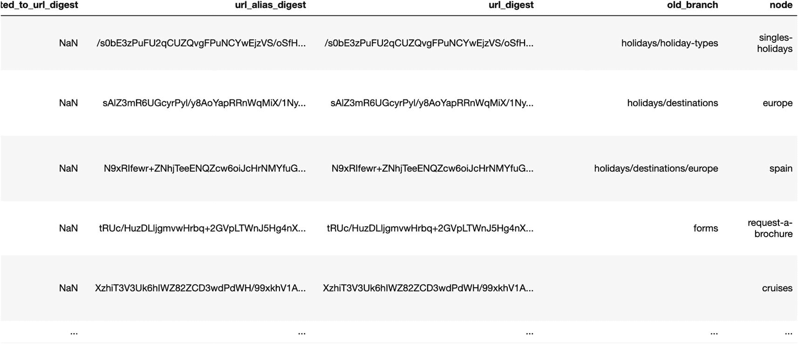

一个包含 5 行 5 列的表格截图，展示了目标爬取变异 URL 的数据框。列标题依次为：变异 URL 摘要、URL 别名摘要、URL 摘要、旧分支和节点。

## 查找新分支

现在我们来查找新分支，因为剩余 URL 中可能存在未完全覆盖的旧分支（即未匹配的异常情况）：

```
unallocated_branch = target_crawl_mutate[['current_url', 'http_status_code', 'old_branch', 'node']]
unallocated_branch = unallocated_branch.merge(branch_map, on = 'old_branch', how = 'left')
unallocated_branch
```

结果如下：

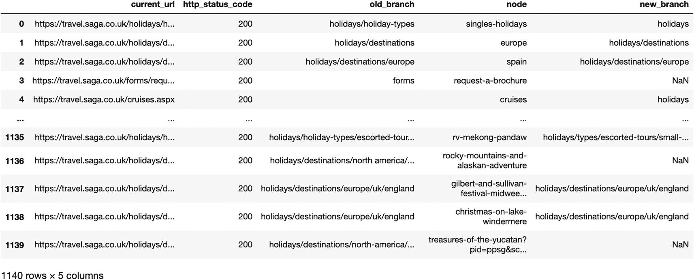

一个包含 1140 行 5 列的表格截图，展示了新建议迁移 URL 的数据框。列标题依次为：当前 URL、HTTP 状态码、旧分支、节点和新分支。

## 清理新分支为空值

未迁移的 URL 现在拥有了建议的 URL 结构，可用于创建新列以生成建议的迁移 URL。我们将先进行少量清理，以处理新分支为空值的情况。

```python
allocated_fillnb = unallocated_branch
allocated_fillnb['new_branch'] = np.where(allocated_fillnb.new_branch.isnull(),
                                          '',
                                          allocated_fillnb.new_branch)
allocated_fillnb['new_branch'] = np.where(allocated_fillnb.new_branch == '',
                                          allocated_fillnb.old_branch,
                                          allocated_fillnb.new_branch)
allocated_fillnb = allocated_fillnb[allocated_fillnb.new_branch != '']
allocated_fillnb.sort_values('new_branch')
```

这将产生以下结果：

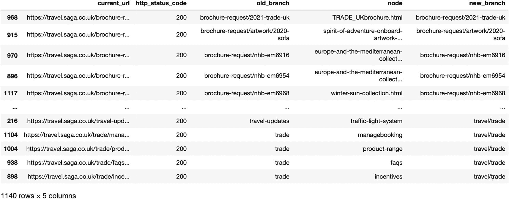

一张包含 1140 行 5 列的数据表截图，展示了针对文本位置的新建议迁移 URL 的数据框。列标题分别为 `current URL`、`http status code`、`old branch`、`node` 和 `new branch`。

## 处理URL节点

接下来需要进行更多清理工作，以处理包含参数字符（如 `?` 和 `=`）的 URL 节点。然后，我们尝试根据这些节点在整个 URL 字符串中的文本位置，创建显示其 `Parent` 和 `Child` URL 节点文件夹的列：

```python
allocated_draft = allocated_fillnb
allocated_draft['node'] = np.where(allocated_draft['node'].str.contains('(\?|=)'),
                                   '',
                                   allocated_draft['node'])
allocated_draft['Parent'] = allocated_draft['new_branch']
allocated_draft['Parent'] = allocated_draft['Parent'].str.split('/').str[0]
allocated_draft['Child'] = allocated_draft['new_branch'].str.split('/').str[1]
allocated_draft['Child'] = np.where(allocated_draft['Child'].isnull(),
                                    allocated_draft['node'],
                                    allocated_draft['Child']
                                   )
allocated_draft
```

这将产生以下结果：

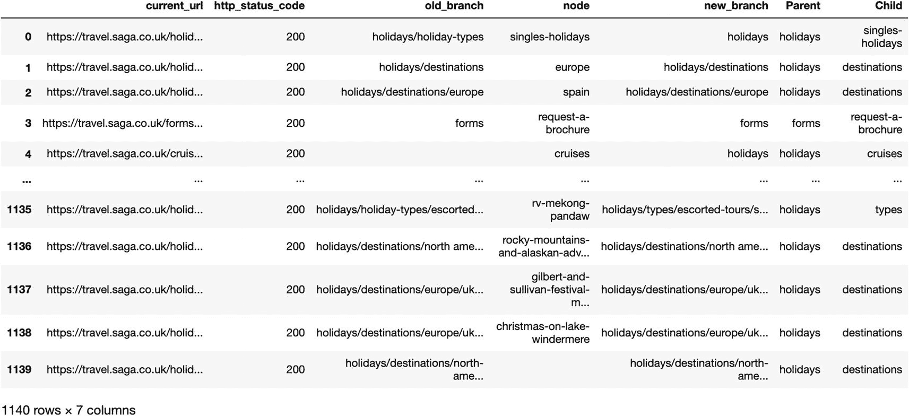

一张包含 1140 行 7 列的数据表截图，展示了新分支 URL 的数据框。列标题分别为 `current URL`、`http status code`、`old branch`、`node`、`new branch`、`parent` 和 `child`。

上表现在包含了 `Parent` 和 `Child` 文件夹。在此阶段，我们希望在整合迁移 URL 之前，确保新的 URL 结构（`new_branch`）归属于新旅游网站的主要板块之一。

## 转换根文件夹名称

将根父文件夹名称转换为小写：

```python
target_roots_urled = [elem.lower() for elem in target_roots]
target_roots_urled = [elem.replace(' ', '-') for elem in target_roots_urled]
print(target_roots_urled)
```

整理分支：

```python
sorted_branches = []
def change_urls(row):
    data = row.values.tolist()
    #print(data)
    if not data[-2] in target_roots_urled:
```


```python
data[-3] = 'holidays/' + str(data[-3])

    sorted_branches.append(data)

def apply_cip(df):

    return df.apply(lambda row: change_urls(row), axis=1)

apply_cip(allocated_draft)

allocated_drafted = pd.DataFrame(sorted_branches, columns=allocated_draft.columns.tolist())

pd.set_option('display.max_colwidth', 35)

allocated_drafted
```

这将产生以下结果：

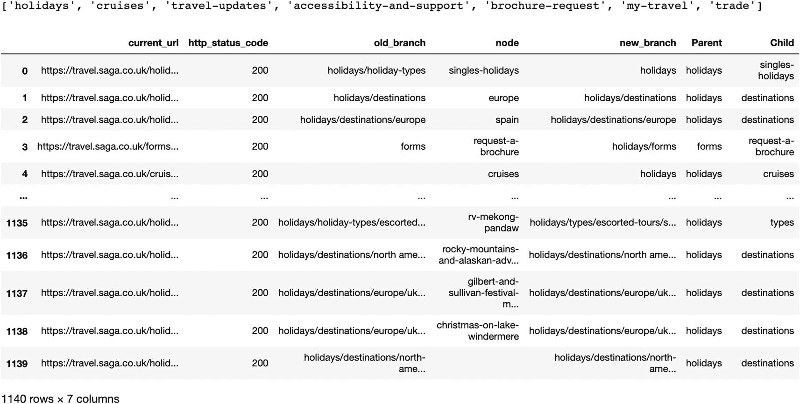

一张包含 1140 行 7 列的数据表截图，展示了排序后的新分支 URL 的数据框。列标题分别为`current URL`、`http status code`、`old branch`、`node`、`new branch`、`parent`和`child`。

任何在前文打印的列表中未找到父节点的文件夹，都会被分配到`holidays`下。这在 90%的情况下应该是正确的。现在开始构建草稿迁移 URL：

```python
allocated_drafted['Migration URL'] = migration_root_url + allocated_drafted.new_branch + '/' + allocated_drafted.node

allocated_drafted['Migration URL'] = np.where(allocated_drafted['Migration URL'].str.endswith('/'),

allocated_drafted['Migration URL'].str[:-1],

allocated_drafted['Migration URL'])

allocated_drafted['Parent'] = allocated_drafted['Parent'].str.replace('-', ' ')

allocated_drafted['Parent'] = allocated_drafted['Parent'].str.title()

allocated_drafted['Child'] = allocated_drafted['Child'].str.replace('-', ' ')

allocated_drafted['Child'] = allocated_drafted['Child'].str.title()
```

转换为小写：

```python
allocated_drafted['Migration URL'] = allocated_drafted['Migration URL'].str.lower()

pd.set_option('display.max_colwidth', 25)

allocated_drafted
```

这将产生以下结果：

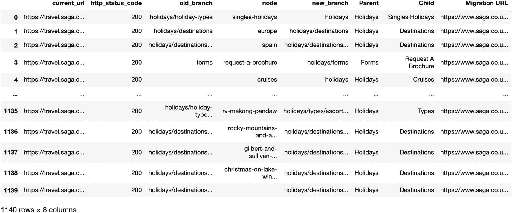

一张包含 1140 行 8 列的数据表截图，展示了草稿迁移 URL 的数据框。列标题分别为：当前 URL、HTTP 状态码、旧分支、节点、新分支、父级、子级和迁移 URL。

通过拼接域名、新分支和节点，迁移 URL 现已完整生成：

```python
allocated_drafted['migration_url'] = migration_root_url + allocated_drafted.new_branch + '/' + allocated_drafted.node

allocated_drafted['migration_url'] = np.where(allocated_drafted['migration_url'].str.endswith('/'),

allocated_drafted['migration_url'].str[:-1],

allocated_drafted['migration_url'])

allocated_drafted['Parent'] = allocated_drafted['Parent'].str.replace('-', ' ')

allocated_drafted['Parent'] = allocated_drafted['Parent'].str.title()

allocated_drafted['Child'] = allocated_drafted['Child'].str.replace('-', ' ')

allocated_drafted['Child'] = allocated_drafted['Child'].str.title()
```

转换为小写：

```python
allocated_drafted['migration_url'] = allocated_drafted['migration_url'].str.lower()

allocated_drafted.columns = allocated_drafted.columns.str.lower()

pd.set_option('display.max_colwidth', 25)

allocated_drafted
```

结果如下：

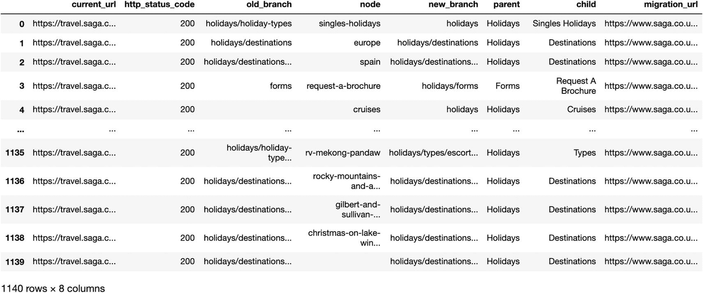

一张包含 1140 行 8 列的数据表截图，展示了迁移 URL 的数据框。列标题分别为：当前 URL、HTTP 状态码、旧分支、节点、新分支、父级、子级和迁移 URL。

为了准备将剩余 URL 与原始最新映射合并，我们需要添加站点层级并进行一些基本检查，例如删除重复的当前 URL（毕竟，同一个 URL 不能重定向到两个或更多不同的 URL）。

站点层级通过计算迁移 URL 中斜杠的数量并减一得出。这意味着首页层级为 1，所有其他页面都以此为基础进行引用。

```python
allocated_distinct = allocated_drafted

allocated_distinct = allocated_distinct.drop_duplicates(subset = 'current_url')

allocated_distinct['migration_url'] = allocated_distinct['migration_url'].str.replace('/holidays/cruises/', '/cruises/')

allocated_distinct['migration_url'] = allocated_distinct['migration_url'].str.replace(' ', '-')

allocated_level = allocated_distinct

allocated_level['level'] = allocated_level.migration_url.str.count('/') - 1

allocated_level = allocated_level[['parent', 'child', 'level', 'current_url', 'migration_url']]

pd.set_option('display.max_colwidth', 65)

allocated_level
```

结果如下：

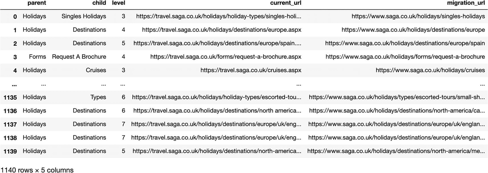

一张包含 1140 行 5 列的数据表截图，展示了当前 URL 和迁移 URL 的数据框。列标题分别为：父级、子级、层级、当前 URL 和迁移 URL。

现在列与原始导入的旅行映射相匹配，我们可以进行合并了：

```python
total_mapping = pd.concat([latest_mapping_raw, allocated_level])

total_mapping
```

结果如下：

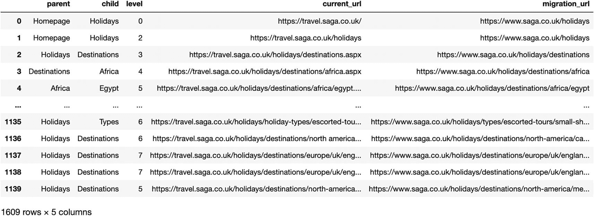

一张包含 1609 行 5 列的数据表截图，展示了总映射 URL 的数据框。列标题分别为：父级、子级、层级、当前 URL 和迁移 URL。

行现已合并。接下来我们将删除重复行，并计算当前 URL 与迁移 URL 之间的字符串相似度，这将有助于我们对导出文件进行人工审核：

```python
total_mapping_simi = total_mapping.drop_duplicates(subset = 'current_url')

total_mapping_simi['simi'] = total_mapping_simi.loc[

:, ['current_url', 'migration_url']].apply(

lambda x: sorensen_dice(*x), axis=1)
```


total_mapping_simi.to_csv('exports/' + target_site_search + '_' + target_bu + '_total_mapping_simi.csv')

`total_mapping_simi`

结果如下：

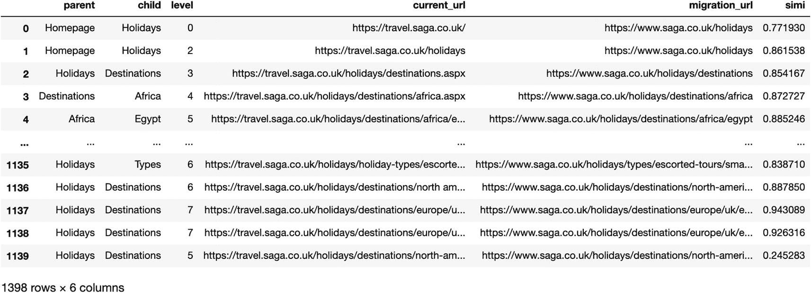

## 迁移映射与流量取证分析

一个包含 1398 行和 6 列的表格截图提供了总映射 URL 的字符串相似度数据框。列标题为：`parent`、`child`、`level`、`current URL`、`migrated URL`和`simi`。

我们现在有了准备在 Excel 中审查的迁移映射。注意行数已减少，因为重复的当前 URL 已被消除。我们还添加了一个新列`simi`，用于标记那些“迁移 URL 与当前 URL 相似度低于 75%”的 URL。虽然并非万无一失，但这将有助于快速发现和排序任何异常情况。

迁移规划可能会让许多 SEO 从业者感到挑战和畏惧。AI 和数据科学尚未发展到足以完全自动化，更不用说半自动化大部分网站迁移规划过程的程度。大部分进展将取决于 SEO 行业可用的 AI 级别的 NLP 模型，以可靠地理解、缩减和映射现有内容 URL 到新 URL。

下一节将讨论网站迁移后流量损失的故障排除。

### 迁移取证

此时，我们的任务是找出迁移后发生了什么变化以及哪些内容受到了影响。我们将采取以下步骤：

1. 流量趋势
2. 确定变化点
3. 确定获胜和失败的内容
4. 收集迁移前后的 URL 列表以供爬取
5. 分组和分段 URL
6. 诊断
7. 建议路线图

像往常一样，我们开始导入库。你会注意到一些包包含了来自`textdistance`的字符串距离函数和`timedelta`，以帮助我们处理时间序列数据：

```python
import pandas as pd
import numpy as np
from textdistance import sorensen_dice
from plotnine import *
import datetime
from datetime import timedelta
from textdistance import sorensen_dice

root_url = 'https://www.saasforecom.com'
root_domain = 'saasforecom.com'
hostname = 'saasforecom'
```

### 流量趋势

导入库并设置变量后，我们将从 Google Analytics（GA）导入数据。我们使用 GA 是因为它能提供按日期划分的详细数据，而 Google Search Console（GSC）在没有大量采样的情况下很难做到这一点。

```python
ga_orgdatelp_raw = pd.read_csv('data/Analytics www.salesorder.com All Traffic 20200901-20201231.csv', skiprows = 5)
```

这里，我们删除不属于 GA 表格导出默认主表的行：

```python
ga_orgdatelp_raw = ga_orgdatelp_raw[~ga_orgdatelp_raw['Landing Page'].isnull()]
ga_orgdatelp_raw = ga_orgdatelp_raw[~ga_orgdatelp_raw['Sessions'].isnull()]
```

为了使列名更整洁，我们将执行一系列字符串操作：

```python
ga_orgdatelp_raw.columns = ga_orgdatelp_raw.columns.str.lower()
ga_orgdatelp_raw.columns = ga_orgdatelp_raw.columns.str.replace('/', '', regex = False)
ga_orgdatelp_raw.columns = ga_orgdatelp_raw.columns.str.replace('.', '', regex = False)
ga_orgdatelp_raw.columns = ga_orgdatelp_raw.columns.str.replace('% ', '', regex = False)
ga_orgdatelp_raw.columns = ga_orgdatelp_raw.columns.str.replace('  ', ' ', regex = False)
ga_orgdatelp_raw.columns = ga_orgdatelp_raw.columns.str.replace(' ', '_', regex = False)
ga_orgdatelp_raw = ga_orgdatelp_raw[ga_orgdatelp_raw['landing_page'] != '/pages/login.aspx']
ga_orgdatelp_raw
```

结果如下：

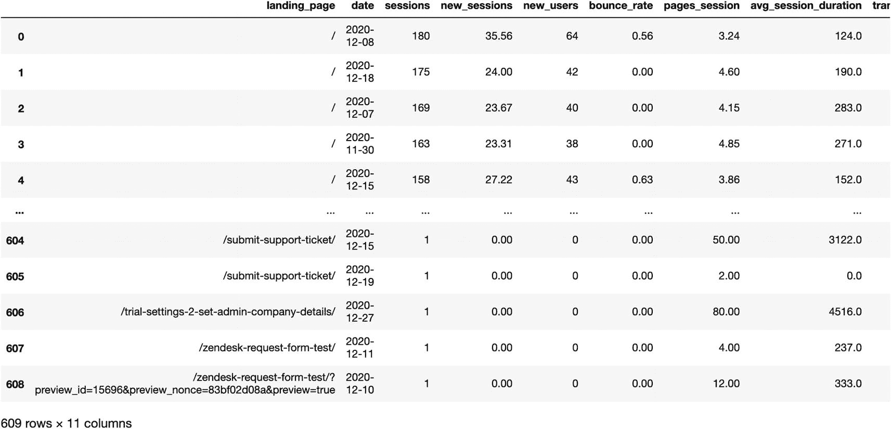

一个包含 609 行和 11 列的表格截图提供了导入变量值的数据框。列标题为：`landing page`、`date`、`sessions`、`new sessions`、`new users`、`bounce rate`、`pages session`和`average session duration`。

数据导入且列名清理并格式化后，我们将开始清理列内的实际数据。这同样会使用字符串操作来移除特殊字符，并将数据类型转换为数字而非字符串。

清理 GA 数据：

```python
ga_clean = ga_orgdatelp_raw
```

格式化日期：

```python
ga_clean['date'] = pd.to_datetime(ga_clean.date, format='%Y%m%d')
ga_clean['bounce_rate'] = ga_clean.bounce_rate.str.replace('%', '')
ga_clean['bounce_rate'] = ga_clean.bounce_rate.astype(float)
ga_clean['new_sessions'] = ga_clean.new_sessions.str.replace('%', '')
ga_clean['new_sessions'] = ga_clean.new_sessions.astype(float)
ga_clean['ecommerce_conversion_rate'] = ga_clean.ecommerce_conversion_rate.str.replace('%', '')
ga_clean['ecommerce_conversion_rate'] = ga_clean.ecommerce_conversion_rate.astype(float)
ga_clean['revenue'] = ga_clean.revenue.str.replace('$', '')
ga_clean['revenue'] = ga_clean.revenue.astype(float)
ga_clean['avg_session_duration'] = ga_clean.avg_session_duration.str.replace('<', '')
ga_clean['avg_session_duration'] = pd.to_timedelta(ga_clean.avg_session_duration).astype(int) / 1e9
ga_clean
```

结果如下：

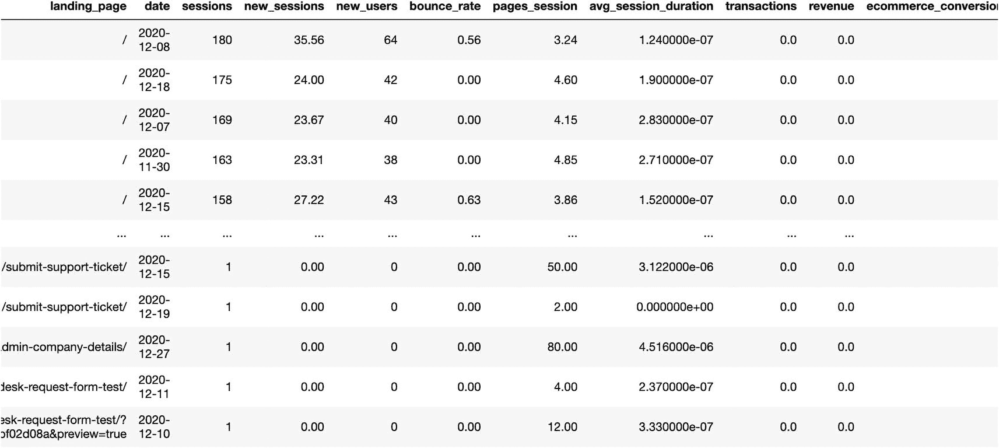

一个包含 609 行和 11 列的表格截图提供了导入变量值的数据框。列标题为：`landing page`、`date`、`sessions`、`new sessions`、`new users`、`bounce rate`、`pages session`、`average session duration`、`transactions`、`revenue`和`ecommerce conversion`。

```python
ga_stats = ga_clean
```

我们选择实际需要的列。你可能注意到有些列被清理后最终并未使用。这看似浪费精力，但你并不总是知道将来需要什么或用于什么目的。因此，清理列是一种良好的标准实践，以便在后续发现需要时数据已准备就绪。

```python
ga_stats = ga_stats[['landing_page', 'date', 'new_sessions', 'avg_session_duration']]
ga_stats = ga_stats.rename(columns = {'landing_page': 'subpath'})
ga_stats
```

# 数据导入与预处理

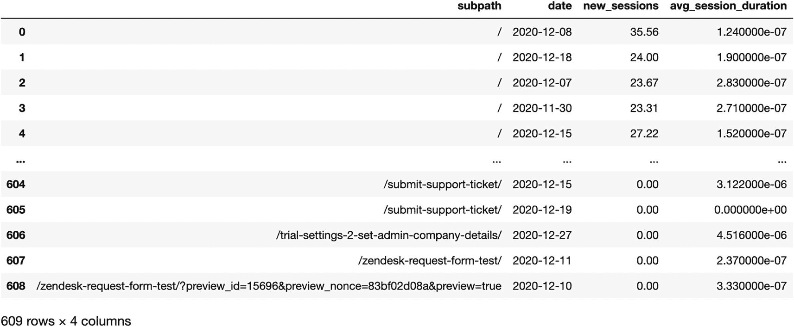
一个包含 609 行和 4 列的表格截图提供了导入子路径的数据框。列标题为：`subpath`、`date`、`new sessions`和`average session duration`。

## 导入GSC数据

导入GSC页面数据以获取所有用于爬取的唯一URL：

```python
all_gsc_raw = pd.read_csv('data/throughout_Pages.csv')

all_gsc_raw.columns = all_gsc_raw.columns.str.lower()

all_gsc_raw.columns = all_gsc_raw.columns.str.replace('/', '', regex = False)

all_gsc_raw.columns = all_gsc_raw.columns.str.replace('.', '', regex = False)

all_gsc_raw.columns = all_gsc_raw.columns.str.replace('% ', '', regex = False)

all_gsc_raw.columns = all_gsc_raw.columns.str.replace('  ', ' ', regex = False)

all_gsc_raw.columns = all_gsc_raw.columns.str.replace(' ', '_', regex = False)

all_gsc_raw['ctr'] = all_gsc_raw.ctr.str.replace('%', '', regex = False)

print(all_gsc_raw.head())

all_gsc_urls = all_gsc_raw[['top_pages']]

all_gsc_urls = all_gsc_urls.rename(columns = {'top_pages': 'url'}).drop_duplicates()

all_gsc_urls
```

结果如下：

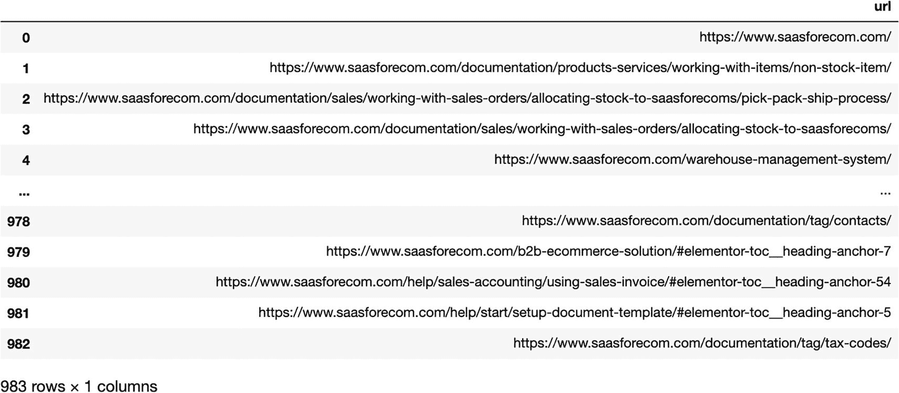
一个包含 983 行和 1 列的表格截图提供了导入的 GSC URL 链接的数据框。

## 导入GA数据

GA URL 也将被提取并连接到域名，准备爬取：

```python
ga_raw_urls = ga_raw_comb[['landing_page']]

ga_raw_urls = ga_raw_urls.rename(columns = {'landing_page': 'url'}).drop_duplicates()

ga_raw_urls['url'] = root_url + ga_raw_urls['url']

ga_raw_urls
```

结果如下：

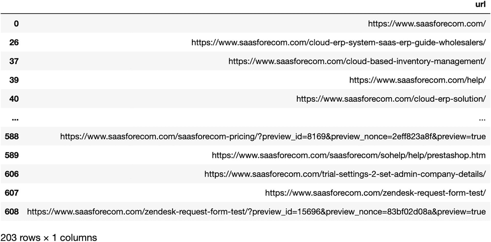
一个包含 203 行和 1 列的表格截图提供了导入的 GA URL 链接的数据框。

## 合并URL

合并 GA 和 GSC 的 URL，去除重复项，准备爬取：

```python
crawl_urls = pd.concat([ga_raw_urls, all_gsc_urls]).drop_duplicates()

crawl_urls.to_csv('data/urls_to_crawl.csv')

crawl_urls
```

结果如下：

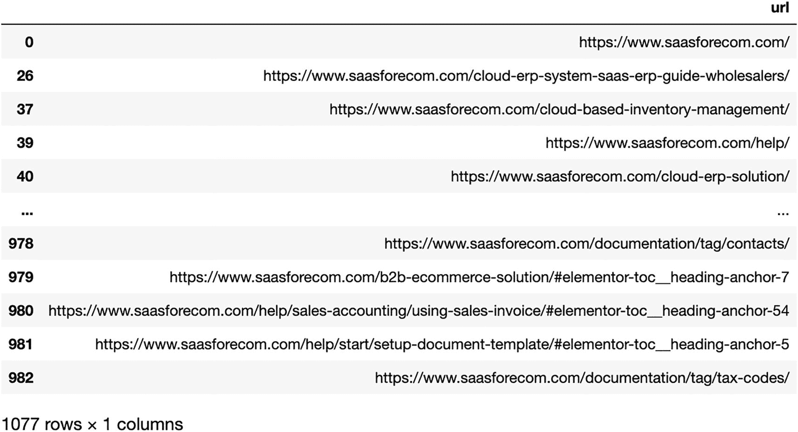
一个包含 1077 行和 1 列的表格截图提供了导入的爬取 URL 链接的数据框。

## 数据爬取与审计

完成爬取后，我们准备导入数据、清洗列并查看原始数据：

```python
audit_urls_raw = pd.read_csv('data/all_urls__excluding_uncrawled__filtered_20210803163126.csv')

audit_urls_raw.columns = audit_urls_raw.columns.str.lower()

audit_urls_raw.columns = audit_urls_raw.columns.str.replace('/', '', regex = False)

audit_urls_raw.columns = audit_urls_raw.columns.str.replace('.', '', regex = False)

audit_urls_raw.columns = audit_urls_raw.columns.str.replace('% ', '', regex = False)

audit_urls_raw.columns = audit_urls_raw.columns.str.replace('  ', ' ', regex = False)

audit_urls_raw.columns = audit_urls_raw.columns.str.replace(' ', '_', regex = False)

#audit_urls_raw['ctr'] = audit_urls_raw.ctr.str.replace('%', '', regex = False)

#audit_urls_raw.drop_duplicates()

audit_urls_raw
```

结果如下：

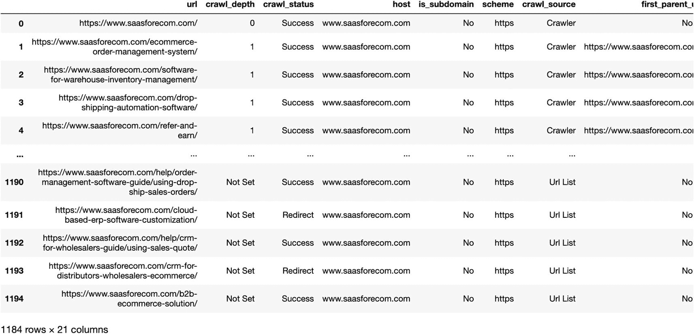
一张包含 1184 行和 21 列的表格截图，展示了导入的审计 URL 链接的数据框。列标题包括 URL、爬取深度、爬取状态、主机是否为子域名、协议、爬取来源、第一父级 1 等。

我们可以看到，大部分服务器状态尚未提取。这很可能是爬取软件中的一个错误。最好的做法是向软件供应商反映此问题，并以更长的超时设置和更慢的速度重新爬取，以改善数据。

```python
audit_urls_raw.groupby('final_redirect_url_status_code').size()

# 输出：
# final_redirect_url_status_code
# 200        452
# 404          1
# Not Set    731
# dtype: int64
```

重新爬取后，我们最多只能得到 452 个 URL。接下来，我们要确保删除任何包含重复 URL 的行：

```python
audit_urls_map = audit_urls_raw.drop_duplicates(subset = ['url']).reset_index()

audit_urls_map.to_csv('exports/audit_urls_map.csv')

audit_urls_map
```

结果如下：

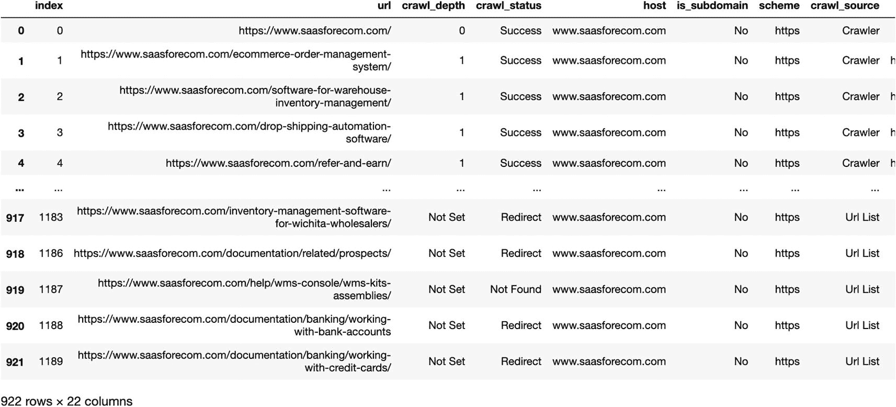
一张包含 922 行和 22 列的表格截图，展示了审计 URL 映射的数据框。列标题包括索引、URL、爬取深度、爬取状态、主机、是否为子域名、协议、爬取来源等。

行数现已从 1122 行减少到 922 行。接下来，我们将查找最终的重定向 URL，以便了解 URL 的映射目标。同样，这个看似多余的步骤是为了克服审计软件可能产生的任何故障。

## 准备数据评估列

准备用于内容评估的列：

```python
audit_urls = audit_urls_map[['url', 'redirect_url', 'final_redirect_url']]

ult_dest_url = []
```

此函数将接收一行，将其转换为列表，并取出最后一个不等于“No Data”的值，然后将该 URL 存入之前创建的列表`ult_dest_url`中：

```python
def find_ult_dest_url(row):

    data = row.values.tolist()

    data = [e for e in data if str(e) not in ('No Data')]

    data = data[-1]

    #print(data)

    ult_dest_url.append(data)
```

通过调用以下函数来逐行处理数据框，从而应用上述函数。这种方式被认为计算量较小，肯定比`iterrows`更快：

```python
def apply_fudu(df):

    return df.apply(lambda row: find_ult_dest_url(row), axis=1)
```

调用`apply_fudu`函数，该函数会调用`find_ult_dest_url`函数：

```python
apply_fudu(audit_urls)
```

现在将生成的列表转换为数据框：

```python
ult_dest_url_df =  pd.DataFrame(ult_dest_url, columns=['ult_dest_url'])

ult_dest_url_df
```

# 数据准备与URL映射

结果如下：

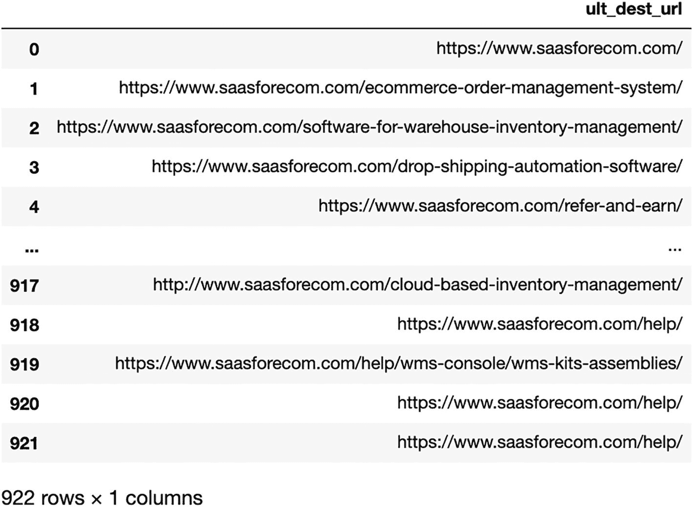

一张包含 922 行和 1 列的表格截图，展示了最终目标 URL 链接的数据框。

将该数据框追加到审计数据框：

```
audit_urls_map_prep = audit_urls_map.join(ult_dest_url_df)
audit_urls_map_prep
```

结果如下：

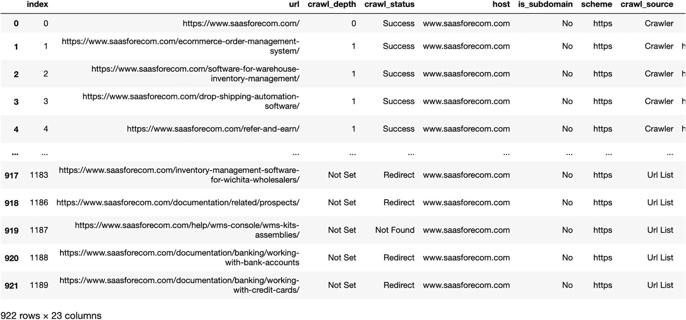

一张包含 922 行和 23 列的表格截图，展示了审计 URL 映射的数据框。列标题包括索引、`URL`、爬取深度、爬取状态、主机、是否为子域名、协议、爬取来源等。

找到最终目标 URL 后，我们需要一种简单的方法来测试它们的相似程度。我们可以通过测量 URL 与重定向 URL 之间的字符串距离来实现。我们将使用 `Sorensen-Dice` 算法，该算法对于 SEO 目的来说快速且有效：

```
audit_urls_map_prep['content_simi'] = audit_urls_map_prep.loc[:, ['url', 'ult_dest_url']].apply(lambda x: sorensen_dice(*x), axis=1)
audit_urls_map = audit_urls_map_prep
audit_urls_map
```

结果如下：

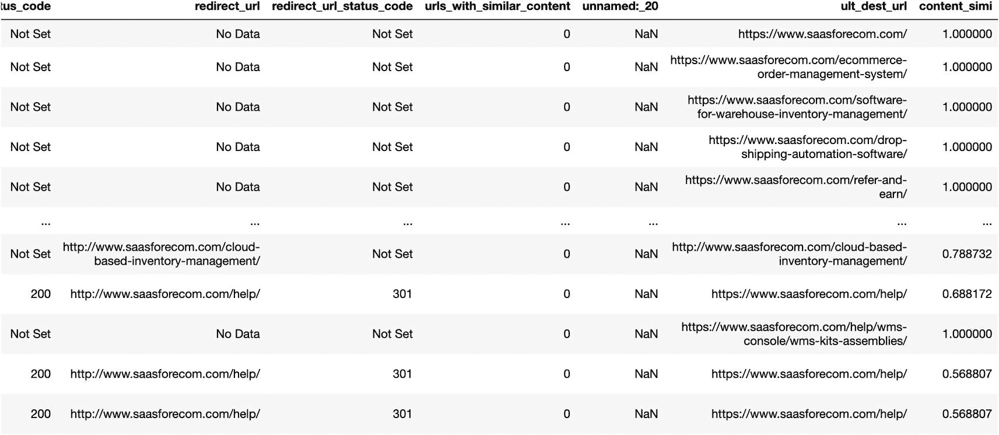

一张包含 922 行和 23 列的表格截图，展示了带有字符串相似度的审计 URL 映射数据框。列标题包括状态码、重定向 URL、重定向 URL 状态、内容相似的 URL、未命名 20、最终目标 URL、内容相似度等。

## 对 URL 进行分段

有了所有这些审计 URL，我们希望理解它们，以便能够按内容类型辨别趋势。由于手头没有训练好的神经网络，我们将使用一种虽然粗糙但有用的方法，即按 URL 地址对 URL 进行分组。这种方法不仅快速，而且成本低廉，因为你不需要数百万个内容文档来训练 AI 按内容类型对网页文档进行分类。

我们将从提取 URL 开始，并确保它们在放入数据框之前是唯一的：

```
crawled_urls_unq = audit_urls_raw.url.drop_duplicates().to_frame()
crawled_urls_unq
```

结果如下：

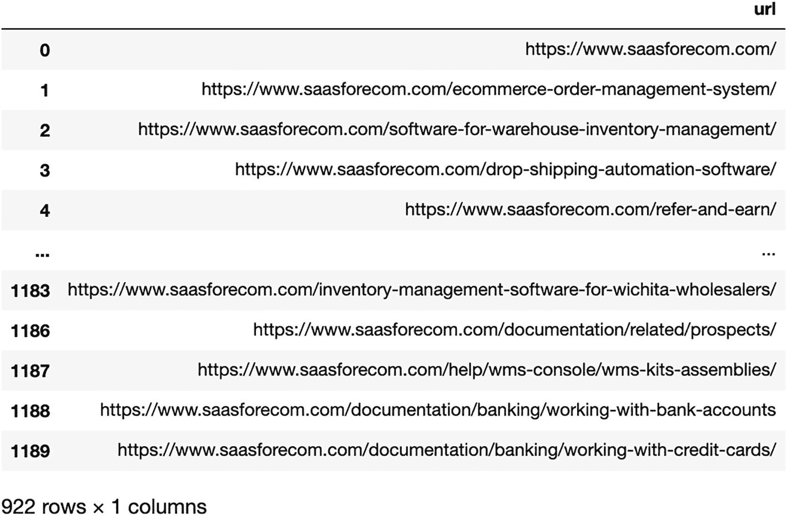

一张包含 922 行和 1 列的表格截图，展示了已爬取 URL 链接的数据框。

```
all_urls = pd.concat([crawl_urls, crawled_urls_unq])
all_urls = all_urls.drop_duplicates()
all_urls
```

结果如下：

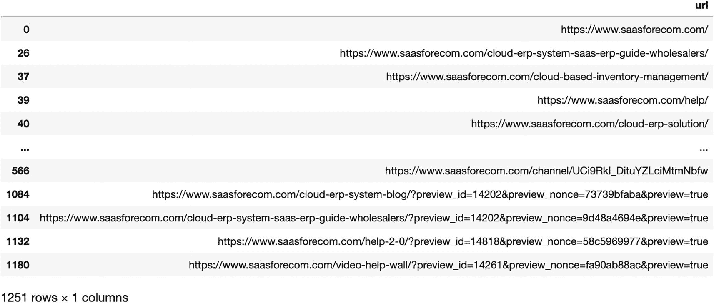

一张包含 1251 行和 1 列的表格截图，展示了所有导入的 URL 链接的数据框。

这段代码清理了 URL，为后续的文本处理做好准备，以便我们可以开始对 URL 进行分组。我们将从移除 URL 的域名部分开始，因为这部分在所有 URL 中都是恒定的：

```
classified_start = all_urls[['url']]
classified_start['slug'] = classified_start.url.str.replace(root_url, '', regex = True)
```

首页可以立即被分类：

```
classified_start['slug'] = np.where(classified_start.slug == "/", "home", classified_start.slug)
```

以下代码将处理日期，这些日期对分类没有价值：

```
classified_start['slug'] = classified_start.slug.str.replace("\\d{4}\\-(0[1-9]|1[012])\\-(0[1-9]|[12][0-9]|3[01])", '', regex = True)
```

移除单词之间多余的空格：

```
classified_start['slug'] = classified_start.slug.str.replace("[^\w\s]", " ", regex = True)
```

移除开头和结尾的空格：

```
classified_start['slug'] = classified_start.slug.str.strip()
classified_start = classified_start.reset_index()
del classified_start['index']
classified_start.head(10)
```

结果如下：

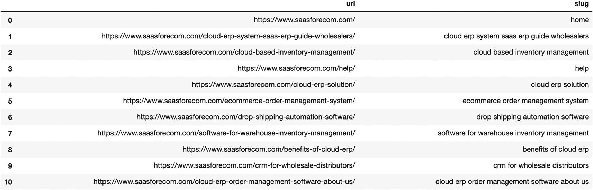

一张包含 11 行和 1 列的表格截图，展示了导入的 `URL` 和 `slug`。

结果是去除了所有字符的 URL 单词，即 `slug`。我们希望应用一些数字来了解优先级，因此我们将使用 GSC 流量数据来对 `slug` 进行加权。

获取 GSC 流量数据：

```
url_clicks_gsc = all_gsc_raw[['top_pages', 'clicks']]
url_clicks_gsc = url_clicks_gsc.rename(columns = {'top_pages': 'url'})
url_clicks_gsc
```

结果如下：

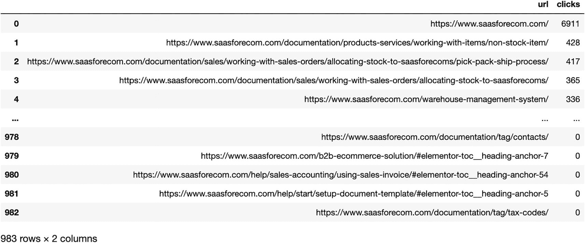

一张包含 983 行和 2 列的表格截图，展示了导入的 `URL` 和点击量。

然后将其合并到之前的 `URL slug` 表中：

```python
classified_stats = classified_start.merge(url_clicks_gsc, on = 'url', how = 'left')
```

移除没有点击量的 `URL`。请在此处明智地选择你的 GSC 日期范围。如果你只选择了 28 天，那么可能存在季节性偏差的风险，因为某些内容在一年中的特定时间可能没有流量。我们的建议是选择 16 个月，这是从 GSC 中提取数据的最大可能范围。

```python
classified_stats = classified_stats[classified_stats.clicks > 0]
classified_stats
```

结果如下：

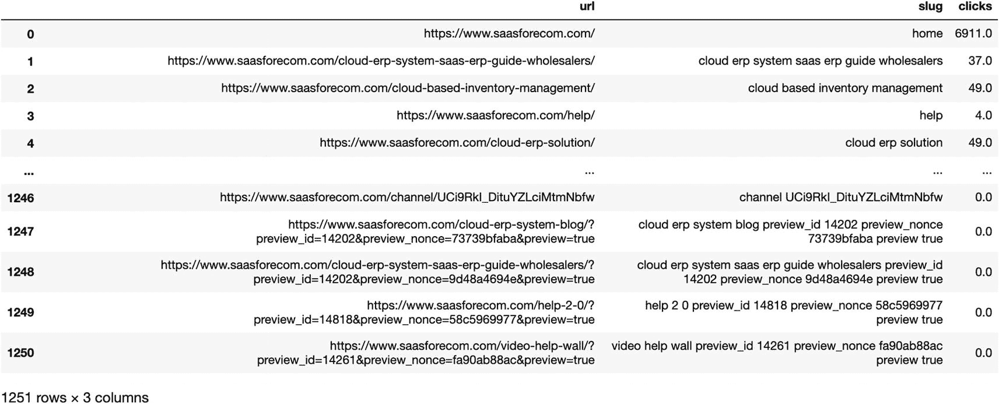

一张包含 1251 行和 3 列的数据表截图，展示了导入的 `URL`、`slug` 和点击量数据框。

我们将把 `slug` 列拆解为单个词（unigrams）。这意味着将 `slug` 列扩展为多行，使得 `slug` 中的每个单词都单独占有一行，作为一列：

```python
bigrams = classified_stats['slug']
bigrams = bigrams.str.split(' ').explode().to_frame()
bigrams = bigrams.rename(columns = {'slug': 'ngram'})
bigrams.head(10)
```

结果如下：

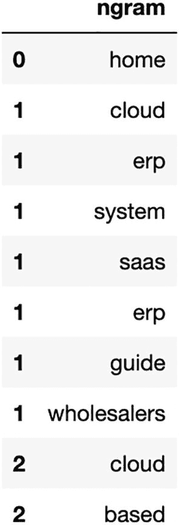

一张包含 10 行和 1 列的数据表截图，展示了将 `slug` 拆解为 `n-gram` 后的数据框。

将 `slug` “拆解”为 `n-gram` 后，这些 `n-gram` 将被映射回其原始 `URL` 和流量统计表：

```python
bigrams_df = classified_stats.join(bigrams)
bigrams_df.head(20)
```

结果如下：

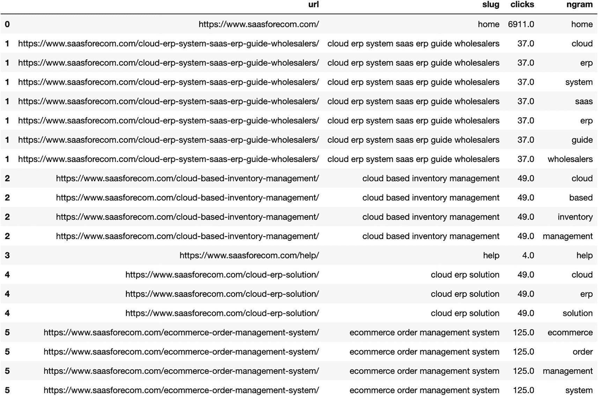

一张包含 20 行和 4 列的数据表截图，展示了原始 `URL` 与 `n-gram` 映射后的数据框。列标题为 `URL`、`slug`、点击量和 `n-gram`。

数据合并后，我们需要移除一些包含停用词和其他无助于创建分组名称的词语的行。

温馨提示：这段代码特意写得有些重复，目的是让你多加练习并形成肌肉记忆，尽管有更聪明的方法（比如使用列表和 `'|'.join(list)`）可以用两行代码完成整个操作：

```python
bigrams_df = bigrams_df[['url', 'ngram', 'clicks']]
bigrams_df = bigrams_df[~bigrams_df.ngram.str.contains(r'\band\b', regex = True)]
```

## 数据清洗与特征工程

`bigrams_df = bigrams_df[~bigrams_df.ngram.str.contains(r'\bfor\b', regex = True)]`

`bigrams_df = bigrams_df[~bigrams_df.ngram.str.contains(r'\bto\b', regex = True)]`

`bigrams_df = bigrams_df[~bigrams_df.ngram.str.contains(r'\ba\b', regex = True)]`

`bigrams_df = bigrams_df[~bigrams_df.ngram.str.contains(r'\ban\b', regex = True)]`

`bigrams_df = bigrams_df[~bigrams_df.ngram.str.contains(r'\bin\b', regex = True)]`

`bigrams_df = bigrams_df[~bigrams_df.ngram.str.contains(r'\bcom\b', regex = True)]`

`bigrams_df = bigrams_df[~bigrams_df.ngram.str.contains(r'\bwww\b', regex = True)]`

`bigrams_df = bigrams_df[~bigrams_df.ngram.str.contains(r'\bthe\b', regex = True)]`

`bigrams_df = bigrams_df[~bigrams_df.ngram.str.contains(r'\busing\b', regex = True)]`

`bigrams_df = bigrams_df[~bigrams_df.ngram.str.contains(r'\bwith\b', regex = True)]`

`bigrams_df = bigrams_df[~bigrams_df.ngram.str.contains(r'\b(http|https)\b', regex = True)]`

`bigrams_df['ngram'] = bigrams_df.ngram.str.strip()`

`bigrams_df = bigrams_df[~bigrams_df.ngram.isnull()]`

`bigrams_df`

结果如下：

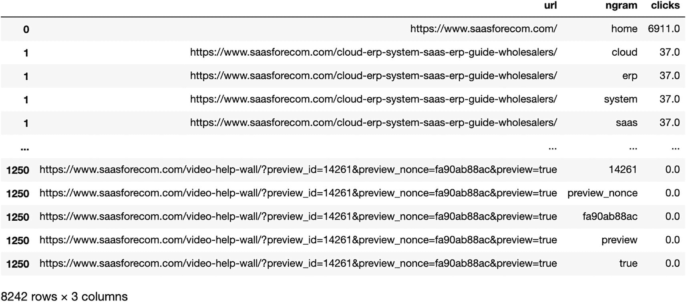

一张包含 8242 行和 3 列的数据表截图，展示了原始 URL 与 n-gram 映射后的数据框。列标题为 URL、n-gram 和点击量。

现在表格中的 n-gram 标签更加合理，可以对其进行汇总聚合，以选出每个 URL 最常见的标签：

```python
bigram_stats = bigrams_df[['ngram', 'clicks']]

bigram_stats = bigram_stats[bigram_stats.ngram.str.contains(r'[\w\s]', regex = True)]

ngram_ins = pd.DataFrame(bigram_stats.value_counts(subset=['ngram']), columns = ['count'])

bigram_stats = bigram_stats.merge(ngram_ins, on = 'ngram', how = 'left')
```

这里的思路是基于流量和 n-gram 标签的实例数量来创建一个索引：

```python
bigram_stats['g_score'] = bigram_stats['clicks'] * bigram_stats['count']

bigram_stats = bigram_stats.sort_values('g_score', ascending = False).reset_index()

del bigram_stats['index']

bigram_stats.head(10)
```

结果如下：


一张包含 11 行和 4 列的数据表截图，展示了带有 g 分数的 n-gram 数据框。列标题为 n-gram、点击量、计数和 g 分数。

现在我们有了一个包含 n-gram 及其统计数据和最终分数的表格。以下函数将为每个 n-gram 选择最高分：

```python
def filter_highest_stat(df, delcol, metric):

    del df[delcol]

    max_count = df[metric].max()

    df = df[df[metric] == max_count]

    df = df.iloc[0]

    return df

ngram_stats_map = bigram_stats.groupby('ngram').apply(lambda x: filter_highest_stat(x, 'ngram', 'g_score')).reset_index()

ngram_stats_map = ngram_stats_map.sort_values('g_score', ascending = False).reset_index()

del ngram_stats_map['index']

ngram_stats_map.head(10)
```

结果如下：


一张包含 11 行和 4 列的数据表截图，展示了带有 g 分数的 n-gram 数据框。列标题为 n-gram、点击量、计数和 g 分数。

结果是一个优先级表格，显示了最常用的 n-gram，这些 n-gram 可用于将 URL 分类为不同的细分。

利用这些分数，我们将创建两个层级的细分，将最流行的 n-gram 作为标签，同时将剩余的归类为“其他”。我们创建两个层级是为了能够提供更宏观和更详细的视图。

```python
ngram_segments = ngram_stats_map[['ngram', 'g_score']]

ngram_segments['segment_one'] = np.where(ngram_segments.index < 11, ngram_segments.ngram, 'other')

ngram_segments['segment_two'] = np.where(ngram_segments.index < 21, ngram_segments.ngram, 'other')

ngram_segments.head(10)
```

结果如下：


一张包含 11 行和 4 列的数据表截图，展示了带有细分标签的 n-gram 数据框。列标题为 n-gram、g 分数、细分 1 和细分 2。

我们将细分标签连接到数据集中，这样所有 URL 现在都按细分标签进行了分类：

# 合并统计量并选取最高值

## `bigram_stats`

```python
urls_grams_stats = bigrams_df.merge(ngram_segments, on = 'ngram', how = 'left').sort_values(['url', 'g_score'], ascending = False)

urls_grams_stats
```

结果如下：


一张表格截图展示了导入的 URL 及其分段的数据框。列标题依次为 URL、ngram、clicks、g_score、segment_1 和 segment_2。

每个 URL 对应多行数据；但我们只需要最高结果，因此将应用一个函数来筛选出 `g_score` 最高的行：

```python
urls_stats_grams_map = urls_grams_stats.groupby('url').apply(lambda x: filter_highest_stat(x, 'url', 'g_score')).reset_index()

pd.set_option('display.max_colwidth', None)

urls_grams_map = urls_stats_grams_map

urls_grams_map = urls_grams_map.drop_duplicates()

del urls_grams_map['clicks']

del urls_grams_map['g_score']

#urls_grams_map.iloc[0, 'ngram'] = 'home'
```


# 数据准备与合并

`urls_grams_map['subpath'] = urls_grams_map.url.str.replace(r'(http|https)://www.saasforecom.com', '', regex = True)`

`urls_grams_map`

```python
urls_grams_map['subpath'] = urls_grams_map.url.str.replace(r'(http|https)://www.saasforecom.com', '', regex = True)

urls_grams_map
```

结果如下：


一张包含 1251 行和 6 列的数据框截图展示了导入的 URL 与 `ngram` 的映射关系。列标题依次为 `URL`、`ngram`、`clicks`、`g_score`、`segment_1` 和 `segment_2`。

上述所有 `URL` 均具有唯一行，并按分段标签进行分类。接下来，我们按分段汇总数据，以查看内容分布情况：

```python
urls_grams_map.groupby('segment_one').count().reset_index()
```

结果如下：


一张包含 11 行和 5 列的数据框截图展示了导入的 `URL` 与分段的映射关系。列标题依次为 `segment_1`、`URL`、`ngram`、`segment_2` 和 `subpath`。

大部分流量集中在“其他”分类，其次是“管理”、“文档”和“销售”。

下一步是将来自 `GA` 的性能数据与分段标签合并，并删除重复的 `URL` 组合：

```python
ga_segmented = ga_stats.merge(urls_grams_map, on = 'subpath', how = 'left')

ga_segmented = ga_segmented.drop_duplicates(subset=['date', 'url'], keep='last')

ga_segmented = ga_segmented.drop_duplicates(subset=['subpath', 'date'], keep='first')
```

清理数据，将空会话设为 `0`，并将 `new_sessions` 视为整数：

```python
ga_segmented['new_sessions'] = np.where(ga_segmented.new_sessions.isnull(), 0, ga_segmented.new_sessions)

ga_segmented['new_sessions'] = ga_segmented['new_sessions'].astype(int)

ga_segmented
```

结果如下：


一张包含 609 行和 8 列的数据框截图展示了 `GA` 数据与分段的合并结果。列标题依次为 `subpath`、`date`、`new_sessions`、`average session duration`、`URL` 等。

最终得到的数据集已准备好进行时间序列分析，并可按照分段进行细分。

## 时间趋势与变化点分析

时间趋势利用时间序列数据帮助我们理解并向同事展示搜索流量随时间的变化情况。这包括：
*   确认流量的变化点
*   查看哪些类型的内容受到了影响（得益于之前完成的分段工作）

存在一定的局限性：从 `Google Search Console (GSC)` 获取时间序列数据相当困难（尽管并非不可能）。对于 `Google Analytics (GA)`，在 `URL` 级别获取仅限于自然搜索的时间序列数据也非常困难。此外，由于数据在一周内周期性波动（存在波峰和波谷），时间序列数据本身可能噪声较大。为了梳理出趋势，我们需要通过计算移动平均值来降低噪声。

我们首先按日期对会话进行分组：

```python
time_trends = ga_segmented.groupby('date')['new_sessions'].sum().to_frame().reset_index()
```

然后应用滚动函数计算七天平均值：

```python
sess_trends_roll = time_trends.rolling(7, min_periods=1)

sess_trends_mean = sess_trends_roll.mean()

time_trends['avg_sess'] = sess_trends_mean

time_trends
```

结果如下：


一张包含 14 行和 3 列的数据框截图展示了时间趋势。列标题依次为 `date`、`new_sessions` 和 `avg_sess`。

让我们进行可视化：

```python
pre_time_trends_plt = (
    ggplot(time_trends, aes(x = 'date', y = 'avg_sess', group = 1)) +
    geom_line(alpha = 0.6, colour = 'blue', size = 3) +
    labs(y = 'GA Sessions', x = 'Date') +
    scale_y_continuous() +
    scale_x_date() +
    theme(legend_position = 'right',
          axis_text_x=element_text(rotation=90, hjust=1)
    ))

Pre_time_trends_plt
```

在图 9-1 中，这种转变非常明显，大约在 2020 年 12 月 20 日，流量趋势从较好的一半切换到了较差的一半。


一张折线图绘制了 `GA` 会话数与日期的关系。它遵循多项式趋势线，最高点约为 1250，最低点约为 700。数值为估算值。

**图 9-1** 分析访问量的时间序列

接下来，我们使用变化点分析，通过 `ruptures` 包从分析角度进行确认：

```python
import ruptures as rpt
import matplotlib.pyplot as plt

points = np.array(overall_trends['avg_sess'])
model="rbf"
algo = rpt.Pelt(model=model).fit(points)
result = algo.predict(pen=6)

rpt.display(points, result, figsize=(10, 6))
plt.title('Change Point Detection using Pelt')
plt.show()
```

图 9-2 中的变化点分析确认了在 12 月 20 日，流量出现了下降趋势。


一张折线图绘制了访问次数与时间段的关系。数据点在两个阴影区域内上下波动。它遵循多项式趋势线，最高点约为 1250，最低点约为 700。数值为估算值。

**图 9-2** 分析访问量的时间序列，并标出了变化点（蓝色阴影区域为变化前，红色为变化后）

是的，这可能与圣诞节假期重合，但不幸的是，对于这家特定公司，我们没有前一年的数据来确认下降中有多少归因于季节性因素，又有多少归因于新网站重新上线迁移。

## 分段时间趋势

确认变化点后，现在让我们看看哪些内容区域受到了影响。我们将首先执行类似的聚合来计算滚动平均值：

```python
segmented_trends = postmortem_df.groupby(['date', 'segment_two'])['new_sessions'].sum().to_frame().reset_index()#.rolling(7).

sessseg_trends_roll = segmented_trends.rolling(8, min_periods=1)
sessseg_trends_mean = sessseg_trends_roll.mean()

segmented_trends['avg_sess'] = sessseg_trends_mean

segmented_trends
```

结果如下：


一张包含 195 行和 4 列的数据框截图展示了分段趋势。列标题依次为 `date`、`segment_1`、`new_sessions` 和 `avg_sess`。

数据为长格式，已计算好滚动平均值，可供可视化：

```python
ga_seg_trends_plt = (
    ggplot(time_trends_segmented, aes(x = 'date', y = 'avg_sess',
                                      group = 'segment_one', colour = 'segment_one')) +
    geom_line(alpha = 0.7, size = 2) +
    labs(y = 'GA Sessions', x = 'Date') +
```

# 趋势图分析

## 绘制趋势图
```python
scale_y_continuous() +

scale_x_date() +

theme(legend_position = 'right',

axis_text_x=element_text(rotation=90, hjust=1)

))
```

```python
ga_seg_trends_plt.save(filename = 'images/1_ga_seg_trends_plt.png', height=5, width=15, units = 'in', dpi=1000)
```

```python
ga_seg_trends_plt
```

图 9-3 中并未呈现明显的趋势，因为大部分（若非全部）内容随时间推移似乎都朝着同一方向移动。并没有出现某些板块下降而其他板块上升或保持不变的情况。


*图 9-3：按内容类型细分的数据分析访问量时间序列。一张多线图绘制了 G A 会话次数与日期的关系。图中绘制了主页、库存、商品、管理、订单、其他、销售、软件、库存和系统的数值。10 条线在 0 到 150 之间呈现上升和下降趋势，并于 2020 年 10 月 12 日达到峰值 430 次会话。数值均为近似值。*

## 分析影响

剖析完时间趋势后，我们将注意力转向分析迁移前后的影响，以期提出建议或确定进一步研究的领域。

我们将使用页面级别的 GSC 数据，这些数据可以通过合并之前创建的映射进行细分：

```python
gsc_before = pd.read_csv('data/gsc_before.csv')
```

像往常一样清理列名：

```python
gsc_before.columns = gsc_before.columns.str.lower()
gsc_before.columns = gsc_before.columns.str.replace('/', '', regex = False)
gsc_before.columns = gsc_before.columns.str.replace('.', '', regex = False)
gsc_before.columns = gsc_before.columns.str.replace('% ', '', regex = False)
gsc_before.columns = gsc_before.columns.str.replace('  ', ' ', regex = False)
gsc_before.columns = gsc_before.columns.str.replace(' ', '_', regex = False)
gsc_before['ctr'] = gsc_before.ctr.str.replace('%', '', regex = False)
```

只是为了让我们知道这些数据指的是迁移的哪个阶段：

```python
gsc_before['phase'] = 'before'
```

在合并细分标签之前重命名 `top_pages` 列：

```python
gsc_before = gsc_before.rename(columns = {'top_pages': 'url'})
gsc_before = gsc_before.merge(urls_grams_map, on = 'url', how = 'left')
gsc_before['count'] = 1
gsc_before['ngram'] = np.where(gsc_before['ngram'].isnull(), 'other', gsc_before['ngram'])
gsc_before['segment_one'] = np.where(gsc_before['segment_one'].isnull(), 'other', gsc_before['segment_one'])
gsc_before['segment_two'] = np.where(gsc_before['segment_two'].isnull(), 'other', gsc_before['segment_two'])
gsc_before
```

结果如下：


*一张包含 320 行 11 列的表格截图，提供了细分前的 GSC URL 链接数据框。列标题为 `url`、`clicks`、`impressions`、`ctr`、`position`、`phase`、`ngram`、`segment_one`、`segment_two` 等。*

至此，我们拥有了已细分的迁移前页面级 GSC 数据。对迁移后的阶段（称为“after”）重复上述操作：

```python
gsc_after = pd.read_csv('data/gsc_after.csv')
gsc_after.columns = gsc_after.columns.str.lower()
gsc_after.columns = gsc_after.columns.str.replace('/', '', regex = False)
gsc_after.columns = gsc_after.columns.str.replace('.', '', regex = False)
gsc_after.columns = gsc_after.columns.str.replace('% ', '', regex = False)
gsc_after.columns = gsc_after.columns.str.replace('  ', ' ', regex = False)
gsc_after.columns = gsc_after.columns.str.replace(' ', '_', regex = False)
gsc_after['ctr'] = gsc_after.ctr.str.replace('%', '', regex = False)
gsc_after['phase'] = 'after'
gsc_after = gsc_after.rename(columns = {'top_pages': 'url'})
gsc_after = gsc_after.merge(urls_grams_map, on = 'url', how = 'left')
gsc_after['count'] = 1
gsc_after['ngram'] = np.where(gsc_after['ngram'].isnull(), 'other', gsc_after['ngram'])
gsc_after['segment_one'] = np.where(gsc_after['segment_one'].isnull(), 'other', gsc_after['segment_one'])
gsc_after['segment_two'] = np.where(gsc_after['segment_two'].isnull(), 'other', gsc_after['segment_two'])
gsc_after
```

结果如下：


*一张包含 320 行 11 列的表格截图，提供了细分后的 GSC URL 链接数据框。列标题为 `url`、`clicks`、`impressions`、`ctr`、`position`、`phase`、`ngram`、`segment_one`、`segment_two` 等。*

两个数据集都已导入并清理完毕，我们可以开始使用聚合进行分析了，首先按阶段计算加权平均排名。

加权平均排名函数（`wavg_rank_imps`）接受两个参数（`position` 和 `impressions`），并使用列名 `wavg_rank` 返回计算结果：

```python
def wavg_rank_imps(x):
    names = {'wavg_rank': (x['position'] * x['impressions']).sum()/(x['impressions']).sum()}
    return pd.Series(names, index=['wavg_rank']).round(1)
```

在应用该函数之前，我们先复制一份“before”数据集：

```python
gsc_before_agg = gsc_before
gsc_before_wavg = gsc_before_agg.groupby('phase').apply(wavg_rank_imps).reset_index()
```

除了加权平均排名位置，我们还对 URL 总数和点击次数（自然搜索流量）感兴趣：

```python
gsc_before_sum = gsc_before_agg.groupby('phase').agg({'count': 'sum',
                                                      'clicks': 'sum'}).reset_index()
```

## 计算迁移前的索引

`gsc_before_stats` 由 `gsc_before_wavg` 与 `gsc_before_sum` 通过 `on = ['phase']` 与 `how = 'left'` 进行合并得到。

索引是点击次数与计数的比率，构成了我们的指标，以便我们了解某种比例关系：

```python
gsc_before_stats['index'] = gsc_before_stats['clicks']/gsc_before_stats['wavg_rank']
gsc_before_stats.sort_values('index', ascending = False)
```

结果如下：


一张包含 1 行 5 列的表格截图，提供了细分前的 GSC 索引数据框。列标题为 `phase`、`wavg_rank`、`count`、`clicks` 和 `index`。行条目如下。第 1 行：before，44.8，375，600，13.392857。

这是迁移前的统计数据。现在让我们看看迁移后的统计数据，对迁移后的数据应用与之前相同的方法：

## 计算迁移后的索引

```python
gsc_after_agg = gsc_after
gsc_after_wavg = gsc_after_agg.groupby('phase').apply(wavg_rank_imps).reset_index()
gsc_after_sum = gsc_after_agg.groupby('phase').agg({'count': 'sum',
                                                    'clicks': 'sum'}).reset_index()
gsc_after_stats = gsc_after_wavg.merge(gsc_after_sum, on = ['phase'], how = 'left')
gsc_after_stats['index'] = gsc_after_stats['clicks']/gsc_after_stats['wavg_rank']
gsc_after_stats.sort_values('index', ascending = False)
```

结果如下：


一张包含 1 行 5 列的表格截图，提供了细分后的 GSC 索引数据框。列标题为 `phase`、`wavg_rank`、`count`、`clicks` 和 `index`。行条目如下。第 1 行：after，45.0，302，205，4.555556。

两个数据集聚合后，我们可以将它们连接成一个表格以便直接比较：

```python
pd.concat([gsc_before_stats, gsc_after_stats])
```

结果如下：


一张包含 2 行 5 列的表格截图，提供了 GSC 索引数据框。列标题为 `phase`、`wavg_rank`、`count`、`clicks` 和 `index`。行条目如下。第 1 行：before，44.8，375，600，13.392857。第 2 行：after，45.0，302，205，4.555556。

因此，平均排名似乎变化不大，这意味着剧烈的变化可能更具季节性。然而，正如我们稍后将看到的，平均值往往掩盖了真实情况。获得流量的页面数量下降了约 -20%，这很能说明问题，因为这似乎与迁移有关。

我们将开始可视化一些数据，以帮助我们进行更深入的研究。

## 可视化整体点击量变化

```python
overall_clicks_plt = (
    ggplot(pd.concat([gsc_before_stats, gsc_after_stats]),
           aes(x = 'reorder(phase, -clicks)', y = 'clicks' , fill = 'phase')) +
    geom_bar(stat = 'identity', alpha = 0.6, position = 'dodge') + position=position_stack(vjust=0.01)) +
    labs(y = 'GSC Clicks', x = 'phase') +
    theme(legend_position = 'right',
    )
)
overall_clicks_plt.save(filename = 'images/2_overall_clicks_plt.png', height=5, width=10, units = 'in', dpi=1000)
overall_clicks_plt
```

如图 9-4 所示，点击量下降了约 67%，这一点我们显然已经知晓。


一张柱状图展示了 GSC 点击量在阶段变更前后的对比。变更前的最大值为 600，变更后的最小值为 200。数值为估算值。

**图 9-4** Google Search Console (GSC) 点击量变更前后的柱状图

接下来，我们按细分领域进行分析。

## 按细分领域分析

首先，计算细分领域的排名平均值和总点击量，并基于点击量与排名的比率推导出一个可见性指数：

### 迁移前的细分领域分析

```python
gsc_before_seg_agg = gsc_before
gsc_before_seg_wavg = gsc_before_seg_agg.groupby(['segment_two', 'phase']).apply(wavg_rank_imps).reset_index()
gsc_before_seg_sum = gsc_before_seg_agg.groupby(['segment_two', 'phase']).agg({'count': 'sum', 'clicks': 'sum'}).reset_index()
gsc_before_seg_stats = gsc_before_seg_wavg.merge(gsc_before_seg_sum, on = ['segment_two', 'phase'], how = 'left')
gsc_before_seg_stats['index'] = gsc_before_seg_stats['clicks']/gsc_before_seg_stats['wavg_rank']
gsc_before_seg_stats.sort_values('index', ascending = False)
```

结果如下：


一张包含 15 行 6 列的表格截图，展示了阶段变更前的指数值数据框。列标题分别为 `segment_two`、`phase`、`wavg_rank`、`count`、`clicks` 和 `index`。

上述细分领域分析显示，大部分内容属于“管理”分类，其次是“文档”。接下来，我们对迁移后的数据进行相同的聚合操作：

### 迁移后的细分领域分析

```python
gsc_after_seg_agg = gsc_after
gsc_after_seg_wavg = gsc_after_seg_agg.groupby(['segment_two', 'phase']).apply(wavg_rank_imps).reset_index()
gsc_after_seg_sum = gsc_after_seg_agg.groupby(['segment_two', 'phase']).agg({'count': 'sum',
                                                                            'clicks': 'sum'}).reset_index()
gsc_after_seg_stats = gsc_after_seg_wavg.merge(gsc_after_seg_sum, on = ['segment_two', 'phase'], how = 'left')
gsc_after_seg_stats['index'] = gsc_after_seg_stats['clicks']/gsc_after_seg_stats['wavg_rank']
gsc_after_seg_stats.sort_values('index', ascending = False)
```

结果如下：


一张包含 15 行 6 列的表格截图，展示了阶段变更后的指数值数据框。列标题分别为 `segment_two`、`phase`、`wavg_rank`、`count`、`clicks` 和 `index`。

有趣的是，“管理”类别的 URL 数量比迁移前增加了 10%，而排名没有实质性变化。“文档”类别几乎失去了所有点击量，并且一半的 URL 也消失了。

为了可视化这一现象，需要将数据框以长格式拼接，以提供给绘图代码使用：

```python
```

gsc_long_seg_stats = pd.concat([gsc_before_seg_stats, gsc_after_seg_stats])
gsc_long_seg_stats['phase'] = gsc_long_seg_stats['phase'].astype('category')
gsc_long_seg_stats['phase'].cat.reorder_categories(['before', 'after'], inplace=True)

segment_clicks_plt = (
    ggplot(gsc_long_seg_stats,
           aes(x = 'reorder(segment_two, -clicks)', y = 'clicks' , fill = 'phase')) +
    geom_bar(stat = 'identity', alpha = 0.6, position = 'dodge') +
    position=position_stack(vjust=0.01)) +
    labs(y = 'GSC Clicks', x = '') +
    theme(legend_position = 'right',
          axis_text_x=element_text(rotation=90, hjust=1)
    )
)
segment_clicks_plt.save(filename = 'images/2_segment_clicks_plt.png', height=5, width=10, units = 'in', dpi=1000)
segment_clicks_plt

如图 9-5 所示，大部分点击量的损失似乎发生在首页。


一张双柱状图展示了 GSC 点击量与会话阶段的对比。图中绘制了两个阶段（点击前和点击后）的数值。首页在点击前和点击后的数值都很高，分别为 370 和 140。数值为估算值。

**图 9-5** 按内容细分领域划分的 Google Search Console (GSC) 点击量变更前后的柱状图

那么，从 Google 获得流量的 URL 数量又如何呢？

```python
segment_urls_plt = (
    ggplot(gsc_long_seg_stats,
           aes(x = 'reorder(segment_two, -count)', y = 'count' , fill = 'phase')) +
    geom_bar(stat = 'identity', alpha = 0.6, position = 'dodge') +
    position=position_stack(vjust=0.01)) +
    labs(y = 'GSC URL Count', x = '') +
    theme(legend_position = 'right',
          axis_text_x=element_text(rotation=90, hjust=1)
    )
)
segment_urls_plt.save(filename = 'images/2_segment_urls_plt.png', height=5, width=10, units = 'in', dpi=1000)
segment_urls_plt
```

因此，迁移后获得流量的管理类 URL 数量更多了（图 9-6）。


一张双柱状图展示了 GSC 点击量与会话阶段的对比。图中绘制了两个阶段（点击前和点击后）的数值。管理类在点击前和点击后的数值都很高，分别为 110 和 115。数值为估算值。

**图 9-6** 按内容细分领域划分的 Google Search Console (GSC) URL 数量变更前后的柱状图

然而，“文档”和“其他”类别的数量大幅减少，“帮助”、“销售”和“库存”类别也略有减少。那么 Google 排名位置又如何呢？

```python
segment_rank_plt = (
    ggplot(gsc_long_seg_stats,
           aes(x = 'reorder(segment_two, -wavg_rank)', y = 'wavg_rank' , fill = 'phase')) +
    geom_bar(stat = 'identity', alpha = 0.6, position = 'dodge') +
    #geom_text(dd_factor_df, aes(label = 'serps_name'), position=position_stack(vjust=0.01)) +
    labs(y = 'GSC Clicks', x = '') +
    scale_y_reverse() +
    #theme_classic() +
    theme(legend_position = 'right',
          axis_text_x=element_text(rotation=90, hjust=1)
    )
)
segment_rank_plt.save(filename = 'images/2_segment_rank_plt.png', height=5, width=15, units = 'in', dpi=1000)
segment_rank_plt
```

库存、销售、批发商和股票分类的排名下降了（图 9-7）。


一张双柱状图展示了 GSC 点击量与会话阶段的对比。图中绘制了两个阶段（点击前和点击后）的数值。点击后阶段，库存类别的数值较高，为 74。点击前阶段，股票类别的数值较低，为 5。数值为估算值。

**图 9-7** 按内容细分领域划分的 Google Search Console (GSC) 排名位置平均值变更前后的柱状图

因此，流量损失与排名下降之间存在一定的相关性。总体结论是，正如最初所怀疑的那样，自然搜索表现下滑的部分原因是季节性和网站迁移共同作用的结果。

### 诊断

那么，我们看到库存等类别的排名下降了，但原因是什么？为了理解问题所在，我们现在将性能数据与爬取数据合并，以帮助我们诊断问题。我们还将附加细分领域名称，以便按内容区域进行诊断。

在合并之前，选择我们需要的点击量和排名列：

```python
gsc_before_diag = gsc_before[['url', 'clicks', 'segment_two', 'position']]
gsc_after_diag = gsc_after[['url', 'clicks', 'segment_two', 'position']]
```

现在进行合并，创建一个新的数据框 `gsc_ba_diag`，以便我们比较迁移前后在 URL 级别的性能。

我们使用外连接来捕获迁移前后的所有 URL。如果我们使用左连接（相当于 Excel 中的 `vlookup`），`Pandas` 会默认使用内连接，这意味着我们会遗漏那些迁移后没有数据的 URL。

```python
gsc_ba_diag = gsc_before_diag.merge(gsc_after_diag, on = ['url', 'segment_two'], how = 'outer')
```

由于前后数据框的列名相同，`Pandas` 会将其视为非预期情况，并正确判断这些列是不同的，因此会添加后缀 `_x` 和 `_y`。所以我们将其重命名，使其更便于用户理解：

```python
gsc_ba_diag = gsc_ba_diag.rename(columns = {'segment_two': 'segment',
    'clicks_x': 'clicks_before', 'clicks_y': 'clicks_after', 'position_x': 'rank_before', 'position_y': 'rank_after' })
```

合并后，我们预计会看到一些行在迁移前或（更可能）迁移后存在空值的点击数据。因此，我们清理数据，将排名中的“非数字”（`NaN`）值替换为 100，将点击中的 `NaN` 值替换为 0：

```python
gsc_ba_diag['rank_before'] = np.where(gsc_ba_diag['rank_before'].isnull(), 100, gsc_ba_diag['rank_before'])
gsc_ba_diag['rank_after'] = np.where(gsc_ba_diag['rank_after'].isnull(), 100, gsc_ba_diag['rank_after'])
gsc_ba_diag['clicks_before'] = np.where(gsc_ba_diag['clicks_before'].isnull(), 0, gsc_ba_diag['clicks_before'])
```

# 数据分析：性能与爬取数据的合并及诊断

## 数据转换与差异计算
数据已转换为宽格式并清理了空值，现在我们可以计算迁移前后的点击和排名差异，具体操作如下：

```python
gsc_ba_diag['rank_delta'] = gsc_ba_diag['rank_before'] - gsc_ba_diag['rank_after']
gsc_ba_diag['clicks_delta'] = gsc_ba_diag['clicks_after'] - gsc_ba_diag['clicks_before']
gsc_ba_diag
```

结果如下：


## 合并性能与爬取数据
性能差异数据现已就位，因此我们可以将爬取数据与性能数据合并到一个新的数据框中，恰当地命名为 `perf_crawl`。

由于我们拥有所有需要的 URL，而爬取数据中包含大量不需要的 URL，因此我们将提取所需的 URL (`perf_crawl`)，并与 `merge` 函数中指定的爬取数据进行左连接。这相当于 Excel 中的 `vlookup`，只会合并所需的爬取 URL。

```python
perf_crawl = gsc_ba_diag.merge(audit_urls_map, on = 'url', how = 'left')
perf_crawl = perf_crawl[['url', 'segment', 'clicks_after', 'clicks_before', 'clicks_delta', 'crawl_depth',
                          'host', 'crawl_source', 'http_status_code', 'indexable_status', 'canonical_url',
                          'canonical_status', 'redirect_url', 'redirect_url_status_code',
                          'final_redirect_url', 'final_redirect_url_status_code', 'urls_with_similar_content',
                          'ult_dest_url', 'content_simi']]
perf_crawl
```

结果如下：


## URL 诊断
更多有趣的工作在等着我们，现在我们要对这些 URL 进行诊断。为此，我们将在数据中使用一组条件，当条件满足时，将赋予一个诊断值。这正是你 SEO 经验发挥作用的地方，因为你识别模式的能力决定了你将设置如下条件：

```python
perf_diags = perf_crawl.copy()
```

创建条件列表：

```python
modifier_conds = [
    (perf_crawl['http_status_code'] == '200') & (perf_crawl['crawl_source'] != 'Crawler'),
    (perf_crawl['redirect_url_status_code'] == '301'),
    (perf_crawl['http_status_code'].isnull()),
    perf_crawl['http_status_code'].isin(['400', '403', '404']),
    (perf_diags['canonical_status'] != 'Missing') & (perf_diags['indexable_status'] == 'Noindex'),
    perf_diags['content_simi'] < 1
]
```

创建每个条件对应的赋值列表：

```python
segment_values = ['outside_ia', 'redirect_chain', 'lost_content', 'error', 'robots_conflict', 'lost_content']
```

创建一个新列，并使用 `np.select` 将我们的列表作为参数为其赋值：

```python
perf_diags['diagnosis'] = np.select(modifier_conds, segment_values, default = 'other')
perf_diags['diagnosis'] = np.where((perf_diags['diagnosis'] == 'redirect_chain') & (perf_diags['content_simi'] < 1),
                                   'lost_content', perf_diags['diagnosis'])
perf_diags
```

结果如下：


根据我们刚刚创建的规则，新增了一个 `diagnosis` 列，帮助我们在 URL 层面理解发生了什么。

## 量化诊断结果
每个 URL 都被标记后，我们可以开始量化诊断结果：

```python
diagnosis_clicks = perf_diags.groupby('diagnosis').agg({'clicks_delta': 'sum'}).reset_index()
diagnosis_urls = perf_diags.groupby('diagnosis').agg({'url': 'count'}).reset_index()
diagnosis_stats = diagnosis_clicks.merge(diagnosis_urls, on = 'diagnosis', how = 'left')
diagnosis_stats['clicks_pURL'] = (diagnosis_stats['clicks_delta'] / diagnosis_stats['url']).round(2)
diagnosis_stats
```

结果如下：


根据分析，总点击损失中约有 25% 是由错误代码（HTTP 服务器状态 4XX）和内容丢失（URL 重定向到父文件夹）造成的。受影响的 URL 中，大部分是那 373 个重定向的 URL，这占了网站的大部分。其他（无 URL）意味着流量损失可能是季节性的和/或迁移错误的间接影响。

## 可视化分享
如果你想分享你的发现，可以使用以下代码为同事进行可视化：

```python
diagnosis_plt = (
    ggplot(diagnosis_stats,
           aes(x = 'reorder(diagnosis, -clicks_delta)', y = 'clicks_delta')) +
    geom_bar(stat = 'identity', alpha = 0.6, position = 'dodge', fill = 'blue') +
    position=position_stack(vjust=0.01)) +
    labs(y = 'GSC Clicks Impact', x = '') +
    coord_flip() +
    theme(legend_position = 'right',
          axis_text_x=element_text(rotation=90, hjust=1)

    )
)

diagnosis_plt.save(filename = 'images/3_diagnosis_plt.png', height=5, width=10, units = 'in', dpi=1000)
diagnosis_plt
```

“其他”（可能是季节性因素）是点击损失的主要原因（图9-8），其次是`lost_content`（即URL重定向）。


### 图 9-8

一张水平条形图，展示了会话数与GSC点击影响的关系。估计值如下：错误，负15。内容丢失，负85。其他，负298。

按技术SEO诊断分类的Google Search Console (GSC) 点击影响条形图。

但受影响的URL数量是多少呢？

```python
diagnosis_count_dat = perf_diags.groupby('diagnosis').agg({'url': 'count'}).reset_index()

print(diagnosis_count_dat)

diagnosis_urlcount_plt = (
    ggplot(diagnosis_count_dat,
           aes(x = 'reorder(diagnosis, url)', y = 'url')) +
    geom_bar(stat = 'identity', alpha = 0.6, position = 'dodge', fill = 'blue') +
    position=position_stack(vjust=0.01)) +
    labs(y = 'URL Count', x = '') +
    coord_flip() +
    theme(legend_position = 'right',
          axis_text_x=element_text(rotation=90, hjust=1)
    )
)

diagnosis_urlcount_plt.save(filename = 'images/3_diagnosis_urlcount_plt.png', height=5, width=15, units = 'in', dpi=1000)

diagnosis_urlcount_plt
```

尽管“其他”类别损失的点击最多，但影响URL数量最多的却是`lost_content`（图9-9）。


### 图 9-9

一个水平条形图绘制了会话数与受影响URL数量之间的关系。估计值如下：外部IA（信息架构）5个，错误35个，其他50个，丢失内容375个。

Google Search Console (GSC) 受影响URL数量的柱状图（按技术SEO诊断分类）。

概览部分已完成；接下来按内容类型进行细分。我们将使用内容片段标签来获取点击影响统计数据：

```python
diagnosis_seg_clicks = perf_diags.groupby(['diagnosis', 'segment']).agg({'clicks_delta': 'sum'}).reset_index()
diagnosis_seg_urls = perf_diags.groupby(['diagnosis', 'segment']).agg({'url': 'count'}).reset_index()
diagnosis_seg_stats = diagnosis_seg_clicks.merge(diagnosis_seg_urls,
                                                on = ['diagnosis', 'segment'], how = 'left')
diagnosis_seg_stats['clicks_p_url'] = (diagnosis_seg_stats['clicks_delta'] / diagnosis_seg_stats['url']).round(2)
diagnosis_seg_stats.sort_values('clicks_p_url')
```

结果如下：


一张包含7行5列的表格截图，提供了诊断和内容片段的数据框。列标题分别为：诊断、片段、点击变化量、URL和每次点击的URL数。

因此，“其他”不仅是点击损失的最大原因，而且大部分影响都集中在首页。这与季节性（即12月典型的流量低迷期）的观点一致。

虽然表格很有用，但我们还将利用数据可视化来更轻松地查看整体情况：

```python
diagnosis_seg_clicks_plt = (
    ggplot(diagnosis_seg_stats,
           aes(x = 'diagnosis', y = 'segment', fill = 'clicks_delta')) +
    geom_tile(stat = 'identity', alpha = 0.6) + position=position_stack(vjust=0.00)) +
    labs(y = '', x = '') +
    theme_classic() +
    theme(legend_position = 'right')
)

diagnosis_seg_clicks_plt.save(filename = 'images/5_diagnosis_seg_clicks_plt.png',
                              height=5, width=10, units = 'in', dpi=1000)

diagnosis_seg_clicks_plt
```

在“其他”类别中，受影响最大的是首页，其次是“管理内容”（图9-10）。


### 图 9-10

热力图绘制了关键词与会话内容类型的关系，点击变化量范围从0到200。首页内容类型的点击量最大，而其余内容类型的点击量最小，通过不同的渐变颜色表示。

按内容类型和SEO诊断划分的点击变化量热力图。

就丢失内容而言，主要是“文档”和“其他”。这对于确定关注重点非常有帮助。尽管“其他”作为原因对于修复迁移后的网站帮助不大，但我们仍然可以解释部分迁移错误发生的位置，开始为URL标记推荐操作，并进行可视化。这正是我们接下来要做的。

## 路线图

我们将从数据框`perf_diags`开始，将其复制到`perf_recs`中，然后根据发现的错误创建推荐：

```python
perf_recs = perf_diags
```

名为`diag_conds`的列表是基于`perf_recs`数据框中`diagnosis`列的值生成的诊断条件列表。稍后使用的`np.select`函数将从这个列表中提取数据以分配推荐。

```python
diag_conds = [
    perf_recs['diagnosis'] == 'outside_ia',
    perf_recs['diagnosis'] == 'redirect_chain',
    perf_recs['diagnosis'] == 'error',
    perf_recs['diagnosis'] == 'robots_conflict',
    perf_recs['diagnosis'] == 'lost_content',
    perf_recs['diagnosis'] == 'other'
]
```

`rec_values`是一个推荐列表，与前面的诊断列表相对应。此时，假设您已经完成了调查工作，知道要为上述每个标签提出哪些推荐。

推荐列表项的顺序与`diag_conds`列表的顺序一致。例如，如果诊断单元格的值为`lost_content`，则推荐操作为`create_integrate`，这意味着创建内容、重定向、取消重定向并重新集成到网站中。

```python
rec_values = ['integrate', 'disintermediate', 'fix/remove links to error URL', 'remove canonical', 'create_integrate', 'no further action']
```

有了这些列表后，我们可以在创建新列时进行匹配，并使用 `np.select` 以列表为参数为其赋值：

```python
perf_recs['recommendation'] = np.select(diag_conds, rec_values, default = 'na')
perf_recs = perf_recs.sort_values('clicks_delta')
perf_recs.to_csv('exports/' + hostname + '_migration_data_1.csv')
perf_recs
```

结果如下：


一张表格的截图展示了用于生成新值的诊断数据框。列标题依次为：最终重定向 URL、最终重定向 URL 状态码、内容相似的 URL、ULT 目标 URL、内容相似度、诊断结果和建议。

现在你会看到`perf_recs`数据框已更新，新增了一列与诊断结果匹配。

当然，接下来我们想用大家熟悉的`groupby()`函数来量化所有这些数据，以便在演示文稿中向同事展示：

```python
recs_clicksurl = perf_recs.groupby('recommendation')['clicks_delta'].agg(['sum', 'count']).reset_index()

recs_clicksurl['recovery_clicks_url'] = np.abs(recs_clicksurl['sum'] / recs_clicksurl['count'])
```

我们取绝对值是为了在呈现数据时保持积极正面的倾向：

```python
recs_clicksurl['sum'] = np.abs(recs_clicksurl['sum'])

recs_clicksurl
```

结果如下：


一张包含 4 行 4 列的表格截图，展示了建议的数据框。列标题依次为：建议、总和、计数、每个 URL 的可恢复点击量。

上表显示了各项建议对应的可恢复点击量（总和）、URL 数量（计数）以及每个 URL 的潜在可恢复点击量。虽然“无需进一步操作”每月能恢复 297 次点击看似奇怪，但其中一部分可能确实会通过修复其他问题而恢复。

接下来进行可视化：

```python
recs_clicks_plt = (

    ggplot(recs_clicksurl,

           aes(x = 'reorder(recommendation, sum)', y = 'sum')) +

    geom_bar(stat = 'identity', alpha = 0.6, position = 'dodge', fill = 'blue') +

    position=position_stack(vjust=0.01)) +

    labs(y = 'Recovery Clicks Available', x = '') +

    coord_flip() +

    theme(legend_position = 'right',

          axis_text_x=element_text(rotation=90, hjust=1)

          )

)

recs_clicks_plt.save(filename = 'images/8_recs_clicks_plt.png',

                     height=5, width=10, units = 'in', dpi=1000)

recs_clicks_plt
```

`图 9-11` 将建议进行了可视化呈现。


一张水平条形图展示了会话数与可用恢复点击量的关系。估算值如下：修复并移除指向错误 URL 的链接，12.5；创建整合，70；无需进一步操作，299。

`图 9-11` 按技术 SEO 诊断结果估算的可用恢复点击量条形图

## 总结

本章涵盖了网站迁移映射的内容，以便你能够设定新网站的结构，并半自动化地生成迁移 URL。使用的一些技术如下：

*   字符串操作
*   通过将数据框行转换为列表来对其进行迭代
*   使用 NLP 比较 URL 字符串

虽然这些技术被应用于加速网站迁移的数据处理，但它们也可以轻松应用于其他场景。在下一章中，我们将展示如何利用数据更好地理解算法更新。

