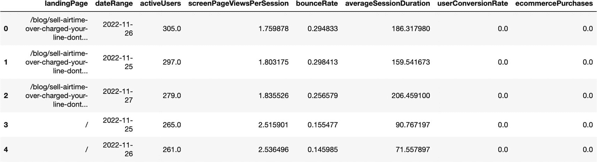

#   Column      Non-Null Count  Dtype
---  ------      ------------  -----
0   landingPage 418 non-null    object
1   dateRange   418 non-null    object
2   activeUsers 418 non-null    object
3   screenPageViewsPerSession  418 non-null    object
4   bounceRate  418 non-null    object
5   averageSessionDuration     418 non-null    object
6   userConversionRate         418 non-null    object
7   ecommercePurchases         418 non-null    object
dtypes: object(8)
memory usage: 26.2+ KB
```

通过 `df.info()` 打印数据框的属性，可以告诉我们数据类型，它们看起来都是字符串。对于着陆页来说这没问题，但对于指标（例如 `activeUsers`）则不然，在进一步处理数据之前，应将其转换为数值类型。

```
df.head()
```

以下生成的数据框显示了维度 `landingPage` 以及各个指标。数据是在整个日期范围内聚合的。



一个数据框的截图，展示了维度条目及其对应的指标。列标题分别为：着陆页、数据范围、活跃用户、每次会话的屏幕页面浏览量、跳出率、平均会话时长、用户转化率和电子商务购买量。

但假设你还希望数据按日期细分。

以下函数将实现这一点，默认天数参数设置为两年：

```
def dated_run_report_to_df(client, property_id="xxxxxxxxx", n_days=365*2):
date_ranges = []
count = 0
df_output = pd.DataFrame()
for i in range(n_days):
count += 1
current = date.today() - timedelta(days=i)
before = date.today() - timedelta(days=i+1)
date_ranges.append(DateRange(start_date=before.strftime("%Y-%m-%d"),
end_date=current.strftime("%Y-%m-%d"),
name=current.strftime("%Y-%m-%d")))
if count == 4:
response = aggregated_run_report(client, property_id=property_id, date_ranges=date_ranges)
df = ga4_response_to_df(response)
df_output = pd.concat([df_output, df], ignore_index=True)
```


# 重新初始化

```
count = 0
date_ranges = []
return df_output
```

运行该函数；在此示例中，我们将提取最近 90 天的数据：

```
df = dated_run_report_to_df(client, n_days=90)
```

以下函数将列数据格式从 `str` 转换为合适的格式（主要为数值型）：

```
def format_df(df):
    df["dateRange"] = pd.to_datetime(df["dateRange"])
    df["activeUsers"] = df["activeUsers"].astype("float")
    df["screenPageViewsPerSession"] = df["screenPageViewsPerSession"].astype("float")
    df["bounceRate"] = df["bounceRate"].astype("float")
    df["averageSessionDuration"] = df["averageSessionDuration"].astype("float")
    df["userConversionRate"] = df["userConversionRate"].astype("float")
    df["ecommercePurchases"] = df["ecommercePurchases"].astype("float")
    return df

df = format_df(df)
df.info()
```

运行结果如下：

```
RangeIndex: 376 entries, 0 to 375
Data columns (total 8 columns):

