# 10. Google 更新

正如死亡和税收是人生的必然，算法更新也是任何 SEO 职业生涯中的必然。没错，Google 会频繁更改其排名算法，这意味着你的网站（以及许多其他网站）可能会在排名上出现波动，进而影响流量。这些变化可能是积极的，也可能是消极的，在某些情况下，你甚至察觉不到任何影响。

## 算法更新分析

为了进一步说明问题，Google 本身对于算法更新的内容以及企业和 SEO 专业人士应如何应对，给出的信息相当模糊。自然，除了提供“出色的用户体验”和“创建引人入胜的内容”之外，Google 缺乏指导性建议，这意味着 SEO 必须使用各种分析工具来寻找答案。幸运的是，对于 SEO 来说：

-   Google 是一个算法系统。这意味着排名因素的变化很可能是一致且可预测的，而不是由人为因素随意决定的。这些变化很可能事先经过了测试。
-   Google 算法变化的结果通过搜索引擎结果页面（SERPs）进入公共领域，这意味着有数据可供分析，即使这违反了 Google 网站管理员指南。
-   即使没有 SERPs，Google Search Console 也是了解 Google 更新性质的重要数据源。

在本章中，我们将介绍算法更新分析，即在算法更新事件前后，在不同层面分析搜索结果的差异：

-   域名
-   结果类型
-   关键词自相残杀
-   关键词
-   客户跟踪查询（目标）内
-   分段的 SERPs

### 算法更新

这里的一般方法是比较 Google 算法更新前后阶段的性能。在本例中，我们将重点关注一家新上市的 webinar 公司`ON24`。`ON24`受到了 2019 年 12 月核心更新的影响。

通过一些分析和可视化，我们可以了解更新的情况。除了常用的库，我们还将从`getSTAT`（一个企业级排名跟踪平台，网址为`getstat.com`）导入 SERPs 数据：

```python
import re

import time

import random

import pandas as pd

import numpy as np

import datetime

import re

import time

import requests

import json

from datetime import timedelta

from glob import glob

import os

from textdistance import sorensen_dice

from plotnine import *

import matplotlib.pyplot as plt

from pandas.api.types import is_string_dtype

from pandas.api.types import is_numeric_dtype

import uritools

pd.set_option('display.max_colwidth', None)

%matplotlib inline

root_domain = 'on24.com'

hostdomain = 'www.on24.com'

hostname = 'on24'

full_domain = 'https://www.on24.com'

target_name = 'ON24'

getstat_raw.head()
```

以下是`getSTAT`数据的打印输出：

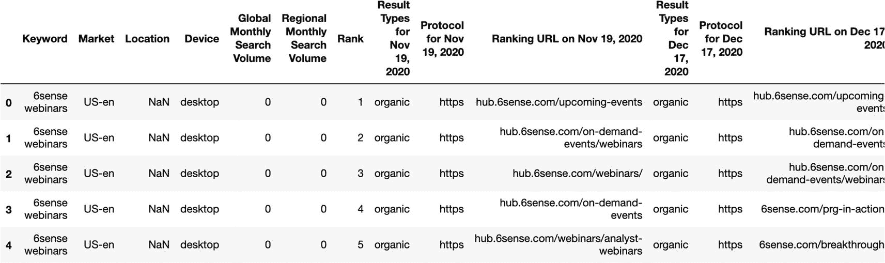

一个表格列出了 13 列和 5 行。行编号为 0-4，对应 6 sense webinars。列包括关键词、市场、位置、设备、全球月搜索量、区域月搜索量、排名、2020 年 11 月 19 日的结果类型、2020 年 11 月 19 日的协议、2020 年 11 月 19 日的排名 URL、2020 年 12 月 17 日的结果类型、2020 年 12 月 17 日的协议以及 2020 年 12 月 17 日的排名 URL。

为了使列名更便于数据处理，我们将进行一些清理：

```python
getstat_cleancols = getstat_raw
```

转换为小写：

```python
getstat_cleancols.columns = [x.lower() for x in getstat_cleancols.columns]
```

鉴于`ON24`是一个全球品牌，并使用单一网站来捕获全球所有英语搜索，我们使用全球月搜索量而不是通常的区域（国家级别）数字。因此，我们将全局搜索量重命名为搜索量：

```python
getstat_cleancols = getstat_cleancols.rename(columns = {'global monthly search volume': 'search_volume'})
```

我们过滤掉品牌搜索的行，因为我们期望`ON24`在其自有品牌上排名良好，而我们更关注一般的核心更新：

```python
getstat_cleancols = getstat_cleancols[~getstat_cleancols['keyword'].str.contains('24')]

getstat_cleancols
```

现在列名已变为小写，并且一些列已重命名：

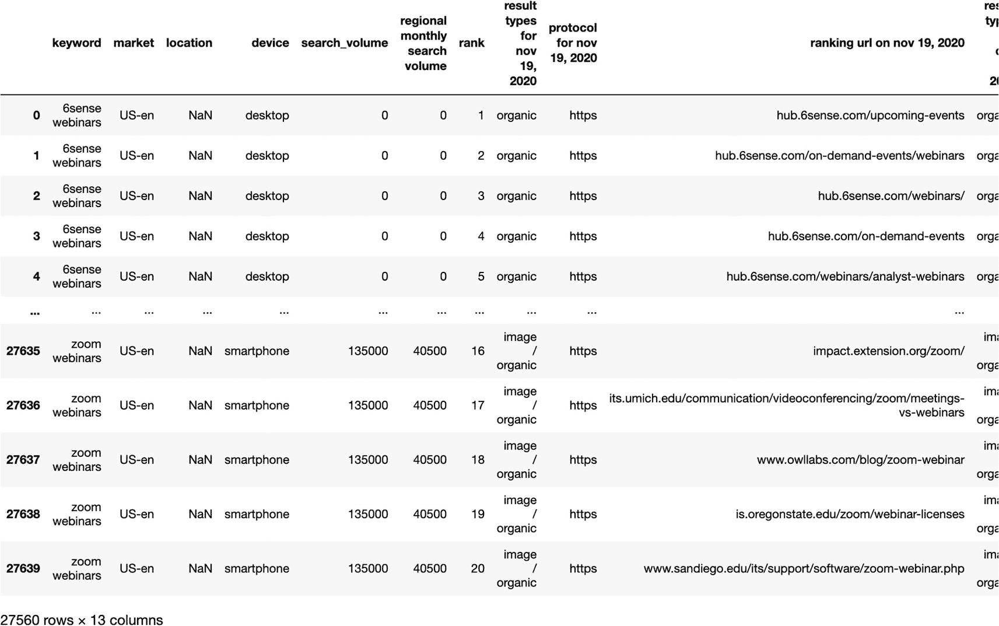

一个表格列出了 10 列和 27560 行，这里只展示了其中的 10 行。行编号从 0 到 4，对应 6 sense webinars 和 zoom webinars，编号从 27635 到 27639。列标题是`keyword`、`market`、`location`、`device`、`search_volume`、`region_monthly_search_volume`、`rank`、`result types for nov 19, 2020`、`protocol for nov 19, 2020`以及`ranking url on nov 19, 2020`。

为了简化计算，我们将数据框按列拆分为“之前”和“之后”。拆分后的数据将被聚合，然后相互比较。

我们从“之前”数据框开始，选择“之前”的列：

```python
getstat_before = getstat_cleancols[['keyword', 'market', 'location', 'device', 'search_volume', 'rank',
'result types for nov 19, 2020', 'protocol for nov 19, 2020',
'ranking url on nov 19, 2020']]
```

我们构建完整的 URL：

```python
getstat_before['url'] = getstat_before['protocol for nov 19, 2020'] + '://' + getstat_before['ranking url on nov 19, 2020']
```

更改`url`列的值，如果存在任何空白（空值），则将其替换为`''`而不是`NaN`（非数字）。这有助于避免稍后聚合时出现错误。

```python
getstat_before['url'] = np.where(getstat_before['url'].isnull(), '', getstat_before['url'])
```

我们将使用`urisplit`函数（嵌入在列表推导式中）来提取域名，从而派生站点名称。这对于在站点级别汇总性能非常有用。

```python
getstat_before['site'] = [uritools.urisplit(x).authority if uritools.isuri(x) else x for x in getstat_before['url']]
```

我们初始化一个名为`strip_subdomains`的列表，以帮助剥离 URL 的字符串组件：

```python
strip_subdomains = ['hub\.', 'blog\.', 'www\.', 'impact\.', 'harvard\.', 'its\.', 'is\.', 'support\.']
```

我们更改`site`字段，将`site`列中找到的任何`strip_subdomains`字符串替换为空：

```python
getstat_before['site'] = getstat_before['site'].str.replace('|'.join(strip_subdomains), '')
```

我们设置一个新列`phase`为`"before"`：

```python
getstat_before['phase'] = 'before'
```

对排名位置数据进行分层有助于我们执行更详细的聚合，以便将性能分解为 Google 的前 3 名、第 1 页等。这使用了`np.where`，它是 Excel 中`if`函数的 Python 等价物：

```python
getstat_before['rank_profile'] = np.where(getstat_before['rank'] < 11, 'page_1', 'page_2')
getstat_before['rank_profile'] = np.where(getstat_before['rank'] < 3, 'top_3',
getstat_before['rank_profile'])
```

在这里，我们将重命名一些列，因为我们不需要列标题中的月份年份：

```python
getstat_before = getstat_before.rename(columns = {'result types for nov 19, 2020': 'snippets'})
```

列选择并非绝对必要，但它确实有助于清理数据框并提醒我们正在处理的内容：

```python
getstat_before = getstat_before[['keyword', 'market', 'phase', 'device', 'search_volume', 'rank',
'url', 'site', 'snippets', 'rank_profile']]
```

我们将零搜索量设置为 1，以便稍后在推导计算时不会出现“除以零错误”：

```python
getstat_before['search_volume'] = np.where(getstat_before['search_volume'] == 0, 1, getstat_before['search_volume'])
```

初始化一个新列`count`，这在聚合时也很有用：

```python
getstat_before['count'] = 1
```

有时，您需要按头部、中部和长尾来剖析 SERPs。为了实现这一点，我们将初始化一个名为`token_count`的列，该列计算单词之间的空格数（并加 1），以提取`keyword`列中的查询词数：

```python
getstat_before['token_count'] = getstat_before['keyword'].str.count(' ') + 1
```

得益于词数统计，我们使用`np.select()`函数对查询长度进行分类。

```python
before_length_conds = [
getstat_before['token_count'] == 1,
getstat_before['token_count'] == 2,
getstat_before['token_count'] > 2]
length_vals = ['head', 'middle', 'long']
getstat_before['token_size'] = np.select(before_length_conds, length_vals)
getstat_before
```

以下是添加了额外特征后的“之前”数据集，以便分析更具实用性。

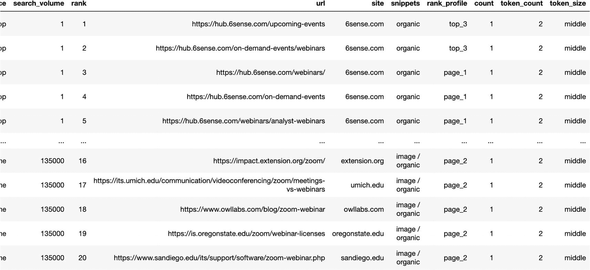

一个表格展示了包含 9 列 10 行的列表。列标题如下：`search_volume`、`rank`、`url`、`site`、`snippets`、`rank_profile`、`count`、`token_count`和`token_size`。各行包含关键词的详细信息。

让我们对“之后”数据集重复数据转换步骤：

```python
getstat_after = getstat_cleancols[['keyword', 'market', 'location', 'device', 'search_volume', 'rank',
'result types for dec 17, 2020', 'protocol for dec 17, 2020',
'ranking url on dec 17, 2020']]

getstat_after['url'] = getstat_after['protocol for dec 17, 2020'] + '://' + getstat_after['ranking url on dec 17, 2020']

getstat_after['url'] = np.where(getstat_after['url'].isnull(), '', getstat_after['url'])

getstat_after['site'] = [uritools.urisplit(x).authority if uritools.isuri(x) else x for x in getstat_after['url']]

strip_subdomains = ['hub\.', 'blog\.', 'www\.', 'impact\.', 'harvard\.', 'its\.', 'is\.', 'support\.']

getstat_after['site'] = getstat_after['site'].str.replace('|'.join(strip_subdomains), '')

getstat_after['phase'] = 'after'
```


`getstat_after` = `getstat_after`.rename(columns = {'result types for dec 17, 2020': 'snippets'})

`getstat_after` = `getstat_after`[['keyword', 'market', 'phase', 'device', 'search_volume', 'rank', 'url', 'site', 'snippets']]

`getstat_after`['search_volume'] = np.where(`getstat_after`['search_volume'] == 0, 1, `getstat_after`['search_volume'])

`getstat_after`['count'] = 1

`getstat_after`['rank_profile'] = np.where(`getstat_after`['rank'] < 4, 'top3', np.where(`getstat_after`['rank'] < 11, 'top10', np.where(`getstat_after`['rank'] < 21, 'top20', 'other')))

`getstat_after`['token_count'] = `getstat_after`['snippets'].str.split().str.len()

`after_length_conds` = [`getstat_after`['token_count'] == 1, `getstat_after`['token_count'] == 2, `getstat_after`['token_count'] > 2,]

`getstat_after`['token_size'] = np.select(`after_length_conds`, `length_vals`)

`getstat_after`

```
getstat_after = getstat_after.rename(columns = {'result types for dec 17, 2020': 'snippets'})

getstat_after = getstat_after[['keyword', 'market', 'phase', 'device', 'search_volume', 'rank', 'url', 'site', 'snippets']]

getstat_after['search_volume'] = np.where(getstat_after['search_volume'] == 0, 1, getstat_after['search_volume'])

getstat_after['count'] = 1

getstat_after['rank_profile'] = np.where(getstat_after['rank'] < 4, 'top3', np.where(getstat_after['rank'] < 11, 'top10', np.where(getstat_after['rank'] < 21, 'top20', 'other')))

getstat_after['token_count'] = getstat_after['snippets'].str.split().str.len()

after_length_conds = [getstat_after['token_count'] == 1, getstat_after['token_count'] == 2, getstat_after['token_count'] > 2,]

getstat_after['token_size'] = np.select(after_length_conds, length_vals)

getstat_after
```

`getstat_after`是“之后”数据集转换的结果，现已完成，使我们能够进入下一步——对数据进行去重：

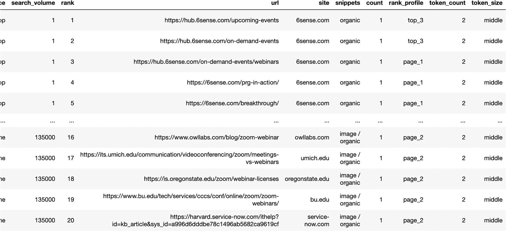

一个表格展示了包含 9 列 10 行的列表。列标题如下：`search volume`、`rank`、`URL`、`site`、`snippets`、`rank profile`、`count`、`token count`和`token size`。各行包含关键词的详细信息。

## 去重

去重的原因是搜索引擎经常在同一 SERP 中对多个 URL 进行排名。如果你想要评估 SERP 的份额或内容蚕食率（即同一域名的多个 URL 争夺同一排名，最终限制了能达到的最高排名），这没有问题。但在我们的用例中，我们只关心哪些网站排在前面、排名顺序如何以及出现的频率，因此去重是关键。

使用转换后的数据集，我们将按`site`分组，在去重后的数据集中选择并保留排名最高的 URL：

```python
getstat_bef_unique = getstat_before.sort_values('rank').groupby(['site', 'device', 'keyword']).first()
getstat_bef_unique = getstat_bef_unique.reset_index()
getstat_bef_unique = getstat_bef_unique[getstat_bef_unique['site'] != '']
getstat_bef_unique = getstat_bef_unique.sort_values(['keyword', 'device', 'rank'])
getstat_bef_unique = getstat_bef_unique[['keyword', 'market', 'phase', 'device', 'search_volume', 'rank', 'url', 'site', 'snippets', 'rank_profile', 'count', 'token_count','token_size']]
getstat_bef_unique
```

结果如下：

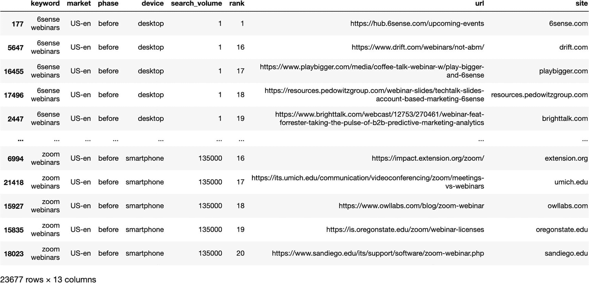

一个表格展示了包含 9 列 10 行的列表。其中 5 行对应 6 sense webinars，5 行对应 zoom webinars。列标题如下：`keyword`、`market`、`phase`、`device`、`search volume`、`rank`、`URL`和`site`。

数据集已从 27,000 行显著减少至 23,600 行。我们将对“之后”数据集重复同样的操作：

```python
getstat_aft_unique = getstat_after.sort_values('rank').groupby(['site', 'device', 'keyword']).first()
getstat_aft_unique = getstat_aft_unique.reset_index()
getstat_aft_unique = getstat_aft_unique[getstat_aft_unique['site'] != '']
getstat_aft_unique = getstat_aft_unique.sort_values(['keyword', 'device', 'rank'])
getstat_aft_unique = getstat_aft_unique[['keyword', 'market', 'phase', 'device', 'search_volume', 'rank', 'url', 'site', 'snippets', 'rank_profile', 'count', 'token_count','token_size']]
getstat_aft_unique
```

结果如下：

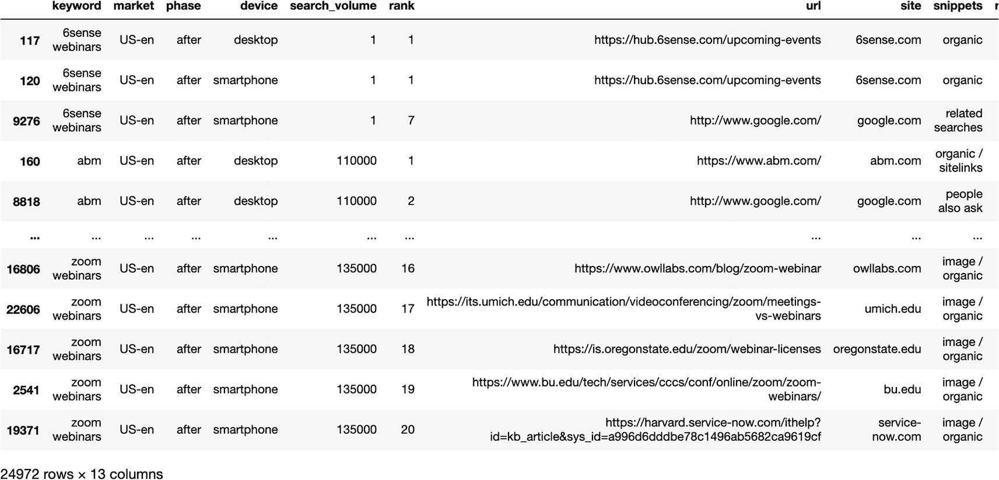

一个表格展示了包含 9 列和 24972 行的列表，此处仅展示其中 10 行。行号从 117 到 8818，接着是省略号，然后从 16806 到 24972，对应 3 个 6 sense 网络研讨会、两个 a b m 和五个 zoom 网络研讨会。列标题如下：`keyword`、`market`、`phase`、`device`、`search volume`、`rank`、`URL`、`site`和`snippets`。

两个数据集都去重后，我们可以开始从不同角度进行聚合分析，并生成洞察。

## 域名

任何算法更新中最常见的问题之一是哪些网站获得了流量，哪些网站流失了流量。我们将首先筛选出排名前 10 的网站，计算其“覆盖范围”，并按网站汇总：

```python
before_unq_reach = getstat_bef_unique
before_unq_reach = before_unq_reach[before_unq_reach['rank'] < 11 ]
before_unq_reach = before_unq_reach.groupby(['site']).agg({'count': 'sum'}).reset_index()
```

将`count`重命名为`reach`：

```python
before_unq_reach = before_unq_reach.rename(columns = {'count': 'reach'})
before_unq_reach = before_unq_reach[['site', 'reach']]
```

将空值替换为零：

```python
before_unq_reach['reach'] = np.where(before_unq_reach['reach'].isnull(), 0, before_unq_reach['reach'])
before_unq_reach.sort_values('reach', ascending = False).head(10)
```

不出所料，谷歌在所有网站中拥有最多的关键词曝光量。紧随其后的是 HubSpot，然后是 ON24，即我们关注的网站。请注意，这是在谷歌更新之前的情况。

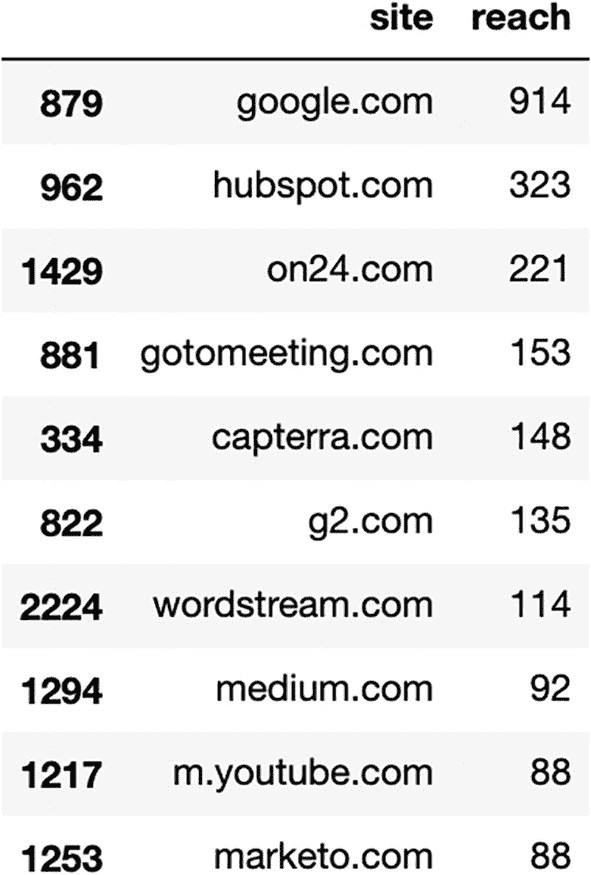

一个表格展示了包含 3 列和 10 行的列表。列标题如下：`site`和`reach`。行中包含频繁被覆盖的网站。热门网站包括`google.com`、`hubspot.com`和`on24.com`。

我们将对更新后的域名覆盖范围重复进行聚合：

```python
after_unq_reach = getstat_aft_unique
after_unq_reach = after_unq_reach[after_unq_reach['rank'] < 11 ]
```


```markdown
`after_unq_reach` = `after_unq_reach`.groupby(['site']).agg({'count': 'sum'}).reset_index()

`after_unq_reach` = `after_unq_reach`.rename(columns = {'count': 'reach'})

`after_unq_reach`['reach'] = `np.where`(`after_unq_reach`['reach'].isnull(), 0, `after_unq_reach`['reach'])

`after_unq_reach` = `after_unq_reach`[['site', 'reach']]

`after_unq_reach`.sort_values('reach', ascending = False).head(10)

```

结果如下：

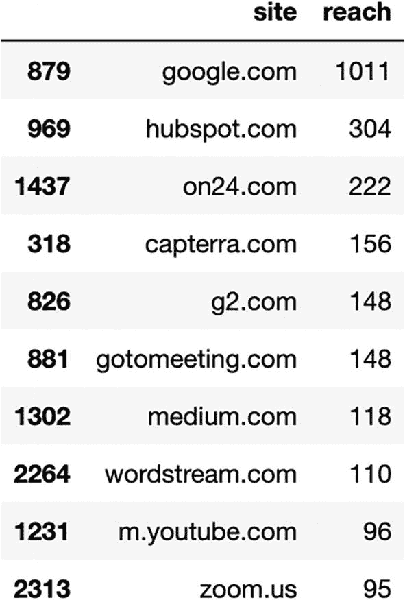

一个表格展示了包含 3 列和 10 行的列表。列包括`site`和`reach`。行中包含频繁被覆盖的网站。热门网站包括`google.com`（覆盖 1011 次）、`hubspot.com`（覆盖 304 次）和`on24.com`（覆盖 222 次）。

谷歌在其自身更新后成为了更大的赢家。HubSpot 略有损失，而 ON24 几乎未变。或者至少表面上看是这样，我们稍后深入分析时会看到更多细节。

与其用肉眼观察两个独立的数据框，不如将它们合并起来进行并排比较：

```python
`compare_reach_loser` = `before_unq_reach`.merge(`after_unq_reach`, on = ['site'], how = 'outer')
```

将列重命名为更友好的名称：

```python
`compare_reach_loser` = `compare_reach_loser`.rename(columns = {'reach_x': 'before_reach', 'reach_y': 'after_reach'})

`compare_reach_loser`['before_reach'] = `np.where`(`compare_reach_loser`['before_reach'].isnull(),

0, `compare_reach_loser`['before_reach'])
```

将空值替换为零，以防止下一步出错：

```python
`compare_reach_loser`['after_reach'] = `np.where`(`compare_reach_loser`['after_reach'].isnull(),

0, `compare_reach_loser`['after_reach'])
```

创建新列，量化更新前后覆盖范围的差异：

```python
`compare_reach_loser`['delta_reach'] = `compare_reach_loser`['after_reach'] - `compare_reach_loser`['before_reach']

`compare_reach_loser` = `compare_reach_loser`.sort_values('delta_reach')

`compare_reach_loser` = `compare_reach_loser`[['site', 'before_reach', 'after_reach', 'delta_reach']]

`compare_reach_loser`.head(10)
```

结果如下：

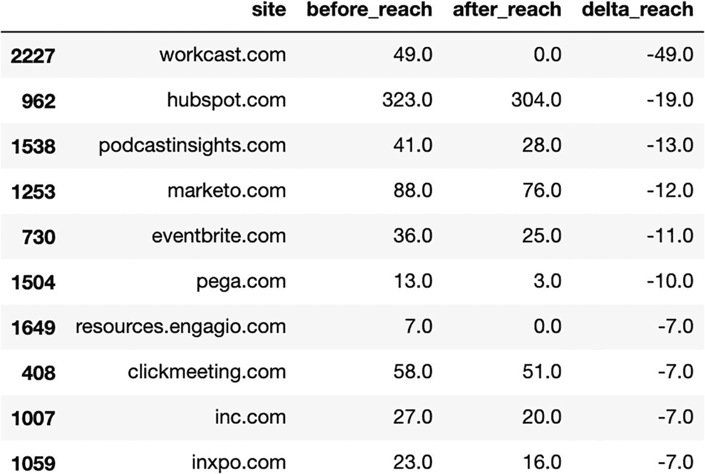

一个表格展示了包含 4 列和 10 行的列表。列标题为`site`、`before_reach`、`after_reach`和`delta_reach`。行按损失降序排列，包括`workcast.com`、`hubspot.com`、`podcastinsights.com`、`marketo.com`等。

迄今为止，损失最大的似乎是 WorkCast（网络研讨会软件领域的主要参与者），其次是 HubSpot。正如你将意识到的，将表格分别聚合后再合并，使得比较变得容易得多。让我们重复操作以找出赢家：

```python
`compare_reach_winners` = `compare_reach_loser`.sort_values('delta_reach', ascending = False)

`compare_reach_winners`.head(10)
```

结果如下：

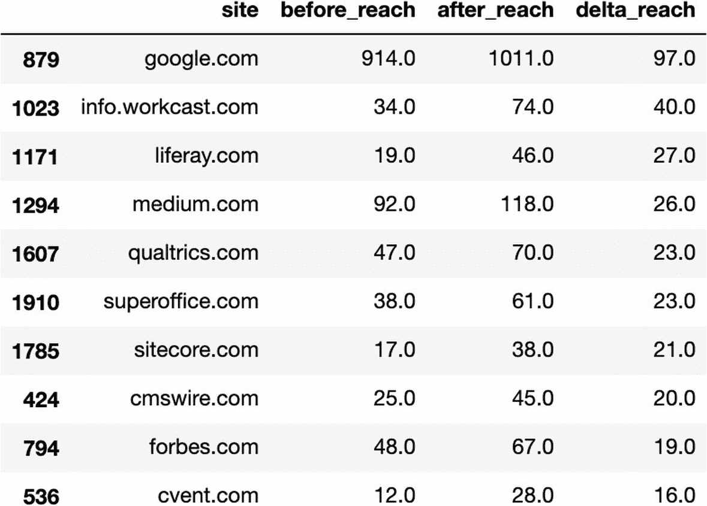

一个表格展示了包含 5 列和 10 行的列表。列包括行号、`site`、`before_reach`、`after_reach`和`delta_reach`。行中包含收益最大且覆盖时间最长的网站，热门网站包括`google.com`、`info.workcast.com`、`liferay.com`、`medium.com`等。

有趣的是，WorkCast 损失了，但其子域名却获得了收益。一些发布商（如 Medium）以及来自间接 B2B 软件竞争对手的博客也获得了收益。直观上看，这似乎表明博客和指南受到了青睐。

是时候进行可视化了。我们将转换为长格式，这是数据可视化绘图包（想想数据透视表）首选的数据结构：

```python
`compare_reach_losers_long` = `compare_reach_loser`[['site', 'before_reach','after_reach']].head(28)

`compare_reach_losers_long` = `compare_reach_losers_long`.melt(id_vars = ['site'], var_name='Phase', value_name='Reach')

`compare_reach_losers_long`['Phase'] = `compare_reach_losers_long`['Phase'].str.replace('_reach', '')

`compare_reach_losers_long`['Phase'] = `compare_reach_losers_long`['Phase'].astype('category')

`compare_reach_losers_long`['Phase'] = `compare_reach_losers_long`['Phase'].cat.reorder_categories(['before', 'after'])

stop_doms = ['en.wikipedia.org', 'google.com', 'youtube.com', 'lexisnexis.com']

`compare_reach_losers_long` = `compare_reach_losers_long`[~`compare_reach_losers_long`['site'].isin(stop_doms)]

`compare_reach_losers_long`.head(10)
```

结果如下：

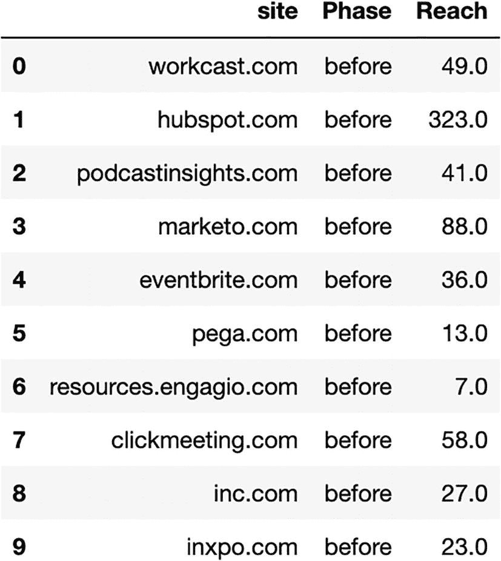

一个表格展示了包含 3 列和 10 行的列表。列包括`site`、`phase`和`reach`。行中包含网站及其更新前的覆盖时间，如`workcast.com`、`hubspot.com`、`podcastinsights.com`、`marketo.com`等。

```python
#VIZ

compare_reach_losers_plt = (

ggplot(compare_reach_losers_long, aes(x = 'reorder(site, Reach)', y = 'Reach', fill = 'Phase')) +

geom_bar(stat = 'identity', position = 'dodge', alpha = 0.8) +

#geom_text(dd_factor_df, aes(label = 'market_name'), position=position_stack(vjust=0.01)) +

labs(y = 'Reach', x = ' ') +

#scale_y_reverse() +

coord_flip() +

theme(legend_position = 'right', axis_text_x=element_text(rotation=0, hjust=1, size = 12)) +

facet_wrap('device')

)

compare_reach_plt.save(filename = 'images/1_compare_reach_losers_plt.png', height=5, width=10, units = 'in', dpi=1000)

compare_reach_plt
```

# 按设备分组的柱状图

似乎并非所有网站在两种设备搜索结果类型中都具有一致的曝光度（图 10-1）。

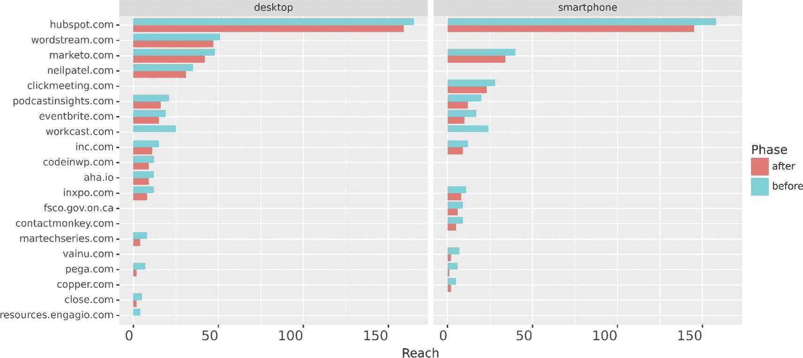

一个按设备分组的柱状图，展示了在阶段前后通过桌面端和智能手机访问的网站。最高的柱状图是`hubspot.com`，无论是在桌面端还是智能手机上，而`wordstream.com`在桌面端被访问，但在智能手机上未被访问。

**图 10-1**
按浏览器设备划分的网站前 10 名排名计数（覆盖量）前后对比

## 分层覆盖量

覆盖量很有帮助，但细节中总有魔鬼。毫无疑问，您和您的同事会希望按排名层级进一步深入分析，例如，排名在前 3 位的位置，或者可能仅在 Google 第 1 页的排名等。这次我们仅聚合带有覆盖量层级的数据，从“之前”数据集开始：

```python
before_unq_reachstrata = getstat_bef_unique
before_unq_reachstrata = before_unq_reachstrata.groupby(['site', 'rank_profile']).agg({'count': 'sum'}).reset_index()
before_unq_reachstrata = before_unq_reachstrata.rename(columns = {'count': 'reach'})
before_unq_reachstrata = before_unq_reachstrata[['site', 'rank_profile', 'reach']]
before_unq_reachstrata.sort_values('reach', ascending = False).head(10)
```

结果如下：

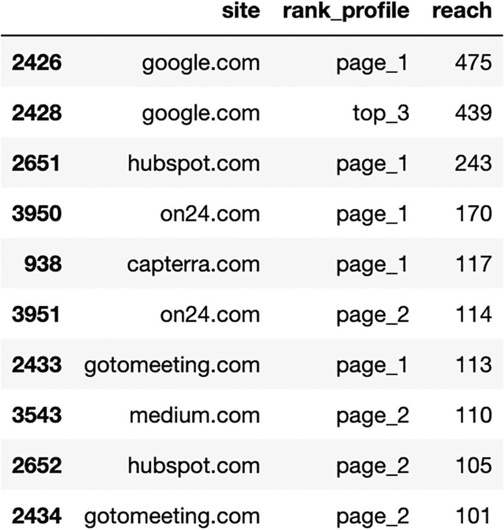

一个表格展示了包含 3 列和 10 行的列表。列包括网站、排名层级和覆盖量。行包括根据其在`google.com`、`hubspot.com`、`on24.com`等网站上的排名和覆盖时间列出的网站。

现在我们有了一个按覆盖量排序的数据框，这次按`rank_profile`拆分，从而对覆盖量指标进行分层。例如，我们看到`HubSpot`在 Google 搜索结果第 1 页的关键词数量是第 2 页的两倍，而对于`ON24`，则大致相等。

对“之后”数据集重复此操作：

```python
after_unq_reachstrata = getstat_aft_unique
after_unq_reachstrata = after_unq_reachstrata.groupby(['site', 'rank_profile']).agg({'count': 'sum'}).reset_index()
after_unq_reachstrata = after_unq_reachstrata.rename(columns = {'count': 'reach'})
after_unq_reachstrata = after_unq_reachstrata[['site', 'rank_profile', 'reach']]
after_unq_reachstrata.sort_values('reach', ascending = False).head(10)
```

结果如下：

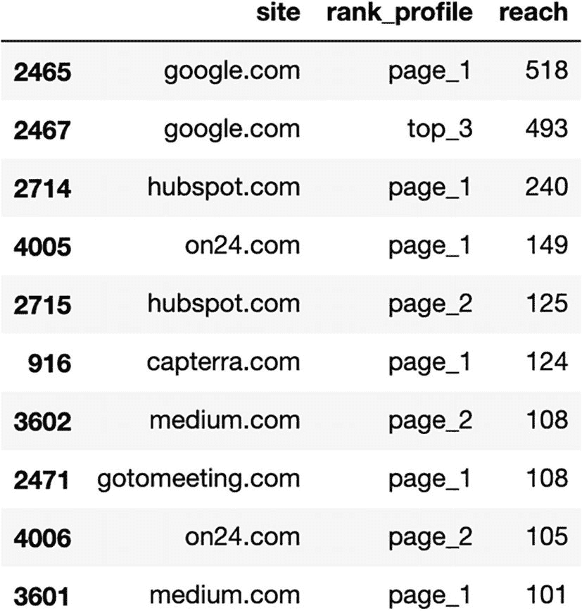

一个表格展示了包含 3 列和 10 行的列表。列包括网站、排名层级和覆盖量。行包括根据其在`google.com`、`hubspot.com`、`on24.com`等网站上的排名和覆盖时间列出的网站。

可以想象，通过肉眼观察单独的数据框来分辨谁赢谁输并不容易，因此我们像往常一样进行合并：

```python
compare_strata_loser = before_unq_reachstrata.merge(after_unq_reachstrata, on = ['site', 'rank_profile'], how = 'outer')
compare_strata_loser = compare_strata_loser.rename(columns = {'reach_x': 'before_reach', 'reach_y': 'after_reach'})
compare_strata_loser['before_reach'] = np.where(compare_strata_loser['before_reach'].isnull(), 0, compare_strata_loser['before_reach'])
compare_strata_loser['after_reach'] = np.where(compare_strata_loser['after_reach'].isnull(), 0, compare_strata_loser['after_reach'])
compare_strata_loser['delta_reach'] = compare_strata_loser['after_reach'] - compare_strata_loser['before_reach']
compare_strata_loser = compare_strata_loser.sort_values('delta_reach')
compare_strata_loser.head(10)
```

结果如下：

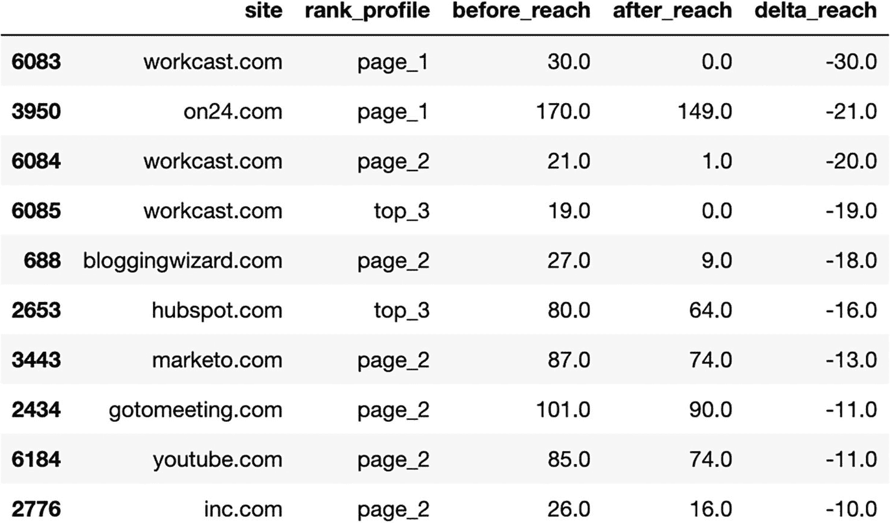

一个表格展示了包含 5 列和 10 行的列表。列包括网站、排名层级、之前覆盖量、之后覆盖量和覆盖量变化。行包括根据其排名和覆盖时间损失最大的网站：`workcast.com`、`on24.com`、`workcast.com`等。

这个数据框合并使事情清晰得多，因为我们现在可以看到`ON24`在第 1 页的排名损失最多，而`WorkCast`在所有地方都有损失。

我们将注意力转向按排名层级划分的覆盖量赢家：

```python
compare_strata_winners = before_unq_reachstrata.merge(after_unq_reachstrata, on = ['site', 'rank_profile'], how = 'outer')
compare_strata_winners = compare_strata_winners.rename(columns = {'reach_x': 'before_reach', 'reach_y': 'after_reach'})
compare_strata_winners['before_reach'] = np.where(compare_strata_winners['before_reach'].isnull(),
    0, compare_strata_winners['before_reach'])
compare_strata_winners['after_reach'] = np.where(compare_strata_winners['after_reach'].isnull(),
    0, compare_strata_winners['after_reach'])
compare_strata_winners['delta_reach'] = compare_strata_winners['after_reach'] - compare_strata_winners['before_reach']
compare_strata_winners = compare_strata_winners.sort_values('delta_reach', ascending = False)
compare_strata_winners = compare_strata_winners[['site', 'rank_profile','before_reach', 'after_reach', 'delta_reach']]
compare_strata_winners = compare_strata_winners[compare_strata_winners['delta_reach'] > 0]
compare_strata_winners.head(10)
```

结果如下：

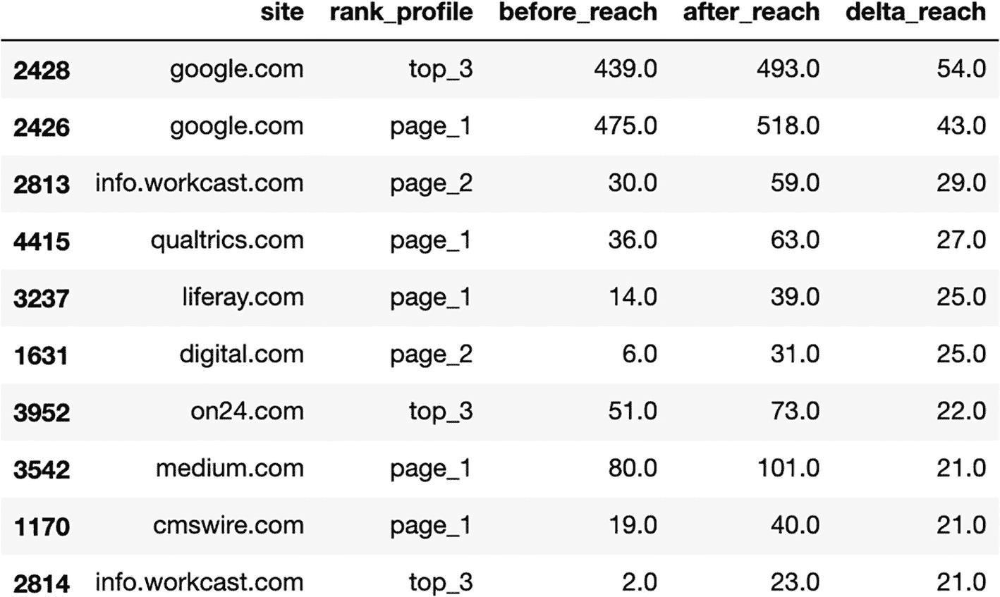

一个表格展示了包含 5 列和 10 行的列表。列包括网站、排名层级、之前覆盖量、之后覆盖量和覆盖量变化。行包括根据其排名和覆盖时间受欢迎的网站：`google.com`、`info.workcast.com`、`qualtrics.com`等。

尽管`WorkCast`的`info`子域名整体获得了 40 个排名，但其主站点损失了 69 个排名，因此是净损失。是时候进行可视化了，我们将使用`head()`函数选取前 28 个站点：

`compare_strata_losers_long = compare_strata_loser[['site', 'rank_profile', 'before_reach','after_reach']].head(28)`

`melt()`函数有助于将数据从宽格式（如前述数据框）重塑为长格式（其中列名现在作为行存在于单个列中）：

```python
compare_strata_losers_long = compare_strata_losers_long.melt(id_vars = ['site', 'rank_profile'], var_name='Phase', value_name='Reach')
compare_strata_losers_long['Phase'] = compare_strata_losers_long['Phase'].str.replace('_reach', '')
```

`astype()`函数允许我们指示 Pandas 将数据列视为不同的数据类型。在这种情况下，我们要求 Pandas 将`Phase`视为类别，因为这是一个离散变量，这使我们能够对这些类别进行排序：

```python
compare_strata_losers_long['Phase'] = compare_strata_losers_long['Phase'].astype('category')
```

将`Phase`设置为类别后，我们现在可以设置顺序：

```python
compare_strata_losers_long['Phase'] = compare_strata_losers_long['Phase'].cat.reorder_categories(['before', 'after'])
```

同样的方法也适用于`rank_profile`。前 3 名显然优于第 1 页，而第 1 页优于第 2 页。

```python
compare_strata_losers_long['rank_profile'] = compare_strata_losers_long['rank_profile'].astype('category')
compare_strata_losers_long['rank_profile'] = compare_strata_losers_long['rank_profile'].cat.reorder_categories(['top_3', 'page_1', 'page_2'])
```

`stop_doms`列表用于从我们的分析中剔除受众不感兴趣的域名：

```python
stop_doms = ['en.wikipedia.org', 'google.com', 'youtube.com']
```

有了`stop_doms`列表，我们可以通过否定任何在`stop_doms`列表中的站点（使用`isin()`函数）来过滤掉这些不想要的域名：

```python
compare_strata_losers_long = compare_strata_losers_long[~compare_strata_losers_long['site'].isin(stop_doms)]
compare_strata_losers_long.head(10)
```

结果如下：

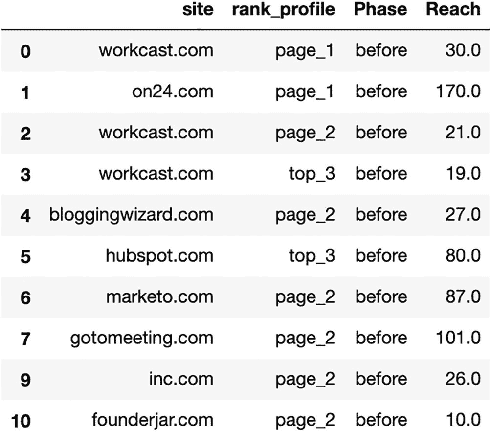

一个表格展示了包含 4 列和 10 行的列表。列包括网站、排名层级、阶段和覆盖量。行包括根据其排名和覆盖时间列出的网站：`workcast.com`、`on24.com`、`bloggingwizard.com`等。

现在数据已转换为长格式，其中`Phase`是从`before_reach`和`after_reach`列中提取出来的，并放入一个名为`Phase`的新列中。这两列的值则归入一个新的单列`Reach`。让我们进行可视化：

```python
compare_strata_losers_plt = (
    ggplot(compare_strata_losers_long, aes(x = 'reorder(site, Reach)', y = 'Reach', fill = 'rank_profile')) +
    geom_bar(stat = 'identity', position = 'fill', alpha = 0.8) +
    labs(y = 'Reach', x = ' ') +
    coord_flip() +
    theme(legend_position = 'right', axis_text_x=element_text(rotation=0, hjust=1, size = 12)) +
    facet_wrap('Phase')
)

compare_strata_losers_plt.save(filename = 'images/1_compare_strata_losers_plt.png', height=5, width=10, units = 'in', dpi=1000)
compare_strata_losers_plt
```

我们可以看到关键词在其排名概况中的比例，由于采用了固定长度，这些比例更容易观察（图 10-2）。

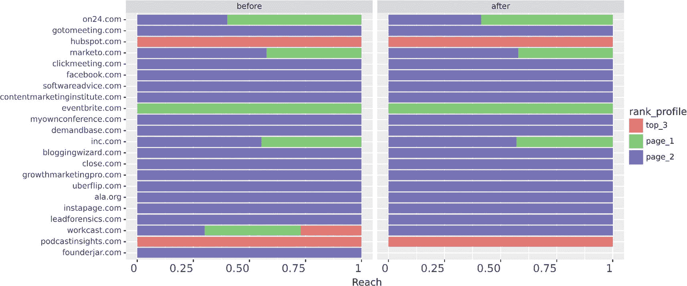

一张水平条形图，展示了前后访问的网站，并按前三名、第一页和第二页的排名概况进行划分。这些网站包括位于第一页和第二页的`on24.com`、位于第二页的`gutomeeting.com`、位于前三名的`hubspot.com`等。

**图 10-2** 网站谷歌排名比例（覆盖度）——按前三名、第一页和第二页划分（前后对比）

例如，WorkCast 原本混合了前三名和第一页的排名，现在全部降到了第二页。FounderJar 原本有第二页的排名，现在则完全找不到了。

固定长度是通过`geom_bar()`函数中的`position`参数设置为`"fill"`来实现的。尽管如上所示遵循了最佳数据可视化实践，但你可能不得不迁就你的业务受众，他们可能希望同时看到可变长度的条形和比例（即使从图表中推断信息要困难得多）。因此，我们不将`position`设置为`fill`，而是将其设置为`"stack"`：

```python
compare_strata_losers_plt = (
    ggplot(compare_strata_losers_long, aes(x = 'reorder(site, Reach)', y = 'Reach', fill = 'rank_profile')) +
    geom_bar(stat = 'identity', position = 'stack', alpha = 0.8) +
    labs(y = 'Reach', x = ' ') +
    coord_flip() +
    theme(legend_position = 'right', axis_text_x=element_text(rotation=0, hjust=1, size = 12)) +
    facet_wrap('Phase')
)

compare_strata_losers_plt.save(filename = 'images/1_compare_strata_losers_stack_plt.png', height=5, width=10, units = 'in', dpi=1000)
compare_strata_losers_plt
```

诚然，在像 ON24 这样的案例中，在上面的固定长度条形图（图 10-2）中，差异并不那么明显（图 10-3）。

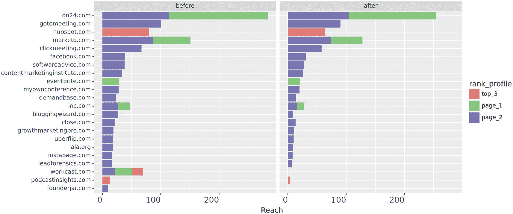

一张条形图，展示了前后访问的网站在前三名、第一页和第二页中的情况。这些网站包括位于第一页和第二页的`on24.com`、位于第二页的`gutomeeting.com`、位于前三名的`hubspot.com`等。

**图 10-3** 网站谷歌排名计数（覆盖度）——按前三名、第一页和第二页划分（前后对比）

相比之下，通过可变长度的条形图，我们可以看到 ON24 的覆盖度至少下降了 10%。

### 排名

虽然覆盖度不错，但仅凭这一个指标是不够的。如果你将自然搜索存在的整体价值视为价格和数量的函数，那么覆盖度就是数量（我们刚刚讨论过）。现在我们必须考虑价格，在自然搜索价值范式中，价格就是排名位置。

我们将按网站汇总核心更新前后的排名，先从更新前的数据集开始：

```python
before_unq_ranks = getstat_bef_unique
```

与覆盖度（我们取关键词搜索结果的总和）不同，在这种情况下，我们取平均值（也称为均值）：

```python
before_unq_ranks = before_unq_ranks.groupby(['site']).agg({'rank': 'mean'}).reset_index()
```


`before_unq_ranks` = `before_unq_ranks`[['site', 'rank']]

`before_unq_ranks.sort_values('rank').head(10)`

结果如下：

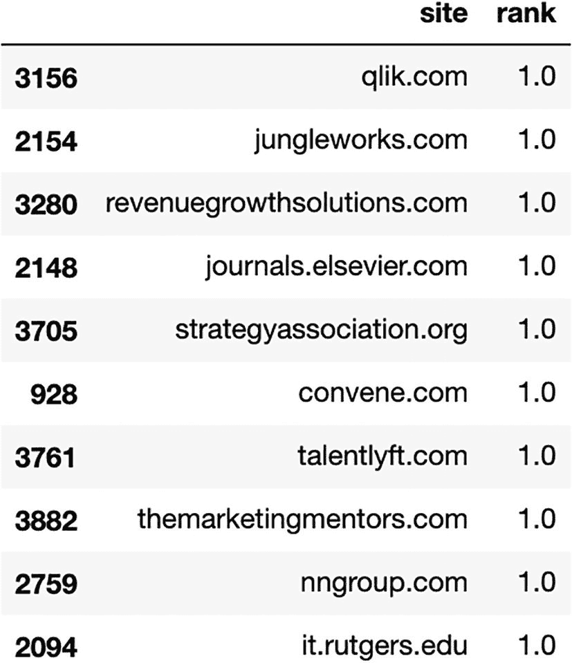

一个表格，包含 2 列和 10 行。列包括网站和排名。行包括根据其排名列出的网站：`qlik.com`、`jungleworks.com`、`revenuegrowthsolutions.com` 等。

该表显示了按网站划分的平均排名。你可能已经推断出，排名本身意义不大，因为：

- 某些关键词的搜索量高于其他关键词。
- 对于网站没有排名的关键词，平均排名并未进行零膨胀处理。例如，`qlik.com` 的平均排名为 1，可能仅仅是因为它在一个关键词上排名第一。

为了避免重复编写代码来计算和可视化更新后数据集的排名并进行比较，我们将直接转向搜索量加权平均排名。

## 搜索量加权平均排名

这次，我们将按搜索量对平均排名位置进行加权：

```python
before_unq_svranks = getstat_bef_unique
```

定义一个函数，该函数接收数据框并使用 `rank` 列。加权平均值的计算方法是：将排名乘以搜索量，然后除以总权重（即搜索量之和）：

```python
def wavg_rank_sv(x):
    names = {'wavg_rank': (x['rank'] * x['search_volume']).sum()/(x['search_volume']).sum()}
    return pd.Series(names, index=['wavg_rank']).round(1)
```

函数定义好后，我们现在使用 `apply()` 函数来应用刚才定义的 `wavg_rank_sv()` 函数：

```python
before_unq_svranks = before_unq_svranks.groupby(['site']).apply(wavg_rank_sv).reset_index()
before_unq_svranks.sort_values('wavg_rank').head(10)
```

结果如下：

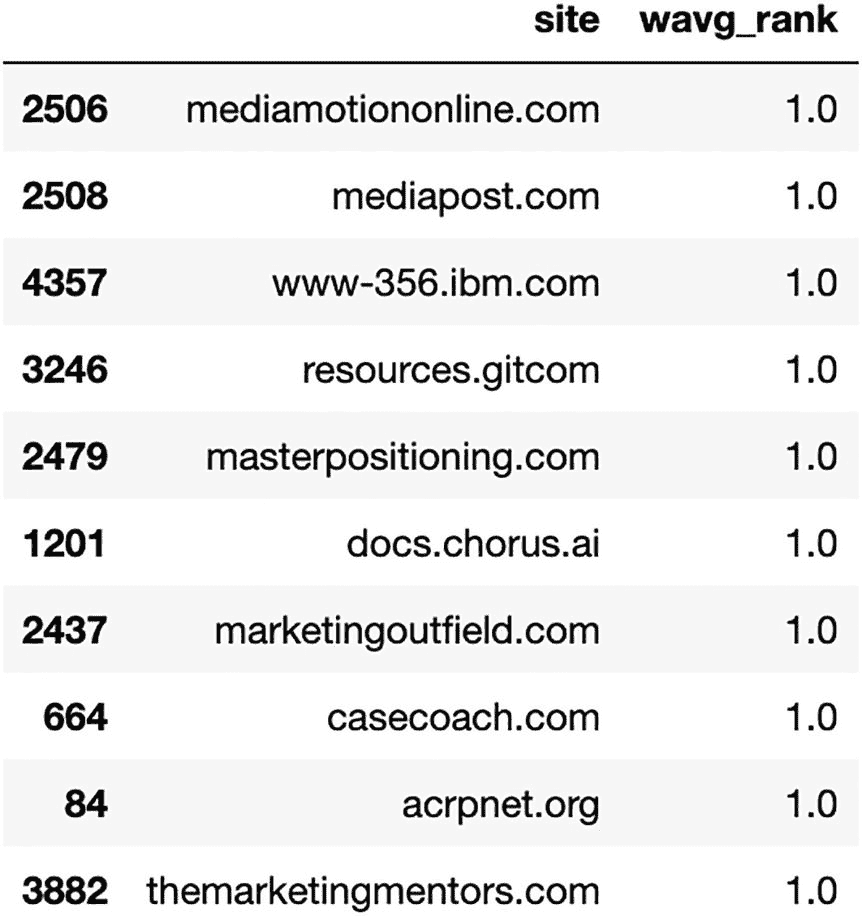

一个表格，包含 2 列和 10 行。列包括网站和 `wavg_rank`。行包括根据其平均排名列出的网站：`mediamotionline.com`、`mediapost.com`、`www-356.ibm.com` 等。

我们已经可以看到，由于搜索量加权，网站列表发生了变化。尽管从商业洞察的角度来看，加权平均排名并没有增加太多价值，但这仍然是一种改进。然而，我们真正需要的是完整的图景，即整体可见度。

## 可见度

可见度将是我们评估网站自然搜索存在价值的指标，它同时考虑了覆盖度和排名。

将搜索量加权排名数据与覆盖度数据合并：

```python
before_unq_visi = before_unq_svranks.merge(before_unq_reach, on = 'site', how = 'left')
```

清理空值列：

```python
before_unq_visi['reach'] = np.where(before_unq_visi['reach'].isnull(), 0, before_unq_visi['reach'])
before_unq_visi['wavg_rank'] = np.where(before_unq_visi['wavg_rank'].isnull(), 100, before_unq_visi['wavg_rank'])
```

计算可见度指数的方法是将覆盖度除以加权平均排名。这是因为加权平均排名的数值越小，网站的可见度越高，因此排名作为除数。相反，覆盖度作为分子，因为数值越高，可见度越高。

```python
before_unq_visi['visibility'] = before_unq_visi['reach'] / before_unq_visi['wavg_rank']
before_unq_visi = before_unq_visi.sort_values('visibility', ascending = False)
before_unq_visi
```

结果如下：

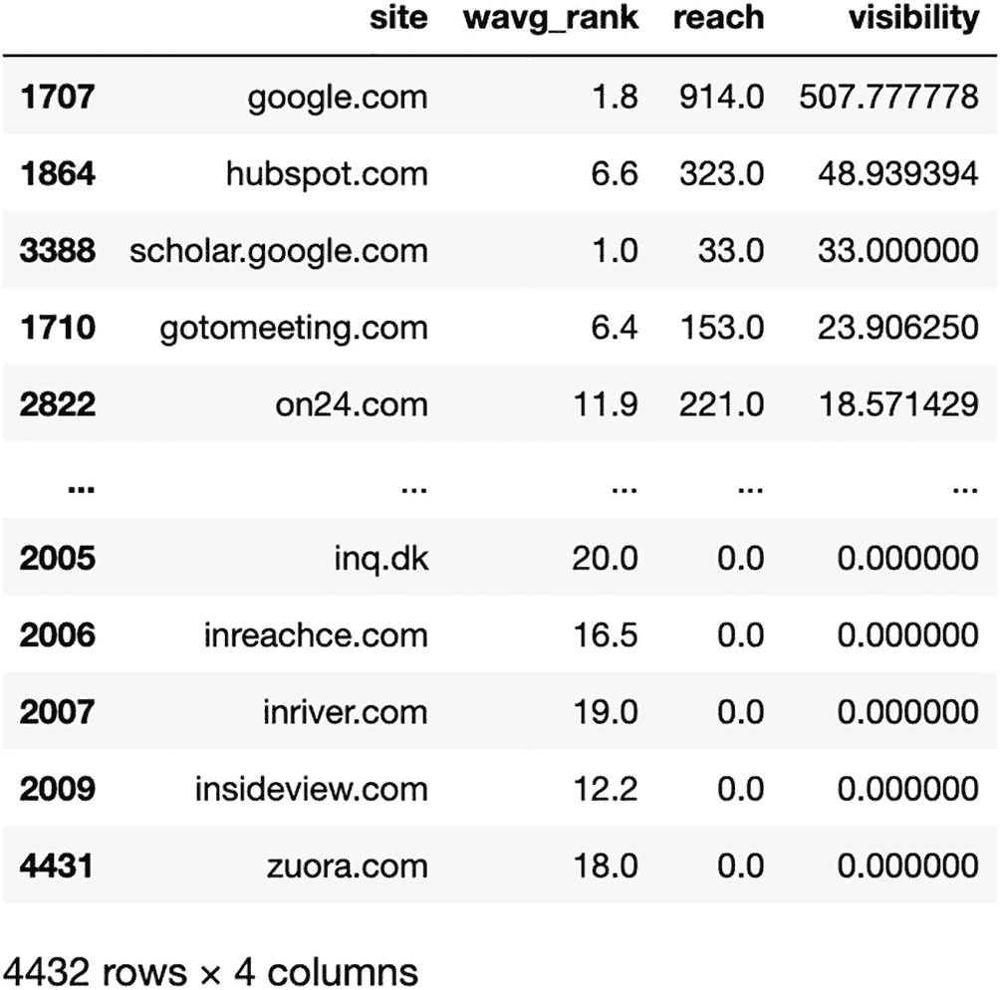

一个表格，包含 4 列和 10 行。列包括网站、`wavg_rank`、覆盖度和可见度。行包括根据其 `wavg_rank` 和可见度列出的网站：`google.com`、`hubspot.com`、`scholar.google.com` 等。

结果看起来合理多了，并且反映了我们在网络研讨会软件领域所期望看到的情况。我们还可以看到，`gotomeeting.com` 尽管覆盖度较低，但由于在更受欢迎的关键词上排名更高，因此具有更高的可见度得分。因此，我们可以得出结论，可见度评分是有效的。

对更新后的数据集执行相同的计算：

```python
after_unq_visi = after_unq_svranks.merge(after_unq_reach, on = 'site', how = 'left')
after_unq_visi['reach'] = np.where(after_unq_visi['reach'].isnull(), 0, after_unq_visi['reach'])
after_unq_visi['wavg_rank'] = np.where(after_unq_visi['wavg_rank'].isnull(), 100, after_unq_visi['wavg_rank'])
after_unq_visi['visibility'] = after_unq_visi['reach'] / after_unq_visi['wavg_rank']
after_unq_visi = after_unq_visi.sort_values('visibility', ascending = False)
after_unq_visi
```

结果如下：

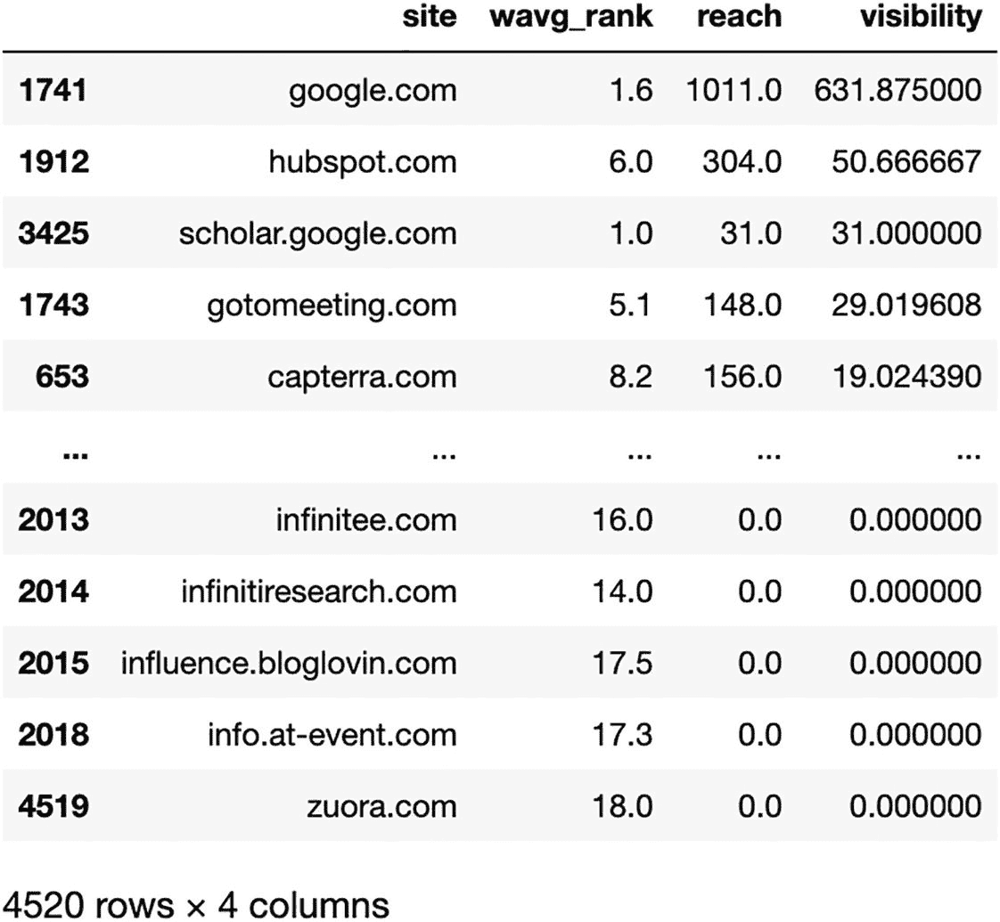

一个表格展示了包含 4 列 10 行的列表。列包括站点、加权平均排名、覆盖率和可见度。行包括根据其加权平均排名和可见度排列的网站：`google.com`、`hubspot.com`、`scholar.google.com` 等。

`GoToMeeting` 的可见度有所提升，而 `ON24` 已不在前五名之列。

合并表格，直接在单个数据框中比较前后变化：

```python
compare_visi_losers = before_unq_visi.merge(after_unq_visi, on = ['site'], how = 'outer')
compare_visi_losers = compare_visi_losers.rename(columns = {'wavg_rank_x': 'before_rank', 'wavg_rank_y': 'after_rank',
'reach_x': 'before_reach', 'reach_y': 'after_reach',
'visibility_x': 'before_visi', 'visibility_y': 'after_visi'
})
compare_visi_losers['before_visi'] = np.where(compare_visi_losers['before_visi'].isnull(), 0, compare_visi_losers['before_visi'])
compare_visi_losers['after_visi'] = np.where(compare_visi_losers['after_visi'].isnull(), 0, compare_visi_losers['after_visi'])
compare_visi_losers['delta_visi'] = compare_visi_losers['after_visi'] - compare_visi_losers['before_visi']
compare_visi_losers = compare_visi_losers.sort_values('delta_visi')
compare_visi_losers.head(10)
```


## 网站可见度变化分析

### 损失者分析

结果如下：

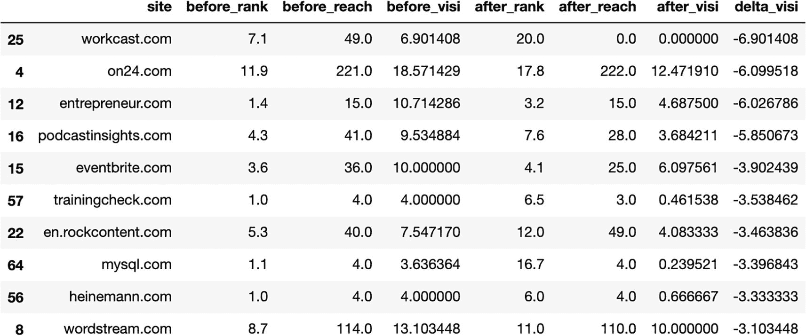

一个表格展示了包含 8 列 10 行的列表。列包括站点、之前排名、之前覆盖率、之前可见度、之后排名、之后覆盖率、之后可见度和可见度变化量。行包括根据其前后排名和可见度排列的损失最大的网站：`workcast.com`、`on24.com`、`entrepreneur.com` 等。

对比视图更加清晰，`ON24`和`WorkCast`是谷歌 2019 年核心更新中损失最大的网站。

让我们看看赢家：

```python
compare_visi_winners = before_unq_visi.merge(after_unq_visi, on = ['site'], how = 'outer')
compare_visi_winners = compare_visi_winners.rename(columns = {'wavg_rank_x': 'before_rank', 'wavg_rank_y': 'after_rank',
                                                                'reach_x': 'before_reach', 'reach_y': 'after_reach',
                                                                'visibility_x': 'before_visi', 'visibility_y': 'after_visi'
                                                               })
compare_visi_winners['before_visi'] = np.where(compare_visi_winners['before_visi'].isnull(), 0, compare_visi_winners['before_visi'])
compare_visi_winners['after_visi'] = np.where(compare_visi_winners['after_visi'].isnull(), 0, compare_visi_winners['after_visi'])
compare_visi_winners['delta_visi'] = compare_visi_winners['after_visi'] - compare_visi_winners['before_visi']
compare_visi_winners = compare_visi_winners.sort_values('delta_visi', ascending  = False)
compare_visi_winners.head(10)
```

结果如下：

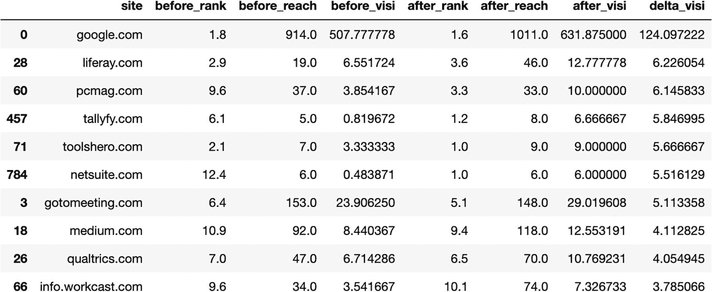

一个表格展示了包含 8 列 10 行的列表。列包括站点、之前排名、之前覆盖率、之前可见度、之后排名、之后覆盖率、之后可见度和可见度变化量。行包括根据其前后排名和可见度排列的网站：`google.com`、`liferay.com`、`pcmag.com` 等。

最大的赢家是出版商，包括像`PCMag`和`Medium`这样的非行业参与者。

以下是将数据转换为长格式以便可视化的代码：

```python
compare_visi_losers_long = compare_visi_losers[['site', 'before_visi','after_visi']].head(12)
compare_visi_losers_long = compare_visi_losers_long.melt(id_vars = ['site'], var_name='Phase', value_name='Visi')
compare_visi_losers_long['Phase'] = compare_visi_losers_long['Phase'].str.replace('_visi', '')
compare_visi_losers_long['Phase'] = compare_visi_losers_long['Phase'].astype('category')
compare_visi_losers_long['Phase'] = compare_visi_losers_long['Phase'].cat.reorder_categories(['before', 'after'])
stop_doms = ['en.wikipedia.org', 'google.com', 'youtube.com']
compare_visi_losers_long = compare_visi_losers_long[~compare_visi_losers_long['site'].isin(stop_doms)]
compare_visi_losers_long.head(10)
```

结果如下：

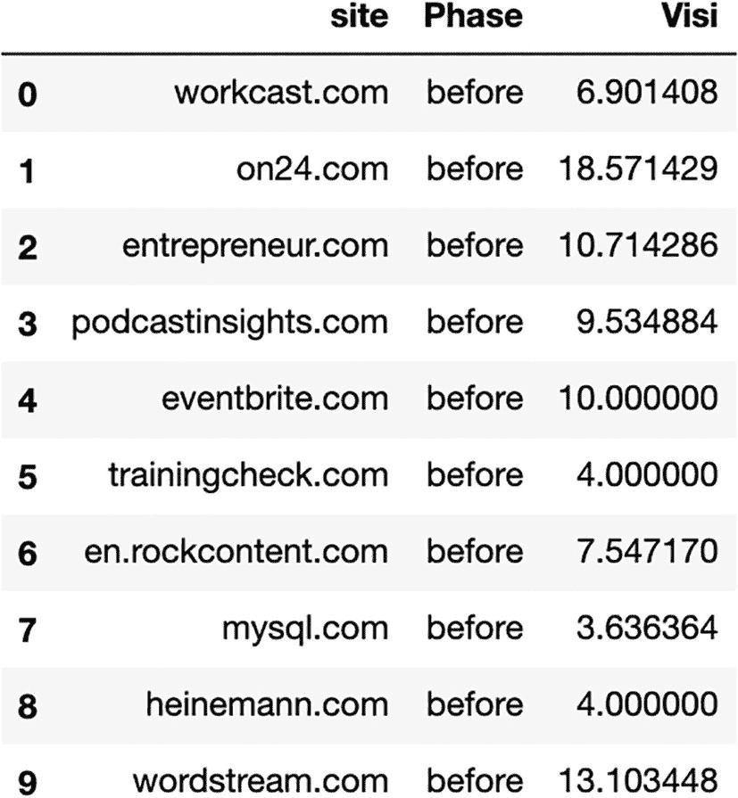

一个表格展示了包含 3 列 10 行的列表。列包括站点、阶段和可见度。行包括根据其可见度排列的网站：`workcast.com`、`on24.com`、`entrepreneur.com` 等。

上述数据为长格式。现在将输入以下图形代码：

```python
compare_visi_losers_plt = (
    ggplot(compare_visi_losers_long, aes(x = 'reorder(site, Visi)', y = 'Visi', fill = 'Phase')) +
    geom_bar(stat = 'identity', position = 'dodge', alpha = 0.8) +
    labs(y = 'Visiblity', x = ' ') +
    coord_flip() +
    theme(legend_position = 'right', axis_text_x=element_text(rotation=0, hjust=1, size = 12)) +
    facet_wrap('Phase')
)
compare_visi_losers_plt.save(filename = 'images/1_compare_visi_losers_plt.png', height=5, width=10, units = 'in', dpi=1000)
compare_visi_losers_plt
```

分离的面板是通过使用`facet_wrap()`函数实现的，我们在其中指示 plotnine（图形包）按`Phase`参数分离面板（`图 10-4`）。

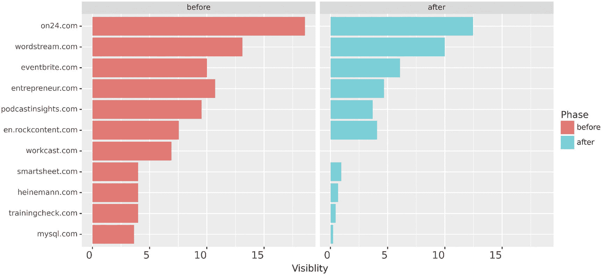

一个根据前后阶段可见度排列的网站水平条形图。最高的网站条形是 `on24.com`、`wordstream.com` 和 `eventbrite.com`，分别对应前后时间，但后一时间相比前一时间有所下降。

### 赢家分析

让我们看看赢家：

```python
compare_visi_winners_long = compare_visi_winners[['site', 'before_visi','after_visi']].head(12)
compare_visi_winners_long = compare_visi_winners_long.melt(id_vars = ['site'], var_name='Phase', value_name='Visi')
compare_visi_winners_long['Phase'] = compare_visi_winners_long['Phase'].str.replace('_visi', '')
compare_visi_winners_long['Phase'] = compare_visi_winners_long['Phase'].astype('category')
compare_visi_winners_long['Phase'] = compare_visi_winners_long['Phase'].cat.reorder_categories(['before', 'after'])
stop_doms = ['en.wikipedia.org', 'google.com', 'youtube.com', 'lexisnexis.com']
compare_visi_winners_long = compare_visi_winners_long[~compare_visi_winners_long['site'].isin(stop_doms)]
compare_visi_winners_long.head(10)
```

结果如下：

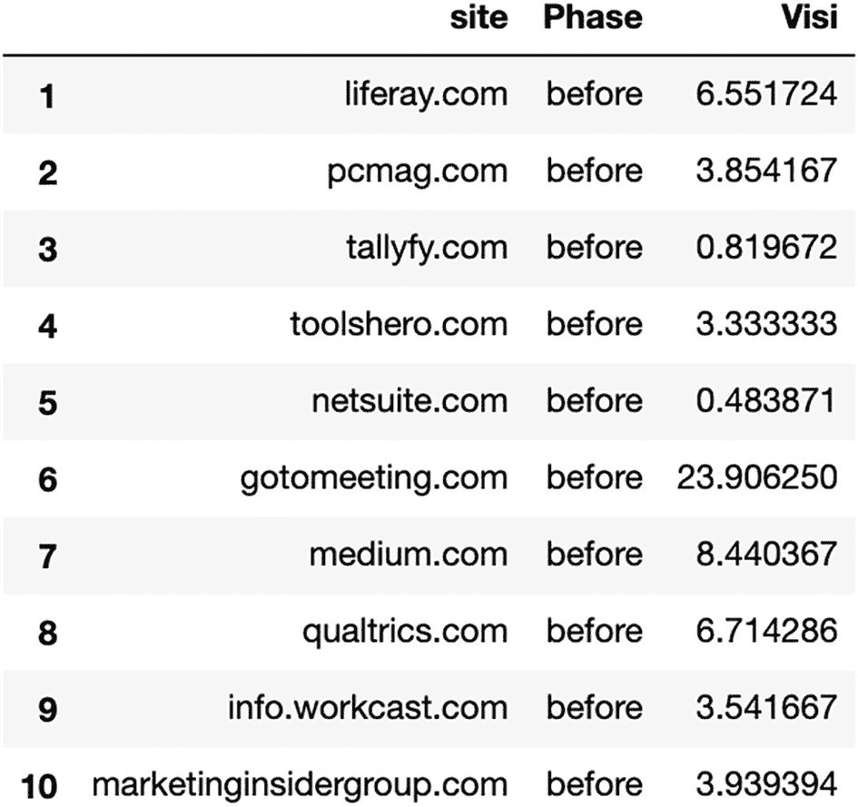

一个表格展示了包含 3 列 10 行的列表。列包括站点、阶段和可见度。行包括根据其可见度排列的网站：`liferay.com`、`pcmag.com`、`tallyfy.com` 等。

```python
compare_visi_winners_plt = (
```

好的，作为一名高级文档工程师，我已仔细阅读并理解您的要求。现在开始对给定的文本进行排版和格式化。


## 绘图与比较

```R
ggplot(compare_visi_winners_long, aes(x = 'reorder(site, Visi)', y = 'Visi', fill = 'Phase')) +
  geom_bar(stat = 'identity', position = 'dodge', alpha = 0.8) +
  position=position_stack(vjust=0.01)) +
  labs(y = 'Rank', x = ' ') +
  coord_flip() +
  theme(legend_position = 'right', axis_text_x=element_text(rotation=0, hjust=1, size = 12)) +
  facet_wrap('Phase')
)
```

```R
compare_visi_winners_plt.save(filename = 'images/1_compare_visi_winners_plt.png', height=5, width=10, units = 'in', dpi=1000)
compare_visi_winners_plt
```

这次，我们没有使用`facet_wrap()`函数，该函数会将前后条形图放在同一个面板上（图 10-5）。

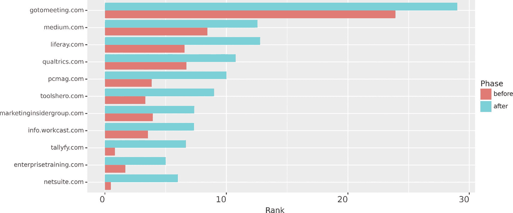

一张水平分组条形图，展示了各网站在阶段前后的排名情况。其中，`gutomeeting.com`、`medium.com` 和 `liferay.com` 的条形最高，分别显示了前后时间的数据，但后一时间的数据相较于前一时间有所下降。

**图 10-5** 网站谷歌排名前后平均值对比

这使得直接比较变得更加容易，甚至能更清晰地了解每个网站前后的差异。

### 结果类型

在掌握整体表现后，我们将进一步深入分析，从结果类型开始。所谓结果类型，指的是排名展示的格式。可能包括：
* 常规自然结果（即常见的十个蓝色链接）
* 视频
* 图片
* 新闻
* “人们还问”

与往常一样，我们将对前后两个数据集进行聚合操作。不过这一次，我们将按 `snippets` 列进行分组：

```R
before_unq_snippets = getstat_bef_unique
```

我们通过统计摘要片段出现的关键词搜索结果数量来进行聚合，这是一种覆盖范围的衡量方式。大多数摘要片段都排在搜索引擎结果页面的前 5 位，因此我们无需关注摘要片段的排名。

```R
before_unq_snippets = before_unq_snippets.groupby(['snippets']).agg({'count': 'sum'}).reset_index()
before_unq_snippets = before_unq_snippets[['snippets', 'count']]
before_unq_snippets = before_unq_snippets.rename(columns = {'count': 'reach'})
before_unq_snippets.sort_values('reach', ascending = False).head(10)
```

结果如下：

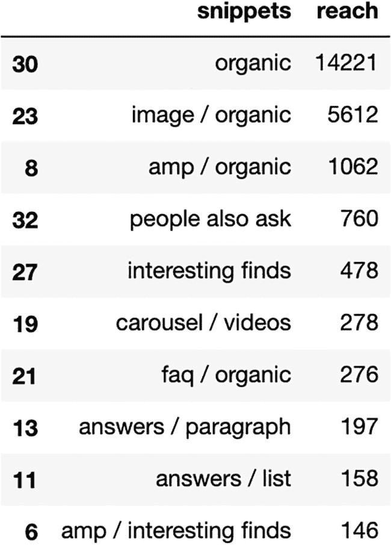

一张表格，包含 2 列和 10 行。列包括 `snippets` 和 `reach`。行包含覆盖范围最高的摘要片段，即 `organic`、`image/organic`、`amp/organic` 等。

可以预见，自然结果（Organic）的覆盖范围最大，其次是图片和 AMP（加速移动页面）。

对后一时间的数据集重复此过程：

```R
after_unq_snippets = getstat_aft_unique
after_unq_snippets = after_unq_snippets.groupby(['snippets']).agg({'count': 'sum'}).reset_index()
after_unq_snippets = after_unq_snippets[['snippets', 'count']]
after_unq_snippets = after_unq_snippets.rename(columns = {'count': 'reach'})
after_unq_snippets.sort_values('reach', ascending = False).head(10)
```

结果如下：

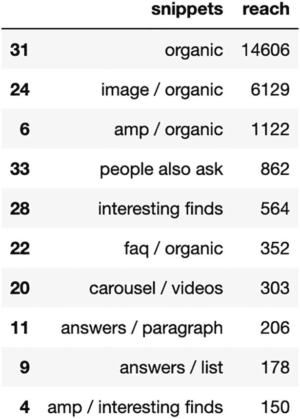

一张表格，包含 2 列和 10 行。列包括 `snippets` 和 `reach`。行包含覆盖范围最高的摘要片段，即 `organic`、`image/organic`、`amp/organic` 等。

自然结果（Organic）的覆盖范围有所下降，这意味着搜索结果可能更加多样化。合并数据集以便于比较：

```R
compare_snippets = before_unq_snippets.merge(after_unq_snippets, on = ['snippets'], how = 'outer')
compare_snippets = compare_snippets_losers.rename(columns = {'reach_x': 'before_reach', 'reach_y': 'after_reach'})
compare_snippets['before_reach'] = np.where(compare_snippets['before_reach'].isnull(), 0, compare_snippets['before_reach'])
compare_snippets['after_reach'] = np.where(compare_snippets['after_reach'].isnull(), 0, compare_snippets['after_reach'])
compare_snippets['delta_reach'] = compare_snippets['after_reach'] - compare_snippets['before_reach']
compare_snippets_losers = compare_snippets.sort_values('delta_reach')
compare_snippets_losers.head(10)
```

结果如下：

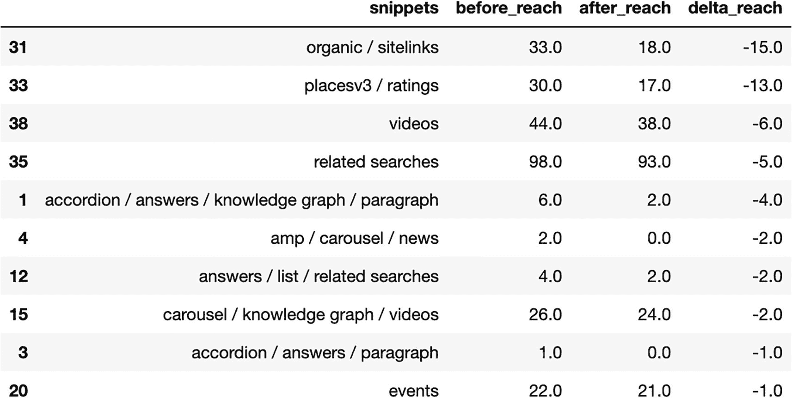

一张表格，包含 4 列和 10 行。列包括 `snippets`、`before_reach`、`after_reach` 和 `delta_reach`。行包含根据覆盖范围排序的摘要片段，覆盖范围最低的是 `organic/site links`、`places v3/ratings`、`videos` 等。

该表证实，自然站点链接（organic sitelinks）的列表数量有所下降，其次是地点、视频和相关搜索。这意味着什么？这意味着谷歌正在使其搜索结果多样化，但并非通过视频或本地商家结果的方式。此外，站点链接的下降表明搜索的导航性降低，这可能意味着之前被某些品牌占据的搜索词组有了更多排名机会。

```R
compare_snippets_winners = compare_snippets.sort_values('delta_reach', ascending = False)
compare_snippets_winners.head(10)
```

结果如下：

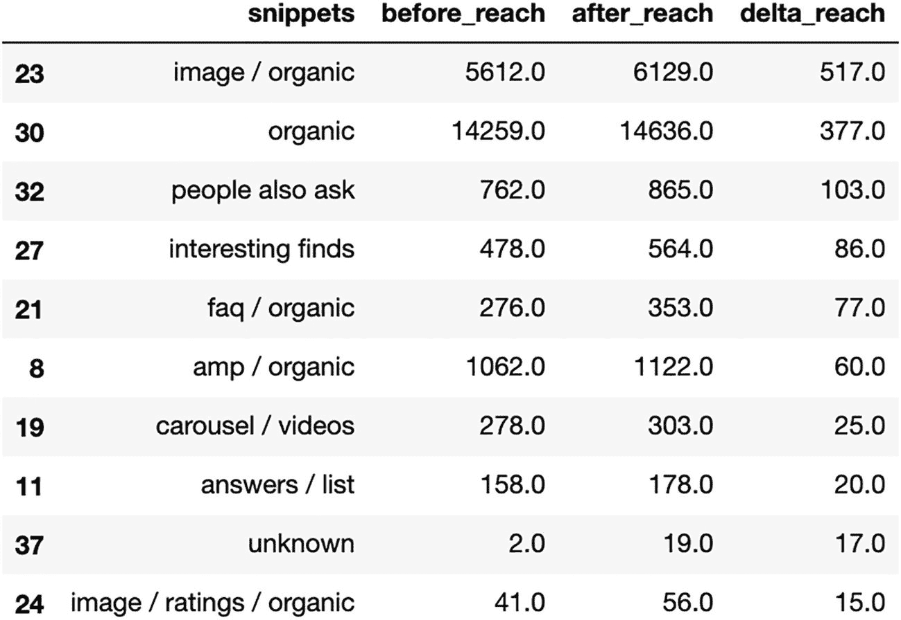

一张表格，包含 4 列和 10 行。列包括 `snippets`、`before_reach`、`after_reach` 和 `delta_reach`。行包含根据覆盖范围排序的摘要片段，覆盖范围最高的是 `image/organic`、`organic`、`people also ask` 等。

比较增长方，我们看到图片和纯自然结果（pure organic）以及“人们还问”（`people also ask`）都有所增加。因此，高层面的结论是：内容应更偏向常见问题解答（FAQ）驱动，并使用 Schema 标记进行标注。同时，内容中也应更多地使用图片。让我们通过重新格式化数据并将其输入到 `plotnine` 中进行可视化：

```R
each']].head(10)
compare_snippets_losers_long = compare_snippets_losers_long.melt(id_vars = ['snippets'], var_name='Phase', value_name='Reach')
```


compare_snippets_losers_long['Phase'] = compare_snippets_losers_long['Phase'].str.replace('_reach', '')

compare_snippets_losers_long['Phase'] = compare_snippets_losers_long['Phase'].astype('category')

compare_snippets_losers_long['Phase'] = compare_snippets_losers_long['Phase'].cat.reorder_categories(['after', 'before'])

compare_snippets_losers_long = compare_snippets_losers_long[compare_snippets_losers_long['snippets'] != 'organic']

compare_snippets_losers_long.head(10)

结果如下：

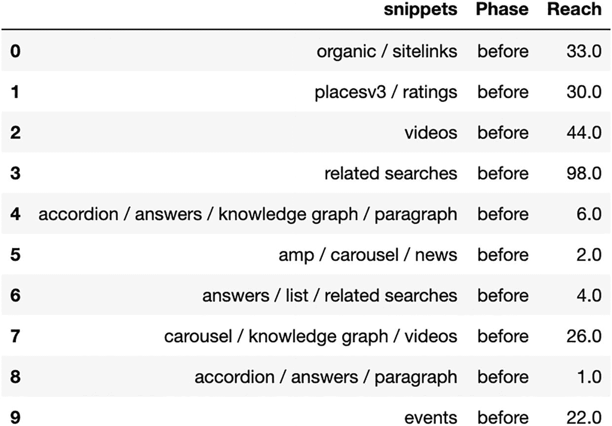

一张表格，包含 3 列和 10 行。列包括 `snippets`、`phases` 和 `reach`。行包含根据覆盖范围排序的摘要片段，即 `organic/site links`、`places v 3 forward slash ratings`、`videos` 等。

```python
compare_snippets_losers_plt = (
    ggplot(compare_snippets_losers_long, aes(x = 'reorder(snippets, Reach)', y = 'Reach', fill = 'Phase')) +
    geom_bar(stat = 'identity', position = 'dodge', alpha = 0.8) +
    #geom_text(dd_factor_df, aes(label = 'market_name'), position=position_stack(vjust=0.01)) +
    labs(y = '可见度', x = ' ') +
    #scale_y_reverse() +
    coord_flip() +
    theme(legend_position = 'right', axis_text_x=element_text(rotation=0, hjust=1, size = 12))
)
compare_snippets_losers_plt.save(filename = 'images/2_compare_snippets_losers_plt.png', height=5, width=10, units = 'in', dpi=1000)
compare_snippets_losers_plt
```

像图 10-6 这样的图表，其妙处在于能让你瞬间把握比例关系。

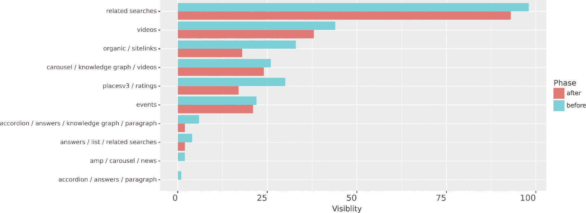

一张分组条形图，展示了阶段前后按结果类型划分的谷歌可见度。在前后时间中，与搜索、视频和自然/站点链接相关的条形最高，但前一时间的数据有所下降。

**图 10-6** 阶段前后按结果类型划分的谷歌可见度

更新后，轮播视频比自然站点链接更多，这一点更容易被察觉。

```python
compare_snippets_winners_long = compare_snippets_winners[['snippets', 'before_reach','after_reach']].head(10)
compare_snippets_winners_long = compare_snippets_winners_long.melt(id_vars = ['snippets'], var_name='Phase', value_name='Reach')
compare_snippets_winners_long['Phase'] = compare_snippets_winners_long['Phase'].str.replace('_reach', '')
compare_snippets_winners_long['Phase'] = compare_snippets_winners_long['Phase'].astype('category')
compare_snippets_winners_long['Phase'] = compare_snippets_winners_long['Phase'].cat.reorder_categories(['after', 'before'])
compare_snippets_winners_long = compare_snippets_winners_long[compare_snippets_winners_long['snippets'] != 'organic']
compare_snippets_winners_long.head(10)
```

结果如下：

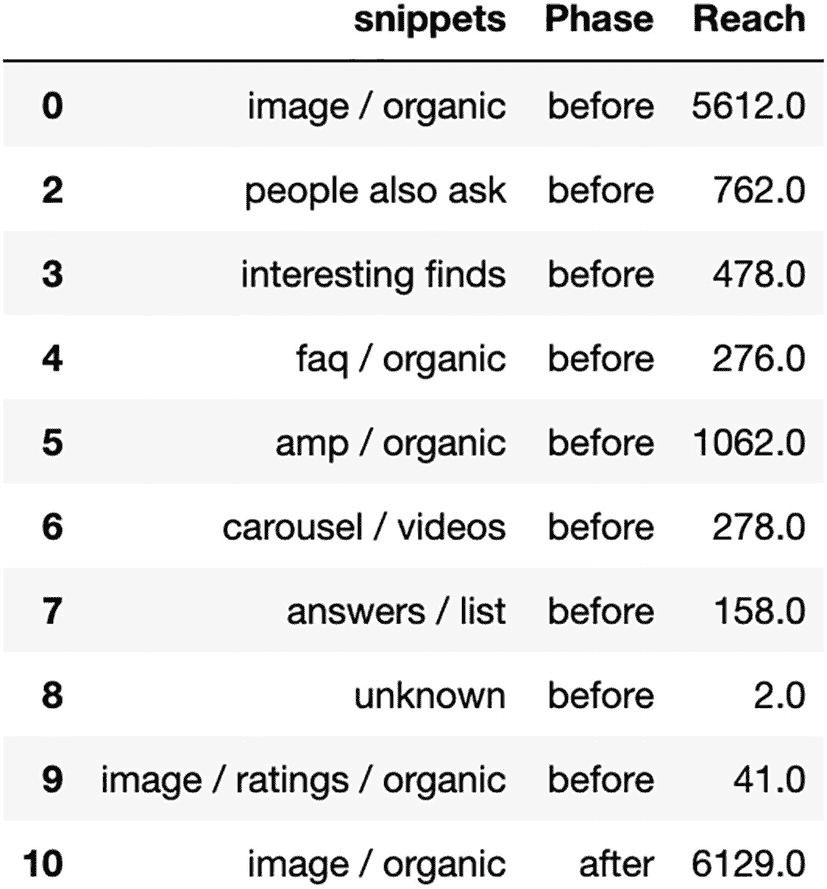

一个表格展示了包含 3 列和 10 行的列表。列包括`snippets`、`phase`和`reach`。行包括覆盖范围最高的片段，如`image / organic`、`people also ask`、`interesting finds`等。

```python
compare_snippets_winners_plt = (
    ggplot(compare_snippets_winners_long, aes(x = 'reorder(snippets, Reach)', y = 'Reach', fill = 'Phase')) +
    geom_bar(stat = 'identity', position = 'dodge', alpha = 0.8) +
    position=position_stack(vjust=0.01)) +
    labs(y = 'Rank', x = ' ') +
    coord_flip() +
    theme(legend_position = 'right', axis_text_x=element_text(rotation=0, hjust=1, size = 12))
)
compare_snippets_winners_plt.save(filename = 'images/1_compare_snippets_winners_plt.png', height=5, width=10, units = 'in', dpi=1000)
compare_snippets_winners_plt
```

除了每种片段或结果类型的数量更多之外，所有类型的增长看起来相对一致（图 10-7）。

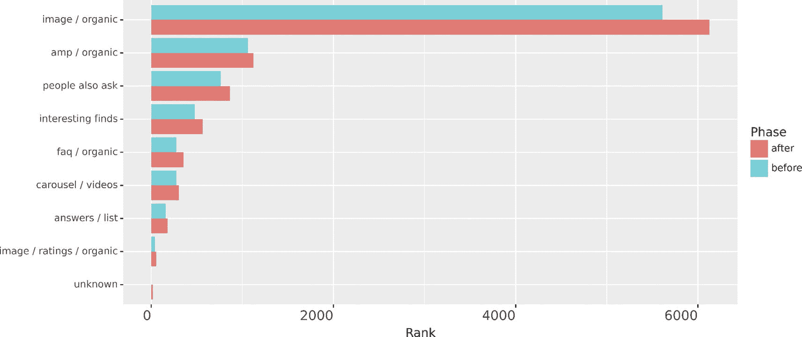

一个分组柱状图，展示了更新前后各结果类型在 Google 前 10 名中的计数。最高的柱形是`image / organic`、`AMP / organic`和`people also ask`，在更新前后均有出现，但更新前有所下降。

**图 10-7** 更新前后 Google 前 10 名按结果类型的覆盖范围排名

## 关键词蚕食

在确定性能表现后，我们的注意力转向了性能的潜在驱动因素，例如关键词蚕食。当同一网站有多个 URL 针对单个关键词出现在搜索结果中时，就会发生关键词蚕食。

我们将从使用重复的 SERP 数据集开始，统计每个关键词下同一网站的 URL 数量。这需要对关键词和网站使用`groupby()`函数：

```python
cannibals_before_agg = getstat_before.groupby(['keyword', 'site']).agg({'count': 'sum'}).reset_index()
```

在此阶段，我们希望隔离出被蚕食的 SERP 行。这意味着这些 URL 所在的关键词结果中，出现了同一网站的其他 URL。

```python
cannibals_before_agg = cannibals_before_agg[cannibals_before_agg['count'] > 1]
```

我们将计数重置为 1，以便进行进一步的求和聚合：

```python
cannibals_before_agg['count'] = 1
```

接下来，我们按关键词聚合，统计 SERP 数据中被蚕食的 URL 数量：

```python
cannibals_before_agg = getstat_before[getstat_before['device'] == 'desktop']
cannibals_before_agg = cannibals_before_agg.groupby(['keyword']).agg({'count': 'sum'}).reset_index()
```

`cannibals_before_agg` = `cannibals_before_agg`.rename(columns = {'count': 'cannibals'})

`cannibals_before_agg`

```

结果如下：

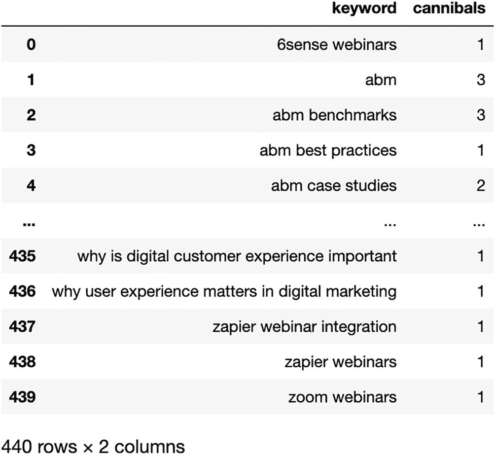

一个表格展示了包含 2 列和 10 行的列表。列包括`keywords`和`cannibals`。

你可能会认为这些数字包含了每个网站的一个 URL，而这些 URL 严格来说并不属于关键词蚕食。然而，这种宽松的计算方法简单易行，足以让我们了解关键词蚕食的趋势。

让我们看看更新后 SERP 的关键词蚕食情况：

```python
cannibals_after_agg = getstat_after.groupby(['keyword', 'site']).agg({'count': 'sum'}).reset_index()
cannibals_after_agg = cannibals_after_agg[cannibals_after_agg['count'] > 1]
cannibals_after_agg['count'] = 1
cannibals_after_agg = cannibals_after_agg.groupby(['keyword']).agg({'count': 'sum'}).reset_index()
cannibals_after_agg = cannibals_after_agg.rename(columns = {'count': 'cannibals'})
cannibals_after_agg
```

结果如下：

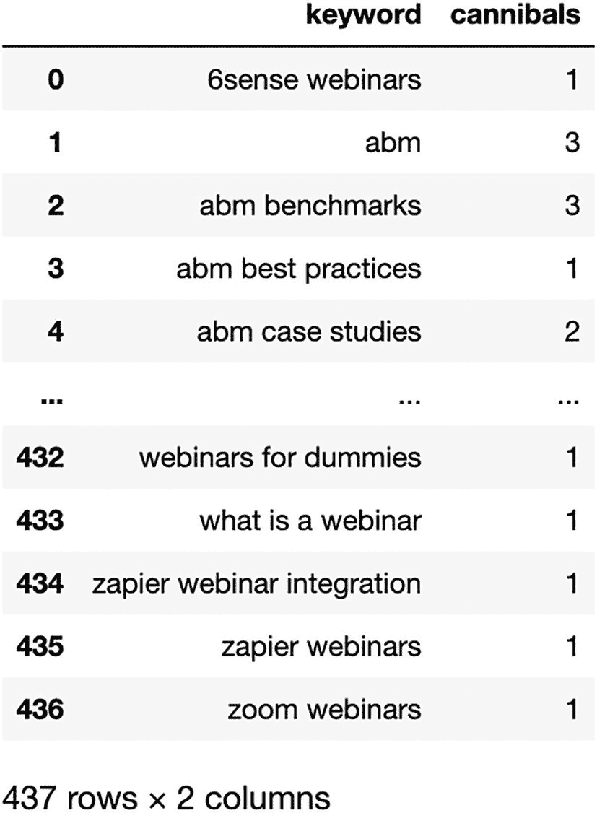

一个表格展示了包含 2 列和 10 行的列表。列包括`keywords`和`cannibals`。

上述预览暗示变化不大；然而，仅凭一个表格很难判断。因此，让我们将它们合并，进行并排比较：

```python
compare_cannibals = cannibals_before_agg.merge(cannibals_after_agg, on = 'keyword', how = 'left')
compare_cannibals = compare_cannibals.rename(columns = {'cannibals_x': 'before_cannibals', 'cannibals_y': 'after_cannibals'})
compare_cannibals['before_cannibals'] = np.where(compare_cannibals['before_cannibals'].isnull(), 0, compare_cannibals['before_cannibals'])
compare_cannibals['after_cannibals'] = np.where(compare_cannibals['after_cannibals'].isnull(), 0, compare_cannibals['after_cannibals'])
compare_cannibals['delta_cannibals'] = compare_cannibals['after_cannibals'] - compare_cannibals['before_cannibals']
compare_cannibals = compare_cannibals.sort_values('delta_cannibals')
compare_cannibals
```

结果如下：

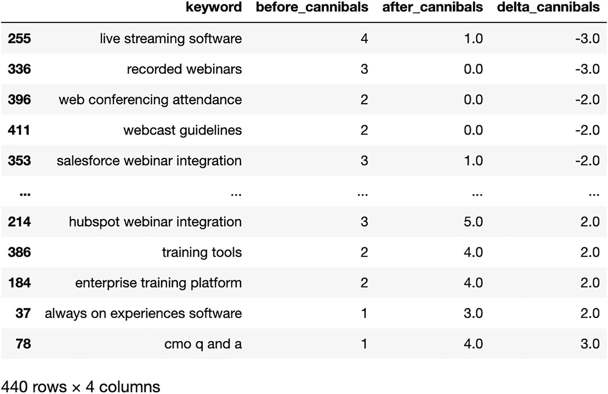

一个表格展示了包含 4 列和 10 行的列表。列包括`keywords`、`before cannibals`、`after cannibals`和`delta cannibals`。行中显示损失最大的关键词是`live streaming software`、`recorded webinars`、`web conferencing attendance`等。

该表格显示，在关键词层面，“webcast guidelines”的蚕食现象减少，而“enterprise training platform”的蚕食现象增多。但总体趋势如何呢？

```python
cannibals_trend = compare_cannibals
cannibals_trend['project'] = target_name
cannibals_trend = cannibals_trend.groupby('project').agg({'before_cannibals': 'sum', 'after_cannibals': 'sum', 'delta_cannibals': 'sum'}).reset_index()
cannibals_trend
```

结果如下：

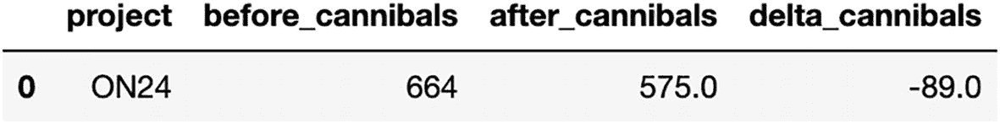

一个表格展示了包含 4 列和 1 行的列表。列包括`project`、`before cannibals`、`after cannibals`和`delta cannibals`。行中显示的项目是`ON 24`。

因此，正如我们所预期的，核心更新后，总体关键词蚕食减少了略高于 13%。

在绘制蚕食增加和减少的 SERP 中排名靠前的关键词图表之前，我们先转换数据格式：

```python
compare_cannibals_less = compare_cannibals[['keyword', 'before_cannibals', 'after_cannibals']].head(10)
compare_cannibals_less = compare_cannibals_less.melt(id_vars = ['keyword'], var_name = 'Phase', value_name = 'cannibals')
compare_cannibals_less['Phase'] = compare_cannibals_less['Phase'].str.replace('_cannibals', '')
compare_cannibals_less['Phase'] = compare_cannibals_less['Phase'].astype('category')
compare_cannibals_less['Phase'] = compare_cannibals_less['Phase'].cat.reorder_categories(['after', 'before'])
compare_cannibals_less
```

结果如下：

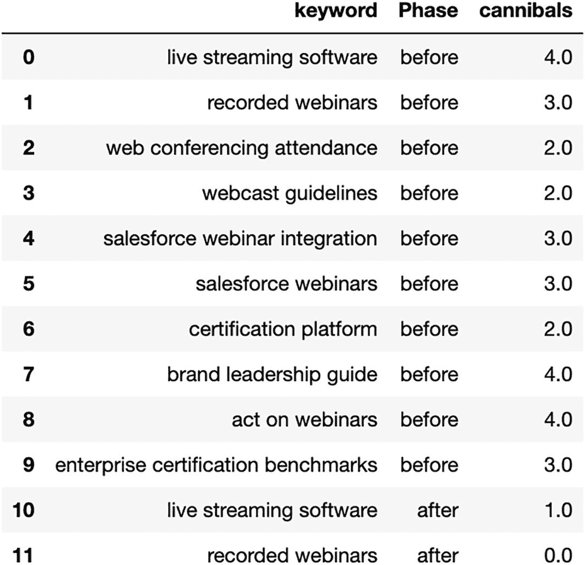

一个表格展示了包含 3 列和 10 行的列表。列包括`keywords`、`cannibals`和`phases`。行中显示的关键词是`live streaming software`、`recorded webinars`、`web conferencing attendance`等。

```python
compare_cannibals_less_plt = (
    ggplot(compare_cannibals_less, aes(x = 'keyword', y = 'cannibals', fill = 'Phase')) +
    geom_bar(stat = 'identity', position = 'dodge', alpha = 0.8) +
    #geom_text(dd_factor_df, aes(label = 'market_name'), position=position_stack(vjust=0.01)) +
    labs(y = '# Cannibals in SERP', x = ' ') +
    #scale_y_reverse() +
    coord_flip() +
    theme(legend_position = 'right', axis_text_x=element_text(rotation=0, hjust=1, size = 12))
)
compare_cannibals_less_plt.save(filename = 'images/5_compare_cannibals_less_plt.png', height=5, width=10, units = 'in', dpi=1000)
compare_cannibals_less_plt
```

图 10-8 展示了那些失去自吞噬 URL 或自吞噬数量减少的关键词。

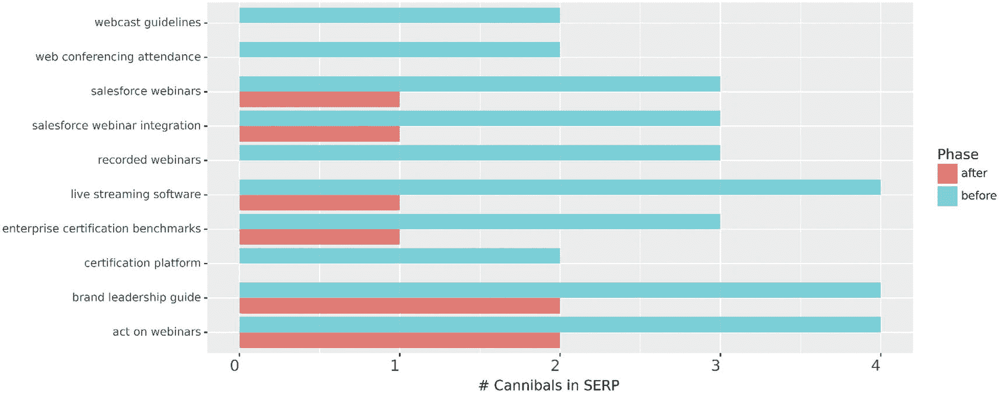

一个水平分组条形图，按关键词展示了被自吞噬的 SERP 关键词结果实例数量。最高的条形对应的是“品牌领导力指南”和“作用于网络研讨会”。

# 图 10-8 按关键词统计的被自吞噬的 SERP 结果实例数量

损失最显著的关键词似乎是“live streaming software”，从 4 个减少到 1 个。除了“act on webinars”这个看起来是`act-on.com`的品牌词之外，所有短语都相当通用。

```python
compare_cannibals_more = compare_cannibals[['keyword', 'before_cannibals', 'after_cannibals']].tail(10)
compare_cannibals_more = compare_cannibals_more.melt(id_vars = ['keyword'],
var_name = 'Phase', value_name = 'cannibals')
compare_cannibals_more['Phase'] = compare_cannibals_more['Phase'].str.replace('_cannibals', '')
compare_cannibals_more['Phase'] = compare_cannibals_more['Phase'].astype('category')
compare_cannibals_more['Phase'] = compare_cannibals_more['Phase'].cat.reorder_categories(['after', 'before'])
compare_cannibals_more
```

结果如下：

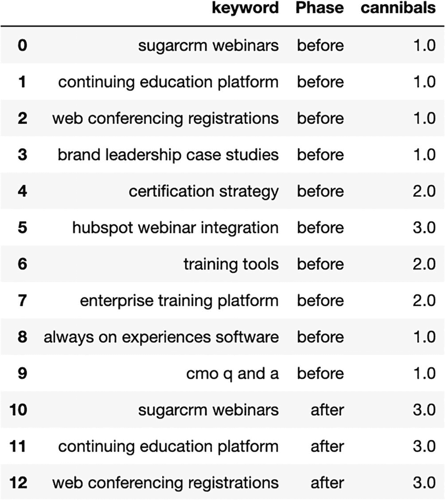

一个表格，包含 3 列和 13 行。列包括关键词、阶段和自吞噬数量。行包括关键词：sugar c r m 网络研讨会、持续教育平台、网络会议出席率等。

```python
compare_cannibals_more_plt = (
ggplot(compare_cannibals_more, aes(x = 'keyword', y = 'cannibals',
fill = 'Phase')) +
geom_bar(stat = 'identity', position = 'dodge', alpha = 0.8) +
labs(y = '# Cannibals in SERP', x = ' ') +
coord_flip() +
theme(legend_position = 'right', axis_text_x=element_text(rotation=0, hjust=1, size = 12))
)
compare_cannibals_more_plt.save(filename = 'images/5_compare_cannibals_more_plt.png', height=5, width=10, units = 'in', dpi=1000)
compare_cannibals_more_plt
```

与那些失去自吞噬的关键词相比，这些关键词为何获得了更多自吞噬，原因并不明显，因为两者都混合了通用词和品牌混合词（图 10-9）。

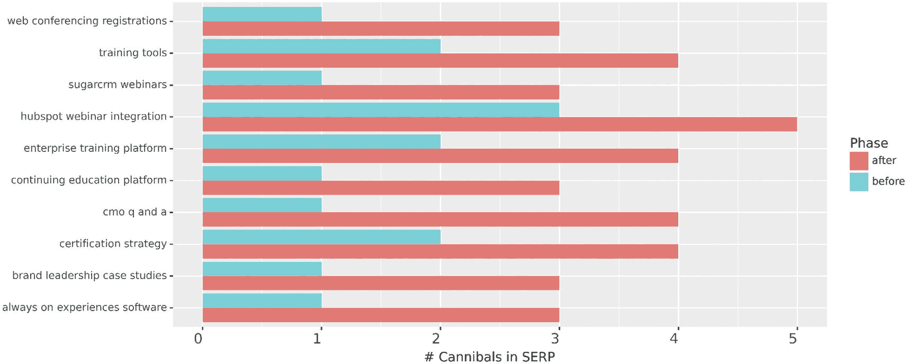

一个水平分组条形图，按关键词展示了被自吞噬的 SERP 关键词结果实例数量。最高的条形对应的是“HubSpot 网络研讨会集成与培训工具”。

## 图 10-9 前后对比：按关键词统计的被自吞噬的 SERP 结果实例数量

### 关键词

在将分析转向目标网站之前，我们先确立一个总体趋势。

### 令牌长度

或许存在一些关键词模式（例如令牌长度）可以解释核心更新后的得失。我们将尝试令牌长度，它衡量搜索查询中的关键词数量。`getSTAT` 在更新前后并未提供诸如搜索量之类的指标。我们感兴趣的是，为了解总体趋势，查看每个令牌长度下出现了多少个独立网站。

我们将分析桌面设备的 SERP；不过，代码可以轻松适配其他设备，例如移动设备：

```python
tokensite_before = getstat_bef_unique[getstat_bef_unique['device'] == 'desktop']
tokensite_after = getstat_aft_unique[getstat_aft_unique['device'] == 'desktop']
tokensite_after.sort_values(['keyword', 'rank'])
```

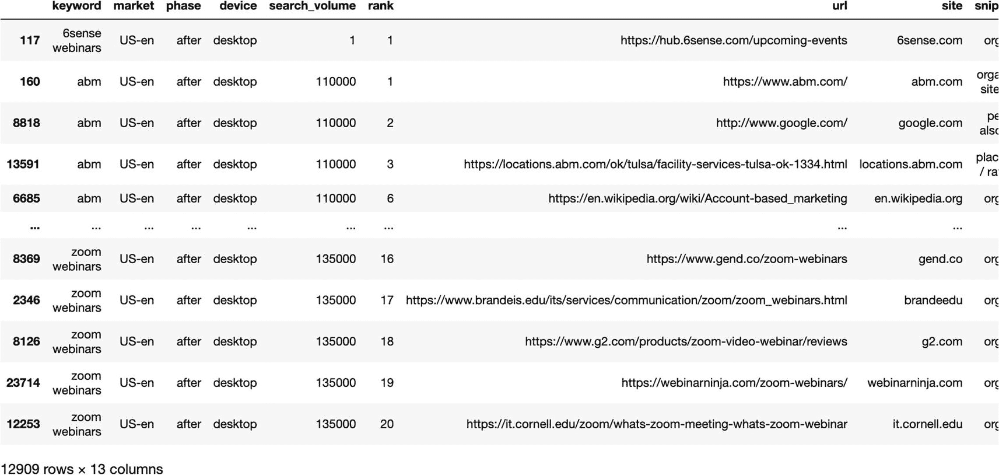

一个表格，包含 9 列和 10 行。列包括关键词、市场、阶段、设备、搜索量、排名、URL、网站和摘要。行包括关键词：6sense 网络研讨会、a b m 和 zoom 网络研讨会。

第一步是按令牌大小和阶段（更新前后）对两个数据集进行聚合。我们只想要排名前 10 的网站；因此，过滤条件是排名小于 11。我们首先在令牌大小和阶段内，按关键词级别进行聚合，以统计网站数量。然后再次按令牌大小和阶段进行聚合，以获取该令牌大小下排名前 10 的网站总数。

之所以需要两步聚合，是因为需要先对关键词内的前 10 个网站进行过滤；否则，我们本可以在一步内完成按阶段和令牌大小的聚合。

```python
tokensite_before_reach = tokensite_before[tokensite_before['rank'] < 11].groupby(['token_size', 'keyword', 'phase']).agg({'count': 'sum'}).reset_index()
tokensite_before_reach = tokensite_before_reach.groupby(['token_size', 'phase']).agg({'count': 'sum'}).reset_index()
tokensite_before_agg = tokensite_before_reach.rename(columns = {'count': 'site_count'})
tokensite_before_agg
```

结果如下：

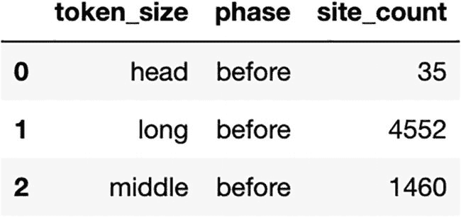

一个表格，包含 3 列和 3 行。列包括令牌大小、阶段和网站数量。行包括令牌大小：头部、长尾和中间，并附有阶段和网站数量的详细信息。

对更新后的数据集重复两步聚合方法：

```python
targetsite_after_token = targetsite_after.groupby(['token_size', 'phase']).agg({'count': 'sum'}).reset_index()
targetsite_after_sv = targetsite_after.groupby(['token_size', 'phase']).agg({'search_volume': 'sum'}).reset_index()
targetsite_after_agg = targetsite_after_token.merge(targetsite_after_sv, on = ['token_size', 'phase'], how = 'left')
targetsite_after_agg = targetsite_after_agg.rename(columns = {'count': 'reach'})
targetsite_after_agg
```

结果如下：

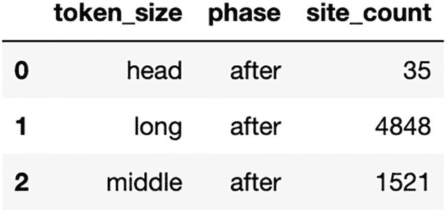

一个表格，包含 3 列和 3 行。列包括令牌大小、阶段和网站数量。行包括令牌大小：头部、长尾和中间，并附有阶段和网站数量的详细信息。

将两个阶段按网站数量聚合后，我们将它们合并以进行并排比较：

```python
tokensite_token_deltas = tokensite_before_agg.merge(tokensite_after_agg, on = ['token_size'], how = 'left')
tokensite_token_deltas['sites_delta'] = (tokensite_token_deltas['site_count_y'] - tokensite_token_deltas['site_count_x'])
```

将令牌大小转换为分类数据类型，以便我们稍后为表格和图表排序：

```python
tokensite_token_deltas['token_size'] = tokensite_token_deltas['token_size'].astype('category')
tokensite_token_deltas['token_size'] = tokensite_token_deltas['token_size'].cat.reorder_categories(['head', 'middle', 'long'])
tokensite_token_deltas = tokensite_token_deltas.sort_values('token_size')
tokensite_token_deltas
```

结果如下：

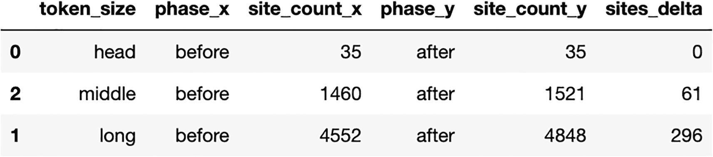

一个表格，包含 3 列和 3 行。列包括令牌大小、阶段 x 和网站数量 x、阶段 y 和网站数量 y、以及网站数量变化。行包括令牌大小：头部、长尾和中间。

因此，该表格是按 `token_size` 排序，而非字母顺序，这得益于将数据类型从字符串转换为类别。大部分变化发生在长尾和中部，因为前十名中的站点数量比以前更多，而头部词条在数量上变化不大。这可能是谷歌为了多样化搜索结果、减少站点主导地位和内容重叠而采取的措施。

让我们进行可视化：

```
targetsite_token_viz = pd.concat([targetsite_before_agg, targetsite_after_agg])
targetsite_token_viz
```

结果如下：

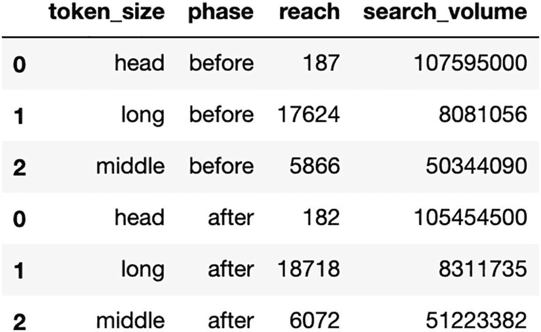

一个表格展示了包含 4 列 6 行的列表。列包括 `token size`、`phase`、`reach` 和 `search volume`。行包括 `token size`，分别为 2 个头部、2 个长尾和 2 个中部。

```
targetsite_token_sites_plt = (
ggplot(tokensite_token_viz,
aes(x = 'token_size', y = 'site_count', fill = 'phase')) +
geom_bar(stat = 'identity', position = 'dodge', alpha = 0.8) +
position=position_stack(vjust=0.01)) +
labs(y = 'Unique Site Count', x = 'Query Length') +
coord_flip() +
theme(legend_position = 'right',
axis_text_y =element_text(rotation=0, hjust=1, size = 12),
legend_title = element_blank()
)
)
targetsite_token_sites_plt.save(filename = 'images/8_targetsite_token_sites_plt.png', height=5, width=10, units = 'in', dpi=1000)
targetsite_token_sites_plt
```

这就是我们为 PPT 演示文稿绘制的总体趋势图（图 10-10）。问题是哪些站点有所增减？


一个水平分组条形图展示了长尾、中部和头部查询长度在唯一站点数量上的前后对比。最高的条形是长尾，最低的条形是头部。

**图 10-10** 按查询长度统计的唯一站点数量

## Token 长度深度剖析

在掌握了总体趋势之后，我们将深入细节，了解长尾中的站点是如何受到影响的。

和之前一样，我们将聚焦桌面端结果，并过滤出长尾数据：

```
longs_before = tokensite_before[tokensite_before['token_size'] == 'long']
longs_after = tokensite_after[tokensite_after['token_size'] == 'long']
longs_after
```

结果如下：


一个表格展示了包含 10 列 10 行的列表。列包括 `keywords`、`market`、`phase`、`device`、`search volume`、`rank`、`URL`、`site`、`snippets` 和 `rank profile`。行包含详细信息。

现在数据已过滤为桌面端和长尾数据，可以使用聚合进行分析：

```
longs_before_reach = longs_before.groupby('site').agg({'count': 'sum'}).reset_index()
longs_before_rank = longs_before.groupby('site').apply(wavg_rank_sv).reset_index()
longs_before_agg = longs_before_reach.merge(longs_before_rank, on = 'site', how = 'left')
longs_before_agg['visi'] = longs_before_agg['count'] / longs_before_agg['wavg_rank']
longs_before_agg['phase'] = 'before'
longs_before_agg = longs_before_agg.sort_values('count', ascending = False)
longs_before_agg.head()
```

结果如下：


一个表格展示了包含 5 列 5 行的列表。列包括 `site`、`count`、`wavg rank`、`visi` 和 `phase`。行包括根据阶段前可见度排列的网站：`google.com`、`qualtrics.com`、`hubspot.com`、`youtube.com` 和 `medium.com`。

到目前为止，我们看到 `Qualtrics` 在桌面搜索的 112 个长尾关键词上平均排名约为 1.2。我们将对阶段后数据重复聚合操作：

```
longs_after_reach = longs_after.groupby('site').agg({'count': 'sum'}).reset_index()
longs_after_rank = longs_after.groupby('site').apply(wavg_rank_sv).reset_index()
longs_after_agg = longs_after_reach.merge(longs_after_rank, on = 'site', how = 'left')
longs_after_agg['visi'] = longs_after_agg['count'] / longs_after_agg['wavg_rank']
longs_after_agg['phase'] = 'after'
longs_after_agg = longs_after_agg.sort_values('visi', ascending = False)
longs_after_agg.head()
```

结果如下：


一个表格展示了包含 5 列 5 行的列表。列包括 `site`、`count`、`wavg rank`、`visi` 和 `phase`。行包括根据阶段后可见度排列的网站：`google.com`、`qualtrics.com`、`hubspot.com`、`youtube.com` 和 `medium.com`。

在核心更新之后，`HubSpot` 和 `Sitecore` 在长尾前五名中超越了 `Qualtrics`。`Medium` 则跌出了前五名。让我们简化这个对比：

```python
compare_longs = longs_before_agg.merge(longs_after_agg, on = ['site'], how = 'outer')
compare_longs = compare_longs.rename(columns = {'count_x': 'before_reach', 'count_y': 'after_reach',
'wavg_rank_x': 'before_rank', 'wavg_rank_y': 'after_rank',
'visi_x': 'before_visi', 'visi_y': 'after_visi',
})
compare_longs['before_reach'] = np.where(compare_longs['before_reach'].isnull(),
0, compare_longs['before_reach'])
compare_longs['after_reach'] = np.where(compare_longs['after_reach'].isnull(),
0, compare_longs['after_reach'])
compare_longs['before_rank'] = np.where(compare_longs['before_rank'].isnull(),
100, compare_longs['before_rank'])
compare_longs['after_rank'] = np.where(compare_longs['after_rank'].isnull(),
100, compare_longs['after_rank'])
compare_longs['before_visi'] = np.where(compare_longs['before_visi'].isnull(),
0, compare_longs['before_visi'])
compare_longs['after_visi'] = np.where(compare_longs['after_visi'].isnull(),
0, compare_longs['after_visi'])
compare_longs['delta_reach'] = compare_longs['after_reach'] - compare_longs['before_reach']
compare_longs['delta_rank'] = compare_longs['before_rank'] - compare_longs['after_rank']
compare_longs['delta_visi'] = compare_longs['after_visi'] - compare_longs['before_visi']
compare_longs.sort_values('delta_visi').head(12)
```

结果如下：


一个表格展示了包含 11 列 10 行的列表。列包括 `site`、`before reach`、`before rank`、`before visi`、`phase x`、`after reach`、`after rank`、`after visi`、`phase y`、`delta reach`、`delta rank` 和 `delta visi`。行包括根据可见度排列的网站：`qualtrics.com`、`podcastinsights.com` 等。

正如所确认的，`Qualtrics` 在长尾中损失最大。让我们进行可视化，先从损失方开始：

```python
longs_reach_losers_long = compare_longs.sort_values('delta_visi')
longs_reach_losers_long = longs_reach_losers_long[['site', 'before_visi', 'after_visi']]
longs_reach_losers_long = longs_reach_losers_long[~longs_reach_losers_long['site'].isin(['google.co.uk', 'youtube.com'])]
longs_reach_losers_long = longs_reach_losers_long.head(10)
longs_reach_losers_long = longs_reach_losers_long.melt(id_vars = 'site', var_name = 'phase', value_name = 'visi')
longs_reach_losers_long['phase'] = longs_reach_losers_long['phase'].str.replace('_visi', '')
longs_reach_losers_long
```

结果如下：


一个表格展示了包含 3 列 10 行的列表。列包括 `site`、`phase` 和 `visi`。行包括根据可见度排列的网站：`qualtrics.com`、`podcastinsights.com`、`workcast.com` 等。

```python
longs_reach_losers_plt = (
ggplot(longs_reach_losers_long,
aes(x = 'reorder(site, visi)', y = 'visi', fill = 'phase')) +
geom_bar(stat = 'identity', position = 'dodge', alpha = 0.8) +
#geom_text(dd_factor_df, aes(label = 'market_name'), position=position_stack(vjust=0.01)) +
labs(y = 'Visibility', x = '') +
#scale_y_log10() +
coord_flip() +
theme(legend_position = 'right',
axis_text_y =element_text(rotation=0, hjust=1, size = 12),
legend_title = element_blank()
)
)
longs_reach_losers_plt.save(filename = 'images/10_longs_visi_losers_plt.png', height=5, width=10, units = 'in', dpi=1000)
longs_reach_losers_plt
```

`Qualtrics` 和主要竞争品牌 `GoToMeeting`（图 10-11）在谷歌更新后明显是最大的输家之一。


一张水平分组条形图展示了各网站在更新前后的可见度。最高的条形是 `qualtrics.com` 和 `gotomeeting.com`，最低的条形是 `zest.is`。

**图 10-11** 各网站更新前后的可见度

## 赢家

```python
longs_reach_winners_long = compare_longs.sort_values('delta_visi')
longs_reach_winners_long = longs_reach_winners_long[['site', 'before_visi', 'after_visi']]
```

我们还将移除谷歌和 YouTube，因为谷歌可能在算法更新后对其自有属性在搜索结果中进行了偏袒：

```python
longs_reach_winners_long = longs_reach_winners_long[~longs_reach_winners_long['site'].isin(['google.co.uk', 'google.com', 'youtube.com'])]
```

选择尾部而非头部数据，是因为表格按重要性升序排列，从可见度下降最多的网站一直到可见度提升最多的网站，这样我们就可以选出赢家：

```markdown
# 长尾领域的赢家与关键词分析

在长尾领域，`HubSpot` 和 `Sitecore` 是明显的赢家（图 10-12）。


一张水平分组条形图展示了各网站在谷歌可见度上的增长情况，分为更新前和更新后。最高的条形是 `hubspot.com` 和 `site.com`，最低的条形是 `enterprise training.com`。

`图 10-12` 各网站谷歌可见度增长情况（更新前后）

这可能是由于它们拥有大量制作精良、内容丰富的指南。

## 目标层级

在确立了总体趋势之后，是时候深入细节了。自然，SEO 从业者和营销人员希望了解关键词和页面在最大赢家和输家方面的表现。我们将把分析分为关键词和页面两部分。

### 关键词

为此，我们将筛选出目标网站 `ON24` 在核心更新前后的数据：

```python
before_site = getstat_bef_unique[getstat_bef_unique['site'] == root_domain]
```

加权平均排名在这里不适用，因为我们是在关键词层面进行聚合，每个关键词只有一个值：

```python
before_site_ranks = before_site.groupby(['keyword', 'search_volume']).agg({'rank': 'mean'}).reset_index()
before_site_ranks = before_site_ranks.sort_values('search_volume', ascending = False).head(10)
after_site = getstat_aft_unique[getstat_aft_unique['site'] == root_domain]
after_site_ranks = after_site.groupby(['keyword', 'search_volume']).agg({'rank': 'mean'}).reset_index()
after_site_ranks = after_site_ranks.sort_values('search_volume', ascending = False).head(10)
after_site_ranks
```

结果如下：


一个表格展示了包含 3 列和 10 行的列表。列包括关键词、搜索量和加权平均排名。行包括根据排名排列的关键词：`webinar`、`what is a webinar`、`webcast` 等。

有了这两个数据集，我们将它们合并以进行并排比较：

```python
compare_site_ranks = before_site_ranks. merge(after_site_ranks, on = ['keyword', 'search_volume'],
how = 'outer')
compare_site_ranks = compare_site_ranks.rename(columns = {'rank_x': 'before_rank', 'rank_y': 'after_rank'})
compare_site_ranks['before_rank'] = np.where(compare_site_ranks['before_rank'].isnull(), 100, compare_site_ranks['before_rank'])
compare_site_ranks['after_rank'] = np.where(compare_site_ranks['after_rank'].isnull(), 100, compare_site_ranks['after_rank'])
compare_site_ranks['delta_rank'] = compare_site_ranks['before_rank'] - compare_site_ranks['after_rank']
compare_site_ranks
```

结果如下：


一个表格展示了包含 5 列和 13 行的列表。列包括关键词、搜索量、更新前排名、更新后排名和排名变化。行包括根据排名排列的关键词：`webinar`、`what is a webinar`、`webcast` 等。

排名下降最多的关键词是 `webinar`，其次是 `what is a webinar`。

让我们进行可视化：

```python
compare_site_ranks_long = compare_site_ranks[['keyword', 'before_rank', 'after_rank']]
compare_site_ranks_long = compare_site_ranks_long.melt(id_vars = 'keyword', var_name = 'Phase', value_name = 'rank')
compare_site_ranks_long['Phase'] = compare_site_ranks_long['Phase'].str.replace('_rank', '')
compare_site_ranks_long
compare_keywords_rank_plt = (
ggplot(compare_site_ranks_long, aes(x = 'keyword', y = 'rank',
fill = 'Phase')) +
geom_bar(stat = 'identity', position = 'dodge', alpha = 0.8) +
labs(y = 'Google Rank', x = ' ') +
scale_y_reverse() +
coord_flip() +
theme(legend_position = 'right', axis_text_x=element_text(rotation=0, hjust=1, size = 12))
)
compare_keywords_rank_plt.save(filename = 'images/6_compare_keywords_rank_plt.png', height=5, width=10, units = 'in', dpi=1000)
compare_keywords_rank_plt
```

`Salesforce webinars` 和 `online webinars` 确实大幅下滑，从前十名跌至无影无踪（图 10-13）。


一张水平分组条形图展示了 ON24 在更新前后各关键词的平均排名位置。最高的条形是 `salesforce webinars` 和 `online webinars`。

`图 10-13` ON24 各关键词更新前后的平均排名位置
```

相比之下，`webinar events` 和 `live webinar` 则有所上升。了解这些信息有助于我们确定需要进一步分析的关键词优先级，以恢复流量。例如，负责 ON24 的 SEO 人员可能希望分析 `webinar` 排名前 20 的竞争对手，以制定恢复建议。

### 页面

使用已预先筛选并包含目标网站 ON24 的目标关键词数据集：

```python
targetURLs_before_reach = before_site.groupby(['url', 'phase']).agg({'count': 'sum'}).reset_index()
targetURLs_before_sv = before_site.groupby(['url', 'phase']).agg({'search_volume': 'mean'}).reset_index()
targetURLs_before_rank = before_site.groupby(['url', 'phase']).apply(wavg_rank_sv).reset_index()
targetURLs_before_agg = targetURLs_before_reach.merge(targetURLs_before_sv, on = ['url', 'phase'], how = 'left')
targetURLs_before_agg = targetURLs_before_agg.merge(targetURLs_before_rank, on = ['url', 'phase'], how = 'left')
targetURLs_before_agg = targetURLs_before_agg.rename(columns = {'count': 'reach'})
targetURLs_before_agg['visi'] = (targetURLs_before_agg['search_volume'] / targetURLs_before_agg['wavg_rank']).round(2)
targetURLs_before_agg
```

结果如下：


一个表格展示了包含 6 列和 10 行的列表。列包括 URL、阶段、覆盖量、搜索量、加权平均排名和可见度。行根据排名和阶段前包含相应的 URL。

```python
targetURLs_after_reach = after_site.groupby(['url', 'phase']).agg({'count': 'sum'}).reset_index()
targetURLs_after_sv = after_site.groupby(['url', 'phase']).agg({'search_volume': 'mean'}).reset_index()
targetURLs_after_rank = after_site.groupby(['url', 'phase']).apply(wavg_rank_sv).reset_index()
targetURLs_after_agg = targetURLs_after_reach.merge(targetURLs_after_sv, on = ['url', 'phase'], how = 'left')
targetURLs_after_agg = targetURLs_after_agg.merge(targetURLs_after_rank, on = ['url', 'phase'], how = 'left')
targetURLs_after_agg = targetURLs_after_agg.rename(columns = {'count': 'reach'})
targetURLs_after_agg['visi'] = (targetURLs_after_agg['search_volume'] / targetURLs_after_agg['wavg_rank']).round(2)
targetURLs_after_agg
```

结果如下：


一个表格展示了包含 6 列和 10 行的列表。列包括 URL、阶段、覆盖量、搜索量、加权平均排名和可见度。行根据排名和阶段后包含相应的 URL。

```python
target_urls_deltas = targetURLs_before_agg.merge(targetURLs_after_agg, on = ['url'], how = 'left')
target_urls_deltas = target_urls_deltas.rename(columns = {'reach_x': 'before_reach', 'reach_y': 'after_reach',
'search_volume_x': 'before_sv', 'search_volume_y': 'after_sv',
'wavg_rank_x': 'before_rank', 'wavg_rank_y': 'after_rank',
'visi_x': 'before_visi', 'visi_y': 'after_visi'})
target_urls_deltas = target_urls_deltas[['url', 'before_reach', 'before_sv', 'before_rank', 'before_visi',
'after_reach', 'after_sv', 'after_rank', 'after_visi']]
target_urls_deltas['after_reach'] = np.where(target_urls_deltas['after_reach'].isnull(),
0, target_urls_deltas['after_reach'])
target_urls_deltas['after_sv'] = np.where(target_urls_deltas['after_sv'].isnull(),
target_urls_deltas['before_sv'], target_urls_deltas['after_sv'])
target_urls_deltas['after_rank'] = np.where(target_urls_deltas['after_rank'].isnull(),
100, target_urls_deltas['after_rank'])
target_urls_deltas['after_visi'] = np.where(target_urls_deltas['after_visi'].isnull(),
0, target_urls_deltas['after_visi'])
target_urls_deltas['sv_delta'] = (target_urls_deltas['after_sv'] - target_urls_deltas['before_sv'])
target_urls_deltas['rank_delta'] = (target_urls_deltas['before_rank'] - target_urls_deltas['after_rank'])
target_urls_deltas['reach_delta'] = (target_urls_deltas['after_reach'] - target_urls_deltas['before_reach'])
target_urls_deltas['visi_delta'] = (target_urls_deltas['after_visi'] - target_urls_deltas['before_visi'])
target_urls_deltas = target_urls_deltas.sort_values(['visi_delta'], ascending = False)
target_urls_deltas
```

结果如下：


一个表格展示了包含 5 列和 10 行的列表。列包括 URL、阶段前覆盖量、阶段前搜索量、阶段前排名和阶段前可见度。行根据阶段前包含相应的 URL。

## 胜者 URL 分析

```python
winning_urls = target_urls_deltas['url'].head(10).tolist()
target_url_winners = pd.concat([targetURLs_before_agg, targetURLs_after_agg])
target_url_winners = target_url_winners[target_url_winners['url'].isin(winning_urls) ]
target_url_winners['phase'] = target_url_winners['phase'].astype('category')
target_url_winners['phase'] = target_url_winners['phase'].cat.reorder_categories(['after', 'before'])
target_url_winners
```

结果如下：


一个表格展示了包含 6 列和 12 行的列表。列包括 `URL`、`阶段`、`覆盖量`、`搜索量`、`加权平均排名`和`可见度`。行根据排名和阶段前包含相应的 `URL`。

```python
target_url_winners_plt = (
ggplot(target_url_winners,
aes(x = 'reorder(url, visi)', y = 'visi', fill = 'phase')) +
geom_bar(stat = 'identity', position = 'dodge', alpha = 0.8) +
labs(y = 'Visi', x = '') +
coord_flip() +
theme(legend_position = 'right',
axis_text_y =element_text(rotation=0, hjust=1, size = 12),
legend_title = element_blank()
)
)
target_url_winners_plt.save(filename = 'images/8_target_url_winners_plt.png', height=5, width=10, units = 'in', dpi=1000)
target_url_winners_plt
```

`Live Webcast Elite` 是获得最多展示量的页面，这是因为如前所述，它在“webcast”搜索中获得了排名（图 10-14）。


一个水平分组条形图展示了 ON24 在阶段前和阶段后的 URL 可见度增长情况。最高的条形对应的是 `live webcast elite`。

**图 10-14** ON24 在阶段前和阶段后的 URL 可见度增长情况

如果我们有网站分析数据（例如 Google Analytics），我们可以将其与 `URL` 合并，从而了解这些排名带来了多少流量，以及流量与搜索量的相关程度。

## 败者 URL 分析

接下来，我们看看表现不佳的 URL：

```python
losing_urls = target_urls_deltas['url'].tail(10).tolist()
print(losing_urls)
target_url_losers = pd.concat([targetURLs_before_agg, targetURLs_after_agg])
target_url_losers = target_url_losers[target_url_losers['url'].isin(losing_urls) ]
target_url_losers['visi'] = (target_url_losers['search_volume'] / target_url_losers['wavg_rank']).round(3)
target_url_losers['phase'] = target_url_losers['phase'].astype('category')
target_url_losers['phase'] = target_url_losers['phase'].cat.reorder_categories(['after', 'before'])
target_url_losers
```

结果如下：


一个表格展示了包含 5 列和 10 行的列表。列包括 `URL`、`阶段`、`覆盖量`、`搜索量`、`加权平均排名`和`可见度`。行根据阶段前包含相应的 `URL`。

```python
target_url_losers_plt = (
ggplot(target_url_losers, aes(x = 'reorder(url, visi)', y = 'visi', fill = 'phase')) +
geom_bar(stat = 'identity', position = 'dodge', alpha = 0.8) +
position=position_stack(vjust=0.01)) +
labs(y = 'Visi', x = '') +
coord_flip() +
theme(legend_position = 'right',
axis_text_y =element_text(rotation=0, hjust=1, size = 12),
legend_title = element_blank()
)
)
target_url_losers_plt.save(filename = 'images/8_target_url_losers_plt.png',
height=5, width=10, units = 'in', dpi=1000)
target_url_losers_plt
```

"How webinars work"和“upcoming webinars”是表现最差的 `URL`（图 10-15）。


一个水平分组条形图展示了 ON24 在阶段前和阶段后的 `URL` 可见度下降情况。最高的条形对应的是 `how webinars work`。

**图 10-15** ON24 在阶段前和阶段后的 `URL` 可见度下降情况

`https://www.on24.com/blog/how-webinars-work/#:~:text=Let's%20start%20with%20a%20simple,using%20other%20available%20interactive%20tools` 似乎未被规范化（即，没有定义 `rel="canonical"` `URL` 来合并任何 `URL` 变体或重复项）。

针对以上所有情况，一个可行的后续步骤是使用 Google Search Console 数据提取每个 `URL` 的搜索查询，并查看：

*   搜索意图是否在该 `URL` 内共享

*   这些 `URL` 是否包含满足产生展示次数的查询的内容

另一个可能的后续步骤是根据内容类型对 `URL` 和关键词进行细分。这有助于确定是否存在任何通用模式，可以解释并加速恢复过程。

## 细分

我们返回 SERP 以分析不同类型的网站在 Google 更新中的表现。总体方法是先找出最显眼的网站，然后使用 `np.select()` 函数对这些网站进行分类和标记。

### 顶级竞争对手

为了找到顶级竞争对手网站，我们将聚合“之前”和“之后”的数据集，以计算出基于覆盖范围和搜索量加权排名平均值的可见性指数：

```python
players_before = getstat_bef_unique
print(players_before.columns)
players_before_rank = players_before.groupby('site').apply(wavg_rank_sv).reset_index()
players_before_reach = players_before.groupby('site').agg({'count': 'sum'}).sort_values('count', ascending = False).reset_index()
players_before_agg = players_before_rank.merge(players_before_reach, on = 'site', how = 'left')
players_before_agg['visi'] = players_before_agg['count'] / players_before_agg['wavg_rank']
players_before_agg = players_before_agg.sort_values('visi', ascending = False)
players_before_agg
```

结果如下：


一个表格展示了包含 5 列和 10 行的列表。列包括 `site`、`wavg_rank`、`count` 和 `visi`。行包括根据排名列出的网站，如 `google.com`、`hubspot.com`、`gotomeeting.com` 等。

```
players_after = getstat_aft_unique
print(players_before.columns)
players_after_rank = players_after.groupby('site').apply(wavg_rank_sv).reset_index()
players_after_reach = players_after.groupby('site').agg({'count': 'sum'}).sort_values('count', ascending = False).reset_index()
players_after_agg = players_after_rank.merge(players_after_reach, on = 'site', how = 'left')
players_after_agg['visi'] = players_after_agg['count'] / players_after_agg['wavg_rank']
players_after_agg = players_after_agg.sort_values('visi', ascending = False)
players_after_agg
```

结果如下：


一个表格展示了包含 5 列和 10 行的列表。列包括 `site`、`wavg_rank`、`count` 和 `visi`。行包括根据排名列出的网站，如 `google.com`、`hubspot.com`、`gotomeeting.com` 等。

为了整合数据聚合，我们取“之前”数据集，并排除出现在“之后”数据集中的任何网站。目的是与“之后”数据集执行外连接，以捕获每一个可能的网站。

```
players_agg = players_before_agg[~players_before_agg['site'].isin(players_after_agg['site'])]
players_agg = players_agg.merge(players_after_agg, how='outer', indicator=True)
players_agg = players_agg.sort_values('visi', ascending = False)
players_agg.head(50)
```

结果如下：


一个表格展示了包含 5 列和 10 行的列表。列包括 `site`、`wavg_rank`、`count`、`visi` 和 `merge`。行包括根据排名列出的网站，如 `google.com`、`hubspot.com`、`gotomeeting.com` 等。

现在我们已经按优先级降序列出了所有网站，我们可以开始按站点类型对域名进行分类。使用现在应该已经很熟悉的 `np.select()` 函数，我们将手动对网站进行分类，创建一个包含我们条件的列表，这些条件创建网站列表，然后将这些条件映射到一个单独的类别名称列表：

```
site_conds = [
players_agg['site'].str.contains('|'.join(['google.com', 'youtube.com'])),
players_agg['site'].str.contains('|'.join(['wikipedia.org'])),
players_agg['site'].str.contains('|'.join(['medium.com', 'forbes.com', 'hbr.org', 'smartinsights.com', 'mckinsey.com',
'techradar.com','searchenginejournal.com', 'cmswire.com', 'entrepreneur.com',
'pcmag.com', 'elearningindustry.com', 'businessnewsdaily.com'])),
players_agg['site'].isin(['on24.com', 'gotomeeting.com', 'marketo.com', 'zoom.us', 'livestorm.co', 'hubspot.com', 'drift.com', 'salesforce.com', 'clickmeeting.com', 'liferay.com',
'qualtrics.com', 'workcast.com', 'livewebinar.com', 'getresponse.com', 'brightwork.com',
'superoffice.com', 'myownconference.com', 'info.workcast.com', 'tallyfy.com',
'readytalk.com', 'eventbrite.com', 'sitecore.com', 'pgi.com', '3cx.com', 'walkme.com',
'venngage.com', 'tableau.com', 'netsuite.com', 'zoominfo.com', 'sproutsocial.com']),
players_agg['site'].isin([ 'neilpatel.com', 'ventureharbour.com', 'wordstream.com', 'business.tutsplus.com',
'convinceandconvert.com', 'growthmarketingpro.com', 'marketinginsidergroup.com',
'adamenfroy.com', 'danielwaas.com', 'newbreedmarketing.com']),
players_agg['site'].str.contains('|'.join(['trustradius.com', 'g2.com', 'capterra.com', 'softwareadvice.com'])),
players_agg['site'].str.contains('|'.join(['facebook.com', 'linkedin.com', 'business.linkedin.com'])),
players_agg['site'].str.contains('|'.join(['.edu', '.ac.uk']))
]
```

创建一个列表，包含我们想要为每个条件分配的值。此处的类别基于其商业模式或站点目的：

```
segment_values = ['search', 'reference', 'publisher', 'martech', 'consulting', 'reviews', 'social_media', 'education']
```

创建一个新列，并使用 `np.select` 将我们的列表作为参数为其赋值：

```
players_agg['segment'] = np.select(site_conds, segment_values, default = 'other')
players_agg.head(5)
```

结果如下：


一个表格展示了包含 5 列和 6 行的列表。列包括 `site`、`wavg_rank`、`count`、`visi`、`merge` 和 `segment`。行包括根据排名列出的网站，如 `google.com`、`hubspot.com`、`gotomeeting.com` 等。

网站已被分类。我们现在将查看归类为 `other` 的网站。这很有用，因为如果我们看到任何我们认为重要到不应归类为 `other` 的网站，我们可以更新之前的条件。

```
players_agg[players_agg['segment'] == 'other'].head(20)
```

结果如下：


一个表格展示了包含 5 列和 6 行的列表。列包括 `site`、`wavg_rank`、`count`、`visi`、`merge` 和 `segment`。行包括根据排名列出的网站，如 `abm.com`、`toolshero.com` 等。

```
players_agg_map = players_agg[['site', 'segment']]
players_agg_map
```

结果如下：


一个表格展示了包含 2 列和 10 行的列表。列包括`site`和`segment`。行包括根据细分列出的网站，如`google.com`、`hubspot.com`、`gotomeeting.com`等。

至此，您就拥有了一个映射数据框，它将用于提供细分的 SERP 洞察，首先从可见性开始。

## 可见性

网站分类完成后，我们现在可以比较更新前后按站点类型划分的性能。

像往常一样，我们将聚合“之前”和“之后”的数据集。不过这一次，我们还将合并站点类型标签。

从“之前”数据集开始：

```python
before_sector_unq_reach = getstat_bef_unique.merge(players_agg_map, on = 'site', how = 'left')
```

我们筛选出前 10 名来计算覆盖统计量，这些数据稍后将在可见性计算中用到：

```python
before_sector_unq_reach = before_sector_unq_reach[before_sector_unq_reach['rank'] < 11 ]
before_sector_agg_reach = before_sector_unq_reach.groupby(['segment']).agg({'count': 'sum'}).reset_index()
before_sector_agg_reach = before_sector_agg_reach.rename(columns = {'count': 'reach'})
before_sector_agg_reach = before_sector_agg_reach[['segment', 'reach']]
before_sector_agg_reach['reach'] = np.where(before_sector_agg_reach['reach'].isnull(), 0, before_sector_agg_reach['reach'])
```

同样的逻辑和操作应用于“之后”数据集：

```python
after_sector_unq_reach = getstat_aft_unique.merge(players_agg_map, on = 'site', how = 'left')
after_sector_unq_reach = after_sector_unq_reach[after_sector_unq_reach['rank'] < 11 ]
after_sector_agg_reach = after_sector_unq_reach.groupby(['segment']).agg({'count': 'sum'}).reset_index()
after_sector_agg_reach = after_sector_agg_reach.rename(columns = {'count': 'reach'})
after_sector_agg_reach['reach'] = np.where(after_sector_agg_reach['reach'].isnull(), 0, after_sector_agg_reach['reach'])
after_sector_agg_reach = after_sector_agg_reach[['segment', 'reach']]
after_sector_agg_reach.sort_values('reach', ascending = False).head(10)
```

结果如下：


一个表格展示了包含 2 列 9 行的列表。列包括“细分领域”和“覆盖量”。行包括“其他”、“营销技术”、“搜索”、“发布商”等细分领域。

在覆盖量方面，作为网站类型细分领域的“其他”占据了统计数据的绝对优势。我们可能稍后需要将其过滤掉。接下来是按搜索量计算的加权平均排名，这将用到之前定义的`wavg_rank_sv()`函数。

```python
before_sector_unq_visi = before_sector_unq_svranks.merge(before_sector_agg_reach, on = 'segment', how = 'left')
before_sector_unq_visi['reach'] = np.where(before_sector_unq_visi['reach'].isnull(), 0, before_sector_unq_visi['reach'])
before_sector_unq_visi['wavg_rank'] = np.where(before_sector_unq_visi['wavg_rank'].isnull(), 100, before_sector_unq_visi['wavg_rank'])
before_sector_unq_visi['visibility'] = before_sector_unq_visi['reach'] / before_sector_unq_visi['wavg_rank']
before_sector_unq_visi = before_sector_unq_visi.sort_values('visibility', ascending = False)
after_sector_unq_visi = after_sector_unq_svranks.merge(after_sector_agg_reach, on = 'segment', how = 'left')
after_sector_unq_visi['reach'] = np.where(after_sector_unq_visi['reach'].isnull(), 0, after_sector_unq_visi['reach'])
after_sector_unq_visi['wavg_rank'] = np.where(after_sector_unq_visi['wavg_rank'].isnull(), 100, after_sector_unq_visi['wavg_rank'])
after_sectaor_unq_visi['visibility'] = after_sector_unq_visi['reach'] / after_sector_unq_visi['wavg_rank']
after_sector_unq_visi = after_sector_unq_visi.sort_values('visibility', ascending = False)
after_sector_unq_visi
```

结果如下：


一个表格展示了包含 4 列 10 行的列表。列包括“细分领域”、“加权平均排名”、“覆盖量”和“可见性”。行包括“其他”、“搜索”、“营销技术”、“发布商”等细分领域。

与覆盖量一样，“其他”在搜索量加权排名指标中表现优异，因此在整体可见性方面也表现出色。在聚合了“之前”和“之后”的细分数据集后，我们现在可以将它们合并：

# 基于细分领域的可见性对比分析

## 数据比较与结果

首先，我们将 `before_sector_unq_visi` 和 `after_sector_unq_visi` 两个数据框在 `segment` 字段上进行合并，以比较不同细分领域在可见性上的变化。计算了每个细分领域的可见性变化量 `delta_visi`，并按该值排序以查看变化情况。

```python
compare_sector_visi_players = before_sector_unq_visi.merge(after_sector_unq_visi, on = ['segment'], how = 'outer')
compare_sector_visi_players = compare_sector_visi_players.rename(columns = {'wavg_rank_x': 'before_rank', 'wavg_rank_y': 'after_rank',
'reach_x': 'before_reach', 'reach_y': 'after_reach',
'visibility_x': 'before_visi', 'visibility_y': 'after_visi'
})
compare_sector_visi_players['before_visi'] = np.where(compare_sector_visi_players['before_visi'].isnull(),
0, compare_sector_visi_players['before_visi'])
compare_sector_visi_players['after_visi'] = np.where(compare_sector_visi_players['after_visi'].isnull(),
0, compare_sector_visi_players['after_visi'])
compare_sector_visi_players['delta_visi'] = compare_sector_visi_players['after_visi'] - compare_sector_visi_players['before_visi']
compare_sector_visi_players = compare_sector_visi_players.sort_values('delta_visi')
compare_sector_visi_players.head(10)
```

结果如下：


一个表格展示了包含 8 列 10 行的列表。列包括“细分领域”、“之前排名”、“之前覆盖量”、“之前可见性”、“之后排名”、“之后覆盖量”、“之后可见性”和“可见性变化量”。行包括根据排名参考、咨询、覆盖量、评论等划分的细分领域。

唯一出现下降的网站组是参考类网站，如维基百科、词典等。它们的覆盖量增长了 11%，但排名平均下降了近两位。这可能是因为非参考类网站正在产出更多有价值的文章，从而挤占了像维基百科这样在这些领域缺乏专业知识的通用网站。

## 数据重塑与可视化

让我们重塑数据以便进行可视化：

```python
compare_sector_visi_players_long = compare_sector_visi_players[['segment', 'before_visi','after_visi']]
compare_sector_visi_players_long = compare_sector_visi_players_long.melt(id_vars = ['segment'], var_name='Phase',
value_name='Visi')
compare_sector_visi_players_long['Phase'] = compare_sector_visi_players_long['Phase'].str.replace('_visi', '')
compare_sector_visi_players_long['Phase'] = compare_sector_visi_players_long['Phase'].astype('category')
compare_sector_visi_players_long['Phase'] = compare_sector_visi_players_long['Phase'].cat.reorder_categories(['after',
'before'])
compare_sector_visi_players_long.head(10)
```

结果如下：


一个表格展示了包含 3 列 10 行的列表。列包括“细分领域”、“阶段”和“可见性”。行包括根据阶段参考、咨询、覆盖量、评论等划分的细分领域。

接下来，使用 `ggplot` 库绘制分组柱状图，直观展示各细分领域在“之前”和“之后”阶段的可见性对比。

```python
compare_sector_visi_players_long_plt = (
ggplot(compare_sector_visi_players_long, aes(x = 'reorder(segment, Visi)', y = 'Visi', fill = 'Phase')) +
geom_bar(stat = 'identity', position = 'dodge', alpha = 0.8) +
labs(y = 'Visibility', x = ' ') +
coord_flip() +
theme(legend_position = 'right', axis_text_x=element_text(rotation=0, hjust=1, size = 12))
)
compare_sector_visi_players_long_plt.save(filename = 'images/11_compare_sector_visi_players_long_plt.png', height=5, width=10, units = 'in', dpi=1000)
Compare_sector_visi_players_long_plt
```

因此，除了参考类网站，其他所有类别都有所增长，其中营销技术和发布商增长最多（图 10-16）。


一个分组柱状图按网站类型展示了“之前”和“之后”的可见性。最高的柱形是“其他”、“搜索”和“营销技术”，最低的柱形在两个阶段中都是“社交媒体”和“参考”。

图 10-16：按网站类型划分的“之前”和“之后”可见性

## 摘要片段分析

除了可见性，我们还可以按细分领域剖析结果类型。虽然可以按细分领域进行多种可视化，但我们选择了摘要片段，以便引入热力图可视化技术。

这次，我们将对“之前”和“之后”的数据集执行合并后，按摘要片段和细分领域进行聚合：

```python
before_sector_unq_snippets = getstat_bef_unique.merge(players_agg_map, on = 'site', how = 'left')
before_sector_agg_snippets = before_sector_unq_snippets.groupby(['snippets', 'segment']).agg({'count': 'sum'}).reset_index()
before_sector_agg_snippets = before_sector_agg_snippets[['snippets', 'segment', 'count']]
before_sector_agg_snippets = before_sector_agg_snippets.rename(columns = {'count': 'reach'})
after_sector_unq_snippets = getstat_aft_unique.merge(players_agg_map, on = 'site', how = 'left')
after_sector_agg_snippets = after_sector_unq_snippets.groupby(['snippets', 'segment']).agg({'count': 'sum'}).reset_index()
after_sector_agg_snippets = after_sector_agg_snippets[['snippets', 'segment', 'count']]
after_sector_agg_snippets = after_sector_agg_snippets.rename(columns = {'count': 'reach'})
after_sector_agg_snippets.sort_values('reach', ascending = False).head(10)
```

结果如下：


表格包含 3 列 10 行，列名分别为片段（snippet）、细分（segment）和覆盖量（reach）。行按覆盖量排列细分。

更新后，我们可以看到其他网站的覆盖量主要来自自然搜索、图片和 AMP。更新前后对比如何？

```python
compare_sector_snippets = before_sector_agg_snippets.merge(after_sector_agg_snippets, on = ['snippets', 'segment'], how = 'outer')
compare_sector_snippets = compare_sector_snippets.rename(columns = {'reach_x': 'before_reach', 'reach_y': 'after_reach'})
compare_sector_snippets['before_reach'] = np.where(compare_sector_snippets['before_reach'].isnull(), 0, compare_sector_snippets['before_reach'])
compare_sector_snippets['after_reach'] = np.where(compare_sector_snippets['after_reach'].isnull(), 0, compare_sector_snippets['after_reach'])
compare_sector_snippets['delta_reach'] = compare_sector_snippets['after_reach'] - compare_sector_snippets['before_reach']
compare_sector_snippets = compare_sector_snippets.sort_values('delta_reach')
compare_sector_snippets.head(10)
```

结果如下：


表格包含 5 列 10 行，列名分别为片段（`snippets`）、细分（`segment`）、更新前覆盖量（`before_reach`）、更新后覆盖量（`after_reach`）和覆盖量变化（`delta_reach`）。行按覆盖量变化排列细分，包括评论、其他、教育等。

评论网站在自然搜索结果和 Google 图片中流失的覆盖量最多。Martech 在 AMP 结果中有所损失。

```python
compare_sector_snippets.tail(10)
```

结果如下：


表格包含 5 列 10 行，列名分别为片段（`snippets`）、细分（`segment`）、更新前覆盖量（`before_reach`）、更新后覆盖量（`after_reach`）和覆盖量变化（`delta_reach`）。行按覆盖量变化排列细分，包括搜索、发布商、其他等。

相比之下，发布商网站似乎在图片和自然搜索结果中取代了评论网站。由于我们更关注常规自然链接之外的结果类型，因此将剔除这些类型并进行可视化。否则，生成的图表会显示自然链接占据巨大权重，而其他结果类型则相形见绌。

```python
compare_sector_snippets_graphdf = compare_sector_snippets[compare_sector_snippets['snippets'] != 'organic']
compare_sector_snippets_plt = (
    ggplot(compare_sector_snippets_graphdf,
           aes(x = 'segment', y = 'snippets', fill = 'delta_reach')) +
    geom_tile(stat = 'identity', alpha = 0.6) +
    labs(y = '', x = '') +
    theme_classic() +
    theme(legend_position = 'right',
          axis_text_x=element_text(rotation=90, hjust=1)
    )
)
compare_sector_snippets_plt.save(filename = 'images/12_compare_sector_snippets_plt.png', height=5, width=10, units = 'in', dpi=1000)
compare_sector_snippets_plt
```

图 10-17 中的热力图使用颜色作为第三维度，展示了不同网站细分（底部）和结果类型（垂直）中覆盖量的主要变化位置。

结果如下：


瀑布图解释了按网站类型和结果类型划分的前 10 名计数差异。最显著的变化是“其他”细分中的 Google 图片结果。相比之下，其余变化似乎微不足道。

`图 10-17` 热力图显示按网站类型和结果类型划分的前 10 名计数差异

最显著的变化是“其他”细分中的 Google 图片结果。相比之下，其余变化似乎微不足道。该热力图展示了如何对三维分类数据进行可视化。

## 总结

我们重点分析了算法更新后的性能，旨在解释发生了什么，并可能提取洞察，用于进一步研究和生成建议。我们不仅评估了建立可见性变化的方法，总体方法还包括分析通用 SERP 趋势，然后按结果类型、自相残杀情况进行细分。接着，我们着眼于目标网站层面，观察关键词、查询长度和 URL 的变化。

我们还尝试通过将网站分组为网站类别细分来评估通用 SERP 趋势，从而对 SERP 的可见性和摘要进行更丰富的分析。虽然核心更新前后的数据可视化并不总能揭示算法更新的原因，但可以学习到一些模式，为生成建议的进一步研究提供信息。这些数据始终可以与其他数据源结合，并运用竞争对手分析中概述的技术，来发现潜在的分割测试排名因素假设。

下一章将讨论 SEO 的未来。

# 11. SEO 的未来

将数据科学方法应用于 SEO 的探索，最终会引发关于 SEO 作为一个行业和职业演变的进一步问题。随着付费搜索日益自动化和商品化，SEO 是否也会发生同样的情况？为了回答这个问题，让我们回顾一下本书中数据科学如何应用于 SEO，以及自动化的局限性和机遇。

### 聚合

`聚合`是一种数据分析技术，将数据按组级别汇总，例如按内容组统计平均点击次数。在 Microsoft Excel 中，这可以通过数据透视表实现。`聚合`是可以且应该通过自动化实现的技术。`聚合`已被用于帮助我们理解 SEO 中众多不同的领域（本书已涵盖）。借助提供的代码，这可以集成到基于云的数据管道中，用于 SEO 应用，以加载数据仓库并驱动仪表板。对于大多数用例，`聚合`已经足够。然而，对于数据的科学探索和假设检验，我们需要考虑数据的分布、变异及其他统计特性。

用于报告和 SEO 咨询中许多分析方面的`聚合`当然可以自动化，并在云端执行。鉴于 Apache 已有的数据管道技术，这相当容易实现。

### 分布

统计分布之所以强大，是因为我们能够理解什么是正常情况，从而识别出任何显著高于或低于性能的数据。我们利用分布来发现增长关键词，即 Google Search Console (GSC) 中展示次数超过其排名位置第 95 百分位数的关键词。我们还利用分布来识别网站架构和层级中缺乏内部链接的内容。

这也可以在云端实现自动化，从而可能催生为 SEO 行业发布的应用，用于自动识别内部链接机会。当然，存在一个轻微的风险，即所有内部链接都纯粹基于分布进行，而未考虑并非针对搜索渠道的内容，这需要成为软件设计的一部分。

### 字符串匹配

使用 Sorensen-Dice 算法的字符串匹配已被应用于帮助将内容与 URL 进行匹配，适用于关键词映射、迁移规划等用例。由于该算法相对快速且扩展性良好，结果尚可，但它首先依赖于描述性的 URL 和标题标签。它还依赖于预处理，例如在应用字符串匹配之前移除 URL 的网站域名部分，这很容易自动化。较难处理的是，需要人为判断标题和 URL 别名在多大程度上相似才算良好匹配。阈值应该设为 70%、83% 还是 92%？

这不太容易，并且可能需要某种形式的 AI 进行自我学习，更具体地说，是循环神经网络（`RNN`）。当然，这并非不可能，因为你需要确定一个衡量结果好坏的指标，才知道如何训练模型。此外，你至少需要一百万个数据点来训练模型。

关键词映射的一个关键问题是：“对于搜索 X 关键词的用户来说，哪个 URL 是最佳的衡量指标是什么？”`RNN` 在这里可能很有用，因为它可以从排名靠前的 SERP 内容中学习，将其简化为一个对象，然后将网站内容与该对象进行比较，从而将关键词映射到 URL。

对于将已失效的 URL（带有反向链接）重定向到返回 200 HTTP 响应的有效 URL，这可能更直接，不需要 AI。你可以使用基于决策树的算法，利用用户行为来确定最佳的替换 URL，也就是说，在可用的其他 URL 选项中，“URL A”上的用户总是会前往 URL X。

非 AI 解决方案不依赖于数百万的 SERP 或互联网数据，因此在内部构建成本（相对）较低。另一方面，基于 AI 的解决方案很可能要么作为 SaaS 构建，要么由像亚马逊、Quora 或 Tripadvisor 这样依赖自然流量的超大型企业品牌构建。

### 聚类

在本书中，聚类被用于通过大规模比较搜索结果来确定搜索意图。其原理基于比较数据点之间的距离，当距离相对较小时，就存在一个聚类。本书未采用词干提取，因为尽管它速度快，但缺乏所需的精度。

聚类不仅有助于理解关键词，还有助于对关键词进行分组以报告性能，以及对内容进行分组以设置网站层级结构。作为 SEO 专家，你的想象力就是极限。SEO 市场中已经存在通过比较搜索结果来根据搜索意图对关键词进行聚类的应用，因此 Artios、Keyword Insights、Keyword Cupid、SEO Scout 等公司已经可以在云端实现自动化。

### 机器学习建模

试图理解自然搜索中的运作方式是 SEO 的诸多乐趣和考验之一，尤其是在当前谷歌更新的时代。机器学习辅助建模在这方面有所帮助，因为你实际上是将数据输入到机器学习算法中，它会显示出算法更新背后最具影响力的因素。

机器学习模型当然可以部署到云端，作为自动化应用的一部分，用于突出显示最具影响力的 SERP 因素和反向链接的质量，作为更广泛的仪表盘智能系统或独立应用的一部分。

由于不需要神经网络，构建和部署的成本相对较低，这使得 SEO 专业人员能够专注于理解模型输出以及如何应用它们。

### 集合论

集合论是指我们比较数据集（可以理解为列表），例如关键词，并将它们与另一个集合进行比较。这可以用来查看两个数据集之间的差异。它被用于内容差距分析，以找到共同的关键词（即两个网站关键词的交集），并找到目标网站与核心关键词集之间的差距。

这相当直接，并且可以使用 SEMRush 和 AHREFs 等工具轻松实现自动化。那么为什么还要用 `Python` 来做呢？因为它是免费的，并且让你对所需的交集程度有更多控制。

确定完美的交集程度则不那么明确，因为这需要研究和开发来确定所需的交集程度，而这又取决于被取交集网站的数量。

然而，关键在于首先要知道将哪些竞争对手纳入集合中，这对于机器来说可能不太容易辨别。

### 计算机能做什么和不能做什么

从上述内容中，我们看到了一个共同模式，即当涉及到诸如响应统计属性或基于数值模式做出决策等直接任务时，计算机表现出色（尽管需要一些数据清理和准备工作）。

当问题有些模糊且需要解释（例如语言）时，计算机仍然可以应对挑战，但这需要大量的资源来获取数据和训练 AI 模型。

### 给 SEO 专家的话

我们应该学习用于数据分析的 `Python`，因为这是我们生成见解和相应建议的方式。不利用技术和数据科学思维来解决 SEO 问题是没有道理的，尤其是当 SERP 由一个一致（因此更可预测）的算法决定时。

学习 `Python` 和数据科学不仅有助于让你的 SEO 职业生涯面向未来，还能让你更深入地理解搜索引擎的工作原理（鉴于它们是数学化的），并使你能够投入更多的时间和精力来定义要测试的假设并创建 SEO 解决方案。花更少的时间收集和分析数据，花更多的时间响应数据，这才是当下的要务。

在指定云应用（无论是报告、自动化还是其他方面）时，你也能更好地与软件工程师合作。

当然，创造力源于知识，因此你对 SEO 了解得越多，你就越能向数据提出更好的问题，从而产生更好的见解和更有针对性的建议。

## 总结

在本章中，我们从非常高的层面整合了用于使 SEO 数据驱动化的思路和技术：

*   聚合
*   分布
*   字符串匹配
*   聚类
*   机器学习建模
*   集合论

我们还探讨了计算机能做什么和不能做什么，并提醒了 SEO 专家为何应该转向数据科学。

为 SEO 的未来干杯。

# 索引

## A

*   A/A 测试
*   `aa_means` 数据框
*   `aa_model.summary()`
*   `aa_test_box_plt`
*   `dataframe`
*   数据结构
*   日期范围
*   组的分布
*   直方图
*   `.merge()` 函数
*   `NegativeBinomial()` 模型
*   优化
*   测试前和测试期间组
*   p 值
*   SearchPilot
*   西格玛
*   统计模型
*   统计属性
*   `.summary()` 属性
*   测试期间
*   加速移动页面 (AMP)
*   基于客户的营销
*   附加功能
*   Adobe Analytics
*   聚合
*   AHREFs
*   赤池信息量准则 (AIC)
*   替代方法
*   亚马逊云服务 (AWS)
*   `anchor_levels_issues_count_plt` 图表
*   `anchor_rel_stats_site_agg_plt` 图
*   锚文本
*   `anchor_issues_count_plt`
*   HREF
*   按站点级别的问题
*   非描述性
*   搜索引擎和用户
*   Sitebulb
*   锚文本词汇
*   Andreas
*   反垃圾算法
*   API 库
*   API 输出
*   API 响应
*   `Append()` 函数
*   `apply_pcn` 函数
*   `astype()` 函数
*   增强迪基-福勒检验 (ADF)
*   权威性
    *   聚合
    *   反向链接
    *   数据与清洗
    *   数据特征
    *   数据框
    *   描述性统计
    *   分布
    *   域名评级
    *   域名
    *   链接
    *   数学方法
    *   排名
    *   搜索引擎
    *   SEO 难度
    *   SEO 行业
    *   电子表格
*   权威性预优化
*   权威性评分
*   自动化

# averageSessionDuration

## B

- 反向链接域名
- 贝叶斯信息准则 (BIC)
- 米色风衣
- 网络研讨会最佳实践
- BlackHatWorld 论坛
- 箱线图分布

## C

- 关键词自相蚕食
- 被蚕食的搜索结果页
- 通用与品牌混合关键词
- 关键词
- 分类分析
- 变点分析
- 子节点
- 子 URL 节点文件夹
- Chrome 开发者工具
- 点击率 (CTR)
- 云计算服务
- 云网络爬虫
- `CLS_cwv_landscape_plt`
- 聚类标题
- 聚类
- 聚类
- 列重新分配
- 结合网站级别与页面权威性
- 孤立 URL
- 索引不足的 URL
- 链接不足的 URL
- 比较平均值与变异
- 竞争市场
- 竞争对手分析
- AHREFs 文件
- 缓存年龄
- 竞争力
- `concat()` 函数
- `crawl_path`
- `dataframe`
- 衍生新特征
- 全域特征
- `groupby()` 函数
- 关键词
- 线性回归
- 机器学习
- `merge()` 函数
- 排名与搜索结果
- 排名检查工具
- 排名
- 排名因素
- 排名页面
- 稳健分析
- 搜索引擎
- SEO 分析
- SERPs 数据
- 字符串格式列
- 标签品牌化比例
- 跟踪代码
- 变量
- 可见性指标
- 零错误
- `Competitor_count_cumsum_plt` 图
- 竞争对手
- 计算广告学
- 内容
- 内容整合
- 内容创作
- 数据源
- 关键词映射
- 用户查询
- 内容创作（规划着陆页内容）
- 清理与选择标题
- 聚类标题
- 爬取
- 提取标题
- 主机名
- 反思
- SERP 数据
- 顶级域名
- URL
- 垂直领域
- 内容差距分析
- `combinations` 函数
- 内容差距
- 内容交集
- 核心内容集
- `dataframe`
- 获取数据
- 列表与集合函数
- 映射客户需求
- 搜索引擎
- SEMRush 文件
- SEMRush 网站
- 内容交集
- 内容管理系统 (CMS)
- 核心网页指标 (CWV)
- Google 倡议
- 倡议
- 格局
- 站内 CWV
- 技术性 SEO
- 网络开发
- 爬取数据
- 爬取深度
- 爬取软件
- 爬取工具
- 创建有效的网络研讨会
- 累积平均反向链接流量
- 累积布局偏移 (CLS)
- 累积和
- 自定义函数
- CWV 指标值
- CWV 分数

## D

- 仪表盘
- 数据源
- ETL
- 参见 提取、转换与加载 (ETL)
- SEO
- 类型，数据源
- 数据驱动方法
- CWV
- 内部链接优化
- 参见 内部链接优化
- 建模页面权威性
- 数据驱动的关键词研究
- 数据驱动的 SEO
- DataForSEO SERPs API
- 数据框
- 迁移后数据
- 数据科学
- 可自动化
- 成本低
- 数据丰富
- 数据源
- 数据可视化
- 数据仓库
- 基于决策树的算法
- 去重
- 对列表去重
- 定义 ABM
- `depthauth_stats_plt`
- `Describe()` 函数
- 目标 URL
- `df.info()`
- `diag_conds`
- 诊断
- Distilled ODN
- 分布
- DNA 测序
- 文档
- 域名权威性
- 域名评级 (DR)
- 域名
- 创建新列
- 设备搜索结果类型
- HubSpot
- 排名
- 覆盖范围
- 分层覆盖范围
- 重命名列
- 按阶段作为参数分隔面板
- 可见性
- 加权平均搜索量
- WorkCast
- `drop_col` 函数

## E

- 消除缺失值
- 实验
- `ab_assign_box_plt`
- `ab_assign_log_box_plt`
- `ab_assign_plt`
- `ab_group`
- A/B 组
- `ab_model.summary()`
- A/B 测试
- 分析数据
- 数组
- `dataframe`
- 数据集
- 分布，测试组
- 直方图
- 假设
- 结果
- `pd.concat` 数据框
- p 值
- `simul_abgroup_trend.head()`
- `simul_abgroup_trend_plt`
- `test_analytics_expanded`
- 测试组与对照组
- 测试组与对照组
- 测试与对照会话
- 网站分析软件
- 实验设计
- A/A 测试
- 参见 A/A 测试
- 实际拆分测试
- API
- `dataframe`
- 数据类型
- 会话分布
- Pandas 数据框
- 样本量
- 基本原则
- `dataframe`
- 因子
- 统计显著性水平
- 显著性水平
- 最小 URL 数
- 参数
- `python_rzip` 函数
- `run_simulations`
- SEO 实验
- `split_ab_dev` 数据框
- 测试组与对照组
- `testing_days`
- 测试着陆页
- `urls_control` 数据框
- 标准差 (sd) 值
- `to_datetime()` 函数
- 网站分析数据
- 网站分析包
- 零膨胀
- 提取、转换与加载 (ETL)
- 提取过程
- DataForSEO SERPs API
- Google Analytics (GA)
- Google Search Console (GSC)
- PageSpeed API
- 加载数据
- 转换数据

## F

- `facet_wrap()` 函数
- `FCP_cwv_landscape_plt`
- `FID_cwv_landscape_plt`
- 金融证券
- 首次内容绘制 (FCP)
- 首次输入延迟 (FID)
- 预测
- 客户提案与报告
- 分解
- 探索你的数据
- 未来
- 模型测试
- SARIMA
- SEO 的未来
- 聚合
- 聚类
- 分布

# 排版后的文本

## A

- `machine learning (ML)`建模
- `SEO`专家
- `set theory`
- `string matching`

## G

- `geom_bar()`函数
- `Geom_histogram`函数
- `get_api_result`
- `getSTAT`数据
- `Google`
- `Google`算法更新
- `cannibalization`
- `dataset`
- `dedupe`
- `domains`
- `SeeDomains`
- `getstat_after`
- `getSTAT`数据
- 导入`SERPs`数据，`getSTAT`
- `keywords`
- `token length`
- `token length deep dive`
- `np.select()`函数
- `ON24`
- `result types`
- `segments`
- `np.select()`函数
- `snippets`
- `top competitors`
- `visibility`
- `strip_subdomains`
- `target level`
- `keywords`
- `pages`
- `urisplit`函数
- `zero search volumes`
- `Google Analytics (GA)`
- 和`GSC URLs`
- `tabular exports`
- `URLs`
- `version 4`
- `Google Cloud Platform (GCP)`
- `Google Data Studio (GDS)`
- `Google PageSpeed API`
- `Google rank`
- `Google Search Console (GSC)`
- `activation`
- `data`
- `data explore`
- `filter and export to CSV`
- `import, clean, and arrange the data`
- `position data into whole numbers`
- `search queries`
- `segment average and variation`
- `segment by query type`
- `Google`的知识
- `Google Trends`
- `multiple keywords`
- `ps4`和`ps5`
- `Python`
- `single keywords`
- `time series data`
- `visualizing`
- `GoToMeeting`
- `Groupby aggregation`函数
- `groupby()`函数
- `gsc_ba_diag`
- `GSC traffic data`

## H

`Heading`、`Heatmap`、`Hindering search engines`、`HTTP protocol`、`HubSpot`、`Hypothesis generation`。

`competitor analysis`、`conference events`、`industry peers`、`past experiment failures`、`recent website updates`、`SEO performance`、`social media`、`team`的想法、`website articles`。

## I, J

`ia_current_mapping`。

`Inbound internal links`、`Inbound links`、`Indexable URLs`、`Individual CWV metrics`、`Inexact (data) science of SEO`、`channel`的 diminishing value、`high costs`、`lacking sample data`、`making ads look`、`noisy feedback loop`、`things can’t be measured`。

`Internal link optimization`、`anchor text relevance`、`Anchor texts`、`content type`、`crawl dataframe`、`external inbound link data`、`hyperlinked URL`的、`inbound links`、`link dataframe`、`by page authority`、`probability`、`Sitebulb`、`Sitebulb auditing software`、`by site level`、`URLs`、`URLs with backlinks`、`website optimization`。

`Internal links distribution`、`intlink_dist_plt`图。

`Irrel_anchors`、`Irrelevant anchors`、`Irrelevant anchor texts`。

## K

`keysv_df`。

`Keyword mapping`、`approaches`、`definition`、`string matching`。

`Keyword research`、`data-driven methods`、`data sources`、`forecasts`、`Google Search Console (GSC)`、`Google Trends`、`search intent`、`SERP competitors`。

`Keywords`、`token length`、`token length deep dive`。

`Keywords_dict`。

## L

`LCP_cwv_landscape_plt`图。

`Levenshtein distance`、`Life insurance`、`Linear models`、`Link acquisition program`、`Link capital`、`Link capital velocity`、`Link checkers`、`Link quality`、`Link velocity`、`Link volumes`。

`Listdir()`函数。

`Live Webcast Elite`、`Live webinar`。

`Logarithmic scale`、`Logarized internal links`、`log_intlinks`、`log_pa`、`Log page authority`。

`Long short-term memory (LSTM)`。

`Looker Studio bar chart`、`Looker Studio graph`。

## M

`Machine learning (ML)`、`Management`、`Management content`、`Many-to-many relationship`、`Marketing channels`。

`The mean`、`Median`、`Medium`。

`melt()`函数。

`Mens jeans`。

`Metrics`。

`Migration forensics`、`analysis impact`、`diagnostics`、`segmented time trends`、`segmenting URLs`、`time trends and change point analysis`、`traffic trend`。

`Migration mapping`、`Migration planning`、`Migration URLs`。

`MinMaxScaler()`。

`ML algorithm`、`ML model`、`ML modeling`、`ML processes`、`ML software library`。

`Modeling page authority`、`approach`、`calculating new distribution`、`dataframe`、`examining authority distribution`、`filters`、`Sitebulb desktop crawler`。

`Modeling SERPs`、`Multicollinearity`、`Multiple audit measurements`。

## N

`Natural language processing (NLP)`、`Near identical code`、`Near Zero Variance (NZVs)`。

`API`、`highvar_variables`、`scaled_images`列、`search query`、`title_relevance`、`new_branch`。

`Non-CWV factors`、`Nonindexable URLs`、`Nonnumeric columns`。

`np.select()`函数。

## O

`old_branch`。

`ON24`。

`One hot encoding (OHE)`、`Online webinars`、`Onsite indexable URLs`、`Open source data science tools`、`Organic results`、`Orphaned URLs`、`ove_intlink_dist_plt`。

## P

`pageauth_newdist_plt`、`page_authority_dist_plt`。

`Page authority level`、`page_authority_trans_dist_plt`。

`PageRank`、`PageSpeed API`、`PageSpeed data`。

`Paid search ads`、`Pandas dataframe`。

`parent_child_map` dataframe、`parent_child_nodes`、`Parent URL node folders`。

`Pattern identification`、`PCMag`。

`perf_crawl`、`perf_diags`、`perf_recs` dataframe。

`Phase`。

`Plot impressions vs. rank_bracket`、`plot intlink_dist_plt`。

`Power network`、`PS4`、`PS5`、`Python`、`Python code`。

## Q

`Quantile`、`Query data vs. expected average`。

“Quick and dirty” analysis。

## R

`Random forest`、`Rank checking tool`、`Ranking factors`、`Ranking position`、`Rankings`、`RankScience`、`Rank tracking costs`。

`Reach`、`Reallocation authority`、`Recurrent neural network (RNN)`、`Referring domains`、`Referring URL`、`Repetitive work`、`Root Mean Squared Error (RMSE)`、`r-squared`。

## S

`Salesforce webinars`、`SARIMA`、`Screaming Frog`、`Search engine`、`Search engine optimization (SEO)`、`Search Engine Results Pages (SERPs)`、`Search intent`、`convert SERPs URL into string`、`core updates`、`DataForSEO`的`SERP API`、`keyword content mapping`、`Ladies trench coats`、`Life insurance`、`paid search ads`、`queries`、`rank tracking costs`、`SERPs comparison`、`Split-Apply-Combine (SAC)`、`Trench coats`。

`Search query`、`Search volume`、`Segment`。

`SEMRush`、`semrush_csvs`、`SEMRush domain`、`SEMRush files`、`SEMRush visibility`。

`SEO benefits`、`SEO campaigns and operations`、`SEO manager`、`SEO rank checking tool`、`SERP competitors`、`extract keywords from page title`、`filter and clean data`、`SEMRush`、`SERPs data`、`SERP dataframe`、`SERP results`、`SERPs comparison`、`SERPs data`、`SERPs model`、`Serps_raw` dataframe、`set_post_data`、`Set theory`。

`Single-level factor (SLFs)`、`dataset`、`parameterized URLs`、`ranking URL titles`。

`SIS_cwv_landscape_plt`、`Site architecture`、`Sitebulb crawl data`、`Site depth`、`Site migration`、`Snippets`、`Sorensen-Dice`、`speed_ex_plt`图表、`Speed Index Score (SIS)`、`Speed score`。

`Split A/B test`、`Split heading`、`Standard deviations`、`Statistical distribution`、`Statistically robust`、`stop_doms`列表。

`String matching`、`cross-product merge`、`dataframe`、`DNA sequencing`、`groupby()`函数、`libraries`、`np.where()`、`simi`列、`Sitebulb`、`Sorensen-Dice`、`sorensen_dice`函数、`string distance`、`to URLs`、`values`。

`String matching`、`String methods`、`String similarity`、`Structured Query Language (SQL)`。

## T

`target_CLS_plt`、`target_crawl_unmigrated`、`target_FCP_plt`、`target_FID_plt`、`target_LCP_plt`、`target_speedDist_plt`图。

`Technical SEO`、`data-driven approach`、`SeeData-driven approach`、`search engines and websites interaction`。

`Tech SEO diagnosis`、`TF-IDF`。

`Think vlookup/index match`。

`Time series data`、`TLD extract package`、`Token length`、`Token size`、`Top-level domain (TLD)`、`Touched Interiors`、`Traffic post migration`、`Traffic/ranking changes`、`parent and child nodes`、`separate migration documents`、`site levels`、`site taxonomy/hierarchy`、`Travel nodes`、`Two-step aggregation approach`。

## U

`Underindexed URLs`、`Underlinked page authority URLs`、`optimal threshold`、`pageauth_agged_plt`、`PageRank`、`site-level approach`。

`Underlinked site-level URLs`、`average internal links`、`code exports`、`depth_uidx_plt`、`depth_uidx_prop_plt`、`intlinks_agged`表、`list comprehension`、`lower levels`、`orphaned URLs`、`percentile number`、`place marking`、`quantiles`、`Upper quantile`。

`Urisplit()`函数。

`URL by site level`、`URL Rating`、`452 URLs`、`URLs by site level`、`URL strings`、`URL structure`、`URL visibility`。

`User experience (UX)`、`User query`。

## V

`Variance inflation factor (VIF)`、`Visibility`、`Visualization`。

## W

`wavg_rank`、`wavg_rank_imps`、`wavg_rank_sv()`函数、`WAVG search volume`。

`Webinar`、`Webinar best practices`、`Webinar events`、`Webmaster tools`、`Webmaster World`、`Website analytics`、`Website analytics data`。

`Winning benchmark`、`Wordcloud`函数。

`WorkCast`。

## X, Y

`xbox series x`。

## Z

`Zero inflation`、`Zero string similarity`。