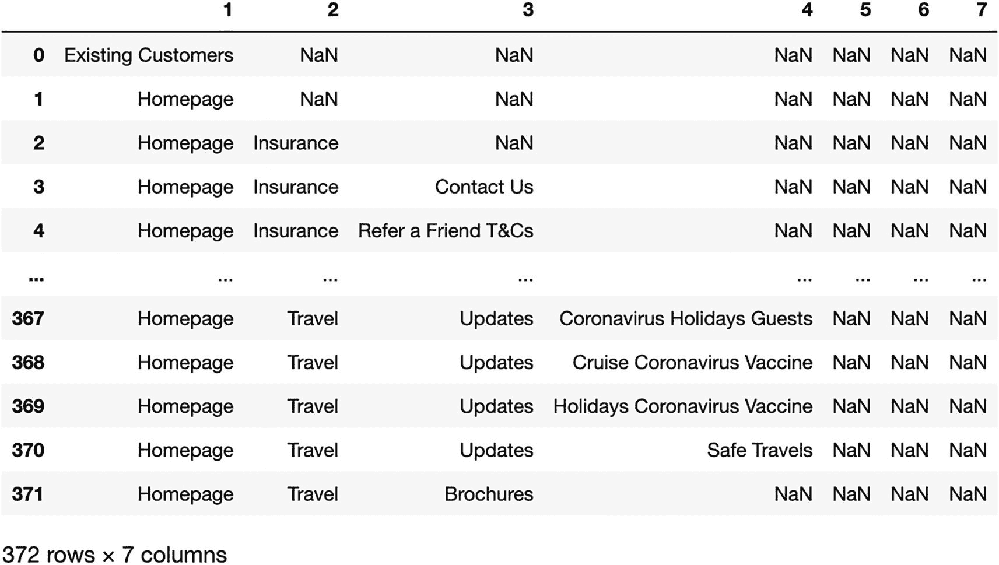
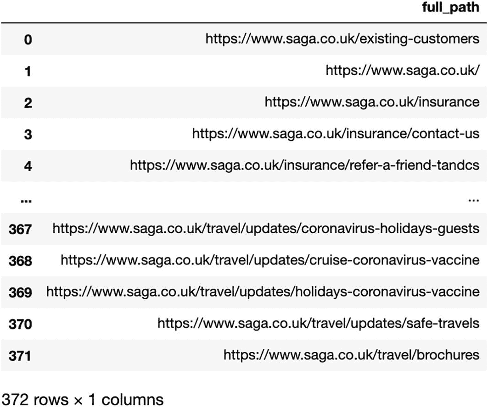

# Forward Fill HOMEPAGE

```python
hierarchy_fp['1'] = hierarchy_fp['1'].ffill()
```

以下是检查右侧单元格是否填充了数据或 `NaN` 的函数：

```python
def has_data_right(idx):
    return hierarchy_fp[hierarchy_fp.columns[idx:]].notnull().apply(any, axis=1)

for c in hierarchy_fp.columns[1:]:
    hierarchy_fp.loc[has_data_right(int(c)), c] = hierarchy_fp.loc[has_data_right(int(c)), c].ffill()

hierarchy_fp
```

以下显示了生成的 `hierarchy_fp` 数据帧，其中包含构建 URL 完整路径所需的所有文件夹名称：



这是一个包含 372 行和 7 列的表格，提供了层级结构数据框架的结果。它包含了现有客户、主页、保险、联系我们、推荐朋友条款与细则、更新、新冠假期客人、邮轮新冠疫苗、假期新冠疫苗以及旅行销售。

有了这个，我们现在可以逐行迭代数据帧，移除空白（`NaN`）并用正斜杠（`/`）连接它们：

```python
min_fp_nonnan = hierarchy_fp
full_paths = []

def find_full_paths(row):
    data = row.values.tolist()
    data = [e for e in data if str(e) not in ('nan')]
    data = '/'.join(data)
    print(data)
    full_paths.append(data)

def apply_ffp(df):
    return df.apply(
        lambda row: find_full_paths(row),
        axis=1
    )

apply_ffp(min_fp_nonnan)
full_paths
```

结果如下：



这是一个包含 372 行和 1 列的表格，提供了 Saga 网站（如现有客户、联系人、保险、安全旅行等）的完整路径 URL。例如，`https://www.saga.co.uk/insurance`。

完整的 URL 路径现已构建并推入数据帧，因此我们可以将其添加到之前创建的 `parent_child_map` 数据帧中。