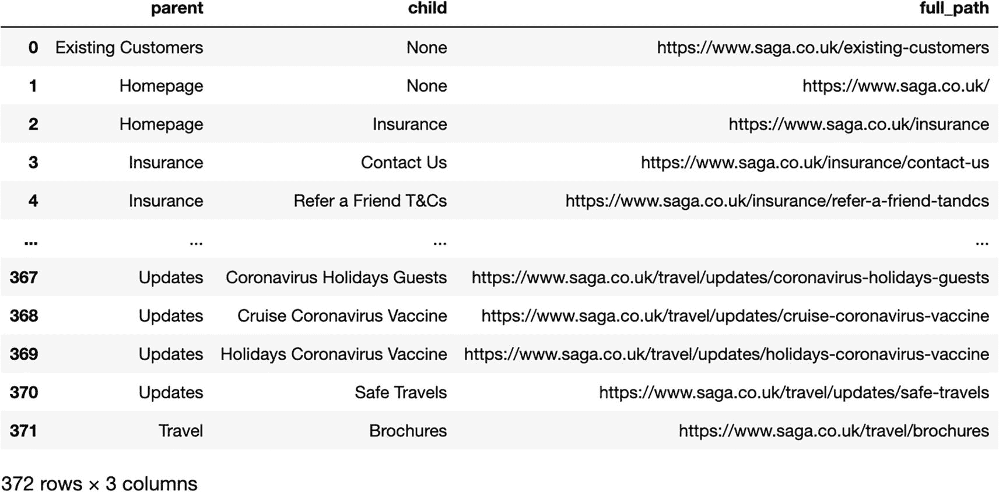
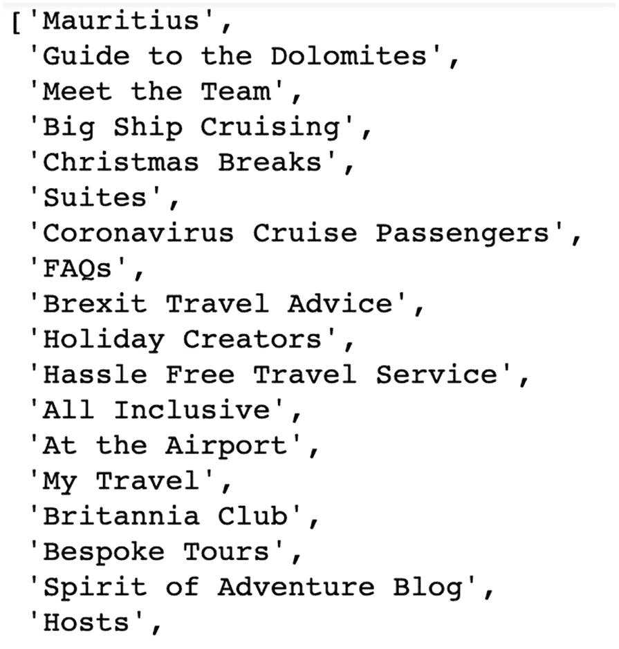
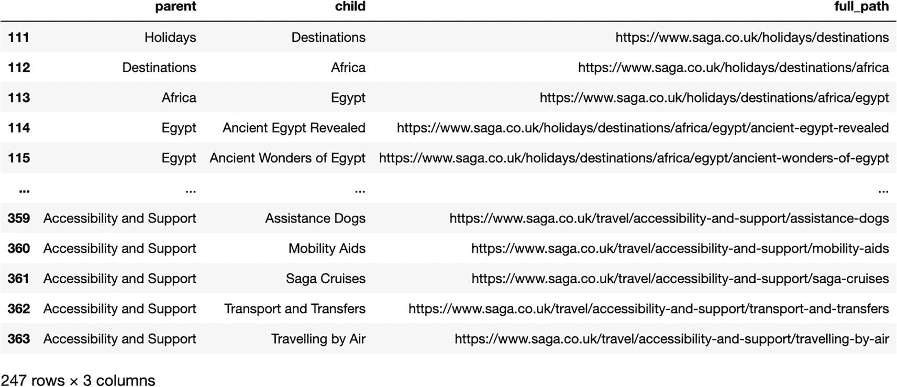
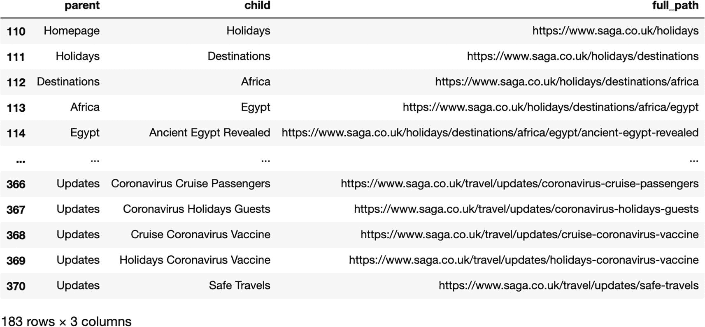
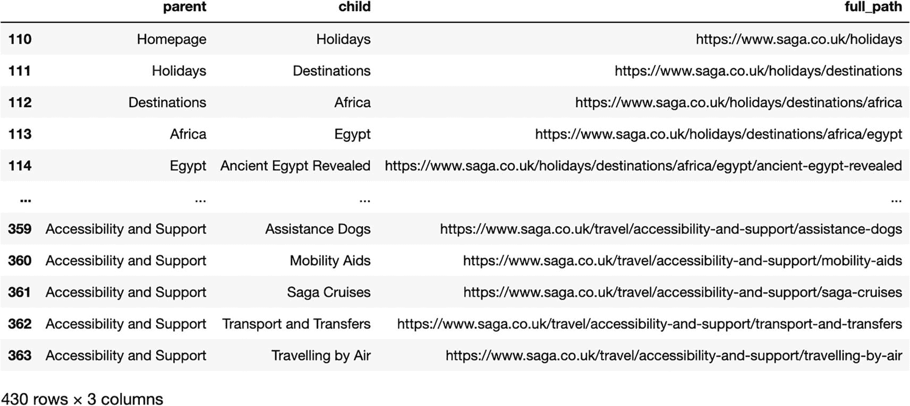
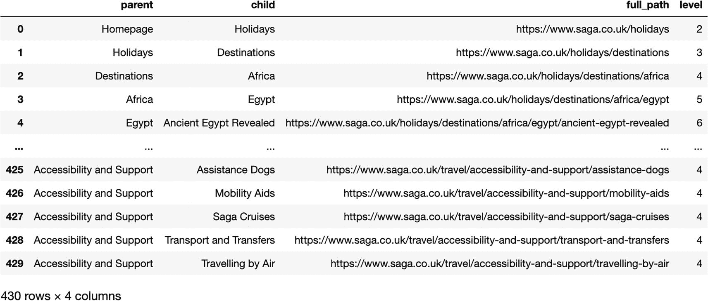
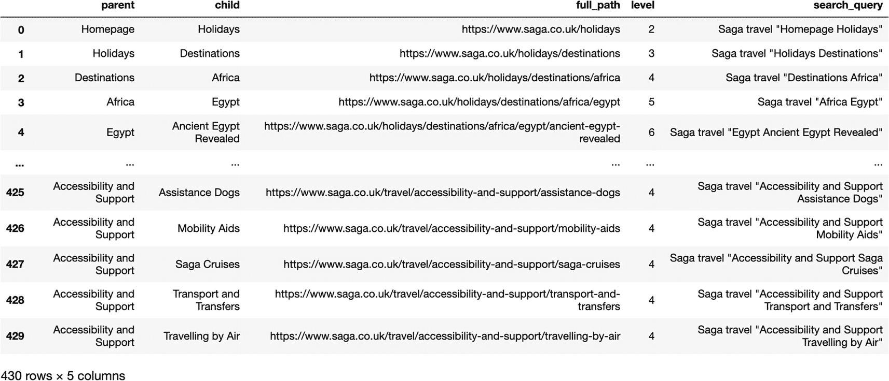
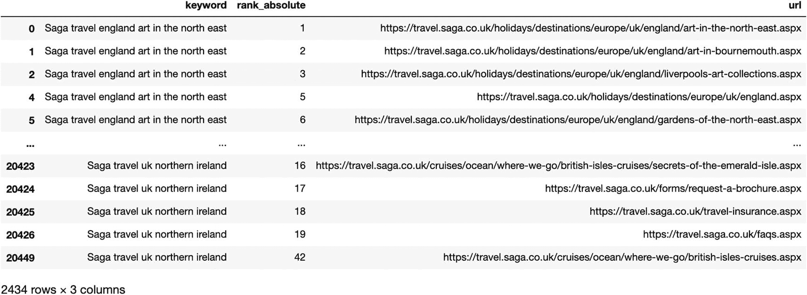
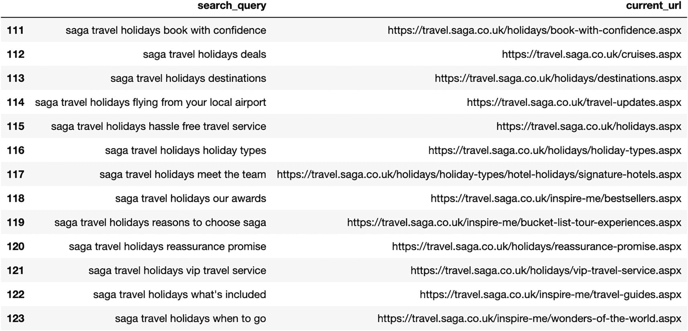
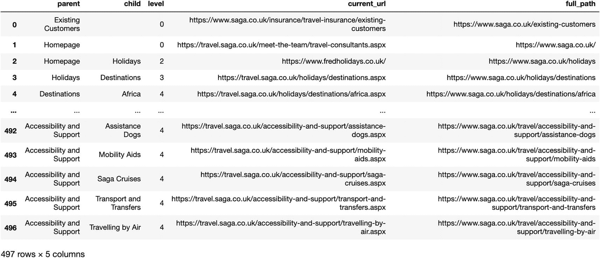

## 合并父节点到完整路径

```python
full_node_map = pd.concat([parent_child_map, full_path_df], axis=1)
full_node_map
```

现在我们有了一个包含节点和完整路径的表格：



一个包含 372 行和 3 列的表格，提供了父节点和子节点的完整路径 URL。它包含了现有客户、主页、保险、联系我们、推荐朋友条款与细则、更新、新冠假期客人、邮轮新冠疫苗、假期新冠疫苗以及旅行销售。

### 分离迁移文档

通常，在大型组织中，不同的业务部门希望为其特定网站提供单独的迁移文档，这是很常见的。接下来，我们将逐行迭代，查找“Travel”部门的所有子节点，并将它们追加到列表 `target_roots` 中：

### 筛选目标业务单元

`target_node_map = full_node_map`

```python
def append_target_pairs(row):
    data = row.values.tolist()
    [target_roots.append(data[1]) for e in data if str(e) in target_roots]

def apply_atp(df):
    return df.apply(
        lambda row:
        append_target_pairs(
            row),
        axis=1
    )

apply_atp(target_node_map)
target_roots = list(set(target_roots))
target_roots
```

结果如下：



一组用于提取旅行节点的 18 行代码。其中包括毛里求斯、多洛米蒂指南、认识团队、大型邮轮巡游、圣诞假期、套房、新冠病毒邮轮乘客、常见问题解答、脱欧旅行服务、全包式旅行、在机场、我的旅行、不列颠尼亚之旅、冒险精神博客以及主持人。

在`target_roots`中提取出旅行节点后，我们现在可以仅筛选旅行 URL，从子节点开始：

```python
#目标子节点
stop_strings = ['insurance', 'breakdown-cover']
target_parent_nodes = target_node_map[~target_node_map.full_path.str.contains('|'.join(stop_strings))]
target_parent_nodes
```

结果如下：



一个包含 247 行和 3 列的表格，提供了父节点和子节点的完整路径 URL 链接。其中包括假期、目的地、非洲、埃及、无障碍与支持、辅助犬、行动辅助设备、Saga 邮轮、交通与接送、乘飞机旅行。

现在来看父节点：

```python
target_parent_nodes = target_node_map[target_node_map.child.isin(first_gen)]
target_parent_nodes
```

结果如下：



一个包含 183 行和 3 列的表格，提供了父节点和子节点的完整路径 URL 链接。其中包括假期、目的地、非洲、埃及、更新、新冠病毒邮轮乘客、新冠病毒假期客人、邮轮新冠病毒疫苗、假期新冠病毒疫苗以及安全旅行。

下一步是将这两者合并到一个表格中：

```python
target_node_map = pd.concat([target_parent_nodes, target_kid_nodes])
target_node_map
```

结果如下：



一个包含 430 行和 3 列的表格截图，提供了目标节点的数据框。列标题为父节点、子节点和完整路径。

成功筛选出旅行网站 URL 后，我们现在将加入站点层级：

```python
nodes_levelled = pd.merge(target_node_map, site_levels, how='left', left_on='child', right_on='node')
del nodes_levelled['node']
nodes_levelled['child'] = np.where(nodes_levelled.child.isnull().values, '', nodes_levelled.child)
nodes_levelled['level'] = np.where(nodes_levelled.level.isnull().values, 0, nodes_levelled.level)
nodes_levelled
```

结果如下：



一个包含 430 行和 4 列的表格截图，提供了站点层级的数据框。列标题为父节点、子节点、完整路径和层级。

站点层级是使用 `pd.merge` 连接的，该功能相当于 `Microsoft Excel` 中的`vlookup`函数。由于两个表中的列名不同，因此必须像前面所示的那样在`left_on`和`right_on`下指定。

## 寻找最匹配的分类 URL

现在我们有了旅行部门的新分类层级 URL 结构，可以开始寻找最匹配的现有网站 URL。你可以尝试在此处使用自然语言处理（NLP）技术，但这将收效甚微。这是因为现有的 URL 字符串可能无法反映提议的 URL 结构，特别是当你希望“清理门户”并为网站重新上线提出更合理的新想法时。

我们在这里采用的方法是让 Google 来完成这项工作，即针对父节点和子节点站点名称的组合，获取搜索结果中排名最高的 URL（如 Google 搜索结果所示）。毕竟，Google 拥有更强大的工具，因此使用它们才是明智之举。

```python
nodes_levelled['search_query'] = target_site_search + ' ' + nodes_levelled.parent + ' ' + nodes_levelled.child
nodes_levelled['search_query'] = target_site_search + ' "' + nodes_levelled.parent + ' ' + nodes_levelled.child + '"'
nodes_levelled
```

结果如下：



一个包含 430 行和 5 列的表格截图，提供了 SERP 查询的数据框。列标题为父节点、子节点、完整路径、层级和搜索查询。

通过组合站点名称以及父节点和子节点，我们形成了将用于获取 SERP 数据的搜索字符串：

```python
serptool_queries = nodes_levelled['search_query'].to_list()
serptool_queries
```

结果如下：

```
'Saga travel homepage holidays',
'Saga travel homepage cruises',
'Saga travel homepage travel updates',
'Saga travel homepage accessibility and support',
'Saga travel homepage brochure request',
'Saga travel homepage trade',
'Saga travel holidays destinations',
'Saga travel destinations africa',
'Saga travel africa egypt',
'Saga travel egypt ancient egypt revealed',
'Saga travel egypt ancient wonders of egypt',
'Saga travel egypt el quseir',
'Saga travel el quseir radisson blu resort',
'Saga travel africa ethiopia', ...
```

使用上述数据，可以通过你最喜欢的 SEO 排名检查工具 API 进行检查，然后加载到笔记本中：

```python
saga_serps = pd.read_csv('client_serps.csv')
saga_serps
```

结果如下：



一个包含 2434 行和 3 列的表格截图，提供了 SERP 笔记本的数据框，其中包含相应的 URL 链接。列标题为关键词、绝对排名和 URL。

之前，我们已经将 SERP 数据加载到笔记本中，显示了关键词、排名位置和 URL。

现在是提取排名最高的 URL 的时候了，方法是按关键词对 SERP 数据框进行分组，然后选择排名最高的 URL（如果尚未被选择）。原因是一个 URL 不能同时重定向到两个不同的 URL；因此，Python 代码中使用的“while”子句正在检查该 URL 是否尚未被用于之前的关键词：

```python
serps_grp = saga_serps.groupby('keyword')
current_allocated = []

def filter_top_serp(df):
    del df['keyword']
    i = 0
    while not df.iloc[i]['url'] in current_allocated:
        if not df.iloc[i]['url'] in current_allocated:
            current_allocated.append(df.iloc[i]['url'])
            return df.iloc[i]
        else:
            i += 1

current_map = serps_grp.apply(filter_top_serp)
```

与初始数据框连接：

```python
current_map_df = pd.concat([current_map], axis=0).reset_index()
del current_map_df['rank_absolute']
current_map_df = current_map_df.rename(columns={'keyword': 'search_query', 'url': 'current_url'})
current_map_df['current_alloc'] = pd.DataFrame({'current_alloc': current_allocated})
current_map_df['current_url'] = np.where(current_map_df.current_url.isnull(),
                                         current_map_df.current_alloc, current_map_df.current_url)
del current_map_df['current_alloc']
current_map_df['search_query'] = current_map_df.search_query.str.lower()
current_map_df
```

结果是一个包含当前 URL 的数据框，我们现在可以将其连接到主表：



一个包含 13 行和 2 列的表格截图，提供了搜索查询及其当前 URL 链接的数据框。

## 将当前 URL 映射到新的分类 URL

以下代码将当前的现有分类层级 URL 连接到提议的新网站 URL：

```python
nodes_levelled['search_query'] = nodes_levelled.search_query.str.lower()
ia_current_mapping = pd.merge(nodes_levelled, current_map_df, on = 'search_query', how = 'left')
ia_current_mapping = ia_current_mapping[['parent', 'child', 'level', 'current_url', 'full_path']]
ia_current_mapping
```

在这里，我们可以看到，无论是这种方法还是谷歌都不是完美的。尽管如此，这是一个良好的开端，并且节省了大量的人工工作。



一张包含 497 行 5 列的表格截图，展示了当前 URL 与建议的新 URL 映射后的数据框。列标题分别为`parent`、`child`、`level`、`current_url`和`full_path`。

让我们通过重命名几个列并将 `NaN` 替换为空白来整理表格：

```python
```