# 重新排列列

```python
ia_current_mapping = ia_current_mapping[['parent', 'child', 'level','search_query', 'current_url', 'full_path']]
ia_current_mapping = ia_current_mapping.rename(columns = {'full_path': 'migration_url'})
ia_current_mapping['current_url'] = np.where(ia_current_mapping.current_url.isnull(), '', ia_current_mapping.current_url)
ia_current_mapping
```

在下表中，你可以看到前五行的`simi`值为零，因为当前 URL 是空白的，所以建议的迁移 URL 与当前 URL 之间的字符串相似度自然为零。

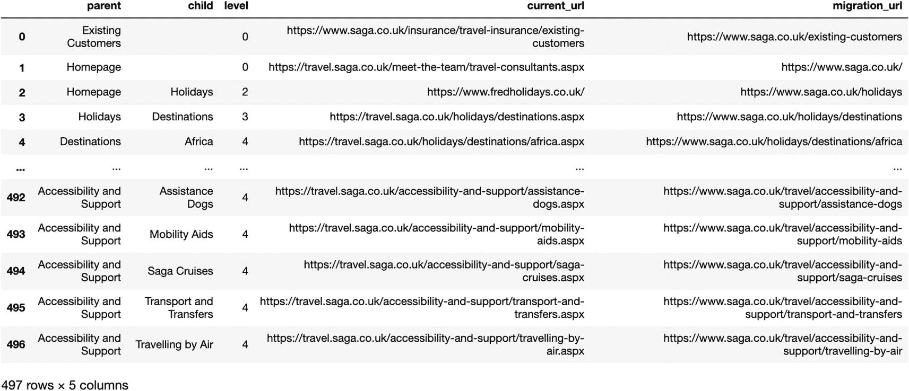

一张包含 497 行 5 列的表格截图，展示了当前 URL 与迁移 URL 映射后的数据框。列标题分别为`parent`、`child`、`level`、`current_url`和`migrated_url`。

表格整理完毕后，我们将使用 NLP 方法来比较当前 URL 的字符串相似度：

```python
ia_current_simi = ia_current_mapping
ia_current_simi = ia_current_simi.drop_duplicates()
ia_current_simi['simi'] = ia_current_simi.loc[
    :, ['current_url', 'migration_url']].apply(
    lambda x: sorensen_dice(*x), axis=1)
ia_current_simi
```

字符串相似度非常有用，因为当我们在 Microsoft Excel 等电子表格应用中审查迁移 URL 时，可以过滤出相似度不高的 URL（例如低于 0.9），这能向我们展示那些可能与迁移 URL 匹配不佳的当前 URL。缺少当前 URL 的行需要手动修复，而从 SERP 中推导出的 URL 则需要审查。

```python
ia_current_mapping.to_csv('exports/' + target_site_search + '_ia_current_mapping.csv')
```

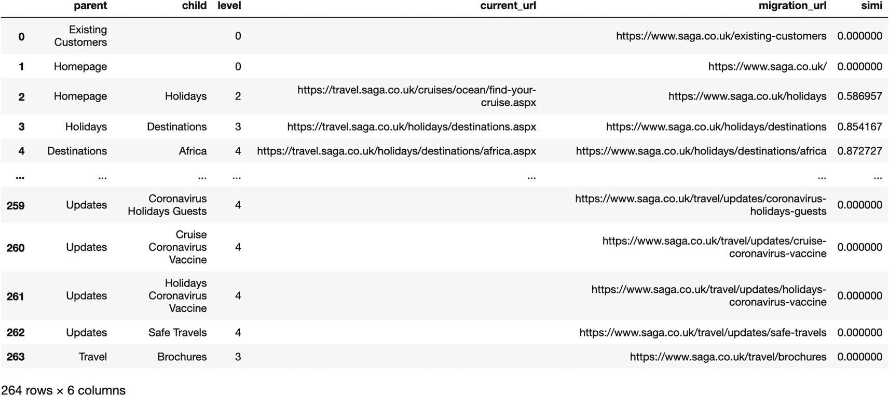

一张包含 264 行 6 列的表格截图，展示了当前 URL 及其字符串相似度的数据框。列标题分别为`parent`、`child`、`level`、`current_url`、`migrated_url`和`simi`。

## 将剩余 URL 映射到迁移 URL

现在，类别 URL 和子类别 URL 的 URL 结构已经设置好，我们可以为网站的其余部分设置迁移 URL 了。我们假设你已经编辑了之前生成的`ia_current_mapping` CSV 导出文件（在 Excel 中），纠正了所有未处理的错误（例如缺失的当前 URL，现在已不再缺失），因此可以准备导入：

```python
import re
import time
import random
import pandas as pd
import numpy as np
import datetime
from textdistance import sorensen_dice
pd.set_option('display.max_colwidth', None)
import os.path
target_site_search = 'saga'
target_bu = 'travel'
target_roots = ['Holidays', 'Cruises', 'Travel Updates', 'Accessibility and Support', 'Brochure Request', 'My Travel', 'Trade']
source_root_url = 'https://travel.saga.co.uk/'
migration_root_url = 'https://www.saga.co.uk/'
source_hostname = 'travel.saga.co.uk'
file_path = 'cases/'+ target_site_search + '/'
latest_mapping_raw = pd.read_csv('data/Saga travel_ia_edited_mapping_dd.csv')
latest_mapping_raw
```

导入的映射是一个经过编辑的 Excel 文件，用于反映在上一节中无法调整的业务和运营需求。

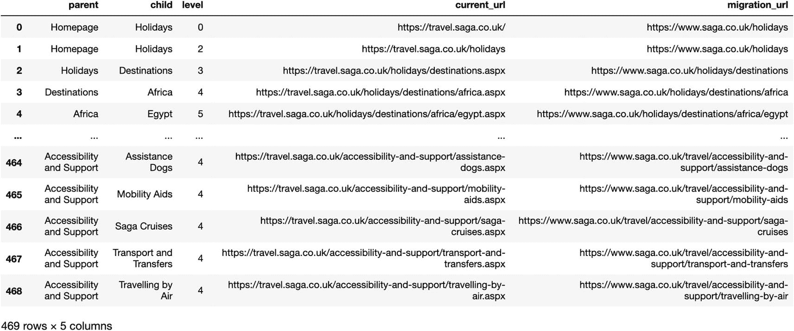

一张包含 469 行 5 列的表格截图，展示了当前 URL 与导入的迁移 URL 映射后的数据框。列标题分别为`parent`、`child`、`level`、`current_url`和`migrated_url`。

在设置了类别和子类别 URL 的 URL 结构后，我们现在将分解当前 URL 和迁移 URL，以便创建一个映射公式。

当我们导入网站其余部分的 URL 时，脚本将使用它们的文件夹结构将其转换为新的迁移 URL 结构：

```python
latest_mapping_full_branch = latest_mapping_raw[['parent', 'child', 'level', 'current_url','migration_url']]
latest_mapping_full_branch['current_url'] = np.where(latest_mapping_full_branch.current_url.isnull(), '', latest_mapping_full_branch.current_url)
```

为了创建新的 URL 结构，创建一个名为`new_branch`的模板变量；我们只需获取迁移 URL，并提取根域名与网页 URL 字符串之间的文件夹。例如，`https://travel.saga.co.uk/holidays/destinations.aspx`的`new_branch`值变为`/holidays/`。为了提取中间的文件夹，我们移除根域名，用正斜杠（`/`）分割字符串，然后提取除最后一个元素之外的所有内容。

设置新的 URL 结构：

```python
latest_mapping_full_branch['new_branch'] = latest_mapping_full_branch['migration_url'].str.replace(migration_root_url, '', regex = False)
latest_mapping_full_branch['new_branch'] = latest_mapping_full_branch['new_branch'].str.split('/').str[:-1]
latest_mapping_full_branch['new_branch'] = ['/'.join(map(str, l)) for l in latest_mapping_full_branch['new_branch']]
```

类似的原则应用于下面的`old_branch`，即当前 URL 的 URL 结构：

```python
latest_mapping_full_branch['old_branch'] = latest_mapping_full_branch['current_url'].str.replace(migration_root_url, '', regex = False)
```

为了使新 URL 更具持久性（即不含日期），我们将所有不需要的字符串放入一个列表中，并告诉 Python 从列表中移除所有内容：

```python
remove_strs = ['2018/', '2019/', '2020/','2021/', 'jan/', 'feb/', 'mar/', 'apr/', 'may/','jun/', 'jul/', 'aug/','sep/','oct/', 'nov/', 'dec/']
latest_mapping_full_branch['old_branch'] = latest_mapping_full_branch['old_branch'].str.replace('|'.join(remove_strs), '')
```

移除节点：

```python
```


`latest_mapping_full_branch['old_branch'] = latest_mapping_full_branch['old_branch'].str.split('/').str[:-1]`

`latest_mapping_full_branch['old_branch'] = latest_mapping_full_branch['old_branch'].apply(lambda x: '/'.join(map(str, x)))`

# 节点是页面本身特有的 URL 字符串，我们按如下方式提取：设置 `NODE`

```
latest_mapping_full_branch['node'] = latest_mapping_full_branch['current_url'].str.split('/').str[-1]
latest_mapping_full_branch['node'] = latest_mapping_full_branch['node'].str.replace('.aspx', '', regex = False)
latest_mapping_full_branch['node'] = latest_mapping_full_branch['node'].str.replace(' ', '-', regex = False)
```

如果任何 `old_branch` 值为空，则直接替换为 `node`。`np.where` 是 Pandas 中与 Excel 的 `if` 语句等效的函数：

```
latest_mapping_full_branch['old_branch'] = np.where(latest_mapping_full_branch['old_branch'] == '', latest_mapping_full_branch.node, latest_mapping_full_branch['old_branch'])
```

`latest_mapping_full_branch`

结果如下：

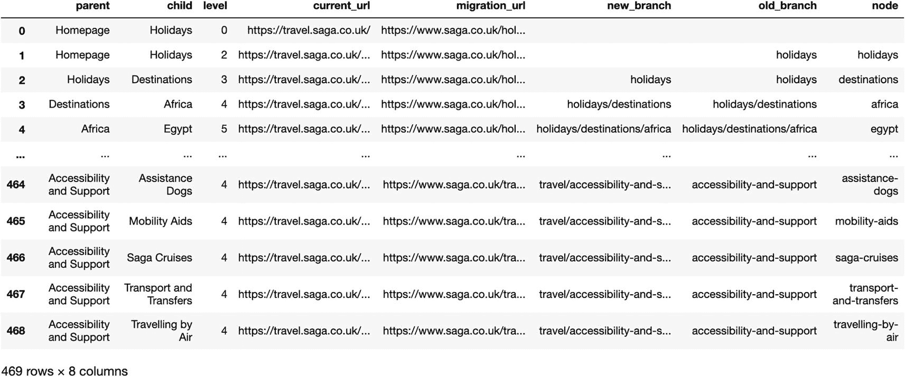

一张包含 469 行和 8 列的数据表截图，展示了最新映射节点的数据框。列标题分别为 `parent`、`child`、`level`、`current URL`、`migrated URL`、`new branch`、`old branch` 和 `node`。

在分解并重构 URL 结构后，我们就可以开始构建映射关系了。接下来进行一些清理工作，包括删除重复行以及移除 `current_url` 值为空的行。虽然我们预计此阶段不会出现异常，但以防万一。

```
branch_map = latest_mapping_full_branch
branch_map = branch_map.sort_values('old_branch')
branch_map = branch_map.drop_duplicates(subset = 'old_branch')
branch_map = branch_map[~branch_map['current_url'].isnull()]
branch_map = branch_map[['old_branch', 'new_branch']]
branch_map['new_branch'] = np.where(branch_map['new_branch'] == '', 'holidays', branch_map['new_branch'])
```

`branch_map`

结果如下：

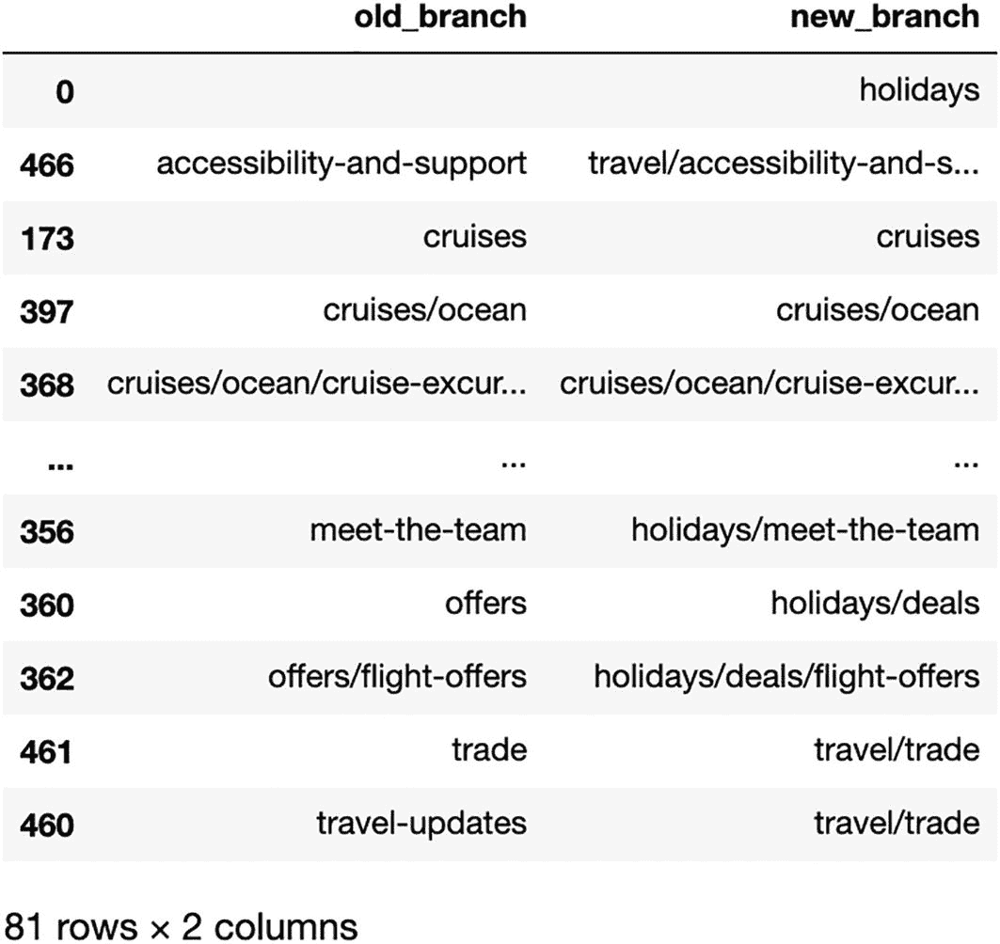

一张包含 81 行和 2 列的数据表截图，展示了 `new branch` 和 `old branch` 节点的数据框。

## 导入 URL

映射关系准备就绪后，我们就可以导入 URL 并将其适配到新的迁移结构中：

```
# DETERMINE the unallocated URLs
target_crawl_raw = pd.read_csv('data/crawl_urls.csv')
```

`target_crawl_raw`

我们将移除那些不会随网站重新上线而迁移的 URL 和子文件夹：

```
target_crawl_urls = target_crawl_raw
stop_folders = ['/membership/', '/magazine/', '/saga-charities/', '/legal/',
                '/money/', '/my/', '/care/', '/magazine-subscriptions/',
                '/membership', '/magazine', '/saga-charities', '/legal',
                '/money', '/my', '/care', '/magazine-subscriptions', 'boardbasis',
                '/antiquity', '/pharaoh', '/orca', '/italy-splendour', '/walking', '/archaeology',
                '/gardens', '/music', '/MyS', '/404', '/contentli']
target_crawl_urls = target_crawl_urls[~target_crawl_urls['URL'].str.contains('|'.join(stop_folders))]
target_crawl_urls = target_crawl_urls[target_crawl_urls['Host'].str.contains('www.saga.co.uk')]
```

`target_crawl_urls`

结果如下：

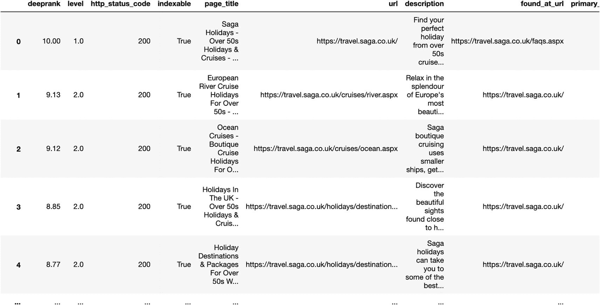

一张包含 5 行和 8 列的数据表截图，展示了目标爬取 URL 的数据框。列标题分别为 `deep rank`、`level`、`status code`、`indexable`、`page title`、`URL`、`description` 和 `found URL`。

爬取数据已就绪，现在已将其子集化为我们想要迁移的 URL。接下来，我们将这些 URL 放入一个列表中，以确保其唯一性：

```
current_url_lst = latest_mapping_full_branch.current_url.to_list()
mapped_url_lst = list(set(current_url_lst))
print(len(mapped_url_lst))
```

然后，我们创建一个新的数据框 `target_crawl_unmigrated`，用于排除已映射的 URL（即类别和子类别 URL）：

```
target_crawl_unmigrated = target_crawl_urls[~target_crawl_urls['URL'].isin(mapped_url_lst)]
```

`target_crawl_unmigrated`

在此阶段，检查是否存在任何重定向（300 响应）以及其他非 `200` 服务器状态的 URL 是明智之举：

```
target_crawl_unmigrated.groupby('HTTP Status Code').agg({'HTTP Status Code': 'count'})
```

结果如下：

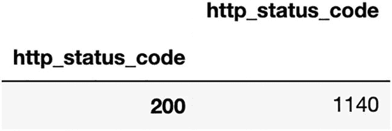

最终 HTTP 状态码为 200 和 1140 的截图。

我们可以看到，所有尚未迁移的过滤 URL 均提供实时页面（返回 200 响应）。如果存在 301 状态码，我们可以使用以下代码检查这些 301 URL：

```
target_crawl_unmigrated[target_crawl_unmigrated['HTTP Status Code'] == '301'][[url]]
```

要处理重定向 URL，我们需要确保它们被包含在映射中，以便在迁移网站 URL 时避免重定向链。重定向链是指从初始请求 URL 到最终目标 URL 之间存在多次重定向。我们将通过确保这些 URL 被列为当前 URL 来实现这一点。

修改 `old_branch` 列：

```
target_crawl_mutate = target_crawl_unmigrated
target_crawl_mutate = target_crawl_mutate.rename(columns = {'url': 'current_url'})
```

创建条件列表：

```
redirect_conds = [
    target_crawl_mutate['http_status_code'].isin(['200', '204', '404', '410', '500']),
```


## 处理重定向问题

`target_crawl_mutate['http_status_code'].isin(['301', '302', '307', '308'])`

]

创建每个条件对应的赋值列表：

```
desturl_values = [target_crawl_mutate['current_url'],
                  target_crawl_mutate['redirected_to_url'],
                 ]
```

创建新列并使用 `np.select` 根据条件列表赋值：

```
target_crawl_mutate['dest_url'] = np.select(redirect_conds, desturl_values)
target_crawl_mutate = target_crawl_mutate[['dest_url']]
target_crawl_mutate = target_crawl_mutate.rename(columns = {'dest_url': 'current_url'})
```

至此，重定向问题已处理完毕。

## 分解URL为映射结构

以下代码将使用之前步骤创建的表格，将 URL 分解为可用于映射的结构：

```
target_crawl_mutate['old_branch'] = target_crawl_mutate['current_url'].str.replace(source_root_url, '', regex = False)
remove_strs = ['2018/', '2019/', '2020/','2021/', 'jan/', 'feb/', 'mar/', 'apr/', 'may/','jun/',
               'jul/', 'aug/','sep/','oct/', 'nov/', 'dec/']
target_crawl_mutate['old_branch'] = target_crawl_mutate['old_branch'].str.replace('|'.join(remove_strs), '')
target_crawl_mutate['old_branch'] = target_crawl_mutate['old_branch'].str.split('/').str[:-1]
target_crawl_mutate['node'] = target_crawl_mutate['current_url'].str.split('/').str[-1]  # 仅节点部分
target_crawl_mutate['node'] = target_crawl_mutate['node'].str.replace('.aspx', '', regex = False)
target_crawl_mutate['node'] = target_crawl_mutate['node'].str.replace(' ', '-', regex = False)
target_crawl_mutate['old_branch'] = target_crawl_mutate.old_branch.apply(lambda x: '/'.join(map(str, x)))
target_crawl_mutate
```

以下爬取数据 `target_crawl_mutate` 现在包含旧分支信息，这意味着经过少量清理（删除不必要的列名）后，我们可以将这些数据与之前创建的分支映射表合并，以帮助制定迁移 URL。

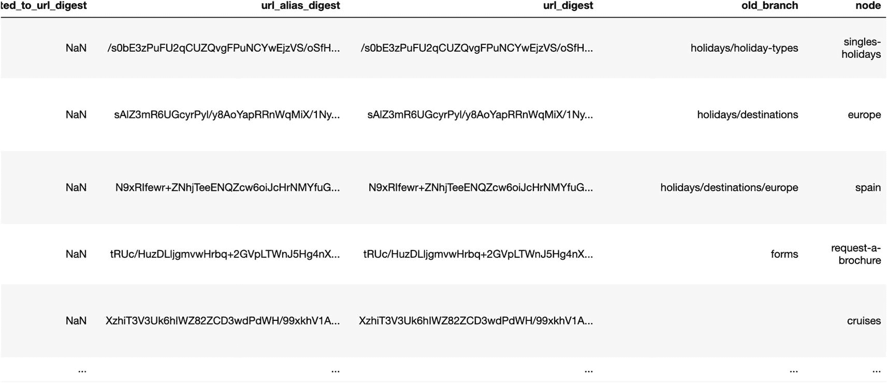

一个包含 5 行 5 列的表格截图，展示了目标爬取变异 URL 的数据框。列标题依次为：变异 URL 摘要、URL 别名摘要、URL 摘要、旧分支和节点。

## 查找新分支

现在我们来查找新分支，因为剩余 URL 中可能存在未完全覆盖的旧分支（即未匹配的异常情况）：

```
unallocated_branch = target_crawl_mutate[['current_url', 'http_status_code', 'old_branch', 'node']]
unallocated_branch = unallocated_branch.merge(branch_map, on = 'old_branch', how = 'left')
unallocated_branch
```

结果如下：

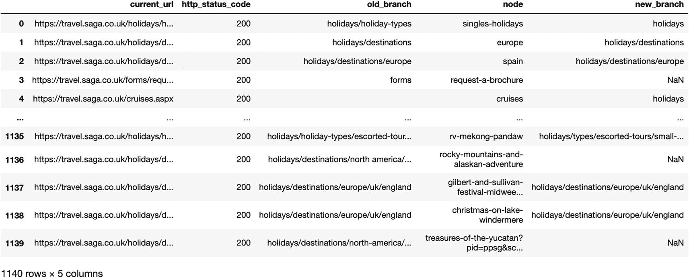

一个包含 1140 行 5 列的表格截图，展示了新建议迁移 URL 的数据框。列标题依次为：当前 URL、HTTP 状态码、旧分支、节点和新分支。

## 清理新分支为空值

未迁移的 URL 现在拥有了建议的 URL 结构，可用于创建新列以生成建议的迁移 URL。我们将先进行少量清理，以处理新分支为空值的情况。

```python
allocated_fillnb = unallocated_branch
allocated_fillnb['new_branch'] = np.where(allocated_fillnb.new_branch.isnull(),
                                          '',
                                          allocated_fillnb.new_branch)
allocated_fillnb['new_branch'] = np.where(allocated_fillnb.new_branch == '',
                                          allocated_fillnb.old_branch,
                                          allocated_fillnb.new_branch)
allocated_fillnb = allocated_fillnb[allocated_fillnb.new_branch != '']
allocated_fillnb.sort_values('new_branch')
```

这将产生以下结果：

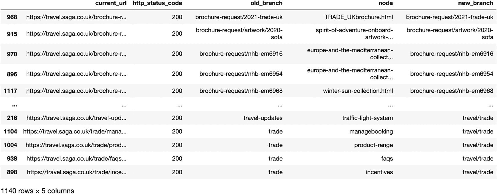

一张包含 1140 行 5 列的数据表截图，展示了针对文本位置的新建议迁移 URL 的数据框。列标题分别为 `current URL`、`http status code`、`old branch`、`node` 和 `new branch`。

## 处理URL节点

接下来需要进行更多清理工作，以处理包含参数字符（如 `?` 和 `=`）的 URL 节点。然后，我们尝试根据这些节点在整个 URL 字符串中的文本位置，创建显示其 `Parent` 和 `Child` URL 节点文件夹的列：

```python
allocated_draft = allocated_fillnb
allocated_draft['node'] = np.where(allocated_draft['node'].str.contains('(\?|=)'),
                                   '',
                                   allocated_draft['node'])
allocated_draft['Parent'] = allocated_draft['new_branch']
allocated_draft['Parent'] = allocated_draft['Parent'].str.split('/').str[0]
allocated_draft['Child'] = allocated_draft['new_branch'].str.split('/').str[1]
allocated_draft['Child'] = np.where(allocated_draft['Child'].isnull(),
                                    allocated_draft['node'],
                                    allocated_draft['Child']
                                   )
allocated_draft
```

这将产生以下结果：

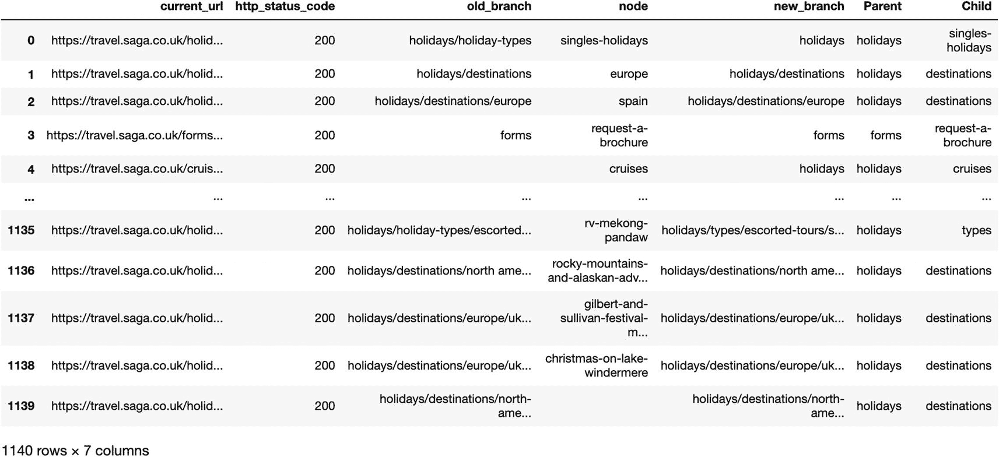

一张包含 1140 行 7 列的数据表截图，展示了新分支 URL 的数据框。列标题分别为 `current URL`、`http status code`、`old branch`、`node`、`new branch`、`parent` 和 `child`。

上表现在包含了 `Parent` 和 `Child` 文件夹。在此阶段，我们希望在整合迁移 URL 之前，确保新的 URL 结构（`new_branch`）归属于新旅游网站的主要板块之一。

## 转换根文件夹名称

将根父文件夹名称转换为小写：

```python
target_roots_urled = [elem.lower() for elem in target_roots]
target_roots_urled = [elem.replace(' ', '-') for elem in target_roots_urled]
print(target_roots_urled)
```

整理分支：

```python
sorted_branches = []
def change_urls(row):
    data = row.values.tolist()
    #print(data)
    if not data[-2] in target_roots_urled:
```


```python
data[-3] = 'holidays/' + str(data[-3])

    sorted_branches.append(data)

def apply_cip(df):

    return df.apply(lambda row: change_urls(row), axis=1)

apply_cip(allocated_draft)

allocated_drafted = pd.DataFrame(sorted_branches, columns=allocated_draft.columns.tolist())

pd.set_option('display.max_colwidth', 35)

allocated_drafted
```

这将产生以下结果：

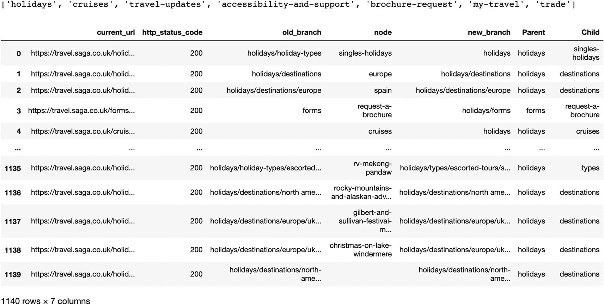

一张包含 1140 行 7 列的数据表截图，展示了排序后的新分支 URL 的数据框。列标题分别为`current URL`、`http status code`、`old branch`、`node`、`new branch`、`parent`和`child`。

任何在前文打印的列表中未找到父节点的文件夹，都会被分配到`holidays`下。这在 90%的情况下应该是正确的。现在开始构建草稿迁移 URL：

```python
allocated_drafted['Migration URL'] = migration_root_url + allocated_drafted.new_branch + '/' + allocated_drafted.node

allocated_drafted['Migration URL'] = np.where(allocated_drafted['Migration URL'].str.endswith('/'),

allocated_drafted['Migration URL'].str[:-1],

allocated_drafted['Migration URL'])

allocated_drafted['Parent'] = allocated_drafted['Parent'].str.replace('-', ' ')

allocated_drafted['Parent'] = allocated_drafted['Parent'].str.title()

allocated_drafted['Child'] = allocated_drafted['Child'].str.replace('-', ' ')

allocated_drafted['Child'] = allocated_drafted['Child'].str.title()
```

转换为小写：

```python
allocated_drafted['Migration URL'] = allocated_drafted['Migration URL'].str.lower()

pd.set_option('display.max_colwidth', 25)

allocated_drafted
```

这将产生以下结果：

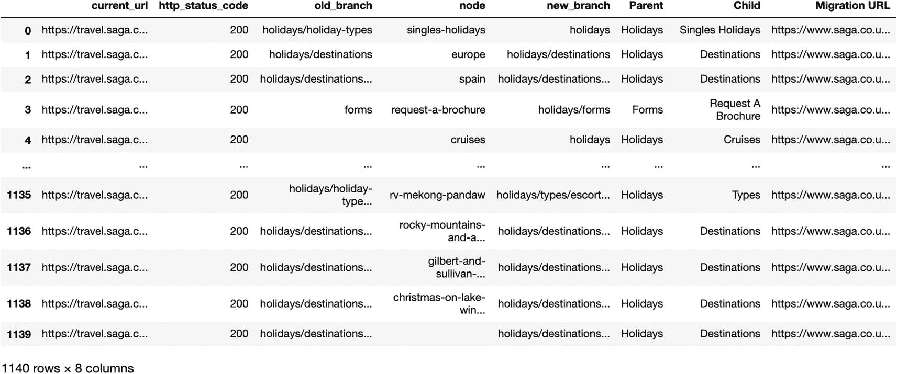

一张包含 1140 行 8 列的数据表截图，展示了草稿迁移 URL 的数据框。列标题分别为：当前 URL、HTTP 状态码、旧分支、节点、新分支、父级、子级和迁移 URL。

通过拼接域名、新分支和节点，迁移 URL 现已完整生成：

```python
allocated_drafted['migration_url'] = migration_root_url + allocated_drafted.new_branch + '/' + allocated_drafted.node

allocated_drafted['migration_url'] = np.where(allocated_drafted['migration_url'].str.endswith('/'),

allocated_drafted['migration_url'].str[:-1],

allocated_drafted['migration_url'])

allocated_drafted['Parent'] = allocated_drafted['Parent'].str.replace('-', ' ')

allocated_drafted['Parent'] = allocated_drafted['Parent'].str.title()

allocated_drafted['Child'] = allocated_drafted['Child'].str.replace('-', ' ')

allocated_drafted['Child'] = allocated_drafted['Child'].str.title()
```

转换为小写：

```python
allocated_drafted['migration_url'] = allocated_drafted['migration_url'].str.lower()

allocated_drafted.columns = allocated_drafted.columns.str.lower()

pd.set_option('display.max_colwidth', 25)

allocated_drafted
```

结果如下：

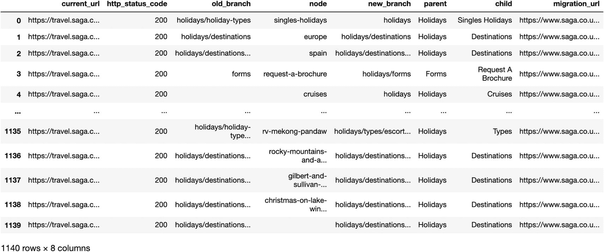

一张包含 1140 行 8 列的数据表截图，展示了迁移 URL 的数据框。列标题分别为：当前 URL、HTTP 状态码、旧分支、节点、新分支、父级、子级和迁移 URL。

为了准备将剩余 URL 与原始最新映射合并，我们需要添加站点层级并进行一些基本检查，例如删除重复的当前 URL（毕竟，同一个 URL 不能重定向到两个或更多不同的 URL）。

站点层级通过计算迁移 URL 中斜杠的数量并减一得出。这意味着首页层级为 1，所有其他页面都以此为基础进行引用。

```python
allocated_distinct = allocated_drafted

allocated_distinct = allocated_distinct.drop_duplicates(subset = 'current_url')

allocated_distinct['migration_url'] = allocated_distinct['migration_url'].str.replace('/holidays/cruises/', '/cruises/')

allocated_distinct['migration_url'] = allocated_distinct['migration_url'].str.replace(' ', '-')

allocated_level = allocated_distinct

allocated_level['level'] = allocated_level.migration_url.str.count('/') - 1

allocated_level = allocated_level[['parent', 'child', 'level', 'current_url', 'migration_url']]

pd.set_option('display.max_colwidth', 65)

allocated_level
```

结果如下：

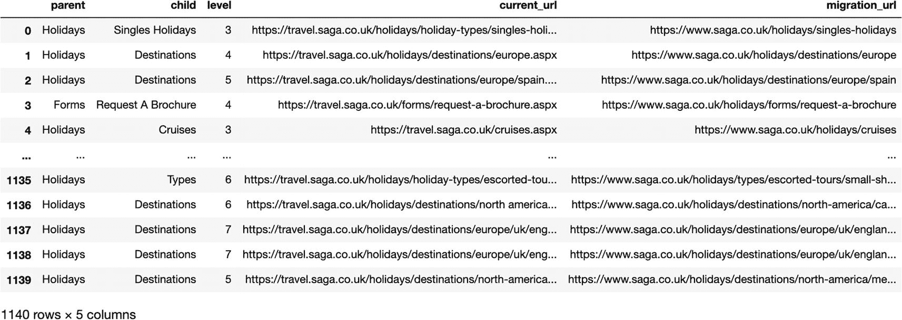

一张包含 1140 行 5 列的数据表截图，展示了当前 URL 和迁移 URL 的数据框。列标题分别为：父级、子级、层级、当前 URL 和迁移 URL。

现在列与原始导入的旅行映射相匹配，我们可以进行合并了：

```python
total_mapping = pd.concat([latest_mapping_raw, allocated_level])

total_mapping
```

结果如下：

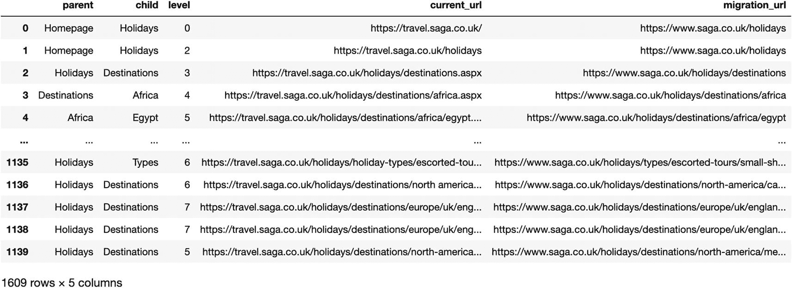

一张包含 1609 行 5 列的数据表截图，展示了总映射 URL 的数据框。列标题分别为：父级、子级、层级、当前 URL 和迁移 URL。

行现已合并。接下来我们将删除重复行，并计算当前 URL 与迁移 URL 之间的字符串相似度，这将有助于我们对导出文件进行人工审核：

```python
total_mapping_simi = total_mapping.drop_duplicates(subset = 'current_url')

total_mapping_simi['simi'] = total_mapping_simi.loc[

:, ['current_url', 'migration_url']].apply(

lambda x: sorensen_dice(*x), axis=1)
```


total_mapping_simi.to_csv('exports/' + target_site_search + '_' + target_bu + '_total_mapping_simi.csv')

`total_mapping_simi`

结果如下：

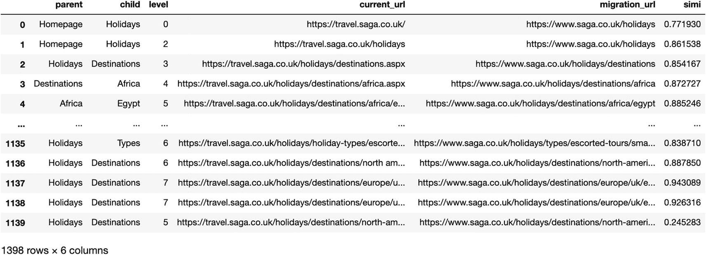

## 迁移映射与流量取证分析

一个包含 1398 行和 6 列的表格截图提供了总映射 URL 的字符串相似度数据框。列标题为：`parent`、`child`、`level`、`current URL`、`migrated URL`和`simi`。

我们现在有了准备在 Excel 中审查的迁移映射。注意行数已减少，因为重复的当前 URL 已被消除。我们还添加了一个新列`simi`，用于标记那些“迁移 URL 与当前 URL 相似度低于 75%”的 URL。虽然并非万无一失，但这将有助于快速发现和排序任何异常情况。

迁移规划可能会让许多 SEO 从业者感到挑战和畏惧。AI 和数据科学尚未发展到足以完全自动化，更不用说半自动化大部分网站迁移规划过程的程度。大部分进展将取决于 SEO 行业可用的 AI 级别的 NLP 模型，以可靠地理解、缩减和映射现有内容 URL 到新 URL。

下一节将讨论网站迁移后流量损失的故障排除。

### 迁移取证

此时，我们的任务是找出迁移后发生了什么变化以及哪些内容受到了影响。我们将采取以下步骤：

1. 流量趋势
2. 确定变化点
3. 确定获胜和失败的内容
4. 收集迁移前后的 URL 列表以供爬取
5. 分组和分段 URL
6. 诊断
7. 建议路线图

像往常一样，我们开始导入库。你会注意到一些包包含了来自`textdistance`的字符串距离函数和`timedelta`，以帮助我们处理时间序列数据：

```python
import pandas as pd
import numpy as np
from textdistance import sorensen_dice
from plotnine import *
import datetime
from datetime import timedelta
from textdistance import sorensen_dice

root_url = 'https://www.saasforecom.com'
root_domain = 'saasforecom.com'
hostname = 'saasforecom'
```

### 流量趋势

导入库并设置变量后，我们将从 Google Analytics（GA）导入数据。我们使用 GA 是因为它能提供按日期划分的详细数据，而 Google Search Console（GSC）在没有大量采样的情况下很难做到这一点。

```python
ga_orgdatelp_raw = pd.read_csv('data/Analytics www.salesorder.com All Traffic 20200901-20201231.csv', skiprows = 5)
```

这里，我们删除不属于 GA 表格导出默认主表的行：

```python
ga_orgdatelp_raw = ga_orgdatelp_raw[~ga_orgdatelp_raw['Landing Page'].isnull()]
ga_orgdatelp_raw = ga_orgdatelp_raw[~ga_orgdatelp_raw['Sessions'].isnull()]
```

为了使列名更整洁，我们将执行一系列字符串操作：

```python
ga_orgdatelp_raw.columns = ga_orgdatelp_raw.columns.str.lower()
ga_orgdatelp_raw.columns = ga_orgdatelp_raw.columns.str.replace('/', '', regex = False)
ga_orgdatelp_raw.columns = ga_orgdatelp_raw.columns.str.replace('.', '', regex = False)
ga_orgdatelp_raw.columns = ga_orgdatelp_raw.columns.str.replace('% ', '', regex = False)
ga_orgdatelp_raw.columns = ga_orgdatelp_raw.columns.str.replace('  ', ' ', regex = False)
ga_orgdatelp_raw.columns = ga_orgdatelp_raw.columns.str.replace(' ', '_', regex = False)
ga_orgdatelp_raw = ga_orgdatelp_raw[ga_orgdatelp_raw['landing_page'] != '/pages/login.aspx']
ga_orgdatelp_raw
```

结果如下：

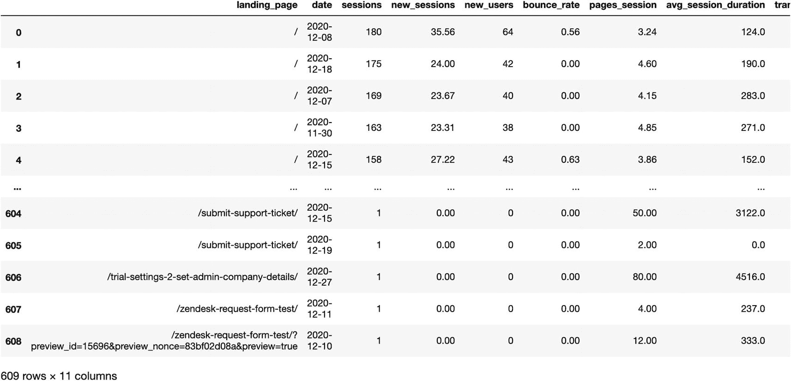

一个包含 609 行和 11 列的表格截图提供了导入变量值的数据框。列标题为：`landing page`、`date`、`sessions`、`new sessions`、`new users`、`bounce rate`、`pages session`和`average session duration`。

数据导入且列名清理并格式化后，我们将开始清理列内的实际数据。这同样会使用字符串操作来移除特殊字符，并将数据类型转换为数字而非字符串。

清理 GA 数据：

```python
ga_clean = ga_orgdatelp_raw
```

格式化日期：

```python
ga_clean['date'] = pd.to_datetime(ga_clean.date, format='%Y%m%d')
ga_clean['bounce_rate'] = ga_clean.bounce_rate.str.replace('%', '')
ga_clean['bounce_rate'] = ga_clean.bounce_rate.astype(float)
ga_clean['new_sessions'] = ga_clean.new_sessions.str.replace('%', '')
ga_clean['new_sessions'] = ga_clean.new_sessions.astype(float)
ga_clean['ecommerce_conversion_rate'] = ga_clean.ecommerce_conversion_rate.str.replace('%', '')
ga_clean['ecommerce_conversion_rate'] = ga_clean.ecommerce_conversion_rate.astype(float)
ga_clean['revenue'] = ga_clean.revenue.str.replace('$', '')
ga_clean['revenue'] = ga_clean.revenue.astype(float)
ga_clean['avg_session_duration'] = ga_clean.avg_session_duration.str.replace('<', '')
ga_clean['avg_session_duration'] = pd.to_timedelta(ga_clean.avg_session_duration).astype(int) / 1e9
ga_clean
```

结果如下：

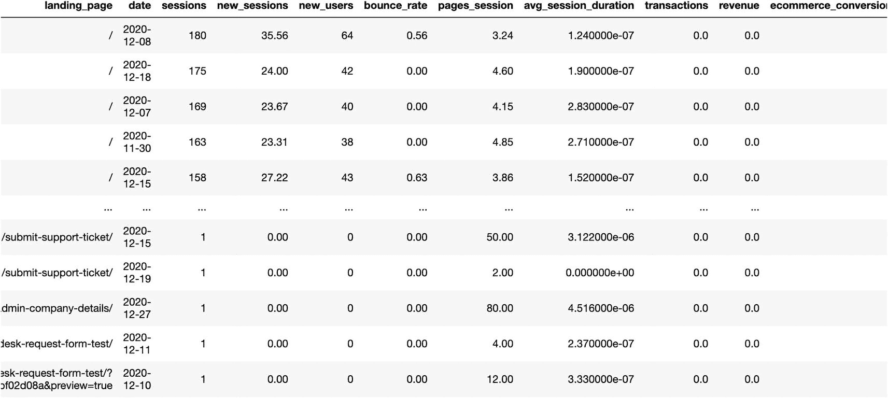

一个包含 609 行和 11 列的表格截图提供了导入变量值的数据框。列标题为：`landing page`、`date`、`sessions`、`new sessions`、`new users`、`bounce rate`、`pages session`、`average session duration`、`transactions`、`revenue`和`ecommerce conversion`。

```python
ga_stats = ga_clean
```

我们选择实际需要的列。你可能注意到有些列被清理后最终并未使用。这看似浪费精力，但你并不总是知道将来需要什么或用于什么目的。因此，清理列是一种良好的标准实践，以便在后续发现需要时数据已准备就绪。

```python
ga_stats = ga_stats[['landing_page', 'date', 'new_sessions', 'avg_session_duration']]
ga_stats = ga_stats.rename(columns = {'landing_page': 'subpath'})
ga_stats
```

# 数据导入与预处理

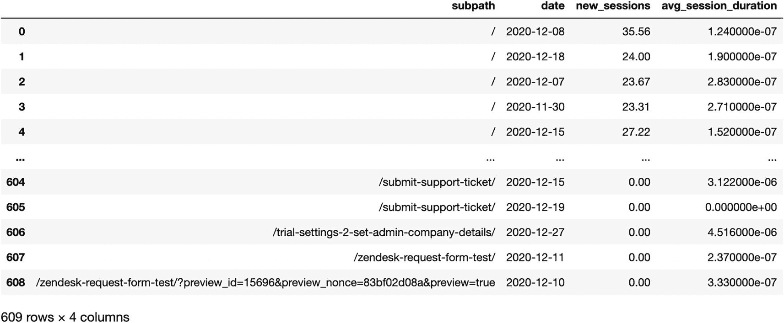
一个包含 609 行和 4 列的表格截图提供了导入子路径的数据框。列标题为：`subpath`、`date`、`new sessions`和`average session duration`。

## 导入GSC数据

导入GSC页面数据以获取所有用于爬取的唯一URL：

```python
all_gsc_raw = pd.read_csv('data/throughout_Pages.csv')

all_gsc_raw.columns = all_gsc_raw.columns.str.lower()

all_gsc_raw.columns = all_gsc_raw.columns.str.replace('/', '', regex = False)

all_gsc_raw.columns = all_gsc_raw.columns.str.replace('.', '', regex = False)

all_gsc_raw.columns = all_gsc_raw.columns.str.replace('% ', '', regex = False)

all_gsc_raw.columns = all_gsc_raw.columns.str.replace('  ', ' ', regex = False)

all_gsc_raw.columns = all_gsc_raw.columns.str.replace(' ', '_', regex = False)

all_gsc_raw['ctr'] = all_gsc_raw.ctr.str.replace('%', '', regex = False)

print(all_gsc_raw.head())

all_gsc_urls = all_gsc_raw[['top_pages']]

all_gsc_urls = all_gsc_urls.rename(columns = {'top_pages': 'url'}).drop_duplicates()

all_gsc_urls
```

结果如下：

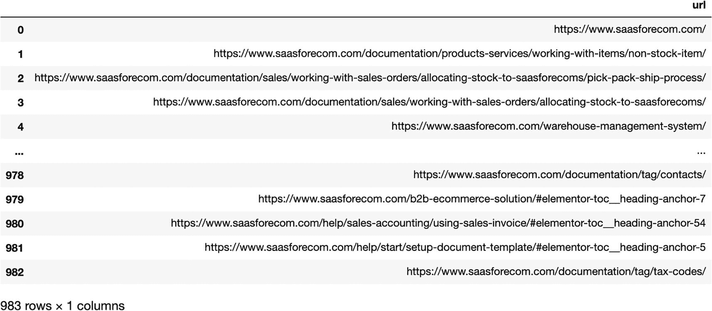
一个包含 983 行和 1 列的表格截图提供了导入的 GSC URL 链接的数据框。

## 导入GA数据

GA URL 也将被提取并连接到域名，准备爬取：

```python
ga_raw_urls = ga_raw_comb[['landing_page']]

ga_raw_urls = ga_raw_urls.rename(columns = {'landing_page': 'url'}).drop_duplicates()

ga_raw_urls['url'] = root_url + ga_raw_urls['url']

ga_raw_urls
```

结果如下：

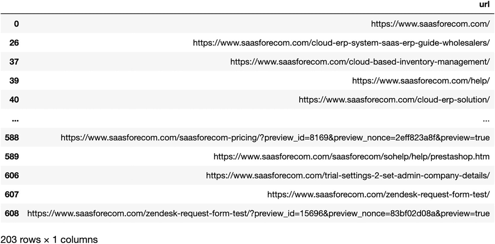
一个包含 203 行和 1 列的表格截图提供了导入的 GA URL 链接的数据框。

## 合并URL

合并 GA 和 GSC 的 URL，去除重复项，准备爬取：

```python
crawl_urls = pd.concat([ga_raw_urls, all_gsc_urls]).drop_duplicates()

crawl_urls.to_csv('data/urls_to_crawl.csv')

crawl_urls
```

结果如下：

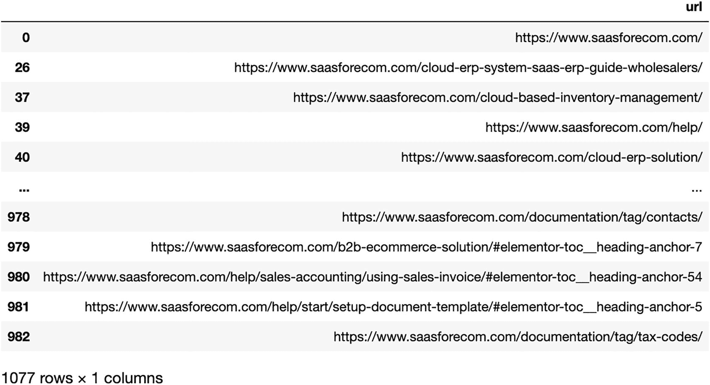
一个包含 1077 行和 1 列的表格截图提供了导入的爬取 URL 链接的数据框。

## 数据爬取与审计

完成爬取后，我们准备导入数据、清洗列并查看原始数据：

```python
audit_urls_raw = pd.read_csv('data/all_urls__excluding_uncrawled__filtered_20210803163126.csv')

audit_urls_raw.columns = audit_urls_raw.columns.str.lower()

audit_urls_raw.columns = audit_urls_raw.columns.str.replace('/', '', regex = False)

audit_urls_raw.columns = audit_urls_raw.columns.str.replace('.', '', regex = False)

audit_urls_raw.columns = audit_urls_raw.columns.str.replace('% ', '', regex = False)

audit_urls_raw.columns = audit_urls_raw.columns.str.replace('  ', ' ', regex = False)

audit_urls_raw.columns = audit_urls_raw.columns.str.replace(' ', '_', regex = False)

#audit_urls_raw['ctr'] = audit_urls_raw.ctr.str.replace('%', '', regex = False)

#audit_urls_raw.drop_duplicates()

audit_urls_raw
```

结果如下：

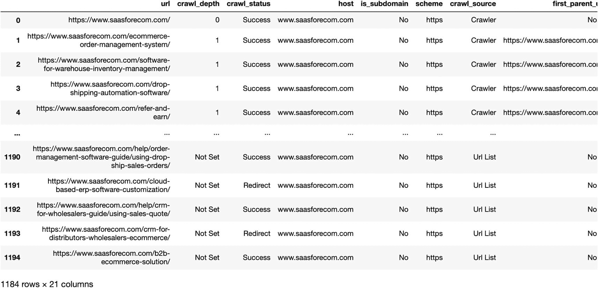
一张包含 1184 行和 21 列的表格截图，展示了导入的审计 URL 链接的数据框。列标题包括 URL、爬取深度、爬取状态、主机是否为子域名、协议、爬取来源、第一父级 1 等。

我们可以看到，大部分服务器状态尚未提取。这很可能是爬取软件中的一个错误。最好的做法是向软件供应商反映此问题，并以更长的超时设置和更慢的速度重新爬取，以改善数据。

```python
audit_urls_raw.groupby('final_redirect_url_status_code').size()

# 输出：
# final_redirect_url_status_code
# 200        452
# 404          1
# Not Set    731
# dtype: int64
```

重新爬取后，我们最多只能得到 452 个 URL。接下来，我们要确保删除任何包含重复 URL 的行：

```python
audit_urls_map = audit_urls_raw.drop_duplicates(subset = ['url']).reset_index()

audit_urls_map.to_csv('exports/audit_urls_map.csv')

audit_urls_map
```

结果如下：

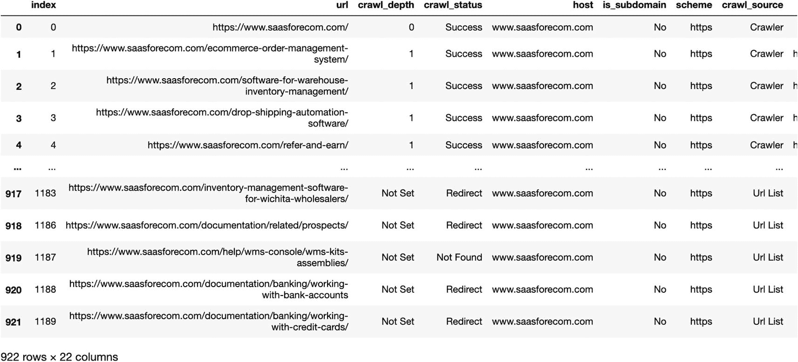
一张包含 922 行和 22 列的表格截图，展示了审计 URL 映射的数据框。列标题包括索引、URL、爬取深度、爬取状态、主机、是否为子域名、协议、爬取来源等。

行数现已从 1122 行减少到 922 行。接下来，我们将查找最终的重定向 URL，以便了解 URL 的映射目标。同样，这个看似多余的步骤是为了克服审计软件可能产生的任何故障。

## 准备数据评估列

准备用于内容评估的列：

```python
audit_urls = audit_urls_map[['url', 'redirect_url', 'final_redirect_url']]

ult_dest_url = []
```

此函数将接收一行，将其转换为列表，并取出最后一个不等于“No Data”的值，然后将该 URL 存入之前创建的列表`ult_dest_url`中：

```python
def find_ult_dest_url(row):

    data = row.values.tolist()

    data = [e for e in data if str(e) not in ('No Data')]

    data = data[-1]

    #print(data)

    ult_dest_url.append(data)
```

通过调用以下函数来逐行处理数据框，从而应用上述函数。这种方式被认为计算量较小，肯定比`iterrows`更快：

```python
def apply_fudu(df):

    return df.apply(lambda row: find_ult_dest_url(row), axis=1)
```

调用`apply_fudu`函数，该函数会调用`find_ult_dest_url`函数：

```python
apply_fudu(audit_urls)
```

现在将生成的列表转换为数据框：

```python
ult_dest_url_df =  pd.DataFrame(ult_dest_url, columns=['ult_dest_url'])

ult_dest_url_df
```

# 数据准备与URL映射

结果如下：

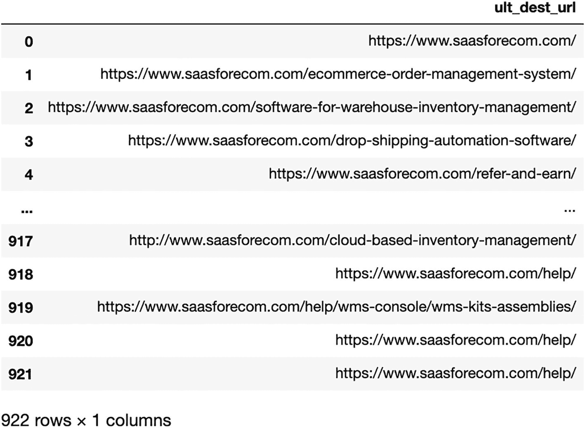

一张包含 922 行和 1 列的表格截图，展示了最终目标 URL 链接的数据框。

将该数据框追加到审计数据框：

```
audit_urls_map_prep = audit_urls_map.join(ult_dest_url_df)
audit_urls_map_prep
```

结果如下：

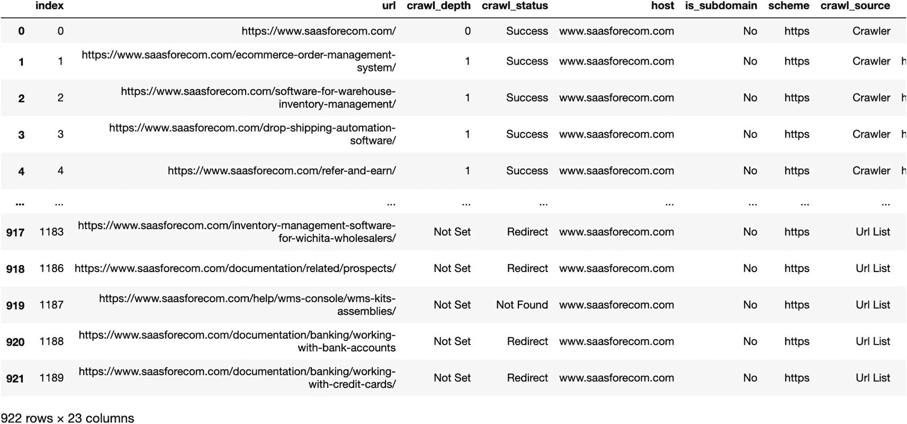

一张包含 922 行和 23 列的表格截图，展示了审计 URL 映射的数据框。列标题包括索引、`URL`、爬取深度、爬取状态、主机、是否为子域名、协议、爬取来源等。

找到最终目标 URL 后，我们需要一种简单的方法来测试它们的相似程度。我们可以通过测量 URL 与重定向 URL 之间的字符串距离来实现。我们将使用 `Sorensen-Dice` 算法，该算法对于 SEO 目的来说快速且有效：

```
audit_urls_map_prep['content_simi'] = audit_urls_map_prep.loc[:, ['url', 'ult_dest_url']].apply(lambda x: sorensen_dice(*x), axis=1)
audit_urls_map = audit_urls_map_prep
audit_urls_map
```

结果如下：

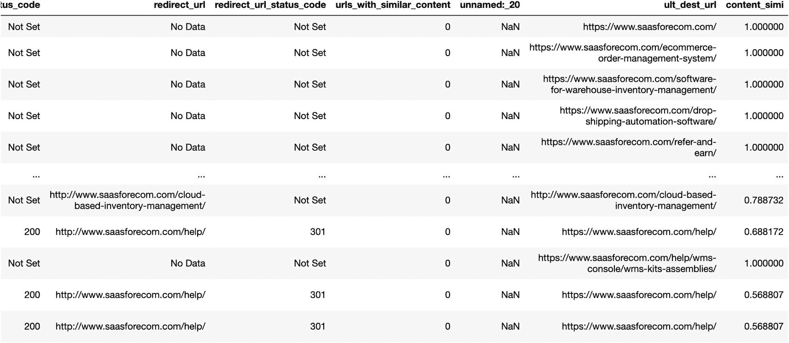

一张包含 922 行和 23 列的表格截图，展示了带有字符串相似度的审计 URL 映射数据框。列标题包括状态码、重定向 URL、重定向 URL 状态、内容相似的 URL、未命名 20、最终目标 URL、内容相似度等。

## 对 URL 进行分段

有了所有这些审计 URL，我们希望理解它们，以便能够按内容类型辨别趋势。由于手头没有训练好的神经网络，我们将使用一种虽然粗糙但有用的方法，即按 URL 地址对 URL 进行分组。这种方法不仅快速，而且成本低廉，因为你不需要数百万个内容文档来训练 AI 按内容类型对网页文档进行分类。

我们将从提取 URL 开始，并确保它们在放入数据框之前是唯一的：

```
crawled_urls_unq = audit_urls_raw.url.drop_duplicates().to_frame()
crawled_urls_unq
```

结果如下：

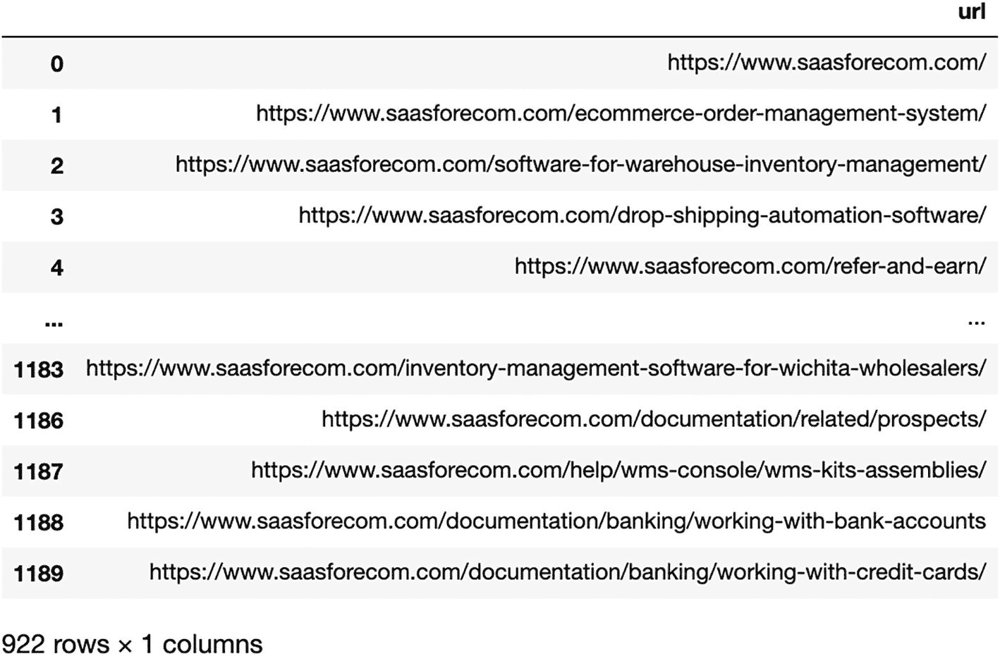

一张包含 922 行和 1 列的表格截图，展示了已爬取 URL 链接的数据框。

```
all_urls = pd.concat([crawl_urls, crawled_urls_unq])
all_urls = all_urls.drop_duplicates()
all_urls
```

结果如下：

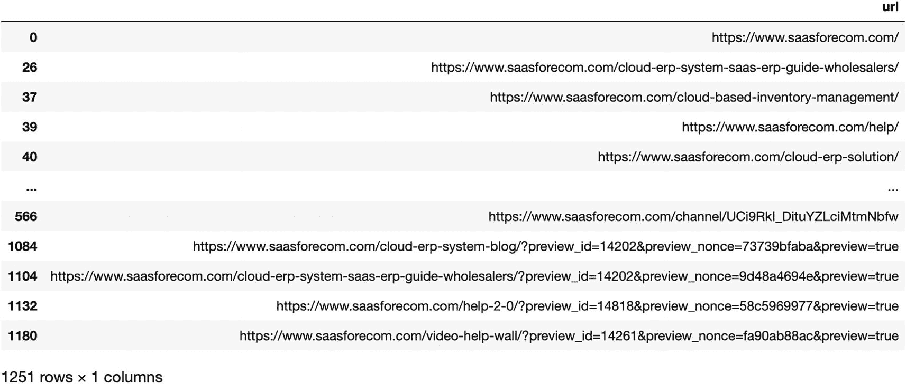

一张包含 1251 行和 1 列的表格截图，展示了所有导入的 URL 链接的数据框。

这段代码清理了 URL，为后续的文本处理做好准备，以便我们可以开始对 URL 进行分组。我们将从移除 URL 的域名部分开始，因为这部分在所有 URL 中都是恒定的：

```
classified_start = all_urls[['url']]
classified_start['slug'] = classified_start.url.str.replace(root_url, '', regex = True)
```

首页可以立即被分类：

```
classified_start['slug'] = np.where(classified_start.slug == "/", "home", classified_start.slug)
```

以下代码将处理日期，这些日期对分类没有价值：

```
classified_start['slug'] = classified_start.slug.str.replace("\\d{4}\\-(0[1-9]|1[012])\\-(0[1-9]|[12][0-9]|3[01])", '', regex = True)
```

移除单词之间多余的空格：

```
classified_start['slug'] = classified_start.slug.str.replace("[^\w\s]", " ", regex = True)
```

移除开头和结尾的空格：

```
classified_start['slug'] = classified_start.slug.str.strip()
classified_start = classified_start.reset_index()
del classified_start['index']
classified_start.head(10)
```

结果如下：

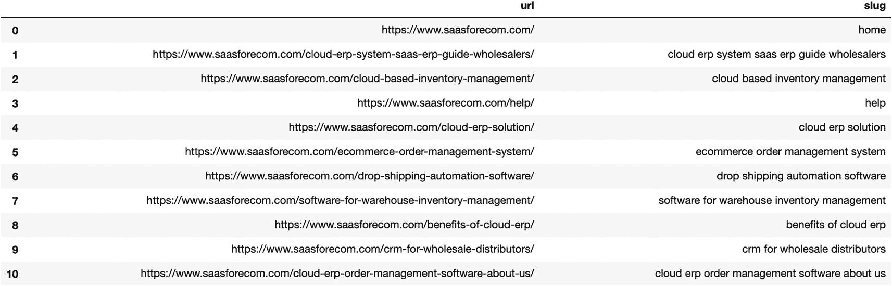

一张包含 11 行和 1 列的表格截图，展示了导入的 `URL` 和 `slug`。

结果是去除了所有字符的 URL 单词，即 `slug`。我们希望应用一些数字来了解优先级，因此我们将使用 GSC 流量数据来对 `slug` 进行加权。

获取 GSC 流量数据：

```
url_clicks_gsc = all_gsc_raw[['top_pages', 'clicks']]
url_clicks_gsc = url_clicks_gsc.rename(columns = {'top_pages': 'url'})
url_clicks_gsc
```

结果如下：

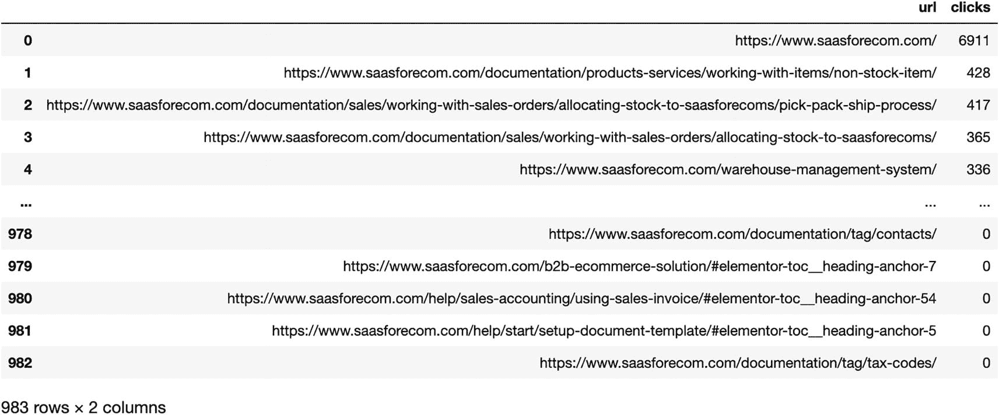

一张包含 983 行和 2 列的表格截图，展示了导入的 `URL` 和点击量。

然后将其合并到之前的 `URL slug` 表中：

```python
classified_stats = classified_start.merge(url_clicks_gsc, on = 'url', how = 'left')
```

移除没有点击量的 `URL`。请在此处明智地选择你的 GSC 日期范围。如果你只选择了 28 天，那么可能存在季节性偏差的风险，因为某些内容在一年中的特定时间可能没有流量。我们的建议是选择 16 个月，这是从 GSC 中提取数据的最大可能范围。

```python
classified_stats = classified_stats[classified_stats.clicks > 0]
classified_stats
```

结果如下：

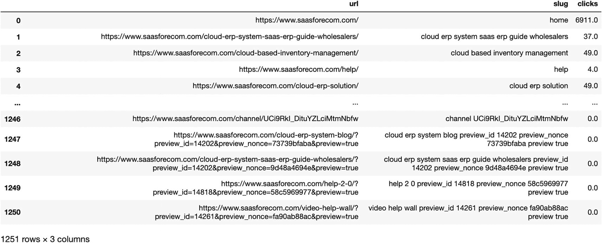

一张包含 1251 行和 3 列的数据表截图，展示了导入的 `URL`、`slug` 和点击量数据框。

我们将把 `slug` 列拆解为单个词（unigrams）。这意味着将 `slug` 列扩展为多行，使得 `slug` 中的每个单词都单独占有一行，作为一列：

```python
bigrams = classified_stats['slug']
bigrams = bigrams.str.split(' ').explode().to_frame()
bigrams = bigrams.rename(columns = {'slug': 'ngram'})
bigrams.head(10)
```

结果如下：

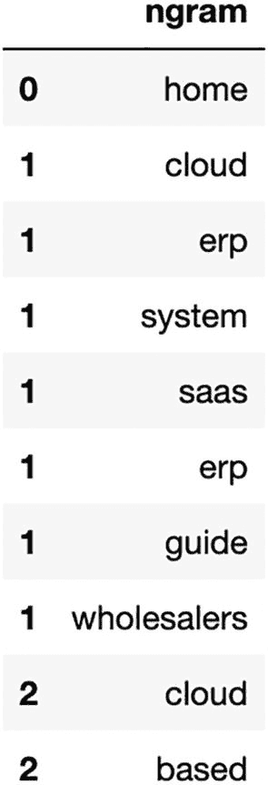

一张包含 10 行和 1 列的数据表截图，展示了将 `slug` 拆解为 `n-gram` 后的数据框。

将 `slug` “拆解”为 `n-gram` 后，这些 `n-gram` 将被映射回其原始 `URL` 和流量统计表：

```python
bigrams_df = classified_stats.join(bigrams)
bigrams_df.head(20)
```

结果如下：

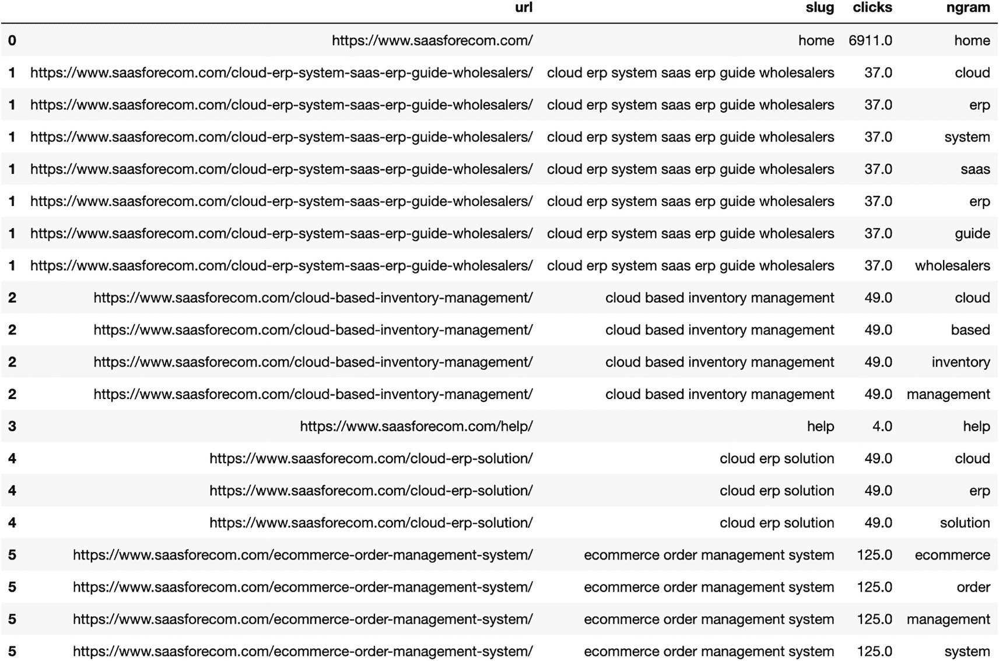

一张包含 20 行和 4 列的数据表截图，展示了原始 `URL` 与 `n-gram` 映射后的数据框。列标题为 `URL`、`slug`、点击量和 `n-gram`。

数据合并后，我们需要移除一些包含停用词和其他无助于创建分组名称的词语的行。

温馨提示：这段代码特意写得有些重复，目的是让你多加练习并形成肌肉记忆，尽管有更聪明的方法（比如使用列表和 `'|'.join(list)`）可以用两行代码完成整个操作：

```python
bigrams_df = bigrams_df[['url', 'ngram', 'clicks']]
bigrams_df = bigrams_df[~bigrams_df.ngram.str.contains(r'\band\b', regex = True)]
```

## 数据清洗与特征工程

`bigrams_df = bigrams_df[~bigrams_df.ngram.str.contains(r'\bfor\b', regex = True)]`

`bigrams_df = bigrams_df[~bigrams_df.ngram.str.contains(r'\bto\b', regex = True)]`

`bigrams_df = bigrams_df[~bigrams_df.ngram.str.contains(r'\ba\b', regex = True)]`

`bigrams_df = bigrams_df[~bigrams_df.ngram.str.contains(r'\ban\b', regex = True)]`

`bigrams_df = bigrams_df[~bigrams_df.ngram.str.contains(r'\bin\b', regex = True)]`

`bigrams_df = bigrams_df[~bigrams_df.ngram.str.contains(r'\bcom\b', regex = True)]`

`bigrams_df = bigrams_df[~bigrams_df.ngram.str.contains(r'\bwww\b', regex = True)]`

`bigrams_df = bigrams_df[~bigrams_df.ngram.str.contains(r'\bthe\b', regex = True)]`

`bigrams_df = bigrams_df[~bigrams_df.ngram.str.contains(r'\busing\b', regex = True)]`

`bigrams_df = bigrams_df[~bigrams_df.ngram.str.contains(r'\bwith\b', regex = True)]`

`bigrams_df = bigrams_df[~bigrams_df.ngram.str.contains(r'\b(http|https)\b', regex = True)]`

`bigrams_df['ngram'] = bigrams_df.ngram.str.strip()`

`bigrams_df = bigrams_df[~bigrams_df.ngram.isnull()]`

`bigrams_df`

结果如下：

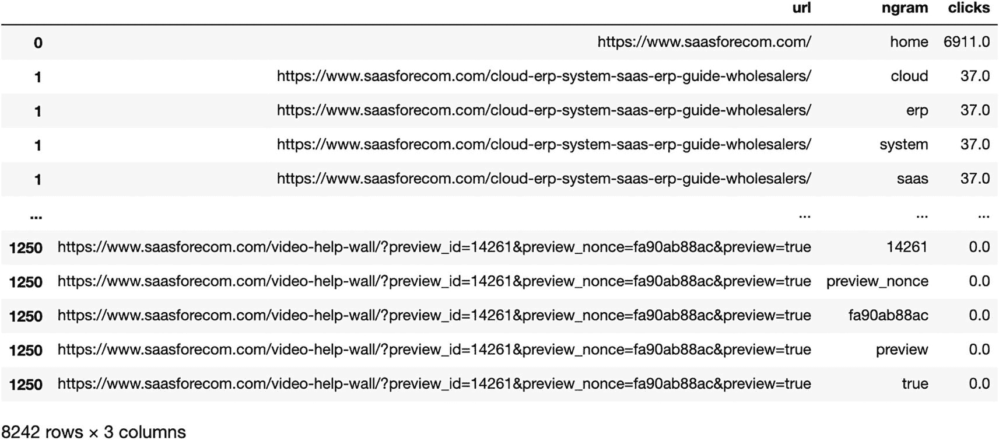

一张包含 8242 行和 3 列的数据表截图，展示了原始 URL 与 n-gram 映射后的数据框。列标题为 URL、n-gram 和点击量。

现在表格中的 n-gram 标签更加合理，可以对其进行汇总聚合，以选出每个 URL 最常见的标签：

```python
bigram_stats = bigrams_df[['ngram', 'clicks']]

bigram_stats = bigram_stats[bigram_stats.ngram.str.contains(r'[\w\s]', regex = True)]

ngram_ins = pd.DataFrame(bigram_stats.value_counts(subset=['ngram']), columns = ['count'])

bigram_stats = bigram_stats.merge(ngram_ins, on = 'ngram', how = 'left')
```

这里的思路是基于流量和 n-gram 标签的实例数量来创建一个索引：

```python
bigram_stats['g_score'] = bigram_stats['clicks'] * bigram_stats['count']

bigram_stats = bigram_stats.sort_values('g_score', ascending = False).reset_index()

del bigram_stats['index']

bigram_stats.head(10)
```

结果如下：

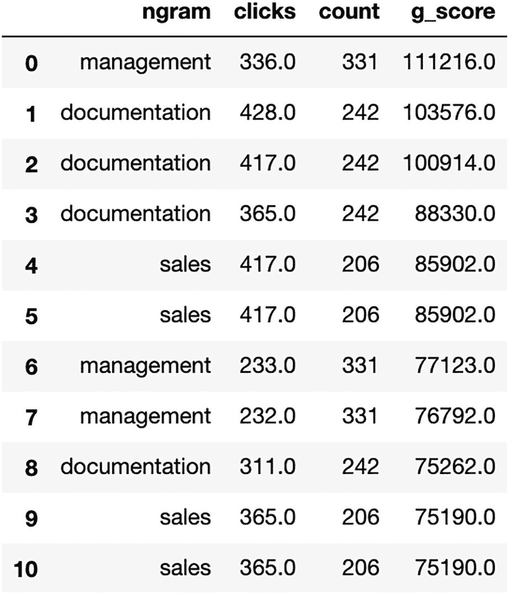

一张包含 11 行和 4 列的数据表截图，展示了带有 g 分数的 n-gram 数据框。列标题为 n-gram、点击量、计数和 g 分数。

现在我们有了一个包含 n-gram 及其统计数据和最终分数的表格。以下函数将为每个 n-gram 选择最高分：

```python
def filter_highest_stat(df, delcol, metric):

    del df[delcol]

    max_count = df[metric].max()

    df = df[df[metric] == max_count]

    df = df.iloc[0]

    return df

ngram_stats_map = bigram_stats.groupby('ngram').apply(lambda x: filter_highest_stat(x, 'ngram', 'g_score')).reset_index()

ngram_stats_map = ngram_stats_map.sort_values('g_score', ascending = False).reset_index()

del ngram_stats_map['index']

ngram_stats_map.head(10)
```

结果如下：

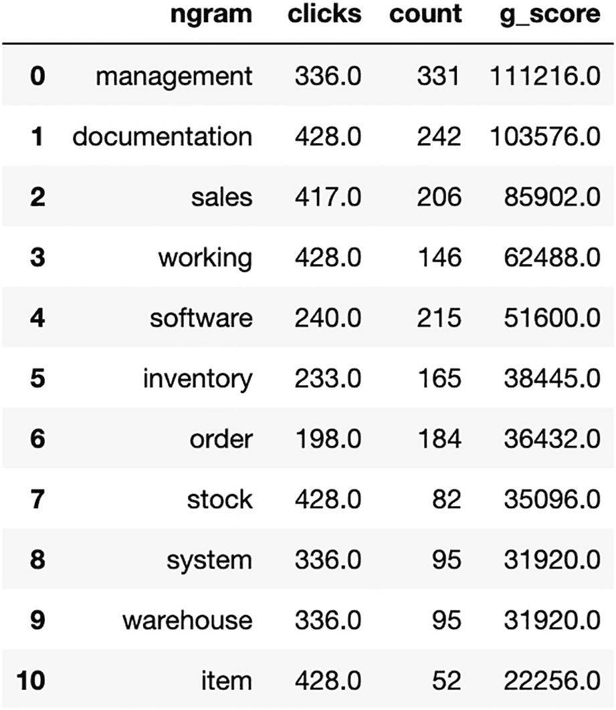

一张包含 11 行和 4 列的数据表截图，展示了带有 g 分数的 n-gram 数据框。列标题为 n-gram、点击量、计数和 g 分数。

结果是一个优先级表格，显示了最常用的 n-gram，这些 n-gram 可用于将 URL 分类为不同的细分。

利用这些分数，我们将创建两个层级的细分，将最流行的 n-gram 作为标签，同时将剩余的归类为“其他”。我们创建两个层级是为了能够提供更宏观和更详细的视图。

```python
ngram_segments = ngram_stats_map[['ngram', 'g_score']]

ngram_segments['segment_one'] = np.where(ngram_segments.index < 11, ngram_segments.ngram, 'other')

ngram_segments['segment_two'] = np.where(ngram_segments.index < 21, ngram_segments.ngram, 'other')

ngram_segments.head(10)
```

结果如下：

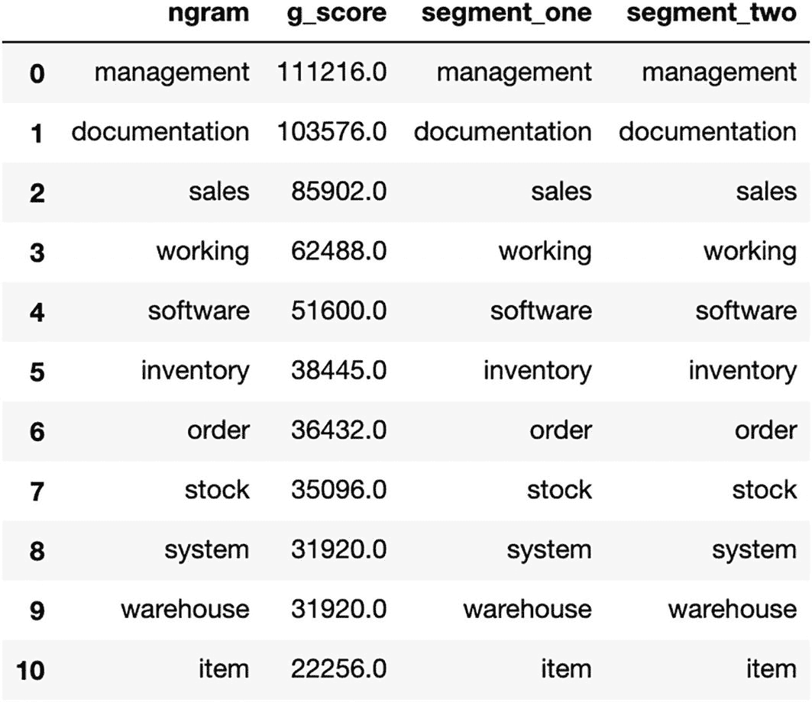

一张包含 11 行和 4 列的数据表截图，展示了带有细分标签的 n-gram 数据框。列标题为 n-gram、g 分数、细分 1 和细分 2。

我们将细分标签连接到数据集中，这样所有 URL 现在都按细分标签进行了分类：

# 合并统计量并选取最高值

## `bigram_stats`

```python
urls_grams_stats = bigrams_df.merge(ngram_segments, on = 'ngram', how = 'left').sort_values(['url', 'g_score'], ascending = False)

urls_grams_stats
```

结果如下：

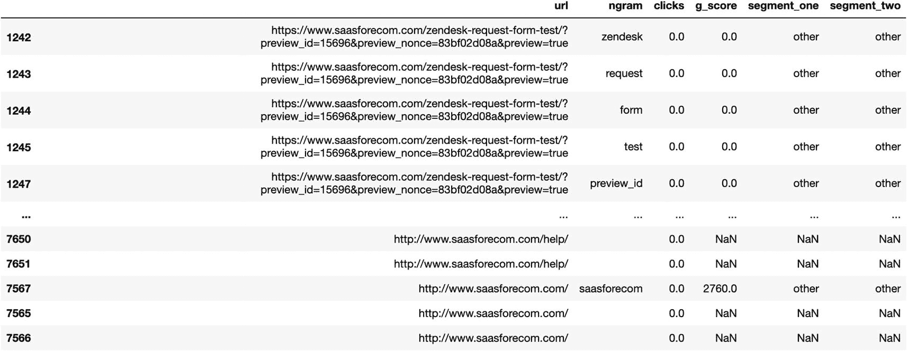

一张表格截图展示了导入的 URL 及其分段的数据框。列标题依次为 URL、ngram、clicks、g_score、segment_1 和 segment_2。

每个 URL 对应多行数据；但我们只需要最高结果，因此将应用一个函数来筛选出 `g_score` 最高的行：

```python
urls_stats_grams_map = urls_grams_stats.groupby('url').apply(lambda x: filter_highest_stat(x, 'url', 'g_score')).reset_index()

pd.set_option('display.max_colwidth', None)

urls_grams_map = urls_stats_grams_map

urls_grams_map = urls_grams_map.drop_duplicates()

del urls_grams_map['clicks']

del urls_grams_map['g_score']

#urls_grams_map.iloc[0, 'ngram'] = 'home'
```


# 数据准备与合并

`urls_grams_map['subpath'] = urls_grams_map.url.str.replace(r'(http|https)://www.saasforecom.com', '', regex = True)`

`urls_grams_map`

```python
urls_grams_map['subpath'] = urls_grams_map.url.str.replace(r'(http|https)://www.saasforecom.com', '', regex = True)

urls_grams_map
```

结果如下：

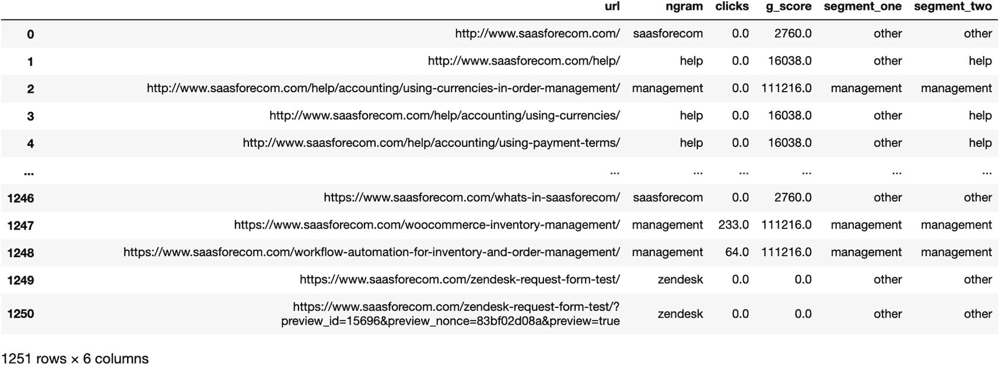
一张包含 1251 行和 6 列的数据框截图展示了导入的 URL 与 `ngram` 的映射关系。列标题依次为 `URL`、`ngram`、`clicks`、`g_score`、`segment_1` 和 `segment_2`。

上述所有 `URL` 均具有唯一行，并按分段标签进行分类。接下来，我们按分段汇总数据，以查看内容分布情况：

```python
urls_grams_map.groupby('segment_one').count().reset_index()
```

结果如下：

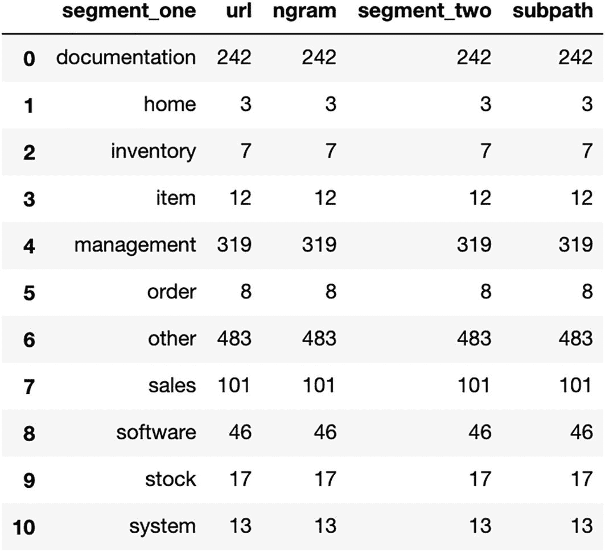
一张包含 11 行和 5 列的数据框截图展示了导入的 `URL` 与分段的映射关系。列标题依次为 `segment_1`、`URL`、`ngram`、`segment_2` 和 `subpath`。

大部分流量集中在“其他”分类，其次是“管理”、“文档”和“销售”。

下一步是将来自 `GA` 的性能数据与分段标签合并，并删除重复的 `URL` 组合：

```python
ga_segmented = ga_stats.merge(urls_grams_map, on = 'subpath', how = 'left')

ga_segmented = ga_segmented.drop_duplicates(subset=['date', 'url'], keep='last')

ga_segmented = ga_segmented.drop_duplicates(subset=['subpath', 'date'], keep='first')
```

清理数据，将空会话设为 `0`，并将 `new_sessions` 视为整数：

```python
ga_segmented['new_sessions'] = np.where(ga_segmented.new_sessions.isnull(), 0, ga_segmented.new_sessions)

ga_segmented['new_sessions'] = ga_segmented['new_sessions'].astype(int)

ga_segmented
```

结果如下：

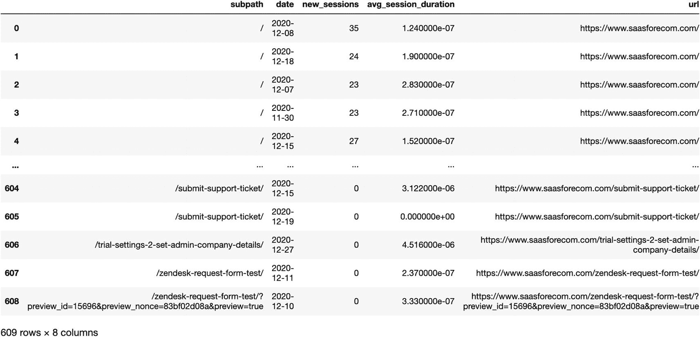
一张包含 609 行和 8 列的数据框截图展示了 `GA` 数据与分段的合并结果。列标题依次为 `subpath`、`date`、`new_sessions`、`average session duration`、`URL` 等。

最终得到的数据集已准备好进行时间序列分析，并可按照分段进行细分。

## 时间趋势与变化点分析

时间趋势利用时间序列数据帮助我们理解并向同事展示搜索流量随时间的变化情况。这包括：
*   确认流量的变化点
*   查看哪些类型的内容受到了影响（得益于之前完成的分段工作）

存在一定的局限性：从 `Google Search Console (GSC)` 获取时间序列数据相当困难（尽管并非不可能）。对于 `Google Analytics (GA)`，在 `URL` 级别获取仅限于自然搜索的时间序列数据也非常困难。此外，由于数据在一周内周期性波动（存在波峰和波谷），时间序列数据本身可能噪声较大。为了梳理出趋势，我们需要通过计算移动平均值来降低噪声。

我们首先按日期对会话进行分组：

```python
time_trends = ga_segmented.groupby('date')['new_sessions'].sum().to_frame().reset_index()
```

然后应用滚动函数计算七天平均值：

```python
sess_trends_roll = time_trends.rolling(7, min_periods=1)

sess_trends_mean = sess_trends_roll.mean()

time_trends['avg_sess'] = sess_trends_mean

time_trends
```

结果如下：

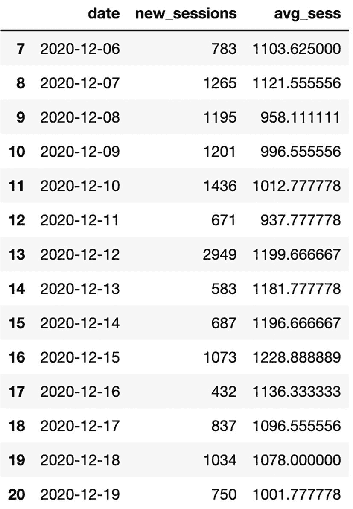
一张包含 14 行和 3 列的数据框截图展示了时间趋势。列标题依次为 `date`、`new_sessions` 和 `avg_sess`。

让我们进行可视化：

```python
pre_time_trends_plt = (
    ggplot(time_trends, aes(x = 'date', y = 'avg_sess', group = 1)) +
    geom_line(alpha = 0.6, colour = 'blue', size = 3) +
    labs(y = 'GA Sessions', x = 'Date') +
    scale_y_continuous() +
    scale_x_date() +
    theme(legend_position = 'right',
          axis_text_x=element_text(rotation=90, hjust=1)
    ))

Pre_time_trends_plt
```

在图 9-1 中，这种转变非常明显，大约在 2020 年 12 月 20 日，流量趋势从较好的一半切换到了较差的一半。

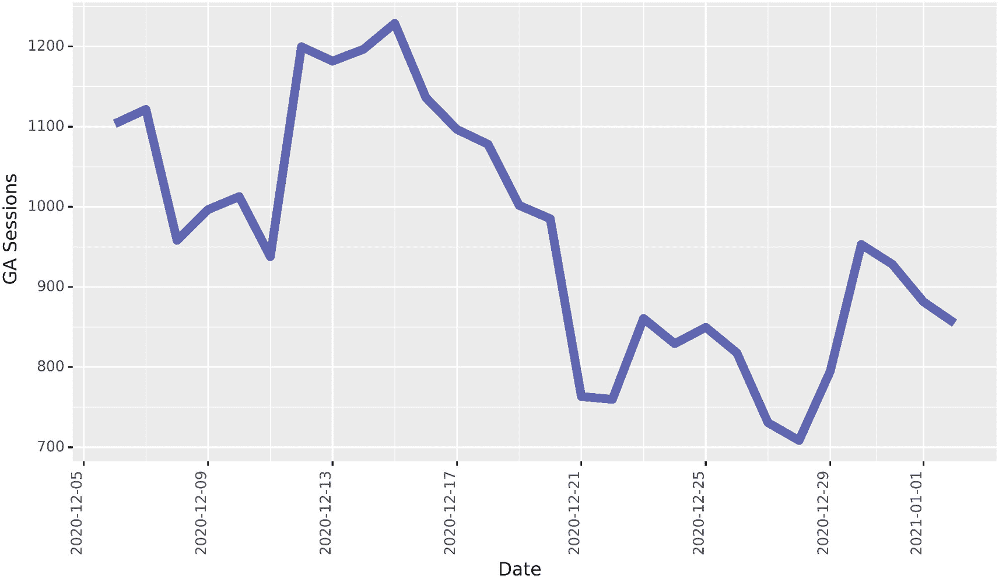
一张折线图绘制了 `GA` 会话数与日期的关系。它遵循多项式趋势线，最高点约为 1250，最低点约为 700。数值为估算值。

**图 9-1** 分析访问量的时间序列

接下来，我们使用变化点分析，通过 `ruptures` 包从分析角度进行确认：

```python
import ruptures as rpt
import matplotlib.pyplot as plt

points = np.array(overall_trends['avg_sess'])
model="rbf"
algo = rpt.Pelt(model=model).fit(points)
result = algo.predict(pen=6)

rpt.display(points, result, figsize=(10, 6))
plt.title('Change Point Detection using Pelt')
plt.show()
```

图 9-2 中的变化点分析确认了在 12 月 20 日，流量出现了下降趋势。

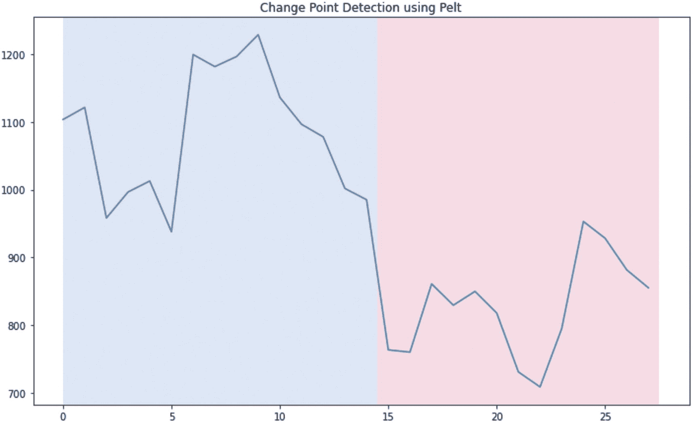
一张折线图绘制了访问次数与时间段的关系。数据点在两个阴影区域内上下波动。它遵循多项式趋势线，最高点约为 1250，最低点约为 700。数值为估算值。

**图 9-2** 分析访问量的时间序列，并标出了变化点（蓝色阴影区域为变化前，红色为变化后）

是的，这可能与圣诞节假期重合，但不幸的是，对于这家特定公司，我们没有前一年的数据来确认下降中有多少归因于季节性因素，又有多少归因于新网站重新上线迁移。

## 分段时间趋势

确认变化点后，现在让我们看看哪些内容区域受到了影响。我们将首先执行类似的聚合来计算滚动平均值：

```python
segmented_trends = postmortem_df.groupby(['date', 'segment_two'])['new_sessions'].sum().to_frame().reset_index()#.rolling(7).

sessseg_trends_roll = segmented_trends.rolling(8, min_periods=1)
sessseg_trends_mean = sessseg_trends_roll.mean()

segmented_trends['avg_sess'] = sessseg_trends_mean

segmented_trends
```

结果如下：

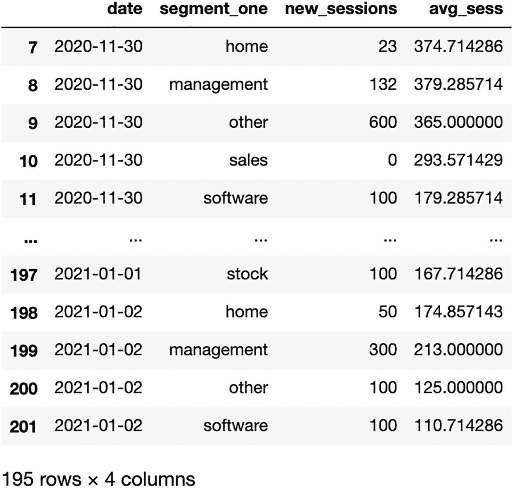
一张包含 195 行和 4 列的数据框截图展示了分段趋势。列标题依次为 `date`、`segment_1`、`new_sessions` 和 `avg_sess`。

数据为长格式，已计算好滚动平均值，可供可视化：

```python
ga_seg_trends_plt = (
    ggplot(time_trends_segmented, aes(x = 'date', y = 'avg_sess',
                                      group = 'segment_one', colour = 'segment_one')) +
    geom_line(alpha = 0.7, size = 2) +
    labs(y = 'GA Sessions', x = 'Date') +
```

# 趋势图分析

## 绘制趋势图
```python
scale_y_continuous() +

scale_x_date() +

theme(legend_position = 'right',

axis_text_x=element_text(rotation=90, hjust=1)

))
```

```python
ga_seg_trends_plt.save(filename = 'images/1_ga_seg_trends_plt.png', height=5, width=15, units = 'in', dpi=1000)
```

```python
ga_seg_trends_plt
```

图 9-3 中并未呈现明显的趋势，因为大部分（若非全部）内容随时间推移似乎都朝着同一方向移动。并没有出现某些板块下降而其他板块上升或保持不变的情况。

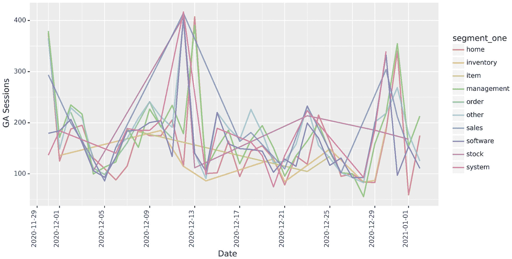
*图 9-3：按内容类型细分的数据分析访问量时间序列。一张多线图绘制了 G A 会话次数与日期的关系。图中绘制了主页、库存、商品、管理、订单、其他、销售、软件、库存和系统的数值。10 条线在 0 到 150 之间呈现上升和下降趋势，并于 2020 年 10 月 12 日达到峰值 430 次会话。数值均为近似值。*

## 分析影响

剖析完时间趋势后，我们将注意力转向分析迁移前后的影响，以期提出建议或确定进一步研究的领域。

我们将使用页面级别的 GSC 数据，这些数据可以通过合并之前创建的映射进行细分：

```python
gsc_before = pd.read_csv('data/gsc_before.csv')
```

像往常一样清理列名：

```python
gsc_before.columns = gsc_before.columns.str.lower()
gsc_before.columns = gsc_before.columns.str.replace('/', '', regex = False)
gsc_before.columns = gsc_before.columns.str.replace('.', '', regex = False)
gsc_before.columns = gsc_before.columns.str.replace('% ', '', regex = False)
gsc_before.columns = gsc_before.columns.str.replace('  ', ' ', regex = False)
gsc_before.columns = gsc_before.columns.str.replace(' ', '_', regex = False)
gsc_before['ctr'] = gsc_before.ctr.str.replace('%', '', regex = False)
```

只是为了让我们知道这些数据指的是迁移的哪个阶段：

```python
gsc_before['phase'] = 'before'
```

在合并细分标签之前重命名 `top_pages` 列：

```python
gsc_before = gsc_before.rename(columns = {'top_pages': 'url'})
gsc_before = gsc_before.merge(urls_grams_map, on = 'url', how = 'left')
gsc_before['count'] = 1
gsc_before['ngram'] = np.where(gsc_before['ngram'].isnull(), 'other', gsc_before['ngram'])
gsc_before['segment_one'] = np.where(gsc_before['segment_one'].isnull(), 'other', gsc_before['segment_one'])
gsc_before['segment_two'] = np.where(gsc_before['segment_two'].isnull(), 'other', gsc_before['segment_two'])
gsc_before
```

结果如下：

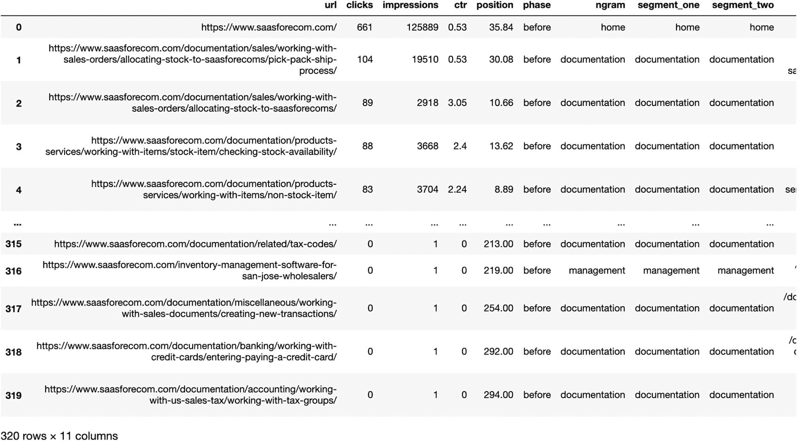
*一张包含 320 行 11 列的表格截图，提供了细分前的 GSC URL 链接数据框。列标题为 `url`、`clicks`、`impressions`、`ctr`、`position`、`phase`、`ngram`、`segment_one`、`segment_two` 等。*

至此，我们拥有了已细分的迁移前页面级 GSC 数据。对迁移后的阶段（称为“after”）重复上述操作：

```python
gsc_after = pd.read_csv('data/gsc_after.csv')
gsc_after.columns = gsc_after.columns.str.lower()
gsc_after.columns = gsc_after.columns.str.replace('/', '', regex = False)
gsc_after.columns = gsc_after.columns.str.replace('.', '', regex = False)
gsc_after.columns = gsc_after.columns.str.replace('% ', '', regex = False)
gsc_after.columns = gsc_after.columns.str.replace('  ', ' ', regex = False)
gsc_after.columns = gsc_after.columns.str.replace(' ', '_', regex = False)
gsc_after['ctr'] = gsc_after.ctr.str.replace('%', '', regex = False)
gsc_after['phase'] = 'after'
gsc_after = gsc_after.rename(columns = {'top_pages': 'url'})
gsc_after = gsc_after.merge(urls_grams_map, on = 'url', how = 'left')
gsc_after['count'] = 1
gsc_after['ngram'] = np.where(gsc_after['ngram'].isnull(), 'other', gsc_after['ngram'])
gsc_after['segment_one'] = np.where(gsc_after['segment_one'].isnull(), 'other', gsc_after['segment_one'])
gsc_after['segment_two'] = np.where(gsc_after['segment_two'].isnull(), 'other', gsc_after['segment_two'])
gsc_after
```

结果如下：

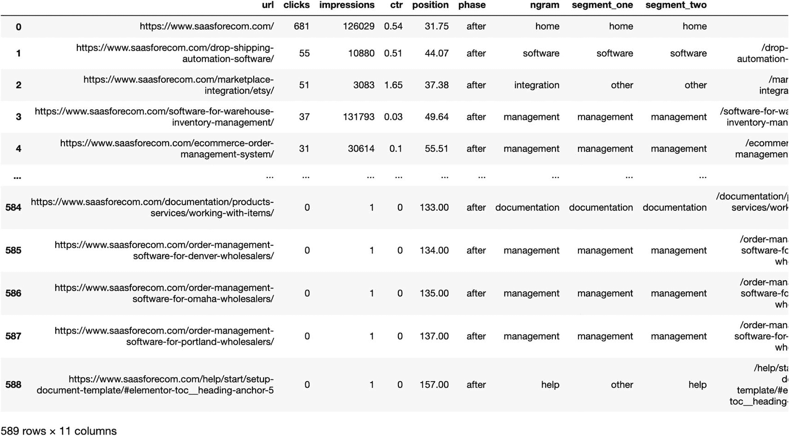
*一张包含 320 行 11 列的表格截图，提供了细分后的 GSC URL 链接数据框。列标题为 `url`、`clicks`、`impressions`、`ctr`、`position`、`phase`、`ngram`、`segment_one`、`segment_two` 等。*

两个数据集都已导入并清理完毕，我们可以开始使用聚合进行分析了，首先按阶段计算加权平均排名。

加权平均排名函数（`wavg_rank_imps`）接受两个参数（`position` 和 `impressions`），并使用列名 `wavg_rank` 返回计算结果：

```python
def wavg_rank_imps(x):
    names = {'wavg_rank': (x['position'] * x['impressions']).sum()/(x['impressions']).sum()}
    return pd.Series(names, index=['wavg_rank']).round(1)
```

在应用该函数之前，我们先复制一份“before”数据集：

```python
gsc_before_agg = gsc_before
gsc_before_wavg = gsc_before_agg.groupby('phase').apply(wavg_rank_imps).reset_index()
```

除了加权平均排名位置，我们还对 URL 总数和点击次数（自然搜索流量）感兴趣：

```python
gsc_before_sum = gsc_before_agg.groupby('phase').agg({'count': 'sum',
                                                      'clicks': 'sum'}).reset_index()
```

## 计算迁移前的索引

`gsc_before_stats` 由 `gsc_before_wavg` 与 `gsc_before_sum` 通过 `on = ['phase']` 与 `how = 'left'` 进行合并得到。

索引是点击次数与计数的比率，构成了我们的指标，以便我们了解某种比例关系：

```python
gsc_before_stats['index'] = gsc_before_stats['clicks']/gsc_before_stats['wavg_rank']
gsc_before_stats.sort_values('index', ascending = False)
```

结果如下：


一张包含 1 行 5 列的表格截图，提供了细分前的 GSC 索引数据框。列标题为 `phase`、`wavg_rank`、`count`、`clicks` 和 `index`。行条目如下。第 1 行：before，44.8，375，600，13.392857。

这是迁移前的统计数据。现在让我们看看迁移后的统计数据，对迁移后的数据应用与之前相同的方法：

## 计算迁移后的索引

```python
gsc_after_agg = gsc_after
gsc_after_wavg = gsc_after_agg.groupby('phase').apply(wavg_rank_imps).reset_index()
gsc_after_sum = gsc_after_agg.groupby('phase').agg({'count': 'sum',
                                                    'clicks': 'sum'}).reset_index()
gsc_after_stats = gsc_after_wavg.merge(gsc_after_sum, on = ['phase'], how = 'left')
gsc_after_stats['index'] = gsc_after_stats['clicks']/gsc_after_stats['wavg_rank']
gsc_after_stats.sort_values('index', ascending = False)
```

结果如下：


一张包含 1 行 5 列的表格截图，提供了细分后的 GSC 索引数据框。列标题为 `phase`、`wavg_rank`、`count`、`clicks` 和 `index`。行条目如下。第 1 行：after，45.0，302，205，4.555556。

两个数据集聚合后，我们可以将它们连接成一个表格以便直接比较：

```python
pd.concat([gsc_before_stats, gsc_after_stats])
```

结果如下：


一张包含 2 行 5 列的表格截图，提供了 GSC 索引数据框。列标题为 `phase`、`wavg_rank`、`count`、`clicks` 和 `index`。行条目如下。第 1 行：before，44.8，375，600，13.392857。第 2 行：after，45.0，302，205，4.555556。

因此，平均排名似乎变化不大，这意味着剧烈的变化可能更具季节性。然而，正如我们稍后将看到的，平均值往往掩盖了真实情况。获得流量的页面数量下降了约 -20%，这很能说明问题，因为这似乎与迁移有关。

我们将开始可视化一些数据，以帮助我们进行更深入的研究。

## 可视化整体点击量变化

```python
overall_clicks_plt = (
    ggplot(pd.concat([gsc_before_stats, gsc_after_stats]),
           aes(x = 'reorder(phase, -clicks)', y = 'clicks' , fill = 'phase')) +
    geom_bar(stat = 'identity', alpha = 0.6, position = 'dodge') + position=position_stack(vjust=0.01)) +
    labs(y = 'GSC Clicks', x = 'phase') +
    theme(legend_position = 'right',
    )
)
overall_clicks_plt.save(filename = 'images/2_overall_clicks_plt.png', height=5, width=10, units = 'in', dpi=1000)
overall_clicks_plt
```

如图 9-4 所示，点击量下降了约 67%，这一点我们显然已经知晓。


一张柱状图展示了 GSC 点击量在阶段变更前后的对比。变更前的最大值为 600，变更后的最小值为 200。数值为估算值。

**图 9-4** Google Search Console (GSC) 点击量变更前后的柱状图

接下来，我们按细分领域进行分析。

## 按细分领域分析

首先，计算细分领域的排名平均值和总点击量，并基于点击量与排名的比率推导出一个可见性指数：

### 迁移前的细分领域分析

```python
gsc_before_seg_agg = gsc_before
gsc_before_seg_wavg = gsc_before_seg_agg.groupby(['segment_two', 'phase']).apply(wavg_rank_imps).reset_index()
gsc_before_seg_sum = gsc_before_seg_agg.groupby(['segment_two', 'phase']).agg({'count': 'sum', 'clicks': 'sum'}).reset_index()
gsc_before_seg_stats = gsc_before_seg_wavg.merge(gsc_before_seg_sum, on = ['segment_two', 'phase'], how = 'left')
gsc_before_seg_stats['index'] = gsc_before_seg_stats['clicks']/gsc_before_seg_stats['wavg_rank']
gsc_before_seg_stats.sort_values('index', ascending = False)
```

结果如下：


一张包含 15 行 6 列的表格截图，展示了阶段变更前的指数值数据框。列标题分别为 `segment_two`、`phase`、`wavg_rank`、`count`、`clicks` 和 `index`。

上述细分领域分析显示，大部分内容属于“管理”分类，其次是“文档”。接下来，我们对迁移后的数据进行相同的聚合操作：

### 迁移后的细分领域分析

```python
gsc_after_seg_agg = gsc_after
gsc_after_seg_wavg = gsc_after_seg_agg.groupby(['segment_two', 'phase']).apply(wavg_rank_imps).reset_index()
gsc_after_seg_sum = gsc_after_seg_agg.groupby(['segment_two', 'phase']).agg({'count': 'sum',
                                                                            'clicks': 'sum'}).reset_index()
gsc_after_seg_stats = gsc_after_seg_wavg.merge(gsc_after_seg_sum, on = ['segment_two', 'phase'], how = 'left')
gsc_after_seg_stats['index'] = gsc_after_seg_stats['clicks']/gsc_after_seg_stats['wavg_rank']
gsc_after_seg_stats.sort_values('index', ascending = False)
```

结果如下：


一张包含 15 行 6 列的表格截图，展示了阶段变更后的指数值数据框。列标题分别为 `segment_two`、`phase`、`wavg_rank`、`count`、`clicks` 和 `index`。

有趣的是，“管理”类别的 URL 数量比迁移前增加了 10%，而排名没有实质性变化。“文档”类别几乎失去了所有点击量，并且一半的 URL 也消失了。

为了可视化这一现象，需要将数据框以长格式拼接，以提供给绘图代码使用：

```python
```

gsc_long_seg_stats = pd.concat([gsc_before_seg_stats, gsc_after_seg_stats])
gsc_long_seg_stats['phase'] = gsc_long_seg_stats['phase'].astype('category')
gsc_long_seg_stats['phase'].cat.reorder_categories(['before', 'after'], inplace=True)

segment_clicks_plt = (
    ggplot(gsc_long_seg_stats,
           aes(x = 'reorder(segment_two, -clicks)', y = 'clicks' , fill = 'phase')) +
    geom_bar(stat = 'identity', alpha = 0.6, position = 'dodge') +
    position=position_stack(vjust=0.01)) +
    labs(y = 'GSC Clicks', x = '') +
    theme(legend_position = 'right',
          axis_text_x=element_text(rotation=90, hjust=1)
    )
)
segment_clicks_plt.save(filename = 'images/2_segment_clicks_plt.png', height=5, width=10, units = 'in', dpi=1000)
segment_clicks_plt

如图 9-5 所示，大部分点击量的损失似乎发生在首页。


一张双柱状图展示了 GSC 点击量与会话阶段的对比。图中绘制了两个阶段（点击前和点击后）的数值。首页在点击前和点击后的数值都很高，分别为 370 和 140。数值为估算值。

**图 9-5** 按内容细分领域划分的 Google Search Console (GSC) 点击量变更前后的柱状图

那么，从 Google 获得流量的 URL 数量又如何呢？

```python
segment_urls_plt = (
    ggplot(gsc_long_seg_stats,
           aes(x = 'reorder(segment_two, -count)', y = 'count' , fill = 'phase')) +
    geom_bar(stat = 'identity', alpha = 0.6, position = 'dodge') +
    position=position_stack(vjust=0.01)) +
    labs(y = 'GSC URL Count', x = '') +
    theme(legend_position = 'right',
          axis_text_x=element_text(rotation=90, hjust=1)
    )
)
segment_urls_plt.save(filename = 'images/2_segment_urls_plt.png', height=5, width=10, units = 'in', dpi=1000)
segment_urls_plt
```

因此，迁移后获得流量的管理类 URL 数量更多了（图 9-6）。


一张双柱状图展示了 GSC 点击量与会话阶段的对比。图中绘制了两个阶段（点击前和点击后）的数值。管理类在点击前和点击后的数值都很高，分别为 110 和 115。数值为估算值。

**图 9-6** 按内容细分领域划分的 Google Search Console (GSC) URL 数量变更前后的柱状图

然而，“文档”和“其他”类别的数量大幅减少，“帮助”、“销售”和“库存”类别也略有减少。那么 Google 排名位置又如何呢？

```python
segment_rank_plt = (
    ggplot(gsc_long_seg_stats,
           aes(x = 'reorder(segment_two, -wavg_rank)', y = 'wavg_rank' , fill = 'phase')) +
    geom_bar(stat = 'identity', alpha = 0.6, position = 'dodge') +
    #geom_text(dd_factor_df, aes(label = 'serps_name'), position=position_stack(vjust=0.01)) +
    labs(y = 'GSC Clicks', x = '') +
    scale_y_reverse() +
    #theme_classic() +
    theme(legend_position = 'right',
          axis_text_x=element_text(rotation=90, hjust=1)
    )
)
segment_rank_plt.save(filename = 'images/2_segment_rank_plt.png', height=5, width=15, units = 'in', dpi=1000)
segment_rank_plt
```

库存、销售、批发商和股票分类的排名下降了（图 9-7）。


一张双柱状图展示了 GSC 点击量与会话阶段的对比。图中绘制了两个阶段（点击前和点击后）的数值。点击后阶段，库存类别的数值较高，为 74。点击前阶段，股票类别的数值较低，为 5。数值为估算值。

**图 9-7** 按内容细分领域划分的 Google Search Console (GSC) 排名位置平均值变更前后的柱状图

因此，流量损失与排名下降之间存在一定的相关性。总体结论是，正如最初所怀疑的那样，自然搜索表现下滑的部分原因是季节性和网站迁移共同作用的结果。

### 诊断

那么，我们看到库存等类别的排名下降了，但原因是什么？为了理解问题所在，我们现在将性能数据与爬取数据合并，以帮助我们诊断问题。我们还将附加细分领域名称，以便按内容区域进行诊断。

在合并之前，选择我们需要的点击量和排名列：

```python
gsc_before_diag = gsc_before[['url', 'clicks', 'segment_two', 'position']]
gsc_after_diag = gsc_after[['url', 'clicks', 'segment_two', 'position']]
```

现在进行合并，创建一个新的数据框 `gsc_ba_diag`，以便我们比较迁移前后在 URL 级别的性能。

我们使用外连接来捕获迁移前后的所有 URL。如果我们使用左连接（相当于 Excel 中的 `vlookup`），`Pandas` 会默认使用内连接，这意味着我们会遗漏那些迁移后没有数据的 URL。

```python
gsc_ba_diag = gsc_before_diag.merge(gsc_after_diag, on = ['url', 'segment_two'], how = 'outer')
```

由于前后数据框的列名相同，`Pandas` 会将其视为非预期情况，并正确判断这些列是不同的，因此会添加后缀 `_x` 和 `_y`。所以我们将其重命名，使其更便于用户理解：

```python
gsc_ba_diag = gsc_ba_diag.rename(columns = {'segment_two': 'segment',
    'clicks_x': 'clicks_before', 'clicks_y': 'clicks_after', 'position_x': 'rank_before', 'position_y': 'rank_after' })
```

合并后，我们预计会看到一些行在迁移前或（更可能）迁移后存在空值的点击数据。因此，我们清理数据，将排名中的“非数字”（`NaN`）值替换为 100，将点击中的 `NaN` 值替换为 0：

```python
gsc_ba_diag['rank_before'] = np.where(gsc_ba_diag['rank_before'].isnull(), 100, gsc_ba_diag['rank_before'])
gsc_ba_diag['rank_after'] = np.where(gsc_ba_diag['rank_after'].isnull(), 100, gsc_ba_diag['rank_after'])
gsc_ba_diag['clicks_before'] = np.where(gsc_ba_diag['clicks_before'].isnull(), 0, gsc_ba_diag['clicks_before'])
```

# 数据分析：性能与爬取数据的合并及诊断

## 数据转换与差异计算
数据已转换为宽格式并清理了空值，现在我们可以计算迁移前后的点击和排名差异，具体操作如下：

```python
gsc_ba_diag['rank_delta'] = gsc_ba_diag['rank_before'] - gsc_ba_diag['rank_after']
gsc_ba_diag['clicks_delta'] = gsc_ba_diag['clicks_after'] - gsc_ba_diag['clicks_before']
gsc_ba_diag
```

结果如下：


## 合并性能与爬取数据
性能差异数据现已就位，因此我们可以将爬取数据与性能数据合并到一个新的数据框中，恰当地命名为 `perf_crawl`。

由于我们拥有所有需要的 URL，而爬取数据中包含大量不需要的 URL，因此我们将提取所需的 URL (`perf_crawl`)，并与 `merge` 函数中指定的爬取数据进行左连接。这相当于 Excel 中的 `vlookup`，只会合并所需的爬取 URL。

```python
perf_crawl = gsc_ba_diag.merge(audit_urls_map, on = 'url', how = 'left')
perf_crawl = perf_crawl[['url', 'segment', 'clicks_after', 'clicks_before', 'clicks_delta', 'crawl_depth',
                          'host', 'crawl_source', 'http_status_code', 'indexable_status', 'canonical_url',
                          'canonical_status', 'redirect_url', 'redirect_url_status_code',
                          'final_redirect_url', 'final_redirect_url_status_code', 'urls_with_similar_content',
                          'ult_dest_url', 'content_simi']]
perf_crawl
```

结果如下：


## URL 诊断
更多有趣的工作在等着我们，现在我们要对这些 URL 进行诊断。为此，我们将在数据中使用一组条件，当条件满足时，将赋予一个诊断值。这正是你 SEO 经验发挥作用的地方，因为你识别模式的能力决定了你将设置如下条件：

```python
perf_diags = perf_crawl.copy()
```

创建条件列表：

```python
modifier_conds = [
    (perf_crawl['http_status_code'] == '200') & (perf_crawl['crawl_source'] != 'Crawler'),
    (perf_crawl['redirect_url_status_code'] == '301'),
    (perf_crawl['http_status_code'].isnull()),
    perf_crawl['http_status_code'].isin(['400', '403', '404']),
    (perf_diags['canonical_status'] != 'Missing') & (perf_diags['indexable_status'] == 'Noindex'),
    perf_diags['content_simi'] < 1
]
```

创建每个条件对应的赋值列表：

```python
segment_values = ['outside_ia', 'redirect_chain', 'lost_content', 'error', 'robots_conflict', 'lost_content']
```

创建一个新列，并使用 `np.select` 将我们的列表作为参数为其赋值：

```python
perf_diags['diagnosis'] = np.select(modifier_conds, segment_values, default = 'other')
perf_diags['diagnosis'] = np.where((perf_diags['diagnosis'] == 'redirect_chain') & (perf_diags['content_simi'] < 1),
                                   'lost_content', perf_diags['diagnosis'])
perf_diags
```

结果如下：


根据我们刚刚创建的规则，新增了一个 `diagnosis` 列，帮助我们在 URL 层面理解发生了什么。

## 量化诊断结果
每个 URL 都被标记后，我们可以开始量化诊断结果：

```python
diagnosis_clicks = perf_diags.groupby('diagnosis').agg({'clicks_delta': 'sum'}).reset_index()
diagnosis_urls = perf_diags.groupby('diagnosis').agg({'url': 'count'}).reset_index()
diagnosis_stats = diagnosis_clicks.merge(diagnosis_urls, on = 'diagnosis', how = 'left')
diagnosis_stats['clicks_pURL'] = (diagnosis_stats['clicks_delta'] / diagnosis_stats['url']).round(2)
diagnosis_stats
```

结果如下：


根据分析，总点击损失中约有 25% 是由错误代码（HTTP 服务器状态 4XX）和内容丢失（URL 重定向到父文件夹）造成的。受影响的 URL 中，大部分是那 373 个重定向的 URL，这占了网站的大部分。其他（无 URL）意味着流量损失可能是季节性的和/或迁移错误的间接影响。

## 可视化分享
如果你想分享你的发现，可以使用以下代码为同事进行可视化：

```python
diagnosis_plt = (
    ggplot(diagnosis_stats,
           aes(x = 'reorder(diagnosis, -clicks_delta)', y = 'clicks_delta')) +
    geom_bar(stat = 'identity', alpha = 0.6, position = 'dodge', fill = 'blue') +
    position=position_stack(vjust=0.01)) +
    labs(y = 'GSC Clicks Impact', x = '') +
    coord_flip() +
    theme(legend_position = 'right',
          axis_text_x=element_text(rotation=90, hjust=1)

    )
)

diagnosis_plt.save(filename = 'images/3_diagnosis_plt.png', height=5, width=10, units = 'in', dpi=1000)
diagnosis_plt
```

“其他”（可能是季节性因素）是点击损失的主要原因（图9-8），其次是`lost_content`（即URL重定向）。


### 图 9-8

一张水平条形图，展示了会话数与GSC点击影响的关系。估计值如下：错误，负15。内容丢失，负85。其他，负298。

按技术SEO诊断分类的Google Search Console (GSC) 点击影响条形图。

但受影响的URL数量是多少呢？

```python
diagnosis_count_dat = perf_diags.groupby('diagnosis').agg({'url': 'count'}).reset_index()

print(diagnosis_count_dat)

diagnosis_urlcount_plt = (
    ggplot(diagnosis_count_dat,
           aes(x = 'reorder(diagnosis, url)', y = 'url')) +
    geom_bar(stat = 'identity', alpha = 0.6, position = 'dodge', fill = 'blue') +
    position=position_stack(vjust=0.01)) +
    labs(y = 'URL Count', x = '') +
    coord_flip() +
    theme(legend_position = 'right',
          axis_text_x=element_text(rotation=90, hjust=1)
    )
)

diagnosis_urlcount_plt.save(filename = 'images/3_diagnosis_urlcount_plt.png', height=5, width=15, units = 'in', dpi=1000)

diagnosis_urlcount_plt
```

尽管“其他”类别损失的点击最多，但影响URL数量最多的却是`lost_content`（图9-9）。


### 图 9-9

一个水平条形图绘制了会话数与受影响URL数量之间的关系。估计值如下：外部IA（信息架构）5个，错误35个，其他50个，丢失内容375个。

Google Search Console (GSC) 受影响URL数量的柱状图（按技术SEO诊断分类）。

概览部分已完成；接下来按内容类型进行细分。我们将使用内容片段标签来获取点击影响统计数据：

```python
diagnosis_seg_clicks = perf_diags.groupby(['diagnosis', 'segment']).agg({'clicks_delta': 'sum'}).reset_index()
diagnosis_seg_urls = perf_diags.groupby(['diagnosis', 'segment']).agg({'url': 'count'}).reset_index()
diagnosis_seg_stats = diagnosis_seg_clicks.merge(diagnosis_seg_urls,
                                                on = ['diagnosis', 'segment'], how = 'left')
diagnosis_seg_stats['clicks_p_url'] = (diagnosis_seg_stats['clicks_delta'] / diagnosis_seg_stats['url']).round(2)
diagnosis_seg_stats.sort_values('clicks_p_url')
```

结果如下：


一张包含7行5列的表格截图，提供了诊断和内容片段的数据框。列标题分别为：诊断、片段、点击变化量、URL和每次点击的URL数。

因此，“其他”不仅是点击损失的最大原因，而且大部分影响都集中在首页。这与季节性（即12月典型的流量低迷期）的观点一致。

虽然表格很有用，但我们还将利用数据可视化来更轻松地查看整体情况：

```python
diagnosis_seg_clicks_plt = (
    ggplot(diagnosis_seg_stats,
           aes(x = 'diagnosis', y = 'segment', fill = 'clicks_delta')) +
    geom_tile(stat = 'identity', alpha = 0.6) + position=position_stack(vjust=0.00)) +
    labs(y = '', x = '') +
    theme_classic() +
    theme(legend_position = 'right')
)

diagnosis_seg_clicks_plt.save(filename = 'images/5_diagnosis_seg_clicks_plt.png',
                              height=5, width=10, units = 'in', dpi=1000)

diagnosis_seg_clicks_plt
```

在“其他”类别中，受影响最大的是首页，其次是“管理内容”（图9-10）。


### 图 9-10

热力图绘制了关键词与会话内容类型的关系，点击变化量范围从0到200。首页内容类型的点击量最大，而其余内容类型的点击量最小，通过不同的渐变颜色表示。

按内容类型和SEO诊断划分的点击变化量热力图。

就丢失内容而言，主要是“文档”和“其他”。这对于确定关注重点非常有帮助。尽管“其他”作为原因对于修复迁移后的网站帮助不大，但我们仍然可以解释部分迁移错误发生的位置，开始为URL标记推荐操作，并进行可视化。这正是我们接下来要做的。

## 路线图

我们将从数据框`perf_diags`开始，将其复制到`perf_recs`中，然后根据发现的错误创建推荐：

```python
perf_recs = perf_diags
```

名为`diag_conds`的列表是基于`perf_recs`数据框中`diagnosis`列的值生成的诊断条件列表。稍后使用的`np.select`函数将从这个列表中提取数据以分配推荐。

```python
diag_conds = [
    perf_recs['diagnosis'] == 'outside_ia',
    perf_recs['diagnosis'] == 'redirect_chain',
    perf_recs['diagnosis'] == 'error',
    perf_recs['diagnosis'] == 'robots_conflict',
    perf_recs['diagnosis'] == 'lost_content',
    perf_recs['diagnosis'] == 'other'
]
```

`rec_values`是一个推荐列表，与前面的诊断列表相对应。此时，假设您已经完成了调查工作，知道要为上述每个标签提出哪些推荐。

推荐列表项的顺序与`diag_conds`列表的顺序一致。例如，如果诊断单元格的值为`lost_content`，则推荐操作为`create_integrate`，这意味着创建内容、重定向、取消重定向并重新集成到网站中。

```python
rec_values = ['integrate', 'disintermediate', 'fix/remove links to error URL', 'remove canonical', 'create_integrate', 'no further action']
```

有了这些列表后，我们可以在创建新列时进行匹配，并使用 `np.select` 以列表为参数为其赋值：

```python
perf_recs['recommendation'] = np.select(diag_conds, rec_values, default = 'na')
perf_recs = perf_recs.sort_values('clicks_delta')
perf_recs.to_csv('exports/' + hostname + '_migration_data_1.csv')
perf_recs
```

结果如下：


一张表格的截图展示了用于生成新值的诊断数据框。列标题依次为：最终重定向 URL、最终重定向 URL 状态码、内容相似的 URL、ULT 目标 URL、内容相似度、诊断结果和建议。

现在你会看到`perf_recs`数据框已更新，新增了一列与诊断结果匹配。

当然，接下来我们想用大家熟悉的`groupby()`函数来量化所有这些数据，以便在演示文稿中向同事展示：

```python
recs_clicksurl = perf_recs.groupby('recommendation')['clicks_delta'].agg(['sum', 'count']).reset_index()

recs_clicksurl['recovery_clicks_url'] = np.abs(recs_clicksurl['sum'] / recs_clicksurl['count'])
```

我们取绝对值是为了在呈现数据时保持积极正面的倾向：

```python
recs_clicksurl['sum'] = np.abs(recs_clicksurl['sum'])

recs_clicksurl
```

结果如下：


一张包含 4 行 4 列的表格截图，展示了建议的数据框。列标题依次为：建议、总和、计数、每个 URL 的可恢复点击量。

上表显示了各项建议对应的可恢复点击量（总和）、URL 数量（计数）以及每个 URL 的潜在可恢复点击量。虽然“无需进一步操作”每月能恢复 297 次点击看似奇怪，但其中一部分可能确实会通过修复其他问题而恢复。

接下来进行可视化：

```python
recs_clicks_plt = (

    ggplot(recs_clicksurl,

           aes(x = 'reorder(recommendation, sum)', y = 'sum')) +

    geom_bar(stat = 'identity', alpha = 0.6, position = 'dodge', fill = 'blue') +

    position=position_stack(vjust=0.01)) +

    labs(y = 'Recovery Clicks Available', x = '') +

    coord_flip() +

    theme(legend_position = 'right',

          axis_text_x=element_text(rotation=90, hjust=1)

          )

)

recs_clicks_plt.save(filename = 'images/8_recs_clicks_plt.png',

                     height=5, width=10, units = 'in', dpi=1000)

recs_clicks_plt
```

`图 9-11` 将建议进行了可视化呈现。


一张水平条形图展示了会话数与可用恢复点击量的关系。估算值如下：修复并移除指向错误 URL 的链接，12.5；创建整合，70；无需进一步操作，299。

`图 9-11` 按技术 SEO 诊断结果估算的可用恢复点击量条形图

## 总结

本章涵盖了网站迁移映射的内容，以便你能够设定新网站的结构，并半自动化地生成迁移 URL。使用的一些技术如下：

*   字符串操作
*   通过将数据框行转换为列表来对其进行迭代
*   使用 NLP 比较 URL 字符串

虽然这些技术被应用于加速网站迁移的数据处理，但它们也可以轻松应用于其他场景。在下一章中，我们将展示如何利用数据更好地理解算法更新。

# 10. Google 更新

正如死亡和税收是人生的必然，算法更新也是任何 SEO 职业生涯中的必然。没错，Google 会频繁更改其排名算法，这意味着你的网站（以及许多其他网站）可能会在排名上出现波动，进而影响流量。这些变化可能是积极的，也可能是消极的，在某些情况下，你甚至察觉不到任何影响。

## 算法更新分析

为了进一步说明问题，Google 本身对于算法更新的内容以及企业和 SEO 专业人士应如何应对，给出的信息相当模糊。自然，除了提供“出色的用户体验”和“创建引人入胜的内容”之外，Google 缺乏指导性建议，这意味着 SEO 必须使用各种分析工具来寻找答案。幸运的是，对于 SEO 来说：

-   Google 是一个算法系统。这意味着排名因素的变化很可能是一致且可预测的，而不是由人为因素随意决定的。这些变化很可能事先经过了测试。
-   Google 算法变化的结果通过搜索引擎结果页面（SERPs）进入公共领域，这意味着有数据可供分析，即使这违反了 Google 网站管理员指南。
-   即使没有 SERPs，Google Search Console 也是了解 Google 更新性质的重要数据源。

在本章中，我们将介绍算法更新分析，即在算法更新事件前后，在不同层面分析搜索结果的差异：

-   域名
-   结果类型
-   关键词自相残杀
-   关键词
-   客户跟踪查询（目标）内
-   分段的 SERPs

### 算法更新

这里的一般方法是比较 Google 算法更新前后阶段的性能。在本例中，我们将重点关注一家新上市的 webinar 公司`ON24`。`ON24`受到了 2019 年 12 月核心更新的影响。

通过一些分析和可视化，我们可以了解更新的情况。除了常用的库，我们还将从`getSTAT`（一个企业级排名跟踪平台，网址为`getstat.com`）导入 SERPs 数据：

```python
import re

import time

import random

import pandas as pd

import numpy as np

import datetime

import re

import time

import requests

import json

from datetime import timedelta

from glob import glob

import os

from textdistance import sorensen_dice

from plotnine import *

import matplotlib.pyplot as plt

from pandas.api.types import is_string_dtype

from pandas.api.types import is_numeric_dtype

import uritools

pd.set_option('display.max_colwidth', None)

%matplotlib inline

root_domain = 'on24.com'

hostdomain = 'www.on24.com'

hostname = 'on24'

full_domain = 'https://www.on24.com'

target_name = 'ON24'

getstat_raw.head()
```

以下是`getSTAT`数据的打印输出：


一个表格列出了 13 列和 5 行。行编号为 0-4，对应 6 sense webinars。列包括关键词、市场、位置、设备、全球月搜索量、区域月搜索量、排名、2020 年 11 月 19 日的结果类型、2020 年 11 月 19 日的协议、2020 年 11 月 19 日的排名 URL、2020 年 12 月 17 日的结果类型、2020 年 12 月 17 日的协议以及 2020 年 12 月 17 日的排名 URL。

为了使列名更便于数据处理，我们将进行一些清理：

```python
getstat_cleancols = getstat_raw
```

转换为小写：

```python
getstat_cleancols.columns = [x.lower() for x in getstat_cleancols.columns]
```

鉴于`ON24`是一个全球品牌，并使用单一网站来捕获全球所有英语搜索，我们使用全球月搜索量而不是通常的区域（国家级别）数字。因此，我们将全局搜索量重命名为搜索量：

```python
getstat_cleancols = getstat_cleancols.rename(columns = {'global monthly search volume': 'search_volume'})
```

我们过滤掉品牌搜索的行，因为我们期望`ON24`在其自有品牌上排名良好，而我们更关注一般的核心更新：

```python
getstat_cleancols = getstat_cleancols[~getstat_cleancols['keyword'].str.contains('24')]

getstat_cleancols
```

现在列名已变为小写，并且一些列已重命名：


一个表格列出了 10 列和 27560 行，这里只展示了其中的 10 行。行编号从 0 到 4，对应 6 sense webinars 和 zoom webinars，编号从 27635 到 27639。列标题是`keyword`、`market`、`location`、`device`、`search_volume`、`region_monthly_search_volume`、`rank`、`result types for nov 19, 2020`、`protocol for nov 19, 2020`以及`ranking url on nov 19, 2020`。

为了简化计算，我们将数据框按列拆分为“之前”和“之后”。拆分后的数据将被聚合，然后相互比较。

我们从“之前”数据框开始，选择“之前”的列：

```python
getstat_before = getstat_cleancols[['keyword', 'market', 'location', 'device', 'search_volume', 'rank',
'result types for nov 19, 2020', 'protocol for nov 19, 2020',
'ranking url on nov 19, 2020']]
```

我们构建完整的 URL：

```python
getstat_before['url'] = getstat_before['protocol for nov 19, 2020'] + '://' + getstat_before['ranking url on nov 19, 2020']
```

更改`url`列的值，如果存在任何空白（空值），则将其替换为`''`而不是`NaN`（非数字）。这有助于避免稍后聚合时出现错误。

```python
getstat_before['url'] = np.where(getstat_before['url'].isnull(), '', getstat_before['url'])
```

我们将使用`urisplit`函数（嵌入在列表推导式中）来提取域名，从而派生站点名称。这对于在站点级别汇总性能非常有用。

```python
getstat_before['site'] = [uritools.urisplit(x).authority if uritools.isuri(x) else x for x in getstat_before['url']]
```

我们初始化一个名为`strip_subdomains`的列表，以帮助剥离 URL 的字符串组件：

```python
strip_subdomains = ['hub\.', 'blog\.', 'www\.', 'impact\.', 'harvard\.', 'its\.', 'is\.', 'support\.']
```

我们更改`site`字段，将`site`列中找到的任何`strip_subdomains`字符串替换为空：

```python
getstat_before['site'] = getstat_before['site'].str.replace('|'.join(strip_subdomains), '')
```

我们设置一个新列`phase`为`"before"`：

```python
getstat_before['phase'] = 'before'
```

对排名位置数据进行分层有助于我们执行更详细的聚合，以便将性能分解为 Google 的前 3 名、第 1 页等。这使用了`np.where`，它是 Excel 中`if`函数的 Python 等价物：

```python
getstat_before['rank_profile'] = np.where(getstat_before['rank'] < 11, 'page_1', 'page_2')
getstat_before['rank_profile'] = np.where(getstat_before['rank'] < 3, 'top_3',
getstat_before['rank_profile'])
```

在这里，我们将重命名一些列，因为我们不需要列标题中的月份年份：

```python
getstat_before = getstat_before.rename(columns = {'result types for nov 19, 2020': 'snippets'})
```

列选择并非绝对必要，但它确实有助于清理数据框并提醒我们正在处理的内容：

```python
getstat_before = getstat_before[['keyword', 'market', 'phase', 'device', 'search_volume', 'rank',
'url', 'site', 'snippets', 'rank_profile']]
```

我们将零搜索量设置为 1，以便稍后在推导计算时不会出现“除以零错误”：

```python
getstat_before['search_volume'] = np.where(getstat_before['search_volume'] == 0, 1, getstat_before['search_volume'])
```

初始化一个新列`count`，这在聚合时也很有用：

```python
getstat_before['count'] = 1
```

有时，您需要按头部、中部和长尾来剖析 SERPs。为了实现这一点，我们将初始化一个名为`token_count`的列，该列计算单词之间的空格数（并加 1），以提取`keyword`列中的查询词数：

```python
getstat_before['token_count'] = getstat_before['keyword'].str.count(' ') + 1
```

得益于词数统计，我们使用`np.select()`函数对查询长度进行分类。

```python
before_length_conds = [
getstat_before['token_count'] == 1,
getstat_before['token_count'] == 2,
getstat_before['token_count'] > 2]
length_vals = ['head', 'middle', 'long']
getstat_before['token_size'] = np.select(before_length_conds, length_vals)
getstat_before
```

以下是添加了额外特征后的“之前”数据集，以便分析更具实用性。


一个表格展示了包含 9 列 10 行的列表。列标题如下：`search_volume`、`rank`、`url`、`site`、`snippets`、`rank_profile`、`count`、`token_count`和`token_size`。各行包含关键词的详细信息。

让我们对“之后”数据集重复数据转换步骤：

```python
getstat_after = getstat_cleancols[['keyword', 'market', 'location', 'device', 'search_volume', 'rank',
'result types for dec 17, 2020', 'protocol for dec 17, 2020',
'ranking url on dec 17, 2020']]

getstat_after['url'] = getstat_after['protocol for dec 17, 2020'] + '://' + getstat_after['ranking url on dec 17, 2020']

getstat_after['url'] = np.where(getstat_after['url'].isnull(), '', getstat_after['url'])

getstat_after['site'] = [uritools.urisplit(x).authority if uritools.isuri(x) else x for x in getstat_after['url']]

strip_subdomains = ['hub\.', 'blog\.', 'www\.', 'impact\.', 'harvard\.', 'its\.', 'is\.', 'support\.']

getstat_after['site'] = getstat_after['site'].str.replace('|'.join(strip_subdomains), '')

getstat_after['phase'] = 'after'
```


`getstat_after` = `getstat_after`.rename(columns = {'result types for dec 17, 2020': 'snippets'})

`getstat_after` = `getstat_after`[['keyword', 'market', 'phase', 'device', 'search_volume', 'rank', 'url', 'site', 'snippets']]

`getstat_after`['search_volume'] = np.where(`getstat_after`['search_volume'] == 0, 1, `getstat_after`['search_volume'])

`getstat_after`['count'] = 1

`getstat_after`['rank_profile'] = np.where(`getstat_after`['rank'] < 4, 'top3', np.where(`getstat_after`['rank'] < 11, 'top10', np.where(`getstat_after`['rank'] < 21, 'top20', 'other')))

`getstat_after`['token_count'] = `getstat_after`['snippets'].str.split().str.len()

`after_length_conds` = [`getstat_after`['token_count'] == 1, `getstat_after`['token_count'] == 2, `getstat_after`['token_count'] > 2,]

`getstat_after`['token_size'] = np.select(`after_length_conds`, `length_vals`)

`getstat_after`

```
getstat_after = getstat_after.rename(columns = {'result types for dec 17, 2020': 'snippets'})

getstat_after = getstat_after[['keyword', 'market', 'phase', 'device', 'search_volume', 'rank', 'url', 'site', 'snippets']]

getstat_after['search_volume'] = np.where(getstat_after['search_volume'] == 0, 1, getstat_after['search_volume'])

getstat_after['count'] = 1

getstat_after['rank_profile'] = np.where(getstat_after['rank'] < 4, 'top3', np.where(getstat_after['rank'] < 11, 'top10', np.where(getstat_after['rank'] < 21, 'top20', 'other')))

getstat_after['token_count'] = getstat_after['snippets'].str.split().str.len()

after_length_conds = [getstat_after['token_count'] == 1, getstat_after['token_count'] == 2, getstat_after['token_count'] > 2,]

getstat_after['token_size'] = np.select(after_length_conds, length_vals)

getstat_after
```

`getstat_after`是“之后”数据集转换的结果，现已完成，使我们能够进入下一步——对数据进行去重：


一个表格展示了包含 9 列 10 行的列表。列标题如下：`search volume`、`rank`、`URL`、`site`、`snippets`、`rank profile`、`count`、`token count`和`token size`。各行包含关键词的详细信息。

## 去重

去重的原因是搜索引擎经常在同一 SERP 中对多个 URL 进行排名。如果你想要评估 SERP 的份额或内容蚕食率（即同一域名的多个 URL 争夺同一排名，最终限制了能达到的最高排名），这没有问题。但在我们的用例中，我们只关心哪些网站排在前面、排名顺序如何以及出现的频率，因此去重是关键。

使用转换后的数据集，我们将按`site`分组，在去重后的数据集中选择并保留排名最高的 URL：

```python
getstat_bef_unique = getstat_before.sort_values('rank').groupby(['site', 'device', 'keyword']).first()
getstat_bef_unique = getstat_bef_unique.reset_index()
getstat_bef_unique = getstat_bef_unique[getstat_bef_unique['site'] != '']
getstat_bef_unique = getstat_bef_unique.sort_values(['keyword', 'device', 'rank'])
getstat_bef_unique = getstat_bef_unique[['keyword', 'market', 'phase', 'device', 'search_volume', 'rank', 'url', 'site', 'snippets', 'rank_profile', 'count', 'token_count','token_size']]
getstat_bef_unique
```

结果如下：


一个表格展示了包含 9 列 10 行的列表。其中 5 行对应 6 sense webinars，5 行对应 zoom webinars。列标题如下：`keyword`、`market`、`phase`、`device`、`search volume`、`rank`、`URL`和`site`。

数据集已从 27,000 行显著减少至 23,600 行。我们将对“之后”数据集重复同样的操作：

```python
getstat_aft_unique = getstat_after.sort_values('rank').groupby(['site', 'device', 'keyword']).first()
getstat_aft_unique = getstat_aft_unique.reset_index()
getstat_aft_unique = getstat_aft_unique[getstat_aft_unique['site'] != '']
getstat_aft_unique = getstat_aft_unique.sort_values(['keyword', 'device', 'rank'])
getstat_aft_unique = getstat_aft_unique[['keyword', 'market', 'phase', 'device', 'search_volume', 'rank', 'url', 'site', 'snippets', 'rank_profile', 'count', 'token_count','token_size']]
getstat_aft_unique
```

结果如下：


一个表格展示了包含 9 列和 24972 行的列表，此处仅展示其中 10 行。行号从 117 到 8818，接着是省略号，然后从 16806 到 24972，对应 3 个 6 sense 网络研讨会、两个 a b m 和五个 zoom 网络研讨会。列标题如下：`keyword`、`market`、`phase`、`device`、`search volume`、`rank`、`URL`、`site`和`snippets`。

两个数据集都去重后，我们可以开始从不同角度进行聚合分析，并生成洞察。

## 域名

任何算法更新中最常见的问题之一是哪些网站获得了流量，哪些网站流失了流量。我们将首先筛选出排名前 10 的网站，计算其“覆盖范围”，并按网站汇总：

```python
before_unq_reach = getstat_bef_unique
before_unq_reach = before_unq_reach[before_unq_reach['rank'] < 11 ]
before_unq_reach = before_unq_reach.groupby(['site']).agg({'count': 'sum'}).reset_index()
```

将`count`重命名为`reach`：

```python
before_unq_reach = before_unq_reach.rename(columns = {'count': 'reach'})
before_unq_reach = before_unq_reach[['site', 'reach']]
```

将空值替换为零：

```python
before_unq_reach['reach'] = np.where(before_unq_reach['reach'].isnull(), 0, before_unq_reach['reach'])
before_unq_reach.sort_values('reach', ascending = False).head(10)
```

不出所料，谷歌在所有网站中拥有最多的关键词曝光量。紧随其后的是 HubSpot，然后是 ON24，即我们关注的网站。请注意，这是在谷歌更新之前的情况。


一个表格展示了包含 3 列和 10 行的列表。列标题如下：`site`和`reach`。行中包含频繁被覆盖的网站。热门网站包括`google.com`、`hubspot.com`和`on24.com`。

我们将对更新后的域名覆盖范围重复进行聚合：

```python
after_unq_reach = getstat_aft_unique
after_unq_reach = after_unq_reach[after_unq_reach['rank'] < 11 ]
```


```markdown
`after_unq_reach` = `after_unq_reach`.groupby(['site']).agg({'count': 'sum'}).reset_index()

`after_unq_reach` = `after_unq_reach`.rename(columns = {'count': 'reach'})

`after_unq_reach`['reach'] = `np.where`(`after_unq_reach`['reach'].isnull(), 0, `after_unq_reach`['reach'])

`after_unq_reach` = `after_unq_reach`[['site', 'reach']]

`after_unq_reach`.sort_values('reach', ascending = False).head(10)

```

结果如下：


一个表格展示了包含 3 列和 10 行的列表。列包括`site`和`reach`。行中包含频繁被覆盖的网站。热门网站包括`google.com`（覆盖 1011 次）、`hubspot.com`（覆盖 304 次）和`on24.com`（覆盖 222 次）。

谷歌在其自身更新后成为了更大的赢家。HubSpot 略有损失，而 ON24 几乎未变。或者至少表面上看是这样，我们稍后深入分析时会看到更多细节。

与其用肉眼观察两个独立的数据框，不如将它们合并起来进行并排比较：

```python
`compare_reach_loser` = `before_unq_reach`.merge(`after_unq_reach`, on = ['site'], how = 'outer')
```

将列重命名为更友好的名称：

```python
`compare_reach_loser` = `compare_reach_loser`.rename(columns = {'reach_x': 'before_reach', 'reach_y': 'after_reach'})

`compare_reach_loser`['before_reach'] = `np.where`(`compare_reach_loser`['before_reach'].isnull(),

0, `compare_reach_loser`['before_reach'])
```

将空值替换为零，以防止下一步出错：

```python
`compare_reach_loser`['after_reach'] = `np.where`(`compare_reach_loser`['after_reach'].isnull(),

0, `compare_reach_loser`['after_reach'])
```

创建新列，量化更新前后覆盖范围的差异：

```python
`compare_reach_loser`['delta_reach'] = `compare_reach_loser`['after_reach'] - `compare_reach_loser`['before_reach']

`compare_reach_loser` = `compare_reach_loser`.sort_values('delta_reach')

`compare_reach_loser` = `compare_reach_loser`[['site', 'before_reach', 'after_reach', 'delta_reach']]

`compare_reach_loser`.head(10)
```

结果如下：


一个表格展示了包含 4 列和 10 行的列表。列标题为`site`、`before_reach`、`after_reach`和`delta_reach`。行按损失降序排列，包括`workcast.com`、`hubspot.com`、`podcastinsights.com`、`marketo.com`等。

迄今为止，损失最大的似乎是 WorkCast（网络研讨会软件领域的主要参与者），其次是 HubSpot。正如你将意识到的，将表格分别聚合后再合并，使得比较变得容易得多。让我们重复操作以找出赢家：

```python
`compare_reach_winners` = `compare_reach_loser`.sort_values('delta_reach', ascending = False)

`compare_reach_winners`.head(10)
```

结果如下：


一个表格展示了包含 5 列和 10 行的列表。列包括行号、`site`、`before_reach`、`after_reach`和`delta_reach`。行中包含收益最大且覆盖时间最长的网站，热门网站包括`google.com`、`info.workcast.com`、`liferay.com`、`medium.com`等。

有趣的是，WorkCast 损失了，但其子域名却获得了收益。一些发布商（如 Medium）以及来自间接 B2B 软件竞争对手的博客也获得了收益。直观上看，这似乎表明博客和指南受到了青睐。

是时候进行可视化了。我们将转换为长格式，这是数据可视化绘图包（想想数据透视表）首选的数据结构：

```python
`compare_reach_losers_long` = `compare_reach_loser`[['site', 'before_reach','after_reach']].head(28)

`compare_reach_losers_long` = `compare_reach_losers_long`.melt(id_vars = ['site'], var_name='Phase', value_name='Reach')

`compare_reach_losers_long`['Phase'] = `compare_reach_losers_long`['Phase'].str.replace('_reach', '')

`compare_reach_losers_long`['Phase'] = `compare_reach_losers_long`['Phase'].astype('category')

`compare_reach_losers_long`['Phase'] = `compare_reach_losers_long`['Phase'].cat.reorder_categories(['before', 'after'])

stop_doms = ['en.wikipedia.org', 'google.com', 'youtube.com', 'lexisnexis.com']

`compare_reach_losers_long` = `compare_reach_losers_long`[~`compare_reach_losers_long`['site'].isin(stop_doms)]

`compare_reach_losers_long`.head(10)
```

结果如下：


一个表格展示了包含 3 列和 10 行的列表。列包括`site`、`phase`和`reach`。行中包含网站及其更新前的覆盖时间，如`workcast.com`、`hubspot.com`、`podcastinsights.com`、`marketo.com`等。

```python
#VIZ

compare_reach_losers_plt = (

ggplot(compare_reach_losers_long, aes(x = 'reorder(site, Reach)', y = 'Reach', fill = 'Phase')) +

geom_bar(stat = 'identity', position = 'dodge', alpha = 0.8) +

#geom_text(dd_factor_df, aes(label = 'market_name'), position=position_stack(vjust=0.01)) +

labs(y = 'Reach', x = ' ') +

#scale_y_reverse() +

coord_flip() +

theme(legend_position = 'right', axis_text_x=element_text(rotation=0, hjust=1, size = 12)) +

facet_wrap('device')

)

compare_reach_plt.save(filename = 'images/1_compare_reach_losers_plt.png', height=5, width=10, units = 'in', dpi=1000)

compare_reach_plt
```

# 按设备分组的柱状图

似乎并非所有网站在两种设备搜索结果类型中都具有一致的曝光度（图 10-1）。


一个按设备分组的柱状图，展示了在阶段前后通过桌面端和智能手机访问的网站。最高的柱状图是`hubspot.com`，无论是在桌面端还是智能手机上，而`wordstream.com`在桌面端被访问，但在智能手机上未被访问。

**图 10-1**
按浏览器设备划分的网站前 10 名排名计数（覆盖量）前后对比

## 分层覆盖量

覆盖量很有帮助，但细节中总有魔鬼。毫无疑问，您和您的同事会希望按排名层级进一步深入分析，例如，排名在前 3 位的位置，或者可能仅在 Google 第 1 页的排名等。这次我们仅聚合带有覆盖量层级的数据，从“之前”数据集开始：

```python
before_unq_reachstrata = getstat_bef_unique
before_unq_reachstrata = before_unq_reachstrata.groupby(['site', 'rank_profile']).agg({'count': 'sum'}).reset_index()
before_unq_reachstrata = before_unq_reachstrata.rename(columns = {'count': 'reach'})
before_unq_reachstrata = before_unq_reachstrata[['site', 'rank_profile', 'reach']]
before_unq_reachstrata.sort_values('reach', ascending = False).head(10)
```

结果如下：


一个表格展示了包含 3 列和 10 行的列表。列包括网站、排名层级和覆盖量。行包括根据其在`google.com`、`hubspot.com`、`on24.com`等网站上的排名和覆盖时间列出的网站。

现在我们有了一个按覆盖量排序的数据框，这次按`rank_profile`拆分，从而对覆盖量指标进行分层。例如，我们看到`HubSpot`在 Google 搜索结果第 1 页的关键词数量是第 2 页的两倍，而对于`ON24`，则大致相等。

对“之后”数据集重复此操作：

```python
after_unq_reachstrata = getstat_aft_unique
after_unq_reachstrata = after_unq_reachstrata.groupby(['site', 'rank_profile']).agg({'count': 'sum'}).reset_index()
after_unq_reachstrata = after_unq_reachstrata.rename(columns = {'count': 'reach'})
after_unq_reachstrata = after_unq_reachstrata[['site', 'rank_profile', 'reach']]
after_unq_reachstrata.sort_values('reach', ascending = False).head(10)
```

结果如下：


一个表格展示了包含 3 列和 10 行的列表。列包括网站、排名层级和覆盖量。行包括根据其在`google.com`、`hubspot.com`、`on24.com`等网站上的排名和覆盖时间列出的网站。

可以想象，通过肉眼观察单独的数据框来分辨谁赢谁输并不容易，因此我们像往常一样进行合并：

```python
compare_strata_loser = before_unq_reachstrata.merge(after_unq_reachstrata, on = ['site', 'rank_profile'], how = 'outer')
compare_strata_loser = compare_strata_loser.rename(columns = {'reach_x': 'before_reach', 'reach_y': 'after_reach'})
compare_strata_loser['before_reach'] = np.where(compare_strata_loser['before_reach'].isnull(), 0, compare_strata_loser['before_reach'])
compare_strata_loser['after_reach'] = np.where(compare_strata_loser['after_reach'].isnull(), 0, compare_strata_loser['after_reach'])
compare_strata_loser['delta_reach'] = compare_strata_loser['after_reach'] - compare_strata_loser['before_reach']
compare_strata_loser = compare_strata_loser.sort_values('delta_reach')
compare_strata_loser.head(10)
```

结果如下：


一个表格展示了包含 5 列和 10 行的列表。列包括网站、排名层级、之前覆盖量、之后覆盖量和覆盖量变化。行包括根据其排名和覆盖时间损失最大的网站：`workcast.com`、`on24.com`、`workcast.com`等。

这个数据框合并使事情清晰得多，因为我们现在可以看到`ON24`在第 1 页的排名损失最多，而`WorkCast`在所有地方都有损失。

我们将注意力转向按排名层级划分的覆盖量赢家：

```python
compare_strata_winners = before_unq_reachstrata.merge(after_unq_reachstrata, on = ['site', 'rank_profile'], how = 'outer')
compare_strata_winners = compare_strata_winners.rename(columns = {'reach_x': 'before_reach', 'reach_y': 'after_reach'})
compare_strata_winners['before_reach'] = np.where(compare_strata_winners['before_reach'].isnull(),
    0, compare_strata_winners['before_reach'])
compare_strata_winners['after_reach'] = np.where(compare_strata_winners['after_reach'].isnull(),
    0, compare_strata_winners['after_reach'])
compare_strata_winners['delta_reach'] = compare_strata_winners['after_reach'] - compare_strata_winners['before_reach']
compare_strata_winners = compare_strata_winners.sort_values('delta_reach', ascending = False)
compare_strata_winners = compare_strata_winners[['site', 'rank_profile','before_reach', 'after_reach', 'delta_reach']]
compare_strata_winners = compare_strata_winners[compare_strata_winners['delta_reach'] > 0]
compare_strata_winners.head(10)
```

结果如下：


一个表格展示了包含 5 列和 10 行的列表。列包括网站、排名层级、之前覆盖量、之后覆盖量和覆盖量变化。行包括根据其排名和覆盖时间受欢迎的网站：`google.com`、`info.workcast.com`、`qualtrics.com`等。

尽管`WorkCast`的`info`子域名整体获得了 40 个排名，但其主站点损失了 69 个排名，因此是净损失。是时候进行可视化了，我们将使用`head()`函数选取前 28 个站点：

`compare_strata_losers_long = compare_strata_loser[['site', 'rank_profile', 'before_reach','after_reach']].head(28)`

`melt()`函数有助于将数据从宽格式（如前述数据框）重塑为长格式（其中列名现在作为行存在于单个列中）：

```python
compare_strata_losers_long = compare_strata_losers_long.melt(id_vars = ['site', 'rank_profile'], var_name='Phase', value_name='Reach')
compare_strata_losers_long['Phase'] = compare_strata_losers_long['Phase'].str.replace('_reach', '')
```

`astype()`函数允许我们指示 Pandas 将数据列视为不同的数据类型。在这种情况下，我们要求 Pandas 将`Phase`视为类别，因为这是一个离散变量，这使我们能够对这些类别进行排序：

```python
compare_strata_losers_long['Phase'] = compare_strata_losers_long['Phase'].astype('category')
```

将`Phase`设置为类别后，我们现在可以设置顺序：

```python
compare_strata_losers_long['Phase'] = compare_strata_losers_long['Phase'].cat.reorder_categories(['before', 'after'])
```

同样的方法也适用于`rank_profile`。前 3 名显然优于第 1 页，而第 1 页优于第 2 页。

```python
compare_strata_losers_long['rank_profile'] = compare_strata_losers_long['rank_profile'].astype('category')
compare_strata_losers_long['rank_profile'] = compare_strata_losers_long['rank_profile'].cat.reorder_categories(['top_3', 'page_1', 'page_2'])
```

`stop_doms`列表用于从我们的分析中剔除受众不感兴趣的域名：

```python
stop_doms = ['en.wikipedia.org', 'google.com', 'youtube.com']
```

有了`stop_doms`列表，我们可以通过否定任何在`stop_doms`列表中的站点（使用`isin()`函数）来过滤掉这些不想要的域名：

```python
compare_strata_losers_long = compare_strata_losers_long[~compare_strata_losers_long['site'].isin(stop_doms)]
compare_strata_losers_long.head(10)
```

结果如下：


一个表格展示了包含 4 列和 10 行的列表。列包括网站、排名层级、阶段和覆盖量。行包括根据其排名和覆盖时间列出的网站：`workcast.com`、`on24.com`、`bloggingwizard.com`等。

现在数据已转换为长格式，其中`Phase`是从`before_reach`和`after_reach`列中提取出来的，并放入一个名为`Phase`的新列中。这两列的值则归入一个新的单列`Reach`。让我们进行可视化：

```python
compare_strata_losers_plt = (
    ggplot(compare_strata_losers_long, aes(x = 'reorder(site, Reach)', y = 'Reach', fill = 'rank_profile')) +
    geom_bar(stat = 'identity', position = 'fill', alpha = 0.8) +
    labs(y = 'Reach', x = ' ') +
    coord_flip() +
    theme(legend_position = 'right', axis_text_x=element_text(rotation=0, hjust=1, size = 12)) +
    facet_wrap('Phase')
)

compare_strata_losers_plt.save(filename = 'images/1_compare_strata_losers_plt.png', height=5, width=10, units = 'in', dpi=1000)
compare_strata_losers_plt
```

我们可以看到关键词在其排名概况中的比例，由于采用了固定长度，这些比例更容易观察（图 10-2）。


一张水平条形图，展示了前后访问的网站，并按前三名、第一页和第二页的排名概况进行划分。这些网站包括位于第一页和第二页的`on24.com`、位于第二页的`gutomeeting.com`、位于前三名的`hubspot.com`等。

**图 10-2** 网站谷歌排名比例（覆盖度）——按前三名、第一页和第二页划分（前后对比）

例如，WorkCast 原本混合了前三名和第一页的排名，现在全部降到了第二页。FounderJar 原本有第二页的排名，现在则完全找不到了。

固定长度是通过`geom_bar()`函数中的`position`参数设置为`"fill"`来实现的。尽管如上所示遵循了最佳数据可视化实践，但你可能不得不迁就你的业务受众，他们可能希望同时看到可变长度的条形和比例（即使从图表中推断信息要困难得多）。因此，我们不将`position`设置为`fill`，而是将其设置为`"stack"`：

```python
compare_strata_losers_plt = (
    ggplot(compare_strata_losers_long, aes(x = 'reorder(site, Reach)', y = 'Reach', fill = 'rank_profile')) +
    geom_bar(stat = 'identity', position = 'stack', alpha = 0.8) +
    labs(y = 'Reach', x = ' ') +
    coord_flip() +
    theme(legend_position = 'right', axis_text_x=element_text(rotation=0, hjust=1, size = 12)) +
    facet_wrap('Phase')
)

compare_strata_losers_plt.save(filename = 'images/1_compare_strata_losers_stack_plt.png', height=5, width=10, units = 'in', dpi=1000)
compare_strata_losers_plt
```

诚然，在像 ON24 这样的案例中，在上面的固定长度条形图（图 10-2）中，差异并不那么明显（图 10-3）。


一张条形图，展示了前后访问的网站在前三名、第一页和第二页中的情况。这些网站包括位于第一页和第二页的`on24.com`、位于第二页的`gutomeeting.com`、位于前三名的`hubspot.com`等。

**图 10-3** 网站谷歌排名计数（覆盖度）——按前三名、第一页和第二页划分（前后对比）

相比之下，通过可变长度的条形图，我们可以看到 ON24 的覆盖度至少下降了 10%。

### 排名

虽然覆盖度不错，但仅凭这一个指标是不够的。如果你将自然搜索存在的整体价值视为价格和数量的函数，那么覆盖度就是数量（我们刚刚讨论过）。现在我们必须考虑价格，在自然搜索价值范式中，价格就是排名位置。

我们将按网站汇总核心更新前后的排名，先从更新前的数据集开始：

```python
before_unq_ranks = getstat_bef_unique
```

与覆盖度（我们取关键词搜索结果的总和）不同，在这种情况下，我们取平均值（也称为均值）：

```python
before_unq_ranks = before_unq_ranks.groupby(['site']).agg({'rank': 'mean'}).reset_index()
```


`before_unq_ranks` = `before_unq_ranks`[['site', 'rank']]

`before_unq_ranks.sort_values('rank').head(10)`

结果如下：


一个表格，包含 2 列和 10 行。列包括网站和排名。行包括根据其排名列出的网站：`qlik.com`、`jungleworks.com`、`revenuegrowthsolutions.com` 等。

该表显示了按网站划分的平均排名。你可能已经推断出，排名本身意义不大，因为：

- 某些关键词的搜索量高于其他关键词。
- 对于网站没有排名的关键词，平均排名并未进行零膨胀处理。例如，`qlik.com` 的平均排名为 1，可能仅仅是因为它在一个关键词上排名第一。

为了避免重复编写代码来计算和可视化更新后数据集的排名并进行比较，我们将直接转向搜索量加权平均排名。

## 搜索量加权平均排名

这次，我们将按搜索量对平均排名位置进行加权：

```python
before_unq_svranks = getstat_bef_unique
```

定义一个函数，该函数接收数据框并使用 `rank` 列。加权平均值的计算方法是：将排名乘以搜索量，然后除以总权重（即搜索量之和）：

```python
def wavg_rank_sv(x):
    names = {'wavg_rank': (x['rank'] * x['search_volume']).sum()/(x['search_volume']).sum()}
    return pd.Series(names, index=['wavg_rank']).round(1)
```

函数定义好后，我们现在使用 `apply()` 函数来应用刚才定义的 `wavg_rank_sv()` 函数：

```python
before_unq_svranks = before_unq_svranks.groupby(['site']).apply(wavg_rank_sv).reset_index()
before_unq_svranks.sort_values('wavg_rank').head(10)
```

结果如下：


一个表格，包含 2 列和 10 行。列包括网站和 `wavg_rank`。行包括根据其平均排名列出的网站：`mediamotionline.com`、`mediapost.com`、`www-356.ibm.com` 等。

我们已经可以看到，由于搜索量加权，网站列表发生了变化。尽管从商业洞察的角度来看，加权平均排名并没有增加太多价值，但这仍然是一种改进。然而，我们真正需要的是完整的图景，即整体可见度。

## 可见度

可见度将是我们评估网站自然搜索存在价值的指标，它同时考虑了覆盖度和排名。

将搜索量加权排名数据与覆盖度数据合并：

```python
before_unq_visi = before_unq_svranks.merge(before_unq_reach, on = 'site', how = 'left')
```

清理空值列：

```python
before_unq_visi['reach'] = np.where(before_unq_visi['reach'].isnull(), 0, before_unq_visi['reach'])
before_unq_visi['wavg_rank'] = np.where(before_unq_visi['wavg_rank'].isnull(), 100, before_unq_visi['wavg_rank'])
```

计算可见度指数的方法是将覆盖度除以加权平均排名。这是因为加权平均排名的数值越小，网站的可见度越高，因此排名作为除数。相反，覆盖度作为分子，因为数值越高，可见度越高。

```python
before_unq_visi['visibility'] = before_unq_visi['reach'] / before_unq_visi['wavg_rank']
before_unq_visi = before_unq_visi.sort_values('visibility', ascending = False)
before_unq_visi
```

结果如下：


一个表格，包含 4 列和 10 行。列包括网站、`wavg_rank`、覆盖度和可见度。行包括根据其 `wavg_rank` 和可见度列出的网站：`google.com`、`hubspot.com`、`scholar.google.com` 等。

结果看起来合理多了，并且反映了我们在网络研讨会软件领域所期望看到的情况。我们还可以看到，`gotomeeting.com` 尽管覆盖度较低，但由于在更受欢迎的关键词上排名更高，因此具有更高的可见度得分。因此，我们可以得出结论，可见度评分是有效的。

对更新后的数据集执行相同的计算：

```python
after_unq_visi = after_unq_svranks.merge(after_unq_reach, on = 'site', how = 'left')
after_unq_visi['reach'] = np.where(after_unq_visi['reach'].isnull(), 0, after_unq_visi['reach'])
after_unq_visi['wavg_rank'] = np.where(after_unq_visi['wavg_rank'].isnull(), 100, after_unq_visi['wavg_rank'])
after_unq_visi['visibility'] = after_unq_visi['reach'] / after_unq_visi['wavg_rank']
after_unq_visi = after_unq_visi.sort_values('visibility', ascending = False)
after_unq_visi
```

结果如下：


一个表格展示了包含 4 列 10 行的列表。列包括站点、加权平均排名、覆盖率和可见度。行包括根据其加权平均排名和可见度排列的网站：`google.com`、`hubspot.com`、`scholar.google.com` 等。

`GoToMeeting` 的可见度有所提升，而 `ON24` 已不在前五名之列。

合并表格，直接在单个数据框中比较前后变化：

```python
compare_visi_losers = before_unq_visi.merge(after_unq_visi, on = ['site'], how = 'outer')
compare_visi_losers = compare_visi_losers.rename(columns = {'wavg_rank_x': 'before_rank', 'wavg_rank_y': 'after_rank',
'reach_x': 'before_reach', 'reach_y': 'after_reach',
'visibility_x': 'before_visi', 'visibility_y': 'after_visi'
})
compare_visi_losers['before_visi'] = np.where(compare_visi_losers['before_visi'].isnull(), 0, compare_visi_losers['before_visi'])
compare_visi_losers['after_visi'] = np.where(compare_visi_losers['after_visi'].isnull(), 0, compare_visi_losers['after_visi'])
compare_visi_losers['delta_visi'] = compare_visi_losers['after_visi'] - compare_visi_losers['before_visi']
compare_visi_losers = compare_visi_losers.sort_values('delta_visi')
compare_visi_losers.head(10)
```


## 网站可见度变化分析

### 损失者分析

结果如下：


一个表格展示了包含 8 列 10 行的列表。列包括站点、之前排名、之前覆盖率、之前可见度、之后排名、之后覆盖率、之后可见度和可见度变化量。行包括根据其前后排名和可见度排列的损失最大的网站：`workcast.com`、`on24.com`、`entrepreneur.com` 等。

对比视图更加清晰，`ON24`和`WorkCast`是谷歌 2019 年核心更新中损失最大的网站。

让我们看看赢家：

```python
compare_visi_winners = before_unq_visi.merge(after_unq_visi, on = ['site'], how = 'outer')
compare_visi_winners = compare_visi_winners.rename(columns = {'wavg_rank_x': 'before_rank', 'wavg_rank_y': 'after_rank',
                                                                'reach_x': 'before_reach', 'reach_y': 'after_reach',
                                                                'visibility_x': 'before_visi', 'visibility_y': 'after_visi'
                                                               })
compare_visi_winners['before_visi'] = np.where(compare_visi_winners['before_visi'].isnull(), 0, compare_visi_winners['before_visi'])
compare_visi_winners['after_visi'] = np.where(compare_visi_winners['after_visi'].isnull(), 0, compare_visi_winners['after_visi'])
compare_visi_winners['delta_visi'] = compare_visi_winners['after_visi'] - compare_visi_winners['before_visi']
compare_visi_winners = compare_visi_winners.sort_values('delta_visi', ascending  = False)
compare_visi_winners.head(10)
```

结果如下：


一个表格展示了包含 8 列 10 行的列表。列包括站点、之前排名、之前覆盖率、之前可见度、之后排名、之后覆盖率、之后可见度和可见度变化量。行包括根据其前后排名和可见度排列的网站：`google.com`、`liferay.com`、`pcmag.com` 等。

最大的赢家是出版商，包括像`PCMag`和`Medium`这样的非行业参与者。

以下是将数据转换为长格式以便可视化的代码：

```python
compare_visi_losers_long = compare_visi_losers[['site', 'before_visi','after_visi']].head(12)
compare_visi_losers_long = compare_visi_losers_long.melt(id_vars = ['site'], var_name='Phase', value_name='Visi')
compare_visi_losers_long['Phase'] = compare_visi_losers_long['Phase'].str.replace('_visi', '')
compare_visi_losers_long['Phase'] = compare_visi_losers_long['Phase'].astype('category')
compare_visi_losers_long['Phase'] = compare_visi_losers_long['Phase'].cat.reorder_categories(['before', 'after'])
stop_doms = ['en.wikipedia.org', 'google.com', 'youtube.com']
compare_visi_losers_long = compare_visi_losers_long[~compare_visi_losers_long['site'].isin(stop_doms)]
compare_visi_losers_long.head(10)
```

结果如下：


一个表格展示了包含 3 列 10 行的列表。列包括站点、阶段和可见度。行包括根据其可见度排列的网站：`workcast.com`、`on24.com`、`entrepreneur.com` 等。

上述数据为长格式。现在将输入以下图形代码：

```python
compare_visi_losers_plt = (
    ggplot(compare_visi_losers_long, aes(x = 'reorder(site, Visi)', y = 'Visi', fill = 'Phase')) +
    geom_bar(stat = 'identity', position = 'dodge', alpha = 0.8) +
    labs(y = 'Visiblity', x = ' ') +
    coord_flip() +
    theme(legend_position = 'right', axis_text_x=element_text(rotation=0, hjust=1, size = 12)) +
    facet_wrap('Phase')
)
compare_visi_losers_plt.save(filename = 'images/1_compare_visi_losers_plt.png', height=5, width=10, units = 'in', dpi=1000)
compare_visi_losers_plt
```

分离的面板是通过使用`facet_wrap()`函数实现的，我们在其中指示 plotnine（图形包）按`Phase`参数分离面板（`图 10-4`）。


一个根据前后阶段可见度排列的网站水平条形图。最高的网站条形是 `on24.com`、`wordstream.com` 和 `eventbrite.com`，分别对应前后时间，但后一时间相比前一时间有所下降。

### 赢家分析

让我们看看赢家：

```python
compare_visi_winners_long = compare_visi_winners[['site', 'before_visi','after_visi']].head(12)
compare_visi_winners_long = compare_visi_winners_long.melt(id_vars = ['site'], var_name='Phase', value_name='Visi')
compare_visi_winners_long['Phase'] = compare_visi_winners_long['Phase'].str.replace('_visi', '')
compare_visi_winners_long['Phase'] = compare_visi_winners_long['Phase'].astype('category')
compare_visi_winners_long['Phase'] = compare_visi_winners_long['Phase'].cat.reorder_categories(['before', 'after'])
stop_doms = ['en.wikipedia.org', 'google.com', 'youtube.com', 'lexisnexis.com']
compare_visi_winners_long = compare_visi_winners_long[~compare_visi_winners_long['site'].isin(stop_doms)]
compare_visi_winners_long.head(10)
```

结果如下：


一个表格展示了包含 3 列 10 行的列表。列包括站点、阶段和可见度。行包括根据其可见度排列的网站：`liferay.com`、`pcmag.com`、`tallyfy.com` 等。

```python
compare_visi_winners_plt = (
```

好的，作为一名高级文档工程师，我已仔细阅读并理解您的要求。现在开始对给定的文本进行排版和格式化。


## 绘图与比较

```R
ggplot(compare_visi_winners_long, aes(x = 'reorder(site, Visi)', y = 'Visi', fill = 'Phase')) +
  geom_bar(stat = 'identity', position = 'dodge', alpha = 0.8) +
  position=position_stack(vjust=0.01)) +
  labs(y = 'Rank', x = ' ') +
  coord_flip() +
  theme(legend_position = 'right', axis_text_x=element_text(rotation=0, hjust=1, size = 12)) +
  facet_wrap('Phase')
)
```

```R
compare_visi_winners_plt.save(filename = 'images/1_compare_visi_winners_plt.png', height=5, width=10, units = 'in', dpi=1000)
compare_visi_winners_plt
```

这次，我们没有使用`facet_wrap()`函数，该函数会将前后条形图放在同一个面板上（图 10-5）。


一张水平分组条形图，展示了各网站在阶段前后的排名情况。其中，`gutomeeting.com`、`medium.com` 和 `liferay.com` 的条形最高，分别显示了前后时间的数据，但后一时间的数据相较于前一时间有所下降。

**图 10-5** 网站谷歌排名前后平均值对比

这使得直接比较变得更加容易，甚至能更清晰地了解每个网站前后的差异。

### 结果类型

在掌握整体表现后，我们将进一步深入分析，从结果类型开始。所谓结果类型，指的是排名展示的格式。可能包括：
* 常规自然结果（即常见的十个蓝色链接）
* 视频
* 图片
* 新闻
* “人们还问”

与往常一样，我们将对前后两个数据集进行聚合操作。不过这一次，我们将按 `snippets` 列进行分组：

```R
before_unq_snippets = getstat_bef_unique
```

我们通过统计摘要片段出现的关键词搜索结果数量来进行聚合，这是一种覆盖范围的衡量方式。大多数摘要片段都排在搜索引擎结果页面的前 5 位，因此我们无需关注摘要片段的排名。

```R
before_unq_snippets = before_unq_snippets.groupby(['snippets']).agg({'count': 'sum'}).reset_index()
before_unq_snippets = before_unq_snippets[['snippets', 'count']]
before_unq_snippets = before_unq_snippets.rename(columns = {'count': 'reach'})
before_unq_snippets.sort_values('reach', ascending = False).head(10)
```

结果如下：


一张表格，包含 2 列和 10 行。列包括 `snippets` 和 `reach`。行包含覆盖范围最高的摘要片段，即 `organic`、`image/organic`、`amp/organic` 等。

可以预见，自然结果（Organic）的覆盖范围最大，其次是图片和 AMP（加速移动页面）。

对后一时间的数据集重复此过程：

```R
after_unq_snippets = getstat_aft_unique
after_unq_snippets = after_unq_snippets.groupby(['snippets']).agg({'count': 'sum'}).reset_index()
after_unq_snippets = after_unq_snippets[['snippets', 'count']]
after_unq_snippets = after_unq_snippets.rename(columns = {'count': 'reach'})
after_unq_snippets.sort_values('reach', ascending = False).head(10)
```

结果如下：


一张表格，包含 2 列和 10 行。列包括 `snippets` 和 `reach`。行包含覆盖范围最高的摘要片段，即 `organic`、`image/organic`、`amp/organic` 等。

自然结果（Organic）的覆盖范围有所下降，这意味着搜索结果可能更加多样化。合并数据集以便于比较：

```R
compare_snippets = before_unq_snippets.merge(after_unq_snippets, on = ['snippets'], how = 'outer')
compare_snippets = compare_snippets_losers.rename(columns = {'reach_x': 'before_reach', 'reach_y': 'after_reach'})
compare_snippets['before_reach'] = np.where(compare_snippets['before_reach'].isnull(), 0, compare_snippets['before_reach'])
compare_snippets['after_reach'] = np.where(compare_snippets['after_reach'].isnull(), 0, compare_snippets['after_reach'])
compare_snippets['delta_reach'] = compare_snippets['after_reach'] - compare_snippets['before_reach']
compare_snippets_losers = compare_snippets.sort_values('delta_reach')
compare_snippets_losers.head(10)
```

结果如下：


一张表格，包含 4 列和 10 行。列包括 `snippets`、`before_reach`、`after_reach` 和 `delta_reach`。行包含根据覆盖范围排序的摘要片段，覆盖范围最低的是 `organic/site links`、`places v3/ratings`、`videos` 等。

该表证实，自然站点链接（organic sitelinks）的列表数量有所下降，其次是地点、视频和相关搜索。这意味着什么？这意味着谷歌正在使其搜索结果多样化，但并非通过视频或本地商家结果的方式。此外，站点链接的下降表明搜索的导航性降低，这可能意味着之前被某些品牌占据的搜索词组有了更多排名机会。

```R
compare_snippets_winners = compare_snippets.sort_values('delta_reach', ascending = False)
compare_snippets_winners.head(10)
```

结果如下：


一张表格，包含 4 列和 10 行。列包括 `snippets`、`before_reach`、`after_reach` 和 `delta_reach`。行包含根据覆盖范围排序的摘要片段，覆盖范围最高的是 `image/organic`、`organic`、`people also ask` 等。

比较增长方，我们看到图片和纯自然结果（pure organic）以及“人们还问”（`people also ask`）都有所增加。因此，高层面的结论是：内容应更偏向常见问题解答（FAQ）驱动，并使用 Schema 标记进行标注。同时，内容中也应更多地使用图片。让我们通过重新格式化数据并将其输入到 `plotnine` 中进行可视化：

```R
each']].head(10)
compare_snippets_losers_long = compare_snippets_losers_long.melt(id_vars = ['snippets'], var_name='Phase', value_name='Reach')
```


compare_snippets_losers_long['Phase'] = compare_snippets_losers_long['Phase'].str.replace('_reach', '')

compare_snippets_losers_long['Phase'] = compare_snippets_losers_long['Phase'].astype('category')

compare_snippets_losers_long['Phase'] = compare_snippets_losers_long['Phase'].cat.reorder_categories(['after', 'before'])

compare_snippets_losers_long = compare_snippets_losers_long[compare_snippets_losers_long['snippets'] != 'organic']

compare_snippets_losers_long.head(10)

结果如下：


一张表格，包含 3 列和 10 行。列包括 `snippets`、`phases` 和 `reach`。行包含根据覆盖范围排序的摘要片段，即 `organic/site links`、`places v 3 forward slash ratings`、`videos` 等。

```python
compare_snippets_losers_plt = (
    ggplot(compare_snippets_losers_long, aes(x = 'reorder(snippets, Reach)', y = 'Reach', fill = 'Phase')) +
    geom_bar(stat = 'identity', position = 'dodge', alpha = 0.8) +
    #geom_text(dd_factor_df, aes(label = 'market_name'), position=position_stack(vjust=0.01)) +
    labs(y = '可见度', x = ' ') +
    #scale_y_reverse() +
    coord_flip() +
    theme(legend_position = 'right', axis_text_x=element_text(rotation=0, hjust=1, size = 12))
)
compare_snippets_losers_plt.save(filename = 'images/2_compare_snippets_losers_plt.png', height=5, width=10, units = 'in', dpi=1000)
compare_snippets_losers_plt
```

像图 10-6 这样的图表，其妙处在于能让你瞬间把握比例关系。


一张分组条形图，展示了阶段前后按结果类型划分的谷歌可见度。在前后时间中，与搜索、视频和自然/站点链接相关的条形最高，但前一时间的数据有所下降。

**图 10-6** 阶段前后按结果类型划分的谷歌可见度

更新后，轮播视频比自然站点链接更多，这一点更容易被察觉。

```python
compare_snippets_winners_long = compare_snippets_winners[['snippets', 'before_reach','after_reach']].head(10)
compare_snippets_winners_long = compare_snippets_winners_long.melt(id_vars = ['snippets'], var_name='Phase', value_name='Reach')
compare_snippets_winners_long['Phase'] = compare_snippets_winners_long['Phase'].str.replace('_reach', '')
compare_snippets_winners_long['Phase'] = compare_snippets_winners_long['Phase'].astype('category')
compare_snippets_winners_long['Phase'] = compare_snippets_winners_long['Phase'].cat.reorder_categories(['after', 'before'])
compare_snippets_winners_long = compare_snippets_winners_long[compare_snippets_winners_long['snippets'] != 'organic']
compare_snippets_winners_long.head(10)
```

结果如下：


一个表格展示了包含 3 列和 10 行的列表。列包括`snippets`、`phase`和`reach`。行包括覆盖范围最高的片段，如`image / organic`、`people also ask`、`interesting finds`等。

```python
compare_snippets_winners_plt = (
    ggplot(compare_snippets_winners_long, aes(x = 'reorder(snippets, Reach)', y = 'Reach', fill = 'Phase')) +
    geom_bar(stat = 'identity', position = 'dodge', alpha = 0.8) +
    position=position_stack(vjust=0.01)) +
    labs(y = 'Rank', x = ' ') +
    coord_flip() +
    theme(legend_position = 'right', axis_text_x=element_text(rotation=0, hjust=1, size = 12))
)
compare_snippets_winners_plt.save(filename = 'images/1_compare_snippets_winners_plt.png', height=5, width=10, units = 'in', dpi=1000)
compare_snippets_winners_plt
```

除了每种片段或结果类型的数量更多之外，所有类型的增长看起来相对一致（图 10-7）。


一个分组柱状图，展示了更新前后各结果类型在 Google 前 10 名中的计数。最高的柱形是`image / organic`、`AMP / organic`和`people also ask`，在更新前后均有出现，但更新前有所下降。

**图 10-7** 更新前后 Google 前 10 名按结果类型的覆盖范围排名

## 关键词蚕食

在确定性能表现后，我们的注意力转向了性能的潜在驱动因素，例如关键词蚕食。当同一网站有多个 URL 针对单个关键词出现在搜索结果中时，就会发生关键词蚕食。

我们将从使用重复的 SERP 数据集开始，统计每个关键词下同一网站的 URL 数量。这需要对关键词和网站使用`groupby()`函数：

```python
cannibals_before_agg = getstat_before.groupby(['keyword', 'site']).agg({'count': 'sum'}).reset_index()
```

在此阶段，我们希望隔离出被蚕食的 SERP 行。这意味着这些 URL 所在的关键词结果中，出现了同一网站的其他 URL。

```python
cannibals_before_agg = cannibals_before_agg[cannibals_before_agg['count'] > 1]
```

我们将计数重置为 1，以便进行进一步的求和聚合：

```python
cannibals_before_agg['count'] = 1
```

接下来，我们按关键词聚合，统计 SERP 数据中被蚕食的 URL 数量：

```python
cannibals_before_agg = getstat_before[getstat_before['device'] == 'desktop']
cannibals_before_agg = cannibals_before_agg.groupby(['keyword']).agg({'count': 'sum'}).reset_index()
```

`cannibals_before_agg` = `cannibals_before_agg`.rename(columns = {'count': 'cannibals'})

`cannibals_before_agg`

```

结果如下：


一个表格展示了包含 2 列和 10 行的列表。列包括`keywords`和`cannibals`。

你可能会认为这些数字包含了每个网站的一个 URL，而这些 URL 严格来说并不属于关键词蚕食。然而，这种宽松的计算方法简单易行，足以让我们了解关键词蚕食的趋势。

让我们看看更新后 SERP 的关键词蚕食情况：

```python
cannibals_after_agg = getstat_after.groupby(['keyword', 'site']).agg({'count': 'sum'}).reset_index()
cannibals_after_agg = cannibals_after_agg[cannibals_after_agg['count'] > 1]
cannibals_after_agg['count'] = 1
cannibals_after_agg = cannibals_after_agg.groupby(['keyword']).agg({'count': 'sum'}).reset_index()
cannibals_after_agg = cannibals_after_agg.rename(columns = {'count': 'cannibals'})
cannibals_after_agg
```

结果如下：


一个表格展示了包含 2 列和 10 行的列表。列包括`keywords`和`cannibals`。

上述预览暗示变化不大；然而，仅凭一个表格很难判断。因此，让我们将它们合并，进行并排比较：

```python
compare_cannibals = cannibals_before_agg.merge(cannibals_after_agg, on = 'keyword', how = 'left')
compare_cannibals = compare_cannibals.rename(columns = {'cannibals_x': 'before_cannibals', 'cannibals_y': 'after_cannibals'})
compare_cannibals['before_cannibals'] = np.where(compare_cannibals['before_cannibals'].isnull(), 0, compare_cannibals['before_cannibals'])
compare_cannibals['after_cannibals'] = np.where(compare_cannibals['after_cannibals'].isnull(), 0, compare_cannibals['after_cannibals'])
compare_cannibals['delta_cannibals'] = compare_cannibals['after_cannibals'] - compare_cannibals['before_cannibals']
compare_cannibals = compare_cannibals.sort_values('delta_cannibals')
compare_cannibals
```

结果如下：


一个表格展示了包含 4 列和 10 行的列表。列包括`keywords`、`before cannibals`、`after cannibals`和`delta cannibals`。行中显示损失最大的关键词是`live streaming software`、`recorded webinars`、`web conferencing attendance`等。

该表格显示，在关键词层面，“webcast guidelines”的蚕食现象减少，而“enterprise training platform”的蚕食现象增多。但总体趋势如何呢？

```python
cannibals_trend = compare_cannibals
cannibals_trend['project'] = target_name
cannibals_trend = cannibals_trend.groupby('project').agg({'before_cannibals': 'sum', 'after_cannibals': 'sum', 'delta_cannibals': 'sum'}).reset_index()
cannibals_trend
```

结果如下：


一个表格展示了包含 4 列和 1 行的列表。列包括`project`、`before cannibals`、`after cannibals`和`delta cannibals`。行中显示的项目是`ON 24`。

因此，正如我们所预期的，核心更新后，总体关键词蚕食减少了略高于 13%。

在绘制蚕食增加和减少的 SERP 中排名靠前的关键词图表之前，我们先转换数据格式：

```python
compare_cannibals_less = compare_cannibals[['keyword', 'before_cannibals', 'after_cannibals']].head(10)
compare_cannibals_less = compare_cannibals_less.melt(id_vars = ['keyword'], var_name = 'Phase', value_name = 'cannibals')
compare_cannibals_less['Phase'] = compare_cannibals_less['Phase'].str.replace('_cannibals', '')
compare_cannibals_less['Phase'] = compare_cannibals_less['Phase'].astype('category')
compare_cannibals_less['Phase'] = compare_cannibals_less['Phase'].cat.reorder_categories(['after', 'before'])
compare_cannibals_less
```

结果如下：


一个表格展示了包含 3 列和 10 行的列表。列包括`keywords`、`cannibals`和`phases`。行中显示的关键词是`live streaming software`、`recorded webinars`、`web conferencing attendance`等。

```python
compare_cannibals_less_plt = (
    ggplot(compare_cannibals_less, aes(x = 'keyword', y = 'cannibals', fill = 'Phase')) +
    geom_bar(stat = 'identity', position = 'dodge', alpha = 0.8) +
    #geom_text(dd_factor_df, aes(label = 'market_name'), position=position_stack(vjust=0.01)) +
    labs(y = '# Cannibals in SERP', x = ' ') +
    #scale_y_reverse() +
    coord_flip() +
    theme(legend_position = 'right', axis_text_x=element_text(rotation=0, hjust=1, size = 12))
)
compare_cannibals_less_plt.save(filename = 'images/5_compare_cannibals_less_plt.png', height=5, width=10, units = 'in', dpi=1000)
compare_cannibals_less_plt
```

图 10-8 展示了那些失去自吞噬 URL 或自吞噬数量减少的关键词。


一个水平分组条形图，按关键词展示了被自吞噬的 SERP 关键词结果实例数量。最高的条形对应的是“品牌领导力指南”和“作用于网络研讨会”。

# 图 10-8 按关键词统计的被自吞噬的 SERP 结果实例数量

损失最显著的关键词似乎是“live streaming software”，从 4 个减少到 1 个。除了“act on webinars”这个看起来是`act-on.com`的品牌词之外，所有短语都相当通用。

```python
compare_cannibals_more = compare_cannibals[['keyword', 'before_cannibals', 'after_cannibals']].tail(10)
compare_cannibals_more = compare_cannibals_more.melt(id_vars = ['keyword'],
var_name = 'Phase', value_name = 'cannibals')
compare_cannibals_more['Phase'] = compare_cannibals_more['Phase'].str.replace('_cannibals', '')
compare_cannibals_more['Phase'] = compare_cannibals_more['Phase'].astype('category')
compare_cannibals_more['Phase'] = compare_cannibals_more['Phase'].cat.reorder_categories(['after', 'before'])
compare_cannibals_more
```

结果如下：


一个表格，包含 3 列和 13 行。列包括关键词、阶段和自吞噬数量。行包括关键词：sugar c r m 网络研讨会、持续教育平台、网络会议出席率等。

```python
compare_cannibals_more_plt = (
ggplot(compare_cannibals_more, aes(x = 'keyword', y = 'cannibals',
fill = 'Phase')) +
geom_bar(stat = 'identity', position = 'dodge', alpha = 0.8) +
labs(y = '# Cannibals in SERP', x = ' ') +
coord_flip() +
theme(legend_position = 'right', axis_text_x=element_text(rotation=0, hjust=1, size = 12))
)
compare_cannibals_more_plt.save(filename = 'images/5_compare_cannibals_more_plt.png', height=5, width=10, units = 'in', dpi=1000)
compare_cannibals_more_plt
```

与那些失去自吞噬的关键词相比，这些关键词为何获得了更多自吞噬，原因并不明显，因为两者都混合了通用词和品牌混合词（图 10-9）。


一个水平分组条形图，按关键词展示了被自吞噬的 SERP 关键词结果实例数量。最高的条形对应的是“HubSpot 网络研讨会集成与培训工具”。

## 图 10-9 前后对比：按关键词统计的被自吞噬的 SERP 结果实例数量

### 关键词

在将分析转向目标网站之前，我们先确立一个总体趋势。

### 令牌长度

或许存在一些关键词模式（例如令牌长度）可以解释核心更新后的得失。我们将尝试令牌长度，它衡量搜索查询中的关键词数量。`getSTAT` 在更新前后并未提供诸如搜索量之类的指标。我们感兴趣的是，为了解总体趋势，查看每个令牌长度下出现了多少个独立网站。

我们将分析桌面设备的 SERP；不过，代码可以轻松适配其他设备，例如移动设备：

```python
tokensite_before = getstat_bef_unique[getstat_bef_unique['device'] == 'desktop']
tokensite_after = getstat_aft_unique[getstat_aft_unique['device'] == 'desktop']
tokensite_after.sort_values(['keyword', 'rank'])
```


一个表格，包含 9 列和 10 行。列包括关键词、市场、阶段、设备、搜索量、排名、URL、网站和摘要。行包括关键词：6sense 网络研讨会、a b m 和 zoom 网络研讨会。

第一步是按令牌大小和阶段（更新前后）对两个数据集进行聚合。我们只想要排名前 10 的网站；因此，过滤条件是排名小于 11。我们首先在令牌大小和阶段内，按关键词级别进行聚合，以统计网站数量。然后再次按令牌大小和阶段进行聚合，以获取该令牌大小下排名前 10 的网站总数。

之所以需要两步聚合，是因为需要先对关键词内的前 10 个网站进行过滤；否则，我们本可以在一步内完成按阶段和令牌大小的聚合。

```python
tokensite_before_reach = tokensite_before[tokensite_before['rank'] < 11].groupby(['token_size', 'keyword', 'phase']).agg({'count': 'sum'}).reset_index()
tokensite_before_reach = tokensite_before_reach.groupby(['token_size', 'phase']).agg({'count': 'sum'}).reset_index()
tokensite_before_agg = tokensite_before_reach.rename(columns = {'count': 'site_count'})
tokensite_before_agg
```

结果如下：


一个表格，包含 3 列和 3 行。列包括令牌大小、阶段和网站数量。行包括令牌大小：头部、长尾和中间，并附有阶段和网站数量的详细信息。

对更新后的数据集重复两步聚合方法：

```python
targetsite_after_token = targetsite_after.groupby(['token_size', 'phase']).agg({'count': 'sum'}).reset_index()
targetsite_after_sv = targetsite_after.groupby(['token_size', 'phase']).agg({'search_volume': 'sum'}).reset_index()
targetsite_after_agg = targetsite_after_token.merge(targetsite_after_sv, on = ['token_size', 'phase'], how = 'left')
targetsite_after_agg = targetsite_after_agg.rename(columns = {'count': 'reach'})
targetsite_after_agg
```

结果如下：


一个表格，包含 3 列和 3 行。列包括令牌大小、阶段和网站数量。行包括令牌大小：头部、长尾和中间，并附有阶段和网站数量的详细信息。

将两个阶段按网站数量聚合后，我们将它们合并以进行并排比较：

```python
tokensite_token_deltas = tokensite_before_agg.merge(tokensite_after_agg, on = ['token_size'], how = 'left')
tokensite_token_deltas['sites_delta'] = (tokensite_token_deltas['site_count_y'] - tokensite_token_deltas['site_count_x'])
```

将令牌大小转换为分类数据类型，以便我们稍后为表格和图表排序：

```python
tokensite_token_deltas['token_size'] = tokensite_token_deltas['token_size'].astype('category')
tokensite_token_deltas['token_size'] = tokensite_token_deltas['token_size'].cat.reorder_categories(['head', 'middle', 'long'])
tokensite_token_deltas = tokensite_token_deltas.sort_values('token_size')
tokensite_token_deltas
```

结果如下：


一个表格，包含 3 列和 3 行。列包括令牌大小、阶段 x 和网站数量 x、阶段 y 和网站数量 y、以及网站数量变化。行包括令牌大小：头部、长尾和中间。

因此，该表格是按 `token_size` 排序，而非字母顺序，这得益于将数据类型从字符串转换为类别。大部分变化发生在长尾和中部，因为前十名中的站点数量比以前更多，而头部词条在数量上变化不大。这可能是谷歌为了多样化搜索结果、减少站点主导地位和内容重叠而采取的措施。

让我们进行可视化：

```
targetsite_token_viz = pd.concat([targetsite_before_agg, targetsite_after_agg])
targetsite_token_viz
```

结果如下：


一个表格展示了包含 4 列 6 行的列表。列包括 `token size`、`phase`、`reach` 和 `search volume`。行包括 `token size`，分别为 2 个头部、2 个长尾和 2 个中部。

```
targetsite_token_sites_plt = (
ggplot(tokensite_token_viz,
aes(x = 'token_size', y = 'site_count', fill = 'phase')) +
geom_bar(stat = 'identity', position = 'dodge', alpha = 0.8) +
position=position_stack(vjust=0.01)) +
labs(y = 'Unique Site Count', x = 'Query Length') +
coord_flip() +
theme(legend_position = 'right',
axis_text_y =element_text(rotation=0, hjust=1, size = 12),
legend_title = element_blank()
)
)
targetsite_token_sites_plt.save(filename = 'images/8_targetsite_token_sites_plt.png', height=5, width=10, units = 'in', dpi=1000)
targetsite_token_sites_plt
```

这就是我们为 PPT 演示文稿绘制的总体趋势图（图 10-10）。问题是哪些站点有所增减？


一个水平分组条形图展示了长尾、中部和头部查询长度在唯一站点数量上的前后对比。最高的条形是长尾，最低的条形是头部。

**图 10-10** 按查询长度统计的唯一站点数量

## Token 长度深度剖析

在掌握了总体趋势之后，我们将深入细节，了解长尾中的站点是如何受到影响的。

和之前一样，我们将聚焦桌面端结果，并过滤出长尾数据：

```
longs_before = tokensite_before[tokensite_before['token_size'] == 'long']
longs_after = tokensite_after[tokensite_after['token_size'] == 'long']
longs_after
```

结果如下：


一个表格展示了包含 10 列 10 行的列表。列包括 `keywords`、`market`、`phase`、`device`、`search volume`、`rank`、`URL`、`site`、`snippets` 和 `rank profile`。行包含详细信息。

现在数据已过滤为桌面端和长尾数据，可以使用聚合进行分析：

```
longs_before_reach = longs_before.groupby('site').agg({'count': 'sum'}).reset_index()
longs_before_rank = longs_before.groupby('site').apply(wavg_rank_sv).reset_index()
longs_before_agg = longs_before_reach.merge(longs_before_rank, on = 'site', how = 'left')
longs_before_agg['visi'] = longs_before_agg['count'] / longs_before_agg['wavg_rank']
longs_before_agg['phase'] = 'before'
longs_before_agg = longs_before_agg.sort_values('count', ascending = False)
longs_before_agg.head()
```

结果如下：


一个表格展示了包含 5 列 5 行的列表。列包括 `site`、`count`、`wavg rank`、`visi` 和 `phase`。行包括根据阶段前可见度排列的网站：`google.com`、`qualtrics.com`、`hubspot.com`、`youtube.com` 和 `medium.com`。

到目前为止，我们看到 `Qualtrics` 在桌面搜索的 112 个长尾关键词上平均排名约为 1.2。我们将对阶段后数据重复聚合操作：

```
longs_after_reach = longs_after.groupby('site').agg({'count': 'sum'}).reset_index()
longs_after_rank = longs_after.groupby('site').apply(wavg_rank_sv).reset_index()
longs_after_agg = longs_after_reach.merge(longs_after_rank, on = 'site', how = 'left')
longs_after_agg['visi'] = longs_after_agg['count'] / longs_after_agg['wavg_rank']
longs_after_agg['phase'] = 'after'
longs_after_agg = longs_after_agg.sort_values('visi', ascending = False)
longs_after_agg.head()
```

结果如下：


一个表格展示了包含 5 列 5 行的列表。列包括 `site`、`count`、`wavg rank`、`visi` 和 `phase`。行包括根据阶段后可见度排列的网站：`google.com`、`qualtrics.com`、`hubspot.com`、`youtube.com` 和 `medium.com`。

在核心更新之后，`HubSpot` 和 `Sitecore` 在长尾前五名中超越了 `Qualtrics`。`Medium` 则跌出了前五名。让我们简化这个对比：

```python
compare_longs = longs_before_agg.merge(longs_after_agg, on = ['site'], how = 'outer')
compare_longs = compare_longs.rename(columns = {'count_x': 'before_reach', 'count_y': 'after_reach',
'wavg_rank_x': 'before_rank', 'wavg_rank_y': 'after_rank',
'visi_x': 'before_visi', 'visi_y': 'after_visi',
})
compare_longs['before_reach'] = np.where(compare_longs['before_reach'].isnull(),
0, compare_longs['before_reach'])
compare_longs['after_reach'] = np.where(compare_longs['after_reach'].isnull(),
0, compare_longs['after_reach'])
compare_longs['before_rank'] = np.where(compare_longs['before_rank'].isnull(),
100, compare_longs['before_rank'])
compare_longs['after_rank'] = np.where(compare_longs['after_rank'].isnull(),
100, compare_longs['after_rank'])
compare_longs['before_visi'] = np.where(compare_longs['before_visi'].isnull(),
0, compare_longs['before_visi'])
compare_longs['after_visi'] = np.where(compare_longs['after_visi'].isnull(),
0, compare_longs['after_visi'])
compare_longs['delta_reach'] = compare_longs['after_reach'] - compare_longs['before_reach']
compare_longs['delta_rank'] = compare_longs['before_rank'] - compare_longs['after_rank']
compare_longs['delta_visi'] = compare_longs['after_visi'] - compare_longs['before_visi']
compare_longs.sort_values('delta_visi').head(12)
```

结果如下：


一个表格展示了包含 11 列 10 行的列表。列包括 `site`、`before reach`、`before rank`、`before visi`、`phase x`、`after reach`、`after rank`、`after visi`、`phase y`、`delta reach`、`delta rank` 和 `delta visi`。行包括根据可见度排列的网站：`qualtrics.com`、`podcastinsights.com` 等。

正如所确认的，`Qualtrics` 在长尾中损失最大。让我们进行可视化，先从损失方开始：

```python
longs_reach_losers_long = compare_longs.sort_values('delta_visi')
longs_reach_losers_long = longs_reach_losers_long[['site', 'before_visi', 'after_visi']]
longs_reach_losers_long = longs_reach_losers_long[~longs_reach_losers_long['site'].isin(['google.co.uk', 'youtube.com'])]
longs_reach_losers_long = longs_reach_losers_long.head(10)
longs_reach_losers_long = longs_reach_losers_long.melt(id_vars = 'site', var_name = 'phase', value_name = 'visi')
longs_reach_losers_long['phase'] = longs_reach_losers_long['phase'].str.replace('_visi', '')
longs_reach_losers_long
```

结果如下：


一个表格展示了包含 3 列 10 行的列表。列包括 `site`、`phase` 和 `visi`。行包括根据可见度排列的网站：`qualtrics.com`、`podcastinsights.com`、`workcast.com` 等。

```python
longs_reach_losers_plt = (
ggplot(longs_reach_losers_long,
aes(x = 'reorder(site, visi)', y = 'visi', fill = 'phase')) +
geom_bar(stat = 'identity', position = 'dodge', alpha = 0.8) +
#geom_text(dd_factor_df, aes(label = 'market_name'), position=position_stack(vjust=0.01)) +
labs(y = 'Visibility', x = '') +
#scale_y_log10() +
coord_flip() +
theme(legend_position = 'right',
axis_text_y =element_text(rotation=0, hjust=1, size = 12),
legend_title = element_blank()
)
)
longs_reach_losers_plt.save(filename = 'images/10_longs_visi_losers_plt.png', height=5, width=10, units = 'in', dpi=1000)
longs_reach_losers_plt
```

`Qualtrics` 和主要竞争品牌 `GoToMeeting`（图 10-11）在谷歌更新后明显是最大的输家之一。


一张水平分组条形图展示了各网站在更新前后的可见度。最高的条形是 `qualtrics.com` 和 `gotomeeting.com`，最低的条形是 `zest.is`。

**图 10-11** 各网站更新前后的可见度

## 赢家

```python
longs_reach_winners_long = compare_longs.sort_values('delta_visi')
longs_reach_winners_long = longs_reach_winners_long[['site', 'before_visi', 'after_visi']]
```

我们还将移除谷歌和 YouTube，因为谷歌可能在算法更新后对其自有属性在搜索结果中进行了偏袒：

```python
longs_reach_winners_long = longs_reach_winners_long[~longs_reach_winners_long['site'].isin(['google.co.uk', 'google.com', 'youtube.com'])]
```

选择尾部而非头部数据，是因为表格按重要性升序排列，从可见度下降最多的网站一直到可见度提升最多的网站，这样我们就可以选出赢家：

```markdown
# 长尾领域的赢家与关键词分析

在长尾领域，`HubSpot` 和 `Sitecore` 是明显的赢家（图 10-12）。


一张水平分组条形图展示了各网站在谷歌可见度上的增长情况，分为更新前和更新后。最高的条形是 `hubspot.com` 和 `site.com`，最低的条形是 `enterprise training.com`。

`图 10-12` 各网站谷歌可见度增长情况（更新前后）

这可能是由于它们拥有大量制作精良、内容丰富的指南。

## 目标层级

在确立了总体趋势之后，是时候深入细节了。自然，SEO 从业者和营销人员希望了解关键词和页面在最大赢家和输家方面的表现。我们将把分析分为关键词和页面两部分。

### 关键词

为此，我们将筛选出目标网站 `ON24` 在核心更新前后的数据：

```python
before_site = getstat_bef_unique[getstat_bef_unique['site'] == root_domain]
```

加权平均排名在这里不适用，因为我们是在关键词层面进行聚合，每个关键词只有一个值：

```python
before_site_ranks = before_site.groupby(['keyword', 'search_volume']).agg({'rank': 'mean'}).reset_index()
before_site_ranks = before_site_ranks.sort_values('search_volume', ascending = False).head(10)
after_site = getstat_aft_unique[getstat_aft_unique['site'] == root_domain]
after_site_ranks = after_site.groupby(['keyword', 'search_volume']).agg({'rank': 'mean'}).reset_index()
after_site_ranks = after_site_ranks.sort_values('search_volume', ascending = False).head(10)
after_site_ranks
```

结果如下：


一个表格展示了包含 3 列和 10 行的列表。列包括关键词、搜索量和加权平均排名。行包括根据排名排列的关键词：`webinar`、`what is a webinar`、`webcast` 等。

有了这两个数据集，我们将它们合并以进行并排比较：

```python
compare_site_ranks = before_site_ranks. merge(after_site_ranks, on = ['keyword', 'search_volume'],
how = 'outer')
compare_site_ranks = compare_site_ranks.rename(columns = {'rank_x': 'before_rank', 'rank_y': 'after_rank'})
compare_site_ranks['before_rank'] = np.where(compare_site_ranks['before_rank'].isnull(), 100, compare_site_ranks['before_rank'])
compare_site_ranks['after_rank'] = np.where(compare_site_ranks['after_rank'].isnull(), 100, compare_site_ranks['after_rank'])
compare_site_ranks['delta_rank'] = compare_site_ranks['before_rank'] - compare_site_ranks['after_rank']
compare_site_ranks
```

结果如下：


一个表格展示了包含 5 列和 13 行的列表。列包括关键词、搜索量、更新前排名、更新后排名和排名变化。行包括根据排名排列的关键词：`webinar`、`what is a webinar`、`webcast` 等。

排名下降最多的关键词是 `webinar`，其次是 `what is a webinar`。

让我们进行可视化：

```python
compare_site_ranks_long = compare_site_ranks[['keyword', 'before_rank', 'after_rank']]
compare_site_ranks_long = compare_site_ranks_long.melt(id_vars = 'keyword', var_name = 'Phase', value_name = 'rank')
compare_site_ranks_long['Phase'] = compare_site_ranks_long['Phase'].str.replace('_rank', '')
compare_site_ranks_long
compare_keywords_rank_plt = (
ggplot(compare_site_ranks_long, aes(x = 'keyword', y = 'rank',
fill = 'Phase')) +
geom_bar(stat = 'identity', position = 'dodge', alpha = 0.8) +
labs(y = 'Google Rank', x = ' ') +
scale_y_reverse() +
coord_flip() +
theme(legend_position = 'right', axis_text_x=element_text(rotation=0, hjust=1, size = 12))
)
compare_keywords_rank_plt.save(filename = 'images/6_compare_keywords_rank_plt.png', height=5, width=10, units = 'in', dpi=1000)
compare_keywords_rank_plt
```

`Salesforce webinars` 和 `online webinars` 确实大幅下滑，从前十名跌至无影无踪（图 10-13）。


一张水平分组条形图展示了 ON24 在更新前后各关键词的平均排名位置。最高的条形是 `salesforce webinars` 和 `online webinars`。

`图 10-13` ON24 各关键词更新前后的平均排名位置
```

相比之下，`webinar events` 和 `live webinar` 则有所上升。了解这些信息有助于我们确定需要进一步分析的关键词优先级，以恢复流量。例如，负责 ON24 的 SEO 人员可能希望分析 `webinar` 排名前 20 的竞争对手，以制定恢复建议。

### 页面

使用已预先筛选并包含目标网站 ON24 的目标关键词数据集：

```python
targetURLs_before_reach = before_site.groupby(['url', 'phase']).agg({'count': 'sum'}).reset_index()
targetURLs_before_sv = before_site.groupby(['url', 'phase']).agg({'search_volume': 'mean'}).reset_index()
targetURLs_before_rank = before_site.groupby(['url', 'phase']).apply(wavg_rank_sv).reset_index()
targetURLs_before_agg = targetURLs_before_reach.merge(targetURLs_before_sv, on = ['url', 'phase'], how = 'left')
targetURLs_before_agg = targetURLs_before_agg.merge(targetURLs_before_rank, on = ['url', 'phase'], how = 'left')
targetURLs_before_agg = targetURLs_before_agg.rename(columns = {'count': 'reach'})
targetURLs_before_agg['visi'] = (targetURLs_before_agg['search_volume'] / targetURLs_before_agg['wavg_rank']).round(2)
targetURLs_before_agg
```

结果如下：


一个表格展示了包含 6 列和 10 行的列表。列包括 URL、阶段、覆盖量、搜索量、加权平均排名和可见度。行根据排名和阶段前包含相应的 URL。

```python
targetURLs_after_reach = after_site.groupby(['url', 'phase']).agg({'count': 'sum'}).reset_index()
targetURLs_after_sv = after_site.groupby(['url', 'phase']).agg({'search_volume': 'mean'}).reset_index()
targetURLs_after_rank = after_site.groupby(['url', 'phase']).apply(wavg_rank_sv).reset_index()
targetURLs_after_agg = targetURLs_after_reach.merge(targetURLs_after_sv, on = ['url', 'phase'], how = 'left')
targetURLs_after_agg = targetURLs_after_agg.merge(targetURLs_after_rank, on = ['url', 'phase'], how = 'left')
targetURLs_after_agg = targetURLs_after_agg.rename(columns = {'count': 'reach'})
targetURLs_after_agg['visi'] = (targetURLs_after_agg['search_volume'] / targetURLs_after_agg['wavg_rank']).round(2)
targetURLs_after_agg
```

结果如下：


一个表格展示了包含 6 列和 10 行的列表。列包括 URL、阶段、覆盖量、搜索量、加权平均排名和可见度。行根据排名和阶段后包含相应的 URL。

```python
target_urls_deltas = targetURLs_before_agg.merge(targetURLs_after_agg, on = ['url'], how = 'left')
target_urls_deltas = target_urls_deltas.rename(columns = {'reach_x': 'before_reach', 'reach_y': 'after_reach',
'search_volume_x': 'before_sv', 'search_volume_y': 'after_sv',
'wavg_rank_x': 'before_rank', 'wavg_rank_y': 'after_rank',
'visi_x': 'before_visi', 'visi_y': 'after_visi'})
target_urls_deltas = target_urls_deltas[['url', 'before_reach', 'before_sv', 'before_rank', 'before_visi',
'after_reach', 'after_sv', 'after_rank', 'after_visi']]
target_urls_deltas['after_reach'] = np.where(target_urls_deltas['after_reach'].isnull(),
0, target_urls_deltas['after_reach'])
target_urls_deltas['after_sv'] = np.where(target_urls_deltas['after_sv'].isnull(),
target_urls_deltas['before_sv'], target_urls_deltas['after_sv'])
target_urls_deltas['after_rank'] = np.where(target_urls_deltas['after_rank'].isnull(),
100, target_urls_deltas['after_rank'])
target_urls_deltas['after_visi'] = np.where(target_urls_deltas['after_visi'].isnull(),
0, target_urls_deltas['after_visi'])
target_urls_deltas['sv_delta'] = (target_urls_deltas['after_sv'] - target_urls_deltas['before_sv'])
target_urls_deltas['rank_delta'] = (target_urls_deltas['before_rank'] - target_urls_deltas['after_rank'])
target_urls_deltas['reach_delta'] = (target_urls_deltas['after_reach'] - target_urls_deltas['before_reach'])
target_urls_deltas['visi_delta'] = (target_urls_deltas['after_visi'] - target_urls_deltas['before_visi'])
target_urls_deltas = target_urls_deltas.sort_values(['visi_delta'], ascending = False)
target_urls_deltas
```

结果如下：


一个表格展示了包含 5 列和 10 行的列表。列包括 URL、阶段前覆盖量、阶段前搜索量、阶段前排名和阶段前可见度。行根据阶段前包含相应的 URL。

## 胜者 URL 分析

```python
winning_urls = target_urls_deltas['url'].head(10).tolist()
target_url_winners = pd.concat([targetURLs_before_agg, targetURLs_after_agg])
target_url_winners = target_url_winners[target_url_winners['url'].isin(winning_urls) ]
target_url_winners['phase'] = target_url_winners['phase'].astype('category')
target_url_winners['phase'] = target_url_winners['phase'].cat.reorder_categories(['after', 'before'])
target_url_winners
```

结果如下：


一个表格展示了包含 6 列和 12 行的列表。列包括 `URL`、`阶段`、`覆盖量`、`搜索量`、`加权平均排名`和`可见度`。行根据排名和阶段前包含相应的 `URL`。

```python
target_url_winners_plt = (
ggplot(target_url_winners,
aes(x = 'reorder(url, visi)', y = 'visi', fill = 'phase')) +
geom_bar(stat = 'identity', position = 'dodge', alpha = 0.8) +
labs(y = 'Visi', x = '') +
coord_flip() +
theme(legend_position = 'right',
axis_text_y =element_text(rotation=0, hjust=1, size = 12),
legend_title = element_blank()
)
)
target_url_winners_plt.save(filename = 'images/8_target_url_winners_plt.png', height=5, width=10, units = 'in', dpi=1000)
target_url_winners_plt
```

`Live Webcast Elite` 是获得最多展示量的页面，这是因为如前所述，它在“webcast”搜索中获得了排名（图 10-14）。


一个水平分组条形图展示了 ON24 在阶段前和阶段后的 URL 可见度增长情况。最高的条形对应的是 `live webcast elite`。

**图 10-14** ON24 在阶段前和阶段后的 URL 可见度增长情况

如果我们有网站分析数据（例如 Google Analytics），我们可以将其与 `URL` 合并，从而了解这些排名带来了多少流量，以及流量与搜索量的相关程度。

## 败者 URL 分析

接下来，我们看看表现不佳的 URL：

```python
losing_urls = target_urls_deltas['url'].tail(10).tolist()
print(losing_urls)
target_url_losers = pd.concat([targetURLs_before_agg, targetURLs_after_agg])
target_url_losers = target_url_losers[target_url_losers['url'].isin(losing_urls) ]
target_url_losers['visi'] = (target_url_losers['search_volume'] / target_url_losers['wavg_rank']).round(3)
target_url_losers['phase'] = target_url_losers['phase'].astype('category')
target_url_losers['phase'] = target_url_losers['phase'].cat.reorder_categories(['after', 'before'])
target_url_losers
```

结果如下：


一个表格展示了包含 5 列和 10 行的列表。列包括 `URL`、`阶段`、`覆盖量`、`搜索量`、`加权平均排名`和`可见度`。行根据阶段前包含相应的 `URL`。

```python
target_url_losers_plt = (
ggplot(target_url_losers, aes(x = 'reorder(url, visi)', y = 'visi', fill = 'phase')) +
geom_bar(stat = 'identity', position = 'dodge', alpha = 0.8) +
position=position_stack(vjust=0.01)) +
labs(y = 'Visi', x = '') +
coord_flip() +
theme(legend_position = 'right',
axis_text_y =element_text(rotation=0, hjust=1, size = 12),
legend_title = element_blank()
)
)
target_url_losers_plt.save(filename = 'images/8_target_url_losers_plt.png',
height=5, width=10, units = 'in', dpi=1000)
target_url_losers_plt
```

"How webinars work"和“upcoming webinars”是表现最差的 `URL`（图 10-15）。


一个水平分组条形图展示了 ON24 在阶段前和阶段后的 `URL` 可见度下降情况。最高的条形对应的是 `how webinars work`。

**图 10-15** ON24 在阶段前和阶段后的 `URL` 可见度下降情况

`https://www.on24.com/blog/how-webinars-work/#:~:text=Let's%20start%20with%20a%20simple,using%20other%20available%20interactive%20tools` 似乎未被规范化（即，没有定义 `rel="canonical"` `URL` 来合并任何 `URL` 变体或重复项）。

针对以上所有情况，一个可行的后续步骤是使用 Google Search Console 数据提取每个 `URL` 的搜索查询，并查看：

*   搜索意图是否在该 `URL` 内共享

*   这些 `URL` 是否包含满足产生展示次数的查询的内容

另一个可能的后续步骤是根据内容类型对 `URL` 和关键词进行细分。这有助于确定是否存在任何通用模式，可以解释并加速恢复过程。

## 细分

我们返回 SERP 以分析不同类型的网站在 Google 更新中的表现。总体方法是先找出最显眼的网站，然后使用 `np.select()` 函数对这些网站进行分类和标记。

### 顶级竞争对手

为了找到顶级竞争对手网站，我们将聚合“之前”和“之后”的数据集，以计算出基于覆盖范围和搜索量加权排名平均值的可见性指数：

```python
players_before = getstat_bef_unique
print(players_before.columns)
players_before_rank = players_before.groupby('site').apply(wavg_rank_sv).reset_index()
players_before_reach = players_before.groupby('site').agg({'count': 'sum'}).sort_values('count', ascending = False).reset_index()
players_before_agg = players_before_rank.merge(players_before_reach, on = 'site', how = 'left')
players_before_agg['visi'] = players_before_agg['count'] / players_before_agg['wavg_rank']
players_before_agg = players_before_agg.sort_values('visi', ascending = False)
players_before_agg
```

结果如下：


一个表格展示了包含 5 列和 10 行的列表。列包括 `site`、`wavg_rank`、`count` 和 `visi`。行包括根据排名列出的网站，如 `google.com`、`hubspot.com`、`gotomeeting.com` 等。

```
players_after = getstat_aft_unique
print(players_before.columns)
players_after_rank = players_after.groupby('site').apply(wavg_rank_sv).reset_index()
players_after_reach = players_after.groupby('site').agg({'count': 'sum'}).sort_values('count', ascending = False).reset_index()
players_after_agg = players_after_rank.merge(players_after_reach, on = 'site', how = 'left')
players_after_agg['visi'] = players_after_agg['count'] / players_after_agg['wavg_rank']
players_after_agg = players_after_agg.sort_values('visi', ascending = False)
players_after_agg
```

结果如下：


一个表格展示了包含 5 列和 10 行的列表。列包括 `site`、`wavg_rank`、`count` 和 `visi`。行包括根据排名列出的网站，如 `google.com`、`hubspot.com`、`gotomeeting.com` 等。

为了整合数据聚合，我们取“之前”数据集，并排除出现在“之后”数据集中的任何网站。目的是与“之后”数据集执行外连接，以捕获每一个可能的网站。

```
players_agg = players_before_agg[~players_before_agg['site'].isin(players_after_agg['site'])]
players_agg = players_agg.merge(players_after_agg, how='outer', indicator=True)
players_agg = players_agg.sort_values('visi', ascending = False)
players_agg.head(50)
```

结果如下：


一个表格展示了包含 5 列和 10 行的列表。列包括 `site`、`wavg_rank`、`count`、`visi` 和 `merge`。行包括根据排名列出的网站，如 `google.com`、`hubspot.com`、`gotomeeting.com` 等。

现在我们已经按优先级降序列出了所有网站，我们可以开始按站点类型对域名进行分类。使用现在应该已经很熟悉的 `np.select()` 函数，我们将手动对网站进行分类，创建一个包含我们条件的列表，这些条件创建网站列表，然后将这些条件映射到一个单独的类别名称列表：

```
site_conds = [
players_agg['site'].str.contains('|'.join(['google.com', 'youtube.com'])),
players_agg['site'].str.contains('|'.join(['wikipedia.org'])),
players_agg['site'].str.contains('|'.join(['medium.com', 'forbes.com', 'hbr.org', 'smartinsights.com', 'mckinsey.com',
'techradar.com','searchenginejournal.com', 'cmswire.com', 'entrepreneur.com',
'pcmag.com', 'elearningindustry.com', 'businessnewsdaily.com'])),
players_agg['site'].isin(['on24.com', 'gotomeeting.com', 'marketo.com', 'zoom.us', 'livestorm.co', 'hubspot.com', 'drift.com', 'salesforce.com', 'clickmeeting.com', 'liferay.com',
'qualtrics.com', 'workcast.com', 'livewebinar.com', 'getresponse.com', 'brightwork.com',
'superoffice.com', 'myownconference.com', 'info.workcast.com', 'tallyfy.com',
'readytalk.com', 'eventbrite.com', 'sitecore.com', 'pgi.com', '3cx.com', 'walkme.com',
'venngage.com', 'tableau.com', 'netsuite.com', 'zoominfo.com', 'sproutsocial.com']),
players_agg['site'].isin([ 'neilpatel.com', 'ventureharbour.com', 'wordstream.com', 'business.tutsplus.com',
'convinceandconvert.com', 'growthmarketingpro.com', 'marketinginsidergroup.com',
'adamenfroy.com', 'danielwaas.com', 'newbreedmarketing.com']),
players_agg['site'].str.contains('|'.join(['trustradius.com', 'g2.com', 'capterra.com', 'softwareadvice.com'])),
players_agg['site'].str.contains('|'.join(['facebook.com', 'linkedin.com', 'business.linkedin.com'])),
players_agg['site'].str.contains('|'.join(['.edu', '.ac.uk']))
]
```

创建一个列表，包含我们想要为每个条件分配的值。此处的类别基于其商业模式或站点目的：

```
segment_values = ['search', 'reference', 'publisher', 'martech', 'consulting', 'reviews', 'social_media', 'education']
```

创建一个新列，并使用 `np.select` 将我们的列表作为参数为其赋值：

```
players_agg['segment'] = np.select(site_conds, segment_values, default = 'other')
players_agg.head(5)
```

结果如下：


一个表格展示了包含 5 列和 6 行的列表。列包括 `site`、`wavg_rank`、`count`、`visi`、`merge` 和 `segment`。行包括根据排名列出的网站，如 `google.com`、`hubspot.com`、`gotomeeting.com` 等。

网站已被分类。我们现在将查看归类为 `other` 的网站。这很有用，因为如果我们看到任何我们认为重要到不应归类为 `other` 的网站，我们可以更新之前的条件。

```
players_agg[players_agg['segment'] == 'other'].head(20)
```

结果如下：


一个表格展示了包含 5 列和 6 行的列表。列包括 `site`、`wavg_rank`、`count`、`visi`、`merge` 和 `segment`。行包括根据排名列出的网站，如 `abm.com`、`toolshero.com` 等。

```
players_agg_map = players_agg[['site', 'segment']]
players_agg_map
```

结果如下：


一个表格展示了包含 2 列和 10 行的列表。列包括`site`和`segment`。行包括根据细分列出的网站，如`google.com`、`hubspot.com`、`gotomeeting.com`等。

至此，您就拥有了一个映射数据框，它将用于提供细分的 SERP 洞察，首先从可见性开始。

## 可见性

网站分类完成后，我们现在可以比较更新前后按站点类型划分的性能。

像往常一样，我们将聚合“之前”和“之后”的数据集。不过这一次，我们还将合并站点类型标签。

从“之前”数据集开始：

```python
before_sector_unq_reach = getstat_bef_unique.merge(players_agg_map, on = 'site', how = 'left')
```

我们筛选出前 10 名来计算覆盖统计量，这些数据稍后将在可见性计算中用到：

```python
before_sector_unq_reach = before_sector_unq_reach[before_sector_unq_reach['rank'] < 11 ]
before_sector_agg_reach = before_sector_unq_reach.groupby(['segment']).agg({'count': 'sum'}).reset_index()
before_sector_agg_reach = before_sector_agg_reach.rename(columns = {'count': 'reach'})
before_sector_agg_reach = before_sector_agg_reach[['segment', 'reach']]
before_sector_agg_reach['reach'] = np.where(before_sector_agg_reach['reach'].isnull(), 0, before_sector_agg_reach['reach'])
```

同样的逻辑和操作应用于“之后”数据集：

```python
after_sector_unq_reach = getstat_aft_unique.merge(players_agg_map, on = 'site', how = 'left')
after_sector_unq_reach = after_sector_unq_reach[after_sector_unq_reach['rank'] < 11 ]
after_sector_agg_reach = after_sector_unq_reach.groupby(['segment']).agg({'count': 'sum'}).reset_index()
after_sector_agg_reach = after_sector_agg_reach.rename(columns = {'count': 'reach'})
after_sector_agg_reach['reach'] = np.where(after_sector_agg_reach['reach'].isnull(), 0, after_sector_agg_reach['reach'])
after_sector_agg_reach = after_sector_agg_reach[['segment', 'reach']]
after_sector_agg_reach.sort_values('reach', ascending = False).head(10)
```

结果如下：


一个表格展示了包含 2 列 9 行的列表。列包括“细分领域”和“覆盖量”。行包括“其他”、“营销技术”、“搜索”、“发布商”等细分领域。

在覆盖量方面，作为网站类型细分领域的“其他”占据了统计数据的绝对优势。我们可能稍后需要将其过滤掉。接下来是按搜索量计算的加权平均排名，这将用到之前定义的`wavg_rank_sv()`函数。

```python
before_sector_unq_visi = before_sector_unq_svranks.merge(before_sector_agg_reach, on = 'segment', how = 'left')
before_sector_unq_visi['reach'] = np.where(before_sector_unq_visi['reach'].isnull(), 0, before_sector_unq_visi['reach'])
before_sector_unq_visi['wavg_rank'] = np.where(before_sector_unq_visi['wavg_rank'].isnull(), 100, before_sector_unq_visi['wavg_rank'])
before_sector_unq_visi['visibility'] = before_sector_unq_visi['reach'] / before_sector_unq_visi['wavg_rank']
before_sector_unq_visi = before_sector_unq_visi.sort_values('visibility', ascending = False)
after_sector_unq_visi = after_sector_unq_svranks.merge(after_sector_agg_reach, on = 'segment', how = 'left')
after_sector_unq_visi['reach'] = np.where(after_sector_unq_visi['reach'].isnull(), 0, after_sector_unq_visi['reach'])
after_sector_unq_visi['wavg_rank'] = np.where(after_sector_unq_visi['wavg_rank'].isnull(), 100, after_sector_unq_visi['wavg_rank'])
after_sectaor_unq_visi['visibility'] = after_sector_unq_visi['reach'] / after_sector_unq_visi['wavg_rank']
after_sector_unq_visi = after_sector_unq_visi.sort_values('visibility', ascending = False)
after_sector_unq_visi
```

结果如下：


一个表格展示了包含 4 列 10 行的列表。列包括“细分领域”、“加权平均排名”、“覆盖量”和“可见性”。行包括“其他”、“搜索”、“营销技术”、“发布商”等细分领域。

与覆盖量一样，“其他”在搜索量加权排名指标中表现优异，因此在整体可见性方面也表现出色。在聚合了“之前”和“之后”的细分数据集后，我们现在可以将它们合并：

# 基于细分领域的可见性对比分析

## 数据比较与结果

首先，我们将 `before_sector_unq_visi` 和 `after_sector_unq_visi` 两个数据框在 `segment` 字段上进行合并，以比较不同细分领域在可见性上的变化。计算了每个细分领域的可见性变化量 `delta_visi`，并按该值排序以查看变化情况。

```python
compare_sector_visi_players = before_sector_unq_visi.merge(after_sector_unq_visi, on = ['segment'], how = 'outer')
compare_sector_visi_players = compare_sector_visi_players.rename(columns = {'wavg_rank_x': 'before_rank', 'wavg_rank_y': 'after_rank',
'reach_x': 'before_reach', 'reach_y': 'after_reach',
'visibility_x': 'before_visi', 'visibility_y': 'after_visi'
})
compare_sector_visi_players['before_visi'] = np.where(compare_sector_visi_players['before_visi'].isnull(),
0, compare_sector_visi_players['before_visi'])
compare_sector_visi_players['after_visi'] = np.where(compare_sector_visi_players['after_visi'].isnull(),
0, compare_sector_visi_players['after_visi'])
compare_sector_visi_players['delta_visi'] = compare_sector_visi_players['after_visi'] - compare_sector_visi_players['before_visi']
compare_sector_visi_players = compare_sector_visi_players.sort_values('delta_visi')
compare_sector_visi_players.head(10)
```

结果如下：


一个表格展示了包含 8 列 10 行的列表。列包括“细分领域”、“之前排名”、“之前覆盖量”、“之前可见性”、“之后排名”、“之后覆盖量”、“之后可见性”和“可见性变化量”。行包括根据排名参考、咨询、覆盖量、评论等划分的细分领域。

唯一出现下降的网站组是参考类网站，如维基百科、词典等。它们的覆盖量增长了 11%，但排名平均下降了近两位。这可能是因为非参考类网站正在产出更多有价值的文章，从而挤占了像维基百科这样在这些领域缺乏专业知识的通用网站。

## 数据重塑与可视化

让我们重塑数据以便进行可视化：

```python
compare_sector_visi_players_long = compare_sector_visi_players[['segment', 'before_visi','after_visi']]
compare_sector_visi_players_long = compare_sector_visi_players_long.melt(id_vars = ['segment'], var_name='Phase',
value_name='Visi')
compare_sector_visi_players_long['Phase'] = compare_sector_visi_players_long['Phase'].str.replace('_visi', '')
compare_sector_visi_players_long['Phase'] = compare_sector_visi_players_long['Phase'].astype('category')
compare_sector_visi_players_long['Phase'] = compare_sector_visi_players_long['Phase'].cat.reorder_categories(['after',
'before'])
compare_sector_visi_players_long.head(10)
```

结果如下：


一个表格展示了包含 3 列 10 行的列表。列包括“细分领域”、“阶段”和“可见性”。行包括根据阶段参考、咨询、覆盖量、评论等划分的细分领域。

接下来，使用 `ggplot` 库绘制分组柱状图，直观展示各细分领域在“之前”和“之后”阶段的可见性对比。

```python
compare_sector_visi_players_long_plt = (
ggplot(compare_sector_visi_players_long, aes(x = 'reorder(segment, Visi)', y = 'Visi', fill = 'Phase')) +
geom_bar(stat = 'identity', position = 'dodge', alpha = 0.8) +
labs(y = 'Visibility', x = ' ') +
coord_flip() +
theme(legend_position = 'right', axis_text_x=element_text(rotation=0, hjust=1, size = 12))
)
compare_sector_visi_players_long_plt.save(filename = 'images/11_compare_sector_visi_players_long_plt.png', height=5, width=10, units = 'in', dpi=1000)
Compare_sector_visi_players_long_plt
```

因此，除了参考类网站，其他所有类别都有所增长，其中营销技术和发布商增长最多（图 10-16）。


一个分组柱状图按网站类型展示了“之前”和“之后”的可见性。最高的柱形是“其他”、“搜索”和“营销技术”，最低的柱形在两个阶段中都是“社交媒体”和“参考”。

图 10-16：按网站类型划分的“之前”和“之后”可见性

## 摘要片段分析

除了可见性，我们还可以按细分领域剖析结果类型。虽然可以按细分领域进行多种可视化，但我们选择了摘要片段，以便引入热力图可视化技术。

这次，我们将对“之前”和“之后”的数据集执行合并后，按摘要片段和细分领域进行聚合：

```python
before_sector_unq_snippets = getstat_bef_unique.merge(players_agg_map, on = 'site', how = 'left')
before_sector_agg_snippets = before_sector_unq_snippets.groupby(['snippets', 'segment']).agg({'count': 'sum'}).reset_index()
before_sector_agg_snippets = before_sector_agg_snippets[['snippets', 'segment', 'count']]
before_sector_agg_snippets = before_sector_agg_snippets.rename(columns = {'count': 'reach'})
after_sector_unq_snippets = getstat_aft_unique.merge(players_agg_map, on = 'site', how = 'left')
after_sector_agg_snippets = after_sector_unq_snippets.groupby(['snippets', 'segment']).agg({'count': 'sum'}).reset_index()
after_sector_agg_snippets = after_sector_agg_snippets[['snippets', 'segment', 'count']]
after_sector_agg_snippets = after_sector_agg_snippets.rename(columns = {'count': 'reach'})
after_sector_agg_snippets.sort_values('reach', ascending = False).head(10)
```

结果如下：


表格包含 3 列 10 行，列名分别为片段（snippet）、细分（segment）和覆盖量（reach）。行按覆盖量排列细分。

更新后，我们可以看到其他网站的覆盖量主要来自自然搜索、图片和 AMP。更新前后对比如何？

```python
compare_sector_snippets = before_sector_agg_snippets.merge(after_sector_agg_snippets, on = ['snippets', 'segment'], how = 'outer')
compare_sector_snippets = compare_sector_snippets.rename(columns = {'reach_x': 'before_reach', 'reach_y': 'after_reach'})
compare_sector_snippets['before_reach'] = np.where(compare_sector_snippets['before_reach'].isnull(), 0, compare_sector_snippets['before_reach'])
compare_sector_snippets['after_reach'] = np.where(compare_sector_snippets['after_reach'].isnull(), 0, compare_sector_snippets['after_reach'])
compare_sector_snippets['delta_reach'] = compare_sector_snippets['after_reach'] - compare_sector_snippets['before_reach']
compare_sector_snippets = compare_sector_snippets.sort_values('delta_reach')
compare_sector_snippets.head(10)
```

结果如下：


表格包含 5 列 10 行，列名分别为片段（`snippets`）、细分（`segment`）、更新前覆盖量（`before_reach`）、更新后覆盖量（`after_reach`）和覆盖量变化（`delta_reach`）。行按覆盖量变化排列细分，包括评论、其他、教育等。

评论网站在自然搜索结果和 Google 图片中流失的覆盖量最多。Martech 在 AMP 结果中有所损失。

```python
compare_sector_snippets.tail(10)
```

结果如下：


表格包含 5 列 10 行，列名分别为片段（`snippets`）、细分（`segment`）、更新前覆盖量（`before_reach`）、更新后覆盖量（`after_reach`）和覆盖量变化（`delta_reach`）。行按覆盖量变化排列细分，包括搜索、发布商、其他等。

相比之下，发布商网站似乎在图片和自然搜索结果中取代了评论网站。由于我们更关注常规自然链接之外的结果类型，因此将剔除这些类型并进行可视化。否则，生成的图表会显示自然链接占据巨大权重，而其他结果类型则相形见绌。

```python
compare_sector_snippets_graphdf = compare_sector_snippets[compare_sector_snippets['snippets'] != 'organic']
compare_sector_snippets_plt = (
    ggplot(compare_sector_snippets_graphdf,
           aes(x = 'segment', y = 'snippets', fill = 'delta_reach')) +
    geom_tile(stat = 'identity', alpha = 0.6) +
    labs(y = '', x = '') +
    theme_classic() +
    theme(legend_position = 'right',
          axis_text_x=element_text(rotation=90, hjust=1)
    )
)
compare_sector_snippets_plt.save(filename = 'images/12_compare_sector_snippets_plt.png', height=5, width=10, units = 'in', dpi=1000)
compare_sector_snippets_plt
```

图 10-17 中的热力图使用颜色作为第三维度，展示了不同网站细分（底部）和结果类型（垂直）中覆盖量的主要变化位置。

结果如下：


瀑布图解释了按网站类型和结果类型划分的前 10 名计数差异。最显著的变化是“其他”细分中的 Google 图片结果。相比之下，其余变化似乎微不足道。

`图 10-17` 热力图显示按网站类型和结果类型划分的前 10 名计数差异

最显著的变化是“其他”细分中的 Google 图片结果。相比之下，其余变化似乎微不足道。该热力图展示了如何对三维分类数据进行可视化。

## 总结

我们重点分析了算法更新后的性能，旨在解释发生了什么，并可能提取洞察，用于进一步研究和生成建议。我们不仅评估了建立可见性变化的方法，总体方法还包括分析通用 SERP 趋势，然后按结果类型、自相残杀情况进行细分。接着，我们着眼于目标网站层面，观察关键词、查询长度和 URL 的变化。

我们还尝试通过将网站分组为网站类别细分来评估通用 SERP 趋势，从而对 SERP 的可见性和摘要进行更丰富的分析。虽然核心更新前后的数据可视化并不总能揭示算法更新的原因，但可以学习到一些模式，为生成建议的进一步研究提供信息。这些数据始终可以与其他数据源结合，并运用竞争对手分析中概述的技术，来发现潜在的分割测试排名因素假设。

下一章将讨论 SEO 的未来。