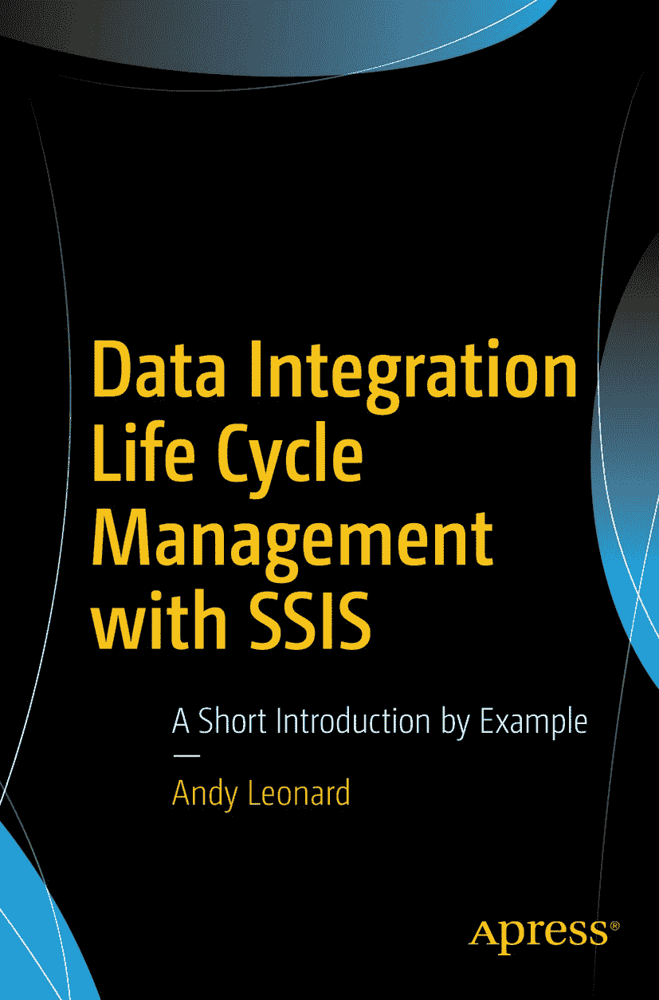

ISBN 978-1-4842-3275-0  
e-ISBN 978-1-4842-3276-7  
[`doi.org/10.1007/978-1-4842-3276-7`](https://doi.org/10.1007/978-1-4842-3276-7)

美国国会图书馆控制编号：2017960764

© 安迪·伦纳德 2018

本作品受版权保护。出版商保留所有权利，无论涉及材料的全部或部分，特别是翻译、重印、重用插图、朗诵、广播、微缩胶片复制或其他任何物理形式的复制权，以及传输或信息存储与检索、电子改编、计算机软件，或目前已知或未来开发的其他类似或不同方法的权利。本书中可能出现商标名称、标识和图像。我们并未在每次出现商标名称、标识或图像时使用商标符号，而是仅在编辑风格下使用这些名称、标识和图像，以维护商标所有者的利益，且无意侵犯商标权。

本出版物中使用的商品名称、商标、服务标志及类似术语，即使未被明确标识，也不应被视为对其是否受专有权利保护的立场表达。尽管本书中的建议和信息在出版时被认为是真实准确的，但作者、编辑及出版商均不对可能出现的任何错误或遗漏承担法律责任。出版商对本书所含内容不作任何明示或暗示的保证。本书采用无酸纸印刷。

本书由施普林格科学与商业媒体纽约公司（地址：纽约春街 233 号 6 楼，邮编 10013）向全球图书贸易发行。电话：1-800-SPRINGER，传真：(201) 348-4505，电子邮件：`orders-ny@springer-sbm.com`，或访问`www.springeronline.com`。Apress Media, LLC 是加利福尼亚州的有限责任公司，其唯一成员（所有者）为 Springer Science + Business Media Finance Inc (SSBM Finance Inc)。SSBM Finance Inc 是特拉华州的一家公司。

*献给克里斯蒂。*

## 前言

我有幸与安迪·伦纳德相识并共事多年。大部分时间里，我们以独立承包人的身份合作项目。我们目睹并学习了 SSIS 多年来如何逐步成熟。安迪是我合作过的最知识渊博、技术精湛的人之一。而在这个领域工作了近 40 年后，我合作过的人非常多。

本书充满了我们在多年实践中通过试用 SSIS 解决实际问题而学到的**最佳实践**。我们通过实践、反思并寻找更优解决方案来学习。事物变化很快，所以我们一直在学习新东西。我们不断重新评估过去的做法，并将其与后来学到的新知进行比较。

《SSIS 数据集成生命周期管理》源于多个项目反复迭代的经验。它不仅关乎开发，还涉及持续的维护工作。理解这两个方面对于在 DevOps 企业中开发高效的流程至关重要。这种方法论有助于使开发和部署流程更高效、更有效、更具可预测性。这让我们所有人都更快乐一点。

这本书也旨在分享一路走来的学习心得，让其他人从中受益。安迪正是这样的践行者，这也是我最欣赏他的一点。我真诚希望您能从本书中获得帮助，并长久受益。

祝阅读愉快！

肯特·布拉德肖  
2017 年夏季

## 致谢

我首先感谢上帝，因祂为自己的名引导我走义路（诗篇 23:3）。感谢我的爱妻克里斯蒂，以及我们的孩子——史蒂维·雷、艾玛和赖利——为我牺牲了部分父亲陪伴时间。感谢企业数据与分析团队的出色成员——肯特·布拉德肖、尼克·哈里斯和彭妮·特鲁普——在我写作期间的耐心与辛勤工作。我在 Apress 也拥有一个出色的团队：吉尔·巴尔扎诺让一切顺利运转，乔纳森·詹尼克是业内最优秀的编辑。

## 关于作者

