# 2. SSIS

本书并非旨在教你 SSIS。如果你阅读本书并实践其中的示例，你可能会对 SSIS 有更多了解。这是我的希望，但本书的目标并不是教会你 SSIS。我的目标是教会你如何管理企业中的 SSIS。如果你希望学习 SSIS，我推荐初学者阅读《SQL Server Central 上的 Integration Services 阶梯教程》（`sqlservercentral.com/stairway/72494/`），进阶学习者可阅读《SQL Server Integration Services 设计模式》（`amazon.com/Server-Integration-Services-Design-Patterns/dp/1484200837`）。

通过示例学习是最好的方式。在本章中，你将构建一个用于演示目的的 SSIS 项目。该 SSIS 项目将包含一个 SSIS 包、一个连接管理器、变量、项目参数和包参数。你将在本书后续章节中持续使用这个名为 `DILMSample` 的 SSIS 项目。该 SSIS 项目在 SQL Server Data Tools（`SSDT`）中构建。请参阅附录 A，获取你将在本书中使用的工具和实用程序的链接。

我将讨论数据集成检测和消息传递，以便在 SSIS 包执行期间输出日志消息。这些消息有助于对执行失败进行故障排除的人员，并输出重要的数据集成检测元数据。

## 演示示例

打开 `SSDT` 并创建一个名为 `DILMSample` 的新 SSIS 项目。当 `SSDT` 创建新 SSIS 项目时，它会加载一个默认的 SSIS 项目。默认的 SSIS 项目包括：

*   项目参数，存储在 `Project.params` 文件中
*   用于项目级连接管理器的虚拟文件夹
*   用于包部件的虚拟文件夹
    *   用于控制流包部件的虚拟文件夹
*   用于杂项项目的虚拟文件夹
*   一个名为 `Package.dtsx` 的默认（空）SSIS 包

如图 2-1 所示，将 `Package.dtsx` 重命名为 `SimplePackage.dtsx`。

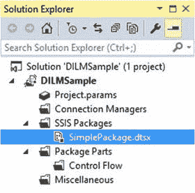

图 2-1：DILMSample SSIS 项目

重命名包表明了意图；而保留默认包名则显得懒惰。

## 添加包参数

由于我们计划使用此项目和包来演示生命周期管理，让我们添加一些参数。首先，单击 `SimplePackage.dtsx` 包上的“参数”选项卡。添加两个包参数，其设置如表 2-1 所示。

表 2-1：包参数设置

完成后，你的“参数”选项卡应类似于图 2-2 所示。

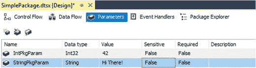

图 2-2：包参数

你将这些演示参数添加在包作用域（Scope）。作用域是软件开发和生命周期管理中的一个重要概念。DevOps 中的“Dev”部分侧重于构建运维团队易于管理的代码。作用域如何帮助实现这一点？稍后，你将把参数值外部化到 Transact-SQL（`T-SQL`）脚本中。运维人员最终将通过部署和维护 `T-SQL` 脚本来管理这些外部化的值。DevOps 开发的一个目标是将尽可能多的信息传达给运维人员，尤其是那些不了解 SSIS 工作原理的运维人员。将参数和变量限定在适当的级别（不要更高，也不要更低），可以传达参数值在 SSIS 应用程序中的使用位置和方式，从而为数据集成项目的“黑箱”带来一些光明。

## 添加项目参数

在解决方案资源管理器中双击 `Project.params` 工件，打开项目参数窗口，如图 2-3 所示。

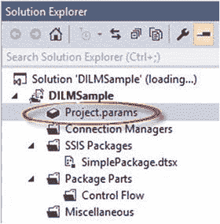

图 2-3：项目参数

根据表 2-2 中的设置添加两个项目参数。

表 2-2：项目参数设置

完成后，“项目参数”选项卡应类似于图 2-4 所示。

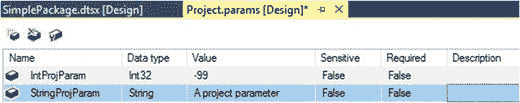

图 2-4：项目参数

SSIS 参数的工作原理与 SSIS 变量非常相似。两者有两个重要区别：

1. SSIS 变量值可以在任何时间更改（无论是在 SSIS 包执行之前还是执行期间）。SSIS 参数值可以在 SSIS 包执行之前更改，但不能在执行期间更改。
2. SSIS 参数值可以标记为敏感或必需。敏感参数会被加密。必需参数必须在 SSIS 包执行之前进行替代。

## 关于变量、参数和作用域的说明

为将在 SSIS 包执行期间更改的值创建 SSIS 变量，例如在 Foreach 循环容器分配中使用的变量。

为单个 SSIS 包中使用的值创建包作用域参数。包作用域参数的值在 SSIS 包执行期间不能更改。为 SSIS 项目中所有（或几个）SSIS 包共享的值创建项目作用域参数。

保存并关闭“项目参数”窗口。

## 添加执行 SQL 任务

向 `SimplePackage.dtsx` SSIS 包的控制流中添加一个执行 SQL 任务。打开执行 SQL 任务编辑器，并将 `ConnectionType` 属性设置为 ADO.NET。单击 `Connection` 属性，然后单击 `<新连接...>`。此时会打开 ADO.Net 连接管理器编辑器。您可以配置 ADO.Net 连接管理器以连接到任何所需的 SQL Server 数据库。您将执行一个通用查询，该查询适用于任何 SQL Server 关系数据库。

我使用了一个名为 `vmDemo` 的虚拟机。我安装了一个 SQL Server 2016 实例，名为 `vmDemo\Demo`。我将 ADO.Net 连接管理器配置为连接到一个名为 `TestDB` 的数据库，如图 2-5 所示。

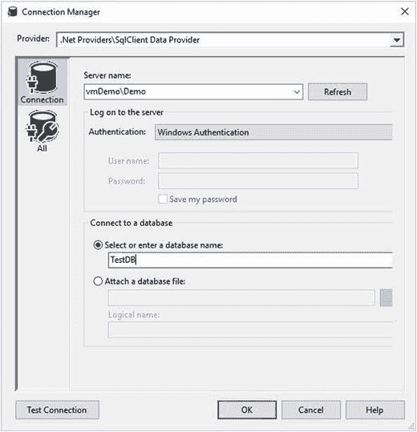

图 2-5：配置 ADO.Net 连接管理器

单击“确定”，直到返回到执行 SQL 任务编辑器。在 `SQLStatement` 属性的“值”文本框中单击，然后单击省略号按钮打开“输入 SQL 查询”对话框。在此对话框中输入以下 Transact-SQL 语句：

```
Select Count(*) As TableCount From [sys].[tables]
```

为什么要为 `Count(*)` 的值设置别名？执行 SQL 任务期望返回值采用带有列名的表格格式（尤其是当分配给了 SSIS 变量时，下一步就会进行分配）。

将 `ResultSet` 属性从“无”改为“单行”。单击执行 SQL 任务编辑器左侧列表框中的“结果集”页面。单击“添加”按钮，并将“结果名称”从 `NewResultName` 改为 `0`。单击 `0` 结果名称旁边的“变量名称”列中的下拉菜单，然后单击 `<新建变量...>` 打开“添加变量”对话框。确保“容器”设置为 `SimplePackage`。将变量命名为 `TableCount`，并将“值类型”属性设置为 Int32。提供默认值为 `0`。您的“添加变量”对话框应如图 2-6 所示。

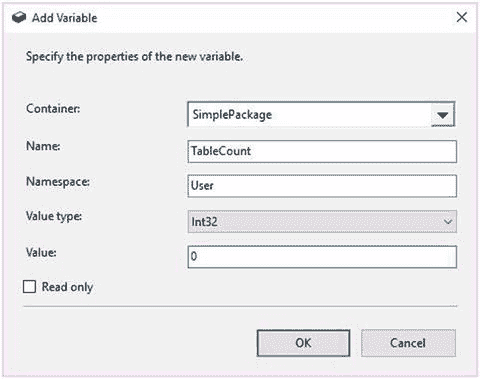

图 2-6：添加新的 SSIS 变量

您可以使用“添加变量”对话框中的“容器”下拉菜单选择 SSIS 变量的作用域。请注意此设置。如果执行 SQL 任务位于序列容器中，则很容易错误地将变量的作用域限定为主机序列容器，而不是 SSIS 包。

## 关于 SSIS 变量作用域的说明

由于 SSIS 变量很少限定在 SSIS 包之下，因此 Microsoft SSIS 开发团队更改了 SSIS 变量作用域的默认行为。在更改之前，SSIS 变量作用域默认为具有焦点的可执行文件。现在，SSIS 变量作用域默认为 SSIS 包，但在“添加变量”对话框中除外。

单击“确定”按钮。您的执行 SQL 任务编辑器的“结果集”页面应如图 2-7 所示。

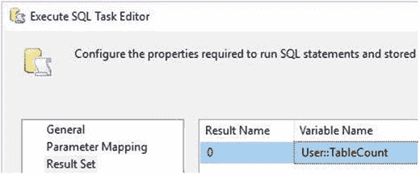

图 2-7：配置后的结果集

单击“确定”按钮关闭执行 SQL 任务编辑器。右键单击执行 SQL 任务并单击“重命名”。将任务重命名为“SQL 获取表计数”。

## 添加脚本任务

向 `SimplePackage.dtsx` 的控制流中添加一个脚本任务。将其重命名为“SCR 记录值”，然后从“SQL 获取表计数”执行 SQL 任务连接一个“成功”优先约束到“SCR 记录值”脚本任务。打开脚本任务编辑器。您可以选择 Microsoft Visual Basic 作为 `ScriptLanguage` 属性，也可以接受默认的 Microsoft Visual C#。本书中的演示将使用 C#。

### 为什么选择 C#？

自 2016 年底以来，Microsoft 多次重申 Visual Basic 和 C# 的语言功能将分化（`blogs.msdn.microsoft.com/dotnet/2017/02/01/the-net-language-strategy/`）。Microsoft 的官方观点（来自该链接）是，它将继续将 C# 发展为“最先进的编程语言”，而其他功能将不会添加到 Visual Basic 中，因为“它们不会满足需求或自然融入 VB”。请阅读该文章及其包含的链接。C# 和 VB 在未来将有所不同，并且 C# 将获得 VB 不具备的功能。

有关 C# 的优质教程，请访问 `bimlscript.com`，然后点击“立即学习 Biml!”课程中的“C# 入门”链接。

单击脚本任务编辑器的 `ReadOnlyVariables` 属性的“值”文本框，然后单击省略号按钮打开“选择变量”对话框。勾选以下变量的复选框：

* `System::TaskName`
* `System::PackageName`
* `User::TableCount`
* `$Package::IntPkgParam`
* `$Package::StringPkgParam`
* `$Project::IntProjParam`
* `$Project::StringProjParam`

完成后，“选择变量”对话框应类似于图 2-8 所示。

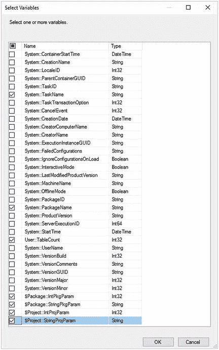

图 2-8：“选择变量”对话框

### 为什么使用 `ProjectName` 和 `TaskName`？

如下方代码所示，你将使用这些变量在代码中的 `subComponent`.Net 变量内构建一个值。对于 SSIS 开发来说，你绝对需要这个变量吗？不。但如果你要帮助运维团队监控和报告来自 SSIS 日志的消息与失败情况，那么你绝对需要这个变量。对于 DevOps 中的开发端而言，这只是几行代码。对于 DevOps 中的运维端而言，它能在日志中多呈现一条执行元数据。提供这种类型和级别的流程检测，对于 DevOps 与 SSIS 的成功集成至关重要。

点击确定按钮关闭选择变量对话框。此时你的脚本任务编辑器应如图 2-9 所示。

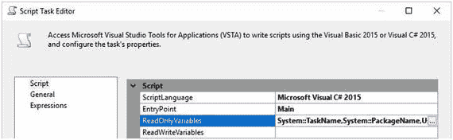

图 2-9：脚本任务编辑器

点击编辑脚本按钮打开 Visual Studio Tools for Applications (VSTA) 编辑器。编辑 `public void Main()` 方法，使其内容如下：

```
public void Main()
{
string packageName = Dts.Variables["System::PackageName"].Value.ToString();
string taskName = Dts.Variables["System::TaskName"].Value.ToString();
string subComponent = packageName + "." + taskName;
bool fireAgain = true;
int tableCount = Convert.ToInt32(Dts.Variables["User::TableCount"].Value);
int intPkgParam = Convert.ToInt32(Dts.Variables["$Package::IntPkgParam"].Value);
string stringPkgParam = Dts.Variables["$Package::StringPkgParam"].Value.ToString();
int intProjParam = Convert.ToInt32(Dts.Variables["$Project::IntProjParam"].Value);
string stringProjParam = Dts.Variables["$Project::StringProjParam"].Value.ToString();
string msg = "Table Count: " + tableCount.ToString();
Dts.Events.FireInformation(1001, subComponent, msg, "", 0, ref fireAgain);
msg = "Package Parameters: IntPkgParam = " + intPkgParam.ToString() + " ; StringPkgParam = " + stringPkgParam;
Dts.Events.FireInformation(1001, subComponent, msg, "", 0, ref fireAgain);
msg = "Project Parameters: IntProjParam = " + intProjParam.ToString() + " ; StringProjParam = " + stringProjParam;
Dts.Events.FireInformation(1001, subComponent, msg, "", 0, ref fireAgain);
Dts.TaskResult = (int)ScriptResults.Success;
}
```

完成后，你的 VSTA 编辑器中的代码应类似于图 2-10 所示。

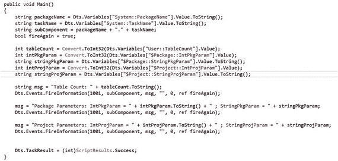

图 2-10：VSTA 编辑器中的代码

### 在关闭 VSTA 编辑器前测试 .Net 代码是否编译通过

你是否曾在 SSIS 脚本任务中编写过代码，然后关闭 VSTA 编辑器，接着关闭脚本任务编辑器，却看到了如图 2-11 所示的错误？

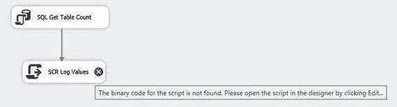

图 2-11：VSTA .Net 代码中的脚本任务错误

Kevin Hazzard 分享了一个便捷方法，可以在关闭编辑器之前测试 VSTA 编辑器中 .Net 代码的可行性。点击生成 > 生成 `ST_...`（VSTA 脚本具有唯一名称），如图 2-12 所示。

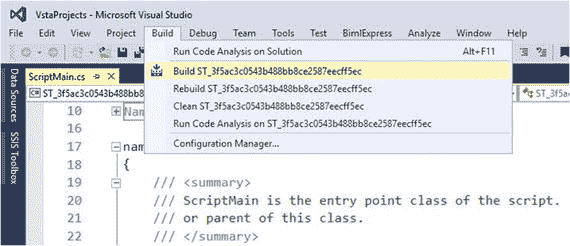

图 2-12：准备生成 VSTA 脚本

当你点击生成 `ST_...` 时，VSTA 编辑器会尝试生成脚本。在屏幕左下角，你会看到“生成已启动”，如图 2-13 所示。


图 2-13：生成已启动

如果 .Net 代码中存在错误，生成将失败。如果 .Net 代码没有错误，生成将成功，如图 2-14 所示。

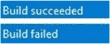

图 2-14：生成成功或失败

关闭 VSTA 编辑器，然后在脚本任务编辑器中点击确定按钮。此时 `SimplePackage.dtsx` 应如图 2-15 所示。

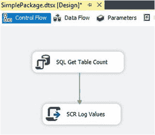

图 2-15：`SimplePackage.dtsx`

演示用的 SSIS 包和项目已完成。

## 测试进展

> *“所有软件都会经过测试。有些是有意为之。”*
> 
> – Andy Leonard，约 2005 年

始终在 SSIS 调试器中执行你的包是个好习惯。否则你如何知道你所构建的内容能够正常工作？

按 `F5` 键启动 SSIS 调试器。如果一切顺利，你应该会看到两个任务都成功执行，如图 2-16 所示。


如果你点击 `进度` 选项卡，你应该会看到由脚本触发的 `OnInformation` 消息，如图 2-17 所示。


你的演示现在已准备好开始一段关于数据集成生命周期管理的史诗之旅。

## 结论

在本章中，你构建了一个 SSIS 包，它将用于本书后续的所有课程。我讨论了数据集成的检测和消息传递，以呈现 SSIS 包执行的日志消息。对于我们 DevOps 开发端的人员来说，向运维端的支持人员发送信号非常重要。编写这段代码只需几分钟，却可能节省数小时的故障排查时间。