# 3. 源代码管理

在本书后面，我将讨论为什么通过备份和还原 `SSISDB` 数据库并非 SSIS 代码提升的可行方法。你应该像备份所有数据库一样备份 `SSISDB` 数据库。你不应该为了代码提升而备份 `SSISDB` 数据库，也不应该用备份 `SSISDB` 数据库来替代源代码管理。

开发者分为两类：正在使用源代码管理的，以及将要使用源代码管理的。有人问我：“Andy，哪种源代码管理引擎最好？”我的回答是：“你正在用的那个。”请务必使用源代码管理。

本节并非关于源代码管理或使用 Team Foundation Services 的详尽教程。我不主张某一种源代码管理引擎优于另一种。

在本章中，我将演示通过 Visual Studio Online (`visualstudio.com`) 使用 Team Foundation Services。我会交替使用“源代码管理”和“版本控制”这两个术语，因为现代的源代码管理引擎也同时管理软件版本。

## 源代码管理客户端

根据你希望使用的源代码管理（或版本控制）引擎，你可能需要也可能不需要 Visual Studio 插件（或扩展）。许多开发者使用 Subversion（一种流行的开源版本控制系统）以及 Tortoise SVN（一个实现为 Windows 外壳扩展的 Subversion 客户端）。Tortoise 是一个高度直观的界面，它集成到 Windows 资源管理器中，通过右键单击包含受 Subversion 源代码管理的项目工件的文件系统文件夹，提供上下文相关的菜单。

Git 是由 Linus Torvalds（Linux 的创建者）创建的流行版本控制系统。Git 是一个分布式源代码管理系统，这意味着每个开发者都维护着仓库的本地工作副本。Git 在很大程度上依赖于*分支*（创建代码当前版本的另一个（通常是本地的）副本）和*合并*（将更改添加到代码的另一个（通常是本地的）已编辑版本的过程）。

在本章中，我使用 `Team Explorer`，它是 `Team Foundation Services` (TFS) 的 Visual Studio 插件。你可以在 `visualstudio.com/en-us/docs/tools` 上了解有关用于 TFS 的 Visual Studio 插件的更多信息。

## 创建团队项目

在本节中，我将演示如何使用 Visual Studio Online 上提供的免费源代码管理。我喜欢 Visual Studio Online，因为它的价格（免费）和总体拥有成本（也是免费）很难被超越。设置帐户后，你可以从仪表板创建新的团队项目。我的项目如图 3-1 所示。

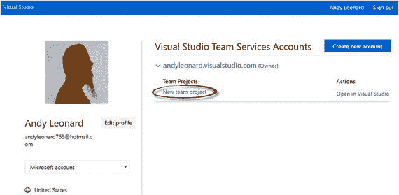

图 3-1 准备创建新的团队项目

你可以将 Visual Studio Online 源代码管理视为 Visual 范式的扩展。图 3-2 中的红色框圈出了一个 SSIS 包，它可以被视为 Visual Studio 的*项目工件*。项目工件是 Visual Studio 对象层次结构中的最低级别。下一级别是*项目*，在图 3-2 中用蓝色框圈出。Visual Studio 项目包含一个或多个项目工件。Visual Studio *解决方案*，例如图 3-2 中用绿色圈出的 `DILMSuite` 解决方案，包含一个或多个项目。

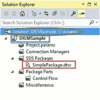

图 3-2 Visual Studio 范式

`Team Foundation Server` 将这个范式扩展了一个级别：TFS *团队项目*包含一个或多个 Visual Studio 解决方案。

单击“创建团队项目”链接以进入“创建新项目”页面，如图 3-3 所示。

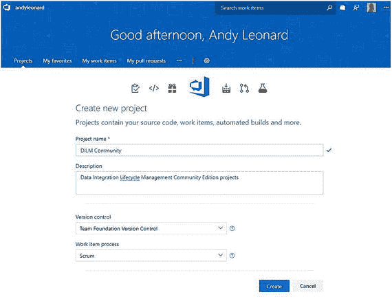

图 3-3 创建新的团队项目

要配置新的团队项目，请添加名称和可选的描述，然后选择版本控制引擎（Team Foundation 版本控制或 Git）和工作项流程。单击“创建”按钮以创建团队项目并进入“团队项目”页面，如图 3-4 所示。

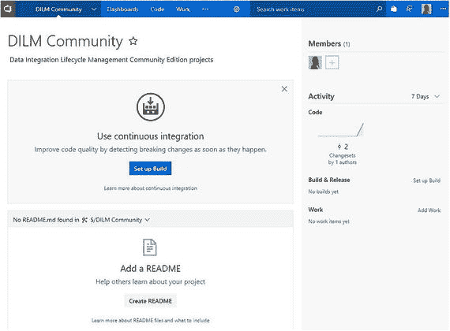

图 3-4 新的团队项目

现在，一个新的团队项目已准备就绪。

## 配置 `SSDT` 以使用 TFS Online

回到 `SSDT`，接下来你配置一个到 TFS Online 的连接。首先单击“团队”下拉菜单，然后单击“管理连接”，如图 3-5 所示。

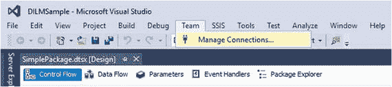

图 3-5 管理源代码管理连接

如果你尚未配置连接，则可能首先会看到如图 3-6 所示的“连接到 Team Foundation Server”窗口。

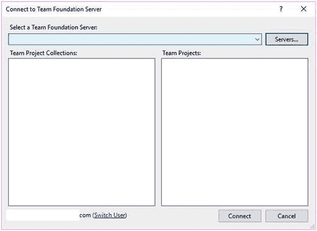

图 3-6 连接到 Team Foundation Server

单击“服务器”按钮以打开“添加/删除 Team Foundation Server”对话框，如图 3-7 所示。

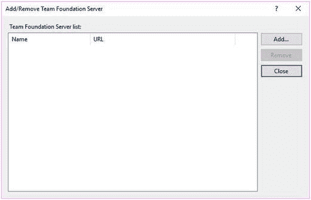

图 3-7 添加/删除 Team Foundation Server

单击“添加”按钮以打开“添加 Team Foundation Server”对话框，如图 3-8 所示。

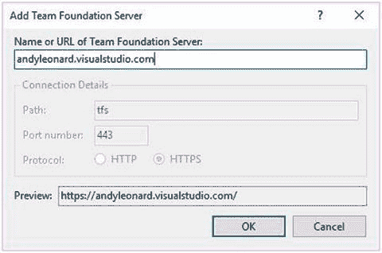

图 3-8 添加 Team Foundation Server

在“Team Foundation Server 的名称或 URL”文本框中输入你的 TFS Online 帐户页面的 URL。单击“确定”按钮继续。

“添加 Team Foundation Server”对话框关闭，“添加/删除 Team Foundation Server”对话框现在应列出你的 TFS Online 配置，并看起来类似于图 3-9 所示。

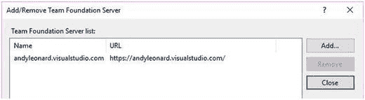

图 3-9 配置后的“添加/删除 Team Foundation Server”对话框

单击“关闭”按钮以返回到“连接到 Team Foundation Server”对话框。

当“连接到 Team Foundation Server”对话框显示时，选择你的新团队项目，如图 3-10 所示。

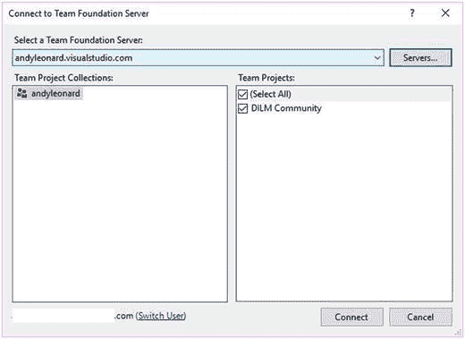

图 3-10 选择团队项目

单击“连接”按钮。`Team Explorer` 的“连接”页面现在应出现，类似于图 3-11 所示。

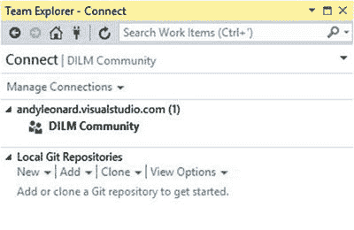

图 3-11 连接到 TFS Online 的 Team Explorer

在解决方案资源管理器中，右键单击项目名称 (`DILMSample`)，将鼠标悬停在“源代码管理”上，然后单击“将项目添加到源代码管理”，如图 3-12 所示。

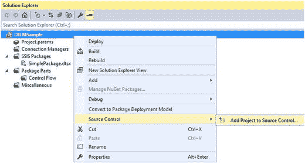

图 3-12 准备将项目添加到源代码管理

“将解决方案 <*解决方案名称*> 添加到源代码管理”对话框显示，并在“团队项目位置”列表框中包含你的团队项目的名称，如图 3-13 所示。

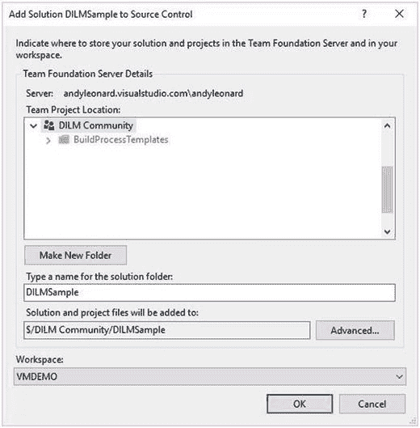

图 3-13 将解决方案添加到源代码管理

单击“确定”按钮将 `DILMSample` 项目添加到源代码管理。

添加后，解决方案资源管理器中的解决方案工件会带有 `+` 符号标记。`+` 符号表示该文件是“新添加到”源代码管理但尚未签入的，如图 3-14 所示。

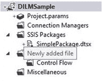

图 3-14 新添加到源代码管理

通过右键单击项目名称、将鼠标悬停在“源代码管理”上并单击“签入”来签入解决方案，如图 3-15 所示。

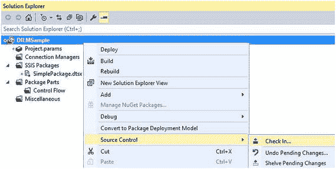

**图 3-15** 签入解决方案

此时将显示团队资源管理器的“挂起的更改”窗口。最佳实践是始终添加版本注释，如图 3-16 所示。

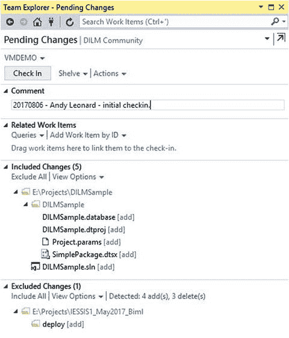

**图 3-16** 准备签入项目

你可能会（也可能不会）收到确认签入的提示，如图 3-17 所示。

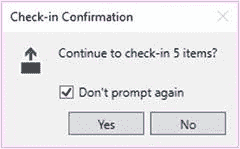

**图 3-17** 签入确认

签入后，团队资源管理器的“挂起的更改”页面将如图 3-18 所示。

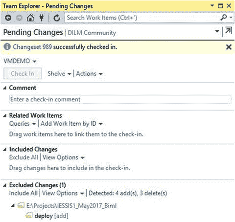

**图 3-18** 全部已签入

签入后，解决方案资源管理器将在已签入的项目旁显示锁定标记，如图 3-19 所示。

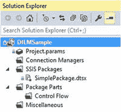

**图 3-19** 已签入的解决方案项目

在本章中，我演示了如何通过 Visual Studio Online 网站使用 Team Foundation Services (TFS) Online。有关更多信息，请访问 `visualstudio.com`。