# 4. 部署到 `SSIS` 目录

`SSIS` 目录随 `SSIS 2012` 一起发布。自 2012 年以来，`SSIS` 的每个版本都对目录功能进行了升级。有几种方法可以将 `SSIS` 项目部署到 `SSIS` 目录。在本章中，我将介绍两种部署选项：
* 从 `SSDT` 部署
* 从 `ISPAC` 文件部署

`DevOps` 的一个关键原则是自动化，在本章中，我将讨论并演示自动化的 `SSIS` 部署。

## 从 `SSDT` 部署

自 `SSIS` 目录首次发布以来，`SSIS` 一直保持向后兼容。在 2012 年之前，`SSIS` 的部署模型没有名称；只有一种部署 `SSIS` 的方式和三个目标：文件系统、`MSDB` 数据库和“`SSIS` 包存储区”（默认情况下，它是文件系统中的一个文件夹和 `MSDB` 数据库的组合）。部署到 `SSIS` 目录是一种部署 `SSIS` 包的新方式，因此我们需要为“旧方式”和“新方式”命名。新方式称为“项目部署模型”，旧方式称为“包部署模型”。

在本章（以及本书）中，我将重点介绍项目部署模型。将 `SSIS` 包部署到 `SSIS` 目录需要使用项目部署模型。

要部署你的演示项目，请在 `SSDT` 中打开该项目，右键单击解决方案资源管理器中的项目名称，然后单击“部署”，如图 4-1 所示。

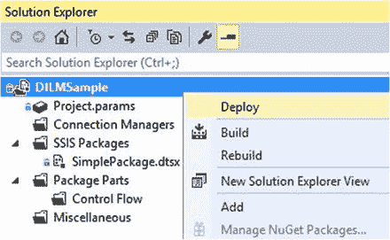

**图 4-1** 从 `SSDT` 部署 `DILMSuite` `SSIS` 项目

`Integration Services` 部署向导是一个非常实用的软件。其底层可执行文件 `ISDeploymentWizard.exe` 具有图形用户界面 (GUI) 和命令行界面 (CLI)。该实用程序支持从 `ISPAC` 文件部署到 `SSIS` 目录，以及从 `SSIS` 目录部署到 `SSIS` 目录；并且从 `SSIS 2016` 开始，它同时支持包部署和项目部署。我不会深入探讨这个出色的应用程序；只要知道我非常欣赏 `Integration Services` 部署向导所体现出的卓越性能即可。

`Integration Services` 部署向导会显示“简介”页面或“选择目标”页面（如果你之前在“简介”页面上选中了“不再显示此页面”复选框），如图 4-2 所示。

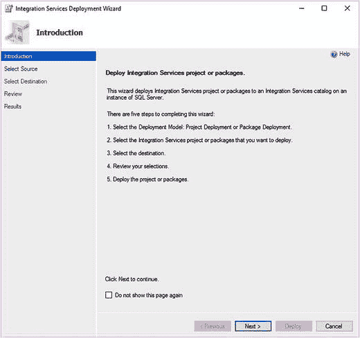

**图 4-2** `Integration Services` 部署向导的“简介”页面

如果显示了“简介”页面，请单击“下一步”按钮，继续进入“选择目标”页面。

我是不是跳过了“选择源”页面？是的。从 `SSDT` 内部启动时，`Integration Services` 部署向导已经拥有所需关于源的信息。

输入托管你的 `SSIS` 目录的服务器名称。单击“浏览”按钮以选择目标目录文件夹。完成后，你的“选择目标”页面应类似于图 4-3 所示。

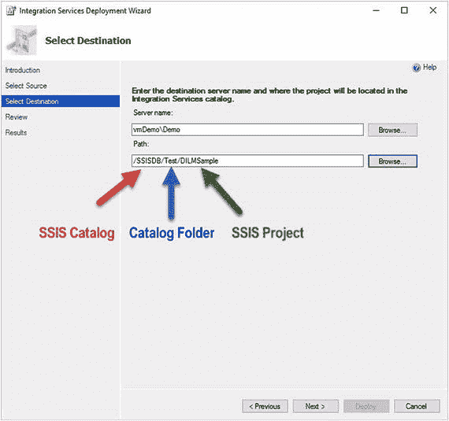

**图 4-3** `Integration Services` 部署向导的“选择目标”页面

“选择目标”页面上显示的“路径”值是指 `SSIS` 项目的 `SSIS` 目录路径。`SSIS` 目录项目包含在 `SSIS` 目录文件夹中，而该文件夹又包含在 `SSIS` 目录中（该目录始终命名为 `SSISDB`）。`SSIS` 包包含在 `SSIS` 目录项目中。

单击“下一步”按钮继续进入“审阅”页面，如图 4-4 所示。

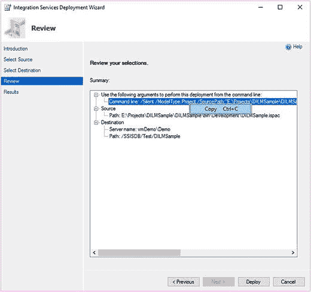

**图 4-4** 审阅部署选择项和选项

很容易对 `Integration Services` 部署向导的“审阅”页面一扫而过，但我想请你在此稍作停留，因为这里有一些信息可能在将来（或现在）对你有用。

## 通过命令行部署

通过 `CLI` 进行部署功能强大，对于 `DevOps` 自动化非常有用。源和目标信息不言自明。请注意，在截图中，我右键单击了命令行，弹出了一个仅有一个“复制”选项的上下文菜单。我已将命令行粘贴在此处：

```
Command line: /Silent /ModelType:Project /SourcePath:"E:\Projects\DILMSample\DILMSample\bin\Development\DILMSample.ispac" /DestinationServer:"vmDemo\Demo" /DestinationPath:"/SSISDB/Test/DILMSample"
```

`SSIS` 附带了大量实用工具，其中一些可以从命令提示符调用。任何可以从命令提示符调用的实用工具都可以通过 `SQL` 代理（前提是启用了命令行执行）、`Windows` 计划程序或几乎任何其他计划服务或实用工具进行调度。

为了使用集成服务部署向导审阅页面上共享的命令行，你需要了解两件事：

1. 可执行文件的位置
2. 开关和值的含义

我将 `SQL Server` 的 `Demo` 实例安装在 `vmDemo` 的 `E:` 盘上，因此 `ISDeploymentWizard.exe` 的位置是 `E:\Program Files\Microsoft SQL Server\130\DTS\Binn\ISDeploymentWizard.exe`，如图 4-5 所示。

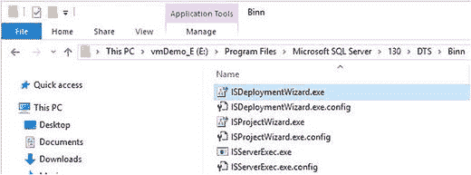

**图 4-5** `ISDeploymentWizard.exe` 文件的位置

这正是当前已打开并正在执行的同一应用程序；它是集成服务部署向导的可执行文件。如前所述，该可执行文件提供了两个接口：一个 `GUI` 和一个 `CLI`。你可以通过打开命令提示符，提供 `ISDeploymentWizard.exe` 的路径，然后跟上上述命令行，来执行整个 `SSIS` 项目 `DILMSuite` 的部署。不相信？看看图 4-6。

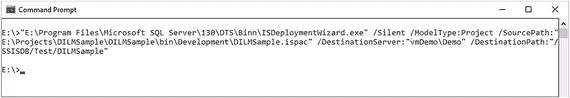

**图 4-6** 通过命令行进行部署

这里有好消息也有坏消息。好消息是此次执行成功了。坏消息呢？如果执行成功，不会提供任何反馈。你如何判断它成功了？嗯，它没有失败。失败是什么样子的？失败可能会导致 `CLI` 弹出一条提示，给出可接受的开关列表，如图 4-7 所示。

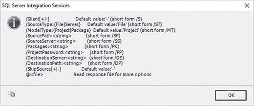

**图 4-7** 使用 `CLI` 部署失败

这并非唯一的失败响应。例如，如果你错误地键入了目标服务器的名称，在 `ISDeploymentWizard.exe` 尝试联系服务器 30 秒后，你会收到一条“连接失败”的消息。该消息显示效果类似于图 4-8。

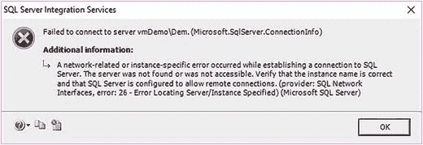

**图 4-8** 因连接错误导致的部署失败

另一种检测是否成功的方法是使用 `SSMS` 连接到 `SSIS` 目录并检查你的 `SSIS` 项目是否存在，如图 4-9 所示。

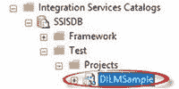

**图 4-9** 已部署到 `SSIS` 目录的 `SSIS` 项目

不过，如果 `SSIS` 项目之前已经部署过，你可以通过右键单击目录中的 `SSIS` 项目并单击“版本”来进行检查，如图 4-10 所示。

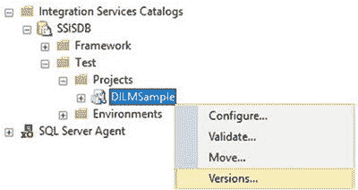

**图 4-10** 打开 `SSIS` 目录项目版本

“项目版本”对话框显示如图 4-11 所示。

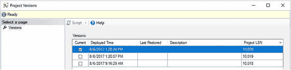

**图 4-11** 查看 `SSIS` 目录项目版本

最后一次部署被标记为“当前”。

回到你在 `SSDT` 中的部署，如果你在集成服务部署向导审阅页面上单击“部署”按钮，部署向导将尝试将你的 `SSIS` 项目部署到你选择的 `SSIS` 目录中，并放入你指定的 `SSIS` 目录文件夹内，如图 4-12 所示。

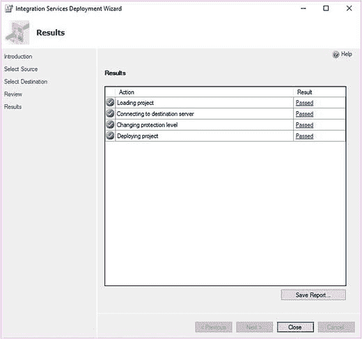

**图 4-12** 成功部署

如果一切顺利，部署将成功完成。

# 部署失败

有时，顺利的部署也会遭遇不测。你阅读本书可能是因为你遇到了由于善意地尝试还原 SSIS 目录数据库 `SSISDB` 而触发的部署失败。

不建议使用备份和还原作为在 SSIS 目录之间提升或传输 SSIS 项目的方法！

当你尝试在 `SSISDB` 被不当还原后向其部署 SSIS 项目（或包）时，部署将不会成功。相反，你的集成服务部署向导结果页面将显示如图 4-13 所示。

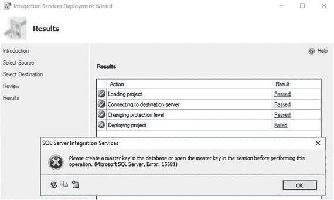

**图 4-13** 失败的 SSIS 项目部署

当你单击“失败”链接时，图 4-13 中的消息框将显示错误消息：

> 请先在该数据库中创建一个主密钥，或在会话中打开主密钥，然后执行此操作。(Microsoft SQL Server, Error: 15581)

请在 SSIS 目录页面上标题为“备份、还原和移动 SSIS 目录”（`docs.microsoft.com/en-us/sql/integration-services/service/ssis-catalog`）的部分中查找有关备份和还原 SSIS 目录数据库 (`SSISDB`) 的更多信息。我曾就此场景写过博客，该博文中包含一个可用于还原 `SSISDB` 的脚本。你可以在 `andyleonard.blog/2017/07/29/deploying-ssis-projects-to-a-restored-ssis-catalog-ssisdb` 找到我题为“将 SSIS 项目部署到已还原的 SSIS 目录”的博文。我使用的脚本如下：

```sql
/*
用于将 SSISDB 恢复到 SQL Server 2016 SP1 实例的脚本。
我遵循了 https://msdn.microsoft.com/en-us/library/hh213291(v=sql.130).aspx 上的说明。
希望对您有所帮助，
Andy Leonard
*** 看到三个星号 "***" 处需要您执行操作
*/
-- 如果 ##MS_SSISServerCleanupJobLogin## 登录名不存在，则创建该登录名。
USE [master]
GO
print '##MS_SSISServerCleanupJobLogin## 登录名'
If Not Exists(Select [name]
From sys.sql_logins
Where [name] = '##MS_SSISServerCleanupJobLogin##')
begin
print ' – 正在创建 ##MS_SSISServerCleanupJobLogin## 登录名'
CREATE LOGIN [##MS_SSISServerCleanupJobLogin##] WITH PASSWORD=N'DWehrJfiRgMxEFaE=KxomUkF7fnV3poW/ZQPJ' -- *** 请更改此密码 – Andy
, DEFAULT_DATABASE=[master]
, DEFAULT_LANGUAGE=[us_english]
, CHECK_EXPIRATION=OFF
, CHECK_POLICY=OFF
print ' – ##MS_SSISServerCleanupJobLogin## 登录名已创建'
end
Else
print ' – ##MS_SSISServerCleanupJobLogin## 已存在。'
GO
print ''
print ' – 正在禁用 ##MS_SSISServerCleanupJobLogin## 登录名'
ALTER LOGIN [##MS_SSISServerCleanupJobLogin##] DISABLE
print ' – ##MS_SSISServerCleanupJobLogin## 登录名已禁用'
GO
USE [master]
GO
SET ANSI_NULLS ON
GO
SET QUOTED_IDENTIFIER ON
GO
print 'dbo.sp_ssis_startup 存储过程'
If Exists(Select s.name + '.' + p.name
From sys.procedures p
Join sys.schemas s
On s.[schema_id] = p.[schema_id]
Where s.[name] = 'dbo'
And p.name = 'sp_ssis_startup')
begin
print ' – 正在删除 dbo.sp_ssis_startup 存储过程'
Drop PROCEDURE [dbo].[sp_ssis_startup]
print ' – dbo.sp_ssis_startup 存储过程已删除'
end
print ' – 正在创建 dbo.sp_ssis_startup 存储过程'
go
CREATE PROCEDURE [dbo].[sp_ssis_startup]
AS
SET NOCOUNT ON
/* 当前，IS 存储名称为 'SSISDB' */
IF DB_ID('SSISDB') IS NULL
RETURN
IF NOT EXISTS(SELECT name FROM [SSISDB].sys.procedures WHERE name=N'startup')
RETURN
/* 调用 SSISDB 中的存储过程 */
/* 使用动态 SQL 处理 AlwaysOn 非可读模式*/
DECLARE @script nvarchar(500)
SET @script = N'EXEC [SSISDB].[catalog].[startup]'
EXECUTE sp_executesql @script
GO
print ' – dbo.sp_ssis_startup 存储过程已创建'
print ''
use master
go
print '正在启用 SQLCLR'
exec sp_configure 'clr enabled', 1
reconfigure
print 'SQLCLR 已启用'
print ''
print 'MS_SQLEnableSystemAssemblyLoadingKey 非对称密钥'
If Not Exists(Select [name]
From sys.asymmetric_keys
Where [name] = 'MS_SQLEnableSystemAssemblyLoadingKey')
begin
print ' – 正在创建 MS_SQLEnableSystemAssemblyLoadingKey'
Create Asymmetric key MS_SQLEnableSystemAssemblyLoadingKey
From Executable File = 'E:\Program Files\Microsoft SQL Server\130\DTS\Binn\Microsoft.SqlServer.IntegrationServices.Server.dll'  -- *** 请检查此路径 – Andy
print ' – MS_SQLEnableSystemAssemblyLoadingKey 已创建'
end
Else
print ' – MS_SQLEnableSystemAssemblyLoadingKey 已存在。'
go
print ''
print 'MS_SQLEnableSystemAssemblyLoadingUser SQL 登录名'
If Not Exists(Select [name]
From sys.sql_logins
Where [name] = 'MS_SQLEnableSystemAssemblyLoadingUser')
begin
print ' – 正在尝试创建 MS_SQLEnableSystemAssemblyLoadingUser SQL 登录名'
begin try
Create Login MS_SQLEnableSystemAssemblyLoadingUser
From Asymmetric key MS_SQLEnableSystemAssemblyLoadingKey
print ' – MS_SQLEnableSystemAssemblyLoadingUser SQL 登录名已创建'
print ' – 授予 MS_SQLEnableSystemAssemblyLoadingUser Unsafe Assembly 权限'
Grant unsafe Assembly to MS_SQLEnableSystemAssemblyLoadingUser
print ' – 已授予 MS_SQLEnableSystemAssemblyLoadingUser Unsafe Assembly 权限'
end try
begin catch
print ' – 尝试创建 MS_SQLEnableSystemAssemblyLoadingUser SQL 登录名时出现问题，但这可能没问题...'
-- 暂不处理
end catch
end
Else
print ' – MS_SQLEnableSystemAssemblyLoadingUser SQL 登录名已存在。'
go
print ''
print '正在恢复 SSISDB'
USE [master]
begin try
ALTER DATABASE [SSISDB] SET SINGLE_USER WITH ROLLBACK IMMEDIATE
end try
begin catch
-- 忽略错误（通常因为数据库不存在而发生...）
end catch
RESTORE DATABASE [SSISDB]
FROM DISK = N'E:\Andy\backup\SSISDB_SP1.bak'  -- *** 请检查此路径 – Andy
WITH FILE = 1,
MOVE N'data' To N'E:\Program Files\Microsoft SQL Server\MSSQL13.TEST\MSSQL\DATA\SSISDB.mdf',   -- *** 请检查此路径 – Andy
MOVE N'log' TO N'E:\Program Files\Microsoft SQL Server\MSSQL13.TEST\MSSQL\DATA\SSISDB.ldf',   -- *** 请检查此路径 – Andy
NOUNLOAD
, REPLACE
, STATS = 5
ALTER DATABASE [SSISDB] SET MULTI_USER
GO
print ' – SSISDB 恢复完成'
print ''
print '为 dbo.sp_ssis_startup 存储过程设置 ProcOption 为 1'
EXEC sp_procoption N'[dbo].[sp_ssis_startup]', 'startup', '1'
print '已为 dbo.sp_ssis_startup 存储过程设置 ProcOption 为 1'
GO
print ''
Use SSISDB
go
print 'SSISDB 数据库中的 ##MS_SSISServerCleanupJobUser## 用户'
If Not Exists(Select *
From sys.sysusers
Where [name] = '##MS_SSISServerCleanupJobUser##')
begin
print ' – 正在创建 ##MS_SSISServerCleanupJobUser## 用户'
CREATE USER [##MS_SSISServerCleanupJobUser##] FOR LOGIN [##MS_SSISServerCleanupJobLogin##] WITH DEFAULT_SCHEMA=[dbo]
print ' – ##MS_SSISServerCleanupJobUser## 用户已创建'
end
Else
print ' – ##MS_SSISServerCleanupJobUser## 已存在。'
GO
print ''
/*
-- 从文件中恢复主密钥的一种方法。
-- 注意：您必须拥有原始的 SSISDB 加密密码！
Restore master key from file = 'E:\Andy\backup\SSISDB_SP1_key'    -- *** 请检查此路径 – Andy
Decryption by password = 'SuperSecretPassword' -- 'SSISDB 备份期间用于加密主密钥的密码'    -- *** 请检查此密码 – Andy
Encryption by password = 'SuperSecretPassword' -- '新密码'    -- *** 请检查此密码 – Andy
Force
go
*/
-- 从文件中恢复主密钥的另一种方法。
-- 注意：您必须拥有原始的 SSISDB 加密密码！
print '正在打开主密钥'
Open master key decryption by password = 'SuperSecretPassword' --'创建 SSISDB 时使用的密码'   -- *** 请检查此密码 – Andy
Alter Master Key
Add encryption by Service Master Key
go
print '主密钥已打开'
print ''
print '正在检查 SSIS 目录架构版本'
exec [catalog].check_schema_version @use32bitruntime = 0
```

上面列出的 Transact-SQL 脚本要求您提供用于创建 SSIS 目录的密码；请将文本 `"SuperSecretPassword"` 替换为您 SSIS 目录的密码。每当您看到注释 `-- *** check this, please – Andy` 时，请检查前面的 T-SQL 行。

## 结论

在本章中，我演示了将 SSIS 项目部署到 SSIS 目录。您学习了 Integration Services 部署向导的 GUI 和 CLI。我讨论了在践行 DevOps 的任何企业中部署的重要性。