# 5. 配置 SSIS 目录项目

企业级 DevOps 的一个关键原则是*外部化*，即对代码进行配置或参数化。配置与代码本身分开存储。外部化促进了代码复用并支持解耦，这两者都是软件开发中的最佳实践。在本章中，我将重点介绍如何外部化 SSIS 连接管理器连接字符串属性，因为我相信通过外部配置来管理 SSIS 项目和包连接字符串是一项 SSIS 最佳实践。

你的 `DILMSample` SSIS 项目已部署到你的 SSIS 目录中。在 SSMS 对象资源管理器中展开 Integration Services Catalogs 节点，会显示出如图 5-1 所示的视图。

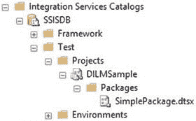

图 5-1
SSMS 对象资源管理器显示的 Integration Services Catalogs 节点中的 `DILMSample` SSIS 项目

你可以看到 SSIS 目录（`SSISDB`）、两个 SSIS 目录文件夹（`Framework` 和 `Test`）、`Test` 目录文件夹中的一个 SSIS 目录项目（`DILMSample`），以及 `DILMSample` 目录项目中的一个 SSIS 包（`SimplePackage.dtsx`）。

为什么我在某些地方写 *SSIS 项目*，而在其他地方写 *SSIS 目录项目*？我指的是两个不同的对象。

1.  SSIS 项目存在于 SQL Server Data Tools (SSDT) 环境中。它是一个正在开发中的项目（希望是受源代码控制的）。
2.  SSIS 目录项目是一个已部署到 SSIS 目录中的 SSIS 项目。

将 SSIS 目录项目视为独立且不同的对象，与存在于 SSIS 目录外部的 SSIS 项目区分开，这将有助于理解，尤其是在考虑 SSIS 目录项目配置时。两者之间的耦合关系很弱：对 SSIS 项目所做的更改可能会影响其相关的 SSIS 目录项目，并且仅在部署到 SSIS 目录之后才会生效。对 SSIS 目录项目所做的更改绝不会影响 SSIS 项目。

## 配置项目

你有多个选项来配置你的 SSIS 目录项目。在 SSMS 对象资源管理器的 Integration Services Catalogs 节点中，展开子节点直到 `DILMSample` 项目级别。右键单击 `DILMSample` SSIS 目录项目，然后点击“配置”，如图 5-2 所示。

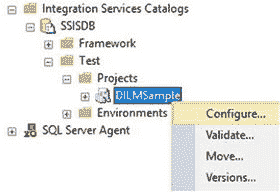

图 5-2
准备配置 `DILMSample` 目录项目

“配置 – `DILMSample`”对话框随即打开。

## 配置连接

SSIS 目录将连接管理器属性视为参数。实际上，如果你查询 `[catalog].[object_parameters]` 视图，你会发现一些名称类似于 `CM.<SSIS 连接管理器名称>.ConnectionString` 的参数。这是一个连接管理器参数。我很确定 `CM` 代表“连接管理器”。`<SSIS 连接管理器名称>.ConnectionString` 无疑是连接管理器的 `ConnectionString` 属性。

当“配置 – `DILMSample`”窗口显示时，单击“连接管理器”选项卡以查看连接的配置，如图 5-3 所示。

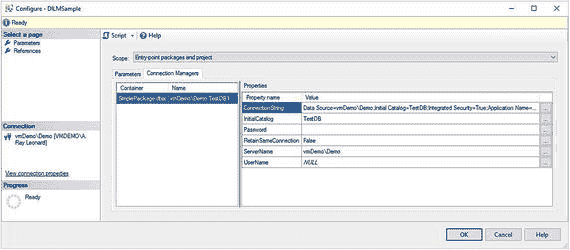

图 5-3
查看连接管理器的配置

请注意“参数”和“连接管理器”选项卡下方的列表框。它显示了容器（一个目录项目工件）和名称（连接管理器的名称）。我的 SSIS 项目在 `SimplePackage.dtsx` 中包含一个连接管理器，因此 `SimplePackage.dtsx` 是容器，连接管理器名称是 `vmDemo\Demo.TestDB1`。你的连接管理器名称几乎肯定会不同，你的 `ConnectionString` 属性也会不同，接下来你将关注这一点。

`ConnectionString` 属性中的值是在设计时配置的值。SSIS 目录始终可以访问设计时的默认值。如果我按当前配置在 SSIS 目录中执行 `SimplePackage.dtsx` SSIS 包，它将执行并尝试连接到 SQL Server 的 `vmDemo\Demo` 实例和 `TestDB` 数据库。由于我已将此 SSIS 项目部署到托管在 `vmDemo\Demo` SQL Server 实例上的 SSIS 目录，`SimplePackage.dtsx` 包应该可以正常执行。

但是，当我将 `DILMSample` SSIS 项目部署到*不同*的 SSIS 目录时会发生什么？`SimplePackage.dtsx` 可能成功执行，也可能不成功，这取决于许多影响一台服务器上运行的进程能否连接到其他服务器上托管的 SQL Server 实例的因素。

需要记住的一个关键点是：按照当前的 SSIS 项目配置，每次我部署 `DILMSample` SSIS 项目时，`SimplePackage.dtsx` 中 `vmDemo\Demo.TestDB1` 连接管理器的默认值将*始终*被配置为连接到 SQL Server 的 `vmDemo\Demo` 实例以及该实例上的 `TestDB` 数据库。

### 重写连接配置

如何更改连接配置？点击图 5-4 中圈出的 `ConnectionString` 属性 `Value` 文本框右侧的省略号。

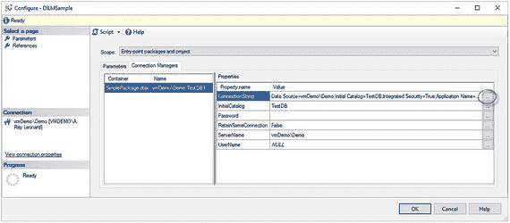

*图 5-4 – 准备打开 ConnectionString 值的配置*

**设置参数值**对话框随之打开。

在 SSIS 目录中，项目参数、包参数以及连接管理器属性均被视为参数。

选中并复制 `ConnectionString` 属性的设计时默认值（位于“使用包中的默认值”选项旁的文本框内），然后将其粘贴到“编辑值”文本框中，如图 5-5 所示。

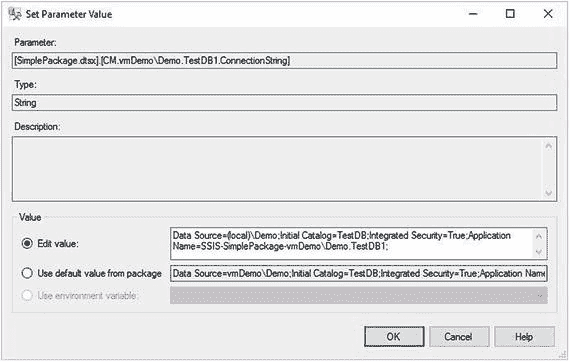

*图 5-5 – 编辑 ConnectionString 属性值*

将 `ConnectionString` 粘贴到**编辑值**文本框后，我做了一些修改。我删除了 `Application Name` 设置中的一个 `Guid` 值，并将数据源从 `vmDemo\Demo` 更改为 `(local)\Demo`。从技术上讲，数据源与之前相同。我这样做是为了之后能明确判断正在使用的是哪一个值：设计时默认值还是此*字面量重写*。

点击**确定**按钮，进入图 5-6 所示的重写页面。

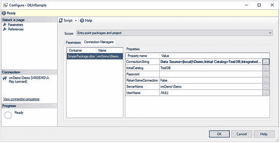

*图 5-6 – 目录项目字面量重写*

`ConnectionString` 的值已被 SSIS 目录字面量重写所覆盖。这通过值的**粗体文字样式**来表示。你可以将字面量重写理解为在 SSIS 目录中硬编码一个配置值。后续将 `DILMSample` SSIS 项目部署到此 SSIS 目录时，即使你更改了连接管理器的设计时默认 `ConnectionString` 值，字面量重写的值*也不会*改变。这就是为什么我将 SSDT 中的项目称为 *SSIS 项目*，而将其部署到 SSIS 目录后称为 *SSIS 目录项目* 或 *目录项目* 的原因之一。

作为拥有 SSIS 目录配置权限的人，你随时可以通过在**设置参数值**对话框中选择“使用包中的默认值”选项，将任何字面量重写恢复为设计时默认值，如图 5-7 所示。

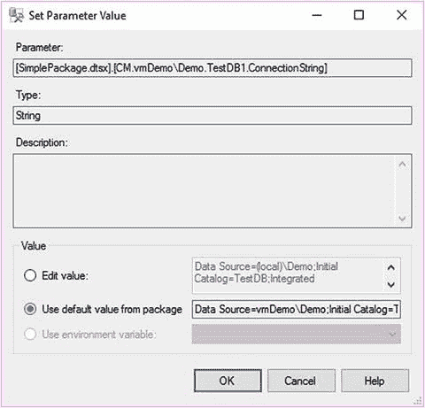

*图 5-7 – 重新选择设计时默认值*

值的文字样式恢复为无样式，并且值恢复为设计时默认值，如图 5-8 所示。

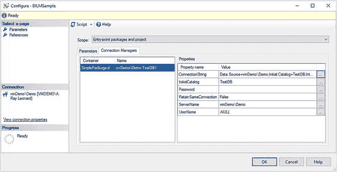

*图 5-8 – 恢复为设计时默认值*

### 外部化连接配置

到目前为止，你已经了解了 SSIS 目录项目配置设置的两个来源：设计时默认值和字面量重写。你可能注意到**设置参数值**对话框上第三个选项是禁用的。“使用环境变量”是第三个选项，但需要额外配置才能启用。

在进入下一个演示之前，我们来讨论一下 SSIS 目录如何管理*外部化*。外部化是指将值存储在其他位置，以便在运行时使用。SSIS 目录的外部化机制是 SSIS 目录环境。目录环境包含一系列目录环境变量，这些变量又包含在运行时用于覆盖目录项目参数值的值。

鉴于上一段所包含信息的深度和重要性，其篇幅相对较短。在继续之前，请先充分理解。

我们来更详细地讨论 SSIS 目录的外部化机制。先从 SSIS 目录环境开始，如图 5-9 所示。

*图 5-9 – 一个目录环境（示意）*

SSIS 目录环境包含零个或多个 SSIS 目录环境变量，如图 5-10 所示。

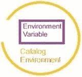

*图 5-10 – 目录环境中的目录环境变量*

要将 SSIS 目录环境连接到 SSIS 目录项目，SSIS 目录使用*引用*。引用简单来说就是将目录项目与目录环境关联起来的关系，如图 5-11 所示。

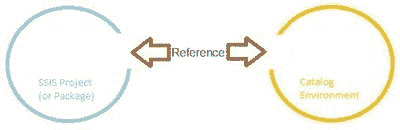

*图 5-11 – 关联 SSIS 目录项目与 SSIS 目录环境的引用*

为了使目录项目中的参数能够使用目录环境变量的值，需要创建*引用映射*。引用映射将存储在 SSIS 目录环境变量中的值映射到 SSIS 目录项目中的参数，如图 5-12 所示。

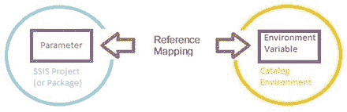

*图 5-12 – SSIS 目录项目参数与 SSIS 目录环境变量之间的引用映射*

重申一下，由于这可能是一个具有挑战性的话题：首先，您需要创建并配置一个 SSIS 目录环境。配置目录环境包括定义 SSIS 目录环境变量。这是外部化的第一步。

接下来，您需要创建一个 SSIS 目录环境与 SSIS 目录项目之间的引用。创建引用是外部化的第二步。

然后，您可以通过引用将 SSIS 目录环境变量分配给 SSIS 目录项目参数。这就是引用映射。通过引用将参数值映射到目录环境变量值是外部化的第三步。

让我们通过一个演示来演练这个过程。

## 创建环境

在 SSIS 目录中，右键单击 `Test` 目录文件夹下的 `Environments` 虚拟文件夹，然后点击**创建环境**，如图 5-13 所示。

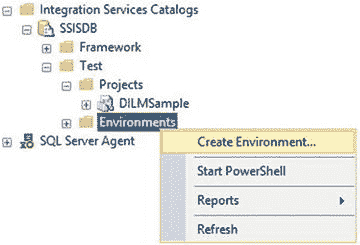

*图 5-13 – 准备创建目录环境*

当**创建环境**对话框显示时，提供环境名称和可选的描述，如图 5-14 所示。

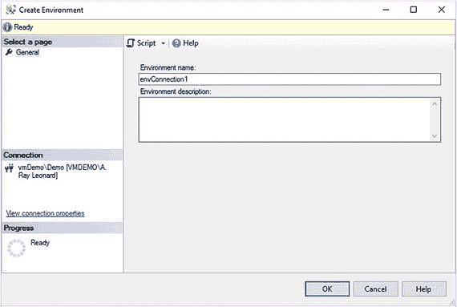

*图 5-14 – 创建 SSIS 目录环境*

点击**确定**关闭**创建环境**对话框。

### 配置环境

在 SSIS 目录中展开 `Environments` 虚拟文件夹。右键单击新建的目录环境，然后单击“属性”，如图 5-15 所示。

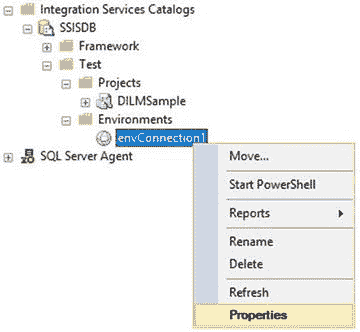

图 5-15 — 准备配置 SSIS 目录环境变量

单击“变量”页面。为目录环境变量添加名称（我将其命名为 `ConnectionString`）。将类型设置为 String。在“值”字段中添加一个有效的连接字符串，如图 5-16 所示。

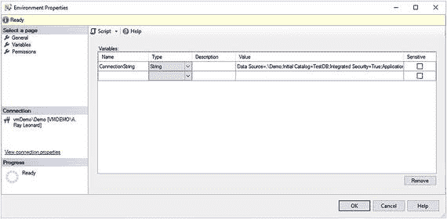

图 5-16 — 配置 SSIS 目录环境变量

单击“确定”按钮关闭“环境属性”对话框。

### 配置引用

右键单击 `DILMSample` 目录项目，然后单击“配置”。当“配置 – `DILMSample`”对话框打开时，单击“引用”页面。单击“添加”按钮，在“浏览环境”对话框中的 `Local Folder (Test)` 虚拟文件夹下选择刚刚创建的目录环境，如图 5-17 所示。

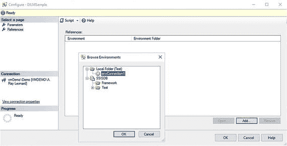

图 5-17 — 选择用于引用的目录环境

在“浏览环境”对话框中，实际上有两个“路径”可以访问 `envConnection1` 目录环境。`Local Folder` 路径在 SSIS 目录术语中创建了一个“相对”引用。如果展开 SSISDB ➤ Test 文件夹，你可以选择*相同*的 `envConnection1` 目录环境。这将创建一个“绝对”引用。

单击“确定”按钮选择用于引用的目录环境。“配置 – `DILMSample`”引用页面将类似于图 5-18 所示。

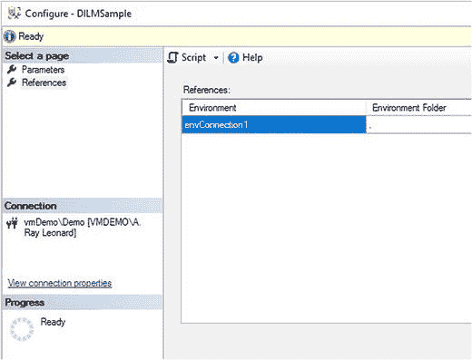

图 5-18 — 引用已配置！

请注意“环境文件夹”列中的“.”；它表示你选择了一个本地目录环境，或者一个与目录项目来自*相同*目录文件夹的目录环境。

### 配置引用映射

单击“参数”页面，然后单击“连接管理器”选项卡。单击唯一连接管理器的 `ConnectionString` 属性旁边的省略号，打开“设置参数值”对话框。请注意，所有三个值配置选项现在都已启用。选择“使用环境变量”选项，然后从下拉列表中选择 `ConnectionString` 目录环境变量，如图 5-19 所示。

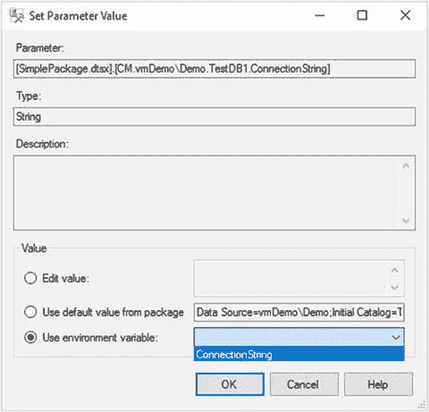

图 5-19 — 为引用映射选择目录环境变量

单击“确定”按钮，在 SSIS 目录项目参数、`SimplePackage.dtsx` 的 `vmDemo\Demo\testDB1` 连接管理器 `ConnectionString`，以及你几分钟前创建的目录环境引用中名为 `ConnectionString` 的 SSIS 目录环境变量之间创建引用映射。你的“配置 – `DILMSample`”对话框现在应该类似于图 5-20 所示。

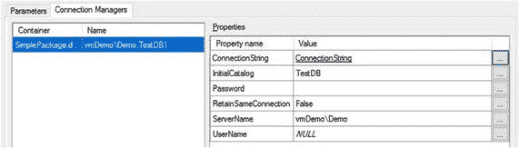

图 5-20 — 引用映射完成！

请注意，`ConnectionString` 属性的值现在是 SSIS 目录环境变量的名称，并且文本带有下划线修饰。

## 测试配置

要测试配置，你需要在 SSIS 目录中执行 SSIS 包。右键单击 `SimplePackage.dtsx`，然后单击“执行”，如图 5-21 所示。

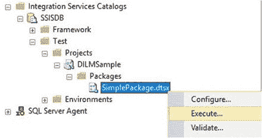

图 5-21 — 执行 `SimplePackage.dtsx`

当“执行包”对话框显示时，你会在对话框顶部看到一个错误消息。单击该错误，可在消息框中显示错误消息，如图 5-22 所示。

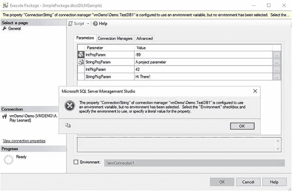

图 5-22 — 显示执行包错误消息

要清除错误，请按照错误消息中的说明进行操作。选中“环境”复选框，然后从下拉列表中选择一个 SSIS 目录环境，如图 5-23 所示。

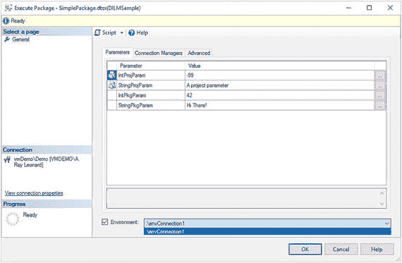

图 5-23 — 选择一个 SSIS 目录环境

执行包错误已清除。单击“确定”按钮执行 `SimplePackage.dtsx` SSIS 包。一个类似于图 5-24 所示的消息框会通知你包执行已开始，并询问你是否要查看概述报告。

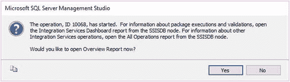

图 5-24 — 概述报告提示

单击“是”按钮显示概述报告，如图 5-25 所示。

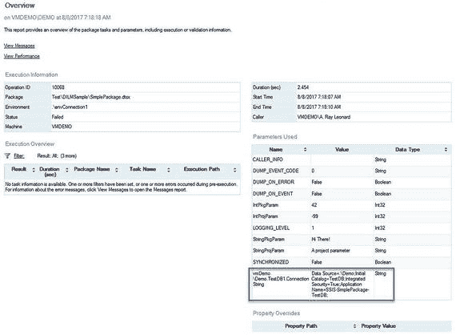

图 5-25 — 概述报告

请注意 `vmDemo\Demo.TestDB1.ConnectionString` 参数的值。运行时的值是你在名为 `envConnection1` 的目录环境中配置的 `ConnectionString` 目录环境变量的值。此测试验证引用映射已正确配置且正常工作。

## 结论

以下是 SSIS 目录中 SSIS 参数的三个值来源（附带匹配的文本修饰）：

1. 设计时默认值
2. 文本替代值
3. 引用映射

设计时默认值仍存储在 SSIS 目录中，但可以使用文本替代值或引用以及引用映射分别覆盖到目录环境和环境变量。