# 6. 目录浏览器

我很荣幸连续五年（2007-2012）成为微软 SQL Server MVP。成为微软 MVP 的一个好处是可以接触到内部开发团队。每个人都可以提交 Microsoft Connect 项来报告错误或提出产品改进建议。许多 MVP 这样做后，他们的错误报告被标记为“按设计工作”或“不修复”，而建议也得到类似回复。这令人沮丧。许多 Connect 项以这种方式处理是有原因的。我很高兴地报告，根本原因（基于性能的管理，即 PBM）已被放弃，*并且*微软开发团队确实在倾听并响应来自实际需求的请求。

## 我为何构建 DILM Suite —— 作者：安迪·伦纳德

这并非意味着每一条建议都会得到采纳（我保证这不是抱怨）。事实证明，微软是一家软件开发企业。即便微软规模如此庞大，也不可能对*每一条*请求都做出回应。当我意识到这一点时，我开始思考如何弥补我所察觉到的这些缺口。我曾与人共同创立了一家咨询公司，而我们（集体而言）对成为一家软件产品公司并不感兴趣。但我对开发产品来解决数据集成生命周期管理（`DILM`）方面的缺口*非常*感兴趣。

2015 年，我离开了共同创立的咨询公司，并立即开始开发我梦想已久的软件。在我看来，对于“为什么？”这个问题，最公平的回答如下：

1.  我开始相信微软 SSIS 开发团队永远不会解决那些我认为是产品故事中“缺口”的问题。
2.  我开始相信，我与共同创立的咨询公司对于如何解决 `DILM` 问题，持有不可调和的分歧。

时隔两年回顾，我相信专注于 `DILM` 对我来说是长期最佳的选择。我创办了另一家咨询公司——Enterprise Data & Analytics (`entdna.com`)，主要是为了资助我的编码爱好。

### 展示 SSIS 目录

让我们看看 SSMS 对象浏览器的“Integration Services 目录”节点中展示的 SSIS 目录表面，如图 6-1 所示。

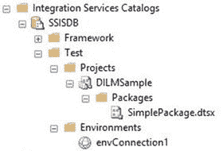

**图 6-1** —— SSMS 对象浏览器“Integration Services 目录”节点中显示的 SSIS 目录

在“Integration Services 目录”节点下，我们找到了名为 `SSISDB` 的 SSIS 目录。显示了两个目录文件夹：`Framework` 和 `Test`。`Test` 文件夹包含 `Projects` 和 `Environments` 虚拟文件夹。`Projects` 虚拟文件夹包含名为 `DILMSample` 的 SSIS 目录项目，该项目又包含名为 `SimplePackage.dtsx` 的 SSIS 包。`Environments` 虚拟文件夹包含名为 `envConnection1` 的目录环境。

因为您已经完成了相关工作，所以您知道这里的信息远不止表面上看到的这些。

### SSIS 目录环境配置

如果双击 `envConnection1`，您可以在“变量”页面上看到目录环境变量的详细信息，如图 6-2 所示。

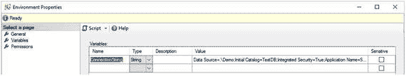

**图 6-2** —— 查看 SSIS 目录环境的“变量”页面

“变量”页面包含 SSIS 目录环境变量的详细信息，包括名称、数据类型、描述、值以及该变量是否为敏感变量。

### SSIS 目录项目配置

在“SSIS 目录项目配置”对话框的“参数”页面上，“参数”选项卡列出了 SSIS 项目和包参数、它们的容器名称以及默认值，如图 6-3 所示。

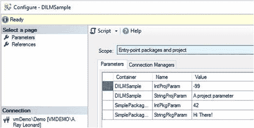

**图 6-3** —— 查看 SSIS 目录项目的项目参数及其值

“参数”页面上的“连接管理器”选项卡包含 SSIS 项目和包连接管理器及其属性的列表，如图 6-4 所示。

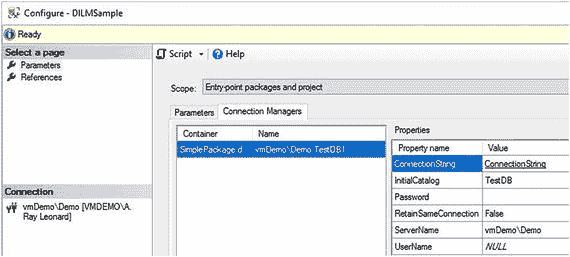

**图 6-4** —— 查看 SSIS 目录项目的连接管理器参数及其值

“SSIS 目录项目配置”对话框的“引用”页面包含 SSIS 目录项目在运行时可能引用的 SSIS 目录环境列表，如图 6-5 所示。

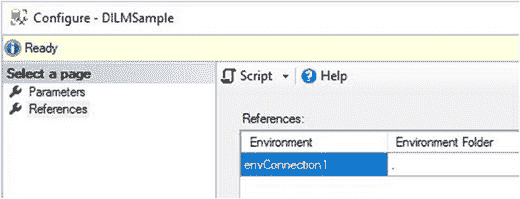

**图 6-5** —— 查看 SSIS 目录项目的项目引用

这需要大量右击和双击操作，才能看清 SSIS 目录项目中配置了什么。

## 目录浏览器

SSIS 目录中充满了非常实用且有用的配置信息，但你必须知道去哪里查找，而在某些情况下，*去哪里查找*这件事并不那么显而易见。

`Catalog Browser（目录浏览器）`应运而生，这是一款免费实用工具，属于 DILM 套件的一部分，可从 `dilmsuite.com/catalog-browser` 获取。`Catalog Browser` 旨在通过单一视图展示 SSIS 目录的内容：一个树形结构，其中展示了所有相关的 SSIS 目录工件、属性和配置。

如图 6-6 所示，`Catalog Browser` 展示的元数据与 SSMS 对象资源管理器中的 Integration Services 目录节点相同。

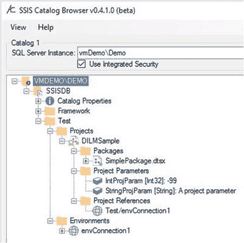

图 6-6

`Catalog Browser` 展示部分 SSIS 项目和配置元数据

不过，观察图 6-6，你可能已经发现 `Catalog Browser` 与 SSMS 对象资源管理器中的 Integration Services 目录节点之间存在一些差异。注意，在 SSIS 目录项目下，除了 `Packages` 虚拟文件夹外，还存在 `Project Parameters` 和 `Project References` 虚拟文件夹。

展开这些虚拟文件夹，即可查看 SSIS 目录项目参数和引用，如图 6-7 所示。

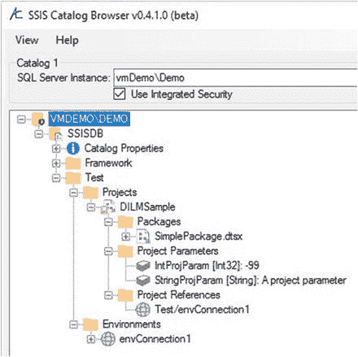

图 6-7

SSIS 目录项目参数和引用

回想一下图 6-3 中，SSMS 对象资源管理器中的 Integration Services 目录节点展示了 *所有* 参数：SSIS 目录项目参数和 SSIS 包参数。那么包参数在哪里呢？它们就在 `Catalog Browser` 中。要查看包参数，请展开 `SimplePackage.dtsx` SSIS 包节点，如图 6-8 所示。

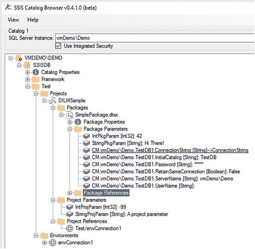

图 6-8

查看 SSIS 包参数

回想一下，连接管理器属性在 SSIS 目录中被视为参数。它们带有“CM.”前缀。你可以看到，SSIS 包连接管理器 `vmDemo\Demo.TestDB1` 的连接字符串属性被映射到了一个名为 `ConnectionString` 的 SSIS 目录环境变量。

要查看引用映射所使用的引用，请展开 `Package References` 虚拟文件夹，如图 6-9 所示。

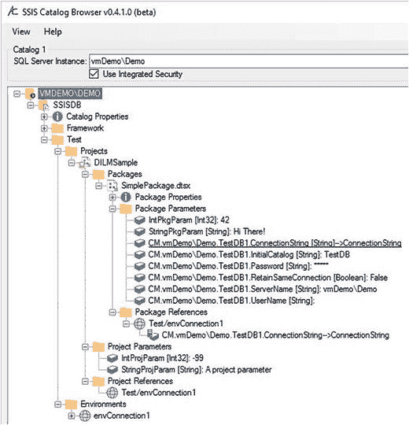

图 6-9

查看包引用

展开 `Package Reference` 虚拟文件夹，会显示 `Test/envConection1` 目录环境。展开 `Test/envConection1` 目录环境，可以看到名为 `ConnectionString` 的目录环境变量已映射到 `vmDemo\Demo.TestDB1` 连接字符串属性。

但是，`ConnectionString` 目录环境变量的值是多少呢？展开 `Environments` 虚拟文件夹中的 `envConnection1` 目录环境，即可查看目录环境变量集合、它们的数据类型和值，如图 6-10 所示。

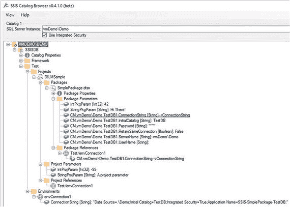

图 6-10

目录环境变量、数据类型和值

SSIS 包属性包含一个由 SSIS 包的 `Version Major`、`Version Minor` 和 `Version Build` 属性构建而成的 `Package Version` 属性。每当开发人员保存 SSIS 包时，`Version Build` 属性就会递增。可以通过手动设置 `Version Build` 属性来修改 SSIS 包并“欺骗”该属性。我尚未发现对已部署到 SSIS 目录的 SSIS 包执行此操作的有效用例。

`Package Version` 属性可用于检测部署到 SSIS 目录中的 SSIS 包的不同版本。由于 SSIS 开发人员可以手动设置 `Version Build` 属性，因此 `Package Version` 并不是一个可靠的指示。

`Package Properties` 虚拟文件夹展示了 SSIS 包的元数据，如图 6-11 所示。

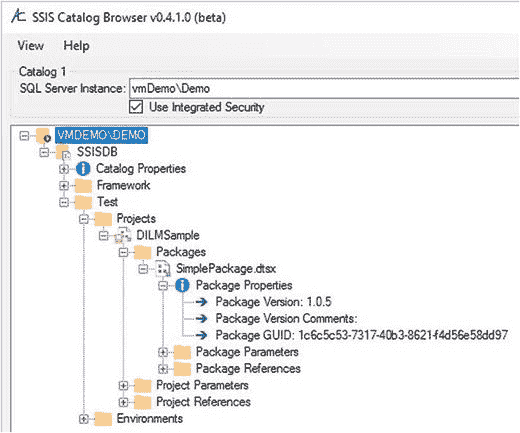

图 6-11

SSIS 包属性

目录属性对于检测补丁级别的差异非常方便（通过 `Schema Build` 属性）。`Catalog Version` 是由 `Catalog Base`（位于 `Catalog Browser` 底层的自定义目录对象）公开的一个属性。

`Catalog Base` 适用于 SSIS 2012、2014 和 2016 目录。

`Catalog Properties` 虚拟文件夹展示了 SSIS 目录的元数据，如图 6-12 所示。

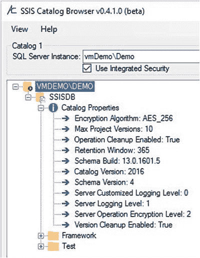

图 6-12

SSIS 目录属性

## 结论

`Catalog Browser` 在单一视图中展示了 SSIS 目录工件、配置元数据和工件属性。

