# 8. SSIS 目录比较

你可以将 `SSIS 目录比较` 视作两个目录浏览器。与 `目录浏览器` 类似，`SSIS 目录比较` 使用 `目录基础` 这一自定义目录对象。在 `SSIS 目录比较` 中，`目录基础` 用于填充两个树形结构，每个树代表一个不同的 SSIS 目录，如图 7-1 所示。

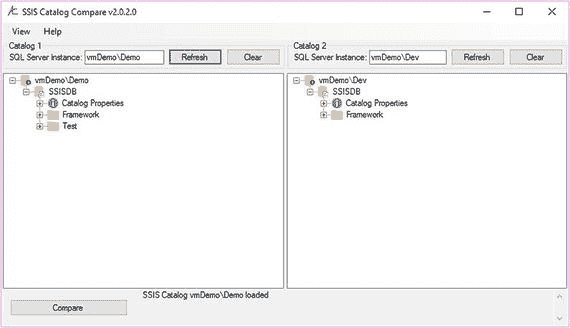

图 7-1 `SSIS 目录比较`

加载两个目录后，点击 `比较` 按钮即可进行比较。如图 7-2 所示，`SSIS 目录比较` 使用斜体字体表示在某个节点下方检测到差异，并使用不同的背景色表示存在于一个 SSIS 目录中但另一个目录中缺失的工件。

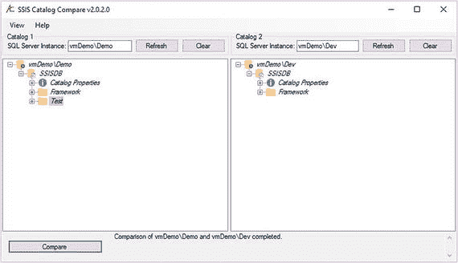

图 7-2 比较操作之后

`VmDemo\Demo` 目录中的 `Test` 目录文件夹在 `vmDemo\Dev` 目录中不存在，因此 `vmDemo\Demo\SSISDB\Test` 节点具有背景色。图 7-2 中显示的“更深层差异”指示（斜体字体）表示 `Framework` 目录文件夹内部以及目录属性之间的差异。

## 展开差异

一项省时功能是 `展开差异`，如图 7-3 所示。

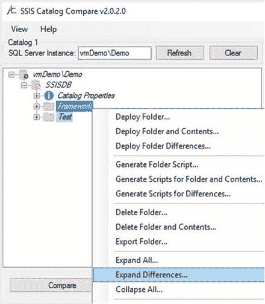

图 7-3 `展开差异`

`展开差异` 会展开差异上方的节点以及存在差异的节点。在大型 SSIS 目录项目、含有大量配置元数据的目录项目或两者兼有的情况下，`展开差异` 可以减少展开的节点数量。展开两个目录的 `Framework` 目录文件夹中的差异，你会看到 `Parent.dtsx` SSIS 包的 SSISDB 连接管理器的 `ConnectionString` 属性已根据每个服务器的本地 SQL Server 实例进行了配置，如图 7-4 所示。

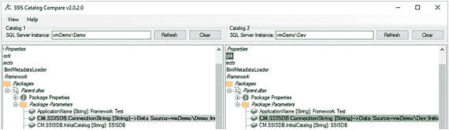

图 7-4 不同的 `ConnectionString` 属性值

这是一件非常好的事情，因为如果这些值匹配，一个目录中的框架应用程序执行会启动另一个目录中的 SSIS 执行。那可能很糟糕。

## 目录属性

我在关于 `目录浏览器` 的部分中没有讨论目录属性，因为我想在此处更详细地介绍目录属性。如果折叠 `Framework` 目录文件夹并展开 `目录属性`，你会看到差异在于 `架构版本` 属性，如图 7-5 所示。

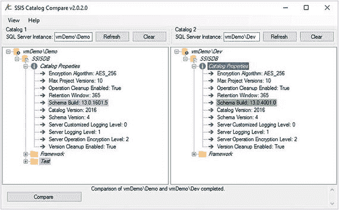

图 7-5 SSIS 目录 `架构版本` 属性的不同值

请注意 `架构版本` 正下方的属性，这两个 SSIS 目录均为 SSIS 2016。`vmDemo\Demo` 的 `架构版本` 告诉我们此目录是 SSIS 2016 的通用发布版。`vmDemo\Dev` 的目录是 SSIS 2016 SP1 `架构版本`。

`目录基础` 对象的构建目的是允许 `SSIS 目录比较` 比较不同版本和不同 SQL Server 版本的 SSIS 目录。例如，我可以将 SSIS 2012 目录的内容与 SSIS 2016 目录的内容进行比较。SSIS 2016 为目录属性添加了几个属性，所以你会在比较的 2016 一侧看到几个属性被标记为 2012 一侧缺失。但比较操作会成功，并产生准确且有用的结果。

## SSIS 目录比较脚本

在拥有两名或更多 IT 专业人员的许多企业中，开发软件的专业人员不被允许部署该软件。大型企业拥有专门负责发布管理的整个团队。生命周期管理将帮助任何规模的企业减少停机时间，并提高代码的可支持性和可维护性。这同样适用于 SSIS，因为数据集成生命周期管理与 Web、GUI 和中间件软件生命周期管理同样重要。

`SSIS 目录比较` 旨在支持 DevOps 和企业 DILM。

你可以使用 `SSIS 目录比较` 为单个工件编写脚本，但或许更有用（且更快）的功能是为一个目录文件夹及其所有内容编写脚本，如图 7-6 所示。

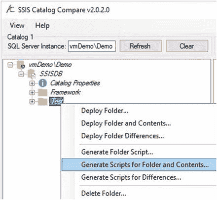

图 7-6 准备为目录文件夹及其内容生成脚本

当你点击 `为文件夹和内容生成脚本` 时，`SSIS 目录比较` 会提示你选择一个文件系统文件夹来存储脚本，如图 7-7 所示。

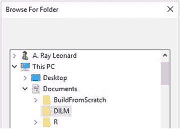

图 7-7 为脚本选择目标文件系统文件夹

当你选择一个文件系统文件夹时，`SSIS 目录比较` 会生成用于创建目录文件夹及其所有内容的脚本和 ISPAC 文件，如图 7-8 所示。

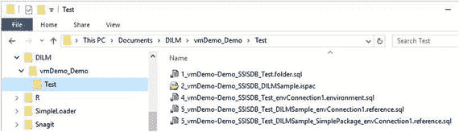

图 7-8 查看脚本的目标文件系统文件夹

脚本按顺序编号，表示依赖关系。例如，在脚本编号 1 的 SSIS 目录文件夹存在之前，你无法使用编号 2 的 ISPAC 文件部署 SSIS 项目。

按列出的顺序双击文件将创建目标 SSIS 目录上的 `Test` 目录文件夹（脚本 1），使用 `集成服务部署向导` GUI 部署 `DILMSample` SSIS 项目（你需要在部署期间选择 `Test` 目录文件夹作为目标目录文件夹），创建 `envConnection1` 目录环境及其目录环境变量，在 `DILMSample` SSIS 项目和 `envConnection1` 之间创建引用，并创建另一个包含 `SimplePackage.dtsx` SSIS 包与 `envConnection1` 目录环境之间引用映射的引用。

为什么需要两个引用文件？因为在 SSIS 目录中，对 SSIS 目录项目和 SSIS 包的引用是不同的工件。

### 创建目录文件夹

这些脚本（以及 `ISPAC`）是幂等的，或者说可以重复执行，如图 7-9 所示。

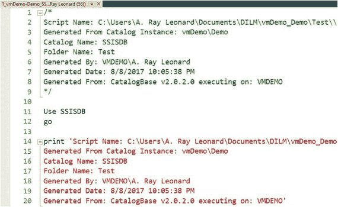

图 7-9 幂等的 Transact-SQL 脚本

如果 `Test` 目录文件夹不存在，脚本会创建它。如果 `Test` 目录文件夹已存在，脚本会输出一条消息，告知执行者这一事实。

输出消息旨在被复制并粘贴到工单的“备注”字段中，然后才能关闭工单。这些消息提供了关于脚本如何以及何时生成、由谁生成、脚本何时何地执行以及由谁执行的详细信息，如图 7-10 所示。

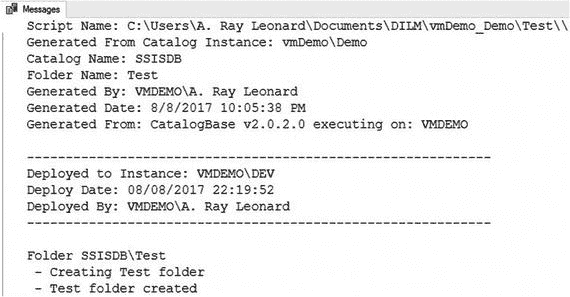

图 7-10 脚本输出消息

在 `SSMS 对象资源管理器` 中刷新 `SSIS` 目录节点，将显示 `Test` 目录文件夹已被创建，如图 7-11 所示。

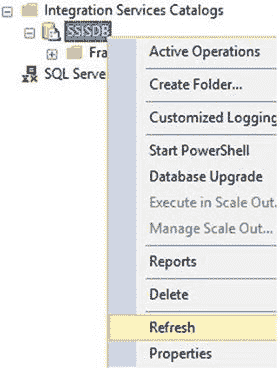

图 7-11 刷新 SSIS 目录节点

图 7-12 显示了刷新的结果：`Test` 目录文件夹已由脚本创建。

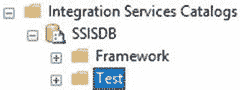

图 7-12 Test 目录文件夹诞生了！

我在本节开头提到，“这些脚本（以及 `ISPAC`）是幂等的……” 如果你重新执行刚刚用于创建 `Test` 目录文件夹的脚本，会发生什么？让我们回到 `SSMS` 并尝试一下。结果如图 7-13 所示。

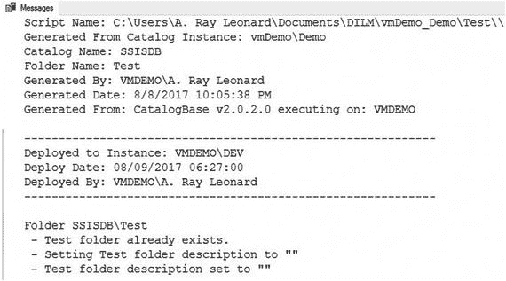

图 7-13 重新执行目录文件夹脚本

请注意返回的消息：“Test 文件夹已存在。” 重新执行脚本不会损害 `Test` 目录文件夹。脚本只是检查目录文件夹是否存在，如果不存在则创建它。如果目录文件夹已存在，脚本会返回一条消息。执行此操作的 `Transact-SQL` 代码如图 7-14 所示。

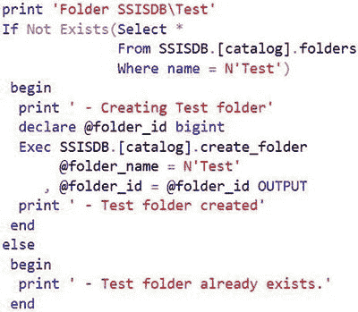

图 7-14 首先检查目录文件夹是否存在的 Transact-SQL

如果你刷新 `SSIS` 目录 Compare Catalog 2，你现在会看到 `Test` 目录文件夹，如图 7-15 所示。

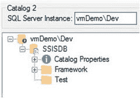

图 7-15 Test 目录文件夹已创建

### 部署 SSIS 项目

要部署 `SSIS` 项目，请双击（或右键单击并选择“打开”）`ISPAC` 文件，如图 7-16 所示。

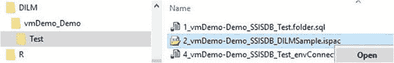

图 7-16 打开 ISPAC 文件

这将启动 `Integration Services 部署向导`；这与用于从 `SQL Server Data Tools (SSDT)` 部署 `SSIS` 项目的向导是同一个。逐步执行向导，第一站是 `选择源` 页面，如图 7-17 所示。

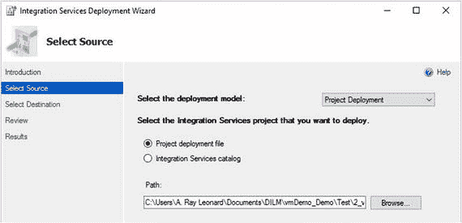

图 7-17 Integration Services 部署向导的“选择源”页面

此页面公开了许多功能。`部署模型` 下拉列表用于选择项目部署或包部署。从 `SSIS 2016` 开始，操作员可以选择部署整个 `SSIS` 项目（这是 `SSIS 2012` 和 `2014` 中唯一可用的选项），或部署单个 `SSIS` 包。操作员还可以选择 `SSIS` 项目源的类型。有两个选项可供选择：项目部署文件或 `Integration Services` 目录。由于您通过打开 `ISPAC` 文件开始此练习，因此已为您选中项目部署文件选项。

如果选择 `Integration Services` 目录选项，`选择源` 页面将显示目录项目设置，这些设置可以为部署到不同 `SSIS` 目录的 `SSIS` 目录项目进行配置，如图 7-18 所示。

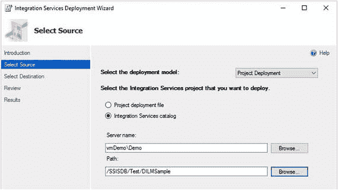

图 7-18 从一个 SSIS 目录部署到另一个

`Integration Services 部署向导` 的其余页面和过程与第 4 章中介绍的相同。在 `选择目标` 页面上，输入承载目标 `SSIS` 目录的 `SQL Server` 实例的名称。然后，您可以浏览到新创建的目录文件夹，如图 7-19 所示。

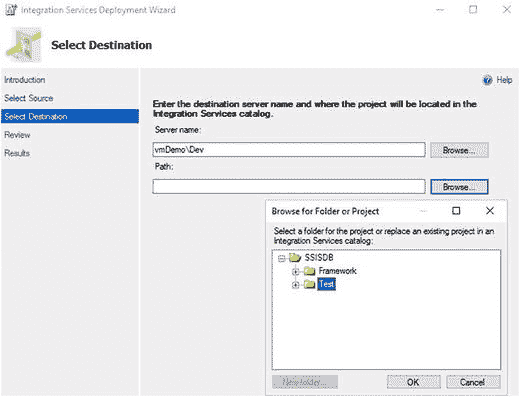

图 7-19 浏览到最近创建的 Test 目录文件夹

逐步完成 `Integration Services 部署向导` 的其余步骤，直到 `SSIS` 项目部署完毕，如图 7-20 所示。

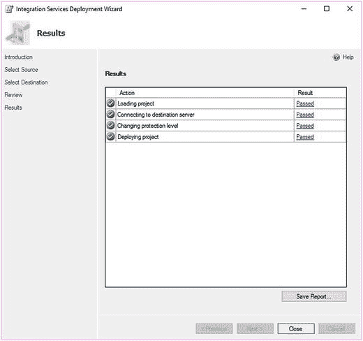

图 7-20 部署成功

刷新 `SSIS Catalog Compare` 以查看 `SSIS` 目录项目现已存在，如图 7-21 所示。

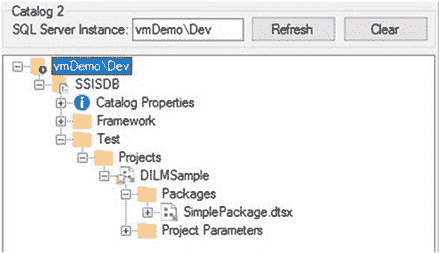

图 7-21 查看 DILMSample SSIS 目录项目

与目录文件夹脚本一样，`ISPAC` 文件也是可重复执行的。当重新执行 `ISPAC` 文件时，会将新版本的 `SSIS` 项目部署到目标 `SSIS` 目录。

### 部署字面值覆盖和目录环境

`SSIS` 目录字面值覆盖和环境脚本是相似的，因为两者都包含值，要么是字面值覆盖值，要么是目录环境变量的值。值参数位于生成的 `Transact-SQL` 脚本的顶部，操作员可以在部署到目标 `SSIS` 目录之前对其进行修改，如图 7-22 所示。

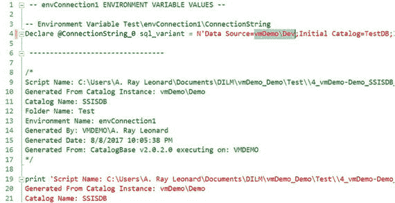

图 7-22 在执行前编辑 SSIS 目录环境脚本

与 `SSIS 目录文件夹` 脚本一样，`目录环境` 脚本提供丰富的反馈消息，如图 7-23 所示。

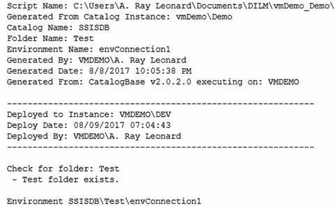

图 7-23 目录环境脚本执行的消息

请注意，`目录环境` 脚本首先检查目标目录文件夹是否存在，并在消息中反馈其存在状态。如果目标文件夹不存在，`目录环境` 脚本将会失败。目录环境变量是在 `目录环境` 脚本中创建的。

## 使用 SSIS Catalog Compare 进行测试

返回 `SSIS Catalog Compare`，右键单击“比较”按钮，选择“刷新两个树视图并比较”，如图 7-29 所示。

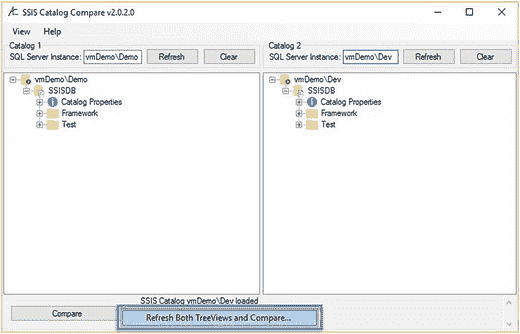

图 7-29 刷新两个树视图并进行比较

这是怎么回事？我不是刚刚将所有这些脚本化的人工制品部署到目标 SSIS 目录中了吗？为什么图 7-30 没有显示所有内容都匹配？请记住，在执行目录环境脚本之前，您已经更新了 `ConnectionString` 目录环境变量的值。图 7-30 显示了 SSIS 目录实例中 `Test` 目录文件夹之间存在的差异。

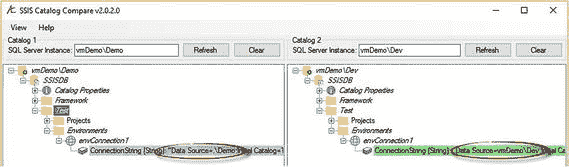

图 7-30 不同的数据源值

接下来做什么？这些值毕竟是 *应该* 不同的。事实上，如果它们相同，那反而是 *糟糕的*。别担心。单击“视图”➤“选项”，如图 7-31 所示。

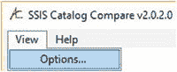

图 7-31 打开 SSIS Catalog Compare 选项

您可以通过勾选图 7-32 所示的复选框来忽略目录环境变量值。

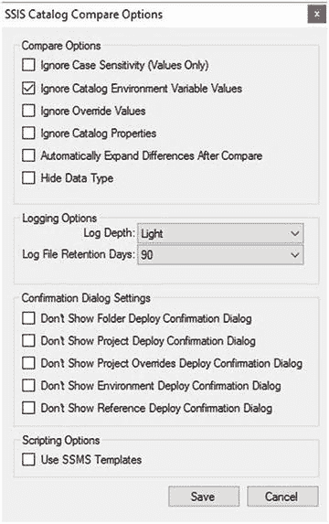

图 7-32 SSIS Catalog Compare 选项

一旦忽略目录环境变量值，重新比较操作将显示您目录中的 `Test` 目录文件夹是匹配的。展开 `envConnection1` 目录环境以查看 `ConnectionString` 目录环境变量的值，会发现这些值并未改变；它们仍然不同，只是被忽略了，如图 7-33 所示。

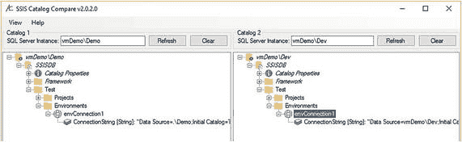

图 7-33 被忽略的目录环境变量值

`SSIS Catalog Compare` 可在 `dilmsuite.com/ssis-catalog-compare` 购买。

本书未讨论 CatCompare，即 `SSIS Catalog Compare` 的 CLI（命令行界面）。了解更多信息，请访问 `dilmsuite.com/ssis-catalog-compare`。

# SSIS Framework Community Edition

SSIS 开发中的一个最佳实践是构建小型的、面向工作单元的 SSIS 包。这样做的原因有如下几个：
-   **解耦**：SSIS 是软件开发，而软件开发的最佳实践之一就是关注点分离。关注点分离主要通过解耦来实现。解耦 SSIS 的一种方法是构建小型的、单一功能的 SSIS 包。
-   **测试**：如果一个 SSIS 包包含七个数据流任务，并且源表的设计发生了变化导致其中一个数据流任务中断，那么该 SSIS 包中的所有任务都应该进行测试。数据流任务越少，意味着测试工作量越小、速度越快。
-   **支持**：如果所有 SSIS 包都包含最少的数据流任务（理想情况下是一个），并且某个包在半夜执行失败，那么值班支持人员就能很好地知道从何处开始进行故障排除。

尽管这些是使用多个较小的 SSIS 包来构建 SSIS 解决方案的充分且合理的理由，但遵循此建议会引发其他问题。一个问题是，您现在有了一堆需要按某种顺序执行的 SSIS 包。数据集成开发人员该怎么办呢？

## SSIS Framework Community Edition

考虑一下 SSIS Framework Community Edition，这是一个免费的开源解决方案，可在 `dilmsuite.com/ssis-framework-community-edition` 获取。SSIS Framework Community Edition 允许通过执行单个存储过程并向其传递单个参数，以指定的执行顺序执行一个或多个 SSIS 包。例如，我可以使用以下 Transact-SQL 语句执行一个测试框架应用程序：
```sql
exec custom.execute_catalog_parent_package @application_name = 'Framework Test '
```

延续我“天下没有免费的午餐”这一主题，SSIS 执行框架极大地简化了像上面列出的那种执行命令，但它们也带来了另一个问题：需要管理大量的元数据。SSIS Framework Community Edition 依赖元数据来构建前面提到的框架应用程序。框架应用程序是配置为按指定顺序执行的一组 SSIS 包。如果您构建包含 `print` 语句（以便让您了解 T-SQL 正在执行什么操作）并使用某种格式的幂等（可重新执行）Transact-SQL，那么每个 SSIS 包大约需要 30-40 行 Transact-SQL。这是大量的 T-SQL。

### 对已部署的 SSIS 目录项目的帮助

也许您正在读到这里并想：“这太棒了，但我的 SSIS 目录中已经部署了海量的 SSIS 包。它们该怎么办？”我在 `andyleonard.blog/2017/07/26/adding-an-ssis-application-to-ssis-framework-community-edition` 写了一篇题为“将 SSIS 应用程序添加到 SSIS Framework Community Edition”的博文。我在那篇文章的末尾包含了一个脚本，该脚本使用三个参数（框架应用程序名称、目录文件夹名称和目录项目名称），并利用这三条元数据将新框架应用程序的元数据加载到 SSIS Framework Community Edition 的元数据表中，如图 8-1 所示。

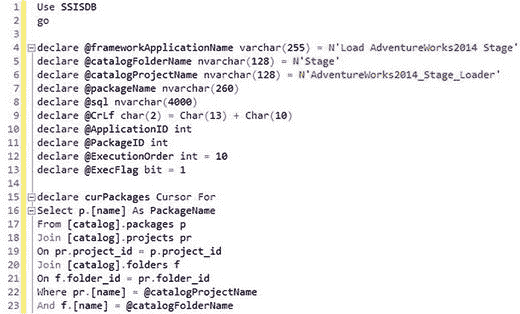
**图 8-1** 从 SSIS 目录项目构建框架应用程序

该脚本读取图 8-2 所示的 SSIS 目录项目元数据，并在几秒钟内将框架应用程序元数据加载到 SSIS Framework Community Edition 的元数据表中。

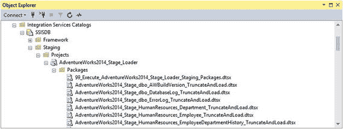
**图 8-2** SSIS 目录项目

名为“Load AdventureWorks2014 Stage”的框架应用程序包含 71 个 SSIS 包，现在可以使用以下 Transact-SQL 语句来执行：
```sql
exec custom.execute_catalog_parent_package @application_name = 'Load AdventureWorks2014 Stage'
```

### 查看 SSIS 目录报告

您可以使用 SSMS 内置的目录报告解决方案来查看这 71 个 SSIS 包的执行情况。要查看所有 SSIS 包执行情况，请右键单击 SSMS 对象资源管理器中 Integration Services 目录节点下的 `SSISDB` 节点，将鼠标悬停在“报告”上，再悬停在“标准报告”上，然后单击“所有执行”，如图 8-3 所示。

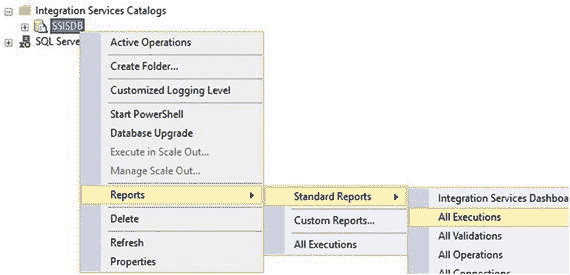
**图 8-3** 打开内置的 SSIS 目录报告

“所有执行”报告会显示并提供 SSIS 包执行日志，如图 8-4 所示。

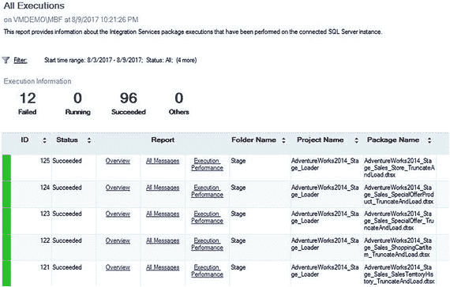
**图 8-4** “所有执行”报告

总而言之，您向一个 Transact-SQL 脚本提供了三条元数据，该脚本构建了一个包含 71 个 SSIS 包的框架应用程序，然后通过启动一个存储过程并传递一个参数值来执行了这 71 个 SSIS 包。

### 查看 SSIS 框架社区版元数据

如前所述，SSIS 框架社区版需要相当多的元数据。我们之前使用的脚本是一种很好的自动化输入 SSIS 框架社区版元数据的方式，但当我们想要查看已存储的框架应用程序时，该怎么办呢？

这时可以借助 `Framework Browser`，这是 DILM Suite 中的另一个免费实用工具，你可以从 `dilmsuite.com/framework-browser` 下载，如图 8-5 所示。

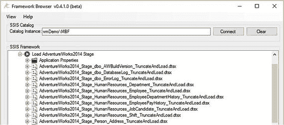
**图 8-5** 框架应用程序的 Load AdventureWorks2014 阶段

框架应用程序是一组 SSIS 包的集合，在框架中被称为应用程序包，它们按指定顺序执行。`Framework Browser` 会按照执行顺序列出应用程序包。

如果你展开 `Application Properties` 虚拟文件夹，就会看到框架应用程序元数据。展开 `Application Package` 节点和 `Application Package Properties` 节点，可以显示应用程序包元数据，如图 8-6 所示。

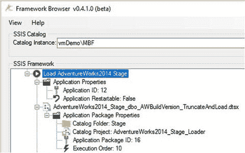
**图 8-6** 显示应用程序和应用程序包框架元数据

`Framework Browser` 是 DILM Suite 中的另一个免费实用工具。