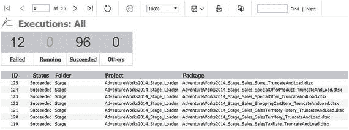
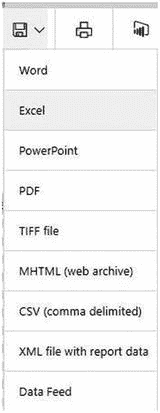
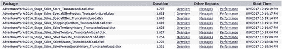
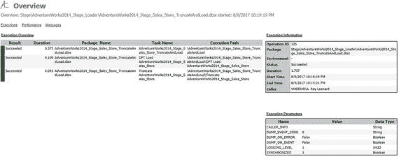
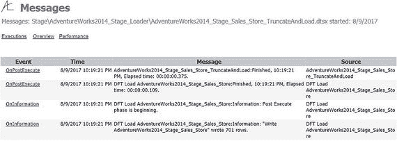
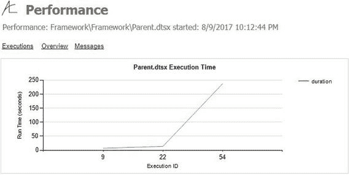

# 9. 目录报表

在迄今为止的学习过程中，你已经多次接触过 SQL Server Management Studio (SSMS) 内置的 SSMS 目录报表解决方案，最近一次是在上一章。作为一名数据集成架构师，我发现这些报表非常棒，但存在两个小问题：

1.  我无法选择文本进行复制粘贴。
2.  要查看 SSMS 目录报表，必须安装 SSMS。

关于第二点，企业中有些人确实需要查看生产环境中数据集成流程的执行情况，但他们没有理由在自己的机器上安装完整的 SSMS，更不用说获得企业生产环境的访问权限了。SSMS 是管理数据和全面管理 SQL Server 的极佳工具。仅为了授予某人访问 SSMS 目录报表的权限而安装 SSMS，实在是小题大做。

请看看 `Catalog Reports`，这是 DILM Suite 中的一个免费开源解决方案，网址是 `dilmsuite.com/catalog-reports`。

`Catalog Reports` 的设计在外观和感觉上都与 SSMS 版本相似，但它们位于 SQL Server Reporting Services (SSRS) 中。请看图 9-1 所示的执行报表。

**图 9-1** DILM Suite 目录报表——执行报表

DILM Suite 目录报表展示了与 SSMS 目录报表相同的日志和数据，且无需安装 SSMS。由于该解决方案是开源的，SSRS 开发人员可以编辑报表以添加公司徽标、应用企业配色方案或包含额外数据。

报表查看者可以从显示报表的浏览器中选择并复制文本。还提供了导出报表内容的选项，如图 9-2 所示。

**图 9-2** 报表导出选项

执行报表的右侧包含指向该解决方案中其他报表的链接：`Overview`、`Messages` 和 `Performance`（如图 9-3 所示）。

**图 9-3** 执行报表中的更多字段

点击最上面 SSIS 包执行的 `Overview` 链接，打开概览报表。概览报表在报表左侧的表格中按执行路径（SSIS 包中的各个可执行文件）分组显示 SSIS 包执行摘要。该表格对于确定 SSIS 包中运行时间最长的部分非常有用。执行信息表显示操作日志数据，例如 SSIS 包执行状态、持续时间、开始时间以及本次执行所引用的目录环境名称。执行参数表显示 SSIS 目录执行参数设置以及任何被覆盖或引用的参数，如图 9-4 所示。

**图 9-4** DILM Suite 目录报表——概览报表

DILM Suite 概览报表顶部有导航链接，方便导航至 `Executions`、`Performance` 和 `Messages` 报表。点击 `Messages` 链接查看消息报表，如图 9-5 所示。

**图 9-5** DILM Suite 目录报表——消息报表

消息报表列出了 SSIS 包执行过程中记录的所有消息、消息记录时间、引发消息的事件以及引发该事件的可执行文件名称。

性能报表以图表形式显示之前成功执行的持续时间，如图 9-6 所示。

**图 9-6** DILM Suite 目录报表——性能报表

DILM Suite 目录报表解决方案是免费且开源的，并且解决了 SSMS 目录报表的几个问题。

