# 10. BimlExpress 元数据框架

商业智能标记语言 (Biml) 是一种基于 XML 的语言，它能提高数据集成开发人员的生产力并改进 SSIS 代码质量。`BimlExpress` 是免费的，并能集成到 SQL Server Data Tools (SSDT) 中。BimlExpress 元数据框架旨在鼓励思考将 Biml 的强大功能与元数据相结合的可能性。

你可以在 `varigence.com/biml` 和 `bimlscript.com` 了解更多关于 Biml 的信息。你可以在 `varigence.com/bimlexpress` 获取 `BimlExpress`。你可以在 `dilmsuite.com/biml-express-metadata-framework` 获取一份 BimlExpress 元数据框架项目的副本。

安装 `BimlExpress` 后，开发人员可以在 SSDT 中访问 `BimlExpress` 菜单。开发人员应首先打开的文档是 `README` 文件，如图 10-1 所示。

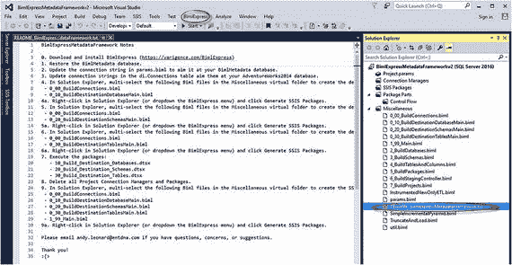

**图 10-1** 在 SSDT 中查看 BimlExpress 元数据框架项目

`README` 文件中的说明会指导开发人员完成使用 BimlExpress 元数据框架所需的步骤。我将在本章中遵循其中的大多数步骤。如果你想使用 BimlExpress 元数据框架，也应该遵循这些步骤。


## 下载并安装 BimlExpress

第一步是从 varigence.com 下载 BimlExpress，如图 10-2 所示。

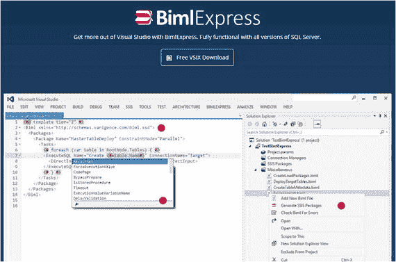

图 10-2

下载 BimlExpress

下载完成后，执行 `.vsix` 文件来安装 BimlExpress，如图 10-3 所示。

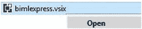

图 10-3

安装 BimlExpress

接受许可协议，如图 10-4 所示。

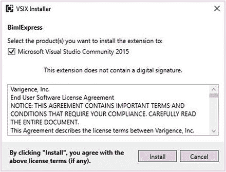

图 10-4

接受许可协议

点击“安装”按钮来安装 BimlExpress。

安装完成后，VSIX 安装程序会显示一条类似于图 10-5 所示的通知。

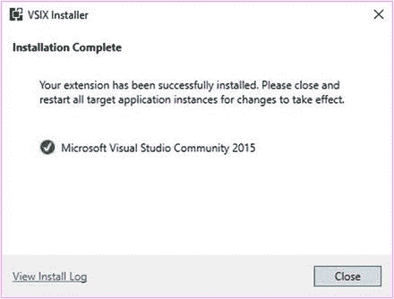

图 10-5

BimlExpress 安装完成

点击“关闭”按钮并打开 SQL Server Data Tools (SSDT)。

点击“工具” ➤ “扩展和更新”，如图 10-6 所示。

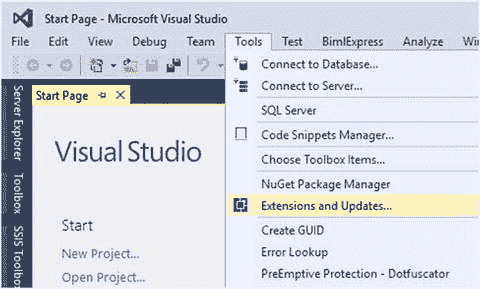

图 10-6

打开扩展和更新

“扩展和更新”对话框用于管理 BimlExpress 以及其他 SSDT 插件，如图 10-7 所示。

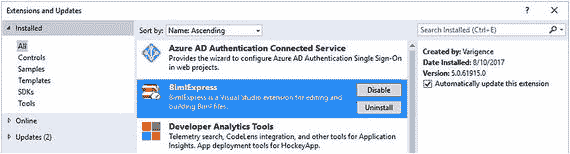

图 10-7

“扩展和更新”对话框

如果你看到图 10-8 中所示的 BimlExpress 菜单项，则表示 BimlExpress 已安装并启用。


图 10-8

BimlExpress 已安装并启用

### 下载 BimlExpress 元数据框架

接下来，我们从 `dilmsuite.com/biml-express-metadata-framework` 下载 BimlExpress 元数据框架代码，如图 10-9 所示。

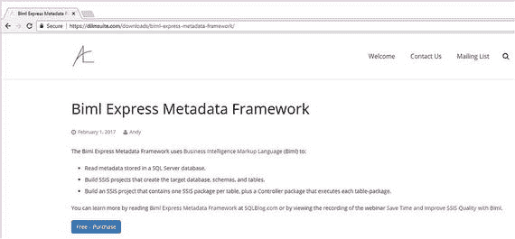

图 10-9

下载 BimlExpress 元数据框架

BimlExpress 元数据框架文件是一个文本文件，名为 `BimlExpressMetadataFramewor.renametozip.txt`，如图 10-10 所示。


图 10-10

BimlExpress 元数据框架文件

下载文件后，将其重命名，如图 10-11 所示。

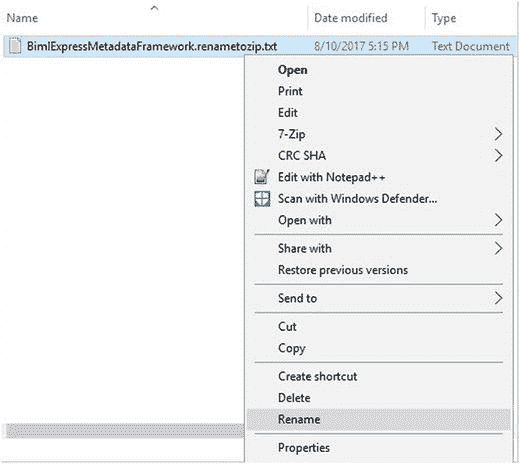

图 10-11

准备重命名 Biml Express 元数据框架下载文件

将文件扩展名更改为“zip”将触发图 10-12 所示的警告。


图 10-12

关于重命名文件并更改扩展名的警告

重命名后，Biml Express 元数据框架下载文件如图 10-13 所示。

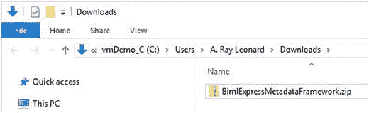

图 10-13

重命名后的 Biml Express 元数据框架下载文件

右键单击 Biml Express 元数据框架文件，然后点击“全部提取”，如图 10-14 所示。

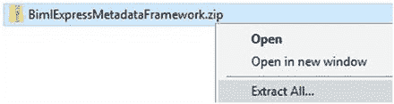

图 10-14

准备提取 Biml Express 元数据框架文件

“提取压缩 (Zipped) 文件夹”对话框显示如图 10-15 所示。

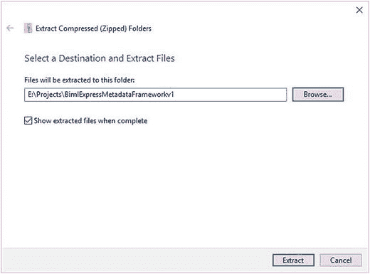

图 10-15

为提取的文件选择文件夹

点击“提取”按钮来解压压缩文件。

解压 zip 文件的内容后，浏览到该文件夹并打开 `BimlExpressMetadataFramework.sln` 文件，如图 10-16 所示。

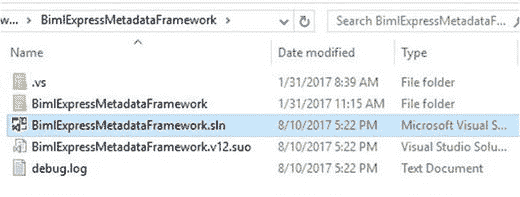

图 10-16

打开 `BimlExpressMetadataFramework.sln` 文件

### 遵循 README 文件中的说明

在撰写本文时，BimlExpressMetadataFramework 项目附带的 README 文件内容如下：

```
BimlExpressMetadataFramework 说明
0. 下载并安装 BimlExpress (https://varigence.com/BimlExpress)
1. 还原 BimlMetadata 数据库。
2. 更新 params.biml 中的连接字符串，使其指向你的 BimlMetadata 数据库。
3. 更新 di.Connections 表中的连接字符串，使其指向你的 AdventureWorks2014 数据库。
4. 在解决方案资源管理器中，多选“杂项”虚拟文件夹中的以下 Biml 文件以创建目标数据库：
   - 0_00_BuildConnections.biml
   - 0_10_BuildDestinationDatabaseMain.biml
4a. 在解决方案资源管理器中右键单击（或展开 BimlExpress 菜单），然后点击“生成 SSIS 包”。
5. 在解决方案资源管理器中，多选“杂项”虚拟文件夹中的以下 Biml 文件以创建目标架构：
   - 0_00_BuildConnections.biml
   - 0_20_BuildDestinationSchemasMain.biml
5a. 在解决方案资源管理器中右键单击（或展开 BimlExpress 菜单），然后点击“生成 SSIS 包”。
6. 在解决方案资源管理器中，多选“杂项”虚拟文件夹中的以下 Biml 文件以创建目标表：
   - 0_00_BuildConnections.biml
   - 0_30_BuildDestinationTablesMain.biml
6a. 在解决方案资源管理器中右键单击（或展开 BimlExpress 菜单），然后点击“生成 SSIS 包”。
7. 执行以下包：
   - 10_Build_Destination_Databases.dtsx
   - 20_Build_Destination_Schemas.dtsx
   - 30_Build_Destination_Tables.dtsx
8. 删除所有项目连接管理器和包。
9. 在解决方案资源管理器中，多选“杂项”虚拟文件夹中的以下 Biml 文件以创建 SSIS 包：
   - 0_00_BuildConnections.biml
   - 0_10_BuildDestinationDatabaseMain.biml
   - 0_20_BuildDestinationSchemasMain.biml
   - 0_30_BuildDestinationTablesMain.biml
   - 1_99_Main.biml
9a. 在解决方案资源管理器中右键单击（或展开 BimlExpress 菜单），然后点击“生成 SSIS 包”。
```

我们已经完成了第 0 步。


## 还原 BimlMetadata 数据库

在 SSMS 对象资源管理器中，右键点击 `Databases` 节点，然后点击 `Restore Database`，如图 10-17 所示。

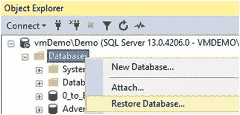

图 10-17: 准备还原 BimlMetadata 数据库

在“源”部分选择 `Device` 选项，然后点击省略号按钮来选择备份文件。导航到您解压 `BimlExpressMetadataFramework.zip` 文件所在的文件系统文件夹，并选择 BimlMetadata 数据库备份文件，如图 10-18 所示。

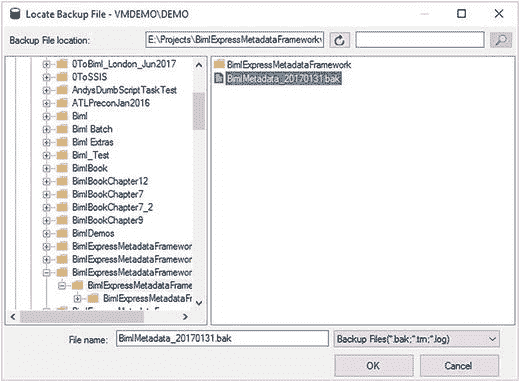

图 10-18: 选择 BimlMetadata 数据库备份文件

点击 `OK` 按钮以选择 BimlMetadata 数据库备份文件，并返回到 `Restore Database` 对话框，如图 10-19 所示。

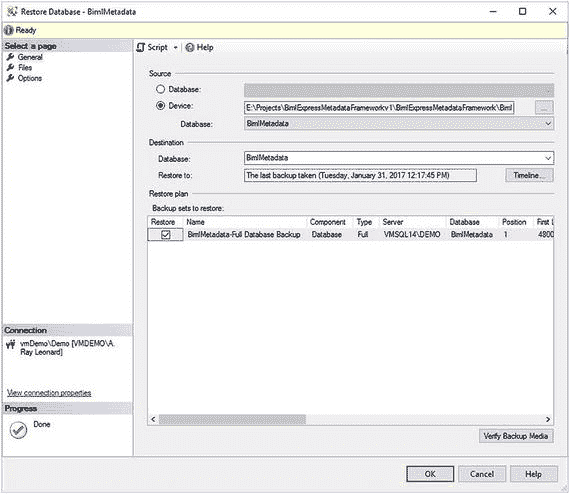

图 10-19: 已选择 BimlMetadata 备份文件

点击 `Files` 页面，并勾选“将所有文件重定位到文件夹”复选框。导航至 `Data` 和 `Log` 文件文件夹，并仔细检查“还原为”路径是否与您为 `Data` 和 `Log` 文件文件夹所做的选择一致，如图 10-20 所示。

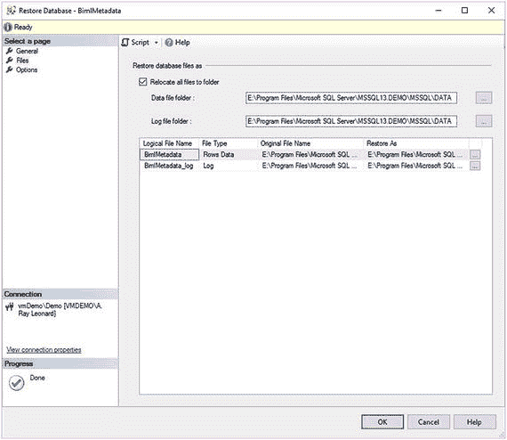

图 10-20: 配置还原文件位置

在 `Options` 页面，勾选“覆盖现有数据库 (WITH REPLACE)”复选框，如图 10-21 所示。

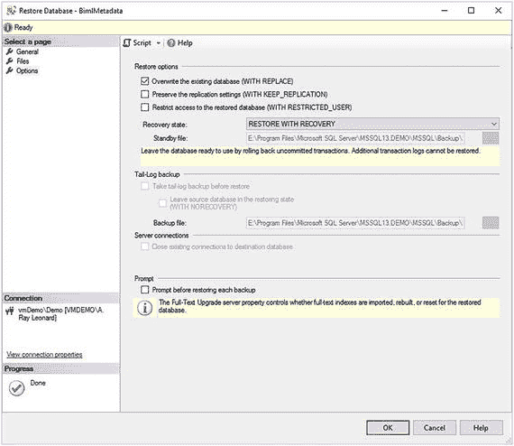

图 10-21: 配置还原操作以覆盖现有数据库

点击 `OK` 按钮开始 `Database Restore` 操作。

如果一切按计划进行，您应该会看到如图 10-22 所示的消息框。

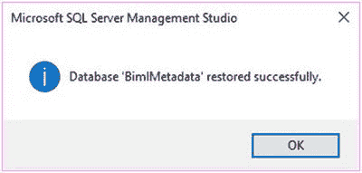

图 10-22: 还原成功！

刷新对象资源管理器。您现在应该会看到列出的 `BimlMetadata` 数据库，如图 10-23 所示。

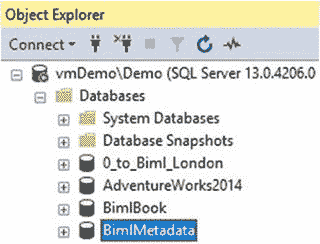

图 10-23: BimlMetadata 数据库

如果您没有 `AdventureWorks2014` 示例数据库的副本，请搜索并下载 Microsoft 示例数据库，然后进行还原或通过其他方式构建它。在撰写本文时，您可以从 `msftdbprodsamples.codeplex.com/downloads/get/880661` 获取 `AdventureWorks2014` 的数据库备份文件，但 Microsoft 计划关闭 CodePlex 并将代码迁移到 GitHub。

## 更新 Params.biml 文件中的连接字符串变量值

README 文件中的下一步是更新 `params.biml` 文件中的连接字符串，使其指向您的 `BimlMetadata` 数据库，如图 10-24 所示。

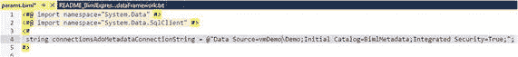

图 10-24: 更新 `Params.biml` 中的 BimlMetadata 连接字符串

## 更新 di.Connections 表

README 文件中的下一步是更新 `di.Connections` 表中的连接字符串，使其指向您的 `AdventureWorks2014` 数据库，如图 10-25 所示。

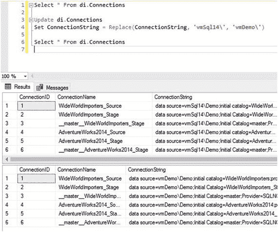

图 10-25: 更新 `di.Connections` 表中的 Adventworks2014 连接字符串

## 生成目标数据库

在 `BimlExpressMetadataFramework` 项目中，多选 `0_00_BuildConnections.biml` 和 `0_10_BuildDestinationDatabaseMain.biml` 文件。右键点击并选择 `Generate SSIS Packages`，如图 10-26 所示。

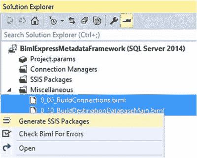

图 10-26: 构建目标数据库 SSIS 包

当 `0_00_BuildConnections.biml` 和 `0_10_BuildDestinationDatabaseMain.biml` 文件执行时，它们会创建名为 `__master__AdventureWorks2014_Stage` 的项目连接管理器和名为 `10_Build_Destination_Databases.dtsx` 的 SSIS 包，如图 10-27 所示。

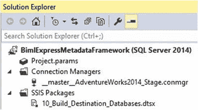

图 10-27: 创建用于构建目标数据库的 SSIS 包

## 生成目标架构

在 `BimlExpressMetadataFramework` 项目中，多选 `0_00_BuildConnections.biml` 和 `0_20_BuildDestinationSchemasMain.biml` 文件。右键点击并选择 `Generate SSIS Packages`，如图 10-28 所示。

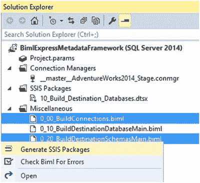

图 10-28: 构建目标架构 SSIS 包

当 `0_00_BuildConnections.biml` 和 `0_20_BuildDestinationSchemasMain.biml` 文件执行时，它们会创建名为 `AdventureWorks2014_Stage` 的项目连接管理器和名为 `20_Build_Destination_Schemas.dtsx` 的 SSIS 包，如图 10-29 所示。

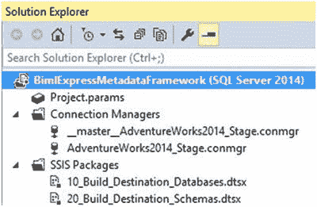

图 10-29: 创建用于构建目标架构的 SSIS 包

## 生成目标表

在 `BimlExpressMetadataFramework` 项目中，多选 `0_00_BuildConnections.biml` 和 `0_30_BuildDestinationTablesMain.biml` 文件。右键点击并选择 `Generate SSIS Packages`，如图 10-30 所示。

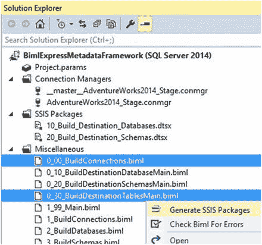

图 10-30: 构建目标表 SSIS 包

`AdventureWorks2014_Stage` 项目连接管理器由 `0_30_BuildDestinationTablesMain.biml` 文件重新生成。此时会显示“确认覆盖项”对话框，如图 10-31 所示。

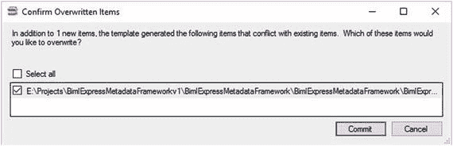

图 10-31: 确认覆盖项对话框

点击 `Commit` 按钮继续。

当 `0_30_BuildDestinationTablesMain.biml` 文件执行并覆盖项目连接管理器时，它还会覆盖名为 `AdventureWorks2014_Stage.conmgr` 的文件，从而触发重新加载操作，如图 10-32 所示。

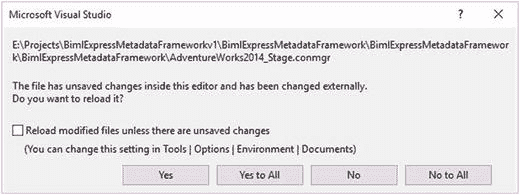

图 10-32: 重新加载被覆盖的 `AdventureWorks2014_Stage` 连接管理器文件

点击 `Yes` 按钮继续。

当 `0_00_BuildConnections.biml` 和 `0_30_BuildDestinationTablesMain.biml` 文件执行时，它们会创建名为 `AdventureWorks2014_Stage` 的项目连接管理器和名为 `30_Build_Destination_Tables.dtsx` 的 SSIS 包。


### 执行创建目标项目的 SSIS 包

右键单击 `10_Build_Destination_Databases.dtsx` SSIS 包以创建目标数据库，如图 10-33 所示。

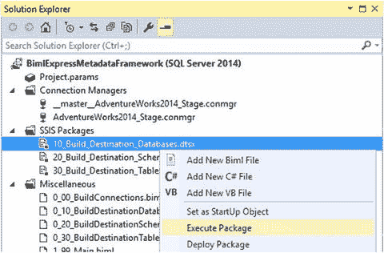

图 10-33

正在执行 `10_Build_Destination_Databases.dtsx` SSIS 包

如果一切顺利，`10_Build_Destination_Databases.dtsx` SSIS 包将成功执行，如图 10-34 所示。

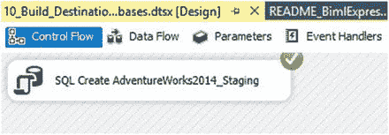

图 10-34

`10_Build_Destination_Databases.dtsx` SSIS 包执行成功

返回 SSMS 并刷新对象资源管理器中的 `Databases` 节点，如图 10-35 所示。

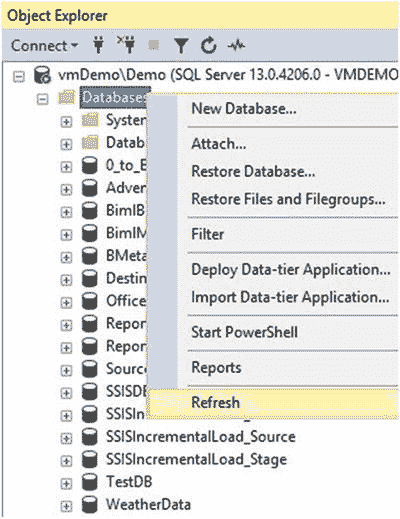

图 10-35

刷新对象资源管理器中的 `Databases` 节点

`AdventureWorks2014_Staging` 数据库现在显示在目标实例中，但尚未创建任何架构或表，如图 10-36 所示。

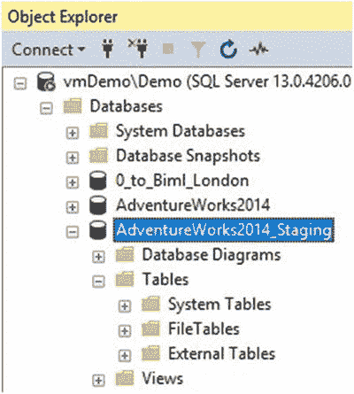

图 10-36

`AdventureWorks2014_Staging` 没有架构或表

右键单击 `20_Build_Destination_Schemas.dtsx` SSIS 包以在目标数据库中创建架构，如图 10-37 所示。

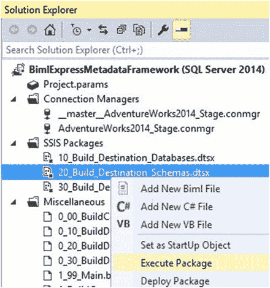

图 10-37

正在执行 `20_Build_Destination_Schemas.dtsx` SSIS 包

如果一切顺利，`20_Build_Destination_Schemas.dtsx` SSIS 包将成功执行，如图 10-38 所示。

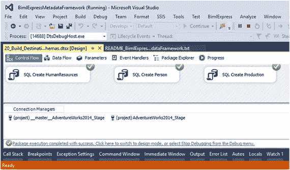

图 10-38

`20_Build_Destination_Schemas.dtsx` SSIS 包执行成功

右键单击 `30_Build_DestinationTables.dtsx` SSIS 包以在目标数据库中创建表，如图 10-39 所示。

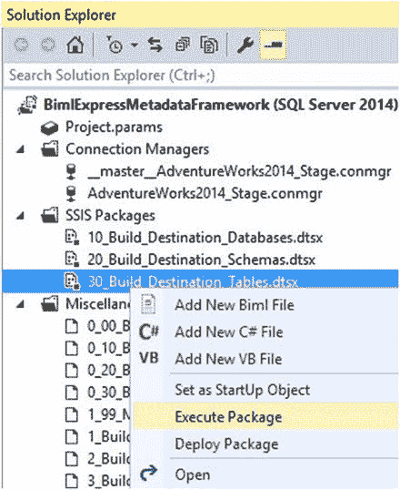

图 10-39

正在执行 `30_Build_Destination_Tables.dtsx` SSIS 包

如果一切顺利，`30_Build_Destination_Tables.dtsx` SSIS 包将成功执行，如图 10-40 所示。

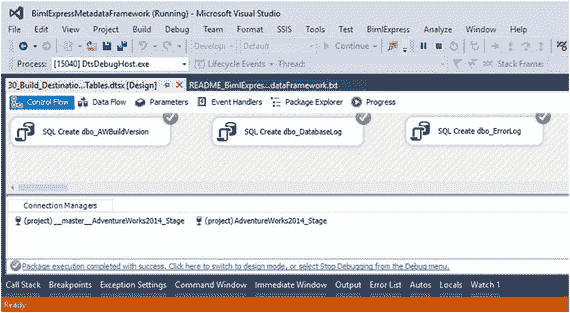

图 10-40

`30_Build_Destination_Tables.dtsx` SSIS 包执行成功

返回 SSMS 并刷新对象资源管理器中的 `AdventureWorks2014_Staging Tables` 节点，如图 10-41 所示。

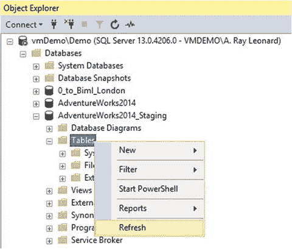

图 10-41

刷新 `AdventureWorks2014_Staging Tables` 节点

`AdventureWorks2014_Staging` 数据库现在包含架构和表，如图 10-42 所示。

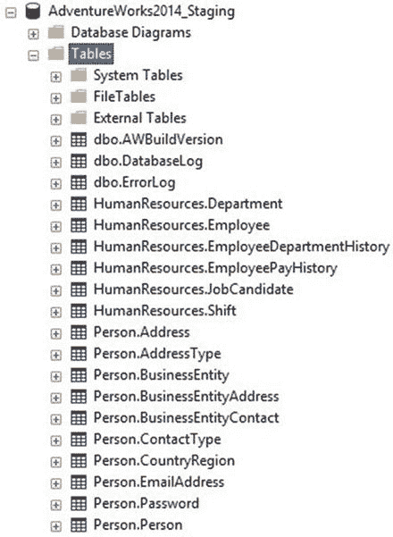

图 10-42

包含架构和表的 `AdventureWorks2014_Staging` 数据库

### 删除现有项目

从 SSIS 项目中删除现有的 SSIS 包和项目连接管理器，如图 10-43 所示。

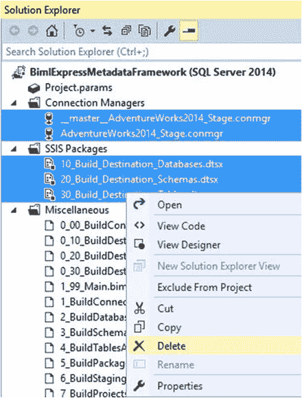

图 10-43

删除现有项目

您不必删除现有项目。如果您不删除现有项目，BimlExpress 将提示您确认覆盖现有项目。

### 生成 SSIS 包

多选 `0_00_BuildConnections.biml`、`0_10_BuildDestinationDatabaseMain.biml`、`0_20_BuildDestinationSchemasMain.biml`、`0_30_BuildDestinationTablesMain.biml` 和 `1_99_Main.biml`。右键单击并选择“生成 SSIS 包”，如图 10-44 所示。

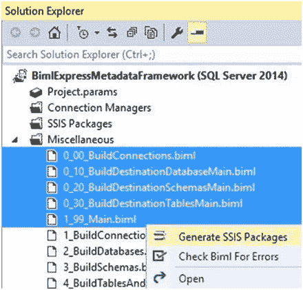

图 10-44

生成 SSIS 包

与之前一样，在生成目标表 SSIS 包时，系统会提示您覆盖 `AdventureWorks2014_Stage` 项目连接管理器及其文件。该过程总共生成 75 个 SSIS 包：

- 1 个创建目标数据库的包
- 1 个创建目标架构的包
- 1 个创建目标表的包
- 71 个 SSIS 加载器，`AdventureWorks2014` 数据库中的每个表对应一个
- 1 个控制器，其中包含 71 个执行包任务，每个 SSIS 加载器对应一个

请参见图 10-45。

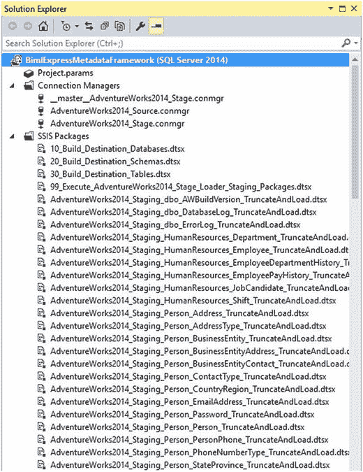

图 10-45

AdventureWorks2014 Staging SSIS 完成！

### 执行控制器

执行名为 `99_Execute_AdventureWorks2014_Stage_Loader_Staging_Packages.dtsx` 的控制器 SSIS 包，如图 10-46 所示。

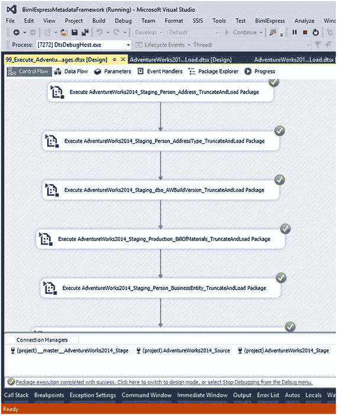

图 10-46

正在执行控制器 SSIS 包

### 验证加载

在 SSMS 中，运行一些测试查询以验证加载过程是否成功执行，如图 10-47 所示。

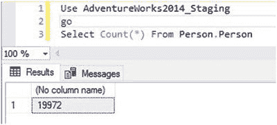

图 10-47

验证加载

加载过程已验证。现在，您应该能够部署 BimlExpressMetadataFramework SSIS 项目的 ISPAC 文件，如图 10-48 所示。

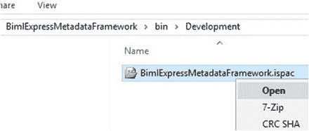

图 10-48

准备部署 BimlExpressMetadataFramework ISPAC 文件

### 圆满闭环

在这个演示中，您已经完成了一个完整的闭环。在第 3 章中，您将一个 SSIS 项目部署到了 SSIS 目录。在第 7 章中，您执行了一个脚本，该脚本为 SSIS 框架社区版添加了元数据，涉及一个已部署到 SSIS 目录的 SSIS 项目，这样您就可以通过调用单个存储过程并传递单个参数值来执行该 SSIS 目录项目中的所有 SSIS 包。

