# 1. 使用 Power Query 发现数据并将其加载到 Excel 中

如果你正在阅读本书，很可能是因为你需要使用数据。更具体地说，你可能需要踏上一段从数据到洞察的旅程，其中你必须获取大量事实与数字，将其塑造成可理解的信息，并辅以能够传达清晰意义的分析。更进一步说，你希望使用自己熟悉且信赖的电子表格——Microsoft Excel——来完成这一切。

本书正是关于这段旅程的。它涵盖了作为 Excel 用户，你可以将外部原始数据转换为信息结构，从而交付高影响力分析的多种方式。这种全新的方法假设你既不依赖中央 IT 部门帮助你从外部源加载数据，也不需要他们提供常规支持。其核心理念是让用户能够使用世界上最流行的电子表格，在尽可能短的时间内处理工业级数量的源数据。

这个领域中的关键词是：

* **快速**
* **去中心化**
* **直观**
* **交互式**
* **交付**

使用本书中描述的技术，你可以从众多外部源中发现并加载数据。然后，你可以快速直观地转换和清理这些原始数据，使其结构化和可用。一旦准备就绪，你就可以将其加载到 Excel 工作表或 Excel 中的 Power Pivot 数据模型中，并开始使用你早已熟悉的工具——Excel——来提供详细的分析。

因此，本书是从用户的角度撰写的。本质上，这一切都关乎*赋能*——让用户基于现有技能，简单高效地定义自身需求并满足自身需要。令人惊叹的是，你完全可以在 Excel 中完成这一切，无需借助任何其他工具或实用程序。你的数据源可能位于许多地方，并以多种格式存在。尽管如此，你需要访问它们、抽样、选择，并在必要时进行转换或清理，以便交付分析。所有这一切都由 Power Query 实现。

## Power Query

Power Query 是 Excel 工具集中最新的成员之一。它现已完全集成到 Excel 中，允许你从各种来源发现、访问和整合信息。一旦你的数据被选定、清理并转换为连贯的表格，你就可以将其放入 Excel 工作表进行详细分析，或直接将其加载到 Power Pivot（Excel 数据模型）中——当你想要交互式地“切片和切块”数据时，这是一个理想的数据存储库。

Power Query 允许你对源数据执行许多操作，但四个主要步骤可能是：

* 从各种来源*导入*数据。这涵盖企业数据库、文件、社交媒体以及大数据。
* 将来自多个源的数据*合并*为连贯的结构。
* 将数据*塑形*为适合你用例的列和记录。
* *清理*数据，使其可靠且易于使用。

曾几何时，这些流程需要专门的 IT 专家团队。嗯，现在再也不用了。使用 Power Query，你可以自行整合数据，使其符合你的需求，并作为自助式解决方案的一部分随时可用。

这是因为发现、加载、清理、重构和修改源数据正是 Power Query 的设计初衷。它允许你完成以下任务：

* *数据发现*：查找并连接到包含潜在有用数据的无数数据源。这可以来自公共和私有数据源。这是第 1 章至第 5 章的主题。
* *数据加载*：选择你已经检查过的数据，并将子集加载到 Power Query 中进行塑形。
* *数据修改*：修改已导入的每个数据集的结构。
* *过滤并清理数据本身*。

尽管我将这三个步骤描述为完全独立且顺序进行，但实际情况是它们常常融合成一个单一流程。事实上，你可能会在许多情况下在数据已经加载到 Excel *之后*再检查数据——或者在加载*之前*清理数据集。然而，核心目标始终不变：找到一些数据，然后在 Power Query 中对其进行抽样，在此处你可以调整、清理和塑形，然后再将其加载到 Excel 中。

这个流程可以简单描述为“首先，获取你的数据。”在数据仓库的世界里，专家们称之为 `ETL`，这是 **E**xtract（提取）、**T**ransform（转换）和 **L**oad（加载）的缩写。尽管这个缩写词带来了令人安心的信心，但这一流程很少是一条通过一系列清晰步骤而进行的平滑、逻辑的推进。实际情况往往要混乱得多。你可能会经常发现自己导入一些数据、清理它、再从另一个源导入更多数据、将第二个数据集与第一个合并、删除一些行和列，然后重复这些操作以及许多其他操作，甚至反复多次。

在本章及接下来的几章中，我将尝试向你展示如何使用 Power Query 使这一流程在实践中运作。我希望这将使构成 `ETL` 流程的各个步骤更加清晰。我只要求你意识到，Power Query 包含的各种选项使其成为一个多面且功能极其强大的工具。科学在于知道*哪些*选项可用。艺术在于知道*何时*使用它们。

## 数据加载过程

首先，快速概述一下你需要做什么才能将数据导入 Excel（假设你已经从 Apress 网站下载了本书附带的示例数据——附录 A 对此进行了说明）。以下步骤解释了如何从你已经非常熟悉的来源——Excel 本身——加载数据。是的，我知道你可以在工作簿之间复制和粘贴数据，但那样就偏离了重点，并且会错过 Power Query 所能提供的所有令人难以置信的数据混搭额外功能。在最初的案例中，数据的实际来源无关紧要。它可以来自几十个可用来源中的任何一个。Excel 仅仅是潜在数据源的一个示例。

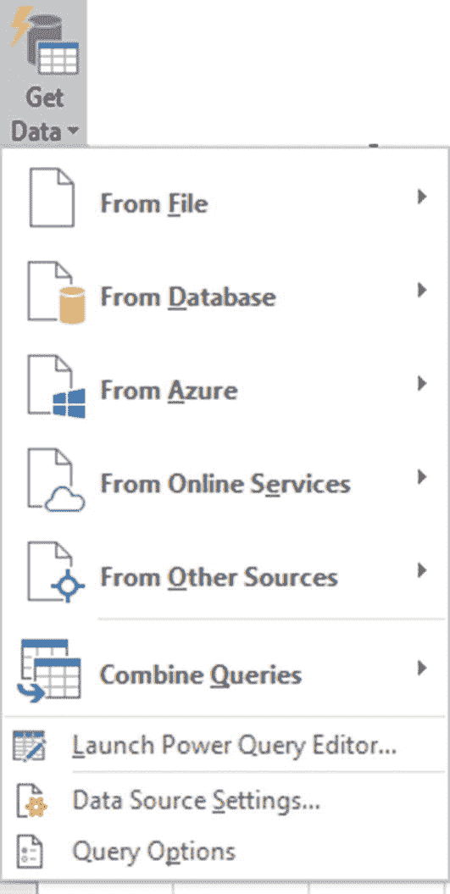

图 1-1

“获取数据”弹出菜单

1.  在 Excel 中打开一个新的空白工作簿。
2.  单击菜单中的“数据”以切换到“数据”功能区。
3.  单击“获取数据”。将出现“获取数据”弹出菜单，如图 1-1 所示。

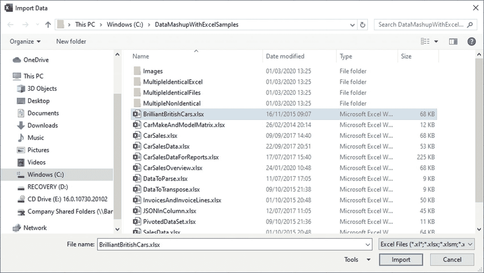

图 1-2

从 Excel 工作簿加载数据时的“导入数据”对话框

1.  单击“从文件”。
2.  单击“从工作簿”。将出现“导入数据”对话框。
3.  单击文件 `C:\DataMashupWithExcelSamples\BrilliantBritishCars.xlsx`。“导入数据”对话框将如图 1-2 所示。

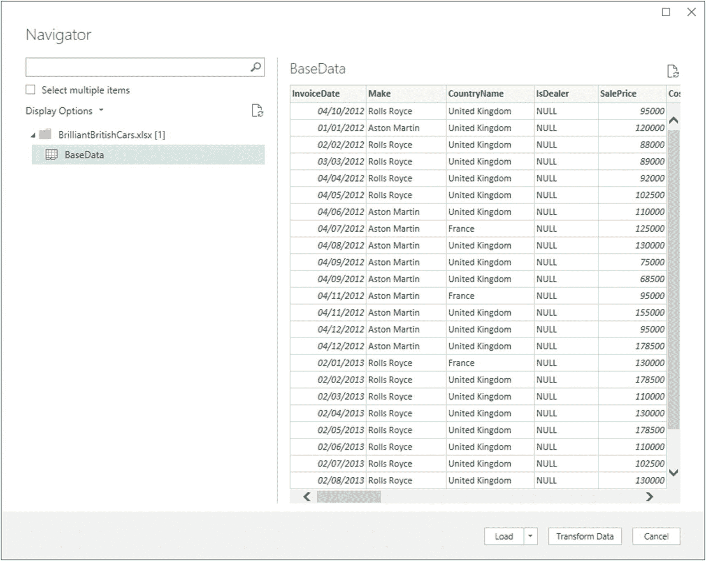

图 1-3

已选择数据的“导航器”对话框

1.  单击“导入”按钮。将出现“导航器”对话框。
2.  你会看到 `BrilliantBritishCars.xlsx` 文件出现在“导航器”对话框的左侧，并且其包含的任何工作表、命名区域或数据表也列在该文件下方。
3.  单击左侧的 `BaseData` 工作表名称。此工作表的内容将显示在“导航器”对话框右侧的数据窗格中。“导航器”对话框应如图 1-3 所示。
4.  单击“加载”。数据将从外部 Excel 工作簿加载到当前工作簿中的一个新工作表中。

你将看到类似图 1-4 所示的 Excel 窗口。外部数据现在是一个 Excel 表格（命名为 `BaseData`，这是源数据表的名称）。你可以看到，与外部工作簿的连接现在出现在新的 `查询和连接` 窗格中的 Excel 电子表格数据右侧。稍后，在我解释了 Power Query 为何是应对数据摄取挑战的绝佳解决方案后，我将用几页篇幅来解释这个新元素。

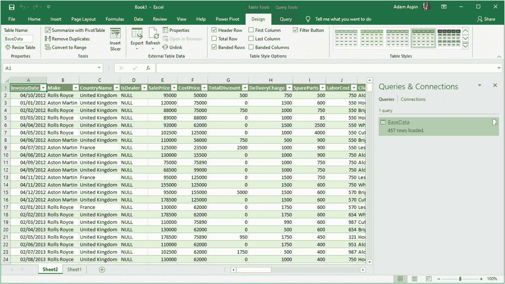

图 1-4

Excel 中可用的数据

我想加载这些数据最多只花了几秒钟。然而，你现在在 Excel 中拥有了一套完整的外部数据，可以随时用于分析和报告。不过，我想先暂停一下，解释一下你目前所看到的内容。

## 为什么使用 Power Query？

你刚才所做的是开启 Excel，使其在连接到数十个外部数据源中的信息时，成为首选的分析和 MI/BI（管理信息和商业智能）工具。你刚刚看到的是，Excel 现在可以连接到多个数据源，并通过几次点击将它们导入电子表格以进行进一步分析。

然而，至关重要的是要理解，到目前为止，你仅仅触及了 Power Query 及其在促进数据摄取方面所能做的一切的皮毛。这是因为查看和加载数据只是开始。此外，你还可以使用它来：

-   从多个不同的数据源导入数据
-   同时从外部数据源导入多个数据集
-   连接来自多种不同类型源数据系统的数据集
-   在加载前过滤数据，以确保只导入你确切需要的数据
-   清理数据以去除异常或错误
-   转换源数据使其更易于使用

不仅如此，你还可以随时刷新流程并重新加载源数据，只需点击一下，即可重新导入源数据，并重新应用你准备好的所有数据选择、清理和转换。换句话说，一旦你定义了一个数据摄取过程，就无需再次创建它，只需再次运行它，即可看到最新版本的源数据流入 Excel 电子表格。当然，你可以随时返回数据加载例程并对其进行调整，无论是纠正错误还是添加新的源或处理步骤。而这一切都可以在你已经熟悉的工具——Excel 中完成，因为 `Power Query` 现在已紧密集成到 Excel 本身的结构中。

## 查询和连接窗格

在 Excel 中使用 `Power Query` 的第一个真正的新方面是 `查询和连接` 窗格。简单来说，此窗口显示了你建立的所有与外部数据源的 `Power Query` 连接。它是你进入 `Power Query` 数据摄取过程的入口点，并允许你：

- 列出所有活动连接
- 刷新由 `Power Query` 连接提供的数据
- 显示源数据的样本
- 导航到数据导入的目标工作表
- 删除连接
- 修改连接以及数据转换过程的任何方面
- 管理连接

由于 `查询和连接` 窗格是你通往 `Power Query` 世界的大门，因此从一开始就熟悉它的几个关键方面是值得的。随着你阅读本书的深入，你将利用它的更多可能性来解锁 `Power Query` 的巨大能力，所以我目前只会尝试揭开它神秘的面纱——细节将在后面呈现。

### 显示查询和连接窗格

要显示（或隐藏）`查询和连接` 窗格：

1. 单击菜单中的“数据”以切换到“数据”功能区。
2. 在“数据”功能区中，单击“查询和连接”。将显示（如果已可见则隐藏）`查询和连接` 窗格。

`查询和连接` 窗格的主要元素在图 1-5 中进行了概述。

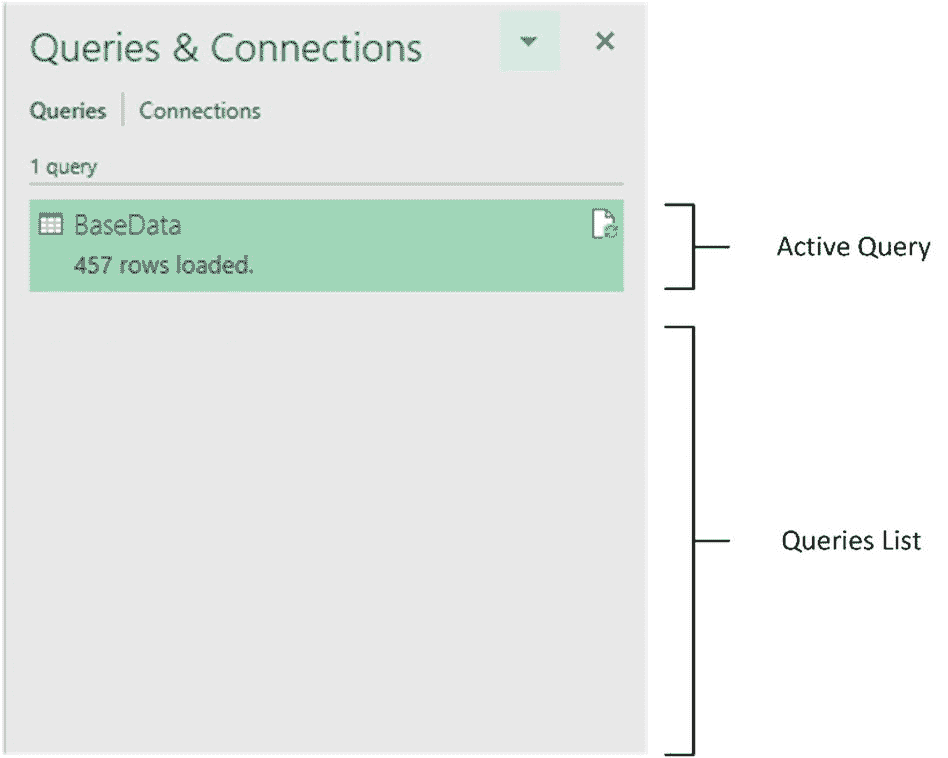
图 1-5 “查询和连接”窗格

### 预览窗口

`查询和连接` 窗格允许你查看查询返回的数据的预览。当你已向 Excel 文件添加了数十个连接，并且不记得哪个连接返回哪个数据集时，这非常有用。

要显示预览窗口：

1. 将鼠标指针悬停在 `查询和连接` 窗格中你想要查看数据的查询上。如果你已按照本章前面的示例操作，它将是名为 `BaseData` 的查询。

预览窗口将出现，显示部分数据以及源数据连接的关键属性。你可以在图 1-6 中看到对预览窗口的说明。

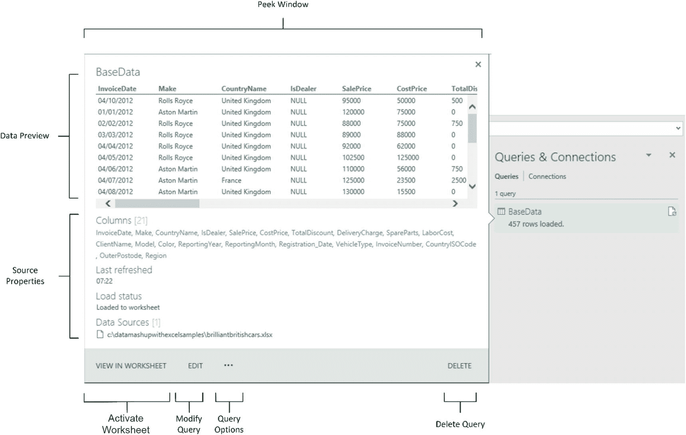
图 1-6 预览窗口

#### 预览窗口选项

预览窗口提供的关键信息概览见表 1-1。

**表 1-1** 预览窗口

| 元素 | 说明 |
| --- | --- |
| 查询或连接名称 | 每个查询或数据源连接的名称 |
| 数据预览 | 数据示例的快速概览 |
| 列列表 | 查询输出的列 |
| 刷新日期 | 数据上次刷新的日期 |
| 在工作表中查看 | 激活包含查询输出数据的工作表（如果数据已以此方式输出） |
| 编辑 | 在 `Power Query` 中修改查询 |
| 查询菜单 | 查询修改选项的子集 |
| 删除 | 从工作簿文件中移除查询 |

#### 在工作表中查看

预览窗口允许您直接跳转到目标工作表中已导入的数据（假设数据未填充到 `Power Pivot` 数据模型中）。

要“跳转”到包含数据的工作表：

1. 在 `查询和连接` 窗格中，单击包含要查看数据的查询。包含已导入数据的工作表将被激活。
反之，您可以单击包含查询数据输出的工作表内部，此时 `查询和连接` 窗格中的查询名称会高亮显示。

**注意：** 另一种（但稍复杂些）激活包含从查询加载数据的工作表的方法是将鼠标悬停在 `查询和连接` 窗格中的查询上，然后在预览窗口中单击 `在工作表中查看`。

### 删除查询

为了完成对使用 `Power Query` 进行查询和连接的初步高层面概览，让我们看看如何删除已创建的连接：

**图 1-7** 预览窗口中的删除确认

1. 将鼠标悬停在 `查询和连接` 窗格中要删除的查询上。预览窗口将出现。
2. 在预览窗口中，单击 `删除`。预览窗口的状态栏将显示一条确认消息，如图 1-7 所示。
3. 单击 `删除`。连接将被删除。

**注意：** 此操作不会删除已导入到工作表中的数据，只会删除与源数据的连接以及您已应用的任何处理步骤。如果要移除数据，只需像平常一样删除工作表即可。然而，删除查询确实会阻止任何未来的数据刷新。

## 了解数据加载

到目前为止，您所看到的是对 `Power Query` 数据加载场景的极速浏览。实际上，这个过程可能从极其简单（正如您刚刚所见）到更为复杂，例如连接、筛选和修改来自不同源的多个数据集（您将在第 6 章至第 12 章中了解）。然而，当您使用 `Power Query` 将数据加载到 Excel 时，加载数据始终是任何数据分析场景中的第一步。

不过，在这个简短的示例中，您仍然看到了数据加载过程的许多关键要素。这些要素包括：

- 访问 `Power Query` 可以读取的任何源格式中可用的数据
- 在将数据加载到 Excel 之前先对其进行初步查看

您在此处未看到的是 `Power Query` 如何能向数据加载过程添加中间步骤，并在 `Power Query` 编辑器中编辑源数据。数据处理的这一方面——数据混搭——将在后续章节中详述。

### 导航器对话框

数据加载过程的一个关键方面是正确使用 `导航器` 对话框。您在图 1-3 中看到了此对话框。`导航器` 窗口在连接到几乎所有数据源时都会出现。它允许您：

- 快速查看源数据中的可用数据表
- 筛选单个数据源中可用的多个数据元素
- 查看源应用程序中各个表内保存的数据
- 选择一个或多个数据表加载到 Excel

**注意：** `Power Query`（以及 `导航器`）真正令人印象深刻的一个方面是，在大多数情况下，您无需在 PC 上安装客户端软件即可访问数据。这意味着您可以直接从 Excel 访问例如 SQL Server 或 Salesforce 中的数据。

根据您连接到的数据源，您可能在 `导航器` 窗口中只看到几个数据表，或者成百上千个。无论如何，您看到的是 `Power Query` 能够识别并确信可以导入的结构化数据集。您在 `导航器` 窗口中看到的内容的复杂程度同样取决于数据源。例如，如果您查看的是数据库服务器，那么您可能首先看到一个数据库列表，并且可能需要通过展开数据库来更深入地挖掘数据的树状结构，以列出可用的数据表和视图。如果您连接到一个 Excel 文件，您可能只看到少数几个数据表。

您使用 `Power Query` 的次数越多，就会越频繁地使用 `导航器` 对话框。因此，似乎应该在早期阶段就解释一些您可以应用的技巧和技术，以便在处理大量潜在数据源时更轻松。

让我们先仔细看看可用的选项。我将使用您首次在图 1-3 中从 Excel 文件 `BrilliantBritishCars.xlsx` 加载数据时看到的 `导航器` 对话框。可用选项在图 1-8 中进行了说明。

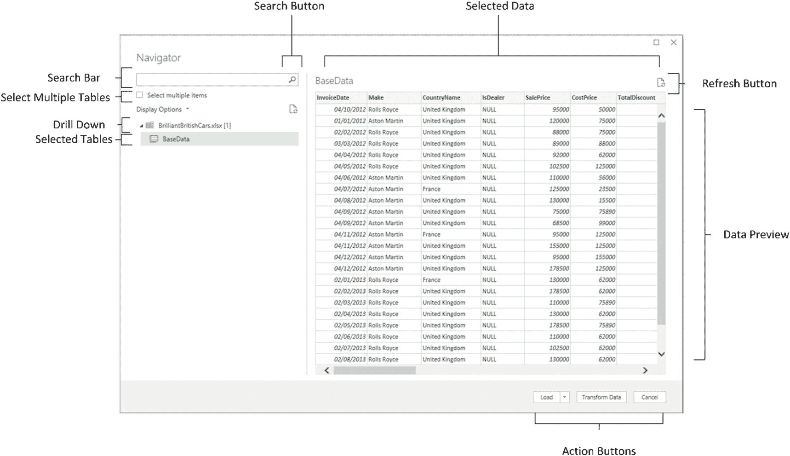
**图 1-8** 导航器对话框

`导航器` 对话框主要分为两部分：

- *左侧*：可用数据源的层次结构。这些可以由单个数据集或多个数据集组成，可能组织在一个或多个文件夹中。
- *右侧*：选定元素中数据的预览。

各种 `导航器` 对话框选项将在以下部分中说明。

### 选择多个源表

`Power Query` 允许您一次选择并加载来自同一连接的多个源数据表。让我们看一个示例。

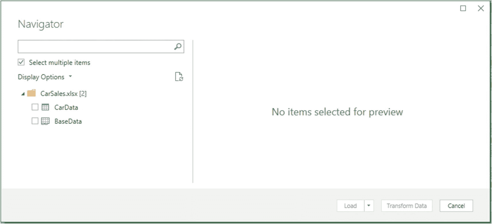
**图 1-9** 选择多个源项目

1. 在 `数据` 功能区中，单击 `获取数据` ➤ `来自文件` ➤ `从工作簿`。
2. 导航到 Excel 文件 `C:\DataMashupWithExcelSamples\CarSales.xlsx` 并单击 `导入`。
3. 在 `导航器` 对话框中，勾选 `选择多项` 复选框。如图 1-9 所示。

这将在每个源数据项（或者如果您愿意，可以说表或数据集）的左侧显示一个复选框。然后，您可以勾选每个要作为此查询一部分加载的源元素对应的复选框。

### 搜索数据集

你难免会遇到这样的情况：所连接的数据源包含数百个数据集，尤其是在数据库中。幸运的是，`Power Query` 让你可以极其轻松地筛选显示的数据集。

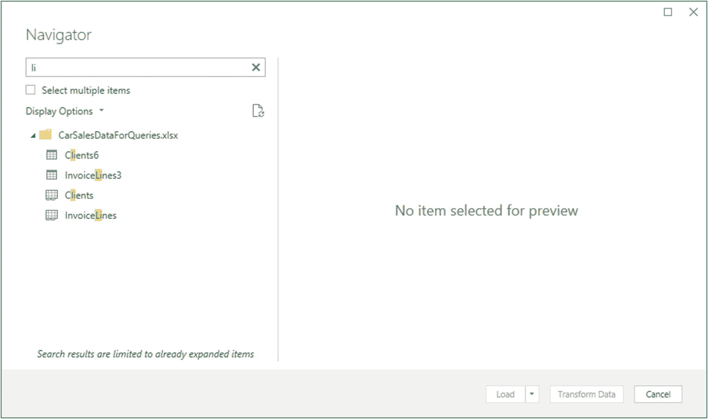

图 1-10：在导航器对话框中搜索数据集

1. 在 `导航器` 对话框中，点击 `搜索` 框内部。
2. 输入你想要隔离的数据集名称的一部分。在此示例中，我输入了“li”。
3. 可用数据集列表将进行筛选，仅显示包含你所输入文本的数据集。你可以在图 1-10 中看到 Excel 源文件 `CarSalesDataForQueries.xlsx`（也位于目录 `C:\DataMashupWithExcelSamples` 中）的这种情况。

要移除筛选，只需点击 `搜索` 框右侧的叉号即可。`导航器` 将清除筛选，并显示数据源中的所有数据集。

**注意：** 你必须在使用 `导航器搜索` 功能*之前*，展开包含你要筛选数据集的项所在的层级结构。

### 导航器显示选项

点击 `导航器` 对话框中的 `显示选项` 将弹出一个包含两个选项的菜单：

- `仅显示选定项`
- `启用数据预览`

你可以在图 1-11 中看到这一点。

图 1-11：导航器显示选项

#### 仅显示选定项

选择此选项将阻止任何你未选定的数据集出现在数据源窗格中。

#### 启用数据预览

选择此选项将显示所选数据集中可用数据的一小部分。如果与源数据的连接速度较慢，你可以选择禁用数据预览。

### 刷新

如果需要，你可以刷新以下一项或两项：

- 源数据
- 数据预览

#### 源数据刷新

点击搜索栏下的预览按钮将刷新源数据窗格中显示的源数据表列表。

#### 数据预览刷新

点击 `导航器` 对话框右上角的预览按钮将刷新右侧可见的选定表的预览数据。

#### 选择相关表

点击 `选择相关表` 按钮仅对数据库源有效，例如 Microsoft `SQL Server` 或 `Oracle`。如果源数据库设计正确，包含了表之间的联接，那么此选项将自动选中所有与你已选定的表相关联的表。

**注意：** 在数据库源中，某些表可能与其他表相关联，而这些表本身又与其他表相关联。当你点击 `选择相关表` 时，这种连接层级结构并不会被完全发现。换句话说，你可能需要选择多个表并重复点击此按钮，以选中你需要的所有表。

至此，我们对 `导航器` 的快速浏览就结束了。然而，在接下来的四章中，当你学习如何连接到各种数据源时，你将更多地了解 `导航器` 窗口。

### 导航器数据预览

`导航器数据预览` 窗格（右侧），顾名思义，是数据源中数据的预览。它提供：

- 你想要查看的任何数据集中*前几条记录*的简要概览。鉴于你正在预览的数据可能有数百列宽、数百行深，`导航器数据预览` 内部可能会出现数据表的滚动条。但请记住，你并非在检查*所有*可用数据，而只是看到*可用记录的一个小样本*。
- 数据表中可用列的列表。这些列显示在 `导航器数据预览` 的底部。

`Power Query` 可以预览和加载来自多个不同数据源的数据。实际上（正如你从 `获取数据` 弹出菜单中的可能数据源列表所看到的），它可以读取大多数常见的企事业数据源以及许多其他数据源。重要的是要理解，`Power Query` 为加载数据的艺术和科学提供了一个通用接口，无论数据源是什么。因此，无论你是在检查 `SQL Server` 还是 `Oracle` 数据库、一个 `XML` 文件或文本文件、一个网页还是大数据源，你都将始终使用标准化的方法来检查和加载数据。这使得 `Power Query` 的数据体验变得无比简单且极其可靠。这意味着你可以减少担心连接到数据源的技术方面问题的时间，从而可以自由地专注于数据本身。

**注意：** `导航器数据预览` 是一个出色的数据发现工具。无需加载任何数据，你就可以快速查看数据源以及其中可能被 `Power Query` 加载的任何数据。然后你可以决定是否值得加载。这样你就不会在可能对你的需求无关紧要的数据加载上浪费时间。

### 修改数据

一旦你在 `Power Query` 中拥有一个或多个可以连接到数据源并将数据带入该环境的查询，你就可以开始考虑下一步——转换数据，使其可供使用。根据你处理的数据源数量以及所需修改的程度，这可能会从简单到复杂。为了使过程有条理，我建议你尝试将任何步骤分解为以下主要线索：

- *塑造数据集*：这包括筛选记录以减小数据集大小，以及移除任何无关的列。它还可能涉及通过拆分现有列、创建计算列甚至联接查询来添加你创建的列。
- *清理和修改数据*：这也称为*数据转换*（ETL 中的 *T*）。它涵盖了将文本数据转换为大写和小写，以及（例如）删除非打印字符的过程。舍入数字和从日期数据中提取日期部分也是可能的（在众多其他可用的转换中）。

然而，就目前而言，只需理解 `Power Query` 在需要时能够完成所有这些工作就很重要。数据转换将在第 6 章到第 12 章中详细解释。

## Power Query 编辑器

在前面的示例中，你直接将数据加载到了 `Excel` 中。在本书的后续内容中，你还将学习如何通过一个额外的步骤来扩展这种方法——因为你也可以选择在将数据添加到数据模型*之前*将其加载到 `Power Query 编辑器` 中。这个“绕行”是流程的一部分，允许你在数据*被添加*到数据模型*之前*对其进行清理和转换。当然，如果你的数据是完美的，那么你可以直接将其添加到数据模型并开始像之前那样进行分析。然而，如果你的数据需要任何调整，那么 `Power Query 编辑器` 很可能很快就会成为一个值得信赖的工具。因此，可能值得阅读第 1 章到第 5 章，这些章节描述了如何从各种可能的数据源加载数据，然后阅读第 6 章到第 12 章，以塑造、修改和结构化你的数据，使其成为新的有价值的见解的清晰来源。

## 数据源

现在你已经见识到将数据加载到 Excel 中是多么快速便捷，是时候更广泛地了解 Power Query 可以摄取和处理的*数据类型*了。

由于潜在的数据源种类繁多，起初可能会让人感到不知所措，因此 Power Query 将潜在的数据源归为以下几类：

- **文件**：包括 Excel 文件、CSV（逗号分隔值）文件、文本文件、JSON 文件和 XML 文件。Power Query 甚至可以加载包含众多文件的整个文件夹。
- **数据库**：当前工作场所和云中使用的各种关系型数据库的全面集合，包括（但不限于）MS Access、`SQL Server` 和 `Oracle`。本书付印时可用的完整列表见第 3 章。
- **Azure**：此选项可让你查看托管在 Microsoft 云中的各种数据类型。这涵盖了从 SQL Server 到大数据源的数据格式。你可以在第 4 章中了解其中一些类型如何与 Power Query 配合使用。
- **在线服务**：这些数据源范围广泛，从 SharePoint 列表到 Salesforce，从 Dynamics 365 到 Facebook——以及许多其他来源。第 4 章将探讨其中部分来源。
- **其他**：范围庞大且不断增长的数据源，从 Hadoop 到 Microsoft Exchange。其中部分内容将在第 2 章至第 5 章的章节中提及。

可能的数据源列表一直在变化，你需要知道，如果你想要获得所有可用数据源的详尽列表，必须查看你正在使用的 Excel 的版本。事实上，我预计当你阅读本书时，可能已经增加了更多数据源。

你还可以列出任何可用本地磁盘、网络共享甚至云中文件夹的内容，然后利用此功能一次性导入多个文件。同样地（如果你拥有必要的权限），你可以列出你所连接的数据库服务器上可用的数据库和数据。这样，Power Query 不仅可以提供数据，还可以提供*元数据*——即关于数据的数据——这有助于你快速浏览潜在的数据源，并只选择你真正需要的数据。

不幸的是，Power Query 能够读取的数据源范围极其广泛，以至于我们无法在短短几章中逐一详细探讨每个数据源的细微之处。因此，我们将在本章及接下来的几章中，快速浏览*一些*最常用的数据源。幸运的是，Power Query 能够读取的大多数数据源都以类似的方式使用。这是因为 Power Query 界面出色地完成了将晦涩的连接细节尽量简化的任务。因此，即使你遇到了本书中未描述的数据源，你仍然可以应用各种技术，这些技术几乎适用于 Power Query 能够连接的任何数据源。

**注意**：Power Query 可访问的数据源列表一直在增长。因此，当你阅读本书时，你很可能会发现比本章及接下来四章所描述的更多的数据源。

## 源数据属性

Excel 允许你调整与 Power Query 连接到外部数据源相关的少量选项。

# Power Query 外部数据属性、查询选项与数据加载

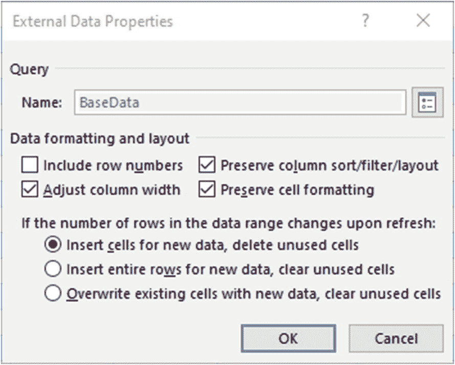

*图 1-12 — 外部数据属性对话框*

1.  单击包含 Power Query 插入到工作表中的数据的表格内部。
2.  在“数据”功能区中单击`属性`。将出现“外部数据属性”对话框。你可以在图 1-12 中看到它。

表 1-2 对这些选项进行了说明。

**表 1-2 — 外部数据属性选项**

| 元素 | 说明 |
| --- | --- |
| `查询名称` | 查询或连接的名称 |
| `包含行号` | 在数据左侧添加自动递增的行号 |
| `调整列宽` | 调整每列的宽度以完全显示数据 |
| `保留列排序/筛选/布局` | 保留源查询中的筛选和排序，而非 Excel 中的输出结果 |
| `保留单元格格式` | 保留源查询中的格式（如有），而非 Excel 中的输出结果 |

> **注意**
> 只有在刷新查询时，你才会看到对这些选项所做的任何更改的结果。

## 查询属性

Excel 在连接到外部数据源时，一直提供一系列查询选项——即使在使用旧式连接技术时也是如此。幸运的是，这些选项在使用 Power Query 时也同样可用。

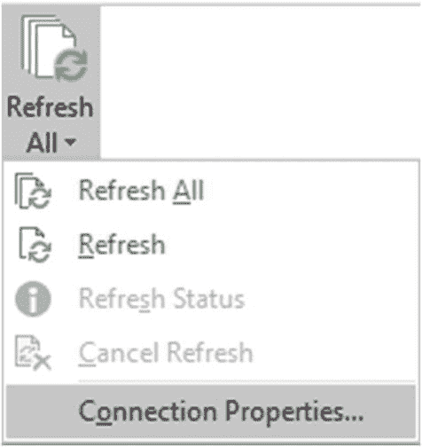

*图 1-13 — 刷新弹出菜单*

1.  单击包含 Power Query 插入到工作表中的数据的表格内部。我将使用你之前在本章中使用`BrilliantBritishCars.xlsx`文件创建的初始查询`BaseData`。
2.  单击`全部刷新`按钮右下角的小三角形。将出现“刷新”弹出菜单，如图 1-13 所示。

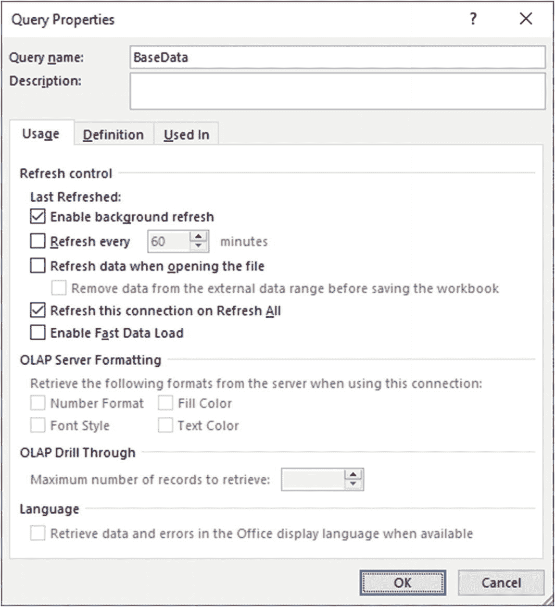

*图 1-14 — 查询属性对话框*

1.  在弹出菜单中单击`连接属性`。你将看到如图 1-14 所示的“查询属性”对话框。

表 1-3 对这些选项进行了说明。

**表 1-3 — 查询属性选项**

| 元素 | 说明 |
| --- | --- |
| `查询名称` | 查询或连接的名称 |
| `说明` | 你希望添加的任何注释 |
| `启用后台刷新` | 允许在 Excel 中工作的同时进行刷新 |
| `每 “N” 分钟刷新一次` | 安排自动刷新 |
| `打开文件时刷新数据` | 每次打开 Excel 文件时运行查询以刷新数据 |
| `在全部刷新时刷新此连接` | 允许你将某个查询排除在全局刷新之外 |
| `启用快速数据加载` | 尽可能快地加载数据——即使这会导致 Excel 看起来“卡住” |

## 加载目标

我在本章开头提到，一旦你完成源数据的准备工作，Power Query 允许你选择加载目标。默认的加载选项是将输出数据直接放入当前 Excel 文件中的新工作表。然而，该主题下还有几种可用的变体。它们是：

-   加载到 Excel 命名表（默认）
-   基于源数据加载到数据透视表
-   基于源数据加载到数据透视图
-   仅创建数据连接，但暂不加载

除此之外，你还可以选择是否：

-   在当前工作表中创建数据表、数据透视表或数据透视图。
-   在新工作表中创建数据表、数据透视表或数据透视图。
-   可选，将数据添加到 Power Pivot 数据模型。添加到数据模型的查询可以分别联接和扩展，以提供一个完整且强大的分析数据源。

> **注意：** 完全可以同时将数据加载到数据模型*和*工作表表格中。

假设您已连接到数据源并可以在导航器中查看所需的源数据（如图 1-3 所示）：

**图 1-15** 加载选项

1.  单击“主页”菜单中“加载”按钮右侧的小三角形。将出现弹出菜单。您可以在图 1-15 中看到它。

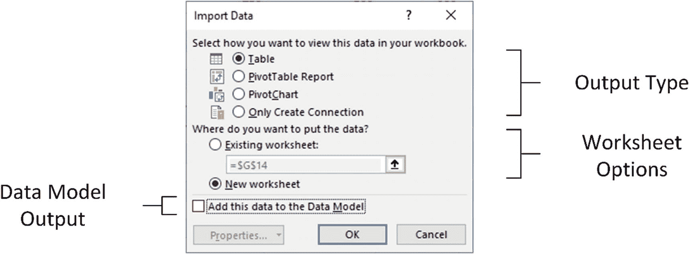

**图 1-16** 加载目标选项

2.  选择 **加载到…**。将出现“导入数据”对话框，如图 1-16 所示。
3.  选择 **表** 单选按钮。
4.  选择 **新工作表** 作为数据目标。
5.  保持 **将此数据添加到数据模型** 复选框未选中。
6.  单击 **确定**。

连接——以及数据加载（如果您选择了此结果）——将根据您指定的选项创建。如果您严格按照上述步骤操作，那么您应该会获得一个包含来自数据源的数据的新工作表。

> **注意：** 选择 **仅创建连接** 单选按钮会阻止您选择输出目标。当您想要准备数据加载过程，但可能还不确定如何以及在何处输出最终数据时，这非常有用。

### 重新利用现有连接

在某些情况下，您可能只想建立到源数据的连接，但实际上并不导入数据。正如您在上一节中看到的，在“导入数据”对话框中选择 **仅创建连接** 选项即可实现此目的。

选择此解决方案可能有多种原因：

-   您想“暂停”数据转换和加载过程的工作，稍后再回来处理——而不会丢失您已经完成的工作，也不会加载数据（数据可能体积庞大且耗时）。
-   此查询不会直接用于访问数据，而是用作更复杂过程中的中间步骤。您将在第 9 章中进一步了解此方法。
-   数据将被加载到 Power Pivot 数据模型中，不直接用于表、Power Pivot 表或图表中。

同样，值得了解的是，如果您删除了包含查询数据输出的工作表，那么源查询将仅成为连接，并且不会加载数据，直到您重新定义输出目标。

由此可知，您还需要了解如何获取一个连接并应用数据目标。操作方法如下：

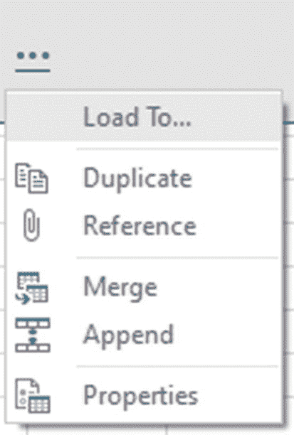

**图 1-17** 预览窗口选项

1.  在 **查询和连接** 窗格中，将鼠标悬停在您要重新利用的连接上。将出现预览窗口。
2.  单击预览窗口底部菜单栏中的省略号。将出现图 1-17 所示的菜单。
3.  选择 **加载到…**，然后从您在图 1-16 中看到的“导入数据”对话框中选择所需的选项。

> **注意：** 您不能简单地重新定义现有数据加载的新目标。您必须首先移除当前的加载目标（例如，通过删除 Excel 表格或目标工作表，或者从 Power Pivot 数据模型中移除数据表），然后重新应用新目标。

### 加载到 Excel

将数据加载到 Excel 不仅是默认选项，而且可能是许多用户的首选。选择此数据目标有众多合理的理由：

-   它是最简单的选项。
-   数据立即可用并可供使用。
-   您可以直接在 Excel 中应用您惯用的技术和函数来分析数据。

但是，您需要意识到这种方法确实有一些局限性：

-   大数据加载会触及 Excel 中的 1,000,000 行限制。
-   大数据加载可能导致巨大的 Excel 文件体积。

在后一种情况下，将数据加载到 Power Pivot 数据模型中可能是更明智的选择，因为数据将被压缩，并且可能包含数百万行数据。

### 加载到数据模型

由于这是使用 Excel 和 Power Query 进行自助式 BI 实践的基础，你确实需要了解什么是数据模型，以及它如何帮助你创建有效的分析。

数据模型是加载到 Power Pivot 中并以连贯方式联接在一起的一个或多个数据表的集合。数据可以来自 Power Query，从现有的 Excel 表格或工作表中获取，或从各种源中导入。每个 Excel 文件只能有一个数据模型。

诚然，你可以将所有数据放在 Excel 中的单个"平面"表中，并将其作为分析输出的基础。然而，如果你打算使用任何复杂程度的数据集，你很可能希望使用 Power Pivot 来开发数据模型。有时，构建一个良好的数据模型可能需要一段时间才能完善，但有许多充分的理由可以证明花时间使用 Power Pivot 构建一个连贯的数据模型是值得的。投入时间的原因包括：

-   如果你在 Power Pivot 中使用 Excel 数据模型，则可以远远超出 Excel 工作表一百万行的限制。事实上，在 Power Pivot 中，数千万行的表格也并非罕见。
-   连贯的数据模型使理解和可视化数据变得更加容易。
-   一个精心设计的数据模型意味着，当数据可以从另一个表引用而不是无休止地重复时，单个表中存储的冗余信息会更少。

-   Power Pivot 可节省磁盘和内存空间，因为它使用高效的`数据压缩算法`来存储数据模型中的数据。这意味着，使用数据集的工作簿所占用的空间远小于将数据存储在 Excel 工作表中。

-   由于数据集完全加载到 PC 的内存中，因此计算速度更快。

-   数据模型可以准备用于数据输出。

-   数据模型可以包含特定的计算（其中一些可能相当复杂），旨在确保在 Excel 中对数据进行切片和筛选时返回正确的结果。

-   数据模型可以包含层次结构和 KPI。

-   数据模型可用于在 Excel 中创建复杂的数据透视表。

-   数据模型可以是成熟的 SSAS（SQL Server Analysis Services）表格数据仓库的基础或概念验证。

-   数据模型可以让你避免在 Excel 中实现复杂的 `VLOOKUP()` 函数。

由于这不是一本关于 Power Pivot 的书，我不会描述如何创建和使用 Power Pivot 数据模型来执行数据分析。我只想指出，你可以指定 Power Pivot 数据模型作为使用 Power Query 导入的数据的目标位置。

有许多关于 Power Pivot 和 Power Pivot 数据模型的优秀书籍和网络资源，我鼓励你查看这些资源，以获取有关使用这一出色工具的详细说明。如果你想要一个简短的介绍，可以在我的书 *High Impact Data Visualization with Power View, Power Map, and Power BI*（第 2 版，Apress，2016 年）中找到。

## 结论

在本章中，你已经了解了如何使用 Power Query 连接到各种数据源。你已经看到，只要你知道要加载哪种数据类型——并且 Power Query 有可用的连接器连接到这些数据——你就可以预览数据并将其加载到 Excel 工作表或内置的 Power Pivot 数据模型中。

现在是时候深入探讨一些你可以与 Power Query 一起使用的各种数据源的细节了。下一章将通过介绍许多可以作为数据源使用的基于文件的数据类型来开启你的旅程。

